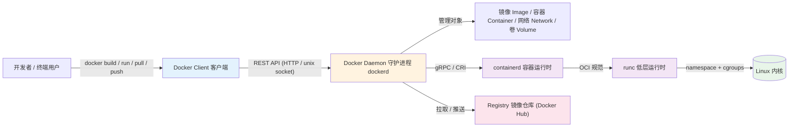
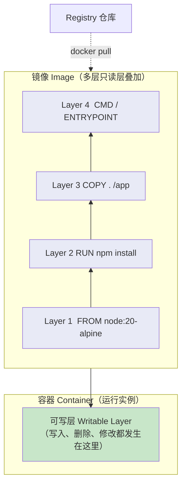
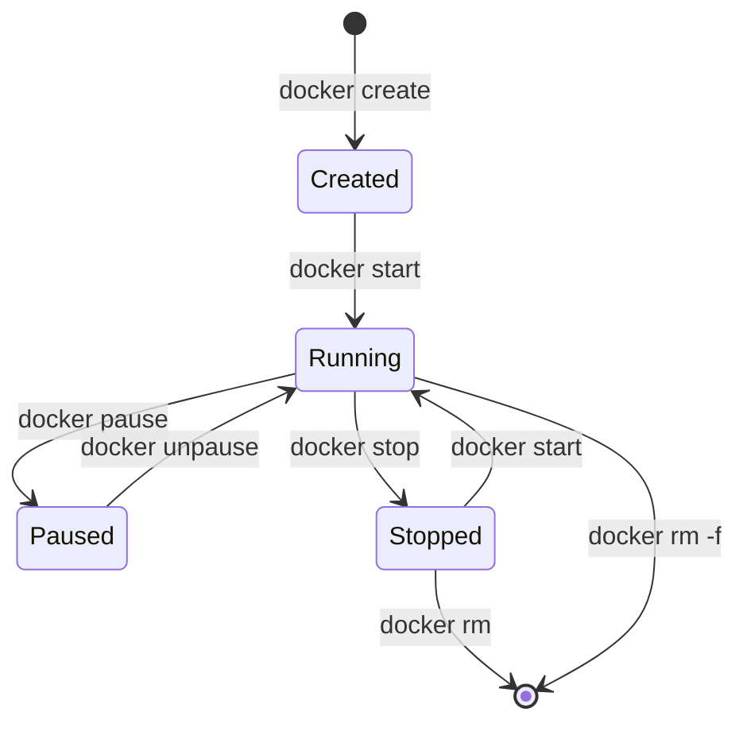
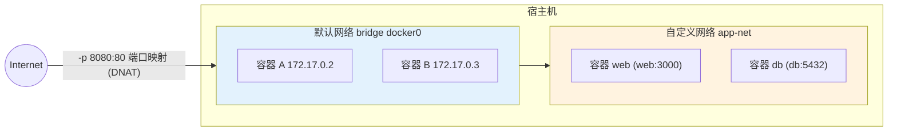
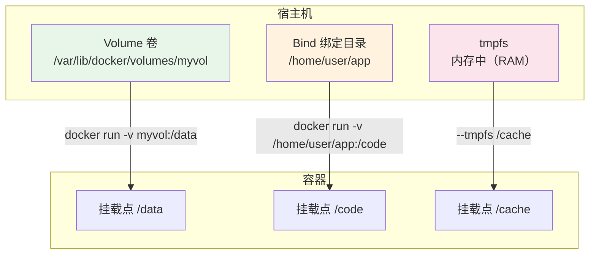
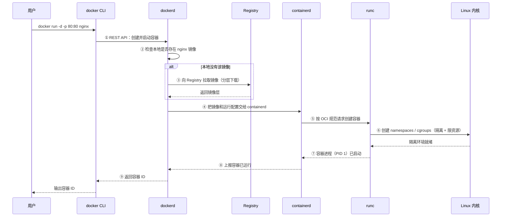
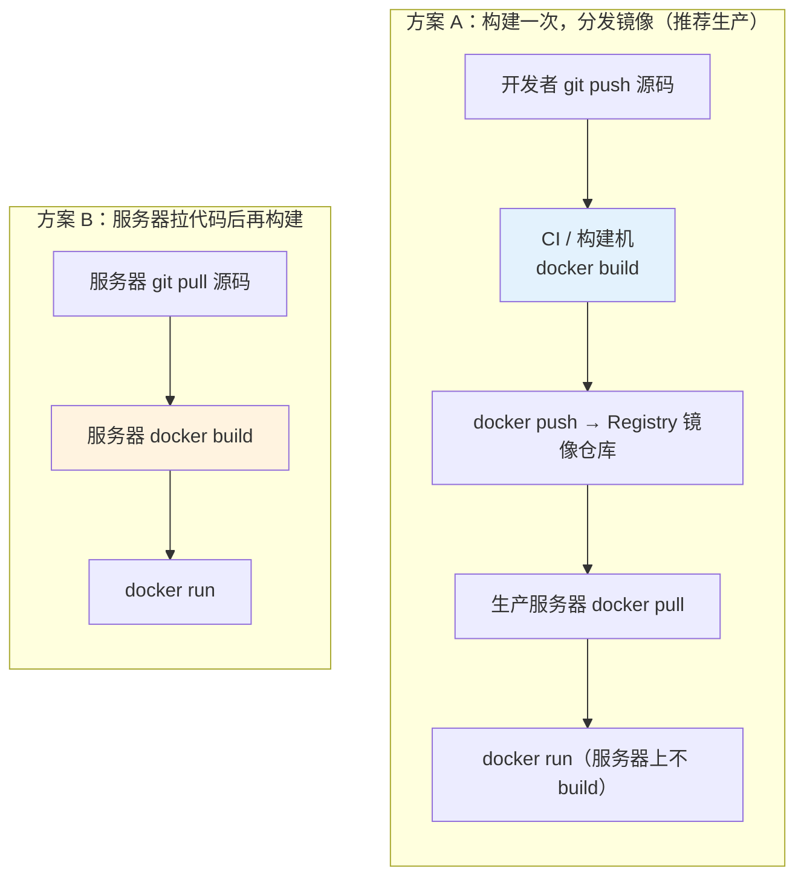
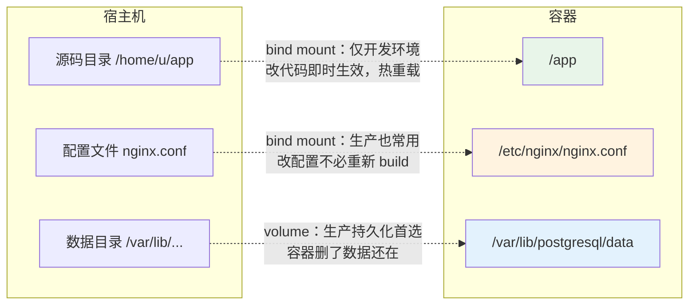

> Docker 不是一个"铁板一块"的单一程序，而是一套**模块化架构**：客户端、守护进程、运行时、镜像、容器、网络、存储、仓库……每个模块各司其职，又通过清晰的接口彼此协作。理解这些模块，是真正掌握 Docker 的钥匙。
>
> 本文结构：**概念 → 原理 → 动手操作 → 命令行速查**，所有架构图均使用 Mermaid 绘制。

---

## 目录

1. Docker 的模块化设计思想
2. 平台核心模块：Client / Daemon / containerd / runc / Registry
3. 镜像模块：分层的只读模板
4. 容器模块：隔离运行的进程
5. 网络模块：连接与隔离
6. 存储模块：数据持久化
7. 镜像仓库模块：发布与分发
8. 端到端实战：一条 `docker run` 背后的故事
9. 部署工作流：代码是怎么跑到服务器上的
10. 命令行速查总表
11. 小结

---

## 1. Docker 的模块化设计思想

传统虚拟机把"应用程序 + 依赖 + **完整操作系统**"打包成一个巨大的镜像，由 Hypervisor 模拟整台硬件。Docker 换了一条路：**只打包应用和依赖，直接共享宿主机的操作系统内核**，再用 Linux 内核自带的隔离技术把进程"圈"起来。

模块化带来的收益：

| 特性 | 说明 |
| --- | --- |
| 可替换 | 运行时（runc / containerd）可换成 Kata、gVisor 等，接口不变 |
| 可组合 | 镜像 + 网络 + 卷可以自由组合成应用 |
| 职责单一 | 每个模块只做一件事，边界清晰、易排障 |
| 标准化 | 各模块之间用公开规范（OCI、REST API）通信 |

下面的全景图展示了 Docker 各模块之间的关系：



从图中可以看到清晰的"三段式"：

1. **用户层**：客户端 CLI，负责接收人的指令；
2. **管理层**：守护进程 dockerd，负责"头脑"工作——调度、编排、对象管理；
3. **执行层**：containerd → runc → 内核，负责真正把进程跑起来。

---

## 2. 平台核心模块：Client / Daemon / containerd / runc / Registry

### 2.1 Docker Client（客户端 CLI）

**概念**：用户与 Docker 交互的命令行程序，例如 `docker run` 中的 `docker` 就是客户端。

**原理**：客户端本身**不做任何容器操作**，它只负责把命令翻译成 REST API 请求，发给守护进程。客户端与守护进程通过本地 `unix:///var/run/docker.sock` 通信，也可通过 `-H` 参数连接远程守护进程：

```bash
# 连接到远程机器的守护进程
docker -H tcp://192.168.1.10:2375 ps
# 查看当前客户端 / 服务端信息
docker version
docker info
```

### 2.2 Docker Daemon（守护进程 dockerd）

**概念**：常驻后台的服务进程，是 Docker 的"大脑"。

**原理**：它监听 REST API 请求，负责管理所有 Docker 对象（镜像、容器、网络、卷），并在需要时调用 containerd 执行真正的容器操作。守护进程与容器运行时之间通过 **shim 进程**（`containerd-shim`）衔接，即使守护进程重启，正在运行的容器也不会被杀死。

```bash
# 查看守护进程与运行环境信息
docker info
# 在容器内查看（了解它跑在哪个内核上）
docker run --rm alpine uname -r
```

### 2.3 containerd（容器运行时管理器）

**概念**：一个工业级容器运行时管理器，CNCF 毕业项目，同时被 Kubernetes（通过 CRI）和 Docker 使用。

**原理**：containerd 负责镜像的下载与解包、容器存储、以及调用低层运行时启动容器。它实现了 OCI（Open Container Initiative）规范中的镜像与运行时标准，把"如何管理容器生命周期"与"具体怎么启动进程"两层分离。

### 2.4 runc（低层运行时）

**概念**：真正与内核打交道的程序，目前 Docker 默认的低层运行时。

**原理**：runc 根据 OCI 运行时规范，调用 Linux 内核的两个关键能力创建隔离环境：

- **namespaces（命名空间）**：让进程拥有独立的 PID、Network、Mount、UTS、IPC、User 视图——容器里看到的"自己是 1 号进程""自己有网卡"，都是命名空间制造的幻觉；
- **cgroups（控制组）**：限制并统计容器可用的 CPU、内存、磁盘 IO 等资源。

```bash
# 查看默认低层运行时（一般是 runc）
docker info | grep -i runtime
# 查看容器实际使用的 cgroup
docker run -d --name demo --memory 128m alpine sleep 3600
docker inspect demo --format '{{.HostConfig.Memory}}'
```

> 小结：`dockerd`（管理）→ `containerd`（编排）→ `runc`（执行）→ 内核（隔离）。任何一层都可替换，这就是模块化的价值。

### 2.5 Registry（镜像仓库）

**概念**：存放和分发镜像的服务，公开的有 Docker Hub，私有常见 Harbor、AWS ECR 等。

```bash
docker pull nginx            # 从默认仓库 Docker Hub 拉取
docker login                 # 登录（访问私有仓库需要）
docker push myname/app:v1    # 推送本地镜像到仓库
```

---

## 3. 镜像模块：分层的只读模板

### 3.1 概念

镜像是**只读的模板**，包含运行一个应用所需的全部内容：代码、运行时、库、环境变量、配置。镜像是"类"，容器是"实例"。

### 3.2 原理：分层与联合文件系统

镜像由**多层只读层**堆叠而成。Dockerfile 中每条指令产生一层：

- 层之间用 **UnionFS（联合文件系统）** 叠加，对外表现为一个完整文件系统；
- 层是**可共享、可缓存**的：多个镜像共用同一基础层时只存一份；
- 容器启动时，Docker 在最上层再加一层**可写层**；修改文件采用 **Copy-on-Write（写时复制）**——先复制再修改，绝不动下层。



### 3.3 构建上下文（Build Context）：`docker build` 到底在哪执行？

先回答一个高频疑问：**是不是必须在 Dockerfile 所在的文件夹里执行 `docker build`？**

准确答案是：**在"构建上下文目录"里执行，通常这个目录就是 Dockerfile 所在目录。** 看这条命令：

```bash
docker build -t myapp:v1 .
#                        ↑ 这个 . 是"构建上下文路径"，不是"Dockerfile 的位置"
```

它背后发生的事是：

1. CLI 把 `.` 目录**整个打包成 tar** 发给守护进程 `dockerd`（排除掉 `.dockerignore` 里的内容）；
2. `dockerd` 解压后，按 Dockerfile 逐条执行指令；
3. 因此 Dockerfile 里 `COPY` / `ADD` 的**源路径只能引用上下文内的文件**——上下文之外的一切，守护进程根本看不到。

**三种典型用法**

```bash
# ① 最常用：Dockerfile 在当前目录，上下文 = 当前目录
cd /home/user/myapp
docker build -t myapp:v1 .

# ② Dockerfile 放在子目录，上下文仍是项目根目录（推荐的工程组织方式）
docker build -f docker/Dockerfile -t myapp:v1 .

# ③ 无上下文，从标准输入读 Dockerfile（此时只能用 ADD 远程 URL，不能 COPY 本地文件）
docker build -t myapp:v1 - < Dockerfile
```

**三个必踩的坑**

```bash
# ❌ 1. 千万别在大目录下构建，会把整个目录打成 tar 传给 dockerd
cd / && docker build -t x .
```

```dockerfile
# ❌ 2. COPY 不能跳出上下文
COPY ../config.yml /app/     # 报错：forbidden path outside the build context
```

```bash
# ❌ 3. 不写 .dockerignore，node_modules / .git / 构建产物全被打包进来，既慢又污染镜像
```

`.dockerignore` 放在**上下文根目录**，语法类似 `.gitignore`：

```
.git
node_modules
dist
*.log
Dockerfile
.dockerignore
```

它既缩小传输体积，又避免本地依赖覆盖镜像内的依赖、导致构建缓存失效。

### 3.4 操作：用 Dockerfile 构建镜像

```dockerfile
# 示例 Dockerfile：构建一个极简 Node.js 应用镜像
FROM node:20-alpine        # 基础镜像层
WORKDIR /app               # 设置工作目录
COPY package*.json ./      # 先只拷贝依赖清单，利于缓存
RUN npm install            # 安装依赖
COPY . .                   # 拷贝应用源码
EXPOSE 3000                # 声明端口（仅文档作用）
CMD ["node", "server.js"]  # 启动命令
```

```bash
docker build -t myapp:v1 .        # 构建，-t 指定名称:标签
docker images                     # 查看本地镜像
docker history myapp:v1           # 查看镜像的层历史（每行对应一层）
docker inspect myapp:v1           # 查看镜像元数据
docker rmi myapp:v1               # 删除镜像
docker image prune                # 清理悬空镜像
```

**镜像命名格式**：`[仓库地址/]仓库名/镜像名:标签`，缺省时仓库为 `docker.io/library`。

```bash
docker tag myapp:v1 myname/myapp:latest   # 打新标签
docker save -o myapp.tar myapp:v1         # 导出镜像为 tar 包
docker load -i myapp.tar                  # 导入 tar 包
```

---

## 4. 容器模块：隔离运行的进程

### 4.1 概念

容器是镜像的**运行实例**。它在宿主机上就是一个普通进程（带着一堆隔离），被命名空间、cgroup 包裹，拥有独立的文件系统、网络栈与进程视图。

### 4.2 原理：生命周期状态机



几个易混的细节：

- `docker stop` 先发 `SIGTERM` 优雅退出，超时后才 `SIGKILL`（默认 10 秒，可用 `-t` 调整）；
- `docker restart` = stop + start，`-f` 强制删除运行中的容器；
- 前台运行（不 `-d`）时，按 `Ctrl-C` 相当于给 PID 1 发送 SIGINT。

### 4.3 操作与命令行

```bash
# 创建并启动容器：-d 后台、--name 命名、-p 端口映射
docker run -d --name myapp -p 3000:3000 myapp:v1

docker ps                       # 查看运行中的容器
docker ps -a                    # 查看所有容器（含已停止）
docker logs -f myapp            # 跟随查看日志
docker exec -it myapp sh        # 进入容器执行命令（排障利器）
docker top myapp                # 查看容器内进程
docker stats                    # 实时查看资源占用（依赖 cgroups）
docker cp myapp:/app/log.txt ./ # 与容器互拷文件

docker pause myapp / unpause    # 暂停（冻结） / 恢复
docker restart myapp
docker stop myapp
docker start myapp
docker rm -f myapp              # 删除容器（-f 先杀后删）
docker container prune          # 清理所有已停止容器
```

> 排障流程口诀：先 `logs` 看应用，再 `exec` 进容器查环境，最后 `inspect` 看配置。

---

## 5. 网络模块：连接与隔离

### 5.1 概念与原理

Docker 通过 `veth` 虚拟网卡 + 网桥 + iptables/NFTables 搭建虚拟网络。主要驱动类型：

| 驱动 | 适用场景 | 说明 |
| --- | --- | --- |
| `bridge` | 单机多容器互访 | 默认网络 `docker0`，自动分配 172.17.0.x 地址 |
| `host` | 需要极致性能 | 容器直接用宿主机网络栈，无隔离，`-p` 失效 |
| `overlay` | Swarm 跨主机 | 让跨节点的容器处于同一虚拟子网 |
| `macvlan` | 需要容器像物理设备 | 给容器分配 MAC 地址，接入局域网 |
| `none` | 网络完全隔离 | 只有 lo 回环接口 |

**要点**：容器默认都能出外网（通过 iptables NAT），但**互访**需要显式连接；容器间推荐加入**同一个自定义 bridge 网络**——此时可直接用**容器名/服务名**通信（内嵌 DNS），而默认 `docker0` 网络不支持按名字解析。



### 5.2 操作与命令行

```bash
# 创建自定义网络，并指定子网
docker network create -d bridge --subnet 172.20.0.0/16 app-net

# 在指定网络中启动容器
docker run -d --name web --network app-net myapp:v1
docker run -d --name db  --network app-net postgres:16

# 在 web 容器里直接用名字访问 db（内嵌 DNS）
docker exec web ping -c 2 db

# 管理命令
docker network ls                 # 列出网络
docker network inspect app-net    # 查看网络详情与成员
docker network connect app-net old-container   # 动态接入
docker network disconnect app-net old-container
docker network rm app-net         # 删除（需先断开成员）

# 端口映射
docker run -d -p 8080:80 nginx    # 宿主机8080 -> 容器80
docker run -d -P nginx            # -P 随机映射所有 EXPOSE 端口
docker port <container>           # 查看端口映射关系
```

---

## 6. 存储模块：数据持久化

### 6.1 概念与原理

容器被删除后，它的**可写层随之消失**，需要持久化的数据必须放到**宿主机侧的挂载**上。Docker 提供三种挂载：

| 类型 | 存储位置 | 典型用途 | 特点 |
| --- | --- | --- | --- |
| **Volume 卷** | `/var/lib/docker/volumes/`（由 Docker 管理） | 数据库数据、应用数据 | 首选；可命名、可备份、可跨容器共享 |
| **Bind mount 绑定挂载** | 宿主机任意路径 | 开发时共享源码、挂配置文件 | 直观，但依赖宿主目录结构 |
| **tmpfs** | 宿主机内存 | 密钥、临时高速缓存 | 不落盘、重启即失，仅 Linux |



> 新写法推荐 `--mount type=volume,src=myvol,dst=/data` 形式，语法更明确，比短写法 `-v` 更不易出错。

### 6.2 操作与命令行

```bash
# ---- Volume 卷 ----
docker volume create pgdata            # 创建命名卷
docker volume ls                       # 列出卷
docker volume inspect pgdata           # 查看卷（含宿主机路径）
docker volume rm pgdata                # 删除卷
docker volume prune                    # 清理无用卷

# 挂载卷：给 Postgres 持久化数据
docker run -d --name pg \
  -v pgdata:/var/lib/postgresql/data \
  -e POSTGRES_PASSWORD=secret postgres:16

# ---- Bind mount：开发时共享源码（改动即时生效）----
docker run -d -p 3000:3000 \
  -v "$PWD":/app \
  -w /app node:20 node server.js

# ---- tmpfs：内存文件系统 ----
docker run -d --tmpfs /run alpine

# ---- 查看容器挂载情况 ----
docker inspect pg --format '{{json .Mounts}}'

# ---- 容器间共享同一卷 ----
docker run -d --name writer -v share:/data alpine sh -c "echo hi > /data/f.txt; sleep 3600"
docker run --rm -v share:/data alpine cat /data/f.txt
```

---

## 7. 镜像仓库模块：发布与分发

### 7.1 概念

Registry 是镜像的"GitHub"。本地 Docker 称为缓存，远程仓库才是源头。完整镜像名是 `[仓库地址]/[命名空间/]镜像名:标签`。

### 7.2 命令行

```bash
docker search nginx              # 搜索官方仓库镜像
docker pull nginx:alpine         # 拉取（默认 latest）
docker login                     # 登录 Docker Hub
docker tag myapp:v1 myname/myapp:1.0.0    # 打上自己的仓库标签
docker push myname/myapp:1.0.0   # 推送
docker logout                    # 退出登录

# 用容器镜像名区分官方与个人镜像
docker pull nginx                          # docker.io/library/nginx
docker pull myname/myapp:1.0.0             # docker.io/myname/myapp
```

---

## 8. 端到端实战：一条 `docker run` 背后的故事

把前面的模块串起来，看一次典型部署中每个模块做了什么。

**第一步：动手操作**（以第 3 节 Dockerfile 构建的 `myapp:v1` 为例）

```bash
# ① 构建镜像（镜像模块）
docker build -t myapp:v1 .

# ② 建网络、建卷（网络/存储模块）
docker network create app-net
docker volume create pgdata

# ③ 启动数据库与业务容器（容器模块）
docker run -d --name pg --network app-net -v pgdata:/var/lib/postgresql/data postgres:16
docker run -d --name web --network app-net -p 3000:3000 myapp:v1

# ④ 验证
docker ps
curl localhost:3000
docker logs -f web
```

**第二步：内部原理**——`docker run -d -p 80:80 nginx` 的完整时序：



对应关系：**CLI = 客户端模块**，**dockerd = 管理模块**，**Registry = 仓库模块**，**containerd/runc = 运行时模块**，**namespaces/cgroups = 内核隔离机制**。

---

## 9. 部署工作流：代码是怎么跑到服务器上的

学到这里，最容易混淆的问题是：**"我写好的代码，到底是推到 Docker Hub 让服务器拉下来 build，还是服务器 git clone 源码再构建？"**

先给结论：**两个方案都有人用，但生产环境推荐"构建一次、分发镜像"**。并且要记住 —— 代码走 **git**，成品走 **Registry**，两者不是一回事。

### 9.1 先分清三个角色

| 角色 | 存什么 | 常用服务 |
| --- | --- | --- |
| **代码仓库** | 源码（人类可读的文本） | GitHub / GitLab / Gitee |
| **Registry 镜像仓库** | 镜像（已构建好的二进制交付物，含代码 + 依赖 + 运行时） | Docker Hub / Harbor / 阿里云 ACR / AWS ECR |
| **服务器** | 只负责运行容器 | 任意装了 Docker 的机器 |

**关键认知**：`docker build` 时 `COPY . /app` 已经把源码烤进镜像了，所以**生产服务器既不需要 git，也不需要 Node/Python/编译器**，它只需要 `docker pull` + `docker run`。这正是容器化的价值所在。

### 9.2 两种部署方案对比



| 对比项 | 方案 A（分发镜像） | 方案 B（服务器构建） |
| --- | --- | --- |
| 服务器需要工具链吗 | 不需要，只需 Docker | 需要 git + 语言 SDK + 构建工具 |
| 部署速度 | 快（只 pull 镜像层，有缓存） | 慢（每次可能重新 build） |
| 回滚 | 换回上一个 tag 即可，秒级 | 需要重新 checkout + build |
| 环境一致性 | 强（构建环境固定） | 弱（依赖服务器当时的环境） |
| 适合场景 | 生产、团队协作、K8s | 个人小项目、内网单机、快速验证 |

### 9.3 方案 A 命令：构建一次，到处运行

```bash
# ===== 本地开发机 或 CI（GitHub Actions / GitLab CI）：只在这里 build 一次 =====
docker build -t myrepo/myapp:1.0.0 .
docker push myrepo/myapp:1.0.0

# ===== 生产服务器：只 pull 和 run，绝不 build =====
docker pull myrepo/myapp:1.0.0
docker run -d -p 3000:3000 --name app myrepo/myapp:1.0.0

# 回滚：把 tag 换成上个版本，重启容器即可
docker pull myrepo/myapp:0.9.0
docker rm -f app
docker run -d -p 3000:3000 --name app myrepo/myapp:0.9.0
```

### 9.4 方案 B 命令：服务器上拉代码构建

```bash
# ===== 服务器上 =====
git pull origin main
docker compose up -d --build     # 拉代码 + 构建 + 启动，一条命令搞定

# 等价的手动写法
docker build -t myapp:latest .
docker run -d -p 3000:3000 --name app myapp:latest
```

简单直接，适合个人项目和内网机器；代价是服务器上要维护一套构建环境。

### 9.5 bind mount 在"开发"与"生产"中的定位

很多人会把上一节的挂载方式和部署流程搞混。**bind mount 是运行时行为，和 build、Registry 没有任何关系**——它不打包、不上传、不构建，只是把宿主机的目录"借"给容器读写。



三条实践准则：

1. **生产环境不要 bind mount 代码**：镜像里已经有代码了，再挂宿主机目录会覆盖镜像内容，"镜像版本"就失去意义了——这是常见反模式；
2. **生产用 volume 挂数据**：数据库文件、用户上传、日志等（见第 6 节），因为容器删除后可写层会一起消失；
3. **开发用 bind mount 挂源码**：配合 `nodemon`、`vite` 等热重载工具，改一行代码立即生效，不用反复 build。

```bash
# 开发环境典型写法：挂源码 + 热重载
docker run -d -p 3000:3000 -v "$PWD":/app -w /app node:20 npm run dev

# 生产环境典型写法：代码在镜像里，只挂数据卷
docker run -d -p 3000:3000 -v pgdata:/var/lib/postgresql/data myrepo/myapp:1.0.0
```

### 9.6 一句话总结

> **代码走 git，成品走镜像仓库；`build` 只做一次（本地或 CI），服务器只 `pull` + `run`；`bind mount` 是"运行时把宿主机目录借给容器"，不参与构建和分发。**

---

## 10. 命令行速查总表

### 容器
| 命令 | 作用 |
| --- | --- |
| `docker run -d --name n -p 80:80 img` | 创建并后台启动容器 |
| `docker ps / -a` | 查看运行中 / 全部容器 |
| `docker start / stop / restart` | 启 / 停 / 重启容器 |
| `docker pause / unpause` | 暂停（冻结）/ 恢复 |
| `docker rm [-f]` | 删除容器（`-f` 强制删运行中） |
| `docker exec -it n sh` | 进入容器执行命令 |
| `docker logs -f n` | 查看并跟随日志 |
| `docker cp n:/path ./` | 容器与宿主机互拷文件 |
| `docker top / stats / inspect n` | 进程 / 资源 / 配置详情 |
| `docker port n` | 查看端口映射 |

### 镜像
| 命令 | 作用 |
| --- | --- |
| `docker build -t name:tag .` | 构建镜像 |
| `docker images` | 列出本地镜像 |
| `docker pull / push` | 拉取 / 推送镜像 |
| `docker tag` | 打标签 |
| `docker history img` | 查看分层历史 |
| `docker rmi` / `docker image prune` | 删除镜像 / 清理悬空镜像 |
| `docker save / load` | 导出 / 导入镜像为 tar |
| `docker commit` | 把容器保存为新镜像（少用） |

### 网络与存储
| 命令 | 作用 |
| --- | --- |
| `docker network ls / create / rm` | 网络列表 / 创建 / 删除 |
| `docker network connect / disconnect` | 动态接入 / 断开网络 |
| `docker volume ls / create / rm / prune` | 卷列表 / 创建 / 删除 / 清理 |
| `docker system df` | 查看镜像、容器、卷占用 |

---

## 11. 小结

把 Docker 拆成模块来理解，你会发现它的设计其实非常优雅：

- **镜像**是"交付物"，**容器**是"运行态"，两者通过分层与 CoW 紧密关联；
- **构建上下文**决定了 `COPY` 能看到什么，`docker build` 要放在项目目录里执行并配好 `.dockerignore`；
- **dockerd → containerd → runc** 是"管理 → 编排 → 执行"三级流水线，每层都可替换；
- **namespace / cgroups** 是内核提供的隔离地基，Docker 只是它的"友好的前端"；
- **网络、存储、仓库**是三个横向支撑模块，分别解决"连通、持久、分发"问题；
- **部署流程**上，代码走 git、成品走 Registry，服务器只 `pull` + `run`，`build` 只在本地或 CI 做一次。
