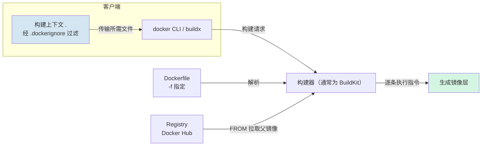
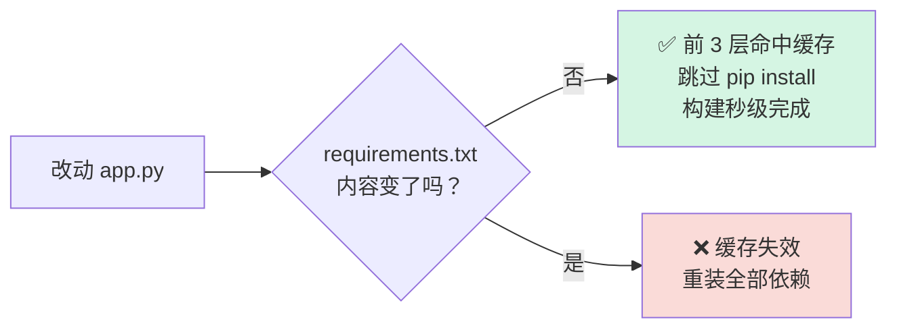
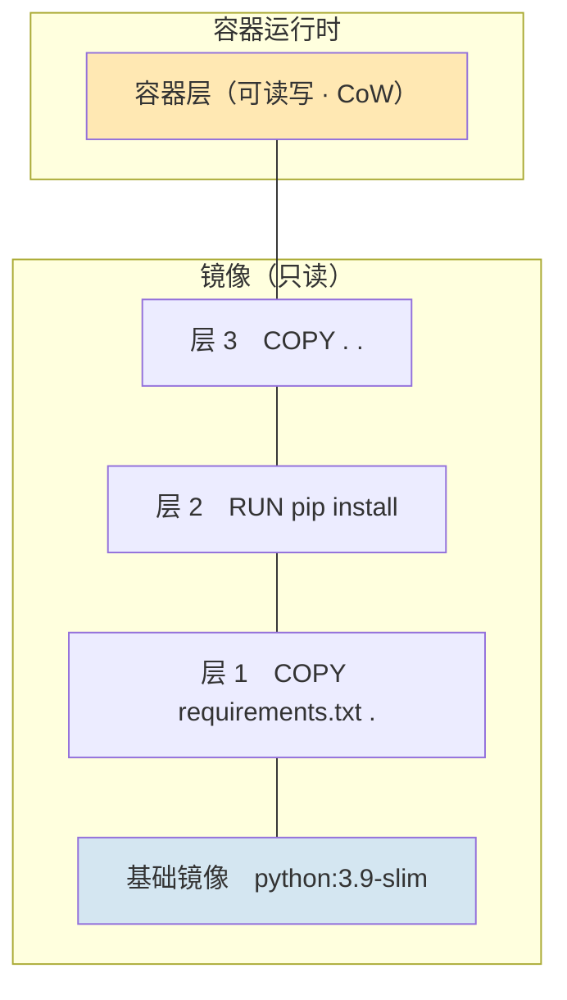

## 零、实验环境与项目结构

### 0.1 确认 Docker 可用

```bash
docker --version
docker info
docker images
```

### 0.2 拉取本次实验的基础镜像

```bash
docker pull python:3.9-slim
docker pull alpine:3.7
```

> [!tip] 为什么要提前拉基础镜像
> 教程在"实验环境准备"里就强调这一点：提前拉取基础镜像可以减少构建时的下载等待，但安装依赖仍可能需要联网。**基础镜像通常包含多层**，相同内容的层可以在本地共享。

### 0.3 最终的项目结构

```
.
├── Dockerfile          # 镜像的"配方"
├── requirements.txt    # Python 依赖清单
├── app.py              # 业务代码
└── .dockerignore       # 构建上下文的"黑名单"（必备，但教程里常被忽略）
```

四个文件就够，这就是"最小样例"的含义 —— 没有多余的东西，但每一条指令都有存在的理由。

---

## 一、Docker 镜像基础：它到底是什么

### 1.1 一句话定义

**Docker 镜像是一个轻量级、可执行的只读软件包**，里面打包了运行应用所需的全部内容：

| 内容 | 说明 |
|------|------|
| 应用程序代码 | 你自己写的 `app.py` |
| 运行时 | Python 3.9 解释器 |
| 库 | Flask、Werkzeug 等依赖 |
| 环境工具与配置 | 环境变量、工作目录、启动命令 |

### 1.2 镜像 vs 容器（最容易混淆的一对）

| Docker 镜像 | Docker 容器 |
|-------------|-------------|
| 容器的"源代码"，静态、只读 | 镜像的运行实例，动态、可写 |
| 由 Dockerfile 构建而来 | 由镜像 `docker run` 而来 |
| 可以通过注册表在用户间共享 | 不能共享，是本地进程 |
| 要改镜像，得改 Dockerfile 重新构建 | 可以直接 `docker exec` 进去改 |

> [!note] 一句话类比
> **镜像是类（Class），容器是对象（Object）**。一个镜像可以同时跑出 N 个容器，彼此隔离。

### 1.3 镜像的四个关键组件

- **层（Layer）**：不可变的文件系统层，堆叠成完整镜像
- **基础镜像（Base Image）**：构建阶段继承的起点，通常已包含多层文件系统和运行配置
- **镜像配置**：默认命令、环境变量、工作目录等元数据；Dockerfile 是构建配方，并非镜像必须携带的组成部分
- **镜像 ID / 标签**：唯一标识与版本别名

---

## 二、分步构建 Python 镜像（核心实操）

下面严格按教程"如何构建 Docker Python 镜像"的 5 个步骤走。

### 步骤 1：编写 Dockerfile

```dockerfile
# 使用Python官方镜像作为基础镜像
FROM python:3.9-slim

# 设置工作目录
WORKDIR /app

# 复制requirements.txt文件
COPY requirements.txt .

# 安装依赖项
RUN pip install --no-cache-dir -r requirements.txt

# 复制应用程序代码
COPY . .

# 暴露端口
EXPOSE 80

# 运行应用程序
CMD ["python", "app.py"]
```

**逐条指令拆解：**

| 指令 | 原理与作用 |
|------|-----------|
| `FROM python:3.9-slim` | 指定**父镜像**。继承它已有的文件系统层和配置；后续指令可能新增文件系统层，也可能只更新元数据 |
| `WORKDIR /app` | 设置后续指令的工作目录，等价于 `mkdir -p /app && cd /app`。**用 WORKDIR 而不是 `RUN cd`**，因为 `RUN cd` 只对那一条指令生效 |
| `COPY requirements.txt .` | 只复制依赖清单。**这是缓存优化的关键**，见 [分层与缓存](#四原理篇分层缓存与写时复制) |
| `RUN pip install --no-cache-dir -r requirements.txt` | 构建期执行安装。`--no-cache-dir` 不保留 pip 缓存，直接减小镜像体积 |
| `COPY . .` | 把构建上下文里的剩余文件拷进 `/app` |
| `EXPOSE 80` | **纯声明**，告诉使用者"我打算用 80 端口"。它不会自动做端口映射，真正映射靠 `docker run -p` |
| `CMD ["python", "app.py"]` | 容器启动的默认命令。**JSON 数组形式（exec form）** 直接 exec，PID 1 就是 python 进程，能正确接收 SIGTERM |

> [!warning] 对教程的一处修正
> 教程原 Dockerfile 写的是 `EXPOSE 5000`，而 `app.py` 监听的是 `80`，两者对不上。
> `EXPOSE` 应该声明**容器内进程实际监听的端口**，所以这里改为 `EXPOSE 80`。
> 宿主机端口（5000）是在 `docker run -p 5000:80` 时才决定的，跟 `EXPOSE` 无关。

### 步骤 2：编写 requirements.txt 与 app.py

`requirements.txt`：

```text
Flask==2.1.0
Werkzeug==2.1.2
```

> [!question] 为什么要锁 Werkzeug？
> Flask 2.1.0 依赖 Werkzeug ≥ 2.0，但 Werkzeug 新版本会移除某些旧 API，不锁版本会出现"本地能跑、构建后跑不起来"的经典事故。
> 锁定直接和传递依赖、记录哈希及基础镜像 digest，才能进一步提高可复现性；只固定这两个包还不够。本例是旧版依赖的兼容性演示，不能直接作为生产环境的版本建议。

`app.py`：

```python
from flask import Flask

app = Flask(__name__)


@app.route('/')
def hello_world():
    return 'Hello, World!'


if __name__ == '__main__':
    app.run(host='0.0.0.0', port=80)
```

> [!danger] 两个必须注意的点
> 1. **`host='0.0.0.0'` 必须写**。默认值是 `127.0.0.1`，那只监听容器内部的回环地址，宿主机完全访问不到 —— 这是新手排名第一的踩坑点。
> 2. 教程示例里带了 `debug=True`。**学习环境可以，生产环境一定要去掉**：debug 模式会开启交互式调试器，等于把任意代码执行的口子暴露出去，而且会额外起一个重载进程，破坏 PID 1 的信号处理。

### 步骤 3：构建镜像

```bash
docker build -t my-python-app:latest .
```


旧式构建器的输出示意如下，ID 仅用于说明格式，并非本次实测结果。构建步骤不等于文件系统层；BuildKit 的输出格式也不同：

```
Sending build context to Docker daemon   5.12kB
Step 1/7 : FROM python:3.9-slim
 ---> a438d5c1bb1b
Step 2/7 : WORKDIR /app
 ---> Using cache
Step 3/7 : COPY requirements.txt .
 ---> 3f2a1c9e8d40
Step 4/7 : RUN pip install --no-cache-dir -r requirements.txt
 ---> Running in 7c1e2f9a5b33
Collecting Flask==2.1.0
...
 ---> 9b7d4e2c1a55
Step 5/7 : COPY . .
 ---> c4e8a1b72d90
Step 6/7 : EXPOSE 80
 ---> Running in 5a9c3e7b1d24
Step 7/7 : CMD ["python", "app.py"]
 ---> 8e1f6a3b9c07
Successfully built 8e1f6a3b9c07
Successfully tagged my-python-app:latest
```

注意 `---> Using cache` —— 这就是 [分层与缓存](#四原理篇分层缓存与写时复制) 要讲的层缓存。

### 步骤 4：运行容器

```bash
docker run -d -p 5000:80 my-python-app:latest
```

`-p 5000:80` 的含义：**宿主机 5000 端口 → 容器 80 端口**。左边是宿主机，右边是容器。

验证：

```bash
curl localhost:5000
# Hello, World!

docker ps
# CONTAINER ID   IMAGE                  PORTS                  NAMES
# 3a1b2c3d4e5f   my-python-app:latest   0.0.0.0:5000->80/tcp   quirky_turing
```

### 步骤 5：Cloud Studio 里访问服务

在 Cloud Studio 中打开**端口插件**，选择 `5000` 端口即可在浏览器里看到 `Hello, World!`。

---

## 三、原理篇：那条 `.` 到底做了什么

这是本文最想讲清楚的一节，也是教程里一笔带过、但实际最常出错的地方。

### 3.1 命令的完整语法

```bash
docker build -t your_image_name:tag -f path/to/Dockerfile .
```

| 片段 | 含义 |
|------|------|
| `docker build` | 启动构建 |
| `-t your_image_name:tag` | 给镜像打名字和标签，不写 tag 则默认 `latest` |
| `-f path/to/Dockerfile` | 指定 Dockerfile 路径 |
| `.` | **构建上下文（build context）的路径**，不是镜像层 |

### 3.2 "从哪一层开始打包" —— 两个层面，两个答案

这个问题其实混淆了两件事，必须分开答。

> [!summary] 结论
> **① 从"文件打包"的角度：起点是 `.`**
> **② 从"镜像分层"的角度：起点是 `FROM` 的基础镜像**

**① 从"文件打包"的角度：起点是 `.`**

`docker build` 的位置参数确定构建上下文。旧式构建器会将过滤后的上下文打包发送给 daemon；现代默认构建器 BuildKit 支持按需传输和缓存，不能一概描述成「每次把全部文件打成 tar」。

所以：

- 打包的根 = `.` = 你敲命令时的当前目录
- 上下文大小 = `.` 下面有多少东西（这就是为什么 `.dockerignore` 至关重要）
- 普通本地 `COPY` 不能借 `../` 读取上下文外文件；不同构建器可能拒绝或规范化该路径，不能依赖它越界读取



**② 从"镜像分层"的角度：起点是 `FROM` 的基础镜像**

镜像的层由 Dockerfile 指令生成，`FROM python:3.9-slim` 把基础镜像的所有层整体继承过来，之后 `RUN` / `COPY` / `ADD` 每条新增一层。**`FROM` 是构建阶段的起点，不代表只有一个「第 0 层」。**

### 3.3 上下文 ≠ 镜像内容

这是个关键区分：

- 上下文中的文件只是构建期间可访问的输入，不会自动全部进入镜像
- `COPY` / `ADD` 可复制文件，`RUN` 也可以生成或下载文件进入镜像层
- 构建缓存可能保留输入和中间结果，不能假设构建结束后相关内容全部消失

> [!note] 打个比方
> 上下文是"厨房里的全部食材"，镜像是"最终装盘的菜"。食材备齐了不等于全下锅。

### 3.4 三种常见写法对照

| 命令                                          | 上下文          | `COPY` 能取到的文件范围                           |
| ------------------------------------------- | ------------ | ----------------------------------------- |
| `docker build -f Dockerfile .`              | 当前目录         | 当前目录下所有文件                                 |
| `docker build -f docker/Dockerfile .`       | 当前目录         | **仍以当前目录为根**，`COPY app.py` 找的是 `./app.py` |
| `docker build -f docker/Dockerfile docker/` | `docker/` 目录 | 只能取 `docker/` 下的文件                        |

> [!danger] 最常见的坑
> `COPY` 的源路径始终相对**上下文根**，而不是相对 Dockerfile 所在目录。

### 3.5 `.dockerignore` 必须配

```
__pycache__/
*.py[cod]
.venv/
venv/
.git/
.gitignore
.dockerignore
Dockerfile
README.md
```

没有它，`COPY . .` 会把本地的虚拟环境（动辄几百 MB）、`.git` 历史、IDE 配置全塞进镜像，还会**直接击穿构建缓存**（见下节）。

---

## 四、原理篇：分层、缓存与写时复制

### 4.1 为什么先 COPY requirements.txt 再 COPY 代码？

这是本 Dockerfile 里最"值钱"的一行设计。看两种写法的对比：

**写法 A（教程的写法，正确）**

```dockerfile
COPY requirements.txt .
RUN pip install -r requirements.txt
COPY . .
```

改 `app.py` 时：`requirements.txt` 没变 → 前两层命中缓存 → **跳过 pip install**，构建秒级完成。

**写法 B（反例）**

```dockerfile
COPY . .
RUN pip install -r requirements.txt
```

改任何一个文件 → `COPY . .` 那一层的校验和变了 → 后面所有层缓存全部失效 → **每次都重装全部依赖**，改一行代码等三分钟。

> [!important] Docker 的缓存规则
> 对每条指令，计算「指令内容 + 相关文件内容」的校验和；若与已有层完全一致则直接复用（输出 `Using cache`），否则从这条开始**后面所有层全部重建**。
>
> 推论：**越不常变的层，越要放在前面。**



### 4.2 层是共享的，不是复制的

两个镜像如果都 `FROM python:3.9-slim`，那基础镜像的层在磁盘上只存一份，被两个镜像共同引用。这就是为什么本地镜像列表的 `SIZE` 加起来很大，实际磁盘占用却小得多。

```bash
docker system df    # 看真实占用，会发现"共享"带来的节省
```

### 4.3 镜像只读 + 写时复制（Copy-on-Write）

镜像层全是**只读**的。`docker run` 时，Docker 在所有只读层之上加一层**薄薄的可读写容器层**：



- **读文件**：从上层往下找，找到就返回
- **改文件**：先把文件从只读层复制到容器层，再改（这就是 CoW）
- **删文件**：在容器层打一个"白化"（whiteout）标记，遮住下层文件

> [!warning] 两个反直觉的推论
> - 容器里删文件**不会**让镜像变小
> - 容器删除后可写层消失；卷和 bind mount 中的数据不随之删除。需要保留镜像变更可用 `docker commit`（见 [docker commit](#八另一种造镜像的方式docker-commit)）或写回 Dockerfile

验证一下分层：

```bash
docker image history my-python-app:latest
docker image inspect --format='{{.RootFS.Layers}}' my-python-app:latest
```

---

## 五、镜像使用：查看、过滤与清理

### 5.1 列出镜像

```bash
docker images                                    # 列出本地镜像
docker images -a                                 # 含中间层镜像
docker images --no-trunc                         # 显示完整 64 位镜像 ID
docker images my-python-app                      # 按名称过滤
docker images my-python-app:latest               # 按名称+标签过滤
docker images --filter=reference='my-python-app' # 用 --filter
docker images --format "table {{.Repository}}\t{{.Tag}}\t{{.Size}}"
```


> [!tip] 关于镜像 ID
> 默认显示的镜像 ID 只有前 12 位，是完整 SHA256 的缩写。日常操作够用，但写脚本时建议用 `--no-trunc` 或直接用 tag。

### 5.2 拉取指定标签的镜像

```bash
docker pull alpine:3.7
```


不写标签就是 `:latest`。

> [!danger] 生产环境永远别用 latest
> 它指向哪个版本会随时间变化，导致"同一份部署脚本，今天和明天跑出不同结果"。

### 5.3 查看详情与历史

```bash
docker image inspect my-python-app:latest                        # 完整元数据
docker image inspect --format='{{.Config.Env}}' my-python-app    # 只看环境变量
docker image inspect --format='{{.RootFS.Layers}}' my-python-app # 看层列表
docker image history my-python-app:latest                        # 看每层的构建指令
```

### 5.4 清理

```bash
docker image prune              # 删除悬空镜像（<none>:<none>）
docker image prune -a           # 删除所有未被容器引用的镜像
docker system prune -a --volumes # 系统级大扫除（含数据卷，慎用）
```

> （图 2 —— 原图待补）
> [!note] 什么是悬空镜像
> **悬空镜像（dangling image）** 是重新构建后被新镜像抢占了名字、只剩 `<none>:<none>` 的旧镜像。它们不承载业务逻辑，但很占磁盘。

---

## 六、镜像标签管理

标签是 `镜像名:标签` 里的后半段，是容器化应用的**版本管理核心**。

### 6.1 为什么必须有标签策略

- **版本控制与回滚**：出问题时能一键退回上一个版本
- **可追溯**：知道线上跑的是哪次构建
- **支撑自动化**：CI/CD 靠标签决定部署什么

### 6.2 打标签的三种时机

**① 构建时指定**

```bash
docker build -t my-python-app:1.0.0 .
docker build -t csc/csc_app:1 -t csc/csc_webapp:1 .   # 一次构建打多个标签
```


**② 构建后追加**

```bash
docker tag my-python-app:latest my-python-app:1.0.0
docker tag my-python-app:latest my-python-app:prod
```

> [!tip] docker tag 很"便宜"
> `docker tag` **不会复制镜像内容**，只是给同一个镜像 ID 多挂一个名字（类似硬链接），所以是瞬时完成、零额外磁盘开销。

**③ 用镜像 ID 打标签**

```bash
docker tag 8a7ffbdffc07 my-python-app:1.0.0
```

### 6.3 推荐的标签策略

```bash
# 语义化版本
docker tag my-python-app:latest my-python-app:1.0.0
docker tag my-python-app:latest my-python-app:1.0
docker tag my-python-app:latest my-python-app:1

# 按环境
docker tag my-python-app:latest my-python-app:prod
docker tag my-python-app:latest my-python-app:dev

# 结合构建信息（可追溯到代码提交）
docker tag my-python-app:latest my-python-app:$(git rev-parse --short HEAD)
docker tag my-python-app:latest my-python-app:$(date +%Y%m%d-%H%M%S)
```

> [!important] 标签四铁律
> 1. 生产环境不用 `latest`
> 2. 用语义化版本（`MAJOR.MINOR.PATCH`）
> 3. 按环境区分（`prod` / `staging` / `dev`）
> 4. 带上 Git commit hash，实现镜像到代码的双向追溯

### 6.4 删除与"重命名"标签

```bash
docker rmi my-python-app:old-tag        # 删标签（若该镜像还有别的标签，只删标签不删数据）
docker tag my-python-app:old my-python-app:new && docker rmi my-python-app:old   # 重命名
```

---

## 七、发布到 Docker Hub

### 7.1 完整流程

**步骤 1**：在 [Docker Hub](https://hub.docker.com/) 注册并登录，进入 **Repositories** 标签页创建一个仓库（例如 `cloudstudio`）。


**步骤 2**：用「用户名/仓库名」的格式构建

```bash
docker build -t keiran479/cloudstudio .
```


> [!warning] 推送到远端必须带用户名前缀
> 写成 `my-python-app:1.0.0` 推送时，Docker 不知道该推给谁。正确格式是 `<用户名>/<仓库名>:<标签>`。

**步骤 3**：登录

```bash
docker login -u <username>
```


> [!tip] 更安全的登录方式
> 用 Access Token 代替密码，并避免明文出现在命令历史里：
> ```bash
> echo $DOCKER_PASSWORD | docker login -u <username> --password-stdin
> ```

**步骤 4**：推送

```bash
docker push keiran479/cloudstudio
```


**步骤 5**：在 Docker Hub 页面确认镜像已上线。

### 7.2 推送指定版本到私有仓库

```bash
docker tag my-python-app:latest keiran479/my-python-app:v1
docker login -u <username>
docker push keiran479/my-python-app:v1
```

### 7.3 推送的原理

`docker push` 并不会把整个镜像无脑上传。它会：

1. 读取镜像的 manifest（层清单）
2. 逐层计算 SHA256，**只上传远端仓库不存在的层**
3. 已存在的层直接跳过（输出里表现为 `Layer already exists` 或 `Mounted from ...`）

这就是为什么基于同一基础镜像的第二个镜像推送得飞快 —— 底层的 `python:3.9-slim` 早就在 Hub 上了。

### 7.4 推送失败的四个常见原因

| 现象 | 排查方向 |
|------|---------|
| 认证错误 `unauthorized` | `docker logout` 后重新 `docker login`，或改用 Access Token |
| 网络超时 | 检查连通性；配置 `/etc/docker/daemon.json` 的 `registry-mirrors` 加速器 |
| `repository does not exist` | 确认 Hub 上已创建仓库、名称拼写正确、有推送权限 |
| 镜像过大 | 用 `.dockerignore`、多阶段构建、清理构建中间产物 |

---

## 八、另一种造镜像的方式：docker commit

### 8.1 语法与定位

```bash
docker commit [OPTIONS] CONTAINER [REPOSITORY[:TAG]]
```

| 选项 | 作用 |
|------|------|
| `-a, --author` | 指定作者 |
| `-m, --message` | 提交说明 |
| `-c, --change` | 应用 Dockerfile 指令，如 `--change="ENV DEBUG=true"` |
| `-p, --pause` | 提交期间暂停容器 |

> [!note] 本质
> **`docker commit` 从容器的当前状态创建新镜像** —— 它捕获的是容器**可读写层**相对镜像的增量，把这部分固化成一个新的只读层。

### 8.2 实操：给 Ubuntu 装上 nmap 并固化

```bash
# 1. 拉取基础镜像
docker pull alex43/ubuntu-with-git:v1.0

# 2. 交互式启动容器
docker run -it alex43/ubuntu-with-git:v1.0 /bin/bash

# 3. 在容器内修改
nmap --version          # 先确认没装
apt-get install nmap
nmap --version          # 确认装好了
exit

# 4. 提交为新镜像
docker commit <container_id> ubuntu-with-nmap:v1.0

# 5. 验证
docker images

# 6. 基于新镜像启动，改动仍在
docker run -it ubuntu-with-nmap:v1.0 /bin/bash
```


### 8.3 commit vs push vs save

| 命令 | 作用 | 对象 |
|------|------|------|
| `docker commit` | 从容器创建镜像 | 容器 → 镜像 |
| `docker push` | 把镜像推送到远端仓库 | 镜像 → 注册表 |
| `docker save -o x.tar img` | 把镜像导出为 tar 备份文件 | 镜像 → 本地文件 |

> [!warning] commit 与 save 的区别
> **commit 保留容器的改动，save 不保留**（save 只打包镜像本身的只读层）。

### 8.4 什么时候该用 commit

✅ 适合：快速原型验证、保存调试现场、临时修复、实验性改动
❌ 不适合：正式交付

> [!important] 核心原则
> **生产镜像一律用 Dockerfile 构建。**
> commit 出来的镜像是"黑盒"—— 没人知道里面改了什么，无法 code review，无法复现。
> 它最大的价值是"临时存档"，存档确认有效后，应当把改动**翻译回 Dockerfile**。

---

## 九、排错清单与最佳实践

### 9.1 五个高频故障

| 问题 | 现象 | 解决方案 |
|------|------|---------|
| **端口访问不通** | `curl` 连接被拒 | ① 应用是否监听 `0.0.0.0`（不是 `127.0.0.1`）；② `docker run -p` 是否加了；③ 宿主机/容器端口顺序是否写反 |
| **构建慢 / 上下文巨大** | `Sending build context` 几百 MB | 配 `.dockerignore`，排除 `.git`、`venv`、日志 |
| **改一行代码就重装依赖** | 每次构建都跑 pip install | 拆开 `COPY requirements.txt` 和 `COPY . .`（见 [依赖缓存](#41-为什么先-copy-requirementstxt-再-copy-代码)） |
| **COPY 路径找不到** | `forbidden path outside the build context` | 理解上下文根；`COPY` 源路径相对上下文而非 Dockerfile |
| **容器起来就退出** | `docker ps` 看不到 | `docker logs <id>` 看报错；通常是前台进程结束或启动命令错误 |

### 9.2 镜像优化六条

1. **用多阶段构建** —— 编译期依赖不进最终镜像
2. **优化层顺序** —— 不常变的层放前面
3. **必配 `.dockerignore`** —— 减小上下文、保护缓存
4. **锁定基础镜像版本** —— 不用 `latest`
5. **合并 RUN 指令** —— `RUN a && b && c` 减少层数，并在同一层内清理缓存
6. **构建过程中清理** —— `pip install --no-cache-dir`、`apt-get clean && rm -rf /var/lib/apt/lists/*`

第 5、6 条配合使用的正确姿势：

```dockerfile
RUN apt-get update \
    && apt-get install -y --no-install-recommends gcc \
    && apt-get clean \
    && rm -rf /var/lib/apt/lists/*
```

> [!danger] 必须在同一条 RUN 里清理
> 如果分成两条 RUN，第一条产生的缓存文件已经被固化进层，第二条删掉它们只会在新层打 whiteout，镜像体积**一点都不会变小**。

---

## 十、总结

### 10.1 本次实操的最小闭环

```bash
# 构建
docker build -t my-python-app:1.0.0 .

# 运行
docker run -d -p 5000:80 --name myapp my-python-app:1.0.0

# 验证
curl localhost:5000          # Hello, World!

# 打标签
docker tag my-python-app:1.0.0 my-python-app:latest

# 发布
docker tag my-python-app:1.0.0 <username>/my-python-app:1.0.0
docker push <username>/my-python-app:1.0.0

# 清理
docker stop myapp && docker rm myapp
docker image prune
```

### 10.2 三个必须刻进脑子里的原理

> [!summary] 核心三条
> 1. **`.` 是构建上下文，不是镜像层。** 上下文决定了"构建时能看到哪些文件"，`FROM` 决定了"镜像从哪一层开始叠"。这是两个不同的维度。
> 2. **层是不可变且可共享的，缓存从失效的那条指令起全线崩塌。** 所以把稳定的东西放前面（`requirements.txt`），把易变的东西放后面（业务代码）。
> 3. **镜像只读，容器靠写时复制获得可写层。** 容器内的任何改动都活不过容器本身，想留存就回到 Dockerfile。

### 10.3 一句话收尾

> [!quote] 收尾
> Dockerfile 是**声明式的、可评审的、可复现的**；`docker commit` 是**命令式的、黑盒的、一次性的**。
> 前者是工程，后者是草稿。真正优秀的镜像管理，是让每一层都言之有据。

---

#Docker #镜像 #容器化 #云原生 #教程笔记

## 核对资料

- [构建上下文与 BuildKit](https://docs.docker.com/build/concepts/context/)
