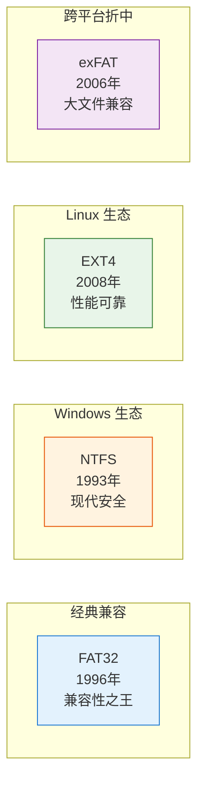
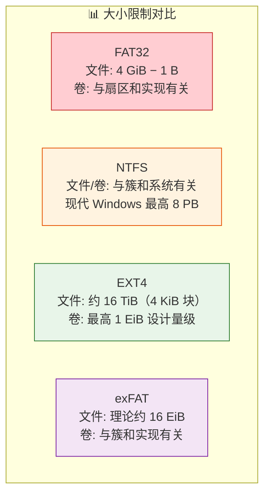
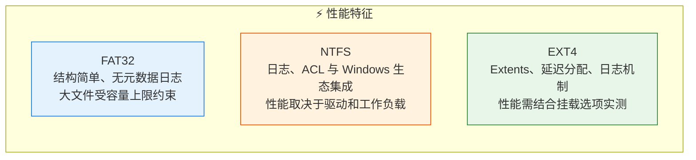
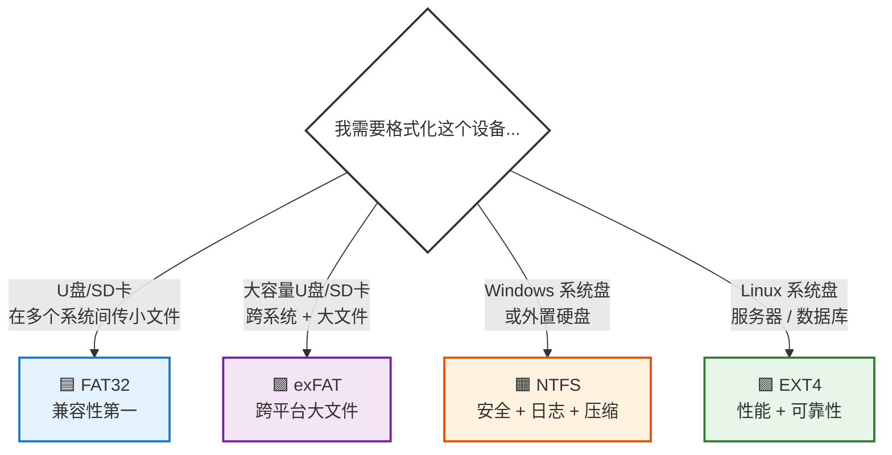

# 文件系统深度解析：FAT32、NTFS、EXT4 与 exFAT 完全指南

> 当你保存一个文件时，它到底存到哪里去了？不是哪个文件夹，而是你的硬盘。如何知道该把它存在哪？如何再次找到它？如何确保它不会被覆盖？这正是文件系统要做的事。

---

## 一、文件系统到底是什么？

把你的硬盘或 SSD 想象成一个巨大的、完全空旷的停车场，里面有成千上万个车位。

如果没有文件系统，这个停车场就毫无组织：没有标识、没有车道线、没有编号。操作系统根本不知道哪辆车停在哪里。

**文件系统就是这套组织规则**。它是一套数据结构和管理协议，决定了文件如何在存储设备上命名、存储、检索和管理。你使用的每一个存储设备——硬盘、SSD、U盘、SD卡——都需要一个文件系统。

### 文件系统的四项核心工作

| 功能 | 说明 |
|------|------|
| **存储分配** | 决定磁盘上的哪些物理块分配给哪个文件 |
| **元数据管理** | 记录文件名、大小、创建日期、权限、所有者 |
| **目录组织** | 将文件组织成树状文件夹结构，便于浏览 |
| **空闲空间管理** | 跟踪哪些磁盘块是空的，可用于新文件 |

这四项工作共同作用，使操作系统能够可靠且快速地创建、读取、更新和删除文件。

---

## 二、四种主流文件系统概览

世界上存在数十种文件系统，但有四种主导着现实世界：

| 文件系统 | 出身 | 核心特点 | 典型场景 |
|----------|------|---------|---------|
| **FAT32** | Microsoft (1996) | 兼容性最好，几乎全平台支持 | U盘、SD卡、车载音响 |
| **NTFS** | Microsoft (1993) | 安全、日志、压缩、加密 | Windows 系统盘、数据盘 |
| **EXT4** | Linux 社区 (2008) | 高性能、高可靠、低延迟分配 | Linux 系统、服务器、数据库 |
| **exFAT** | Microsoft (2006) | 跨平台原生支持 + 大文件 | 大容量 U盘、相机 SDXC 卡 |

---

## 三、FAT32：兼容性之王，但已过时

**FAT** = File Allocation Table（文件分配表），**32** 指 FAT 表项宽度；其中用于簇编号的是低 28 位，并非完整的 32 位都用于寻址。

FAT32 于 1996 年推出，自那以后一直是存储设备的"通用语言"。

### 为什么许多小容量 U 盘使用 FAT32？

因为它可以在 **Windows、macOS、Linux、游戏机、数码相机、汽车音响** 上工作——但是否可读仍取决于设备固件、分区方式和容量限制。它是有史以来**兼容性最好**的文件系统。

### FAT32 的致命局限

| 限制项 | 上限 | 现实影响 |
|--------|------|---------|
| **单个文件大小** | **4 GiB − 1 字节** | 恰好 4 GiB 的文件也无法存储 |
| **卷（分区）大小** | 随逻辑扇区、簇大小和系统工具而异 | 格式化工具限制不等于磁盘格式的理论上限，不能统一写成 8 TB |

在 1996 年，4GB 似乎足够了。但今天：
- 一部 4K 视频轻松达到 20–50 GB
- 一款现代游戏 100+ GB
- 一个数据库备份可能数百 GB

**FAT32 对大型现代工作负载完全无能为力。**

### FAT32 还缺什么？

- **无安全模型**：没有文件权限，任何人都能读写任何文件
- **无日志记录**：断电时文件系统可能损坏，留下写了一半的残破文件
- **无压缩/加密**：不支持任何高级存储功能

---

## 四、NTFS：Windows 的现代文件系统

**NTFS** = New Technology File System，微软于 1993 年随 Windows NT 引入，从 Windows XP 开始成为 Windows 的默认文件系统。

### 大小限制取决于系统版本和簇大小

| 限制项 | 上限 |
|--------|------|
| 单个文件及卷大小 | 受 Windows 版本、簇大小和应用限制；现代 Windows 在相应配置下最高支持 8 PB，默认 4 KB 簇对应 16 TB 量级 |

你的 Windows C 盘几乎肯定是 NTFS 格式。

### NTFS 的核心特性

#### 1. 细粒度安全权限（ACL）

NTFS 支持精确控制谁可以读取、写入或执行每个文件/文件夹。这是 Windows 多用户安全的基础。

> 当你看到"需要管理员权限才能访问此文件夹"时，那就是 NTFS 权限在起作用。

#### 2. 日志记录（Journaling）

NTFS 通过事务日志和检查点恢复文件系统元数据的一致性。这不保证断电前所有应用数据都已经落盘，日志也不能代替应用的刷盘策略和备份。

这是 NTFS 被用于操作系统驱动器（而非 FAT32）的根本原因。

#### 3. 内置压缩与加密

- **NTFS 压缩**：自动压缩文件节省空间，访问时透明解压
- **EFS（加密文件系统）**：加密单个文件/文件夹，没有相应解密密钥时无法直接读取；仍需妥善保管证书、私钥及恢复材料

> 当你尝试将加密文件移动到另一个 Windows 账户时收到"访问被拒绝"，这正是 EFS 按预期工作。

---

## 五、EXT4：Linux 的性能之选

**EXT4** = Fourth Extended File System，2008 年发布，取代 EXT3，是 Ubuntu、Debian 等发行版常见的默认文件系统；其他发行版也可能默认使用 XFS 或 Btrfs。

### 核心规格

| 限制项 | 上限 |
|--------|------|
| 单个文件大小 | 常见 4 KiB 块、extent 文件下约 **16 TiB**；与块大小和实现有关 |
| 卷大小 | 启用 64bit 等相应特性时可达 **1 EiB** 的设计量级；实际工具和发行版可能限制更低 |

### EXT4 相比前代的重大改进

#### 1. Extents 分配（区段分配）

旧文件系统（FAT32、EXT2/3）追踪大文件时，需要存储一个**冗长的列表**，记录文件使用的每一个单独的磁盘块。一个 1GB 的文件可能使用数十万个块，文件系统必须逐个追踪。

EXT4 引入 **Extents**：将**连续的块范围作为一个单元**追踪。

> 例如：文件使用第 5000 到 30000 块 → 只需记录一个范围，而不是列出 25000 个单独的块。

这使得大文件的读写速度显著加快，并大幅降低了元数据开销。

#### 2. 日志校验和（Journal Checksum）

与 NTFS 类似，EXT4 的 JBD2 日志支持校验和以帮助发现损坏。默认日志模式主要保护元数据一致性，不能保证断电前所有文件内容都已持久化。

#### 3. 延迟分配（Delayed Allocation）

当你写入数据时，EXT4 会**等待片刻**，观察系统的写入模式，然后一次性分配一个**更优的连续范围**，而不是零打碎敲地分配小块。

这显著提升了写入大量数据的工作负载性能，如数据库和文件服务器。

---

## 六、exFAT：跨平台大文件的最佳折中

**exFAT** 于 2006 年推出，定位在 FAT32 和 NTFS 之间。

### 核心规格

| 限制项 | 上限 |
|--------|------|
| 单个文件大小 | 长度字段为 64 位，理论上限约 **16 EiB − 1 字节**，实际受实现与卷容量限制 |
| 卷大小 | 由扇区、簇大小和实现共同决定；不能把 128 TB 写成统一的格式上限 |

### 为什么需要 exFAT？

FAT32 有 4GB 文件限制，NTFS 在 macOS 上通常原生只读；Linux 的读写能力取决于所用内核与驱动（如 ntfs3 或 ntfs-3g）。exFAT 解决了这个痛点：

- **跨平台原生支持**：Windows、macOS、Linux 都能原生读写
- **无 4GB 文件限制**
- **SDXC 卡的默认格式**

如果你有一个大容量 U 盘或 SD 卡，需要在多个操作系统间使用，并且需要存储大于 4GB 的文件，**exFAT 是最佳选择**。

---

## 七、四者核心对比

| 特性 | FAT32 | NTFS | EXT4 | exFAT |
|------|:-----:|:----:|:----:|:-----:|
| **最大单个文件** | 4 GiB − 1 字节 | 随簇和系统版本变化 | 常见配置约 16 TiB | 理论约 16 EiB − 1 字节 |
| **最大卷大小** | 随扇区、簇和实现变化 | 现代 Windows 相应配置最高 8 PB | 最高 1 EiB 设计量级 | 随扇区、簇和实现变化 |
| **日志记录** | ❌ | ✅ | ✅ (带校验和) | ❌ |
| **文件权限/ACL** | ❌ | ✅ | ✅ | ❌ |
| **压缩** | ❌ | ✅ | ❌ | ❌ |
| **加密** | ❌ | ✅ (EFS) | ✅（fscrypt，需内核及工具支持） | ❌ |
| **Windows 支持** | ✅ 原生 | ✅ 原生 | ⚠️ 需第三方驱动 | ✅ 原生 |
| **macOS 支持** | ✅ 原生 | ⚠️ 只读/第三方 | ⚠️ 需第三方 | ✅ 原生 |
| **Linux 支持** | ✅ | ✅（ntfs3 / ntfs-3g，依环境而定） | ✅ | ✅（需相应内核驱动） |
| **嵌入式/游戏机** | ✅ 极佳 | ❌ 差 | ⚠️ 一般 | ⚠️ 一般 |

---

## 八、性能判断的边界

- **FAT32**：结构相对简单，但是否适合某个工作负载，仍要测量吞吐、延迟和恢复需求；不能仅凭「没有日志」判断它更快。
- **NTFS**：需要结合 Windows 或其他系统上的具体驱动评估，不能把日志和 ACL 的存在直接换算成性能高低。
- **EXT4**：适用于许多 Linux 服务器工作负载，但不能脱离硬件、挂载选项、驱动、文件大小和并发模式，断言它总比 NTFS 或 FAT32 快。上图是定性示意，不是基准测试或性能排名。

---

## 九、使用场景速查表

| 场景 | 推荐文件系统 | 原因 |
|------|-------------|------|
| **U盘/SD卡（小文件、跨平台）** | FAT32 | 兼容性最好，几乎所有设备都支持 |
| **大容量 U盘/SD卡（>4GB 文件、跨平台）** | exFAT | 原生跨平台 + 无 4GB 限制，SDXC 默认格式 |
| **Windows 系统盘 / 数据盘** | NTFS | 安全权限、日志、压缩、加密 |
| **Linux 系统盘 / 服务器 / 数据库** | EXT4 | Linux 生态支持、extents、延迟分配和日志机制 |
| **相机 / 车载音响 / 电视** | FAT32 / exFAT | 设备兼容性要求 |

---

## 十、总结

选择文件系统，本质上是在**兼容性、安全性、性能、容量**之间做权衡：

- **FAT32** = 兼容性广，仍适合部分设备，但单文件容量和功能有限
- **NTFS** = Windows 的现代标准，功能全面
- **EXT4** = Linux 的性能之选，服务器和开发环境首选
- **exFAT** = 跨平台大文件的常见选择，但没有 NTFS/EXT4 那样的日志和权限机制

> 没有"最好的"文件系统，只有"最适合当前场景"的文件系统。

理解这四种文件系统的差异，是每一位开发者、系统管理员和高级用户的必备基础。

---

## 核对资料

- [Microsoft 文件系统功能对照](https://learn.microsoft.com/en-us/windows/win32/fileio/filesystem-functionality-comparison)
- [NTFS 容量与簇大小](https://learn.microsoft.com/en-us/windows-server/storage/file-server/ntfs-overview)
- [exFAT 格式规范](https://learn.microsoft.com/en-us/windows/win32/fileio/exfat-specification)
- [Linux ext4 文档](https://www.kernel.org/doc/html/latest/filesystems/ext4/overview.html)
