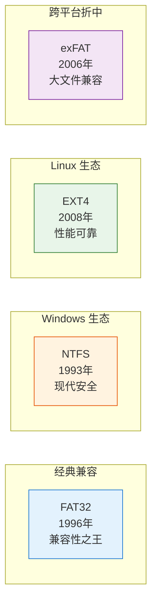
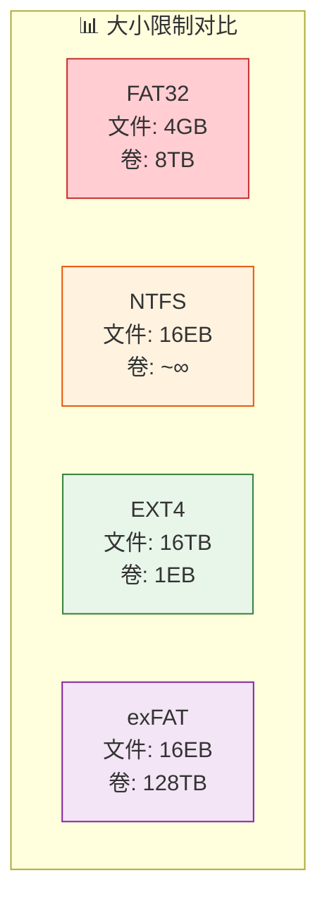
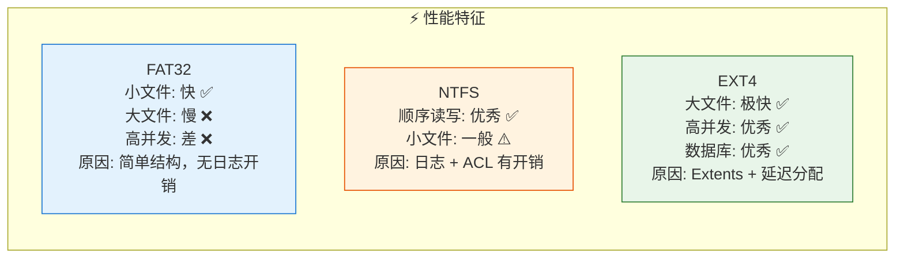
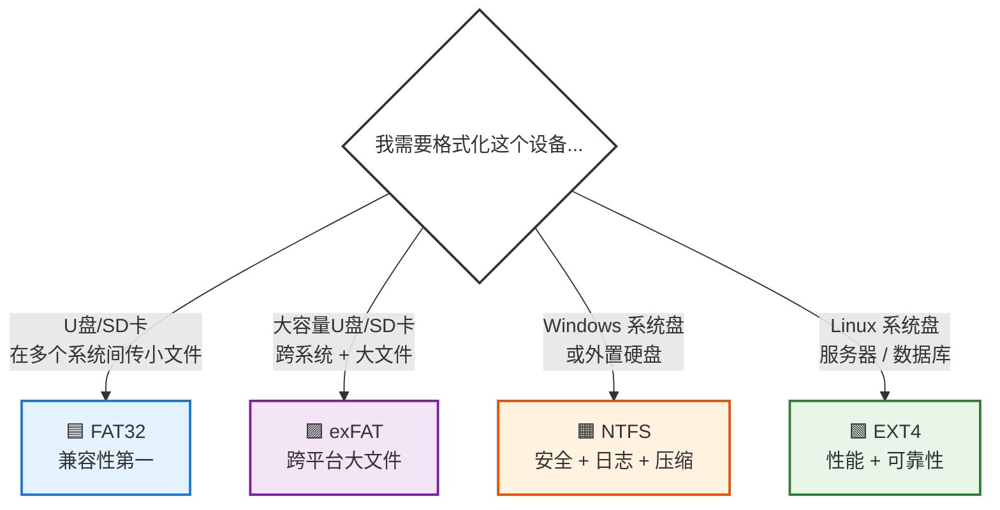

```markdown
# 文件系统深度解析：FAT32、NTFS、EXT4 与 exFAT 完全指南

> 当你保存一个文件时，它到底存到哪里去了？不是哪个文件夹，而是你的硬盘。如何知道该把它存在哪？如何再次找到它？如何确保它不会被覆盖？这正是文件系统要做的事。

---

## 一、文件系统到底是什么？

把你的硬盘或 SSD 想象成一个巨大的、完全空旷的停车场，里面有成千上万个车位。

如果没有文件系统，这个停车场就毫无组织：没有标识、没有车道线、没有编号。操作系统根本不知道哪辆车停在哪里。

**文件系统就是这套组织规则**。它是一套数据结构和管理协议，决定了文件如何在存储设备上命名、存储、检索和管理。你使用的每一个存储设备——硬盘、SSD、U盘、SD卡——都需要一个文件系统。

### 文件系统的四项核心工作

| 功能 | 说明 |
|------|------|
| **存储分配** | 决定磁盘上的哪些物理块分配给哪个文件 |
| **元数据管理** | 记录文件名、大小、创建日期、权限、所有者 |
| **目录组织** | 将文件组织成树状文件夹结构，便于浏览 |
| **空闲空间管理** | 跟踪哪些磁盘块是空的，可用于新文件 |

这四项工作共同作用，使操作系统能够可靠且快速地创建、读取、更新和删除文件。

---

## 二、四种主流文件系统概览

世界上存在数十种文件系统，但有四种主导着现实世界：



| 文件系统 | 出身 | 核心特点 | 典型场景 |
|----------|------|---------|---------|
| **FAT32** | Microsoft (1996) | 兼容性最好，几乎全平台支持 | U盘、SD卡、车载音响 |
| **NTFS** | Microsoft (1993) | 安全、日志、压缩、加密 | Windows 系统盘、数据盘 |
| **EXT4** | Linux 社区 (2008) | 高性能、高可靠、低延迟分配 | Linux 系统、服务器、数据库 |
| **exFAT** | Microsoft (2006) | 跨平台原生支持 + 大文件 | 大容量 U盘、相机 SDXC 卡 |

---

## 三、FAT32：兼容性之王，但已过时

**FAT** = File Allocation Table（文件分配表），**32** = 32 位寻址。

FAT32 于 1996 年推出，自那以后一直是存储设备的"通用语言"。

### 为什么 U 盘出厂默认是 FAT32？

因为它可以在 **Windows、macOS、Linux、游戏机、数码相机、汽车音响** 上工作——基本上任何有 USB 接口的设备都能读取它。它是有史以来**兼容性最好**的文件系统。

### FAT32 的致命局限

| 限制项 | 上限 | 现实影响 |
|--------|------|---------|
| **单个文件大小** | **4 GB** | 无法存储大于 4GB 的单个文件 |
| **卷（分区）大小** | **8 TB** | 大容量硬盘无法充分利用 |

在 1996 年，4GB 似乎足够了。但今天：
- 一部 4K 视频轻松达到 20–50 GB
- 一款现代游戏 100+ GB
- 一个数据库备份可能数百 GB

**FAT32 对大型现代工作负载完全无能为力。**

### FAT32 还缺什么？

- **无安全模型**：没有文件权限，任何人都能读写任何文件
- **无日志记录**：断电时文件系统可能损坏，留下写了一半的残破文件
- **无压缩/加密**：不支持任何高级存储功能

---

## 四、NTFS：Windows 的现代文件系统

**NTFS** = New Technology File System，微软于 1993 年随 Windows NT 引入，从 Windows XP 开始成为 Windows 的默认文件系统。

### 大小限制？基本不存在

| 限制项 | 上限 |
|--------|------|
| 单个文件大小 | **16 EB** (Exabytes，约 160 亿 GB) |
| 卷大小 | 实际用途中**基本无限** |

你的 Windows C 盘几乎肯定是 NTFS 格式。

### NTFS 的核心特性

#### 1. 细粒度安全权限（ACL）

NTFS 支持精确控制谁可以读取、写入或执行每个文件/文件夹。这是 Windows 多用户安全的基础。

> 当你看到"需要管理员权限才能访问此文件夹"时，那就是 NTFS 权限在起作用。

#### 2. 日志记录（Journaling）

NTFS 在执行每个计划的更改之前，会先写入日志。如果操作中途断电，重启时 NTFS 会使用日志**回滚未完成的更改**，确保数据一致性。

这是 NTFS 被用于操作系统驱动器（而非 FAT32）的根本原因。

#### 3. 内置压缩与加密

- **NTFS 压缩**：自动压缩文件节省空间，访问时透明解压
- **EFS（加密文件系统）**：加密单个文件/文件夹，即使有人物理拿到硬盘也无法读取

> 当你尝试将加密文件移动到另一个 Windows 账户时收到"访问被拒绝"，这正是 EFS 按预期工作。

---

## 五、EXT4：Linux 的性能之选

**EXT4** = Fourth Extended File System，2008 年发布，取代 EXT3，是大多数 Linux 发行版（Ubuntu、Debian、CentOS 等）的默认文件系统。

### 核心规格

| 限制项 | 上限 |
|--------|------|
| 单个文件大小 | **16 TB** |
| 卷大小 | **1 EB** (Exabyte) |

### EXT4 相比前代的重大改进

#### 1. Extents 分配（区段分配）

旧文件系统（FAT32、EXT2/3）追踪大文件时，需要存储一个**冗长的列表**，记录文件使用的每一个单独的磁盘块。一个 1GB 的文件可能使用数十万个块，文件系统必须逐个追踪。

EXT4 引入 **Extents**：将**连续的块范围作为一个单元**追踪。

> 例如：文件使用第 5000 到 30000 块 → 只需记录一个范围，而不是列出 25000 个单独的块。

这使得大文件的读写速度显著加快，并大幅降低了元数据开销。

#### 2. 日志校验和（Journal Checksum）

与 NTFS 类似，EXT4 也使用日志保证数据完整性，但更进一步——**日志本身也会被校验**，防止日志损坏导致恢复失败。

#### 3. 延迟分配（Delayed Allocation）

当你写入数据时，EXT4 会**等待片刻**，观察系统的写入模式，然后一次性分配一个**更优的连续范围**，而不是零打碎敲地分配小块。

这显著提升了写入大量数据的工作负载性能，如数据库和文件服务器。

---

## 六、exFAT：跨平台大文件的最佳折中

**exFAT** 于 2006 年推出，定位在 FAT32 和 NTFS 之间。

### 核心规格

| 限制项 | 上限 |
|--------|------|
| 单个文件大小 | **16 EB** |
| 卷大小 | **128 TB** |

### 为什么需要 exFAT？

FAT32 有 4GB 文件限制，NTFS 在 macOS 上原生只读、Linux 支持不完美。exFAT 解决了这个痛点：

- **跨平台原生支持**：Windows、macOS、Linux 都能原生读写
- **无 4GB 文件限制**
- **SDXC 卡的默认格式**

如果你有一个大容量 U 盘或 SD 卡，需要在多个操作系统间使用，并且需要存储大于 4GB 的文件，**exFAT 是最佳选择**。

---

## 七、四者核心对比



| 特性 | FAT32 | NTFS | EXT4 | exFAT |
|------|:-----:|:----:|:----:|:-----:|
| **最大单个文件** | 4 GB | 16 EB | 16 TB | 16 EB |
| **最大卷大小** | 8 TB | ~无限 | 1 EB | 128 TB |
| **日志记录** | ❌ | ✅ | ✅ (带校验和) | ❌ |
| **文件权限/ACL** | ❌ | ✅ | ✅ | ❌ |
| **压缩** | ❌ | ✅ | ❌ | ❌ |
| **加密** | ❌ | ✅ (EFS) | ✅ (dm-crypt) | ❌ |
| **Windows 支持** | ✅ 原生 | ✅ 原生 | ⚠️ 需第三方驱动 | ✅ 原生 |
| **macOS 支持** | ✅ 原生 | ⚠️ 只读/第三方 | ⚠️ 需第三方 | ✅ 原生 |
| **Linux 支持** | ✅ 原生 | ⚠️ 需驱动 | ✅ 原生 | ✅ 原生 |
| **嵌入式/游戏机** | ✅ 极佳 | ❌ 差 | ⚠️ 一般 | ⚠️ 一般 |

---

## 八、性能对比



- **FAT32**：小文件和简单场景下相当快，结构简单、开销极小。但大文件和高并发场景下性能急剧下降。
- **NTFS**：顺序读写性能优秀，Windows 上高度优化。日志和权限系统带来一定开销，但对日常使用完全足够。
- **EXT4**：在大文件、高并发、数据库场景下性能显著优于前两者，是 Linux 服务器的首选。

---

## 九、使用场景速查表



| 场景 | 推荐文件系统 | 原因 |
|------|-------------|------|
| **U盘/SD卡（小文件、跨平台）** | FAT32 | 兼容性最好，几乎所有设备都支持 |
| **大容量 U盘/SD卡（>4GB 文件、跨平台）** | exFAT | 原生跨平台 + 无 4GB 限制，SDXC 默认格式 |
| **Windows 系统盘 / 数据盘** | NTFS | 安全权限、日志、压缩、加密 |
| **Linux 系统盘 / 服务器 / 数据库** | EXT4 | 性能最优、extents、延迟分配、日志校验 |
| **相机 / 车载音响 / 电视** | FAT32 / exFAT | 设备兼容性要求 |

---

## 十、总结

选择文件系统，本质上是在**兼容性、安全性、性能、容量**之间做权衡：

- **FAT32** = 便携性之王，但已被时代淘汰
- **NTFS** = Windows 的现代标准，功能全面
- **EXT4** = Linux 的性能之选，服务器和开发环境首选
- **exFAT** = 跨平台大文件的完美折中

> 没有"最好的"文件系统，只有"最适合当前场景"的文件系统。

理解这四种文件系统的差异，是每一位开发者、系统管理员和高级用户的必备基础。

---
