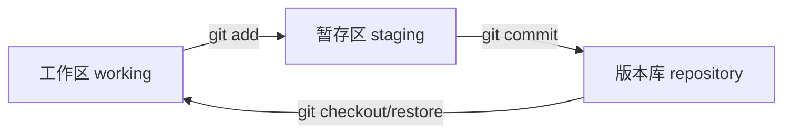

# 单人 Git 基础操作

## 三个区域



- 工作区：你正在编辑的文件。
- 暂存区：`git add` 后，准备提交的"购物车"。
- 版本库：`git commit` 后，正式存档的历史版本。

## 初始化与首次提交

```bash
git init                # 把当前目录变成 git 仓库
git status              # 查看工作区状态（最常用）
git add .               # 把所有改动加入暂存区
git commit -m "第一次提交"
```

## 查看历史与差异

```bash
git log --oneline       # 简洁查看提交历史
git log --graph         # 图形化查看分支历史
git diff                # 查看工作区相对暂存区的改动
git diff --cached       # 查看暂存区相对上次提交的改动
```

## Tips

- 改在工作区，`git add` 进暂存区，`git commit` 进版本库。
- `git status` 是单人开发最常用的命令，每次操作前先看一眼，心里有底。
- 单人开发的最小闭环就是"改代码 → add → commit"，配合 status / log / diff 三个观察命令，就能把版本管好。
