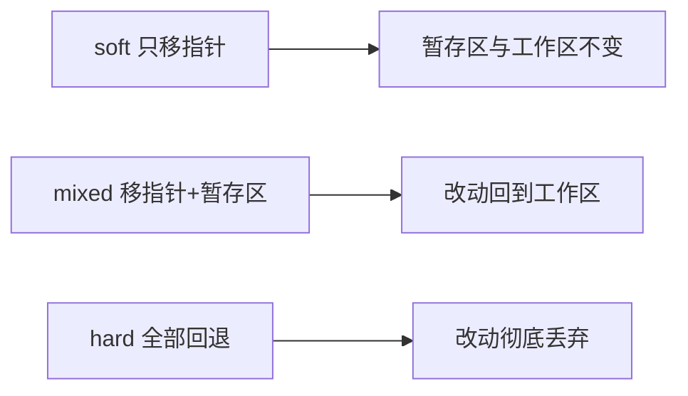

# 单人 Git 撤销与回退

## 撤销工作区改动

```bash
git restore <文件>      # 丢弃工作区某文件改动
git restore .           # 丢弃所有工作区改动
git checkout -- <文件>  # 老写法，等价
```

## 撤销暂存区

```bash
git restore --staged <文件>   # 把文件从暂存区撤回工作区
git reset HEAD <文件>         # 老写法
```

## 回退提交 reset

reset 有三种模式，区别在于"回退时动哪些区域"：



```bash
git reset --soft HEAD~1   # 撤销提交，改动留在暂存区
git reset --mixed HEAD~1  # 默认：撤销提交，改动回到工作区
git reset --hard HEAD~1   # 危险：彻底丢弃最近一次提交的改动
```

## revert 反向提交

`revert` 不删历史，而是生成一个"相反"的新提交，适合已经推送到远程的情况：

```bash
git revert HEAD
```

## reflog 后悔药

误操作后，`reflog` 记录了所有 HEAD 的移动，能找回"丢失"的提交：

```bash
git reflog
git reset --hard HEAD@{2}   # 回到 reflog 里记录的某个状态
```

## Tips

- `--hard` 会丢代码，慎用；安全回退优先 `--soft` 或 `--mixed`。
- 撤销分三层：工作区用 restore、暂存区用 restore --staged、提交用 reset/revert。
- reflog 是最后的后悔药，误操作后先用它找回"丢失"的提交。
