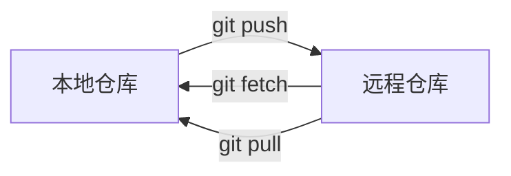

# 单人 Git 远程仓库与标签

## 关联远程

```bash
git remote -v                 # 查看远程
git remote add origin <URL>   # 添加远程
```

## 克隆与推送

```bash
git clone <URL>               # 克隆远程仓库到本地
git push -u origin main       # 首次推送并建立追踪
git push                      # 之后直接推送
```

## 拉取与同步

```bash
git fetch origin              # 拉取远程引用，不影响工作区
git pull origin main          # fetch + merge，一步到位
```



## 标签 tag

标签用于给某个提交打"里程碑"标记，比如发版：

```bash
git tag v1.0                  # 给当前提交打轻量标签
git tag -a v1.0 -m "发布1.0"  # 附注标签，带说明
git push origin v1.0          # 推送标签
git push origin --tags        # 推送所有标签
git tag                       # 查看标签列表
```

## Tips

- 单人同步用 pull 就够了；涉及多人协作时才需要 fetch 和 merge 分步走（见 team.md）。
- 远程仓库负责备份，push 后代码留在云端，不怕本地磁盘损坏。
- tag 给发版打标记，`git push origin --tags` 一次推送所有标签。
