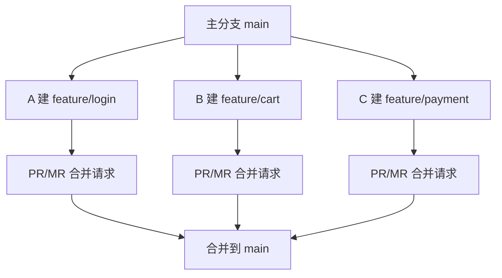
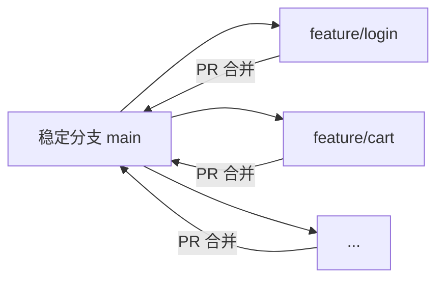

# Git 团队协作心得

## 写在前面

单人开发时，一个 main（或 master）分支就够了；但团队协作时，多人并行开发不同功能，如果都往 main 上直接提交，代码会互相覆盖、冲突不断。团队协作的核心是"分支隔离 + 合并审查"，下面是我在实践中总结的几点心得和完整流程。

## 心得一：先 fetch，别急着 pull

进团队后第一件事是同步最新代码。很多人习惯直接 `git pull`，但 pull 等于 `git fetch + git merge` 两步一起做，合并动作"悄悄"就发生了，容易让人措手不及。

我的习惯是分两步，先看后合：

```bash
git fetch                 # 先拉取全部远程引用，只更新本地追踪，不动工作区
git merge origin/main     # 看清楚再合并
```

只想要某个分支时：

```bash
git fetch origin feature-v1
```

心得：fetch 只"看"不"动"，merge 才真正合并。先看后合，心里有数。

## 心得二：功能分支要短命

多人开发的黄金法则是"永远不在 main 上直接开发"。每个人基于最新 main 建自己的功能分支，做完马上提 PR 合并，合并完立刻删分支。



心得：分支生命周期越短，冲突越少、代码越容易整合。我一般让特性分支存活不超过 2 天。

## 心得三：完整协作流程

### 1. 初始化仓库（负责人）

```bash
git init
git checkout -b main
git add . && git commit -m "Initial commit"
git remote add origin <仓库URL>
git push -u origin main
```

- `checkout -b main` 的 `-b` 是"创建并切换"分支。
- `push -u` 的 `-u` 会建立本地 main 与远程 origin/main 的追踪关系，之后直接 `git push` / `git pull` 即可。

### 2. 开发前准备（成员）

```bash
git clone <仓库URL>
git checkout main
git pull origin main   # 确保本地 main 最新
```

### 3. 建特性分支

```bash
git checkout main
git pull origin main          # 基于最新 main
git checkout -b feature/login # 从 main 切出分支
```

### 4. 日常提交与推送

```bash
git add .
git commit -m "实现登录表单"
git push -u origin feature/login   # 首次带 -u
git push                           # 后续直接 push
```

心得：每天收工前 push 一次，代码留在远程，不怕本地磁盘损坏。

### 5. 解决冲突

```bash
git checkout main
git pull origin main          # main 上自己不直接改，放心 pull

git checkout feature/login
git rebase main               # 推荐变基，历史更干净

# 手动解决冲突后
git add <冲突文件>
git rebase --continue

git push -f   # 变基后需强推，且只限自己的分支
```

### 6. 发起合并请求

```bash
git push origin feature/login
```

再到 Git 平台（GitHub/GitLab）建 PR/MR：源分支 `feature/login` → 目标分支 `main`，写清描述并指定审查人。

### 7. 审查与合并

审查者 Review 代码、提建议、跑 CI；开发者本地改完再 push 会自动更新 PR。合并时可选 Squash Merge（压成一次提交）或 Rebase Merge（保留原始提交）。

### 8. 合并后清理

```bash
git checkout main
git pull origin main
git branch -d feature/login   # 删除本地分支
```

## 心得四：冲突预防比解决更重要

冲突大多能提前避免，我的做法是：

- 每天开工前先 `git pull origin main` 保持同步。
- 小步提交，一次只做一个功能。
- 功能完成立即提 PR，别攒着。
- 模块化开发，减少代码耦合。



## 避坑清单

- 分支命名：`feature/<功能名>` 或 `fix/<问题名>`。
- 提交信息：清晰描述，如 `feat: 添加用户登录验证`。
- 禁止 `push -f` 到 main。
- 禁止直接在 main 上开发。

一句话总结：**短命分支 + 先 fetch 后合 + 强制审查 + 及时清理**，就是团队协作 Git 的安心之道。
