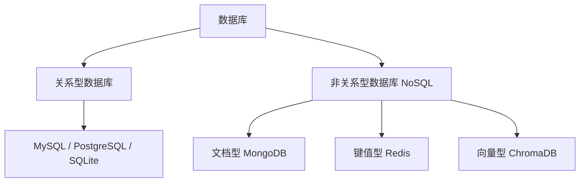
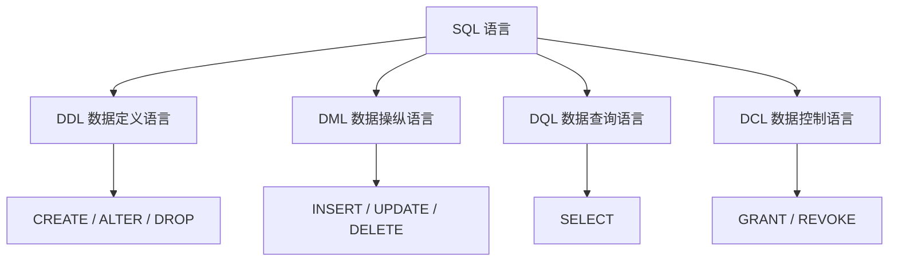

# 第1章 数据库与表基础

## 数据库分类

数据库按数据模型大致分为两大类：

- **关系型数据库（RDBMS）**：以"表"（行 + 列）组织数据，通过 SQL 操作，强调事务与数据一致性。代表有 MySQL、PostgreSQL、Oracle、SQLite。
- **非关系型数据库（NoSQL）**：以键值、文档、列族、图、向量等模型存储，结构更灵活，适合海量、高并发、非结构化数据。代表有 MongoDB（文档型）、Redis（键值型）、ChromaDB（向量型）。



**MySQL 属于关系型数据库**，它以表为核心、使用 SQL 语言、支持事务和外键，是本书的主角。

## 1.1 认识 MySQL

MySQL 是一款开源的关系型数据库管理系统，它把数据以"表"的形式组织起来，一张表由若干"行（记录）"和"列（字段）"组成。在实际开发中，我们通常先规划好库和表结构，再向表里写入和查询数据。本章是后续所有增删改查（INSERT、UPDATE、DELETE、SELECT）的基础。

SQL 语言按功能大致分为四类，理解它们能帮我们快速定位一条语句的作用：



其中建库建表属于 DDL，插入、修改、删除属于 DML，查询属于 DQL。本书从 INSERT 讲起，一路讲到联表查询，覆盖了日常最常用的 DML 与 DQL。

## 1.2 创建数据库

创建数据库使用 `CREATE DATABASE`，通常会带上字符集，避免中文乱码：

```sql
CREATE DATABASE IF NOT EXISTS school
    DEFAULT CHARACTER SET utf8mb4
    COLLATE utf8mb4_general_ci;
```

`utf8mb4` 是 MySQL 推荐使用的字符集，它完整支持中文和 Emoji 表情。`IF NOT EXISTS` 表示数据库不存在时才创建，避免重复执行报错。创建完成后用 `USE school;` 切换到该数据库。

## 1.3 常用数据类型

建表前要先确定每个字段的类型。常见类型分为三类：

- 整数型：`INT`（常用）、`TINYINT`、`BIGINT`。
- 小数型：`DECIMAL(M,D)`（精确小数，适合金额）、`FLOAT`、`DOUBLE`。
- 字符串与时间：`VARCHAR(n)`（可变长度字符串）、`CHAR(n)`（定长）、`TEXT`（长文本）、`DATE`、`DATETIME`、`TIMESTAMP`。

## 1.4 创建表与约束

创建表使用 `CREATE TABLE`，同时可以为字段添加约束来保证数据完整性：

```sql
CREATE TABLE student (
    id          INT PRIMARY KEY AUTO_INCREMENT,   -- 主键，自增
    name        VARCHAR(20) NOT NULL,             -- 非空
    gender      CHAR(1) DEFAULT '男',             -- 默认值
    age         INT,
    class_id    INT,
    email       VARCHAR(50) UNIQUE                -- 唯一
);
```

常见约束的含义如下：

- `PRIMARY KEY`：主键，唯一且非空，一张表只能有一个。
- `AUTO_INCREMENT`：自动增长，一般配合主键使用。
- `NOT NULL`：非空，插入时必须提供值。
- `UNIQUE`：唯一，不允许重复。
- `DEFAULT`：默认值，未提供时自动使用。
- `FOREIGN KEY`：外键，用来关联另一张表，第 7 章会专门讲解。

## 1.5 常见问题 Q&A

**Q1：建表时主键为什么通常用自增 INT？**
A：自增主键能保证每条记录有唯一且连续递增的标识，插入时无需手动指定，既方便又不易冲突。

**Q2：VARCHAR 和 CHAR 有什么区别？**
A：VARCHAR 按实际长度存储、节省空间；CHAR 定长存储、查询更快但浪费空间。姓名这类长度不固定的字段用 VARCHAR，性别等固定长度用 CHAR。

**Q3：为什么推荐 utf8mb4 而不是 utf8？**
A：MySQL 里的 utf8 其实是 utf8mb3，最多 3 字节，存不了 Emoji 等 4 字节字符；utf8mb4 才是完整实现。

**Q4：业务开发和 agent 开发分别用什么数据库，为什么？**
A：业务开发通常用 MySQL + MongoDB。MySQL 是关系型数据库，事务强一致、SQL 成熟，适合订单、用户、库存等结构化核心数据；MongoDB 是文档型 NoSQL，schema 灵活、易于横向扩展，适合日志、评论、内容等半结构化或海量数据。agent 开发常用 LLM wiki + ChromaDB + SQLite：LLM wiki 是向量/语义检索组件，负责对知识内容做语义化检索；ChromaDB 是向量数据库，底层存放文本 embedding 并支持相似度检索，是 RAG 的关键；SQLite 是嵌入式单文件关系库，零配置、无需独立服务，适合 agent 本地保存结构化状态。
