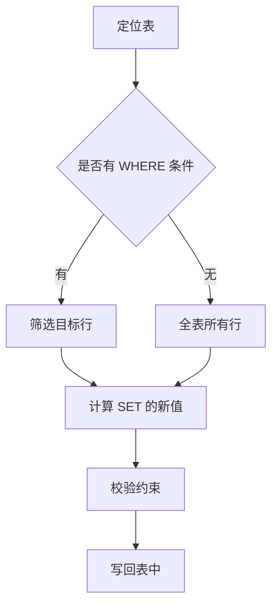

# 第3章 UPDATE 更新数据

## 3.1 UPDATE 的基本语法

`UPDATE` 用于修改表中已存在的记录，语法结构是：

```sql
UPDATE 表名 SET 字段1 = 值1, 字段2 = 值2, ... WHERE 条件;
```

`SET` 后面列出要修改的字段和新值，`WHERE` 后面指定要修改哪些行。例如把 `id` 为 1 的学生年龄改为 19：

```sql
UPDATE student SET age = 19 WHERE id = 1;
```

如果一行里有多个字段需要修改，用逗号隔开，一次更新完成：

```sql
UPDATE student SET age = 19, email = 'zhangsan_new@example.com'
WHERE id = 1;
```

## 3.2 WHERE 条件的重要性

`WHERE` 是 UPDATE 的"安全阀"。如果省略 `WHERE`，UPDATE 会修改整张表的所有记录，这通常是危险的误操作：

```sql
-- 危险！会把所有学生的年龄都改成 20
UPDATE student SET age = 20;
```

因此写 UPDATE 时，强烈建议先写 `WHERE` 再写 `SET`，或者先在 SELECT 里用同样的条件确认要影响的行数，避免误伤数据。

## 3.3 基于计算和函数的更新

UPDATE 里可以用表达式或函数来计算新值。例如给所有学生年龄加 1：

```sql
UPDATE student SET age = age + 1 WHERE class_id = 1;
```

也可以用字符串函数拼接内容：

```sql
UPDATE student SET name = CONCAT(name, '_新') WHERE id = 2;
```

## 3.4 更新流程



## 3.5 注意事项

- 更新的值必须满足字段的约束，例如更新到 `name` 为 `NULL` 会因 `NOT NULL` 失败。
- 更新 `UNIQUE` 字段时不能与已有记录冲突。
- 一条 UPDATE 通常只影响满足条件的若干行，影响行数可以通过执行后返回的提示查看。

## 3.6 常见问题 Q&A

**Q1：忘记写 WHERE 会怎样？**
A：会更新整张表所有行，属于常见高危误操作，执行前务必确认条件。

**Q2：能在 UPDATE 里用子查询吗？**
A：可以，例如把某班学生年龄改成该班平均年龄，但要注意子查询与目标表别名的使用规则。

**Q3：如何只更新影响行数的部分？**
A：UPDATE 无法直接限制条数，通常用 WHERE 精确圈定范围即可。
