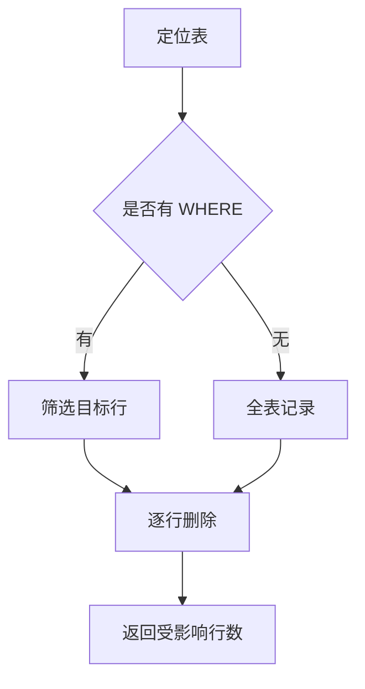

# 第4章 DELETE 删除数据

## 4.1 DELETE 的基本语法

`DELETE` 用于删除表中已有的记录，语法为：

```sql
DELETE FROM 表名 WHERE 条件;
```

它删的是"行"，而不是表结构。例如删除 `id` 为 3 的学生：

```sql
DELETE FROM student WHERE id = 3;
```

## 4.2 WHERE 条件决定删除范围

和 UPDATE 一样，`WHERE` 决定了删除哪些行。省略 `WHERE` 会清空整张表的所有数据，风险极高：

```sql
-- 危险！删除 student 表的所有记录
DELETE FROM student;
```

安全的做法是先查询确认：

```sql
SELECT * FROM student WHERE class_id = 3;   -- 先看
DELETE FROM student WHERE class_id = 3;     -- 再删
```

## 4.3 条件删除与批量删除

DELETE 支持用各种条件筛选，例如删除年龄大于 25 或邮箱为空的学生：

```sql
DELETE FROM student WHERE age > 25 OR email IS NULL;
```

也可以使用 `IN` 删除指定的一组记录：

```sql
DELETE FROM student WHERE id IN (4, 5, 6);
```

## 4.4 DELETE 与 TRUNCATE 的区别

两者都能清空表，但机制不同：

| 对比项 | DELETE | TRUNCATE |
| --- | --- | --- |
| 是否可加 WHERE | 可以 | 不可以 |
| 删除范围 | 满足条件的行 | 整张表所有行 |
| 自增主键 | 计数器保留 | 计数器重置 |
| 能否回滚 | 支持（事务中） | 通常不支持 |
| 速度 | 较慢（逐行删） | 快（直接释放） |

```sql
TRUNCATE TABLE student;   -- 清空表并重置自增
```

## 4.5 删除流程



## 4.6 注意事项

- 若表被外键引用，删除主表记录可能受约束限制（第 7 章详述）。
- 删除是不可逆操作，重要数据删除前务必备份。
- 正式环境禁用不加 WHERE 的 DELETE，可开启 SQL 安全更新模式加以约束。

## 4.7 常见问题 Q&A

**Q1：DELETE 和 TRUNCATE 该选哪个？**
A：想按条件删用 DELETE；想快速清空整表并重置自增用 TRUNCATE。TRUNCATE 不可加 WHERE 且通常不能回滚。

**Q2：删除的数据能恢复吗？**
A：在事务未提交前可以回滚，提交后一般无法恢复，重要数据请先备份。

**Q3：为什么删除时提示外键约束错误？**
A：说明该表记录被其他表通过外键引用，需先删除或解除关联数据。
