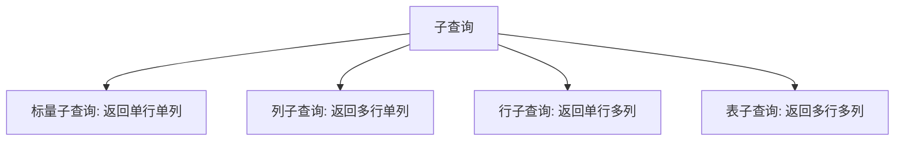

# 第9章 分组查询与子查询

## 9.1 分组查询回顾

分组查询用 `GROUP BY` 把字段值相同的行聚合成一组，再配合聚合函数做统计。例如统计每个班级的人数：

```sql
SELECT class_id, COUNT(*) AS 人数
FROM student
GROUP BY class_id;
```

分组后，SELECT 里只能出现分组字段和聚合函数。`WHERE` 在分组前过滤行，`HAVING` 在分组后过滤组：

```sql
SELECT class_id, COUNT(*) AS 人数
FROM student
WHERE age >= 18            -- 先过滤出成年的学生
GROUP BY class_id
HAVING COUNT(*) > 3;       -- 再筛出人数超过 3 的班级
```

## 9.2 多字段分组

`GROUP BY` 可以按多个字段分组，顺序靠前的字段是外层分组，靠后的是内层分组：

```sql
SELECT class_id, gender, COUNT(*) AS 人数
FROM student
GROUP BY class_id, gender;
```

这条语句按"班级 + 性别"组合统计人数，每个班级会拆成男女两组。

## 9.3 WITH ROLLUP 汇总

`WITH ROLLUP` 在分组结果后追加一行"总计"，便于直接看出整体汇总：

```sql
SELECT class_id, COUNT(*) AS 人数
FROM student
GROUP BY class_id WITH ROLLUP;
```

结果末尾会多出一行 `class_id` 为 NULL 的总计行，其人数是所有班级之和。

## 9.4 子查询概述与分类

子查询是嵌套在另一个查询中的 `SELECT`，外层查询称为主查询。按返回结果可分为四类：



## 9.5 子查询的使用位置

**WHERE 中**（配合 IN、比较运算符）：

```sql
-- 列子查询：查一班所有学生的姓名
SELECT name FROM student
WHERE class_id IN (SELECT id FROM class WHERE name = '一班');

-- 标量子查询：查年龄大于平均年龄的学生
SELECT name FROM student
WHERE age > (SELECT AVG(age) FROM student);
```

**FROM 中**（把子查询结果当临时表）：

```sql
SELECT t.class_id, t.人数
FROM (SELECT class_id, COUNT(*) AS 人数 FROM student GROUP BY class_id) AS t
WHERE t.人数 > 3;
```

**SELECT 中**（标量子查询作一列）：

```sql
SELECT name, (SELECT name FROM class c WHERE c.id = s.class_id) AS 班级
FROM student s;
```

## 9.6 EXISTS 与相关子查询

`EXISTS` 判断子查询是否返回行，只关心"有没有"，不关心具体值。相关子查询会引用外层查询的列，每处理外层一行就执行一次子查询：

```sql
SELECT c.name
FROM class c
WHERE EXISTS (
    SELECT 1 FROM student s WHERE s.class_id = c.id
);
```

它查出"至少有一个学生"的班级。`EXISTS` 常用于判断存在性，通常比 `IN` 更适合大数据量下的相关判断。

## 9.7 常见问题 Q&A

**Q1：子查询能用在 HAVING 里吗？**
A：可以。例如 `HAVING COUNT(*) > (SELECT AVG(人数) FROM ...)`，只要子查询返回单个值即可。

**Q2：IN 和 EXISTS 怎么选？**
A：IN 适合子查询结果集较小、外层表较大的情况；EXISTS 适合子查询依赖外层、且只判断存在性的场景，性能通常更好。

**Q3：相关子查询和普通子查询的区别？**
A：普通子查询可独立执行、只执行一次；相关子查询引用了外层列，外层每行都会触发一次子查询执行。
