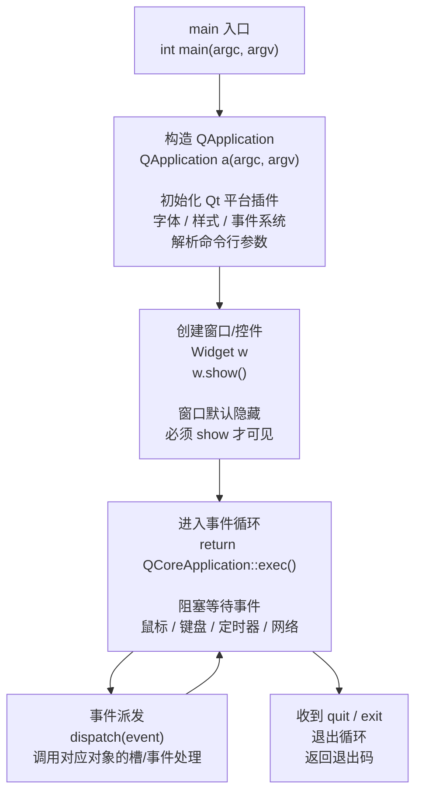

# Qt 01 第一个程序 学习笔记

## 本章重要 API 函数

| API | 功能 | 参数说明 | 头文件 |
|-----|------|----------|--------|
| `QApplication / QCoreApplication` | 应用程序对象，管理 GUI/非 GUI 事件循环与资源 | `int &argc, char **argv`：命令行参数引用（Qt 会接管并改写） | `<QApplication>` / `<QCoreApplication>` |
| `QApplication::exec()` | 进入主事件循环，阻塞直到 `quit()`/`exit()` | 无参数，返回退出码 `int` | `<QApplication>` |
| `QCoreApplication::exec()` | 同上，用于无 GUI 的核心应用 | 无参数 | `<QCoreApplication>` |
| `widget.show()` | 显示窗口/控件（默认隐藏） | 无参数 | `<QWidget>` |
| `app.quit()` / `QCoreApplication::exit(int)` | 请求退出事件循环 | 退出码，默认 0 | `<QCoreApplication>` |

> 💡 Tips：Qt5 与 Qt6 在事件循环入口上没有区别，`exec()` 在两个版本中都可用；`QApplication` 与 `QCoreApplication` 的差别在于前者额外初始化 GUI 子系统（字体、样式、剪贴板等）。本仓库的 `qt01_tst_` 用的是 `QCoreApplication`（控制台型），GUI 程序应改用 `QApplication`——这是初学者第一个容易搞混的点。

## 本章目录

> 点击条目可跳转到对应小节。

### 章节导航

- **[本章重要 API 函数](#本章重要-api-函数)**
- **[学习前后依赖](#学习前后依赖)**
- **[1. 概述](#1-概述)**
- **[2. 核心概念 / 原理](#2-核心概念--原理)**
- **[3. 程序启动与事件循环机制](#3-程序启动与事件循环机制)**
- **[4. 核心代码解析](#4-核心代码解析)**
- **[5. 运行效果 / 验证](#5-运行效果--验证)**
- **[容易踩坑](#容易踩坑)**
- **[学习要点总结](#学习要点总结)**
- **[Q&A（常见问题）](#qa常见问题)**
- **[Tips（全局速记）](#tips全局速记)**

---

## 学习前后依赖

| 方向 | 内容 |
| ---- | ---- |
| 前置基础 | C++ 基础（类、构造函数、main 函数）、对"命令行程序如何运行"有基本认知。 |
| 本章核心 | 理解 `QApplication`/`QCoreApplication` 与 `exec()` 的关系，写出并跑通最小 Qt 程序。 |
| 后续承接 | 直接为 [02 QWidget 基础](02-qt-widget-basic.md) 打基础——GUI 程序只是把 `QCoreApplication` 换成 `QApplication` 并 `show()` 一个 `QWidget`。 |

> 💡 Tips：为什么必须先会本章？因为后续每一篇（CMake 构建、资源系统、信号槽）运行的入口都是这里的 `main()` + `exec()`。事件循环不理解，后面"按钮点了没反应""定时器不触发"的问题就无从排查。

## 1. 概述

Qt 的第一个程序，本质是用 C++ 搭一个"能活着等待用户操作"的最小框架。一个普通的 C++ 程序 `main()` 返回后就结束了；而 Qt 程序在 `main()` 里构造一个 `QApplication`（或 `QCoreApplication`），最后调用 `exec()` 进入**事件循环（Event Loop）**——从此程序不再"顺序执行到底"，而是"空闲等待，有事件（鼠标点击、定时器、网络数据）才处理"。

本仓库 `qt01_tst_` 是一个**控制台型** Qt 程序，源码用 `QCoreApplication` 打印一句 `Hello Macintosh!` 后进入事件循环。它不弹窗，却完整展示了 Qt 应用骨架：应用对象 + `exec()`。

> 💡 Tips：本章最该记住的一句话——**`exec()` 不返回，程序就还活着；`exec()` 返回，程序就该退出了**。所有 GUI 交互都发生在 `exec()` 阻塞期间。一个反直觉点是：`QApplication a(argc, argv);` 这一行本身几乎瞬间完成，真正"卡住"的是最后的 `return QCoreApplication::exec();`。

## 2. 核心概念 / 原理

**应用对象（Q*Application）**：每个 Qt 程序有且仅有一个 `QApplication` 派生实例，它在栈上创建（`QCoreApplication a(argc, argv);`）。它负责：
1. 初始化 Qt 内部子系统（事件分发器、字体引擎、平台插件）；
2. 持有命令行参数（`argv`）并解析 Qt 专用参数（如 `-style`、`-font`）；
3. 管理所有窗口的顶层事件循环。

**事件循环（Event Loop）**：`exec()` 内部是一个 `while` 循环，反复从事件队列取事件、派发到对应对象。伪代码逻辑类似：

```cpp
int QCoreApplication::exec() {
    while (!quitRequested) {
        Event e = eventQueue.waitAndPop();  // 阻塞等待
        dispatch(e);                         // 派发给目标对象
    }
    return exitCode;
}
```

关键点：事件循环是**单线程、协作式**的。如果你在 `exec()` 之前或某个槽函数里写一个 `while(true){}` 死循环，事件循环就被你霸占，界面会"卡死"——因为再没有机会回到 `dispatch(e)`。

> 💡 Tips：原理上最容易误解的是"Qt 是多线程的吗？"——默认不是。一个 `exec()` 只运行在调用它的那个线程（主线程/GUI 线程）。界面卡死几乎都是因为某段同步代码在 GUI 线程里跑太久，把事件循环堵住了，而不是 Qt 自己"没响应"。

## 3. 程序启动与事件循环机制



> 💡 Tips：流程里最关键的箭头是 `D --> E` 与 `E --> D` 的回环——它表达"事件循环不断取事件、派发、再等待"。`w.show()` 必须在 `exec()` 之前，否则窗口虽然被创建但一直隐藏，永远等不到用户点击；而 `quit()`/`exit()` 正是让循环从回环里跳到 `F` 的出口。

## 4. 核心代码解析

`qt01_tst_/main.cpp` 实际源码（控制台型 Qt 程序）：

```cpp
#include <QCoreApplication>
#include <iostream>

int main(int argc, char *argv[])
{
    QCoreApplication a(argc, argv);          // ① 唯一的应用对象

    std::cout<<"Hello Macintosh!"<<std::endl; // ② 普通输出，证明程序已启动

    return QCoreApplication::exec();          // ③ 进入事件循环，阻塞
}
```

逐行讲解：
- **① `QCoreApplication a(argc, argv);`**：在栈上构造应用对象。注意参数是**引用** `argc&`/`argv`——Qt 会吞噬自己认识的命令行参数（例如 `-qwindowgeometry`），并把剩余的留给你的程序。删掉这一行，`exec()` 会因"没有应用实例"而直接崩溃或报错。
- **② `std::cout`**：这里用标准库输出而非 `qDebug()`，说明 Qt 程序里完全可以使用 C++ 标准库；Qt 不排斥 `iostream`。
- **③ `return QCoreApplication::exec();`**：这是整段代码的"心脏"。它进入事件循环，**永远不会主动返回**（除非调用 `quit`/`exit` 或最后一个顶层窗口被关闭）。若把它删掉改成 `return 0;`，程序会一闪而过、控制台打印完就退出——你根本来不及观察，也谈不上"等待事件"。

> 💡 Tips：这段代码藏着一个细节——为何 GUI 工程（如 `qt02_tst_`、`qt03_tst-cmake_`）的 main 里写的是 `QApplication a(argc, argv);` 而非 `QCoreApplication`？因为 `QApplication` 继承自 `QCoreApplication`，在后者基础上额外初始化了 GUI 子系统（窗口、绘图、样式）。GUI 程序若错用 `QCoreApplication`，`show()` 出来的窗口会缺少样式或平台行为异常。本篇源文件是特意的"控制台最小版"，不要误以为所有 Qt 程序都该用 `QCoreApplication`。

## 5. 运行效果 / 验证

- **编译运行 `qt01_tst_`**：控制台输出 `Hello Macintosh!` 后程序**不立即退出**（因为卡在 `exec()`）。按 `Ctrl+C` 或在任务管理器结束进程才会退出。
- 若用 `qmake` 构建（`qt_tst_01.pro` 里 `QT = core`、`CONFIG += c++17 cmdline`），生成的是**命令行可执行文件**，无窗口。
- 想验证"事件循环确实活着"：可临时加一行 `QTimer::singleShot(5000, &a, &QCoreApplication::quit);`，观察程序是否在 5 秒后自动退出——能自动退出就证明事件循环在工作。

> 💡 Tips：验证时最易误判的"假象"是：看到 `Hello Macintosh!` 打印出来就以为"跑通了"。其实只要 `main()` 能执行，这行输出就会出现，与事件循环是否真的进入无关。真正的验证点是"程序有没有在 `exec()` 处阻塞等待"——用上面 `QTimer::singleShot` 自动退出法，或用调试器在 `exec()` 上下断点看是否停住。

## 容易踩坑（注意点）

- **坑 1：`exec()` 之前就 `return 0`。** 现象：窗口一闪而过 / 程序秒退。原因：没进入事件循环。规避：把 `return` 改成 `return a.exec();`。
- **坑 2：GUI 程序用了 `QCoreApplication`。** 现象：窗口无样式、菜单/托盘异常。原因：缺 GUI 子系统初始化。规避：GUI 程序一律用 `QApplication`。
- **坑 3：在 `main()` 里写了死循环再 `exec()`。** 现象：界面卡死，点击事件无响应。原因：事件循环根本没机会启动。规避：把耗时逻辑放进线程或定时器，保证 `exec()` 能尽快进入并持续 `dispatch`。
- **坑 4：应用对象 `a` 是局部变量却提前出作用域。** 现象：程序崩溃。原因：Qt 内部大量静态指针指向 `a`，`a` 被析构后悬空。规避：保证 `a` 的生命周期覆盖整个 `exec()` 期间（通常放在 `main` 栈上即可）。
- **坑 5：以为 `QApplication` 可以创建多个。** 现象：报错 `QApplication was already created`。原因：Qt 限制单实例。规避：整个进程只 `new`/`构造` 一个。

## 学习要点总结

### 核心知识点
1. 每个 Qt 程序有唯一 `QApplication`/`QCoreApplication` 实例，负责初始化与事件循环。
2. `exec()` 进入事件循环并阻塞，是程序"活着等待交互"的核心。
3. GUI 用 `QApplication`，纯逻辑/控制台用 `QCoreApplication`，二者继承关系决定能力差异。

### 关键 API
- `QApplication` / `QCoreApplication`：应用对象构造。
- `exec()`：进入事件循环。
- `quit()` / `exit()`：退出循环。

### 下一步学习
- 进入 [02 QWidget 基础](02-qt-widget-basic.md)：把 `QCoreApplication` 换成 `QApplication`，`show()` 一个真正的窗口，并学习 `.ui` 设计与自动连接槽。

> 💡 Tips：本篇与知识地图里"下一步"那篇（02）是直接挂钩的——02 唯一多出来的东西就是 `QWidget w; w.show();` 和 `.ui` 文件，事件循环、`Application` 的概念完全一致，学完本篇 02 几乎只差"显示窗口"这一步。

## Q&A（常见问题）

**Q1：为什么我的 Qt 程序一运行就退出，窗口看不见？**  A1：99% 是因为 `main()` 里没有调用 `exec()`，或者写了 `return 0;` 提前返回。正确写法：`QApplication a(argc, argv); Widget w; w.show(); return a.exec();`。注意 `show()` 要在 `exec()` 之前调用，窗口默认隐藏，不 `show()` 永不显示。

**Q2：`QApplication` 和 `QCoreApplication` 到底该用哪个？**  A2：只要用到任何 GUI 元素（窗口、按钮、绘图、`QWidget` 派生类），就必须用 `QApplication`；只做后台逻辑/控制台输出用 `QCoreApplication` 即可。本仓库 `qt01_tst_` 是刻意的控制台版本，正式 GUI 工程请参考 `qt02_tst_` 用 `QApplication`。

**Q3：Qt5 和 Qt6 在第一个程序上有区别吗？**  A3：入口写法完全一致（`QApplication` + `exec()`）。差异在**构建侧**：Qt5 的 `qmake` 用 `.pro` 文件（如本仓库 `qt_tst_01.pro` 的 `QT = core`），而 Qt6 官方推荐 `CMake`（见 [03](03-cmake-build.md) / [04](04-cmake-qt6.md)）。代码层面从 Qt5 升级 Qt6 几乎零改动。

## Tips（全局速记）

### 最容易忽视的细节
1. `exec()` 是"阻塞点"也是"存活点"——程序在它内部才真正开始响应事件。
2. 应用对象 `Q*Application` 必须是**单例且生命周期覆盖 `exec()`**，通常放 `main` 栈上最安全。
3. 命令行参数以**引用**传入，Qt 会"偷吃"自己认识的参数再留给程序。

### 踩坑记录
- "打印出 Hello 就以为成功"的错觉：输出成功只说明 `main` 执行了，不能证明事件循环已进入。务必用 `QTimer::singleShot(..., quit)` 或断点确认 `exec()` 在阻塞。
- GUI 工程误用 `QCoreApplication`：编译能通过，运行起来窗口行为怪异，这种"能跑但不对"的坑最隐蔽。

### 与后续章节的衔接
1. **02 QWidget 基础**：在 `QApplication` 基础上 `show()` 窗口，引入 `.ui` 和信号槽——本章事件循环是它运行的土壤。
2. **03/04 CMake 构建**：本章用 `qmake`（`.pro`）能跑，但在 Qt6 时代更推荐 CMake，构建脚本的差异在 03、04 展开。
3. **07 RCC 资源系统**：资源文件最终被编译进可执行体，程序启动时由 `QApplication` 初始化并可在 `exec()` 期间随时访问。

### 设计决策思考
- **为什么 Qt 需要一个 `QApplication` 单例，而不是让 `Widget` 自己管循环？** 因为窗口、剪贴板、字体、拖拽、多窗口之间的事件协调都是"全局"的，必须有一个中心对象统一持有平台插件与事件队列。把这份职责放在每个窗口里会重复且冲突，所以抽象成唯一的 `Q*Application`。
- **为什么 `exec()` 要阻塞而不是返回？** GUI 程序的本质是"被动响应"，没有确定的结束时刻（用户随时可能点关闭）。阻塞式事件循环让"程序退出"变成一个可以被事件触发的**主动决策**（`quit`/`exit`），而不是 `main()` 顺序跑到末尾的自然结束。
