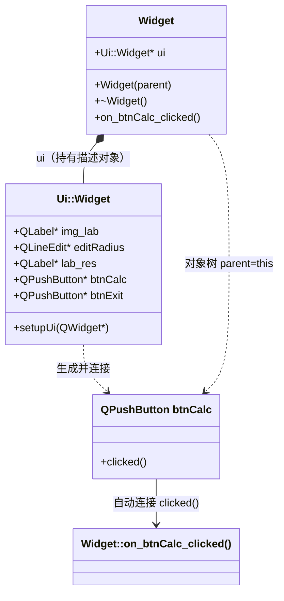

# Qt 02 QWidget 基础 学习笔记

## 本章重要 API 函数

| API | 功能 | 参数说明 | 头文件 |
|-----|------|----------|--------|
| `QWidget` | 所有界面控件的基类 | `QWidget *parent = nullptr`：父对象，用于对象树与内存自动回收 | `<QWidget>` |
| `Ui::Widget` | `uic` 由 `.ui` 生成的界面类 | 无构造参数；含 `setupUi()` 与各控件成员 | `ui_widget.h`（自动生成） |
| `ui->setupUi(this)` | 把 `.ui` 描述的控件实例化并挂到当前窗口 | `QWidget *`：父窗口（一般传 `this`） | 生成的 `ui_widget.h` |
| `on_btnCalc_clicked()` | 自动连接槽（命名约定触发） | 无参数；由 `setupUi` 内的 `QMetaObject::connectSlotsByName` 自动绑定 | `widget.cpp` |
| `qDebug()` | Qt 调试输出 | 流式输出，类似 `cout` | `<QDebug>` |
| `delete ui` | 析构时释放界面对象 | 无参数；释放 `new` 出来的 `Ui::Widget` | `widget.cpp` 析构函数 |

> 💡 Tips：`on_对象名_信号()` 这种"自动连接槽"极易被误认为是魔法——它其实由 `setupUi()` 里调用的 `QMetaObject::connectSlotsByName(this)` 实现：只要你的槽函数名严格符合 `on_<objectName>_<signal>` 格式，`uic` 生成的代码就会帮你连接。名字拼错（大小写、下划线）就不会连接，按钮点了"毫无反应"却编译通过。

## 本章目录

> 点击条目可跳转到对应小节。

### 章节导航

- **[本章重要 API 函数](#本章重要-api-函数)**
- **[学习前后依赖](#学习前后依赖)**
- **[1. 概述](#1-概述)**
- **[2. 核心概念 / 原理](#2-核心概念--原理)**
- **[3. Ui 类与对象树机制](#3-ui-类与对象树机制)**
- **[4. 核心代码解析](#4-核心代码解析)**
- **[5. 运行效果 / 验证](#5-运行效果--验证)**
- **[容易踩坑](#容易踩坑)**
- **[学习要点总结](#学习要点总结)**
- **[Q&A（常见问题）](#qa常见问题)**
- **[Tips（全局速记）](#tips全局速记)**

---

## 学习前后依赖

| 方向 | 内容 |
| ---- | ---- |
| 前置基础 | [01 第一个程序](01-qt-first-program.md) 的 `QApplication` + `exec()` 事件循环入口。 |
| 本章核心 | `.ui` 界面设计、`Ui::Widget` 指针、`on_对象名_信号` 自动连接、对象树与 `delete ui`。 |
| 后续承接 | 为 [07 RCC 资源系统](07-rcc-resource.md) 打基础——本篇 `my_img.qrc` 已用到 `.qrc`；也衔接信号槽专题（自动连接是信号槽的便捷写法）。 |

> 💡 Tips：必须先会 01，因为本篇 `main()` 仍然是 `QApplication + exec()`，只是多了一个 `Widget w; w.show();`。本篇最关键的"自动连接槽"又直接服务于后续所有信号槽章节——不理解 `on_btnCalc_clicked` 为何自动生效，后面手写 `connect()` 就会困惑。

## 1. 概述

`QWidget` 是 Qt 所有可视控件的**共同祖先**：按钮 `QPushButton`、标签 `QLabel`、输入框 `QLineEdit` 全都继承自它。学习 `QWidget` 基础，本质是学会三件事：

1. 用 **`.ui` 文件 + `uic`** 可视化搭界面（Qt Designer 拖控件），再用 `Ui::Widget` 指针在 C++ 里操作这些控件；
2. 用 **`on_<对象名>_<信号>()` 命名约定** 让按钮点击自动调用你的槽函数；
3. 理解 **对象树（Object Tree）**：父子 `QWidget` 之间自动管理生命周期，`delete` 父对象时子对象一并释放。

本仓库 `qt02_tst_` 是一个"圆面积计算器"：`widget.ui` 里放了半径输入框、计算按钮、结果标签，还引用了一张 `.qrc` 里的 `emoji.png` 图片；`widget.cpp` 用 `on_btnCalc_clicked()` 读取半径、算面积并刷新标签。

> 💡 Tips：本章最该记住的一句话——**`.ui` 不是"界面"，而是"界面描述"**。`uic` 在编译期把它翻译成 `ui_widget.h` 里的 `Ui::Widget` 类；你 `new Ui::Widget` 后调用 `setupUi(this)`，控件才真正被创建出来。一个反直觉点：你在 Designer 里看到的对象名（`btnCalc`、`editRadius`）必须和 `on_xxx_clicked` 里的名字**逐字符一致**，否则自动连接失效却无编译错误。

## 2. 核心概念 / 原理

**Ui 命名空间与 `setupUi`**：`widget.h` 里前向声明了 `namespace Ui { class Widget; }`，实际定义在 `uic` 生成的 `ui_widget.h`。这个生成类持有 `.ui` 里所有控件的指针（`ui->editRadius`、`ui->btnCalc`、`ui->lab_res`）。`setupUi(this)` 负责：
- `new` 出所有子控件并设置父子关系；
- 应用 `.ui` 里的属性（大小、文本、布局）；
- 调用 `QMetaObject::connectSlotsByName(this)` 完成自动连接。

**自动连接槽机制**：Qt 的元对象系统会在 `setupUi` 末尾扫描当前对象（即 `this`）的所有槽函数，凡名称匹配 `on_<objectName>_<signal>` 的，就自动调用 `connect(对应控件, 信号, this, 槽)`。所以 `on_btnCalc_clicked` 会自动连到 `btnCalc` 的 `clicked()` 信号——你**不必手写 `connect`**。

**对象树**：`QWidget` 构造时若传入 `parent`，该控件被加入父对象的子对象列表。父对象析构时会递归 `delete` 所有子对象。这就是为什么 `main` 里 `Widget w;` 是栈对象，程序结束时自动析构、连带释放它内部 `new` 的控件。

> 💡 Tips：原理上最易误解的是"`delete ui` 到底删了什么"。`ui` 指向的是 `Ui::Widget` 这个**"界面描述对象"**（它内部持有指向各子控件的指针），而真正的控件（按钮、标签）已经被挂到了 `this`（Widget）的对象树上。析构 `Widget` 时对象树会释放那些控件；`delete ui` 只是释放"描述对象"本身，二者不重复删除同一块内存——所以必须两个都释放，缺一不可。

## 3. Ui 类与对象树机制



> 💡 Tips：图里最关键的两条关系——`Widget *-- ui` 表示 `Widget` 用指针持有"界面描述对象"（析构时 `delete ui`）；`btnCalc --> on_btnCalc_clicked()` 表示信号到槽的自动连接。注意 `Ui::Widget` 里的 `btnCalc` 指针与对象树里真正挂在 `Widget` 下的 `btnCalc` 控件是**同一个对象**，`setupUi` 把它既登记进对象树，又存进 `Ui` 类供你访问。

## 4. 核心代码解析

**`widget.h`（节选）**：

```cpp
class Widget : public QWidget {
    Q_OBJECT                       // ① 启用元对象系统（信号槽、自动连接的前提）
public:
    explicit Widget(QWidget *parent = nullptr);  // ② explicit 禁止隐式转换
    ~Widget() override;
public slots:
    void on_btnCalc_clicked();     // ③ 自动连接槽，命名约定触发
private:
    Ui::Widget *ui;                // ④ 界面描述对象指针
};
```

**`widget.cpp`**：

```cpp
#include<QDebug>
#include "widget.h"
#include "ui_widget.h"

Widget::Widget(QWidget *parent)
    : QWidget(parent)              // ⑤ 把 parent 传给基类，纳入对象树
    , ui(new Ui::Widget)           // ⑥ new 出界面描述对象
{
    ui->setupUi(this);             // ⑦ 实例化控件 + 自动连接槽
}

Widget::~Widget() {
    delete ui;                     // ⑧ 释放描述对象（控件由对象树释放）
}

void Widget::on_btnCalc_clicked() {
    qDebug() << "batton Calc clicked";                 // ⑨ 调试输出
    double radius = ui->editRadius->text().toDouble(); // ⑩ 读输入框
    double res = radius * radius * 3.14;               // ⑪ 算面积
    QString pattern = "结果：%1";
    ui->lab_res->setText(pattern.arg(res));            // ⑫ 刷新结果标签
}
```

逐段要点：
- **① `Q_OBJECT` 宏**：没有它，`on_btnCalc_clicked` 的自动连接就无法工作（`connectSlotsByName` 依赖元对象信息）。删掉它，编译期可能因 `ui_widget.h` 引用元对象而报错或运行期连接失败。
- **② `explicit`**：防止 `Widget w = somePointer;` 这种意外隐式转换，是 Qt 构造函数的标准写法。
- **⑤ `: QWidget(parent)`**：把父对象传给基类，子控件（在 `setupUi` 内）也会被设为 `this` 的子对象，从而进入对象树。
- **⑩ `text().toDouble()`**：`QLineEdit` 返回 `QString`，`toDouble()` 解析失败返回 `0.0`——注意空输入会算出面积 0，这是 `on_btnCalc_clicked` 里藏着的"不报错但结果怪"的细节。

> 💡 Tips：这段代码里最容易被忽视的细节是 **`ui` 与对象树的分工**：`setupUi(this)` 创建的按钮/标签被挂在 `Widget` 对象树下，由 `Widget` 析构时自动 `delete`；而 `ui` 这个"描述对象"本身不在对象树里，所以必须显式 `delete ui`。若漏掉 `delete ui`，会内存泄漏；若对控件调用 `delete`（而非 `ui`），会与对象树重复释放导致崩溃。

## 5. 运行效果 / 验证

- 运行后弹出一个窗口：顶部一张 `emoji.png` 图片（来自 `my_img.qrc` 的 `:/img/myabc/emoji.png`），中间"圆的半径："输入框，底部"计算""退出"两个按钮。
- 在输入框填 `2`，点"计算"，结果标签变为 `结果：12.56`。
- 点"退出"按钮，窗口关闭（`.ui` 里 `btnExit` 的 `clicked()` 被 `connections` 直接连到了 `Widget` 的 `close()` 槽）。
- 点"计算"时，Qt Creator 的"应用程序输出"面板会打印 `batton Calc clicked`（`qDebug` 输出，注意源码里把 button 拼成了 batton，是个原文件笔误）。

> 💡 Tips：验证时容易误判"成功"的假象——窗口能弹出来、图片能显示，就以为全对了。但**自动连接槽是否真的工作**要靠点按钮看结果标签是否变化来确认；`qDebug` 打印 `batton Calc clicked` 是更直接的证据。如果按钮点了没反应，先别怀疑逻辑，先怀疑 `on_btnCalc_clicked` 名字是否与 `.ui` 里的 `objectName`（btnCalc）完全匹配。

## 容易踩坑（注意点）

- **坑 1：自动连接槽名字拼错。** 现象：按钮点了没反应，编译却通过。原因：`on_btnCalc_clicked` 里的 `btnCalc` 必须和 `.ui` 的 `objectName` 完全一致（区分大小写）。规避：在 Designer 里复制对象名，粘贴到函数名。
- **坑 2：忘记 `Q_OBJECT` 宏。** 现象：信号槽/自动连接失效，或 `moc` 报错。原因：元对象系统未启用。规避：凡用到信号槽的类，类体首行加 `Q_OBJECT` 并重新构建（触发 `moc`）。
- **坑 3：漏写/重复 `delete ui`。** 现象：内存泄漏或双击崩溃。原因：混淆了"描述对象 `ui`"与"对象树上的控件"。规避：`ui` 用 `new` 创建就一定要在析构里 `delete ui`；控件不要手动 `delete`。
- **坑 4：在 `setupUi` 之前访问 `ui->xxx`。** 现象：空指针崩溃。原因：控件还没被 `setupUi` 创建。规避：所有 `ui->` 访问放在 `setupUi(this);` 之后。
- **坑 5：`.pro` 漏写 `FORMS += widget.ui`。** 现象：`ui_widget.h` 不生成，编译找不到 `Ui::Widget`。原因：`uic` 没被触发。规避：`.pro` 里 `FORMS` 必须登记所有 `.ui`，本仓库 `qt_tst_02.pro` 已正确包含。
- **坑 6：`toDouble()` 解析失败静默返回 0。** 现象：空输入算出面积 0 不报错。原因：`QString::toDouble` 失败返回 `false` 且结果置 0。规避：用 `bool ok; double r = s.toDouble(&ok);` 判断解析是否成功。

## 学习要点总结

### 核心知识点
1. `.ui` 由 `uic` 编译为 `Ui::Widget` 类，`setupUi(this)` 实例化控件并自动连接。
2. 自动连接槽 `on_<objectName>_<signal>()` 由 `connectSlotsByName` 实现，命名必须精确匹配。
3. 对象树让父子 `QWidget` 自动管理生命周期；`ui` 描述对象需手动 `delete`。

### 关键 API
- `Ui::Widget` + `setupUi(this)`：界面实例化。
- `on_<obj>_<signal>()`：自动连接槽。
- `qDebug()`：调试输出。
- `delete ui`：释放界面描述对象。

### 下一步学习
- 进入 [03 CMake 构建](03-cmake-build.md)：把本篇的 `qmake .pro` 工程改造成 CMake 工程，理解 `AUTOUIC/AUTOMOC/AUTORCC`。

> 💡 Tips：本篇与知识地图里"下一步"那篇（03）直接挂钩——03 会用 CMake 重写一个几乎相同的 `Widget` 工程，差异只在构建系统，`.ui` 与 `on_xxx_clicked` 的写法完全复用，学完本篇 03 几乎是"换个构建脚本"。

## Q&A（常见问题）

**Q1：`on_btnCalc_clicked` 为什么不用写 `connect` 也能生效？**  A1：因为 `setupUi(this)` 内部调用了 `QMetaObject::connectSlotsByName(this)`，它会扫描 `this` 的所有槽，凡是名字符合 `on_<objectName>_<signal>` 格式的，自动建立 `connect(对象, 信号, this, 槽)`。注意前提是类有 `Q_OBJECT` 宏且名字拼写与 `.ui` 的 `objectName` 完全一致。想更可控可改成手写 `connect(ui->btnCalc, &QPushButton::clicked, this, &Widget::on_btnCalc_clicked);`。

**Q2：`ui` 指针和对象树上的控件是同一份吗？会重复 `delete` 吗？**  A2：不是同一份角色。`Ui::Widget`（即 `ui`）是一个"界面容器对象"，它内部持有指向各控件的指针；真正的控件（按钮、标签）由 `setupUi` 创建并设为 `Widget` 的子对象（进入对象树）。`delete ui` 释放的是"容器对象"本身，对象树析构 `Widget` 时释放的是那些控件——两者释放的是不同内存，不会重复。务必两个都释放，缺一不可。

**Q3：Qt5 和 Qt6 在 `.ui` / 自动连接上有区别吗？**  A3：几乎无区别，`uic` 生成的 `Ui` 类、`setupUi`、自动连接机制在 Qt5/Qt6 完全一致。差异仍在**构建侧**：Qt5 用 `qmake` 的 `FORMS += widget.ui`，Qt6 推荐 `CMake` 的 `AUTOUIC`（见 03、04）。代码与 `.ui` 文件可跨版本复用。

## Tips（全局速记）

### 最容易忽视的细节
1. **`Q_OBJECT` 是信号槽/自动连接的总开关**，忘写它，所有自动连接静默失效。
2. **自动连接靠"名字"而非"声明"**——函数名拼错只在运行时表现成"点了没反应"，编译期零提示。
3. **`ui` 必须 `new`/`delete` 配对**，而它指向的控件由对象树管，二者职责不同。

### 踩坑记录
- "窗口弹出、图片显示就以为全对"的错觉：这些只证明 `.ui` 加载成功，不证明 `on_btnCalc_clicked` 被连接。务必点按钮验证结果标签变化，或看 `qDebug` 输出。
- `toDouble()` 失败静默返回 0：空输入算面积 0 不报错，调试时应加 `bool ok` 判断，否则难定位"为什么结果是 0"。

### 与后续章节的衔接
1. **03/04 CMake 构建**：本篇的 `widget.ui`/`widget.cpp`/`widget.h` 三件套会原样进入 CMake 工程，`AUTOUIC` 取代 `qmake` 的 `FORMS`。
2. **07 RCC 资源系统**：本篇 `my_img.qrc` 与 `.ui` 里的 `:/img/myabc/emoji.png` 已经用到资源系统，`07` 会系统讲解 `:/` 前缀与 `rcc` 编译流程。
3. **信号槽专题**：`on_xxx_clicked` 是 `connect` 的语法糖，后续手写 `connect`、自定义信号都建立在本篇基础上。

### 设计决策思考
- **为什么 Qt 要把界面拆成 `.ui`（XML）+ `Ui::Widget`（生成类）两层？** 让"界面描述"和"业务逻辑"解耦：设计师改 `.ui` 不改 C++，程序员在 `widget.cpp` 写逻辑不碰布局。编译期 `uic` 把 XML 翻译为 C++，兼顾可视化效率与运行性能（无运行时 XML 解析开销）。
- **为什么用自动连接而不是强制手写 `connect`？** 自动连接降低样板代码、减少信号/槽签名写错的可能；代价是"连接隐式发生"、名字拼错难排查。Qt 提供了两种并存方案：新手用自动连接，复杂/动态场景用手写 `connect` 更清晰可控。
