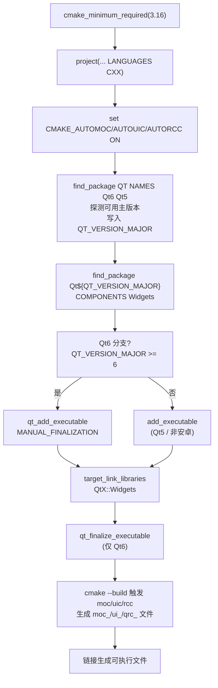

# Qt 03 CMake 构建 Qt 工程入门 学习笔记

## 本章重要 API 函数

| API / 命令 | 功能 | 参数说明 | 来源 |
|------------|------|----------|------|
| `find_package(QT NAMES Qt6 Qt5 REQUIRED COMPONENTS Widgets)` | 探测并加载 Qt，优先 Qt6 回退 Qt5 | `NAMES` 列出候选版本；`COMPONENTS` 指定需要的模块（如 Widgets） | CMake |
| `find_package(Qt${QT_VERSION_MAJOR} REQUIRED COMPONENTS Widgets)` | 按探测到的主版本加载对应 Qt | `QT_VERSION_MAJOR` 由上一句设置 | CMake |
| `set(CMAKE_AUTOMOC/AUTOUIC/AUTORCC ON)` | 开启 moc/uic/rcc 自动处理 | `ON` 启用；缺省 OFF | CMake |
| `qt_add_executable(...)` | Qt 版可执行目标（Qt6 推荐） | 目标名 + 源文件；Qt6 可加 `MANUAL_FINALIZATION` | Qt6 CMake |
| `add_executable(...)` | 标准可执行目标（Qt5 路径用） | 目标名 + 源文件 | CMake |
| `qt_finalize_executable(...)` | Qt6 最终化目标（处理部署/元数据） | 目标名 | Qt6 CMake |
| `target_link_libraries(... Qt${QT_VERSION_MAJOR}::Widgets)` | 链接 Qt 模块 | `PRIVATE` 指定可见性 | CMake |

> 💡 Tips：`AUTOMOC/AUTOUIC/AUTORCC` 三者缺一不可——`AUTOMOC` 处理 `Q_OBJECT` 宏生成 `moc_*.cpp`；`AUTOUIC` 把 `.ui` 生成 `ui_*.h`；`AUTORCC` 把 `.qrc` 生成 `qrc_*.cpp`。本仓库 `qt03_tst-cmake_` 的 CMakeLists 三个全开，少一个对应文件就不会被自动编译，典型报错是"找不到 `Ui::Widget`"或"`moc` 相关未定义引用"。

## 本章目录

> 点击条目可跳转到对应小节。

### 章节导航

- **[本章重要 API 函数](#本章重要-api-函数)**
- **[学习前后依赖](#学习前后依赖)**
- **[1. 概述](#1-概述)**
- **[2. 核心概念 / 原理](#2-核心概念--原理)**
- **[3. CMake 配置与构建流程机制](#3-cmake-配置与构建流程机制)**
- **[4. 核心代码解析](#4-核心代码解析)**
- **[5. 运行效果 / 验证](#5-运行效果--验证)**
- **[容易踩坑](#容易踩坑)**
- **[学习要点总结](#学习要点总结)**
- **[Q&A（常见问题）](#qa常见问题)**
- **[Tips（全局速记）](#tips全局速记)**

---

## 学习前后依赖

| 方向 | 内容 |
| ---- | ---- |
| 前置基础 | [01 第一个程序](01-qt-first-program.md) 的 `QApplication`+`exec()` 入口；[02 QWidget 基础](02-qt-widget-basic.md) 的 `.ui`/`Ui::Widget`/`Q_OBJECT`。 |
| 本章核心 | 用 CMake 替代 `qmake` 构建 Qt 工程：find_package、AUTO* 三开关、qt_add_executable。 |
| 后续承接 | 直接为 [04 CMake+Qt6](04-cmake-qt6.md) 打基础——04 是本章 Qt6 分支的"纯 Qt6 简化版"，并在部署脚本上更进一步。 |

> 💡 Tips：为什么必须先会 01/02？因为本章 CMakeLists 里的源文件（`main.cpp`、`widget.cpp/.h/.ui`）正是前两篇的产物。不理解 `Q_OBJECT` 为什么需要 `moc`、`.ui` 为什么需要 `uic`，就看不懂 `AUTOMOC/AUTOUIC` 存在的意义——这两个开关就是为前两篇的"魔法"提供自动编译支持。

## 1. 概述

`qmake` 用 `.pro` 文件描述工程，简单但不跨平台、且 Qt6 官方已不推荐。CMake 是目前 Qt（尤其 Qt6）推荐的构建系统：它用 `CMakeLists.txt` 描述"要编什么、怎么链 Qt"，由 `find_package(QtX)` 定位 Qt 安装、由 `AUTO*` 开关自动驱动 `moc/uic/rcc`。

本仓库 `qt03_tst-cmake_` 是一个**同时兼容 Qt5 和 Qt6** 的 CMake 模板：通过 `find_package(QT NAMES Qt6 Qt5 ...)` 先探测可用版本，再按主版本走不同目标创建分支（`qt_add_executable` 仅 Qt6，Qt5 用 `add_executable`），最后 Qt6 调用 `qt_finalize_executable`。

> 💡 Tips：本章最该记住的一句话——**CMake 不"认识" Qt，是 `find_package(QtX)` + Qt 自带的 CMake 配置文件让 CMake 学会找 Qt 头文件和库**。一个反直觉点：`qt_add_executable` 和 `add_executable` 都能产出行可执行文件，但只有 Qt 提供的 `qt_add_executable`（配合 `AUTOMOC` 等）才会正确处理 Qt 的元对象/资源/界面集成；Qt5 没有 `qt_add_executable`，必须用标准 `add_executable` + 手动 `qt5_use_modules` 思路（本模板用 `target_link_libraries(... Qt5::Widgets)` 完成）。

## 2. 核心概念 / 原理

**`find_package` 如何找到 Qt**：Qt 安装目录下带有 `Qt6Config.cmake` / `Qt5Config.cmake` 等 CMake 包配置文件。`find_package(Qt6 COMPONENTS Widgets)` 会去 `CMAKE_PREFIX_PATH`（或系统默认路径）找这些文件，成功后导出 `Qt6::Widgets` 等导入目标（包含头文件路径、库路径、编译定义）。

**AUTO\* 三件套的幕后**：
- `AUTOMOC`：扫描源/头文件，凡有 `Q_OBJECT` 宏，自动生成 `moc_xxx.cpp` 并加入编译。
- `AUTOUIC`：对每个 `.ui`，调用 `uic` 生成 `ui_xxx.h`。
- `AUTORCC`：对每个 `.qrc`，调用 `rcc` 生成 `qrc_xxx.cpp`（把资源编译进二进制）。

**Qt5 vs Qt6 目标创建差异**：Qt6 引入 `qt_add_executable`，它在内部为 Qt 特有需求（如 Windows 资源、最终化）预留钩子，需配合 `qt_finalize_executable` 收尾；Qt5 用标准 `add_executable` 即可，链接 `Qt5::Widgets`。本模板用 `if(${QT_VERSION_MAJOR} GREATER_EQUAL 6)` 分流。

> 💡 Tips：原理上最易误解的是"`qt_add_executable` 比 `add_executable` 多了什么"。在 Qt6 里若使用 `MANUAL_FINALIZATION`，你必须**亲自调用 `qt_finalize_executable`**，否则某些平台（如 Windows 的manifest、macOS 的 bundle）配置不完整。本模板正是这么做的：Qt6 分支创建时带 `MANUAL_FINALIZATION`，文件末尾再 `qt_finalize_executable`。漏掉这一步不会在简单桌面程序立刻报错，但跨平台部署会出问题。

## 3. CMake 配置与构建流程机制



> 💡 Tips：流程里最关键的判断节点是 `F`（Qt6 分支？），它决定走 `qt_add_executable`+`qt_finalize_executable` 还是 `add_executable`。而 `C`（三个 AUTO 开关）是整个流程的"发动机"——没有它们，`K` 步骤不会自动生成 `moc_/ui_/qrc_` 文件，后面链接必然失败。箭头 `I --> J --> K` 体现 Qt6 必须先最终化再构建。

## 4. 核心代码解析

`qt03_tst-cmake_/CMakeLists.txt` 关键片段：

```cmake
cmake_minimum_required(VERSION 3.16)
project(qt03_tst-cmake_ VERSION 0.1 LANGUAGES CXX)

set(CMAKE_AUTOUIC ON)   # UIC：.ui -> ui_*.h
set(CMAKE_AUTOMOC ON)   # MOC：Q_OBJECT -> moc_*.cpp
set(CMAKE_AUTORCC ON)   # RCC：.qrc -> qrc_*.cpp

set(CMAKE_CXX_STANDARD 17)
set(CMAKE_CXX_STANDARD_REQUIRED ON)

# ① 先探测 Qt6 再回退 Qt5，COMPONENTS 指定 Widgets 模块
find_package(QT NAMES Qt6 Qt5 REQUIRED COMPONENTS Widgets)
# ② 按探测到的主版本加载对应的 Qt 包
find_package(Qt${QT_VERSION_MAJOR} REQUIRED COMPONENTS Widgets)

set(PROJECT_SOURCES main.cpp widget.cpp widget.h widget.ui)

# ③ 依 Qt 主版本分流创建目标
if(${QT_VERSION_MAJOR} GREATER_EQUAL 6)
    qt_add_executable(qt03_tst-cmake_
        MANUAL_FINALIZATION
        ${PROJECT_SOURCES})
else()
    if(ANDROID)
        add_library(qt03_tst-cmake_ SHARED ${PROJECT_SOURCES})
    else()
        add_executable(qt03_tst-cmake_ ${PROJECT_SOURCES})
    endif()
endif()

target_link_libraries(qt03_tst-cmake_ PRIVATE Qt${QT_VERSION_MAJOR}::Widgets)

# ④ Qt6 必须最终化（因创建时用了 MANUAL_FINALIZATION）
if(QT_VERSION_MAJOR EQUAL 6)
    qt_finalize_executable(qt03_tst-cmake_)
endif()
```

逐段讲解：
- **① `find_package(QT NAMES Qt6 Qt5 ...)`**：`NAMES` 按顺序探测，先把 `QT_VERSION_MAJOR` 设为找到的版本（优先 6）。这是"一份脚本兼容双版本"的关键。
- **② `find_package(Qt${QT_VERSION_MAJOR} ...)`**：用变量拼接出版本专属包名，导出 `Qt6::Widgets` 或 `Qt5::Widgets` 导入目标。
- **③ `MANUAL_FINALIZATION`**：告诉 `qt_add_executable`"稍后我会自己调用 `qt_finalize_executable`"。这样可以在最终化前对目标做额外属性设置。
- **④ `qt_finalize_executable`**：仅当主版本为 6 才调用，完成平台相关收尾。

> 💡 Tips：这段代码里藏着的细节——`set_target_properties(... WIN32_EXECUTABLE TRUE)`（文件后段）让 Windows 下生成**不带控制台窗口**的 GUI 程序；`MACOSX_BUNDLE TRUE` 让 macOS 生成 `.app` bundle。这对桌面 GUI 是标准做法。若漏掉 `WIN32_EXECUTABLE`，Windows 上运行 Qt GUI 程序会额外弹出一个黑控制台窗口。

## 5. 运行效果 / 验证

- 在源码目录外建构建目录（如 `build/`），执行：
  ```
  cmake -S . -B build
  cmake --build build
  ```
- 若系统装了 Qt6，`QT_VERSION_MAJOR` 为 6，走 `qt_add_executable` + `qt_finalize_executable`；若只有 Qt5，自动走 `add_executable` 分支。
- 构建成功后运行生成的可执行文件，应弹出与 `qt02_tst_` 一致的窗口（本模板的 `widget.ui` 是 800×600 空白窗）。
- 验证 `moc/uic` 生效：可在 `build/` 下找到 `moc_widget.cpp`、`ui_widget.h`、`qrc_*`（若有 qrc）。

> 💡 Tips：验证时容易误判"成功"的假象——`cmake -S . -B build` 配置阶段成功，**不代表** `AUTOMOC` 等真的在工作。真正的验证是去 `build/` 目录翻找 `moc_widget.cpp` 和 `ui_widget.h` 是否生成，以及 `cmake --build` 是否成功链接。另一个常见误判：配置时 `find_package` 成功但链接报"undefined reference to vtable for Widget"——这恰恰是 `AUTOMOC` 没生效（没生成 `moc_widget.cpp`）的典型症状，不是代码写错。

## 容易踩坑（注意点）

- **坑 1：`find_package` 找不到 Qt。** 现象：`Could NOT find Qt6`。原因：`CMAKE_PREFIX_PATH` 没指向 Qt 安装根（含 `Qt6Config.cmake` 的目录）。规避：`-DCMAKE_PREFIX_PATH=D:/path/to/Qt/6.x.x/mingw_64`。
- **坑 2：`AUTOMOC` 没开导致 vtable 报错。** 现象：`undefined reference to 'vtable for Widget'`。原因：有 `Q_OBJECT` 却未生成 `moc` 文件。规避：确认 `set(CMAKE_AUTOMOC ON)`，且清掉旧构建目录重新配置。
- **坑 3：Qt6 用了 `MANUAL_FINALIZATION` 却忘 `qt_finalize_executable`。** 现象：部分平台行为异常/部署失败。原因：最终化未完成。规避：Qt6 + `MANUAL_FINALIZATION` 必配 `qt_finalize_executable`。
- **坑 4：Qt5 误用 `qt_add_executable`。** 现象：CMake 报错未知命令。原因：`qt_add_executable` 是 Qt6 命令。规避：Qt5 用 `add_executable`，靠 `target_link_libraries(... Qt5::Widgets)`。
- **坑 5：`.ui` 未在源文件列表却指望 `AUTOUIC` 自动处理。** 现象：`ui_widget.h` 不生成。原因：`AUTOUIC` 只处理**已列入目标的源文件列表**里的 `.ui`。规避：把 `widget.ui` 加进 `PROJECT_SOURCES`。
- **坑 6：混用 Qt5/Qt6 头文件。** 现象：链接或运行崩溃。原因：`find_package(Qt6)` 与链接 `Qt5::Widgets` 不一致。规避：始终用 `Qt${QT_VERSION_MAJOR}::Widgets` 保持版本一致。

## 学习要点总结

### 核心知识点
1. `find_package(QT NAMES Qt6 Qt5)` + `find_package(Qt${QT_VERSION_MAJOR})` 实现双版本兼容。
2. `AUTOMOC/AUTOUIC/AUTORCC` 自动驱动 moc/uic/rcc，是 CMake 构建 Qt 的三大开关。
3. Qt6 用 `qt_add_executable`（可 `MANUAL_FINALIZATION`）+ `qt_finalize_executable`；Qt5 用 `add_executable` + `Qt5::Widgets`。

### 关键 API
- `find_package(QtX COMPONENTS Widgets)`：定位 Qt 模块。
- `qt_add_executable` / `add_executable`：创建目标。
- `qt_finalize_executable`：Qt6 最终化。
- `target_link_libraries(... QtX::Widgets)`：链接模块。

### 下一步学习
- 进入 [04 CMake+Qt6](04-cmake-qt6.md)：看"纯 Qt6"如何借助 `qt_standard_project_setup()` 和 `qt_generate_deploy_app_script` 把本篇的兼容分支大幅简化。

> 💡 Tips：本篇与知识地图里"下一步"那篇（04）直接挂钩——04 就是本篇 Qt6 分支的"官方简化版"：去掉 Qt5 回退、去掉手动最终化，改用 `qt_standard_project_setup()` 一键开 AUTO 开关，并新增部署脚本。学完本篇再看 04 会很轻松。

## Q&A（常见问题）

**Q1：CMake 报错 `Could NOT find Qt6 (missing: Qt6_DIR)`，怎么办？**  A1：CMake 不知道 Qt 装在哪。用 `-DCMAKE_PREFIX_PATH=<Qt安装根>/6.x.x/mingw_64` 指定，该目录下应有 `lib/cmake/Qt6/Qt6Config.cmake`。也可在 `CMakeLists.txt` 里 `set(CMAKE_PREFIX_PATH "...")`。注意路径要指向**具体套件目录**（含 bin/lib 的那层），不是 Qt 总目录。

**Q2：`undefined reference to vtable for Widget` 是什么意思？**  A2：几乎总是 `AUTOMOC` 没生效——含 `Q_OBJECT` 的类没有生成 `moc_widget.cpp`，于是虚表（vtable，含元对象函数）缺失。先确认 `set(CMAKE_AUTOMOC ON)`，再彻底删除 `build/` 重新 `cmake` 配置（CMake 缓存可能记住了"无 moc"的状态）。

**Q3：Qt5 和 Qt6 的 CMake 写法主要差在哪？**  A3：① 目标创建：Qt6 用 `qt_add_executable`，Qt5 用 `add_executable`；② 最终化：Qt6 常用 `qt_finalize_executable`，Qt5 不需要；③ 便捷性：Qt6 有 `qt_standard_project_setup()` 一键开 AUTO 开关（见 04），Qt5 需逐个 `set`。本篇用 `find_package(QT NAMES ...)` 把两者统进一套脚本，是兼容写法；若确定只用 Qt6，可跳到 04 的精简模板。

## Tips（全局速记）

### 最容易忽视的细节
1. **`AUTOMOC/AUTOUIC/AUTORCC` 三开关必须开**，且 `.ui`/`.qrc` 必须列入目标源文件列表才会被处理。
2. **`MANUAL_FINALIZATION` 与 `qt_finalize_executable` 必须成对出现**（Qt6）。
3. **`WIN32_EXECUTABLE TRUE`** 决定 Windows 是否弹黑控制台；GUI 程序通常设 `ON`。

### 踩坑记录
- "配置成功就以为能编"的错觉：`find_package` 通过只说明找到了 Qt 包，不保证 `moc/uic` 会自动跑。必须到 `build/` 确认 `moc_*.cpp`、`ui_*.h` 生成且 `--build` 链接通过。
- vtable 报错误以为是代码问题：实际 9 成是 `AUTOMOC` 没开或旧缓存未清。删 `build/` 重建是万能第一步。

### 与后续章节的衔接
1. **04 CMake+Qt6**：本篇 Qt6 分支的官方简化版，`qt_standard_project_setup()` 取代手写三个 `set(... ON)`。
2. **05 VSCode+CMake**：本篇的 CMakeLists 直接放进 VSCode + CMake Tools 插件即可构建，IDE 配置在 05 展开。
3. **07 RCC 资源系统**：本篇 `AUTORCC ON` 已能处理 `.qrc`；07 会专门讲 `qt_add_resources` 这种更显式的资源注册方式。

### 设计决策思考
- **为什么 Qt6 要把 `add_executable` 升级成 `qt_add_executable`？** 标准 `add_executable` 对 Qt 的元对象/资源/平台集成一无所知。Qt6 提供 `qt_add_executable` 作为"感知 Qt 的封装"，在内部统一处理最终化钩子、Windows 资源、macOS bundle，让跨平台细节收敛到一处，而不是让用户手写一堆 `set_target_properties`。
- **为什么本模板要"兼容 Qt5/Qt6"而不是直接用 Qt6？** 因为很多存量环境（CI、老机器）仍装 Qt5，一份能双版本配置的脚本部署更稳。代价是 CMakeLists 多了 `if` 分支；若锁定 Qt6，04 的精简模板更清爽。
