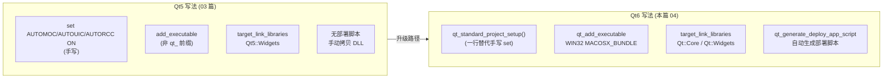

# Qt 04 CMake + Qt6 学习笔记

## 本章重要 API 函数

| API / 命令 | 功能 | 参数说明 | 来源 |
|------------|------|----------|------|
| `find_package(Qt6 6.5 REQUIRED COMPONENTS Core Widgets)` | 直接加载 Qt6 指定版本与模块 | 版本号（如 `6.5`）为最低要求；`COMPONENTS` 列出所需模块 | CMake |
| `qt_standard_project_setup()` | 一键开启 Qt 标准工程设置 | 自动设 `AUTOMOC/AUTOUIC/AUTORCC`、`CMAKE_CXX_STANDARD` 等 | Qt6 CMake |
| `qt_add_executable(name WIN32 MACOSX_BUNDLE srcs...)` | 创建 Qt6 可执行目标 | `WIN32` 去控制台窗口；`MACOSX_BUNDLE` 生成 `.app` | Qt6 CMake |
| `qt_generate_deploy_app_script(...)` | 生成跨平台部署脚本 | `TARGET` 指定目标；`OUTPUT_SCRIPT` 输出脚本变量；`NO_UNSUPPORTED_PLATFORM_ERROR` 抑制不支持平台报错 | Qt6 CMake |
| `install(SCRIPT ${deploy_script})` | 安装时执行部署脚本 | 把部署逻辑挂到 `cmake --install` | CMake |

> 💡 Tips：Qt6 最大的省心点是 `qt_standard_project_setup()`——它替你打开了 `AUTOMOC/AUTOUIC/AUTORCC` 并把 C++ 标准设好，所以本仓库 `qt04_tst-cmake-qt6_` 的 CMakeLists **不再出现** 03 篇里那一堆 `set(CMAKE_AUTOMOC ON)`。如果你手动又设了一遍也不会错，但属于冗余。另一个易错点：`find_package(Qt6 6.5 ...)` 的 `6.5` 是"最低版本"，低于它会直接 `REQUIRED` 失败，不是"尽量用 6.5"。

## 本章目录

> 点击条目可跳转到对应小节。

### 章节导航

- **[本章重要 API 函数](#本章重要-api-函数)**
- **[学习前后依赖](#学习前后依赖)**
- **[1. 概述](#1-概述)**
- **[2. 核心概念 / 原理](#2-核心概念--原理)**
- **[3. Qt5 与 Qt6 的 CMake 差异机制](#3-qt5-与-qt6-的-cmake-差异机制)**
- **[4. 核心代码解析](#4-核心代码解析)**
- **[5. 运行效果 / 验证](#5-运行效果--验证)**
- **[容易踩坑](#容易踩坑)**
- **[学习要点总结](#学习要点总结)**
- **[Q&A（常见问题）](#qa常见问题)**
- **[Tips（全局速记）](#tips全局速记)**

---

## 学习前后依赖

| 方向 | 内容 |
| ---- | ---- |
| 前置基础 | [03 CMake 构建 Qt 工程入门](03-cmake-build.md) 的 `find_package`、AUTO 三开关、`qt_add_executable` 双版本兼容写法。 |
| 本章核心 | 锁定 Qt6，用 `qt_standard_project_setup()` 精简工程，掌握 `qt_generate_deploy_app_script` 部署。 |
| 后续承接 | 为 [05 VSCode+CMake](05-vscode-cmake-template.md) 与 [06 CLion](06-clion-project.md) 提供"纯 Qt6 标准模板"——这两个 IDE 工程都基于 Qt6 + `CMAKE_PREFIX_PATH` 定位。 |

> 💡 Tips：为什么必须先会 03？因为 04 是 03 的"Qt6 专用精简版"。03 里你亲手写了 `set(CMAKE_AUTOMOC ON)` 和 `if(Qt6) qt_add_executable ... else add_executable`，04 用 `qt_standard_project_setup()` 与去掉 Qt5 分支来对应简化。先看全貌（03）再看精简（04），才能体会每句命令"省掉的是什么"。

## 1. 概述

Qt6 的 CMake 支持比 Qt5 更"一体化"：官方提供了一批 `qt_*` 命令和 `qt_standard_project_setup()`，把原本要手写的多条 `set(...)` 收敛成一行。本仓库 `qt04_tst-cmake-qt6_` 就是一个**纯 Qt6** 最小工程：用 `QMainWindow`（`mainwindow.ui` 带菜单栏/状态栏）展示窗口。它的 CMakeLists 比 03 短一大截，却覆盖了"找 Qt6 → 开标准设置 → 建目标 → 链模块 → 生成部署脚本"的完整链路。

> 💡 Tips：本章最该记住的一句话——**`qt_standard_project_setup()` 是 Qt6 给你的"默认正确配置"开关，它替你开了 `AUTOMOC/AUTOUIC/AUTORCC` 并设好 C++ 标准**。一个反直觉点：Qt6 的 `qt_add_executable` **不需要**像 03 那样 `MANUAL_FINALIZATION` + `qt_finalize_executable`——Qt6 新版默认自动最终化，所以本篇 CMakeLists 里看不到 `qt_finalize_executable` 调用，这是与 03 的明显区别。

## 2. 核心概念 / 原理

**`qt_standard_project_setup()` 做了什么**：它在内部为每个目标开启 `AUTOMOC/AUTOUIC/AUTORCC`，设置 `CMAKE_CXX_STANDARD` 到 Qt6 推荐的 C++ 标准（通常 17），并处理一些平台默认值。等价于 03 里你手写的：
```cmake
set(CMAKE_AUTOMOC ON)
set(CMAKE_AUTOUIC ON)
set(CMAKE_AUTORCC ON)
set(CMAKE_CXX_STANDARD 17)
set(CMAKE_CXX_STANDARD_REQUIRED ON)
```

**`qt_add_executable` 的 Qt6 新默认**：Qt6.5 起，`qt_add_executable` 默认自动最终化（除非显式 `MANUAL_FINALIZATION`），不再强制要求手写 `qt_finalize_executable`。`WIN32` 与 `MACOSX_BUNDLE` 直接作为关键字参数传入，更直观。

**部署脚本 `qt_generate_deploy_app_script`**：Qt6 引入了 `Qt6CoreDeploy` 模块，能生成把 Qt 运行时（DLL/插件）拷贝到可执行文件旁边的部署脚本。`install(SCRIPT ...)` 把它挂到 `cmake --install` 阶段，解决"编出来 exe 在别人机器上因缺 Qt DLL 跑不起来"的问题。

> 💡 Tips：原理上最易误解的是"`qt_standard_project_setup()` 是不是必须的"。它不是 CMake 原生命令，而是 Qt6 提供的**便捷封装**——你完全可以像 03 那样手写 `set(...)`，效果等价。但在纯 Qt6 项目里用它是最佳实践，能避免漏开某个 AUTO 开关。另一个误解：`qt_generate_deploy_app_script` 生成的是"部署脚本"不是"打包安装包"，它主要做 DLL/插件拷贝，跨机器分发时很有用。

## 3. Qt5 与 Qt6 的 CMake 差异机制



> 💡 Tips：图里最关键的对比是 `A1` 与 `B1`——Qt5 需要逐条手写 AUTO 开关，Qt6 用 `qt_standard_project_setup()` 一行替代；以及 `A4` 与 `B4`——Qt5 部署靠手动拷 DLL，Qt6 用 `qt_generate_deploy_app_script` 自动生成。注意 Qt6 链接时写 `Qt::Widgets`（不带版本号，由 `find_package(Qt6)` 上下文决定），而 Qt5 必须写 `Qt5::Widgets` 带版本号。

## 4. 核心代码解析

`qt04_tst-cmake-qt6_/CMakeLists.txt` 全文：

```cmake
cmake_minimum_required(VERSION 3.19)
project(qt04_tst-cmake-qt6_ LANGUAGES CXX)

find_package(Qt6 6.5 REQUIRED COMPONENTS Core Widgets)  # ① 锁定 Qt6.5+

qt_standard_project_setup()                             # ② 一行开启 AUTO 三开关 + C++标准

qt_add_executable(qt04_tst-cmake-qt6_                   # ③ 建 Qt6 目标
    WIN32 MACOSX_BUNDLE
    main.cpp
    mainwindow.cpp
    mainwindow.h
    mainwindow.ui
)

target_link_libraries(qt04_tst-cmake-qt6_
    PRIVATE
        Qt::Core
        Qt::Widgets
)

install(TARGETS qt04_tst-cmake-qt6_
    BUNDLE  DESTINATION .
    RUNTIME DESTINATION ${CMAKE_INSTALL_BINDIR}
    LIBRARY DESTINATION ${CMAKE_INSTALL_LIBDIR}
)

qt_generate_deploy_app_script(                          # ④ 生成部署脚本
    TARGET qt04_tst-cmake-qt6_
    OUTPUT_SCRIPT deploy_script
    NO_UNSUPPORTED_PLATFORM_ERROR
)
install(SCRIPT ${deploy_script})                         # ⑤ 安装时执行部署
```

逐段讲解：
- **① `find_package(Qt6 6.5 ...)`**：直接指定 Qt6 且最低 6.5。`REQUIRED` 意味找不到就报错。注意这里**没有 Qt5 回退**——这是与 03 最直观的区别（03 用 `NAMES Qt6 Qt5`）。
- **② `qt_standard_project_setup()`**：取代 03 里四条 `set(... ON)` + 两条 C++ 标准设置。它内部也设置了 `AUTOUIC` 等，所以 `mainwindow.ui` 会被自动处理。
- **③ `qt_add_executable( ... WIN32 MACOSX_BUNDLE ...)`**：Qt6 风格，关键字参数直接内联。`mainwindow.ui` 已列入源文件，会被 `AUTOUIC` 生成 `ui_mainwindow.h`。
- **④⑤ 部署脚本**：`qt_generate_deploy_app_script` 产出 `deploy_script` 变量（一个 `.cmake` 脚本路径），`install(SCRIPT ${deploy_script})` 让 `cmake --install` 时自动把 Qt 运行时拷贝到位。

> 💡 Tips：这段代码里藏着的细节——`mainwindow.h/.cpp` 里是 `QMainWindow` 而非 03 的 `QWidget`，`.ui` 里带了 `QMenuBar`/`QStatusBar`，所以 `main.cpp` 里 `MainWindow w; w.show();` 弹出的窗口自带菜单栏和状态栏。另外 Qt6 链接用 `Qt::Widgets`（不带数字前缀），这是 Qt6 推荐的"无版本命名空间"写法，由 `find_package(Qt6)` 提供 `Qt::` 别名。

## 5. 运行效果 / 验证

- 配置构建（需指定 Qt6 套件路径，如 `cmake -S . -B build -DCMAKE_PREFIX_PATH=D:/QT_place/install_/QT/6.5.3/mingw_64`）。
- `cmake --build build` 成功后，运行 exe 弹出一个 800×600 的 `QMainWindow` 窗口，顶部有菜单栏、底部有状态栏（来自 `mainwindow.ui`）。
- 验证 `AUTOUIC` 生效：在 `build/` 下应找到 `ui_mainwindow.h`。
- 验证部署：执行 `cmake --install build --prefix D:/deploy`，`deploy` 目录下的 exe 旁会自动带上 Qt6 的 DLL 与 `plugins/`，可直接拷贝到无 Qt 的机器运行。

> 💡 Tips：验证时容易误判"成功"的假象——能跑起来只说明编译链接 OK，不代表部署脚本生效。真正的跨机器验证是把 `cmake --install` 产物拷到**没装 Qt 的机器/干净环境**双击运行；若仍弹"缺少 Qt6Core.dll"说明部署脚本没被正确调用，需检查 `install(SCRIPT ${deploy_script})` 是否到位。

## 容易踩坑（注意点）

- **坑 1：`find_package(Qt6 6.5)` 找不到更低版本。** 现象：本地装的是 6.4 却写 `6.5` 报错。原因：版本号是"最低要求"。规避：把版本号降到实际安装版本，或升级 Qt。
- **坑 2：混用 Qt5 写法（如 `add_executable` 不带 qt_ 前缀又想用标准设置）。** 现象：某些 Qt6 特性不生效。原因：`qt_standard_project_setup()` 主要服务 `qt_*` 命令链。规避：Qt6 工程统一用 `qt_add_executable`。
- **坑 3：链接写 `Qt6::Widgets` 还是 `Qt::Widgets` 混淆。** 现象：偶尔能编偶尔报错。原因：Qt6 推荐 `Qt::Widgets` 别名；`Qt6::Widgets` 也能用但风格不一致。规避：统一用 `Qt::Core`/`Qt::Widgets`。
- **坑 4：忘了 `mainwindow.ui` 必须列入 `qt_add_executable` 源列表。** 现象：`ui_mainwindow.h` 不生成，编译报找不到 `Ui::MainWindow`。原因：`AUTOUIC` 只处理已登记的 `.ui`。规避：把 `.ui` 加进源文件参数。
- **坑 5：部署脚本在无支持平台报错中断 install。** 现象：`cmake --install` 失败。原因：默认在不支持平台 `Qt6CoreDeploy` 会报错。规避：加 `NO_UNSUPPORTED_PLATFORM_ERROR`（本篇已加）。
- **坑 6：把 Qt6 CMakeLists 直接用于 Qt5 环境。** 现象：`qt_standard_project_setup` / `qt_add_executable` 未定义。原因：这些是 Qt6 命令。规避：Qt5 环境回退到 03 的兼容写法。

## 学习要点总结

### 核心知识点
1. Qt6 用 `find_package(Qt6 x.y)` 直接锁定版本，无需 Qt5 回退分支。
2. `qt_standard_project_setup()` 一行替代手写 AUTO 三开关与 C++ 标准。
3. `qt_add_executable( ... WIN32 MACOSX_BUNDLE ...)` 是 Qt6 标准目标创建方式，默认自动最终化。
4. `qt_generate_deploy_app_script` + `install(SCRIPT)` 实现一键部署拷贝 Qt 运行时。

### 关键 API
- `find_package(Qt6 ...)`：定位 Qt6。
- `qt_standard_project_setup()`：标准工程设置。
- `qt_add_executable`：Qt6 目标。
- `qt_generate_deploy_app_script`：部署脚本。

### 下一步学习
- 进入 [05 VSCode+CMake 模板](05-vscode-cmake-template.md)：把本篇的 Qt6 标准 CMakeLists 放进 VSCode + CMake Tools + clangd 环境开发。

> 💡 Tips：本篇与知识地图里"下一步"那篇（05）直接挂钩——05 用的正是 Qt6 + `CMAKE_PREFIX_PATH` 定位的同一套写法，区别只是额外加了 VSCode 的 `settings.json`（`clangd`、构建目录配置）。学完本篇 05 几乎只多一层 IDE 配置。

## Q&A（常见问题）

**Q1：Qt6 和 Qt5 的 CMake 主要差在哪？**  A1：① 目标创建：Qt6 用 `qt_add_executable`，Qt5 用 `add_executable`；② 便捷设置：Qt6 有 `qt_standard_project_setup()` 一键开 AUTO 开关，Qt5 需手写 `set(CMAKE_AUTOMOC ON)` 等；③ 最终化：Qt6 默认自动最终化（03 那种 `MANUAL_FINALIZATION`+`qt_finalize_executable` 在 04 里消失）；④ 部署：Qt6 有 `qt_generate_deploy_app_script`，Qt5 靠 manual 拷贝。本篇 04 是 Qt6 精简范例，03 是兼容双版本范例。

**Q2：`qt_standard_project_setup()` 和手写 `set(CMAKE_AUTOMOC ON)` 能混用吗？**  A2：可以，效果叠加不冲突。但既然用了 `qt_standard_project_setup()` 就无需再手写 AUTO 开关，重复写只会让 CMakeLists 冗余。注意它设置的是"项目级默认"，后续 `qt_add_executable` 创建的目标都会受益。

**Q3：部署脚本 `qt_generate_deploy_app_script` 在 Linux/macOS 也有效吗？**  A3：有效，它是跨平台的——Windows 拷 DLL、Linux 拷 `.so`、macOS 处理 `.app` 框架。`NO_UNSUPPORTED_PLATFORM_ERROR` 用于在暂不支持的平台（如某些嵌入式 target）不报错中断 `install`。若你不打算分发二进制，可省略部署脚本，仅保留 `install(TARGETS ...)`。

## Tips（全局速记）

### 最容易忽视的细节
1. **`qt_standard_project_setup()` 替代了 03 的全部 AUTO 开关手写**，纯 Qt6 项目务必用它。
2. **Qt6 链接用 `Qt::Widgets`（无数字前缀）**，由 `find_package(Qt6)` 提供别名。
3. **`qt_add_executable` 默认自动最终化**，无需 `qt_finalize_executable`（与 03 的 Qt6 分支不同）。

### 踩坑记录
- "能 build 就以为部署 OK"的错觉：`cmake --build` 通过只说明本地能跑（因为本地有 Qt）。必须 `cmake --install` 后把产物拷到干净机器验证，才能确认部署脚本生效。
- 版本号写太高导致 `find_package` 失败：本地 6.5.3 写 `6.6` 会 REQUIRED 报错，版本号是"地板"不是"目标"。

### 与后续章节的衔接
1. **05 VSCode+CMake**：本篇 CMakeLists 直接作为 VSCode 工程，加 `settings.json` 即可获得 clangd 智能提示。
2. **06 CLion**：CLion 同样基于 CMake，本篇 `find_package(Qt6)` + `CMAKE_PREFIX_PATH` 写法与 06 一致，CLion 额外用 `.idea/QtSettings.xml` 登记 Qt 路径。
3. **07 RCC 资源系统**：本篇若加图片资源，可用 Qt6 的 `qt_add_resources`（显式）替代 `AUTORCC`（隐式），07 专门讲解。

### 设计决策思考
- **为什么 Qt6 要引入 `qt_standard_project_setup()` 这类"一站式"命令？** Qt5 的 CMake 集成需要用户记忆并手写一堆 `set(...)`，容易漏开 `AUTOMOC` 导致玄学报错。Qt6 把这些"90% 项目都该有的正确默认值"收敛进少数命令，降低新手门槛、统一工程风格，同时仍允许手动覆盖。
- **为什么部署从"手动拷 DLL"升级成 `qt_generate_deploy_app_script`？** 现代 Qt 运行时包含大量插件（platforms、styles、imageformats），手动拷贝极易遗漏导致"换个机器就崩"。官方用部署脚本按目标平台自动收集依赖，把"能编"真正变成"能分发"。
