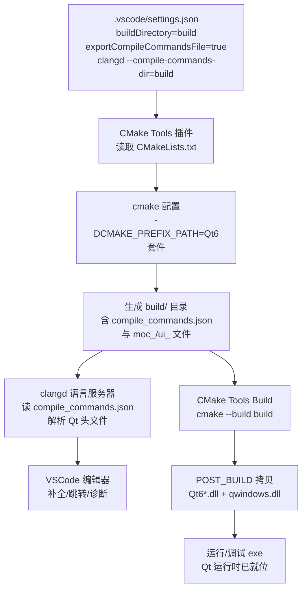

# Qt 05 VSCode + CMake 开发模板 学习笔记

## 本章重要 API 函数

| 配置 / 命令 | 功能 | 参数说明 | 来源 |
|------------|------|----------|------|
| `CMAKE_PREFIX_PATH` | 告诉 CMake Qt 安装位置 | 设为 Qt 套件目录（含 `lib/cmake/Qt6`），如 `D:/QT_place/install_/QT/6.5.3/mingw_64` | CMake 变量 |
| `qt_standard_project_setup()` | 一键开 AUTO 三开关 | 见 [04](04-cmake-qt6.md) | Qt6 CMake |
| `cmake.buildDirectory` | VSCode CMake Tools 的构建目录 | 如 `${workspaceFolder}/build` | VSCode settings |
| `cmake.exportCompileCommandsFile` | 导出 `compile_commands.json` | `true` 让 clangd 获取编译参数 | VSCode settings |
| `clangd.arguments` | clangd 启动参数 | `--compile-commands-dir=build` 指向编译数据库 | VSCode settings |
| `qwindows.dll` 拷贝（POST_BUILD） | 构建后自动拷平台插件 | 通过 `add_custom_command` 把 Qt 平台 DLL 拷到输出目录 | CMake |

> 💡 Tips：VSCode 里"代码飘红但能编"几乎都是 `compile_commands.json` 没被 clangd 读到。本仓库 `qt05` 的 `settings.json` 同时开了 `cmake.exportCompileCommandsFile: true` 和 `clangd.arguments: ["--compile-commands-dir=${workspaceFolder}/build"]`——这两句必须**配对**，缺一个 clangd 就找不到 Qt 头文件（因为 Qt 头路径写在编译数据库里，不在系统默认路径）。

## 本章目录

> 点击条目可跳转到对应小节。

### 章节导航

- **[本章重要 API 函数](#本章重要-api-函数)**
- **[学习前后依赖](#学习前后依赖)**
- **[1. 概述](#1-概述)**
- **[2. 核心概念 / 原理](#2-核心概念--原理)**
- **[3. VSCode + CMake + clangd 协作机制](#3-vscode--cmake--clangd-协作机制)**
- **[4. 核心代码解析](#4-核心代码解析)**
- **[5. 运行效果 / 验证](#5-运行效果--验证)**
- **[容易踩坑](#容易踩坑)**
- **[学习要点总结](#学习要点总结)**
- **[Q&A（常见问题）](#qa常见问题)**
- **[Tips（全局速记）](#tips全局速记)**

---

## 学习前后依赖

| 方向 | 内容 |
| ---- | ---- |
| 前置基础 | [04 CMake+Qt6](04-cmake-qt6.md) 的纯 Qt6 CMakeLists（`find_package(Qt6)`、`qt_standard_project_setup`、`qt_add_executable`）。 |
| 本章核心 | 在 VSCode 中用 CMake Tools + clangd 编辑/构建/调试 Qt6 工程，配置 `settings.json` 打通头文件索引。 |
| 后续承接 | 为 [06 CLion](06-clion-project.md) 提供对照——CLion 内置 CMake/clangd 类似能力但配置在 `.idea`；本篇的 `CMAKE_PREFIX_PATH` 定位思路两者通用。 |

> 💡 Tips：为什么必须先会 04？因为本篇的 `CMakeLists.txt` 就是 04 那套 Qt6 标准写法（外加 DLL 自动拷贝），IDE 只是"驱动它"的外壳。不理解 04 的 `find_package(Qt6)` + `CMAKE_PREFIX_PATH`，就会在 VSCode 里卡在"CMake 找不到 Qt"的同一类错误上——IDE 不改变 CMake 的本质。

## 1. 概述

VSCode 本身只是编辑器，开发 Qt 需要三件套协作：**CMake Tools 插件**（配置/构建/调试 CMake 工程）、**C/C++ 或 clangd**（智能提示与跳转）、以及 Qt6 的 CMake 工程本身。`qt05_tst-cmake_vscode-template_` 提供了一个开箱模板：CMakeLists 用 Qt6 + `CMAKE_PREFIX_PATH` 定位套件，`.vscode/settings.json` 把构建目录指向 `build/` 并导出 `compile_commands.json` 喂给 clangd，实现"写代码时有 Qt 头文件补全、点构建能直接出 exe"。

> 💡 Tips：本章最该记住的一句话——**VSCode 不负责"懂 Qt"，它只负责把 CMake 的编译参数（`compile_commands.json`）交给 clangd 去理解 Qt 头文件**。一个反直觉点：装了 Qt 插件并不意味着 clangd 自动知道 Qt 头在哪；clangd 只认 `compile_commands.json` 里记录的 `-I` 路径。所以 `cmake.exportCompileCommandsFile: true` 是"智能提示可用"的真正开关，而非某个 Qt 专用扩展。

## 2. 核心概念 / 原理

**CMake Tools 的工作流**：插件读取 `CMakeLists.txt`，用你配置的 kit（编译器 + `CMAKE_PREFIX_PATH`）执行 `cmake` 配置，把构建目录设为 `settings.json` 里的 `cmake.buildDirectory`。之后点"Build"等价于在该目录跑 `cmake --build`。

**clangd 与 compile_commands.json**：clangd 是语言服务器，提供补全/跳转/诊断。它需要"每个源文件用什么编译参数编译"的信息，这些信息由 `compile_commands.json` 提供。CMake 配置时若开了 `exportCompileCommandsFile`，就会在构建目录生成该文件；clangd 通过 `--compile-commands-dir` 指向它，从而知道 `#include <QApplication>` 该去哪个 Qt 目录找。

**构建后 DLL 拷贝（POST_BUILD）**：本模板 CMakeLists 末尾有一段 `if(WIN32 ...)` 逻辑，用 `add_custom_command(TARGET ... POST_BUILD ...)` 在每次构建后把 `Qt6Core.dll`、`Qt6Gui.dll`、`Qt6Widgets.dll` 和 `platforms/qwindows.dll` 拷到 exe 同目录。这样在 VSCode 里直接点运行/F5 时，exe 能找到 Qt 运行时而不必把 Qt 加到系统 PATH。

> 💡 Tips：原理上最易误解的是"为什么 clangd 还要单独装、和 Microsoft C/C++ 插件冲突吗"。clangd 与微软 C/C++ 插件都能做 IntelliSense，但两者会抢"谁提供补全"。最佳实践：禁用微软插件的 IntelliSense（或只留它做调试），让 clangd 专职补全，避免重复诊断和卡顿。本模板 `settings.json` 直接配置 clangd，未启用微软插件的语义补全。

## 3. VSCode + CMake + clangd 协作机制



> 💡 Tips：流程里最关键的两条数据链——`D --> E --> F`（编译数据库驱动 clangd 提供提示）和 `D --> G --> H --> I`（构建后自动拷 DLL 让 exe 可独立运行）。注意 `compile_commands.json` 是连接 CMake 与 clangd 的"桥梁"，而 `POST_BUILD` 拷贝是连接"构建产物"与"可运行 exe"的"最后一公里"。缺前者代码飘红，缺后者运行报缺 DLL。

## 4. 核心代码解析

**`qt05_tst-cmake_vscode-template_/.vscode/settings.json`**：

```json
{
    "editor.fontSize": 18,
    "cmake.options.statusBarVisibility": "compact",
    "cmake.exportCompileCommandsFile": true,                  // ① 导出编译数据库
    "cmake.buildDirectory": "${workspaceFolder}/build",       // ② 构建目录
    "clangd.arguments": [
        "--compile-commands-dir=${workspaceFolder}/build"     // ③ clangd 读编译数据库
    ],
    "editor.insertSpaces": false,
    "editor.tabSize": 4
}
```

**CMakeLists 中 DLL 自动拷贝片段**：

```cmake
set(CMAKE_PREFIX_PATH "D:/QT_place/install_/QT/6.5.3/mingw_64")  # ④ 定位 Qt 套件
find_package(Qt6 REQUIRED COMPONENTS Core Widgets)
qt_standard_project_setup()

qt_add_executable(qt05_tst-cmake_vscode-template_ hello.cpp)
target_link_libraries(qt05_tst-cmake_vscode-template_ PRIVATE Qt6::Core Qt6::Widgets)
set_target_properties(... WIN32_EXECUTABLE ON MACOSX_BUNDLE ON)

if (WIN32 AND NOT DEFINED CMAKE_TOOLCHAIN_FILE)
    set(QT_INSTALL_PATH "${CMAKE_PREFIX_PATH}")
    # ⑤ 构建后拷贝 qwindows 平台插件
    add_custom_command(TARGET ${PROJECT_NAME} POST_BUILD
        COMMAND ${CMAKE_COMMAND} -E copy
        "${QT_INSTALL_PATH}/plugins/platforms/qwindows${DEBUG_SUFFIX}.dll"
        "$<TARGET_FILE_DIR:${PROJECT_NAME}>/plugins/platforms/")
    # ⑥ 构建后拷贝 Qt 核心 DLL
    foreach (QT_LIB Core Gui Widgets)
        add_custom_command(TARGET ${PROJECT_NAME} POST_BUILD
            COMMAND ${CMAKE_COMMAND} -E copy
            "${QT_INSTALL_PATH}/bin/Qt6${QT_LIB}${DEBUG_SUFFIX}.dll"
            "$<TARGET_FILE_DIR:${PROJECT_NAME}>")
    endforeach ()
endif ()
```

逐段讲解：
- **① `exportCompileCommandsFile: true`**：让 CMake 在 `build/` 生成 `compile_commands.json`，是 clangd 正常工作的前提。
- **③ `--compile-commands-dir=build`**：clangd 去 `build/` 找上面的 json。①② 与 ③ 必须指向同一目录（都是 `build`），否则 clangd 找不到。
- **④ `CMAKE_PREFIX_PATH`**：硬编码了 Qt6 套件绝对路径，确保 VSCode 的 CMake Tools 无需手动选 kit 也能 `find_package(Qt6)` 成功。
- **⑤⑥ POST_BUILD 拷贝**：`$<TARGET_FILE_DIR:...>` 是 CMake 生成器表达式，指代 exe 输出目录；`DEBUG_SUFFIX` 在 Debug+MSVC 下为 `d`（拷贝 `Qt6Cored.dll` 等调试版）。注意这里写的是 `Qt6::Core` 等**带版本号**的链接（与 04 推荐的无前缀 `Qt::` 略有差异，但都能用）。

> 💡 Tips：这段代码里藏着的细节——`hello.cpp` 用 `QApplication + QWidget` 显示一个标题为 "Hi Macintosh" 的窗口，是验证"VSCode 里能编能跑"的最小例子。注意 `CMAKE_PREFIX_PATH` 是**绝对路径硬编码**，换机器/换 Qt 版本必须改；更优雅的做法是在 VSCode 的 CMake Tools 里选 kit 或设环境变量，而非写死。生产模板建议改成相对/环境变量，避免路径耦合。

## 5. 运行效果 / 验证

- 用 VSCode 打开 `qt05_tst-cmake_vscode-template_` 文件夹，底部状态栏选好 kit（或依赖 `CMAKE_PREFIX_PATH` 自动识别）。
- `CMake: Configure` 后，`build/` 目录出现且含 `compile_commands.json`；此时写 `#include <QApplication>` 应**不再飘红**，输入 `QApplication::` 应有补全。
- `CMake: Build` 成功，exe 位于 `build/`（或子目录）。检查 exe 旁边是否有 `Qt6Core.dll`、`Qt6Widgets.dll` 和 `plugins/platforms/qwindows.dll`——有则说明 POST_BUILD 拷贝生效。
- `CMake: Run` / `Debug` 启动，弹出标题 "Hi Macintosh" 的空白窗口。

> 💡 Tips：验证时容易误判"成功"的假象——exe 能跑（尤其在本机，因为系统 PATH 可能已有 Qt），就以为 POST_BUILD 拷贝生效。真正验证是**临时把系统 PATH 里的 Qt 路径去掉再运行**：若仍正常弹窗，说明 DLL 拷贝到位、exe 自包含；若报缺 DLL，说明之前是靠 PATH 混过去的，POST_BUILD 没真正生效。同样，clangd 补全"看起来有"也可能是微软插件在兜底，需确认状态栏语言模式为 clangd。

## 容易踩坑（注意点）

- **坑 1：clangd 补全失效 / 头文件飘红。** 现象：写 Qt 代码满屏红线但能编。原因：`compile_commands.json` 未生成或 clangd 指向错误目录。规避：确认 `exportCompileCommandsFile: true` 且 `clangd.arguments` 的 `--compile-commands-dir` 与 `buildDirectory` 一致；改后重启 clangd。
- **坑 2：`CMAKE_PREFIX_PATH` 写死导致换机失败。** 现象：别人的机器 `find_package(Qt6)` 找不到。原因：绝对路径不通用。规避：用环境变量或在 CMake Tools 选 kit，不要在 CMakeLists 硬写他人没有的路径。
- **坑 3：clangd 与微软 C/C++ 插件冲突。** 现象：补全重复、诊断打架、卡顿。原因：两个 LS 同时生效。规避：禁用微软插件的 IntelliSense，只让 clangd 提供补全。
- **坑 4：构建后运行仍缺 `qwindows.dll`。** 现象：弹窗失败报平台插件缺失。原因：`platforms/` 子目录拷贝路径或 `QT_INSTALL_PATH` 推导错误。规避：确认 `plugins/platforms/qwindows.dll` 实际存在于 Qt 套件目录，且 POST_BUILD 命令执行成功（看构建日志）。
- **坑 5：`buildDirectory` 与 clangd 目录不一致。** 现象：配置成功但 clangd 仍找不到头。原因：两边目录名对不上（如一个 `build` 一个 `out`）。规避：统一为同一目录。
- **坑 6：用 MSVC 调试版却拷了 Release DLL。** 现象：Debug 运行崩溃。原因：`DEBUG_SUFFIX` 逻辑只对 MSVC 生效；MinGW 调试版 DLL 命名不同。规避：本模板是 MinGW 套件，`DEBUG_SUFFIX` 为空，拷的是同一套 DLL，混用 MSVC 需另处理。

## 学习要点总结

### 核心知识点
1. VSCode 靠 CMake Tools 驱动 CMake 构建，靠 clangd + `compile_commands.json` 提供 Qt 智能提示。
2. `exportCompileCommandsFile` 与 `clangd --compile-commands-dir` 必须配对指向同一 `build/`。
3. POST_BUILD 自动拷 DLL / 平台插件，让 VSCode 里直接运行的 exe 自包含 Qt 运行时。

### 关键 API
- `cmake.buildDirectory` / `exportCompileCommandsFile`：VSCode 配置。
- `--compile-commands-dir`：clangd 参数。
- `add_custom_command(... POST_BUILD ...)`：构建后拷贝。

### 下一步学习
- 进入 [06 CLion 工程配置](06-clion-project.md)：看另一主流 IDE 如何用内置 CMake/clangd 做同样的事，配置集中在 `.idea`。

> 💡 Tips：本篇与知识地图里"下一步"那篇（06）直接挂钩——06 是 CLion 版的同一目标：CMake + Qt6 + 自动定位 + 自包含运行。区别仅在 IDE 配置落点（VSCode 的 `settings.json` vs CLion 的 `.idea/QtSettings.xml`）。学完本篇 06 只是换了个壳。

## Q&A（常见问题）

**Q1：为什么 VSCode 里 Qt 头文件飘红但 `cmake --build` 能过？**  A1：构建用的是 CMake 解析出的 Qt 路径，而编辑器补全（clangd）依赖 `compile_commands.json`。若没开 `cmake.exportCompileCommandsFile: true`，或 clangd 的 `--compile-commands-dir` 指错目录，clangd 就不知道 Qt 头在哪。解决办法：让两者都指向同一个 `build/`，并重启 clangd（命令面板 `clangd: Restart`）。

**Q2：`CMAKE_PREFIX_PATH` 写在 CMakeLists 里好还是用环境变量好？**  A2：模板里写死绝对路径只为"开箱即跑"，但**不利于分享/换机**。更规范的做法：不在 CMakeLists 硬编码，而是在 VSCode 的 CMake Tools 里选择一个已包含 Qt 的 kit，或通过系统/工作区环境变量设置 `CMAKE_PREFIX_PATH`。这样 CMakeLists 保持干净、可移植。

**Q3：Qt5 工程能在 VSCode 这样配吗？**  A3：能，思路完全一致——`find_package(Qt5 ...)` + `CMAKE_PREFIX_PATH` 指向 Qt5 套件 + clangd 读同一 `build/`。差异在 CMakeLists 用 Qt5 写法（见 [03](03-cmake-build.md)）。`settings.json` 的 clangd / 构建目录配置与 Qt 版本无关，可原样复用。

## Tips（全局速记）

### 最容易忽视的细节
1. **`exportCompileCommandsFile` + `--compile-commands-dir` 必须指向同一目录**，这是 clangd 不飘红的命门。
2. **`CMAKE_PREFIX_PATH` 是硬编码陷阱**，模板仅为演示，分享工程请改用 kit/环境变量。
3. **POST_BUILD 拷贝让 exe 自包含**，但验证时要去掉系统 PATH 里的 Qt 才能确认真实生效。

### 踩坑记录
- "能跑就以为 DLL 拷贝成功"的错觉：本机 PATH 常有 Qt，掩盖了 POST_BUILD 没生效。去掉 PATH 再跑才是真验证。
- clangd 与微软插件打架：两者都做 IntelliSense 会重复诊断、卡顿，务必二选一。

### 与后续章节的衔接
1. **06 CLion**：同一套 Qt6 CMake + `CMAKE_PREFIX_PATH` 思路，配置从 `settings.json` 迁到 `.idea/QtSettings.xml`。
2. **04 CMake+Qt6**：本篇 CMakeLists 就是 04 的标准写法加 DLL 拷贝，IDE 不改变 CMake 本质。
3. **07 RCC 资源系统**：本模板若加图片，可用 `qt_add_resources` 显式注册（07 讲解）， clangd 对资源路径的提示同样依赖 `compile_commands.json`。

### 设计决策思考
- **为什么 VSCode 选择 clangd 而非自研 Qt 感知？** clangd 基于 Clang/LLVM，天生理解 C++ 语义和编译参数，且 `compile_commands.json` 是 LLVM 生态标准。VSCode 不必为 Qt 特制索引，只要把 CMake 的编译数据库喂给 clangd，Qt 头文件自然被理解——"通用协议优于专用插件"。
- **为什么 DLL 拷贝放在 POST_BUILD 而不是 install？** POST_BUILD 让"每次构建完就能直接在输出目录运行/调试"，开发期体验最好（F5 即跑）。`install` 是分发场景用的，且本模板没配 `install`。两者不冲突，调试用 POST_BUILD，发布用部署脚本（见 04 的 `qt_generate_deploy_app_script`）。
