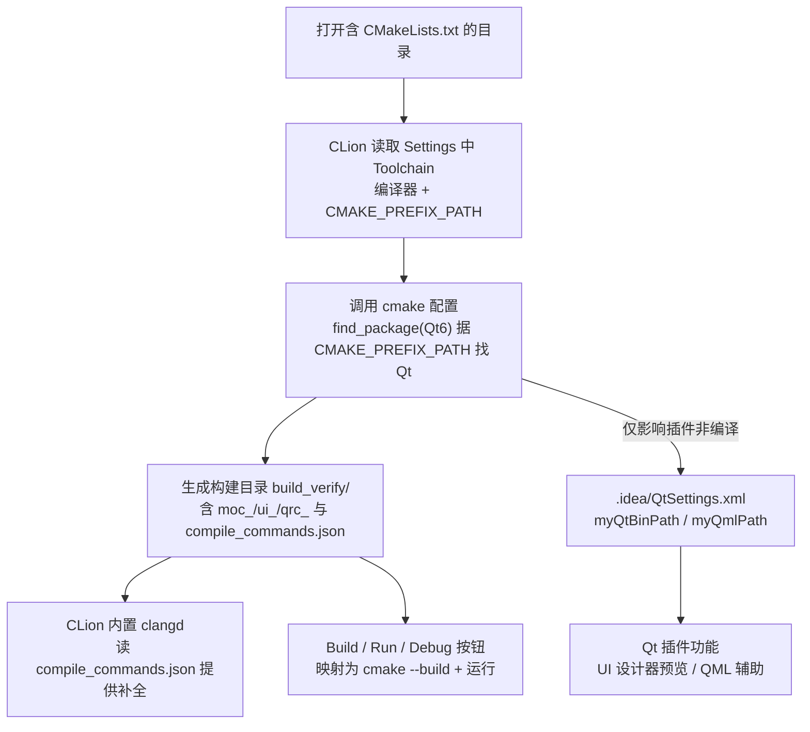

# Qt 06 CLion 工程配置 学习笔记

## 本章重要 API 函数

| 配置 / 命令 | 功能 | 参数说明 | 来源 |
|------------|------|----------|------|
| `CMAKE_PREFIX_PATH` | CLion 中定位 Qt 套件 | 设为 Qt6 套件目录，如 `D:/QT_place/install_/QT/6.5.3/mingw_64` | CMake 变量 |
| `find_package(Qt6 COMPONENTS Core Gui Widgets REQUIRED)` | 加载 Qt6 模块 | `COMPONENTS` 列出 Core/Gui/Widgets | CMake |
| `set(CMAKE_AUTOMOC/AUTORCC/AUTOUIC ON)` | 开启 Qt 自动处理 | 本模板手写三开关（CLion 也识别） | CMake |
| `QtSettings.xml` 的 `myQtBinPath` | CLion Qt 插件登记的 Qt bin 路径 | 值如 `D:/Qt/6.5.3/mingw_64/bin` | CLion `.idea` |
| `QtSettings.xml` 的 `myQmlPath` | CLion Qt 插件登记的 QML 路径 | 值如 `D:/Qt/6.5.3/mingw_64/./qml` | CLion `.idea` |

> 💡 Tips：CLion 与 VSCode（见 [05](05-vscode-cmake-template.md)）最大的不同是——Qt 相关路径**有两套登记**：一套是 CMake 侧（`CMAKE_PREFIX_PATH` + `find_package`，决定能否编译），另一套是 CLion 的 Qt 插件侧（`.idea/QtSettings.xml` 的 `myQtBinPath`，决定 CLion 的 Qt 集成功能如 Designer 预览、QML 支持）。本仓库 `qt06_tst_clion_` 的 `QtSettings.xml` 里路径是 `D:/Qt/6.5.3/...`，而 CMakeLists 里是 `D:/QT_place/install_/QT/6.5.3/...`——**两者不一致时编译以 CMake 为准**，QtSettings 不影响构建，但影响 CLion 的 Qt 辅助功能。

## 本章目录

> 点击条目可跳转到对应小节。

### 章节导航

- **[本章重要 API 函数](#本章重要-api-函数)**
- **[学习前后依赖](#学习前后依赖)**
- **[1. 概述](#1-概述)**
- **[2. 核心概念 / 原理](#2-核心概念--原理)**
- **[3. CLion 配置与构建机制](#3-clion-配置与构建机制)**
- **[4. 核心代码解析](#4-核心代码解析)**
- **[5. 运行效果 / 验证](#5-运行效果--验证)**
- **[容易踩坑](#容易踩坑)**
- **[学习要点总结](#学习要点总结)**
- **[Q&A（常见问题）](#qa常见问题)**
- **[Tips（全局速记）](#tips全局速记)**

---

## 学习前后依赖

| 方向 | 内容 |
| ---- | ---- |
| 前置基础 | [04 CMake+Qt6](04-cmake-qt6.md) 的 Qt6 CMake 写法；[05 VSCode+CMake](05-vscode-cmake-template.md) 的 IDE 配置思路可对照。 |
| 本章核心 | 在 CLion（JetBrains）中用 CMake 工程开发 Qt6，理解 `.idea` 配置与 `CMAKE_PREFIX_PATH` 的关系。 |
| 后续承接 | 本篇与 [07 RCC 资源系统](07-rcc-resource.md) 可组合——在 CLion 里开发一个带 Qt 资源（图片/翻译）的工程，`AUTORCC` + 运行时定位同样适用。 |

> 💡 Tips：为什么必须先会 04？因为 CLion 本身就是"CMake 前端"，它不发明新的构建语言，只是驱动 `cmake`。本篇 CMakeLists 用的是 `set(CMAKE_AUTOMOC ON)` 手写三开关 + `find_package(Qt6)` 的写法（兼容 Qt6 早期风格），与 04 的 `qt_standard_project_setup()` 等价。先懂 04 的"标准写法"，再看本篇"手写开关"才不会困惑二者关系。

## 1. 概述

CLion 是 JetBrains 出品的 C/C++ IDE，对 CMake 工程是**原生一等支持**：打开含 `CMakeLists.txt` 的目录即自动配置、构建、调试。开发 Qt 时，CLion 还内置 Qt 插件，能提供 `.ui` 设计器预览、QML 支持等。本仓库 `qt06_tst_clion_` 是一个最小 Qt6 工程（`main.cpp` 用 `QPushButton` 显示 "Hello world!" 按钮），其配置落在两个地方：CMake 侧（`CMakeLists.txt` 用 `CMAKE_PREFIX_PATH` 定位套件 + `AUTOMOC/AUTORCC/AUTOUIC`）和 CLion 侧（`.idea/QtSettings.xml` 登记 Qt bin/qml 路径供插件使用）。

> 💡 Tips：本章最该记住的一句话——**CLion 编译 Qt 项目靠的是 CMake（`find_package` + `CMAKE_PREFIX_PATH`），不是靠 `.idea/QtSettings.xml`**。一个反直觉点：很多人改了 `QtSettings.xml` 里的路径以为"重新定位了 Qt"，但编译仍报找不到 Qt——因为真正决定编译的是 CMake 的 `CMAKE_PREFIX_PATH`。`QtSettings.xml` 影响的是 CLion 的 Qt 集成体验（如 UI 设计器），不影响 `cmake` 能不能找到 Qt。

## 2. 核心概念 / 原理

**CLion 的 CMake 集成**：CLion 在后台调用系统 `cmake`，读取 `CMakeLists.txt`，用你在 `Settings | Build, Execution, Deployment | CMake` 里配置的 toolchain（编译器、CMake 路径、`CMAKE_PREFIX_PATH` 等）生成构建目录（默认 `cmake-build-debug` 或本项目用的 `build_verify`）。所有构建/调试按钮最终都映射到 `cmake` 命令。

**Qt 插件与 QtSettings.xml**：CLion 检测到 Qt 后，会在 `.idea/QtSettings.xml` 记录当前 Profile（如 `Debug`）下的 `myQtBinPath`（Qt 的 `bin` 目录）和 `myQmlPath`（QML 导入路径）。这些值供 Qt 插件提供 Designer 集成、QML 代码辅助。注意本仓库该文件写的是 `D:/Qt/6.5.3/mingw_64`，而 CMakeLists 是 `D:/QT_place/install_/QT/6.5.3/mingw_64`——说明作者的 Qt 实际装在后者，前者是 CLion 插件记录的另一处（或曾是默认安装路径），二者不必相同。

**AUTOMOC/AUTORCC/AUTOUIC 手写开关**：本模板没用 `qt_standard_project_setup()`，而是显式 `set(CMAKE_AUTOMOC ON)` 等。CLion 能识别这些变量，在索引/构建时自动触发 `moc/uic/rcc`。`main.cpp` 仅有 `QPushButton`（无 `Q_OBJECT`、无 `.ui`），所以实际只需 `find_package` 与链接，AUTO 开关在此工程属"标准保险"。

> 💡 Tips：原理上最易误解的是"CMake 侧 Qt 路径"和"CLion Qt 插件路径"是两套独立配置。编译失败先看 CMake 的 `CMAKE_PREFIX_PATH`；Qt 设计器打不开/UI 预览异常才去查 `QtSettings.xml`。把它们混为一谈会浪费大量时间——改了一处以为另一处也好了，实则没解决根本问题。

## 3. CLion 配置与构建机制



> 💡 Tips：流程里最关键的区分是 `C`（CMake 配置，决定能不能编）与 `G`（QtSettings.xml，决定插件功能）。`G --> H` 这条支路标注"仅影响插件非编译"——它和编译成功与否**无关**。箭头 `C --> G` 表达 CLion 会依据 `find_package` 探测到的 Qt 来建议/填充 `QtSettings.xml`，但手动改 `QtSettings.xml` 不会反向修正 CMake 的 `CMAKE_PREFIX_PATH`。理解这条边界是排错的关键。

## 4. 核心代码解析

**`qt06_tst_clion_/CMakeLists.txt`**：

```cmake
cmake_minimum_required(VERSION 3.31)
project(qt06_tst_clion_)

set(CMAKE_CXX_STANDARD 11)                  # ① C++11 标准
set(CMAKE_AUTOMOC ON)                       # ② 手写 AUTO 三开关
set(CMAKE_AUTORCC ON)
set(CMAKE_AUTOUIC ON)

set(CMAKE_PREFIX_PATH "D:/QT_place/install_/QT/6.5.3/mingw_64")  # ③ 定位 Qt 套件

find_package(Qt6 COMPONENTS
        Core
        Gui
        Widgets
        REQUIRED)                           # ④ 加载 Qt6 三模块

add_executable(qt06_tst_clion_ main.cpp)    # ⑤ 标准 add_executable（Qt6 也可用）
target_link_libraries(qt06_tst_clion_
        Qt::Core
        Qt::Gui
        Qt::Widgets)                        # ⑥ 链接（无前缀 Qt:: 别名）
set_target_properties(qt06_tst_clion_ PROPERTIES
        WIN32_EXECUTABLE ON
        MACOSX_BUNDLE ON)
# ⑦ 后续还有与 05 相同的 POST_BUILD DLL 拷贝（略）
```

**`.idea/QtSettings.xml`**（节选）：

```xml
<component name="QtSettings">
  <option name="myCurrentProfile" value="Debug" />
  <option name="mySettingsPerProfile">
    <entry key="Debug">
      <value>
        <PerProfileState>
          <option name="myQmlPath" value="D:/Qt/6.5.3/mingw_64/./qml" />
          <option name="myQtBinPath" value="D:/Qt/6.5.3/mingw_64/bin" />
        </PerProfileState>
      </value>
    </entry>
  </map>
</component>
```

逐段讲解：
- **① `CMAKE_CXX_STANDARD 11`**：本模板用 C++11（比 04 的 17 低），说明 Qt6 工程最低 C++11 即可，`QPushButton` 演示不需要新标准。但 `AUTOMOC` 生成的代码可能用到较新特性，Qt6 一般推荐 17；这里 11 能过是因为示例极简。
- **③ `CMAKE_PREFIX_PATH`**：指向实际 Qt 安装（`D:/QT_place/install_/QT/6.5.3/mingw_64`），是 `find_package(Qt6)` 成功的依据。
- **④ `find_package(Qt6 COMPONENTS Core Gui Widgets REQUIRED)`**：多列了 `Gui`（Qt6 Widgets 已隐含依赖 Gui，但显式列出更清晰）。
- **⑤ `add_executable`**：注意这里用的是**标准** `add_executable` 而非 `qt_add_executable`（Qt6 也接受标准版，只是少了 Qt 专属最终化钩子；因本工程无 `.ui` 资源特殊需求，标准版足够）。
- **`QtSettings.xml` 的 `myQtBinPath`**：CLion Qt 插件用，路径是 `D:/Qt/...`（与 CMake 的 `D:/QT_place/...` 不同），仅服务于插件，不参与编译。

> 💡 Tips：这段代码里藏着的细节——`main.cpp` 是 `QPushButton button("Hello world!", nullptr); button.resize(200,100); button.show();`，一个**没有父窗口**的独立按钮窗口，验证"最小 Qt6 GUI 在 CLion 里能编能跑"。注意 `CMAKE_PREFIX_PATH` 同样是**绝对路径硬编码**（和 05 同样的可移植性问题），且 `QtSettings.xml` 里的路径与前二者又不同——这提醒我们：三处路径（CMakeLists、QtSettings、实际安装）在真实环境里要逐一核对，模板里的差异只是作者本机布局的产物，移植时以 CMake 的 `CMAKE_PREFIX_PATH` 为准。

## 5. 运行效果 / 验证

- 用 CLion 打开 `qt06_tst_clion_` 目录，等待 CMake 自动配置（状态栏显示 Configuring/Finished）。若报错找不到 Qt，到 `Settings | Build, Execution, Deployment | CMake` 里给 `CMAKE_PREFIX_PATH` 加上 Qt6 套件路径，或确认 `CMakeLists.txt` 里的路径有效。
- 点 `Build`（锤子图标），`build_verify/` 生成可执行文件。
- 点 `Run`（绿三角）或 `Debug`，弹出标题栏为 "Hello world!" 的 200×100 按钮窗口，点按钮有按下反馈。
- 验证 clangd 补全：在 `main.cpp` 输入 `QPushBut` 应自动补全为 `QPushButton`，说明 CLion 内置 clangd 已读 `compile_commands.json`。

> 💡 Tips：验证时容易误判"成功"的假象——CLion 有时会用缓存或默认 kit 让"配置通过"但其实没连到正确的 Qt（比如用了系统别的 Qt 版本）。真正的验证是运行后弹出的窗口行为正常、且 `Build Output` 里 `find_package` 解析到的 Qt 路径正是你期望的套件。另一个注意点：若 `QtSettings.xml` 路径错误，编译**照样成功**（因为它不影响编译），但 CLion 的 Qt 设计器/UI 预览会失效——别把"设计器打不开"当成"编译问题"。

## 容易踩坑（注意点）

- **坑 1：CLion 报找不到 Qt，但 `QtSettings.xml` 路径看着对。** 现象：配置失败。原因：编译取决于 `CMAKE_PREFIX_PATH`（CMake 侧），不是 `QtSettings.xml`（插件侧）。规避：改 `CMakeLists.txt` 的 `CMAKE_PREFIX_PATH` 或在 CLion 的 CMake 设置里加该变量，而非只改 `QtSettings.xml`。
- **坑 2：`QtSettings.xml` 与 `CMAKE_PREFIX_PATH` 路径不一致导致设计器异常。** 现象：UI 预览打不开。原因：插件按 `myQtBinPath` 找 Qt 工具（如 `designer.exe`）。规避：把 `QtSettings.xml` 的 `myQtBinPath` 指向真实 Qt 的 `bin` 目录；这不影响编译只影响插件。
- **坑 3：CLion 用了错误的 CMake/编译器 kit。** 现象：能配但编出的东西跑不了或链接 Qt 失败。原因：Toolchain 指向了非 Qt 配套的编译器（如 MSVC 但 Qt 是 MinGW 版）。规避：确保 CLion 的 toolchain 编译器与 Qt 套件匹配（MinGW Qt 配 MinGW 工具链）。
- **坑 4：`.idea` 被 git 忽略或未同步。** 现象：换机器打开配置丢失。原因：`.idea` 通常不入版本库。规避：CMake 侧配置（`CMAKE_PREFIX_PATH`）写进 `CMakeLists`/CMake 预设，保证可移植；`QtSettings.xml` 是本地偏好。
- **坑 5：C++ 标准过低导致 `AUTOMOC` 生成代码报错。** 现象：Qt6 + `CMAKE_CXX_STANDARD 11` 偶尔报 std 特性缺失。原因：Qt6 推荐 C++17。规避：Qt6 工程建议设 17（如 04 做法），本模板 11 仅因示例极简侥幸通过。
- **坑 6：用 `add_executable` 而非 `qt_add_executable` 却期望 Qt 部署钩子。** 现象：部署/最终化行为不全。原因：标准 `add_executable` 不带 Qt6 专属最终化。规避：需要 Qt6 平台集成时用 `qt_add_executable`（见 04）。

## 学习要点总结

### 核心知识点
1. CLion 是 CMake 前端，编译 Qt 依赖 `find_package(Qt6)` + `CMAKE_PREFIX_PATH`，与 IDE 无关。
2. `.idea/QtSettings.xml` 的 `myQtBinPath`/`myQmlPath` 只影响 Qt 插件功能（设计器/QML），不影响编译。
3. `AUTOMOC/AUTORCC/AUTOUIC` 在 CLion 下同样生效；Qt6 链接用 `Qt::` 无前缀别名。

### 关键 API
- `find_package(Qt6 COMPONENTS ...)`：加载模块。
- `CMAKE_PREFIX_PATH`：定位 Qt 套件。
- `QtSettings.xml`：CLion Qt 插件路径登记。

### 下一步学习
- 进入 [07 RCC 资源系统](07-rcc-resource.md)：在 CLion/CMake 工程里用 `qt_add_resources` 把图片编译进 exe，理解 `:/` 资源访问。

> 💡 Tips：本篇与知识地图里"下一步"那篇（07）直接挂钩——07 的 `qt_add_resources` 就是作用在 `AUTOMOC/AUTORCC` 同一套 CMake + Qt6 工程模型上。学完本篇，把资源注册加进 CMakeLists 即可，IDE（CLion）无需额外交代。

## Q&A（常见问题）

**Q1：CLion 里改了 `QtSettings.xml` 的 Qt 路径，为什么还是编译找不到 Qt？**  A1：因为编译由 CMake 的 `find_package(Qt6)` 决定，它读的是 `CMAKE_PREFIX_PATH`（在 `CMakeLists.txt` 或 CLion 的 CMake 设置里），**不是** `QtSettings.xml`。`QtSettings.xml` 只供 CLion 的 Qt 插件（UI 设计器、QML 辅助）使用。要修编译问题，改 `CMAKE_PREFIX_PATH`；要修设计器问题，才改 `QtSettings.xml` 的 `myQtBinPath`。

**Q2：CLion 里 `CMAKE_PREFIX_PATH` 写在 CMakeLists 和写在 IDE 设置里哪个优先？**  A2：CMakeLists.txt 里的 `set(CMAKE_PREFIX_PATH ...)` 会覆盖/固化该变量；若你在 CLion 的 CMake 配置里通过 `CMake options` 传 `-DCMAKE_PREFIX_PATH=...`，命令行 `-D` 通常优先生效（后到的覆盖）。本模板把路径**硬编码写死在 CMakeLists**，简单但不可移植；更规范的是不在 CMakeLists 写死，而在 CLion 设置或环境变量里提供，让 CMakeLists 保持干净。

**Q3：Qt5 工程能在 CLion 这样配吗？**  A3：能。CMakeLists 改用 `find_package(Qt5 COMPONENTS ...)` + `Qt5::Widgets` 链接（见 [03](03-cmake-build.md)），`QtSettings.xml` 的 `myQtBinPath` 指向 Qt5 的 `bin`。CLion 对 Qt5/Qt6 的 CMake 支持一致，差异仅在 `find_package` 版本与链接命名空间。注意编译器 toolchain 要与所用 Qt（MinGW/MSVC）匹配。

## Tips（全局速记）

### 最容易忽视的细节
1. **CLion 编译只看 CMake（`CMAKE_PREFIX_PATH`），不看 `QtSettings.xml`**——这是排错的第一边界。
2. **`.idea/QtSettings.xml` 路径可与 `CMAKE_PREFIX_PATH` 不同**，模板里的差异是本机布局产物，移植以 CMake 为准。
3. **`add_executable` 与 `qt_add_executable` 在 Qt6 都能编**，但后者带 Qt 专属最终化钩子，需要部署集成时优先后者。

### 踩坑记录
- "设计器打不开就以为 Qt 没配好"的错觉：`QtSettings.xml` 路径错只影响插件，编译仍可能成功。先分清是"编译失败"还是"插件功能缺失"再下手。
- `CMAKE_PREFIX_PATH` 硬编码的绝对路径：换机器/换 Qt 版本必改，模板写法仅为演示，真实工程应外置。

### 与后续章节的衔接
1. **07 RCC 资源系统**：本篇的 CMake + Qt6 工程模型直接容纳 `qt_add_resources`，无需改 IDE 配置。
2. **05 VSCode+CMake**：同一个 Qt6 CMake 工程，换到 VSCode 同样能编；差别仅在 IDE 配置落点（`settings.json` vs `.idea`）。
3. **04 CMake+Qt6**：本篇手写 `set(CMAKE_AUTOMOC ON)` 等价于 04 的 `qt_standard_project_setup()`，理解其一即理解另一。

### 设计决策思考
- **为什么 CLion 要把 Qt 路径登记两份（CMake + QtSettings）？** 因为职责不同：CMake 负责"能不能编译链接"，是构建系统的通用机制；QtSettings 是 CLion 插件专属，负责"IDE 内 Qt 工具链体验"（designer、qmlscene、UI 预览）。把插件配置和构建配置解耦，既保证 CMake 工程可移植，又让 IDE 体验可本地化（`.idea` 通常不入库）。
- **为什么本模板用标准 `add_executable` 而非 `qt_add_executable`？** 示例极简（仅一个 `QPushButton`，无 `.ui`、无复杂资源），标准版已足够，且更能体现"CLion 驱动原生 CMake"的本质——不与 Qt6 专属命令绑定，降低对 Qt6 新命令的依赖，便于对照 Qt5 写法。
