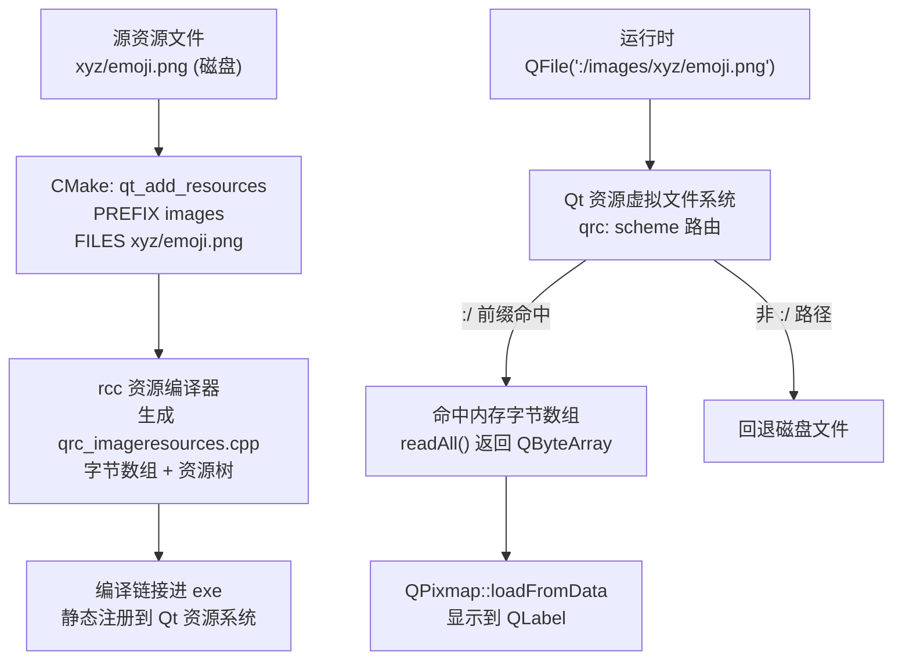

# Qt 07 RCC 资源系统 学习笔记

## 本章重要 API 函数

| API / 命令 | 功能 | 参数说明 | 来源 |
|------------|------|----------|------|
| `.qrc` 文件 / `qt_add_resources` | 把图片等文件编译进可执行体 | `PREFIX` 设虚拟根路径；`FILES` 列源文件（相对 CMakeLists） | Qt RCC |
| `:/images/xyz/emoji.png` | 以资源协议访问编译进 exe 的文件 | `:` 表资源 scheme；`/images` 是 PREFIX；后续为文件相对路径 | Qt 运行时 |
| `QFile(":/images/...")` | 像读文件一样读资源 | 以 `:/` 开头的路径，Qt 自动路由到资源系统 | `<QFile>` |
| `QPixmap::loadFromData(QByteArray, "JPG")` | 从字节数组加载图片 | 第一参资源二进制；第二参格式提示 | `<QPixmap>` |
| `rcc`（Qt 资源编译器） | 把 `.qrc` 编译为 `qrc_*.cpp` | 由 `AUTORCC` 或 `qt_add_resources` 隐式调用 | Qt 工具 |

> 💡 Tips：资源路径有两套写法易混——① **`.qrc` 方式**（见 [02](02-qt-widget-basic.md) 的 `my_img.qrc`，`<qresource prefix="/img">` + `myabc/emoji.png`，访问 `:/img/myabc/emoji.png`）；② **`qt_add_resources` 方式**（本篇，`PREFIX "images"` + `FILES xyz/emoji.png`，访问 `:/images/xyz/emoji.png`）。本篇 `hello.cpp` 里写的是 `file(":/images/xyz/emoji.png")`——注意 `images` 对应 `PREFIX`，`xyz/emoji.png` 对应 `FILES` 里的相对路径。`PREFIX` 不带前导 `/` 也行，Qt 会自动补，但访问时 `:/` 后紧接的就是 PREFIX 文本。

## 本章目录

> 点击条目可跳转到对应小节。

### 章节导航

- **[本章重要 API 函数](#本章重要-api-函数)**
- **[学习前后依赖](#学习前后依赖)**
- **[1. 概述](#1-概述)**
- **[2. 核心概念 / 原理](#2-核心概念--原理)**
- **[3. RCC 资源编译与访问机制](#3-rcc-资源编译与访问机制)**
- **[4. 核心代码解析](#4-核心代码解析)**
- **[5. 运行效果 / 验证](#5-运行效果--验证)**
- **[容易踩坑](#容易踩坑)**
- **[学习要点总结](#学习要点总结)**
- **[Q&A（常见问题）](#qa常见问题)**
- **[Tips（全局速记）](#tips全局速记)**

---

## 学习前后依赖

| 方向 | 内容 |
| ---- | ---- |
| 前置基础 | [03 CMake 构建](03-cmake-build.md) 的 `AUTORCC` 概念；[04 CMake+Qt6](04-cmake-qt6.md) 的 `qt_add_executable`/`qt_standard_project_setup`；[02](02-qt-widget-basic.md) 已用过 `.qrc` 资源（可在 `.ui` 里引用图片）。 |
| 本章核心 | 用 `qt_add_resources` 显式注册资源，理解 `:/` 虚拟路径、rcc 编译流程与运行时访问。 |
| 后续承接 | 资源系统是后续所有"图片/图标/翻译文件/样式表"进包的基础；可与 [05 VSCode](05-vscode-cmake-template.md)/[06 CLion](06-clion-project.md) 的 CMake 工程直接结合。 |

> 💡 Tips：为什么必须先会 03/04？因为 `qt_add_resources` 是 Qt6 CMake 命令，作用在 03/04 建立的 CMake + Qt6 工程模型上；而 `AUTORCC`（03 讲过）正是它背后的"自动触发 rcc"机制。本篇用**显式** `qt_add_resources` 替代隐式 `AUTORCC`，理解 03 的 AUTO 开关才能看懂二者的等价与差异。

## 1. 概述

程序运行时常常需要图片、图标、翻译 `.qm`、QSS 样式表等"静态文件"。如果靠相对路径从磁盘读取，会遇到路径不确定（工作目录变化）、文件被误删、部署麻烦等问题。Qt 的 **资源系统（RCC, Qt Resource Compiler）** 把这些文件在**编译期**直接编码进可执行文件，运行时通过 `:/xxx` 虚拟路径访问，就像访问普通文件一样，但永不依赖外部磁盘文件。

本仓库 `qt07_tst-cmake-rcc_` 演示这种方式：`CMakeLists.txt` 用 `qt_add_resources(... PREFIX "images" FILES xyz/emoji.png)` 把 `xyz/emoji.png` 编进 exe；`hello.cpp` 用 `QFile(":/images/xyz/emoji.png")` 读取其二进制，再用 `QPixmap::loadFromData` 显示到 `QLabel`。

> 💡 Tips：本章最该记住的一句话——**`rcc` 把文件变成了一段 C++ 字节数组常量，链接进 exe，运行时由 Qt 的资源虚拟文件系统（`qrc:` scheme）提供访问**。一个反直觉点：`QFile` 不仅能读真实磁盘文件，也能读 `:/` 资源文件——Qt 在 `QFile` 内部根据路径前缀自动选择"磁盘后端"还是"资源后端"。所以你写 `QFile(":/images/xyz/emoji.png")` 和写 `QFile("C:/a.png")` 用的是同一个类，只是数据来源不同。

## 2. 核心概念 / 原理

**rcc 做了什么**：`rcc` 读取 `.qrc`（XML，描述资源树）或 CMake 提供的 `PREFIX`+`FILES` 信息，把每个文件转换为一个压缩/原始字节数组，生成 `qrc_<name>.cpp`。该 cpp 里有一个静态初始化的资源树结构，注册到 Qt 的全局资源系统。链接后，这些字节就常驻 exe。

**虚拟路径（`:/`）**：资源在 exe 内形成一个虚拟目录树，根用 `:` 表示（类似 `http://` 的 scheme）。`PREFIX "images"` 设定第一级目录为 `images`，于是 `FILES xyz/emoji.png` 的访问路径是 `:/images/xyz/emoji.png`。注意 `PREFIX` 决定 `:/` 后的第一段，而 `FILES` 的相对路径决定后续段。

**访问后端路由**：`QFile`/`QPixmap` 等以 `:` 开头的路径会被 Qt 资源系统拦截。若路径能以 `:/` 命中已注册资源，就读内存里的字节数组；否则尝试磁盘。这让你无需关心资源是"编进 exe"还是"散在磁盘"——代码写法一致（这也是为何 02 的 `.ui` 里 `pixmap resource="my_img.qrc"` 能无缝引用资源）。

> 💡 Tips：原理上最易误解的是"`qt_add_resources` 和 `AUTORCC` 什么关系"。`AUTORCC` 是"自动发现 `.qrc` 文件并调用 rcc"的开关；`qt_add_resources` 是**显式、不依赖 `.qrc` 文件**地声明资源（直接在 CMake 里给 `PREFIX`/`FILES`）。二者最终都调用 `rcc` 生成 `qrc_*.cpp`，效果等价。显式方式的优势：资源清单写在 CMake 里、可加条件、可复用，不必为每个资源维护一个 `.qrc` 文件。

## 3. RCC 资源编译与访问机制



> 💡 Tips：流程里最关键的箭头是 `F -->|":/ 前缀命中"| G`——它表达"以 `:` 开头的路径被资源系统拦截并路由到内存字节数组"。另一个关键点是 `B --> C`：`qt_add_resources` 在 CMake 配置期就决定调用 `rcc`（等价于 03 的 `AUTORCC` 对 `.qrc` 的处理）。务必保证 `PREFIX` 与 `FILES` 拼接出的虚拟路径，和代码里 `QFile(":/...")` 写的路径**逐字符一致**，否则运行时 `open()` 失败、走到 `IMAGE LOAD FAILED` 分支。

## 4. 核心代码解析

**`qt07_tst-cmake-rcc_/CMakeLists.txt` 资源部分**：

```cmake
qt_add_executable(qt07_tst-cmake-rcc_
    hello.cpp
)
target_link_libraries(qt07_tst-cmake-rcc_ PRIVATE Qt6::Core Qt6::Widgets)

qt_add_resources(qt07_tst-cmake-rcc_ imageresources   # ① 资源目标名 imageresources
    PREFIX "images"                                   # ② 虚拟根目录 /images
    FILES xyz/emoji.png                               # ③ 源文件，相对 CMakeLists 目录
)
# ④ 末尾仍有与 05 相同的 POST_BUILD DLL 拷贝（略）
```

**`qt07_tst-cmake-rcc_/hello.cpp`**：

```cpp
#include <QApplication>
#include <QFile>
#include <QLabel>
#include <QPixmap>

int main(int argc, char *argv[]) {
    QApplication app(argc, argv);

    QLabel label;
    QFile file(":/images/xyz/emoji.png");         // ⑤ 以资源协议打开

    if (!file.open(QIODevice::ReadOnly)) {        // ⑥ 资源不存在则失败分支
        label.setText("RESOURCE OPEN FAILED");
        label.resize(260, 80);
    } else {
        QPixmap pixmap;
        const QByteArray imageData = file.readAll();          // ⑦ 读全部字节
        if (!pixmap.loadFromData(imageData, "JPG")) {         // ⑧ 按 JPG 解码
            label.setText("IMAGE LOAD FAILED");
            label.resize(240, 80);
        } else {
            label.setPixmap(pixmap);
            label.adjustSize();
        }
    }

    label.show();
    return app.exec();
}
```

逐段讲解：
- **① `qt_add_resources(... imageresources ...)`**：`imageresources` 是该资源目标的名字（可任意），会被加进目标的源依赖，CMake 据此调用 `rcc` 生成 `qrc_imageresources.cpp` 并链接。
- **②③ `PREFIX "images"` + `FILES xyz/emoji.png`**：拼出虚拟路径 `:/images/xyz/emoji.png`。注意 `FILES` 路径相对 **CMakeLists.txt 所在目录**（即 `xyz/emoji.png` 在源码根下）。
- **⑤ `QFile(":/images/xyz/emoji.png")`**：`QFile` 用 `:/` 前缀触发资源后端。这里有个**潜在坑**：资源图片实际是 `emoji.png`（PNG 格式），但 ⑧ 里 `loadFromData(imageData, "JPG")` 却按 **JPG** 解码——若文件真是 PNG，解码可能失败走到 `IMAGE LOAD FAILED`。这是源码里刻意保留的"教学陷阱"，提醒你格式声明必须与实际文件匹配（见踩坑）。
- **⑥ `file.open` 失败分支**：若 `PREFIX`/`FILES` 拼错导致路径不对，`open()` 返回 false，显示 `RESOURCE OPEN FAILED`——这是验证"资源是否真编进 exe"的最直接信号。

> 💡 Tips：这段代码里藏着的细节——`QFile` 配合 `:/` 既能读资源也能读磁盘，所以 `open()` 失败**不一定**是资源问题，也可能是路径拼错；而 `loadFromData(..., "JPG")` 的第二个参数强制指定解码格式，与文件真实格式不符就会失败。正确的健壮写法是用 `pixmap.load(&file)` 让 Qt 自动探测格式，或保证格式字符串与实际一致（PNG 就写 "PNG"）。

## 5. 运行效果 / 验证

- 构建运行 `qt07_tst-cmake-rcc_`，应弹出一个 `QLabel` 窗口，里面显示 `xyz/emoji.png` 这张图片（前提是 `loadFromData` 的格式与实际匹配；本仓库图片实为 PNG，若按 "JPG" 解码可能走到 `IMAGE LOAD FAILED`，这正是踩坑点）。
- 验证资源确实编进 exe：用资源编辑器或十六进制查看 exe，应能搜到 `emoji.png` 文件名串；或直接把 `xyz/emoji.png` **从磁盘删除**再运行——若仍能显示图片，证明图片来自 exe 内嵌资源而非磁盘读取（这是 RCC 最核心的价值验证）。
- 验证路径正确性：故意把 `hello.cpp` 里路径改成 `:/images/xyz/wrong.png`，应显示 `RESOURCE OPEN FAILED`，说明 `open()` 依赖精确的路径匹配。

> 💡 Tips：验证时容易误判"成功"的假象——图片能显示就以为资源系统生效。但如果你**没删磁盘原图**，也可能是 `QFile` 回退到了磁盘读取（虽然 `:/` 前缀通常只走资源，但某些混合配置下易混淆）。最可靠的验证是**删除/改名磁盘上的 `xyz/emoji.png` 后仍能显示**，这才确证数据来自 exe 内嵌资源。同时注意本例 `loadFromData(..., "JPG")` 的格式陷阱可能导致即使资源编进去了也显示失败，需先把格式改成 "PNG" 或改用自动探测。

## 容易踩坑（注意点）

- **坑 1：虚拟路径拼错导致 `open()` 失败。** 现象：显示 `RESOURCE OPEN FAILED`。原因：`PREFIX`+`FILES` 拼出的路径与 `QFile(":/...")` 不一致（如 PREFIX 写 `image` 却访问 `:/images/...`）。规避：对照 CMake 的 `PREFIX`/`FILES` 与代码路径，逐段核对。
- **坑 2：`loadFromData` 格式字符串与实际不符。** 现象：资源读到了却显示 `IMAGE LOAD FAILED`。原因：本例源码用 `"JPG"` 解码 PNG 文件。规避：格式串要与实际文件匹配；更稳妥用 `pixmap.load(&file)` 让 Qt 自动探测，或 `QPixmap::fromImage(QImage::fromData(data))`。
- **坑 3：`FILES` 相对路径算错。** 现象：rcc 报找不到文件。原因：`FILES` 相对 **CMakeLists.txt 所在目录**，不是相对构建目录。规避：用相对 CMakeLists 的正确路径，或用 `CMAKE_CURRENT_SOURCE_DIR` 拼接绝对路径。
- **坑 4：以为 `qt_add_resources` 和 `AUTORCC` 冲突。** 现象：重复注册/链接错。原因：二者都会触发 rcc，对同一资源重复声明会冲突。规避：选一种方式即可；本篇用 `qt_add_resources`（不含 `.qrc`），就不要再 `AUTORCC` 同一个文件。
- **坑 5：忘记把资源目标关联到可执行目标。** 现象：资源未编进 exe，`open()` 失败。原因：`qt_add_resources(targetName resName ...)` 的第一个参数必须是**已存在**的可执行/库目标名。规避：确保 `qt_add_executable` 先定义，再 `qt_add_resources` 同一 target。
- **坑 6：大资源膨胀 exe 体积。** 现象：exe 莫名变大。原因：资源（尤其图片）被编进二进制，且 rcc 默认压缩。规避：图片做尺寸/格式优化；或用 `qt_add_resources` 的 `BASE`/`QML` 等选项精细控制；超大资源考虑运行时从磁盘/网络加载。

## 学习要点总结

### 核心知识点
1. RCC 在编译期把文件变成字节数组编进 exe，运行时用 `:/虚拟路径` 访问，不依赖外部磁盘文件。
2. `qt_add_resources(target PREFIX "x" FILES ...)` 是 Qt6 显式注册资源的方式，等价于隐式 `AUTORCC` + `.qrc`。
3. 虚拟路径 = `:/` + `PREFIX` + `FILES` 相对路径；`QFile` 对 `:/` 前缀自动走资源后端。

### 关键 API
- `qt_add_resources`：显式资源注册。
- `QFile(":/...")`：访问资源。
- `QPixmap::loadFromData`：从字节数组解码图片。
- `rcc`：资源编译器（被 CMake 隐式调用）。

### 下一步学习
- 回顾 [02 QWidget 基础](02-qt-widget-basic.md)：那里用 `.qrc`（`my_img.qrc`）在 `.ui` 里引用图片，是 RCC 的另一种（`.qrc`）写法，可与本篇 `qt_add_resources` 对照。

> 💡 Tips：本篇与知识地图里"下一步"那篇（02）直接挂钩——02 的 `my_img.qrc` 是 RCC 的"`.qrc` 声明式"分支，本篇的 `qt_add_resources` 是"CMake 命令式"分支，二者底层都是 rcc，理解本篇再看 02 的 `.qrc` 会豁然开朗，反之亦然。

## Q&A（常见问题）

**Q1：`qt_add_resources` 和 `.qrc` + `AUTORCC` 该用哪个？**  A1：两者最终都调用 `rcc` 生成 `qrc_*.cpp`，效果等价。**`.qrc` 方式**（如 02）适合用 Qt Designer 可视化引用资源、资源结构清晰写在 XML 里；**`qt_add_resources` 方式**（本篇）适合在 CMake 里集中声明、加条件逻辑、复用资源列表，且不引入额外 `.qrc` 文件。小型工程用 `.qrc` 更直观，大型/脚本化工程用 `qt_add_resources` 更灵活。注意别对同一资源两种方式重复声明。

**Q2：为什么 `QFile` 能打开 `:/images/xyz/emoji.png` 这种"不存在于磁盘"的路径？**  A2：Qt 的 `QFile` 内部根据路径 scheme 选择后端。以 `:` 开头会被路由到 **Qt 资源虚拟文件系统**（由 `rcc` 生成的静态资源树支撑），从内存字节数组读取；非 `:` 路径才走真实文件系统。所以 `QFile(":/...")` 和 `QFile("C:/a.png")` 接口一致、数据来源不同。这也是 `QPixmap`、`QIcon` 能直接吃 `:/` 路径的原因。

**Q3：Qt5 和 Qt6 在资源系统上有区别吗？**  A3：rcc 资源机制在 Qt5/Qt6 **基本一致**，`QFile(":/...")` 访问方式完全兼容。差异在 CMake 集成：Qt6 推荐 `qt_add_resources`（本篇）；Qt5 用 `QT5_ADD_RESOURCES` 或 `AUTORCC` + `.qrc`（见 [03](03-cmake-build.md) 的 `AUTORCC ON`）。代码侧访问资源的写法跨版本不变。一个小变化：Qt6 对资源压缩/初始化略有优化，但使用者无感。

## Tips（全局速记）

### 最容易忽视的细节
1. **虚拟路径 = `:/` + PREFIX + FILES 相对路径**，三段必须和 `QFile(":/...")` 逐字符吻合。
2. **`FILES` 相对 CMakeLists 目录**，不是构建目录，写错 rcc 直接找不到源文件。
3. **`qt_add_resources` 第一个参数必须是已定义的 target 名**，顺序上 `qt_add_executable` 在前。

### 踩坑记录
- "图片能显示就以为资源生效"的错觉：没删磁盘原图时可能仍在读磁盘。删除原图仍能显示，才是 RCC 真正生效的铁证。
- `loadFromData(..., "JPG")` 格式陷阱：本例文件实为 PNG 却按 JPG 解码，会误报 `IMAGE LOAD FAILED`。格式串必须与实际一致，或改用 `pixmap.load(&file)` 自动探测。

### 与后续章节的衔接
1. **02 QWidget 基础**：02 的 `my_img.qrc` 是 RCC 的 `.qrc` 写法，与本篇 `qt_add_resources` 互为表里，建议对照阅读。
2. **03/04 CMake 构建**：`AUTORCC`（03）是 `qt_add_resources` 的隐式版；04 的 Qt6 标准工程天然支持本篇命令。
3. **05/06 IDE 配置**：VSCode/CLion 的 CMake 工程直接容纳 `qt_add_resources`，clangd 对 `:/` 路径无特殊要求，照常补全。

### 设计决策思考
- **为什么要把资源编译进 exe，而不是运行时读磁盘？** 资源内嵌带来"单文件分发、路径无关、不被误删/篡改"的好处，对图标、翻译、样式表这类小文件尤其合适。代价是 exe 体积增大、更新资源需重新编译。Qt 提供 rcc 正是为"自包含应用"而生；超大资源（视频、大图集）则应权衡，改用磁盘/网络加载。
- **为什么 Qt 提供 `qt_add_resources` 和 `.qrc` 两种声明方式？** `.qrc` 是早期声明式方案，配合 Designer 生态成熟；`qt_add_resources` 是 CMake 原生命令式方案，契合"一切配置在 CMake 里"的现代工程理念，便于条件包含、变量复用。两者并存让用户按工程规模与习惯选择，底层统一于 rcc，避免分裂。
