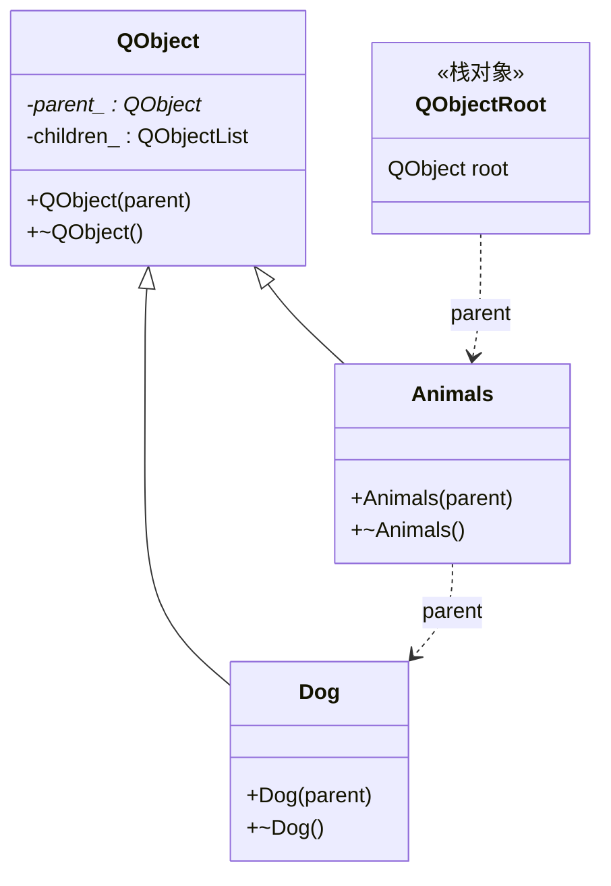
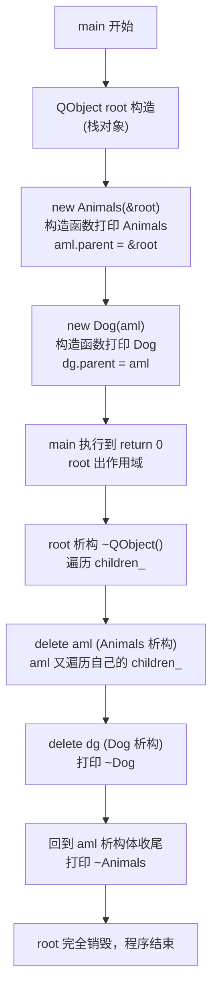

# Qt 08 对象树与父子内存管理 学习笔记

## 本章重要 API 函数

| API | 功能 | 参数说明 | 头文件 |
|-----|------|----------|--------|
| `QObject(QObject *parent = nullptr)` | QObject 基类构造函数，建立父子归属 | `parent`：父对象指针，传入后本对象被登记为该父对象的子对象；默认 `nullptr` 表示无父（顶层对象） | `<QObject>` |
| `~QObject()` | 析构函数，自动销毁其所有子对象 | 无参数；析构时会遍历 children 列表逐个 delete | `<QObject>` |
| `QObject::children()` | 返回子对象列表 | 无；返回 `const QObjectList &` | `<QObject>` |
| `QObject::parent()` | 返回父对象指针 | 无 | `<QObject>` |
| `QWidget(QWidget *parent = nullptr)` | 控件构造函数，本质是 QObject 子类 | `parent` 既决定内存归属，也决定窗口层级（子控件显示在父窗口内） | `<QWidget>` |

> 💡 Tips：Qt6 中 `QObject` 的拷贝构造与赋值运算符被**显式删除**（`Q_DISABLE_COPY`），所以 `QObject` 子类不能按值拷贝/赋值——这也是为什么我们的示例都用指针 `new`。另外 `setParent()` 可以**运行时**改变归属，但构造函数传入 parent 仍是最常见、最安全的方式。

## 本章目录

> 点击条目可跳转到对应小节。

### 章节导航

- **[本章重要 API 函数](#本章重要-api-函数)**
- **[学习前后依赖](#学习前后依赖)**
- **[1. 概述](#1-概述)**
- **[2. 核心概念 / 原理](#2-核心概念--原理)**
- **[3. 对象树的归属与析构顺序](#3-对象树的归属与析构顺序)**
- **[4. 核心代码解析](#4-核心代码解析)**
- **[5. 运行效果 / 验证](#5-运行效果--验证)**
- **[容易踩坑（注意点）](#容易踩坑注意点)**
- **[学习要点总结](#学习要点总结)**
- **[Q&A（常见问题）](#qa常见问题)**
- **[Tips（全局速记）](#tips全局速记)**

---

## 学习前后依赖

| 方向 | 内容 |
| ---- | ---- |
| 前置基础 | C++ 类继承、`new`/`delete`、栈对象生命周期（超出作用域自动析构）。 |
| 本章核心 | QObject 的父子归属机制、父析构时递归析构子对象、避免重复 `delete`。 |
| 后续承接 | 布局管理器（qt11）中大量使用 `new QWidget(this)`；信号槽（qt13）中收发对象多为父子关系；所有 GUI 控件的生命周期都依赖对象树。 |

> 💡 Tips：对象树是 Qt GUI 程序的"地基"。qt11 布局里每个 `new QPushButton(name, buttonPanel)` 的第二个参数就是父对象——如果你没理解对象树，就会困惑"为什么我从没 delete 这些按钮却不内存泄漏"。先吃透本章，后面所有 GUI 章节都顺理成章。

## 1. 概述

在普通 C++ 中，`new` 出来的对象必须手动 `delete`，否则内存泄漏；而 Qt 的 GUI 程序动辄成百上千个控件，逐一手动 `delete` 既繁琐又容易出错（重复 delete 还会崩溃）。Qt 给出的解法是**对象树（Object Tree）**：任何 `QObject`（及其子类，包括所有 GUI 控件 `QWidget`）在被构造时如果指定了父对象，就会被登记到父对象的"孩子列表"中；当父对象析构时，它会**自动递归地**把自己所有子对象也 `delete` 掉。

这种"谁创建谁负责，但父对象统一兜底"的模型，把内存释放的时机从"程序员记得 delete"变成了"随父对象生命周期自动发生"。在 `qt08` 这个示例中，我们用 `Animals`/`Dog` 两个继承自 `QObject` 的类，配合 `main` 里一个位于**栈上**的 `QObject root`，演示了：构造时打印归属关系，程序结束 `root` 出作用域析构时，子对象按相反顺序被自动清理——全程我们一行 `delete` 都没写。

> 💡 Tips：最该记住的一句话——**"父对象销毁，子对象跟着销毁；但子对象被提前 delete，父对象不受影响（只是从孩子列表移除）"**。这是一条不对称的规则，也是对象树安全性的来源。

## 2. 核心概念 / 原理

对象树本质是一个**有根的有向树**，根是父、叶子是子。每个 `QObject` 内部维护两样东西：`parent_` 指针（指向父亲）和 `children_` 列表（指向所有孩子）。当构造一个 `QObject` 并传入 `parent` 时，构造函数内部会执行 `parent->children_.append(this)`，把自己挂到父亲的孩子列表里。

关键点有三个：

1. **归属是单向的**。子对象知道父亲（`parent()`），父亲也知道所有孩子（`children()`），但析构只"自上而下"发生——父亲死，连带杀孩子；孩子先死，父亲继续活。
2. **析构顺序与构造相反**。C++ 保证：父对象析构时，先执行自身析构体，再销毁成员；而 QObject 析构函数会在最后去 `delete` 每个子对象。子对象们又各自是 QObject，于是递归展开。结果是**最晚构造的孩子最先被析构**（栈式 LIFO）。
3. **只有 QObject 子类才进对象树**。裸的 `int*`、`std::string`、普通结构体不会被管理——对象树只认识 `QObject`。

结合本仓库 `widget.cpp` 里那行 `QPushButton *bin = new QPushButton("ok", this);`：按钮 `bin` 的父对象是 `Widget`（即 `this`），所以 `Widget` 析构时按钮会被自动删除。这正是 GUI 程序几乎从不手动 `delete` 控件的原因。

> 💡 Tips：最容易误解的一点是"对象树会自动管理一切内存"。错！它**只管理 QObject 子树**。示例 `qt12` 里 `new QRandomGenerator()` 没有任何父对象、也没 delete，就是真实的内存泄漏——因为 `QRandomGenerator` 虽然属于 Qt，但它不是通过父对象托管的（见 qt12 笔记）。对象树不是万能垃圾回收。

## 3. 对象树的归属与析构顺序

下面用 classDiagram 展示 `qt08` 的继承与父子归属关系，再用 flowchart 展示 `main` 退出时的析构时序。





**运行时的实际打印顺序**是：`Animals` → `Dog`（构造），然后 ` ~Dog` → ` ~Animals`（析构）。注意 `root` 本身是裸 `QObject`、没有自定义析构打印，所以你看不到它的析构日志，但它确实触发了整条链的清理。

> 💡 Tips：流程里最关键的箭头是 `root 析构 → delete aml → delete dg` 这一串——它解释了为什么"没写 delete 却析构了"。而 `~Dog` 先于 `~Animals` 出现，正是"构造 Animals 在前、Dog 在后，析构则反过来"的 LIFO 铁律。记住：对象树的清理方向永远**从叶子往根**。

## 4. 核心代码解析

`qt08_tst-objectTree_/main.cpp` 全文不长，逐段拆解：

```cpp
class Animals : public QObject {
public:
    explicit Animals(QObject *parent = nullptr) : QObject(parent) {
        cout << __FUNCTION__ << std::endl;   // 打印 "Animals"
    }
    ~Animals() override {
        cout << __FUNCTION__ << std::endl;   // 打印 "~Animals"
    }
};
```

- 用 `explicit` 修饰构造函数，避免 `QObject* p = &root;` 之类的隐式转换（Qt 基类构造函数就是 explicit 的，子类保持一致是好习惯）。
- 初始化列表 `: QObject(parent)` **必须把 parent 传给基类**，否则对象树不建立——这是最常见的漏写点。
- 析构加 `override`，明确这是重写基类虚析构。

```cpp
int main(int argc, char *argv[])
{
    QCoreApplication app(argc, argv);

    QObject root;                  // 栈上的根
    Animals *aml = new Animals(&root);   // aml 挂到 root 下
    Dog *dg = new Dog(aml);              // dg 挂到 aml 下

    return 0;                     // root 出作用域 → 自动清理 aml、dg
}
```

- `root` 是栈对象，函数返回即析构，从而触发整棵子树清理。`aml`、`dg` 都是 `new` 出来却**从不手动 delete**——靠的就是对象树兜底。
- `widget.cpp` 里 `QPushButton *bin = new QPushButton("ok", this);` 是 GUI 场景的标准写法：`this`（Widget）作父，按钮随窗口销毁而销毁。删掉 `this` 这个父参数，按钮就变成孤儿、需手动 delete，否则泄漏。

> 💡 Tips：这段代码藏着两个细节——① 若把 `Dog *dg = new Dog(aml)` 写成 `new Dog(&root)`，则 `dg` 和 `aml` 同级（都挂 root 下），析构顺序会变为 `~aml`、`~dg` 谁先取决于登记顺序，不再是严格的嵌套；② `override` 不能省：若基类析构非虚，通过父类指针 delete 子类对象时子析构不执行（不过 QObject 析构本就是 virtual，这里重写是显式声明意图）。

## 5. 运行效果 / 验证

编译运行 `qt08_tst-objectTree_`（Qt6 + MinGW），控制台应看到：

```
Animals
Dog
~Dog
~Animals
```

- 前两个是构造打印，后两个是程序退出时对象树递归析构的打印。
- 若你**手动**在 `return 0;` 前加 `delete dg;`，再运行会看到 `~Dog` 出现两次？其实不会——因为 `dg` 已在对象树中，`delete dg` 会先把它从 `aml` 的孩子列表移除并执行一次 `~Dog`，随后 `root` 析构时 `aml` 析构、`aml` 的孩子列表里已无 `dg`，不会再析构它。但若你 `delete aml;` 又让 `root` 析构，则 `aml` 被析构时仍会 `delete dg`——**重复 delete 的崩溃风险正是对象树要帮你规避的**。

> 💡 Tips：验证时最容易误判"成功"的假象——看到程序正常退出就以为没泄漏。正确验证法：在 `Dog` 析构里打印日志，确认打印了恰好一次；或者用任务管理器/Valgrind 看进程退出后是否还有孤儿句柄。日志出现一次 = 析构恰好一次 = 对象树工作正常。

## 容易踩坑（注意点）

- 坑 1：**忘记把 parent 传给基类构造函数**。现象：控件不随父窗口关闭而释放，内存持续增长。原因：初始化列表漏写 `: QObject(parent)`，对象树关系未建立。规避：构造函数第一行永远先 `: QObject(parent)`。
- 坑 2：**对同一对象既交给对象树又手动 delete**。现象：运行时崩溃（double free）。原因：父析构时会再 delete 一次。规避：交给父对象后就不要再碰它；需要提前销毁用 `deleteLater()` 而非裸 `delete`。
- 坑 3：**跨对象树重复挂父子**。现象：一个对象同时有两个父。原因：`setParent()` 与构造 parent 混用不当。规避：一个 QObject 在任一时刻只能有一个父，第二次 `setParent` 会自动从旧父剥离。
- 坑 4：**在父对象析构前访问已被 delete 的子对象**。现象：野指针崩溃。原因：在析构函数顺序不当的自定义清理代码里访问子控件。规避：子控件生命周期交给父亲，自己不要保存裸指针长期持有。
- 坑 5：**把非 QObject 对象当子对象传**。现象：编译报错或内存不管理。原因：对象树只认 QObject 子类。规避：`std::string`、原生数组等用智能指针 `std::unique_ptr` 管理。

## 学习要点总结

### 核心知识点
1. 对象树是 Qt 基于 QObject 的父子归属 + 析构递归机制，实现"父销毁子跟着销毁"。
2. 析构顺序严格 LIFO：最晚构造的子对象最先析构。
3. 只有 `QObject` 子类进对象树；GUI 控件 `QWidget` 是 QObject 子类，父参数同时决定内存与窗口层级。

### 关键 API
- `QObject(parent)`：传入父对象建立归属。
- `~QObject()`：自动 delete 所有子对象。
- `parent()` / `children()`：查询归属关系。
- `deleteLater()`：线程安全延迟删除（qt13 信号槽会用到）。

### 下一步学习
- 下一站 **qt11 布局管理器**：所有 `new QPushButton(name, panel)` 的父参数依赖本章知识。
- 再往后 **qt13 信号槽**：对象树决定对象生命期，避免槽函数访问已销毁对象。

> 💡 Tips：把本篇与"下一步"直接挂钩——qt11 的 `show1()` 里 `new QPushButton(name, buttonPanel)` 第二个参数 `buttonPanel` 就是父对象，不理解对象树就不知道按钮何时被释放；qt12 的 `Monster` 同样靠 `QObject(parent)` 进树。

## Q&A（常见问题）

**Q1：父对象析构时，子对象的析构函数会被调用吗？**  A1：会。QObject 析构函数遍历 `children()` 列表，对每个子对象执行 `delete`，从而触发子对象的析构体。本例 `root` 析构导致 `~Dog`、`~Animals` 被打印就是证据。注意：若子对象是在栈上（非 new），不能交给对象树——栈对象由 C++ 作用域管理，把它当父挂别的 new 对象没问题，但反过来不行。

**Q2：`deleteLater()` 和普通 `delete` 有什么区别？**  A2：`delete` 立即销毁对象，若在事件处理或信号发射中途调用，可能导致后续代码访问已销毁对象而崩溃；`deleteLater()` 把"销毁"事件投递到事件循环，等当前调用栈返回、控制权回到事件循环时才真正删除，是 Qt 推荐的跨上下文安全删除方式。它依赖对象树所在的事件循环，需 `QCoreApplication::exec()` 运行。

**Q3：Qt5 和 Qt6 在对象树上有差异吗？**  A3：核心机制一致（父析构递归删子）。差异在细节：Qt6 彻底删除了 `QObject` 的拷贝语义（更早版本也只是禁用），并移除了 `QObject::connect` 的 `Qt::ConnectionType` 某些旧行为默认变化；另外 Qt6 中 `QRandomGenerator`、智能指针 `QPointer` 等配合对象树使用更普遍。`QPointer<T>` 能在对象被对象树销毁后自动置空，是访问可能被树回收对象的首选弱引用。

## Tips（全局速记）

### 最容易忽视的细节
1. `QObject` 不能值拷贝——它禁用了拷贝构造/赋值，所以示例全用指针。想共享用 `QPointer` 或 `QSharedPointer`。
2. 父参数 `this` 同时影响"内存归属"和"窗口显示位置"：子控件绘制在父控件客户区内。
3. `root` 是栈对象这一点至关重要——若 `root` 也写成 `new QObject()` 且不 delete，整棵树都不会被清理。

### 踩坑记录
- **"我 new 了却没 delete，居然没泄漏"的错觉**：这是对象树在兜底，不是你写对了。一旦某天忘了传 parent，泄漏立刻出现。养成"凡是 `new QObject` 子类必想父对象"的条件反射。
- **手动 delete 后父析构再 delete 崩**：本例若加 `delete dg;` 再让程序自然退出，因 `dg` 已从 `aml` 孩子列表移除所以不崩——但很多新手会在别处再 `delete` 一次导致 double free。统一交给树，自己别动手。

### 与后续章节的衔接
1. **qt11 布局**：`new QPushButton(name, buttonPanel)` 的 `buttonPanel` 即父，控件随面板销毁。
2. **qt13 信号槽**：信号发射者/接收者多为父子，对象树保证槽执行时对象仍存活（否则用 `QPointer` 防护）。
3. **qt12 随机数/怪物**：`Monster : QObject(parent)` 同样进对象树，演示 QObject 元对象系统。

### 设计决策思考
- **为什么 Qt 不用智能指针而是对象树？** GUI 中控件天然有"包含"语义（窗口包含按钮），且需在事件循环、跨线程删除时统一收口。`QObject` 的父子模型比 `shared_ptr` 更贴合 UI 层级，也不会因循环引用（父子互相 `shared_ptr`）而泄漏。对象树是"所有权树"，而 `QPointer`/`QSharedPointer` 是补充工具。
- **为什么析构是递归而非迭代？** 因为子树可能很深，递归最直观；且 Qt 保证子对象在父对象自身资源释放前先销毁，递归天然满足"先清孩子再清自己"的顺序。
