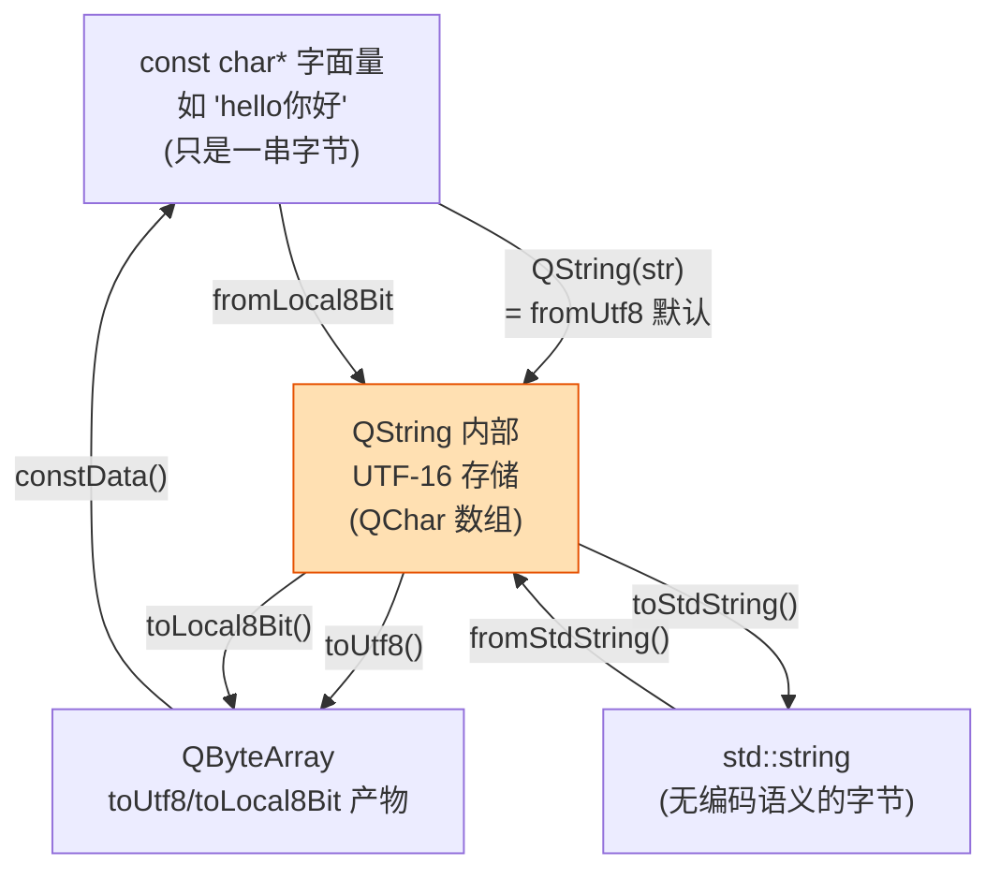

# Qt 09 QString 与 char* / std::string 编码转换 学习笔记

## 本章重要 API 函数

| API | 功能 | 参数说明 | 头文件 |
|-----|------|----------|--------|
| `QString(const char *str)` | 从 `const char*` 构造 QString | 该 `char*` 被**当作 UTF-8** 解码为内部 UTF-16。源码中 `QString str3 = "hello你好";` 即此路径 | `<QString>` |
| `QString::fromUtf8(const char *str)` | 显式按 UTF-8 解码 | `str`：UTF-8 字节序列；源码 `test03` 注释块用到 `QString::fromUtf8(buf1, strlen(buf1))` | `<QString>` |
| `QString::fromLocal8Bit(const char *str)` | 按系统本地编码（如 GBK/Windows-1252）解码 | 用于读取非 UTF-8 的本地文件/老接口返回的 `char*` | `<QString>` |
| `toUtf8()` | QString → `QByteArray`（UTF-8 编码） | 无参数；返回 `QByteArray`，可用 `.constData()` 取 `char*` | `<QString>` |
| `toLocal8Bit()` | QString → `QByteArray`（本地编码） | 传给只认本地编码的 C 接口（如某些 Windows API） | `<QString>` |
| `toStdString()` / `fromStdString()` | 与 `std::string` 互转 | `toStdString()` 返回 UTF-8 编码的 `std::string`（`std::string` 本身无编码语义，只是字节） | `<QString>` |

> 💡 Tips：最易错的是**构造函数的隐式编码假设**——`QString("中文")` 把字面量当 UTF-8。若你的源文件保存为 GBK（Windows 老工程常见），编译器把 GBK 字节塞进字面量，QString 却按 UTF-8 解，立刻乱码。Qt5/Qt6 一致：源码应是 UTF-8，并在 `.pro`/CMake 里声明 `UTF-8` 编码。

## 本章目录

> 点击条目可跳转到对应小节。

### 章节导航

- **[本章重要 API 函数](#本章重要-api-函数)**
- **[学习前后依赖](#学习前后依赖)**
- **[1. 概述](#1-概述)**
- **[2. 核心概念 / 原理](#2-核心概念--原理)**
- **[3. 编码转换链路](#3-编码转换链路)**
- **[4. 核心代码解析](#4-核心代码解析)**
- **[5. 运行效果 / 验证](#5-运行效果--验证)**
- **[容易踩坑（注意点）](#容易踩坑注意点)**
- **[学习要点总结](#学习要点总结)**
- **[Q&A（常见问题）](#qa常见问题)**
- **[Tips（全局速记）](#tips全局速记)**

---

## 学习前后依赖

| 方向 | 内容 |
| ---- | ---- |
| 前置基础 | C/C++ 字符与字符串（`char*`、`std::string`）、字符编码基本概念（ASCII / UTF-8 / Unicode）。建议先读 qt10（char/字符串基础）。 |
| 本章核心 | QString 的内部 UTF-16 存储、与 `char*`/`std::string` 的 UTF-8 / 本地编码转换、中文乱码根因。 |
| 后续承接 | qt11 布局里的按钮中文文案、qt12 怪物名称、qt13 信号槽传递字符串，凡是涉及中文显示都要用到本章；后续文件读写（qt22 SQLite）也依赖编码正确。 |

> 💡 Tips：编码问题是 Qt 初学者"中文一堆问号"的头号元凶。本章必须先于任何带中文 UI 的章节——否则你会在 qt11 按钮上看到"????"，却不知道是 `QString::fromLocal8Bit` 用错了。先会 qt10 的 char/string，再学本章转换，顺序不能反。

## 1. 概述

C++ 原生的 `char*` 和 `std::string` **不携带编码信息**——它们只是一串字节。`char*` 字面量 `"你好"` 在内存里到底是 UTF-8 的 6 个字节还是 GBK 的 4 个字节，完全取决于源文件保存时的编码。而 Qt 的 `QString` 内部统一使用 **UTF-16**（Qt6 内部是 `char16_t`，每个 `QChar` 占 2 字节，基本多文种平面 BMP 内一个字符一 `QChar`，辅助平面用代理对）。这个"内部统一 Unicode、对外灵活编解码"的设计，让 Qt 能正确处理全世界文字，但也带来一个绕不开的问题：**QString 与外部 `char*`/`std::string` 之间如何转换，才不会乱码？**

`qt09` 用三个测试函数给出答案：`test01` 对比 `char*`、`std::string`、`QString` 三种字符串的打印；`test02` 揭示 QString 的"写时复制/隐式共享"内部指针；`test03` 演示 `asprintf` 与 `arg()` 两种格式化，并在注释块里给出 `fromUtf8`/`toUtf8` 的真实用法。理解它们，你就掌握了 Qt 世界里"字符串从哪来、到哪去"。

> 💡 Tips：概述里最该记住的一句话——**"QString 内部永远是 UTF-16；你和它之间只隔着一次明确的编解码，编码说不清，乱码就来了。"** 不存在"QString 直接存了 UTF-8"这回事。

## 2. 核心概念 / 原理

### 2.1 QString 的内部表示

`QString` 是一个**隐式共享（implicit sharing / 写时复制 COW）**的 UTF-16 字符串容器。它内部持有一个指向 `QStringData` 的指针（`d_ptr()` 可见），多个 `QString` 拷贝可共享同一块数据；只有当某个副本被**修改**时，才执行"分离（detach）"复制出独立副本。这点在 `test02` 里一目了然。

### 2.2 编码转换的两条主路

- **UTF-8 路径（推荐、跨平台一致）**：`QString::fromUtf8(char*)` 把 UTF-8 字节解码成 UTF-16；`QString::toUtf8()` 反向编码。源码/网络数据默认 UTF-8，这是现代标准。
- **本地编码路径（兼容老系统）**：`QString::fromLocal8Bit(char*)` 按操作系统当前代码页解码（中文 Windows 通常是 GBK/GB18030）；`toLocal8Bit()` 反向。用于对接只认本地编码的第三方 C 库。

`char*` 字面量直接构造 `QString` 时，等价于 `fromUtf8`，即**假设源文件是 UTF-8**。这是中文乱码最常见的爆发点：源文件若是 GBK，字节不符 UTF-8，解出来就是乱码。

> 💡 Tips：原理层最易误解的是"`std::string` 有编码"。其实 `std::string` 只装字节、毫无编码语义；`toStdString()` 默认按 UTF-8 把 QString 编码进 `std::string`。所以"QString → std::string → 某个 API"是否乱码，取决于那个 API 把它当什么编码解释——这和你用 `toUtf8()` 还是 `toLocal8Bit()` 是一样的权衡。

## 3. 编码转换链路

下面用 flowchart 画出 `char*` 与 `QString` 之间双向转换的四条链路：



关键规则：**黄框 `QString` 是唯一"懂 Unicode"的节点**，所有箭头进出它都必须声明编解码方式。灰框 `char*`/`std::string`/`QByteArray` 都是"裸字节"，它们自己不知道自己是什么编码。

> 💡 Tips：流程里最关键的箭头是 `A -->|QString(str) = fromUtf8 默认| B`——它默认 UTF-8。一旦你机器上的源文件不是 UTF-8（比如 Windows 记事本存成 ANSI/GBK），这条默认箭头就会把 GBK 字节当 UTF-8 解，直接乱码。判断乱码根因，就盯住每个"裸字节 → QString"的箭头用了哪种解码。

## 4. 核心代码解析

`qt09_tst-QString-char_/main.cpp` 三段测试，逐段看：

```cpp
void test01() {
    const char *str1 = "hello你好";
    std::string str2 = "hello你好";
    QString str3 = "hello你好";     // 等同 fromUtf8(str1)

    cout << str1 << endl;           // 依赖终端编码：终端是 UTF-8 才正常
    cout << str2 << endl;           // 同 str1，std::string 原样字节
    qDebug() << str3;               // qDebug 自己按 Unicode 输出，最稳
}
```

- `str3 = "hello你好"` 走 `QString(const char*)`，被当 UTF-8 解码。`qDebug() << str3` 永远正确，因为 qDebug 直接操作内部 UTF-16；而 `cout << str1` 是否正确，取决于**终端/控制台**的编码是否也是 UTF-8（Windows 老控制台默认 GBK，就会乱）。

```cpp
void test02() {
    QString x1 = "12345";
    QString x2(x1);                 // 拷贝，隐式共享
    qDebug() << x1.data_ptr().d_ptr() << x2.data_ptr().d_ptr(); // 同地址
    x2[1] = 'w';                    // 发生写时复制 detach
    qDebug() << x1.data_ptr().d_ptr() << x2.data_ptr().d_ptr(); // 地址不同
}
```

- 拷贝构造后 `x1`、`x2` 的 `d_ptr()`（底层数据指针）**相同**，证明共享；`x2[1]='w'` 触发 detach，之后两者指向不同内存。这就是隐式共享：拷贝很廉价，修改才付代价。

```cpp
void test03() {
    const char *fmt1 = "My name is %s, I'm %d years old, %d is too young!\n";
    qDebug() << QString::asprintf(fmt1, "rocky", 18, 18);   // C 风格
    QString qfmt2("My name is %1, I'm %2 years old, %2 is too young!\n");
    qDebug() << qfmt2.arg("rocky").arg(16);                 // Qt 位置参数 %1 %2
    // 注释块中给出：
    // QString::fromUtf8(buf1, strlen(buf1));
    // str1.toUtf8().constData();   // QString -> UTF-8 字节
}
```

- `asprintf` 是 C 风格 `sprintf` 的安全版；`arg()` 用 `%1 %2` **位置占位**，可重复引用（如 `%2` 出现两次都填 16），比 C 风格更易维护、支持 Unicode 更友好。
- 注释块里的 `fromUtf8` / `toUtf8().constData()` 正是本章核心转换 API 的真实用例，虽被 `#if 0` 关掉，但展示了"字节 → QString → 字节"的闭环。

> 💡 Tips：这段代码藏着的细节——① `x2[1]='w'` 的 `operator[]` 非 const 版本才会 detach，若用 `x2.at(1)` 只读则不分离；② `arg()` 是**返回新 QString** 的链式调用，`qfmt2` 本身不变；③ `toUtf8().constData()` 返回的指针只在 `QByteArray` 临时对象存活期内有效，别把它存成长期 `char*` 否则悬空。

## 5. 运行效果 / 验证

编译运行 `qt09`，预期：

- `test01`：`qDebug() << str3` 稳定打印 `hello你好`；`cout` 是否在控制台也正常，取决于终端编码（Windows 下可能显示乱码，但 QString 本身是对的）。
- `test02`：修改前 `x1`、`x2` 的 `d_ptr()` 输出**相同地址**；`x2[1]='w'` 后输出**不同地址**，且 `x1` 仍是 `"12345"`、`x2` 变 `"1w345"`（验证写时复制只影响副本）。
- `test03`：`asprintf` 与 `arg()` 都正确填入参数。

> 💡 Tips：验证时最容易误判"成功"的假象——在 qDebug 里看到中文正常，就以为全链路没问题。但 qDebug 走的是内部 UTF-16 直接输出，掩盖了 `cout`/文件/网络那一层编码问题。**真正该验证的是**：把 `QString` 用 `toUtf8()` 写出文件、用十六进制查看器确认是 `e4 bd a0 e6 88 91`（"你好"的 UTF-8），这才是编码正确的铁证。

## 容易踩坑（注意点）

- 坑 1：**源文件非 UTF-8 导致 `QString("中文")` 乱码**。现象：界面/日志出现"涓­"类乱码。原因：字面量被当 UTF-8 解，但字节实为 GBK。规避：编辑器保存为 UTF-8（无 BOM 亦可），Qt6 默认按 UTF-8 读源码；必要时改用 `QString::fromLocal8Bit("中文")`。
- 坑 2：**`toLocal8Bit().constData()` 悬空指针**。现象：拿到的 `char*` 很快变成垃圾值。原因：`QByteArray` 是临时对象，语句结束即析构，指针失效。规避：先存到具名 `QByteArray ba = str.toUtf8(); const char* p = ba.constData();` 延长生命周期。
- 坑 3：**用 `qPrintable()` 与 `toLocal8Bit()` 混用**。现象：跨平台中文时好时坏。原因：`qPrintable` 本质 `toLocal8Bit().constData()`，依赖本地编码，在 Linux(UTF-8)/Windows(GBK) 行为不一致。规避：需要 `const char*` 时优先 `toUtf8().constData()` 并明确接收方按 UTF-8 解释。
- 坑 4：**`std::string` 经 `fromStdString` 乱码**。现象：网络/文件读入的 GBK `std::string` 转 QString 乱。原因：`fromStdString` 默认当 UTF-8。规避：若源是本地编码用 `QString::fromLocal8Bit(s.c_str())`。
- 坑 5：**认为 `QString` 存的是 UTF-8**。现象：调试时直接读内存找 UTF-8 字节找不到。原因：内部是 UTF-16。规避：需要 UTF-8 字节必须显式 `toUtf8()`。

## 学习要点总结

### 核心知识点
1. `QString` 内部统一 UTF-16；`char*`/`std::string`/`QByteArray` 只是无编码语义的字节。
2. 转换必须显式声明编码：`fromUtf8`/`toUtf8`（推荐）或 `fromLocal8Bit`/`toLocal8Bit`（兼容老系统）。
3. `QString(const char*)` 默认按 UTF-8 解码——源码必须是 UTF-8 才不乱码。
4. QString 隐式共享（写时复制）：拷贝廉价，修改才分离。

### 关键 API
- `QString::fromUtf8` / `toUtf8`：UTF-8 互转（首选）。
- `QString::fromLocal8Bit` / `toLocal8Bit`：本地编码互转。
- `QString::asprintf` / `arg()`：格式化（推荐 `arg` 位置参数）。
- `toStdString` / `fromStdString`：与 `std::string` 桥接。

### 下一步学习
- **qt10 char/字符串基础**：更底层的 `char`、`std::string`、编码概念，本章的前置。
- **qt11 布局**：按钮中文文案 `new QPushButton("按钮1", ...)` 依赖正确编码。
- **qt22 SQLite**：数据库中文存取必须统一 UTF-8。

> 💡 Tips：本篇直接挂钩 **qt10（先懂 char/string 与编码）** 与 **qt11（UI 中文显示）**。记住口诀："进 QString 用 fromUtf8，出 QString 用 toUtf8，源码存 UTF-8，三处一致就不乱。"

## Q&A（常见问题）

**Q1：为什么 `qDebug() << str` 正常，但 `cout << str` 乱码？**  A1：`qDebug` 直接操作 `QString` 内部 UTF-16，按 Unicode 输出，与终端无关；`cout << str1` 输出的是 `char*` 裸字节，由**控制台编码**决定显示。Windows 老控制台默认 GBK，而字面量是 UTF-8 字节，所以乱。解决：让控制台用 UTF-8（`chcp 65001`），或统一用 `qDebug`。

**Q2：`toUtf8()` 和 `toLocal8Bit()` 该用哪个？**  A2：与外部交互（文件、网络、跨平台）一律 `toUtf8()`，因为 UTF-8 是事实标准、跨平台一致。只有调用"只认系统本地编码"的老 C/Windows API（如某些 `char*` 接口、老 DLL）才用 `toLocal8Bit()`。优先 UTF-8，本地编码是例外。

**Q3：Qt5 和 Qt6 在 QString 上有差异吗？**  A3：转换 API 基本一致。主要差异：Qt6 把内部存储从 `ushort` 改为 `char16_t`，`QChar` 行为微调；删除了 `QString::null` 等旧常量，用 `QString()` 空串代替；`QStringRef` 改为 `QStringView`（C++17 `string_view` 风格，零拷贝）。编码核心（`fromUtf8`/`toUtf8`）两版完全相同。

## Tips（全局速记）

### 最容易忽视的细节
1. **源文件编码 = UTF-8** 是 QString 不乱码的前提，而非 QString 自己能"猜"编码。
2. `toUtf8().constData()` 的指针寿命 = 临时 `QByteArray` 寿命，别长期持有。
3. `arg()` 返回新对象、原 QString 不变，链式 `qfmt.arg(a).arg(b)` 才正确。

### 踩坑记录
- **"qDebug 正常就以为编码对了"的错觉**：qDebug 掩盖了 `cout`/文件/网络层的问题。真验证用十六进制查看 toUtf8 产物。
- **隐式共享的反直觉**：`QString x2(x1); x2[1]='w';` 后 `x1` 不变——很多人以为拷贝会连带改原值。这正是 COW 的价值：读共享、写分离。

### 与后续章节的衔接
1. **qt10**：char/`std::string`/编码基础，本章的底层铺垫。
2. **qt11 布局**：`new QPushButton("按钮1", panel)` 中文文案依靠本章编码知识。
3. **qt22 SQLite**：中文入库出库必须统一 UTF-8，否则出现"???"。

### 设计决策思考
- **为什么 QString 内部用 UTF-16 而不是 UTF-8？** 随机访问 `operator[]` 在 UTF-16（BMP 内）是 O(1) 定长，而 UTF-8 是变长需遍历。GUI 文本频繁按索引访问/编辑，定长更优；代价是 ASCII 文本空间翻倍，但现代内存充足。Qt6 保留 UTF-16 正是为 O(1) 索引。
- **为什么推荐 `arg()` 而非 `sprintf/asprintf`？** `arg()` 的类型安全、支持 Unicode、位置占位可重复（`%2` 复用），且不会因格式串与参数类型不匹配导致未定义行为；`asprintf` 仍保留是为兼容 C 风格。
