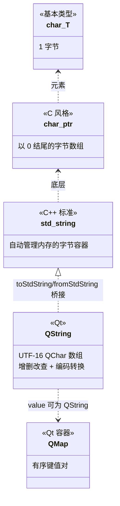

# Qt 10 字符与字符串基础（C++ char / std::string 配合 Qt 上下文）学习笔记

## 本章重要 API 函数

| API | 功能 | 参数说明 | 头文件 |
|-----|------|----------|--------|
| `QString::append/prepend` | 尾部/头部追加字符串 | 接受 `QString` 或 `const char*`（当 UTF-8） | `<QString>` |
| `QString::insert(int pos, const QString &)` | 在指定位置插入 | `pos`：插入索引（基于 UTF-16 字符数）；源码 `test01` 用 `str1.insert(1, "们")` | `<QString>` |
| `QString::mid(int pos, int n = -1)` | 取子串 | `pos` 起始索引；`n` 长度，默认到末尾。源码 `test02` 用 `mid(last_pos+1)` 取文件名 | `<QString>` |
| `QString::left(int n)` | 取左边 n 个字符 | `n`：字符数（非字节） | `<QString>` |
| `QString::lastIndexOf/indexOf` | 反向/正向查找 | 返回索引 `qsizetype`；找不到返回 `-1`。源码用于切分路径与 K-V | `<QString>` |
| `QMap<Key, T>` | Qt 关联容器（红黑树） | 类似 `std::map`，按键有序；源码 `test04` 演示 `insert` 与 `[]` 赋值 | `<QMap>` |

> 💡 Tips：Qt6 起字符串索引/长度返回 `qsizetype`（64 位有符号），不再是 `int`——在 32 位循环里用 `int` 接受返回值会触发截断告警。另外 `QString::mid` 的 `pos` 是"字符数"不是"字节数"，对中文同样按一个 `QChar` 计，这正是 UTF-16 定长索引的优势（见 qt09）。

## 本章目录

> 点击条目可跳转到对应小节。

### 章节导航

- **[本章重要 API 函数](#本章重要-api-函数)**
- **[学习前后依赖](#学习前后依赖)**
- **[1. 概述](#1-概述)**
- **[2. 核心概念 / 原理](#2-核心概念--原理)**
- **[3. C++ 字符串模型与 Qt 衔接](#3-c-字符串模型与-qt-衔接)**
- **[4. 核心代码解析](#4-核心代码解析)**
- **[5. 运行效果 / 验证](#5-运行效果--验证)**
- **[容易踩坑（注意点）](#容易踩坑注意点)**
- **[学习要点总结](#学习要点总结)**
- **[Q&A（常见问题）](#qa常见问题)**
- **[Tips（全局速记）](#tips全局速记)**

---

## 学习前后依赖

| 方向 | 内容 |
| ---- | ---- |
| 前置基础 | C/C++ 基本语法、`char` 单字符、`char*` 字符数组、`std::string` 常用接口。 |
| 本章核心 | 区分字符/字节/编码；掌握 QString 增删改查与子串切分；理解 Qt 容器 `QMap`。 |
| 后续承接 | **qt09** 的编码转换依赖本章的 char/编码概念；**qt11** 布局里的中文文案与字符串处理、**qt22 SQLite** 文本字段都建立在此之上。 |

> 💡 Tips：章节顺序上 qt10 本应在 qt09 之前（先懂 char/string 再学转换），但仓库编号把 qt09 放前面也不冲突——两者互为镜像：qt09 讲"QString 与外部字节如何转"，qt10 讲"字符串本身怎么玩"。建议把本篇当作 qt09 的"底层铺垫篇"来回对照读。

## 1. 概述

字符串是 GUI 程序里出现频率最高的数据类型：按钮文字、文件路径、网络报文、配置键值……C++ 提供了三层字符串抽象：最底层是 `char`（单个字节，常用来表示 ASCII 字符）、`char*`（指向字符数组的指针，C 风格字符串以 `\0` 结尾）、`std::string`（C++ 标准动态字符串，自动管理内存）。它们**都只是字节序列，不携带编码信息**。

Qt 在 `std::string` 之上提供了 `QString`（见 qt09），并配一整套**容器**（顺序容器 `QList`、关联容器 `QMap`/`QHash` 等）来组织数据。`qt10` 的 `hello.cpp` 虽以 `QString` 操作为主体，却恰好覆盖了"字符串基础"的全部核心动作：拼接（`append`/`prepend`/`+=`）、插入（`insert`）、子串提取（`mid`/`left`）、查找定位（`indexOf`/`lastIndexOf`）、以及用 `QMap` 存结构化数据。它本质上是"在 Qt 上下文里练字符串基本功"。

> 💡 Tips：概述里最该记住的一句话——**"char* 是字节、std::string 是字节容器、QString 是 Unicode；操作字符串前先想清楚你手里的是哪一层。"** 中文乱码、索引错位，几乎都源于把这三层混为一谈。

## 2. 核心概念 / 原理

### 2.1 字符、字节与编码

- 一个 `char` 占 1 字节（8 位），只能直接表示 0–255。ASCII 用 0–127 表示英文字符；中文需用多字节（UTF-8 下"你"占 3 字节，GBK 下占 2 字节）。
- `char*` 字符串以 `\0` 结尾，`strlen` 数的是字节数——所以 `strlen("你好")` 在 UTF-8 下返回 6 而非 2。这是初学者最容易踩的"索引/长度按字节还是按字符"的坑。
- `QString` 用 `QChar`（UTF-16）数组，`length()` 返回**字符数**，`"你好".length()` 是 2。这就是 qt09 强调的"UTF-16 定长索引"优势在字符串处理上的直接体现。

### 2.2 QString 的不可变片段与容器

`QString` 的 `append`/`prepend`/`insert` 都会产生新内容（隐式共享下可能触发 detach，见 qt09）。而 `mid`/`left` 返回的是**新 QString 子串**（拷贝），不是原串的视图——这与 C++17 `std::string_view`/`QStringView` 不同，需要注意大字符串频繁切片的开销。

`QMap` 是 Qt 的**有序关联容器**（底层红黑树），按键排序，支持 `[]` 下标与 `insert`。它对应标准库的 `std::map`。Qt 还提供 `QHash`（哈希，无序、查找 O(1)）对应 `std::unordered_map`。

> 💡 Tips：原理层最易误解的是"`mid` 返回的是原串的一部分（视图）"。错，它返回**独立拷贝的子串**；若要零拷贝视图用 Qt6 的 `QStringView`。另一个误区："`indexOf` 找的是字节位置"——在 QString 里它找的是 `QChar` 位置（字符位置），与 `std::string::find` 的字节语义一致但单位不同，对纯 ASCII 无差、对中文要留心。

## 3. C++ 字符串模型与 Qt 衔接

下面用 classDiagram 展示从 C++ 原生字符串到 Qt 字符串/容器的层次关系：



层次含义：`char` 是原子；`char*`/`std::string` 是字节层；`QString` 在字节层之上引入 Unicode 与丰富 API；`QMap` 等容器用来组织多个字符串/数据。

> 💡 Tips：图中最关键的边是 `std_string <|.. QString`——两者通过 `toStdString/fromStdString` 互转，但转换时**默认按 UTF-8**（见 qt09）。记住这条桥，就能在"标准库代码"与"Qt 代码"之间无缝搬运字符串，而不丢失编码。

## 4. 核心代码解析

`qt10_tst-char/hello.cpp` 四个测试，逐段拆解（去掉了注释掉的 `#if 0` 部分，保留实际运行逻辑）：

```cpp
void test01() {
    QString str1("hello");
    qDebug() << str1;
    str1.append('_').prepend("你好,");   // 尾加 '_'，头加 "你好,"
    str1 += "!!";                         // += 等价于 append
    qDebug() << str1;                     // "你好,hello_!!"
    str1.insert(1, "们");                 // 在索引1处插入
    qDebug() << str1;                     // "你们好,hello_!!"
}
```

- `append`/`prepend`/`+=` 都返回 `QString&`，可链式；`insert(1,"们")` 把"们"插到索引 1（"好"之前），体现 UTF-16 按字符定位。`str1` 是 `QString`（UTF-16），构造自 `char*` 字面量默认 UTF-8（qt09 已讲）。

```cpp
void test02() {
    QString str1("/home/rocky/work/code.my.txt");
    QString seq('/');
    qsizetype last_pos = str1.lastIndexOf(seq);
    QString filename = str1.mid(last_pos + seq.size());     // "code.my.txt"
    QString postfix  = str1.mid(str1.lastIndexOf('.') + 1); // "txt"
    QString pathname = str1.left(last_pos + seq.size());    // "/home/rocky/work/"
    qDebug() << filename << postfix << pathname;
}
```

- 这是**路径解析**经典套路：`lastIndexOf('/')` 找最后一级分隔符，`mid` 切文件名，`lastIndexOf('.')` 切后缀，`left` 取目录。`seq.size()` 对 `QString("/")` 是 1（一个字符），不能用 `strlen` 思维。

```cpp
void test03() {
    QString str1("Content-Type: image/png\r\nContent-length: 34789\r\n");
    QString key = "Content-length:";
    qsizetype start_pos = str1.indexOf(key);
    qsizetype end_pos = str1.indexOf("\r\n", start_pos + key.size());
    QString len_str = str1.mid(start_pos + key.size(), end_pos - (start_pos + key.size()));
    bool flags = false;
    int len = len_str.toInt(&flags);   // 字符串转整数
    if (flags) qDebug() << len;        // 34789
}
```

- 这是**从文本报文中提取 K-V 值**的通用模式：先 `indexOf` 定位键，再 `indexOf` 定位值结束符，用 `mid(pos, len)` 截取，`toInt` 转换并靠 `bool*` 判断成败。注意 `mid` 第二参是长度（不是结束索引），与 `last_pos` 套路里的单参 `mid` 不同。

```cpp
void test04() {
    QMap<QString, int> res2;
    res2.insert("a1", 10);
    res2["w1"] = 30;
    res2["b1"] = 20;
    for (auto x: res2.keys()) {        // keys() 返回有序键列表
        qDebug() << x << ": " << res2[x];
    }
}
```

- `QMap` 演示两种写入（`insert` 与 `[]`）和遍历。`keys()` 返回按 key 排序的列表（QMap 有序），所以输出顺序为 `a1, b1, w1` 而非插入顺序——这是 `QMap` 与 `QHash` 的关键区别。

> 💡 Tips：这段代码藏着的细节——① `str1.insert(1,"们")` 的索引基于字符而非字节，对中文安全；② `test03` 的 `mid(start+key.size(), len)` 第二参必须是**长度**，写成 `mid(start, end)` 会多取；③ `QMap::keys()` 遍历时若在大循环里高频调用有拷贝开销，生产环境更推荐 `for (auto it = res2.cbegin(); ...)` 或 C++11 范围 for 直接遍历 `res2`（得键值对）。

## 5. 运行效果 / 验证

编译运行 `qt10_tst-char`，预期输出：

- `test01`：依次打印 `hello`、`你好,hello_!!`、`你们好,hello_!!`。
- `test02`：`code.my.txt` `txt` `/home/rocky/work/`。
- `test03`：打印 `34789`（从报文正确提取整数）。
- `test04`：按 `a1: 10` `b1: 20` `w1: 30` 顺序输出（注意是按键排序，非插入序）。

> 💡 Tips：验证时最容易误判"成功"的假象——只看到有输出就以为算法对。应**单独核对每步索引**：比如 `test02` 的 `pathname` 末尾是否带 `/`、`test03` 的 `len` 是不是恰好 34789 而非 3478 或带空格。字符串切分差一个索引，值就错一位，肉眼难辨，务必逐项核对边界。

## 容易踩坑（注意点）

- 坑 1：**把 `QString::length()` 当字节数**。现象：中文长度计算错误。原因：它返回字符数（UTF-16）。规避：要字节数用 `toUtf8().size()`。
- 坑 2：**`mid(pos, n)` 第二参是长度不是结束索引**。现象：截多了/截少了。原因：与某些语言的 `slice(start,end)` 语义不同。规避：牢记 `n` 是长度；单参 `mid(pos)` 才是截到末尾。
- 坑 3：**`QMap` 误当插入序**。现象：遍历顺序和插入不一致。原因：QMap 按键有序。规避：要保序用 `QList<QPair>` 或 Qt6 的 `QKeyValueIterator` 配合 `QHash`+顺序列表。
- 坑 4：**用 `char*` 字面量拼接 `std::string` 后直接喂 QString 却乱码**。现象：中文乱。原因：源文件非 UTF-8（qt09 坑 1）。规避：源码存 UTF-8，或 `fromLocal8Bit`。
- 坑 5：**循环里反复 `QString::mid` 大字符串**。现象：性能下降。原因：每次 mid 都拷贝子串。规避：Qt6 用 `QStringView` 零拷贝切片，或先 `const QChar*`。
- 坑 6：**`toInt(&ok)` 不看 ok 直接信任结果**。现象：非法字符串得到 0 误当真值。原因：`toInt` 失败返回 0。规避：永远检查 `bool ok`。

## 学习要点总结

### 核心知识点
1. `char`/`char*`/`std::string` 都是字节层，无编码；`QString` 是 UTF-16 Unicode 层。
2. QString 增删改查：`append`/`prepend`/`insert`/`mid`/`left`/`indexOf`/`lastIndexOf`，索引按字符。
3. 文本解析套路：`lastIndexOf` 找分隔 → `mid` 切片 → `toInt/toDouble` 转值（检查 `ok`）。
4. `QMap` 有序关联容器，遍历按键排序；与 `QHash` 按场景取舍。

### 关键 API
- `QString::mid/left/right`：子串提取（长度语义）。
- `QString::indexOf/lastIndexOf`：定位（字符位置）。
- `QString::toInt/toDouble`：带 `bool*` 成败判断的转换。
- `QMap::insert/operator[]/keys`：有序键值存储。

### 下一步学习
- **qt09 编码转换**：本章的 char/string 是它底层；两者对照读。
- **qt11 布局**：按钮文案、文本编辑都用到 QString 操作。
- **qt22 SQLite**：文本字段存取依赖本章字符串处理 + qt09 编码。

> 💡 Tips：本篇直接挂钩 **qt09（编码转换的底层铺垫）** 与 **qt11（UI 字符串）**。口诀："索引按字符、mid 是长度、toInt 看 ok、QMap 有序存。"

## Q&A（常见问题）

**Q1：`QString::length()` 和 `toUtf8().size()` 有什么区别？**  A1：`length()` 返回 UTF-16 字符数（中文算 1 个），`toUtf8().size()` 返回 UTF-8 字节数（中文通常 3 字节）。例如 `QString("你好").length()` 是 2，`.toUtf8().size()` 是 6。需要"网络/文件字节数"用后者，需要"显示字符数"用前者。

**Q2：`mid(pos, n)` 和 `mid(pos)` 怎么用才不会错？**  A2：`mid(pos, n)` 从 `pos` 取 **n 个字符**；`mid(pos)` 从 `pos` 取到末尾。常见错误是把第二参写成"结束索引"，正确应是"长度"。例如取 `str` 第 3 到第 5 字符（含）应写 `str.mid(2, 3)`（起始索引 2、长度 3），不是 `mid(2,5)`。

**Q3：Qt5/Qt6 在字符串/容器上有差异吗？**  A3：QString 索引类型由 `int` 变为 `qsizetype`（Qt6），`QStringRef` 被 `QStringView` 取代（零拷贝视图）；`QMap`/`QHash` 接口基本兼容。Qt6 推荐用 `QStringView` 替代临时 `mid` 拷贝做切片，减少内存分配。其余增删改查语义两版一致。

## Tips（全局速记）

### 最容易忽视的细节
1. **`char*` 字面量进 QString 默认 UTF-8**——源文件必须 UTF-8（与 qt09 一致），否则中文构造即乱。
2. **`toInt(&ok)` 的 ok 必须查**——失败返回 0，别把 0 当真实值。
3. **`QMap` 遍历是按键排序的**，不是插入顺序；要保序换容器。

### 踩坑记录
- **"有输出就等于解析对"的错觉**：test03 若 `mid` 长度算错，可能只差一两位（如 3478 而非 34789），打印出来像"成功了"。务必把提取结果与预期值逐字符比对。
- **频繁 `mid` 大字符串的性能坑**：在解析大日志/大报文时，每行都 `mid` 拷贝子串会大量分配内存；Qt6 用 `QStringView` 零拷贝可显著提速。

### 与后续章节的衔接
1. **qt09**：char/编码基础在此，转换 API 在彼，互为表里。
2. **qt11 布局**：`QTextEdit`、`QLineEdit` 内容都是 QString，增删改查同源。
3. **qt22 SQLite**：SQL 文本拼接、字段解析都依赖本章字符串手法 + qt09 编码。

### 设计决策思考
- **为什么 Qt 自己造 `QMap` 而不是全用 `std::map`？** Qt 容器与 `QObject`、信号槽、元对象系统深度集成（如 `QVariant` 可存 `QMap`），且历史早于标准库成熟；Qt6 仍保留是为兼容海量既有代码。新项目也可混用 `std::map`，但跨 Qt API 边界（如 `QVariant`）仍以 Qt 容器为主。
- **为什么 QString 的 `mid` 返回拷贝而非视图？** 早期设计保证返回的 QString 独立、可安全修改；代价是大字符串切片有拷贝成本。Qt6 引入 `QStringView`/`midView` 补齐零拷贝能力，兼顾历史兼容与新性能需求。
