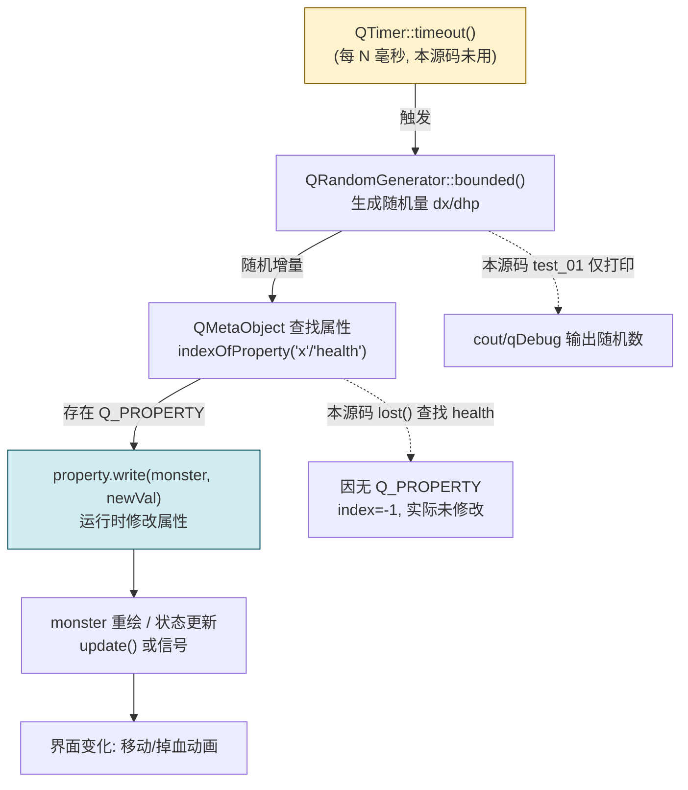

# Qt 12 QRandomGenerator 随机数 + QTimer 定时器 学习笔记

## 本章重要 API 函数

| API | 功能 | 参数说明 | 头文件 |
|-----|------|----------|--------|
| `QRandomGenerator()` | 构造随机数发生器 | 默认基于系统熵源（Qt6 推荐，无需手动 seed 也能用）。源码 `test_01` 用 `new QRandomGenerator()` | `<QRandomGenerator>` |
| `QRandomGenerator::seed(quint32)` | 设置种子 | 同种子产生同序列；源码 `gen->seed(QDateTime::currentSecsSinceEpoch())` | `<QRandomGenerator>` |
| `QRandomGenerator::generate()` | 生成 `quint32` 随机数 | 无参，返回 32 位无符号随机值 | `<QRandomGenerator>` |
| `QRandomGenerator::bounded(low, high)` | 生成 `[low, high)` 区间随机值 | 比 `qrand()%n` 更均匀、且类型安全；源码注释里 `gen->bounded(0,10)` | `<QRandomGenerator>` |
| `QObject::metaObject()` | 返回元对象 | 用于运行时反射，查看/读写属性；源码 `my_show`/`lost` 用到 | `<QObject>` |
| `QMetaObject::propertyCount()/property(i)` | 枚举属性 | `property(i).name()` / `typeName()`；`read(obj)` / `write(obj, val)` | `<QMetaObject>` |
| `QTimer::singleShot/start/timeout` | 定时器 | （驱动动画的标准方式，见 Q&A；本源码未直接用，作为延伸） | `<QTimer>` |

> 💡 Tips：Qt6 **废弃了老旧的 `qrand()`/`qsrand()`**（全局、线程不安全、质量差），统一用 `QRandomGenerator`。`bounded(0,10)` 比 `generate()%10` 更均匀（避免取模偏差）。另外本源码 `new QRandomGenerator()` 后**没有 delete 也没有父对象**——它是裸堆对象、不进对象树（qt08），会造成内存泄漏，生产代码应复用 `QRandomGenerator::global()` 单例而非 `new`。

## 本章目录

> 点击条目可跳转到对应小节。

### 章节导航

- **[本章重要 API 函数](#本章重要-api-函数)**
- **[学习前后依赖](#学习前后依赖)**
- **[1. 概述](#1-概述)**
- **[2. 核心概念 / 原理](#2-核心概念--原理)**
- **[3. 随机数与元对象属性的协作](#3-随机数与元对象属性的协作)**
- **[4. 核心代码解析](#4-核心代码解析)**
- **[5. 运行效果 / 验证](#5-运行效果--验证)**
- **[容易踩坑（注意点）](#容易踩坑注意点)**
- **[学习要点总结](#学习要点总结)**
- **[Q&A（常见问题）](#qa常见问题)**
- **[Tips（全局速记）](#tips全局速记)**

---

## 学习前后依赖

| 方向 | 内容 |
| ---- | ---- |
| 前置基础 | **qt08 对象树**：`Monster : QObject(parent)` 进对象树；**qt09/10 字符串**：属性名、打印。 |
| 本章核心 | `QRandomGenerator` 随机数；`QObject` 元对象系统动态读写属性；`QTimer` 定时刷新的角色。 |
| 后续承接 | **qt13 信号槽**：`QTimer::timeout` 发射信号驱动逻辑；**qt20/21 绘图与仪表**：用定时器 + 随机数做动画/随机移动，正是本篇"怪物随机移动"主题的落点。 |

> 💡 Tips：本篇是"动画/随机移动"的**引擎原理篇**——`qt12` 源码演示了随机数发生器与元对象属性读写这两个"零件"，而把它们真正动起来需要 `QTimer`（定时触发）配合重绘。所以必须先懂 qt08 的对象树（Monster 归属）与元对象系统，下一步才能接 qt13 信号槽把 QTimer 的 `timeout` 连到 `update()`。

## 1. 概述

很多 GUI 效果——游戏里怪物随机游走、仪表盘指针跳动、验证码图片抖动、粒子飘动——本质都是"**定时 + 随机**"：每隔一小段时间，用随机数改变某个状态（位置、血量、角度），再刷新界面。`qt12` 工程名 `radom`（random）正指向这个目标，其源码用两块核心能力搭好地基：

1. **`QRandomGenerator`**：Qt6 的高质量随机数发生器，基于系统熵源，替代了老旧且线程不安全的 `qrand()`。
2. **`QObject` 元对象系统（Meta-Object System）**：通过 `metaObject()` 在运行时"反射"一个 QObject 的属性名、类型，并动态 `read`/`write`——这让"随机数改变怪物属性"可以写得非常通用（一个函数能操作任意属性）。

`monster.h/cpp` 定义了 `Monster : QObject`，`hello.cpp` 里 `test_01` 跑随机数、`test_02` 用元对象系统查看并尝试修改 `Monster` 的 `health`/`mana`。至于"定时器动画"，标准做法是用 `QTimer` 周期性触发——它会在 Q&A 与下一步里重点展开，因为它是把"随机数 + 属性"真正变成"动画"的那根发条。

> 💡 Tips：概述里最该记住的一句话——**"动画 = QTimer 定时发信号 + 槽里用 QRandomGenerator 改属性 + 重绘；qt12 把前两个零件给你了，QTimer 是把它们拧成钟表的螺丝。"** 源码本身没用 QTimer，但它是这主题绕不开的下一步。

## 2. 核心概念 / 原理

### 2.1 QRandomGenerator 的原理

`QRandomGenerator` 内部使用现代伪随机数算法（基于系统提供的熵，如 `/dev/urandom` 或 Windows `BCryptGenRandom`），质量高、统计特性好。`generate()` 返回 32 位 `quint32`；`bounded(low, high)` 在给定区间内均匀取值，且**修正了取模偏差**——`generate() % n` 在 `n` 不整除 2³² 时会产生轻微偏向小值的偏差，`bounded` 通过拒绝采样消除它。Qt6 还提供 `QRandomGenerator::global()` 全局单例，无需 `new`。

### 2.2 元对象属性系统

`QObject` 配合 `Q_OBJECT` 宏会生成**元对象（metaObject）**，包含类的属性、信号、槽的元数据。`QMetaObject` 提供：

- `propertyCount()` / `property(i)`：枚举所有**已用 `Q_PROPERTY` 声明**的属性（含继承自 `QObject` 的 `objectName`）。
- `property.read(obj)` / `property.write(obj, value)`：**按名字运行时读写属性**，无需知道编译期类型——这就是"通用修改器"的基石。

### 2.3 QTimer 的角色（延伸）

`QTimer` 是 Qt 的事件循环定时器：调用 `start(ms)` 后，每过 `ms` 毫秒通过事件循环发射 `timeout()` 信号（也可 `singleShot` 单次）。把 `timeout` 连到"用随机数改属性 + 触发重绘"的槽，就形成动画循环。它依赖 `QCoreApplication::exec()` 事件循环（qt08 提过）。

> 💡 Tips：原理层最易误解的是"凡是 QObject 的成员都能被元对象读写"——**错！** 只有用 `Q_PROPERTY` 宏显式声明的成员才进入元对象属性表。源码 `Monster` 的 `m_health`/`m_mana` 是**普通私有成员、没声明 `Q_PROPERTY`**，所以 `metaObject()->indexOfProperty("health")` 返回 `-1`，`lost()` 实际改不到血量——这是本源码一个真实的"坑"（见核心代码解析与踩坑 1）。

## 3. 随机数与元对象属性的协作

下面用 flowchart 表示"怪物随机移动/掉血"的理想数据流（随机数 → 元属性 → 重绘），并标注本源码的实际落点：



黄框 `QTimer` 是理想动画的"发条"（本源码未接，作为延伸）；蓝框 `write` 是元对象改属性的关键。虚线表示本源码的实际行为：`test_01` 只打印随机数，`lost()` 因缺 `Q_PROPERTY` 未能真正改属性。

> 💡 Tips：流程里最关键的箭头是 `C -->|存在 Q_PROPERTY| D`——**元对象读写的前提是属性被 `Q_PROPERTY` 声明**。若没有它（如本源码），`indexOfProperty` 返回 -1，整个"动态改属性"链条断裂。记住：想让 `read/write` 生效，先给成员加 `Q_PROPERTY`。

## 4. 核心代码解析

`qt12_radom/hello.cpp` 与 `monster.h/cpp` 逐段拆解：

```cpp
void test_01() {
    QRandomGenerator *gen = new QRandomGenerator();
    gen->seed(QDateTime::currentSecsSinceEpoch());
    for(int i=0;i<5;i++) {
        // qDebug() << gen->bounded(0,10);
        qDebug() << gen->generate();     // 打印 5 个 32 位随机数
    }
}
```

- `new QRandomGenerator()` 堆上构造；`seed(epoch)` 用当前秒级时间戳播种（Qt6 其实默认已熵源充足，seed 多用于可复现测试）。循环打印 `generate()` 的 `quint32`。**注意：gen 无父、无 delete → 内存泄漏**（见踩坑）。
- 注释掉的 `bounded(0,10)` 才是更常用、更均匀的区间取法；实际运行打印的是 `generate()` 原始大数。

```cpp
void my_show(QObject *obj) {
    auto meta = obj->metaObject();
    qDebug() << "count "<< meta->propertyCount();
    for(int i=0;i<meta->propertyCount();i++) {
        auto property = meta->property(i);
        qDebug() << property.name() << " " << property.typeName();
    }
}

void lost(QObject *obj, const char *propertyName) {
    auto meta = obj->metaObject();
    int index = meta->indexOfProperty(propertyName);  // 找 "health"
    auto property = meta->property(index);
    int cur = property.read(obj).toInt();
    cur--;
    property.write(obj, cur);     // 期望 : 血量 -1
}
```

- `my_show(&mon1)` 枚举 `Monster` 的属性。由于 `Monster` 没声明 `Q_OBJECT` 属性（除继承的 `objectName`），`propertyCount()` 通常只有 1（即 `objectName`），`m_health`/`m_mana` **不会出现**。
- `lost(&mon1,"health")` 里 `indexOfProperty("health")` 返回 `-1`（属性不存在），`meta->property(-1)` 得到无效 `QMetaProperty`，`read` 返回默认 `QVariant(int 0)`，`write` 写到无效属性被静默忽略——**所以血量其实没减**。这是源码的真实行为，不是"写错了才这样"。

```cpp
// monster.h
class Monster : public QObject {
    Q_OBJECT
public:
    explicit Monster(QObject *parent = nullptr);
    ~Monster();
    void show_info() const;
private:
    int m_health;   // 普通成员, 未用 Q_PROPERTY 声明
    int m_mana;
};

// monster.cpp
Monster::Monster(QObject *parent) : QObject(parent), m_health(100), m_mana(100) {}
void Monster::show_info() const {
    std::cout << "hp" << m_health << "    " << " mana" << m_mana << std::endl;
}
Monster::~Monster() { std::cout << "monster is destroyed" << std::endl; }
```

- `Monster` 继承 `QObject(parent)`，进对象树（qt08），析构打印证明随父销毁。`m_health/m_mana` 在构造初始化列表设 100。`show_info()` 直接打印成员——注意它打印的是**真实成员变量**，不受元对象读写影响，所以 `test_02` 里即便 `lost` 调用了，`show_info` 仍显示 100（因为 write 没真正生效）。

> 💡 Tips：这段代码藏着的细节——① `Q_OBJECT` 宏只在"需要信号/槽/属性"时有用；`Monster` 用了它却没声明 `Q_PROPERTY`，导致元对象系统拿不到 `health`；② 若想让 `lost` 真生效，应改为 `Q_PROPERTY(int health READ health WRITE setHealth)` 并提供访问器，同时把 `m_health` 改名为带 getter；③ `gen` 用 `new` 却不释放，正确做法是 `auto *gen = QRandomGenerator::global();` 直接拿全局单例，零分配。

## 5. 运行效果 / 验证

编译运行 `qt12_radom`（`hello.cpp` 的 `main` 调用 `test_01()`、`test_02()`）：

- `test_01`：打印 5 个明显不同的大整数（32 位随机值），每次运行数值都变（因 seed 用时间戳）。
- `test_02`：`my_show(&mon1)` 输出属性计数与名称（实际只有 `objectName` 之类继承属性）；`lost` 调用后 `mon1.show_info()` 仍显示 `hp100 mana100`——证明 `lost` 没能改到 `m_health/m_mana`（因缺 `Q_PROPERTY`）。
- 程序退出时打印 `monster is destroyed`，证明 `Monster` 随对象树正常析构。

若把 `Monster` 加上 `Q_PROPERTY(int health ...)` 并接 `QTimer`（见 Q&A 示例），则能看到血量随定时器递减、界面刷新——这才是"随机/定时动画"的完整形态。

> 💡 Tips：验证时最容易误判"成功"的假象——看到 `lost` 调用后程序没崩，就以为血量减了。实际 `show_info` 仍打印 100，因为元对象写的是"不存在的属性"（index=-1），被静默忽略。真验证：给 `Monster` 加 `Q_PROPERTY` 后，再跑 `lost` 应看到血量变化；或用 `qDebug() << index` 确认 `indexOfProperty` 不再是 -1。

## 容易踩坑（注意点）

- 坑 1：**`m_health` 没声明 `Q_PROPERTY` 却用元对象读写**。现象：`lost` 调用"成功"但血量不变。原因：`indexOfProperty` 返回 -1，write 写到无效属性。规避：用 `Q_PROPERTY(int health READ ... WRITE ...)` 声明，并提供 getter/setter。
- 坑 2：**`new QRandomGenerator()` 不释放**。现象：内存泄漏（本源码实写）。原因：它不是 QObject、无父、没 delete。规避：用 `QRandomGenerator::global()` 单例，或 `delete gen`。
- 坑 3：**用 `generate() % n` 代替 `bounded`**。现象：轻微分布偏差（尤其 n 不整除 2³²）。原因：取模拒绝采样缺失。规避：一律 `bounded(low, high)`。
- 坑 4：**用已废弃的 `qrand()`**。现象：Qt6 编译告警/行为不一致、线程不安全。原因：`qrand` 在 Qt6 弃用。规避：统一 `QRandomGenerator`。
- 坑 5：**误以为 `metaObject()` 能看到所有私有成员**。现象：枚举属性时找不到自定义字段。原因：元对象只认 `Q_PROPERTY`。规避：需要在运行时反射的成员必须 `Q_PROPERTY` 声明。
- 坑 6：**`QTimer` 不触发 timeout**。现象：定时器"不动"。原因：没跑 `QCoreApplication::exec()` 事件循环，或没 `connect(timeout, ...)`。规避：确保 `exec()` 在跑且信号已连接（qt13）。

## 学习要点总结

### 核心知识点
1. `QRandomGenerator` 是 Qt6 推荐的高质量随机数源；`bounded` 比取模均匀；用 `global()` 单例避免泄漏。
2. `QObject` 元对象系统可运行时反射属性，但**只有 `Q_PROPERTY` 声明的成员才可被 `read/write`**。
3. `Monster` 继承 `QObject(parent)` 进对象树，析构随父自动发生。
4. 动画 = `QTimer`(定时) + `QRandomGenerator`(随机) + 属性修改 + 重绘；本源码给了随机数与属性两零件。

### 关键 API
- `QRandomGenerator::generate()` / `bounded(low, high)` / `global()`
- `QObject::metaObject()` / `QMetaObject::property` / `indexOfProperty`
- `QMetaProperty::read` / `write`
- `QTimer::start` / `timeout`（动画延伸，见 Q&A）

### 下一步学习
- **qt13 信号槽**：把 `QTimer::timeout` 连到槽，驱动随机更新与重绘。
- **qt20 绘图 / qt21 仪表**：在 `paintEvent` 里画怪物/指针，`QTimer` 周期性 `update()` 形成动画。
- **qt08 对象树**：`Monster` 的 `QObject(parent)` 归属是本章基础。

> 💡 Tips：本篇直接挂钩 **qt08（Monster 进对象树）** 与 **qt13（用 QTimer + 信号槽把随机数变成动画）**。口诀："随机用 QRandomGenerator::bounded，反射属性先 Q_PROPERTY，动画靠 QTimer 发 timeout。"

## Q&A（常见问题）

**Q1：Qt6 里怎么正确生成 [0,10) 的随机整数？**  A1：用 `QRandomGenerator::global()->bounded(0, 10)`（或 `bounded(10)` 表示 [0,10)）。不要写 `generate() % 10`——有取模偏差；也不要用已废弃的 `qrand()`。示例：
```cpp
#include <QRandomGenerator>
int r = QRandomGenerator::global()->bounded(0, 10); // 0..9
```

**Q2：为什么 `lost(&mon1,"health")` 没让血量减 1？怎么修？**  A2：因为 `Monster::m_health` 是普通成员、没用 `Q_PROPERTY` 声明，元对象系统里没有名为 `health` 的属性，`indexOfProperty` 返回 -1，写操作被忽略。修复：在 `monster.h` 加 `Q_PROPERTY(int health READ health WRITE setHealth)` 并提供 `int health() const { return m_health; } void setHealth(int v){ m_health=v; }`，再让 `m_health` 通过 getter 暴露。这样 `property.write(obj, cur)` 才会真正改值。

**Q3：本源码没用 QTimer，怎么把它变成"怪物随机移动动画"？**  A3：用 `QTimer` 定时触发，在槽里用随机数改坐标属性并请求重绘。示例骨架：
```cpp
// 在 Monster 或 Widget 中
QTimer *t = new QTimer(this);          // this 作父, 随对象树销毁(qt08)
connect(t, &QTimer::timeout, this, [this]{
    int dx = QRandomGenerator::global()->bounded(-5, 6);
    setX(x() + dx);                     // 假设 x 是 Q_PROPERTY
    update();                           // 触发重绘(qt20)
});
t->start(50);                          // 每 50ms 动一次
```
前提：被改的 `x` 必须是 `Q_PROPERTY`，且需 `QCoreApplication::exec()` 事件循环运行。这正衔接 qt13 信号槽与 qt20 绘图。

## Tips（全局速记）

### 最容易忽视的细节
1. **`QRandomGenerator::global()` 单例**比 `new` 安全且零分配——本源码的 `new` 是反面教材。
2. **元对象只认 `Q_PROPERTY`**——私有普通成员不会出现在 `propertyCount()` 里。
3. **`QTimer` 依赖事件循环 `exec()`**，否则 `timeout` 永不来。

### 踩坑记录
- **"`lost` 调用没报错就以为改成功了"的错觉**：实际 `indexOfProperty("health")==-1`，write 静默无效。验证必须看 `show_info()` 真实输出或打印 index。
- **`new QRandomGenerator` 泄漏**：本源码实写，提醒我们"不是 QObject 就不进对象树"，裸堆对象要自己管。

### 与后续章节的衔接
1. **qt08 对象树**：`Monster(parent)` 与 `QTimer(this)` 的归属都靠它；析构随父自动发生。
2. **qt13 信号槽**：`QTimer::timeout` 是典型信号，连到随机更新槽——本章动画的"发条"在此接上。
3. **qt20/21 绘图与仪表**：`paintEvent` 里画怪物/指针，`QTimer` + 随机数驱动动画，是本章主题的最终落点。

### 设计决策思考
- **为什么 Qt6 废弃 `qrand` 改用 `QRandomGenerator`？** 老的 `qrand/qsrand` 是全局状态、线程不安全、质量依赖实现（常是简单 LCG，统计特性差、可预测）。`QRandomGenerator` 基于系统密码学级熵源、线程局部、接口类型安全（`bounded` 模板化），更适合现代多线程 GUI 与安全敏感场景（如令牌、随机 ID）。
- **为什么属性反射必须显式 `Q_PROPERTY` 而非自动扫描成员？** C++ 没有运行时类型信息能枚举"所有成员变量并可读写"；`Q_PROPERTY` 通过 moc 在编译期生成元数据，明确"哪些成员对外暴露、如何读写"，兼顾性能与封装（私有成员不必暴露）。这也是 Qt 能在 Designer/信号槽编辑器里列出属性的原因。
- **为什么动画用 `QTimer` 而不是手动 `while+sleep`？** 阻塞式 `sleep` 会卡死事件循环、界面假死；`QTimer` 基于事件循环非阻塞触发，超时期间 GUI 仍能响应用户操作、正常重绘——这是 Qt 事件驱动架构的核心理念。
