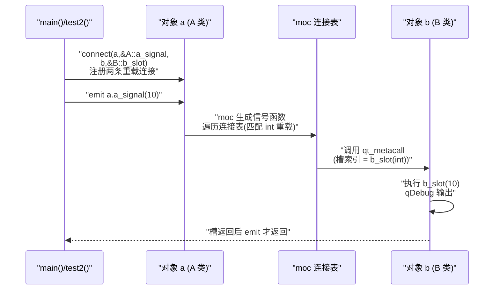

# Qt 13 信号与槽 学习笔记

## 本章重要 API 函数

| API | 功能 | 参数说明 | 头文件 |
|-----|------|----------|--------|
| `QObject::connect()` | 把发送者的信号连接到接收者的槽（或另一个信号） | `(sender*, SIGNAL/函数指针, receiver*, SLOT/函数指针, [type])`；Qt5 新式用成员函数指针，重载时配合 `QOverload` | `<QObject>` |
| `emit` | 触发一个信号（本质是一次函数调用宏） | `emit obj.signal(args);`，`emit` 本身在预处理阶段被展开为空，无运行时开销 | 由 moc 生成的代码 |
| `Q_OBJECT` | 启用元对象系统（信号/槽/属性/反射）的必备宏 | 必须写在类体最开头（private 区之前），且类必须直接或间接继承 `QObject` | 由 moc 处理 |
| `signals:` / `slots:` | 声明信号区 / 槽区的访问限定符（本质是 `public`/`protected`/`private` 的别名） | 出现在类体内，其后声明的函数被 moc 识别为信号或槽 | 由 moc 处理 |
| `QOverload<Args...>::of(&Class::func)` | 在存在重载时，取出某个具体重载的函数指针 | 模板参数填信号/槽的参数类型列表，用于消除 `a_signal()` 与 `a_signal(int)` 的歧义 | `<QObject>`（C++11 起） |

> 💡 Tips：`connect` 第五个参数 `Qt::ConnectionType` 决定同步/异步——默认 `Qt::AutoConnection` 在同线程为直接调用、跨线程为队列投递。`QOverload` 是连接**重载**信号槽的唯一干净写法：本项目 `A` 同时有 `a_signal()` 和 `a_signal(int)`，不写 `QOverload` 编译器无法确定取哪个重载而报错。Qt5 旧式 `SIGNAL("a_signal(int)")` 宏是**运行时**字符串匹配（拼错不报编译错、只静默失败）；Qt5 新式函数指针是**编译期**检查，更安全。Qt6 仍保留旧宏但已标记为 legacy，新代码一律用函数指针对。

## 本章目录

> 点击条目可跳转到对应小节。

### 章节导航

- **[本章重要 API 函数](#本章重要-api-函数)**
- **[学习前后依赖](#学习前后依赖)**
- **[1. 概述](#1-概述)**
- **[2. 核心概念 / 原理](#2-核心概念--原理)**
- **[3. connect → emit → 槽调用链路](#3-connect--emit--槽调用链路)**
- **[4. 核心代码解析](#4-核心代码解析)**
- **[5. 运行效果 / 验证](#5-运行效果--验证)**
- **[容易踩坑](#容易踩坑)**
- **[学习要点总结](#学习要点总结)**
  - [核心知识点](#核心知识点)
  - [关键 API](#关键-api)
  - [下一步学习](#下一步学习)
- **[Q&A](#qa常见问题)**
- **[Tips](#tips)**
  - [最容易忽视的细节](#最容易忽视的细节)
  - [踩坑记录](#踩坑记录)
  - [与后续章节的衔接](#与后续章节的衔接)
  - [设计决策思考](#设计决策思考)

---

## 学习前后依赖

| 方向 | 内容 |
| ---- | ---- |
| 前置基础 | 理解 `QObject` 继承体系、moc 元对象编译器、Qt 工程的基本 `main()` + `QApplication::exec()` 事件循环。 |
| 本章核心 | 掌握 `connect` 的几种写法、`emit` 触发、`Q_OBJECT` 宏的必要性，以及重载信号槽如何连接。 |
| 后续承接 | 第 14 篇键盘面板（按钮 `clicked` 信号接到逻辑槽）、第 15 篇事件系统（事件与信号槽的关系），以及所有基于 `Q_OBJECT` 的自定义控件都建立在本篇之上。 |

> 💡 Tips：必须先会 `QObject` 继承与 moc 流程，否则 `Q_OBJECT` 宏报 "undefined reference to vtable" 时会完全看不懂。本篇是后续所有 GUI 交互（按钮、菜单、拖拽、网络通信）的基石——没有信号槽，Qt 就退化成普通 C++ 绘图库。

## 1. 概述

信号与槽（Signal & Slot）是 Qt 为解决**对象间松耦合通信**而设计的机制。在传统的回调（callback）里，A 调用 B 的函数必须硬知道 B 的接口类型，二者编译期就耦合在一起。而信号槽让"发出方"完全不认识"接收方"：类 `A` 只管 `emit a_signal()`，至于谁在听、听完后做什么，`A` 一概不知。

本项目的 `info.h` 定义了两个最朴素的类：`A` 负责发信号，`B` 负责收信号执行 `b_slot()`。这正是信号槽最经典的"一对多、多对一、解耦"演示：`A` 甚至不需要包含 `B` 的逻辑头文件（这里仅为演示才一起编译）。

> 💡 Tips：记住一句话——**信号由 moc 自动生成实现，你永远不要在 .cpp 里手写信号的函数体**；槽则相反，必须在 .cpp 里给出实现。初学者最反直觉的点就在这里：你 `emit` 了一个从没写过函数体的东西，它居然能"凭空"执行别人的代码。

## 2. 核心概念 / 原理

信号槽在底层依赖 Qt 的**元对象系统（Meta-Object System）**。当你在类里写 `Q_OBJECT` 宏，Qt 的 moc（Meta-Object Compiler）会在编译前扫描这个类，生成 `moc_info.cpp`，里面包含：信号的桩函数实现、信号与槽的名字字符串表、以及用于运行时按名字查找的 `qt_metacall` / `qt_metacast`。

`connect(sender, &A::a_signal, receiver, &B::b_slot)` 的本质：在发送者的内部连接表里登记一条记录（发送者、信号索引、接收者、槽索引）。当 `emit a_signal()` 时，moc 生成的信号函数会遍历这条连接表，逐个调用接收者的 `qt_metacall`，最终落到 `B::b_slot()`。

```cpp
// info.h 中的声明（moc 据此生成代码）
class A : public QObject {
    Q_OBJECT
signals:
    void a_signal();        // moc 生成其实现，你不要写
    void a_signal(int);     // 重载版本
};
class B : public QObject {
    Q_OBJECT
public slots:
    void b_slot();          // 必须自己在 info.cpp 实现
    void b_slot(int);
};
```

> 💡 Tips：原理层面最易误解的是——**默认情况下信号槽是"同步、直接"的函数调用**，不是消息队列、不是线程。除非跨线程且连接类型被设为 `Qt::QueuedConnection`，否则 `emit` 返回时，所有被连接的槽已经全部执行完毕。这和"发消息后立刻往下走"的异步直觉不同。

## 3. connect → emit → 槽调用链路

下面用时序图展示本工程 `test2()` 中 `A a; B b;` 之后，一次 `emit a.a_signal(10)` 的完整调用链（注意 `QOverload<int>` 把这次 emit 精确路由到 `b_slot(int)`）：



> 💡 Tips：流程里最关键的箭头是 `A → Conn → B` 这一段：信号本身不直接调用 `B`，而是先经过 moc 生成的连接表做"分发"。这也解释了为什么一个信号能同时连多个槽（遍历表即可），以及为什么跨线程时能把调用"搬运"到接收者所在线程的事件循环里。

## 4. 核心代码解析

### 4.1 info.h：信号与槽的声明

```cpp
class A : public QObject {
    Q_OBJECT
public:
    A(QObject *parent = nullptr);
    ~A();
signals:
    void a_signal();
    void a_signal(int);     // 重载信号：无参 + int
};
class B : public QObject {
    Q_OBJECT
public:
    B(QObject *parent = nullptr);
    ~B();
public slots:
    void b_slot();
    void b_slot(int);
};
```

`Q_OBJECT` 必须放在类体最开头、任何 `private:` 之前——因为 moc 会把它展开成一组 private 成员（如 `staticMetaObject`、虚函数 `qt_metacall`）。如果把 `Q_OBJECT` 写在 `private:` 后面，这些虚函数就变成 private，链接期会报 vtable 相关错误。`signals:` 后声明的函数 moc 自动实现，**不要**在 info.cpp 里写 `a_signal` 的函数体；而 `slots:` 后的 `b_slot` 必须在 info.cpp 给出实现，否则链接失败。

### 4.2 hello.cpp：连接的两种写法与重载处理

```cpp
void test2() {
    A a; B b;
    // 旧式宏（注释掉，演示用）：
    // QObject::connect(&a, SIGNAL(a_signal()), &b, SLOT(b_slot()));
    // 新式函数指针 + QOverload 解决重载歧义：
    QObject::connect(&a, QOverload<>::of(&A::a_signal),
                         &b, QOverload<>::of(&B::b_slot));
    QObject::connect(&a, QOverload<int>::of(&A::a_signal),
                         &b, QOverload<int>::of(&B::b_slot));
    emit a.a_signal();      // 触发无参重载 -> b_slot()
    emit a.a_signal(10);    // 触发 int 重载  -> b_slot(10)
}
int main(int argc, char *argv[]) { test2(); return 0; }
```

`QOverload<>::of(&A::a_signal)` 取"无参版本"，`QOverload<int>::of` 取"int 版本"。正因为 `A` 有两个同名信号、两个同名槽，若不借助 `QOverload`，编译器在 `&A::a_signal` 处无法确定要哪个地址而直接报错。`test1()` 里把 connect 注释掉了，只留 `emit A.a_signal();`——这会导致链接期 vtable 问题（且没连接任何槽），所以本工程真正运行的是 `test2()`。`info.cpp` 的 `b_slot()`/`b_slot(int)` 用 `qDebug()` 打印，证明槽确实被调用。

> 💡 Tips：这段代码藏着的细节——`connect` 的两个对象 `&a`、`&b` 都是栈上局部变量，生命周期覆盖整个 `test2()`，所以连接有效；若在 `a` 析构后再 emit 就悬空。`emit` 后 `b_slot` 同步执行完才继续，因此 `emit a.a_signal(10)` 返回时控制台已经打印出 `b_slot 10`。

## 5. 运行效果 / 验证

编译运行（Qt6 + MinGW，见 CMakeLists 中 `find_package(Qt6 ... Core Widgets)`）后，控制台应输出：

```
b_slot
b_slot 10
```

顺序对应 `emit a.a_signal()`（无参 → `b_slot()`）和 `emit a.a_signal(10)`（int → `b_slot(10)`）。只要两条日志都出现，就证明信号触发、连接表分发、槽执行三段链路全部打通。

> 💡 Tips：验证时容易误判"成功"的假象——若只看到程序一闪而过没有输出，可能是 `test1()` 那种"只 emit 没 connect"的版本在跑（注释里就是），或 `main` 没调用 `test2()`。务必确认 `main` 调用的是 `test2`，且 `Q_OBJECT` 类所在的 .cpp 都参与了 moc 编译（Qt6 的 `qt_add_executable` 会自动处理，但手写 CMake 漏掉源文件会报 vtable 错）。

## 容易踩坑（注意点）

- **坑 1：`undefined reference to vtable for A`**。原因：类写了 `Q_OBJECT` 但没被 moc 处理（源文件没加入构建列表，或忘了 `#include "moc_info.cpp"`）。规避：用 `qt_add_executable` 把 `info.cpp` 列入源文件，让 CMake 自动调用 moc。
- **坑 2：重载信号/槽连接编译报错"cannot resolve overloaded function"**。原因：没用 `QOverload` 指明具体重载。规避：`QOverload<int>::of(&A::a_signal)`；Qt5 旧式可用 `static_cast<void(A::*)(int)>(&A::a_signal)`。
- **坑 3：用了旧式 `SIGNAL/SLOT` 宏但拼错字符串，运行时静默不连接**。原因：宏是字符串匹配，编译期不检查。规避：一律用新式函数指针写法。
- **坑 4：信号声明却"自己实现"了函数体**。原因：信号由 moc 生成，手写会重定义。规避：信号只在 `signals:` 区声明，绝不写实现。
- **坑 5：跨线程连接期望同步拿到结果却拿到旧值**。原因：跨线程默认 `QueuedConnection`，emit 立即返回、槽稍后执行。规避：同线程才是直接调用；需要结果就改用返回值/直接调用，或 `Qt::BlockingQueuedConnection`（注意死锁风险）。
- **坑 6：`Q_OBJECT` 写在 `private:` 之后导致 moc 虚函数私有化**。现象为链接错误。规避：永远把 `Q_OBJECT` 放在类体最前面。

## 学习要点总结

### 核心知识点
1. 信号槽是 Qt 元对象系统的产物，依赖 `Q_OBJECT` 宏与 moc 代码生成。
2. `emit` 默认是同步直接调用，经连接表分发到各槽；跨线程才变队列异步。
3. 重载信号/槽必须用 `QOverload<>::of` 或 `static_cast` 显式取地址。
4. 信号只声明不实现，槽必须实现；连接的两端对象需保证生命周期有效。

### 关键 API
| API | 功能 |
|-----|------|
| `QObject::connect` | 建立信号→槽/信号 连接 |
| `emit` | 触发信号 |
| `Q_OBJECT` | 启用元对象系统 |
| `QOverload<>::of` | 取重载成员函数指针 |

### 下一步学习
- 第 14 篇：把按钮 `clicked` 信号接到 `lcd_show` 槽（信号槽的 GUI 实战）。
- 第 15 篇：理解事件与信号槽的区别（信号槽底层也由事件驱动）。
- 后续：Lambda 作为槽、`Qt::UniqueConnection`、跨线程 `moveToThread` 通信。

> 💡 Tips：本篇直接为第 14 篇铺垫——键盘面板的 `connect(btn, &QPushButton::clicked, this, &KeyPad::lcd_show)` 与本篇 `connect(&a, &A::a_signal, &b, &B::b_slot)` 是同一套机制，只是发送者换成了 Qt 内置的 `QPushButton`。

## Q&A（常见问题）

**Q1：信号和槽的参数必须完全一样吗？**  A1：连接时，槽的参数个数可以**少于或等于**信号的参数个数，但前面的类型必须一一对应。例如信号 `a_signal(int, QString)` 可连到槽 `b_slot(int)`（丢弃第二个参数）；但不能连到 `b_slot(QString)`（类型顺序不匹配）。本项目 `a_signal(int)` 连 `b_slot(int)` 是严格一致的。

**Q2：事件（event）和信号槽到底是什么关系？**  A2：二者不同层次。事件是更底层的"输入/系统通知"（鼠标、键盘、定时器、绘图），由 `QApplication::notify` 分发；信号槽是建立在 QObject 之上的**对象间通信抽象**。许多信号槽其实是由事件触发的——比如 `QPushButton::clicked` 信号，本质是按钮在 `mouseReleaseEvent` 里 `emit` 出来的。所以"事件驱动信号，信号驱动槽"。

**Q3：Qt5 和 Qt6 在 connect 上有区别吗？**  A3：核心函数指针写法在 Qt5.0+ 与 Qt6 一致；区别在于 Qt6 正式废弃了旧的 `SIGNAL/SLOT` 字符串宏（仍可用但警告），并默认要求 C++17。此外 Qt6 的 `QOverload` 用法不变。新项目一律用函数指针 + `QOverload`，避免旧宏的拼写隐患。

**Q4：一个信号能连多个槽吗？调用顺序如何？**  A4：可以，且默认按 `connect` 的注册顺序同步调用。这正体现了信号槽"一对多"的解耦优势——`A` 完全不知道有几个 `B` 在接收。

## Tips（全局速记）

### 最容易忽视的细节
1. `emit` 不是关键字，而是一个被预处理器清空为空的宏——它纯粹是给程序员看的"这里触发信号"的标记，零运行时成本。
2. `signals:` 在 moc 中等价于 `public`（信号其实是 public 函数，外部也能 `emit`），而 `slots:` 默认也是 public；想限制访问可用 `protected slots:` / `private slots:`。
3. 连接时若两端是父子关系（如 `this`），父对象析构会自动断开连接，无需手动 `disconnect`。

### 踩坑记录
- **"只 emit 没 connect"假跑**：`test1()` 把 connect 注释掉只剩 `emit`，运行时信号发不出去、槽永不执行，程序看似正常退出却毫无输出。这提醒我们——信号槽不是魔法，必须存在一条有效的 `connect` 链路。
- **重载误用**：第一次给 `A` 同时加 `a_signal()` 和 `a_signal(int)` 后，直接写 `&A::a_signal` 编译失败，逼你必须 `QOverload`。这是 Qt 强类型带来的"编译期保护"，比旧宏安全得多。

### 与后续章节的衔接
1. 第 14 篇键盘面板：`connect(btn, &QPushButton::clicked, ...)` 与本篇同构，只是发送者换成内置控件。
2. 第 15 篇事件系统：`clicked` 信号正是由 `mouseReleaseEvent` 内部 `emit` 而来，理解事件才能理解信号来源。
3. 后续多线程：`QTimer`/`QueuedConnection` 都依赖本篇的连接类型与事件循环概念。

### 设计决策思考
- **为何发明信号槽而不是用回调？** 回调要求发送者持有接收者类型、编译期耦合，且难以支持"一个动作通知 N 个对象"。信号槽把"谁在监听"延迟到运行时由 `connect` 决定，UI 组件可以完全独立于业务逻辑——这正是 MVC/MVVM 在 Qt 中的落地方式。
- **为何信号不能自己实现？** 因为 moc 需要统一接管信号的"广播"语义（遍历连接表、参数封送、跨线程投递）。如果允许用户手写实现，就无法保证这套统一分发逻辑被一致执行。
- **为何 `QOverload` 而不是更简洁的语法？** C++ 模板在取重载函数地址时必须有上下文推断类型，`QOverload<Ts...>::of` 是标准库 `QtPrivate` 提供的清晰写法；Qt6 也支持直接用函数指针配合上下文，但 `QOverload` 可读性最好、歧义最少。
