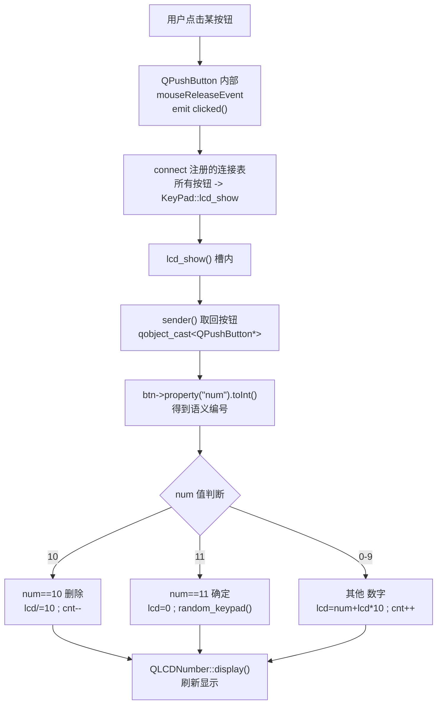

# Qt 14 键盘/按钮面板 学习笔记

## 本章重要 API 函数

| API | 功能 | 参数说明 | 头文件 |
|-----|------|----------|--------|
| `ui->setupUi(this)` | 加载 `.ui` 文件生成的界面到当前 Widget | `this`：界面挂接到的父窗口；由 `uic` 工具从 `keypad.ui` 生成 `ui_keypad.h` | `<ui_keypad.h>` |
| `QGridLayout` | 网格布局管理器，按行列摆放子控件 | 构造时传父控件（如 `ui->padWeight`），再用 `addWidget(w, row, col, rowspan, colspan)` 放置 | `<QGridLayout>` |
| `QPushButton::clicked` | 按钮被点击时发出的信号 | 无参数（本项目用，发送者通过 `sender()` 区分）；重载版本带 `bool checked` | `<QPushButton>` |
| `sender()` | 在槽函数内获取触发本次调用的发送者对象指针 | 返回 `QObject*`，需 `qobject_cast` 转回具体类型；仅同步 `DirectConnection` 有效 | `<QObject>` |
| `setProperty()` / `property()` | 给对象挂自定义动态属性（Qt 属性系统） | 键为 `QString`，值为 `QVariant`；本工程用它存每个按键的"数字含义" | `<QObject>` |
| `QLCDNumber::display()` / `intValue()` | 在 LCD 控件上显示数值 / 读取当前数值 | `display(int/double/QString)`；`intValue()` 返回当前整数 | `<QLCDNumber>` |

> 💡 Tips：本篇 `connect(btn, &QPushButton::clicked, this, &KeyPad::lcd_show)` 是"多对一"连接——12 个按钮连同一个槽，靠 `sender()` 区分是谁被点。这种写法方便，但 `sender()` 只在**直接连接**（同线程默认）时可靠；跨线程队列连接时 `sender()` 可能为 `nullptr`，那时应改用带参数的 Lambda 把 `num` 绑进捕获列表。

## 本章目录

> 点击条目可跳转到对应小节。

### 章节导航

- **[本章重要 API 函数](#本章重要-api-函数)**
- **[学习前后依赖](#学习前后依赖)**
- **[1. 概述](#1-概述)**
- **[2. 核心概念 / 原理](#2-核心概念--原理)**
- **[3. 信号槽将 12 个按键接入逻辑的机制](#3-信号槽将-12-个按键接入逻辑的机制)**
- **[4. 核心代码解析](#4-核心代码解析)**
- **[5. 运行效果 / 验证](#5-运行效果--验证)**
- **[容易踩坑](#容易踩坑)**
- **[学习要点总结](#学习要点总结)**
  - [核心知识点](#核心知识点)
  - [关键 API](#关键-api)
  - [下一步学习](#下一步学习)
- **[Q&A](#qa常见问题)**
- **[Tips](#tips)**
  - [最容易忽视的细节](#最容易忽视的细节)
  - [踩坑记录](#踩坑记录)
  - [与后续章节的衔接](#与后续章节的衔接)
  - [设计决策思考](#设计决策思考)

---

## 学习前后依赖

| 方向 | 内容 |
| ---- | ---- |
| 前置基础 | 第 13 篇信号与槽（connect / emit / Q_OBJECT）+ Qt Designer 的 `.ui` 文件与 `setupUi` 机制。 |
| 本章核心 | 用 `QGridLayout` 摆键盘、用 `setProperty` 给按钮贴标签、用 `sender()` 在统一槽里区分按键。 |
| 后续承接 | 第 15 篇事件系统（按钮的 `clicked` 信号其实来自 `mouseReleaseEvent`）、自定义控件与更复杂的交互布局。 |

> 💡 Tips：本篇是第 13 篇的"实战落地"——第 13 篇的 `A`/`B` 是抽象演示，本篇把发送者换成了 12 个真实 `QPushButton`。先吃透第 13 篇的 `connect` 语法，本篇就只是"把信号源从自定义类换成内置控件"，理解毫无障碍。

## 1. 概述

`qt14_tst-key_pad` 是一个仿手机拨号盘：上方 `QLCDNumber` 显示数字，下方 4×3 网格排布 12 个按钮（1–9、删除、0、确定）。点击数字键向 LCD 追加一位；"删除"键相当于除以 10 退一位；"确定"键清零并触发 `random_keypad()` 把数字键打乱重排（删除/确定键位置固定）。

它的价值在于展示一个 GUI 设计套路：**用一张静态按钮表 + 一个统一槽函数**，而不是为每个按钮写 12 个独立槽。这让"随机打乱布局"变得简单——按钮是固定对象，只是改变它们被 `addWidget` 进网格的行列位置。

> 💡 Tips：记住一句话——**布局（layout）决定"在哪"，按钮对象决定"是什么"，信号槽决定"点了干嘛"**。本工程把所有按钮预先 `new` 出来存进 `btns` 列表，打乱时只是重新 `addWidget`，按钮本身不被销毁重建，因此它们的 `connect` 依然有效。

## 2. 核心概念 / 原理

整个面板建立在三个支柱上：

1. **UI 文件分离**：`keypad.ui` 用 Qt Designer 描述界面（一个 `QLCDNumber` 名为 `lcdNumber`，一个容器 `QWidget` 名为 `padWeight` 作为网格的父）。`uic` 把它编译成 `ui_keypad.h`，`setupUi` 把控件实例化并挂到 `this` 上。
2. **网格布局**：`QGridLayout *pad_layout = new QGridLayout(ui->padWeight)`；之后 `addWidget(btn, i, j, 1, 1)` 把第 `i*3+j` 个按钮放进第 `i` 行第 `j` 列。`setContentsMargins(0,0,0,0)` 和 `setSpacing(0)` 做出无间隙的整块键盘外观。
3. **属性标记 + 统一槽**：每个按钮 `setProperty("num", key_buttons[i].num)` 记住自己的语义（数字 / 删除=10 / 确定=11）。所有按钮 `connect(..., &KeyPad::lcd_show)`，`lcd_show` 内用 `sender()` 取回按钮、读 `property("num")` 决定行为。

```cpp
// 关键数据：按钮文字 + 语义编号
static QList<Key_info> key_buttons = {
    {"1",1},{"2",2},{"3",3},{"4",4},{"5",5},{"6",6},
    {"7",7},{"8",8},{"9",9},{"删除",10},{"0",0},{"确定",11}
};
```

> 💡 Tips：原理上最易混淆的是 `QGridLayout` 的行列索引从 0 开始、先行后列。本项目 4 行 3 列，所以 `pos = i*3+j` 把一维 `key_buttons` 索引映射到二维网格。另外 `ui->padWeight` 是 `native="true"` 的普通 `QWidget`，专门充当布局的"画布"——直接把按钮 `new` 到它上面并交给网格管理。

## 3. 信号槽将 12 个按键接入逻辑的机制

下面用流程图展示"点击任意按钮 → 统一槽 → 按属性分流"的完整链路：



> 💡 Tips：流程里最关键的节点是 `sender()` → `property("num")` 这一段——它是"多对一槽"能区分来源的核心技巧。注意 `lcd_show` 开头的防御：`if (btn==nullptr) return;`——若槽被非按钮来源（或跨线程）触发，`sender()` 转换失败就安全退出，避免空指针崩溃。

## 4. 核心代码解析

### 4.1 构造函数：建按钮、布局、连接

```cpp
KeyPad::KeyPad(QWidget *parent) : QWidget(parent), ui(new Ui::KeyPad) {
    ui->setupUi(this);
    pad_layout = new QGridLayout(ui->padWeight);
    pad_layout->setContentsMargins(0,0,0,0);
    pad_layout->setSpacing(0);
    QPushButton *btn;
    for(int i=0;i<key_buttons.size();i++) {
        btn = new QPushButton(key_buttons[i].text, ui->padWeight);
        btn->setProperty("num", key_buttons[i].num);
        btn->setMinimumSize(80,80); btn->setMaximumSize(80,80);
        if (i==9 || i==11) btn->setStyleSheet(/* 橙色：删除/确定 */);
        else               btn->setStyleSheet(/* 灰色：数字键 */);
        btns.append(btn);
    }
    fixed_keypad();   // 把按钮按固定顺序摆进网格并联信号
}
```

这里所有按钮先一次性 `new` 出来并存入静态 `QList<QPushButton*> KeyPad::btns`。`btns` 是 `static`，但这里实际只用于在当前实例内引用；`new QPushButton(..., ui->padWeight)` 把父设为 `padWeight`，父析构时自动回收，避免内存泄漏。删除/确定键（索引 9、11）用橙色样式区分，其余灰色。

### 4.2 fixed_keypad：布局 + connect

```cpp
void KeyPad::fixed_keypad() {
    for(int i=0;i<4;i++)
        for(int j=0;j<3;j++) {
            auto btn = btns[i*3+j];
            pad_layout->addWidget(btn, i, j, 1, 1);
            connect(btn, &QPushButton::clicked, this, &KeyPad::lcd_show);
        }
}
```

每个按钮都 `connect` 到同一个 `lcd_show`。这就是第 13 篇所说的"多对一"连接——12 条连接指向同一槽。

### 4.3 lcd_show：统一槽内的分流逻辑

```cpp
void KeyPad::lcd_show() {
    auto btn = qobject_cast<QPushButton*>(sender());
    if (btn==nullptr) return;
    int lcd_value = ui->lcdNumber->intValue();
    int num = btn->property("num").toInt();
    qDebug() << "lcd_show:" << num;
    if (num == 10) {                       // 删除
        if(cnt<=0) return;
        lcd_value/=10; ui->lcdNumber->display(lcd_value); --cnt;
    } else if (num == 11) {                // 确定
        ui->lcdNumber->display(0);
        random_keypad(); cnt=0;
    } else {                               // 数字
        lcd_value = num + lcd_value*10;
        ui->lcdNumber->display(lcd_value); ++cnt;
    }
}
```

`cnt` 记录当前位数，删除时若 `cnt<=0` 直接返回（防 `0/10` 无意义循环）。`random_keypad()` 用 `QRandomGenerator` + `std::shuffle` 打乱数字键顺序，再按新顺序 `addWidget` 重新布局——因为按钮对象不变、连接不变，只是换位置，所以打乱后点击依然正确。

> 💡 Tips：这段代码藏着的细节——`ui->lcdNumber` 来自 `.ui`，名字必须与 Designer 里一致；若改名会编译或运行报错。`property("num")` 返回 `QVariant`，`toInt()` 取出语义值。`cnt` 成员初始化为 `0`（头文件 `int cnt = 0;`），且是实例成员，所以每个 KeyPad 独立计数。

## 5. 运行效果 / 验证

运行后窗口显示 240×400 的拨号盘：顶部 LCD，下方 4×3 暗色键盘。验证清单：

1. 依次点 1、2、3 → LCD 依次显示 1、12、123（`lcd=num+lcd*10`）。
2. 点"删除" → 123 变 12，再点变 1，到 0 后不再除（被 `cnt<=0` 拦截）。
3. 点"确定" → LCD 清零，且数字键位置被打乱；再点数字仍能正确输入，证明按钮身份未变。
4. 控制台输出每点的 `lcd_show: <num>`，与按钮语义一致。

> 💡 Tips：验证时容易误判"成功"的假象——若 LCD 不更新，先确认 `connect` 是否真的执行（断点或 `qDebug` 进 `lcd_show`）；若 `sender()` 转换失败，说明槽被非按钮触发或连接类型异常。另外 `.ui` 改过名字但没重新生成 `ui_keypad.h` 时界面会是空白——Qt Creator 通常会自动重跑 uic，但命令行构建要确认构建步骤包含 uic。

## 容易踩坑（注意点）

- **坑 1：按钮 `new` 出来却没设父、也没进布局** → 不显示或内存泄漏。规避：始终 `new QPushButton(text, ui->padWeight)` 设父，并用 `addWidget` 纳入布局。
- **坑 2：`sender()` 返回 `nullptr` 导致 `property` 崩溃** → 槽被非按钮或跨线程触发。规避：坚持 `qobject_cast` 后判空；跨线程改用 Lambda 捕获 `num`。
- **坑 3：`.ui` 里控件改名后 C++ 引用没改** → 编译期 `ui->xxx` 报错或运行空指针。规避：Designer 改名后同步更新 `.cpp` 中的 `ui->` 成员名（uic 生成的成员名随 ui 名变化）。
- **坑 4：布局边距/间距没清零，键盘出现缝隙** → 视觉不整。规避：`setContentsMargins(0,0,0,0)` 与 `setSpacing(0)`。
- **坑 5：多次调用 `fixed_keypad`/`random_keypad` 重复 `addWidget`** → 同一按钮被加两次。规避：本项目按钮只建一次、只连一次，打乱仅改行列位置，本身安全；自定义时若要重排应先 `removeWidget` 再 `addWidget`。
- **坑 6：忘记 `Q_OBJECT` 与 moc** → `lcd_show` 作槽无效。规避：KeyPad 类已带 `Q_OBJECT`，用 `qt_add_executable` 把 `keypad.h/.cpp/.ui` 都列入源，CMake 自动处理 uic/moc。

## 学习要点总结

### 核心知识点
1. `.ui` 文件经 `uic` 生成 `ui_keypad.h`，`setupUi` 实例化并挂载控件。
2. `QGridLayout` 用 `(row, col)` 摆放子控件，配合 `setSpacing(0)` 做无缝键盘。
3. "多对一"连接 + `sender()` + `setProperty` 是统一管理同类按钮的经典套路。
4. 打乱布局时复用按钮对象、只变 `addWidget` 位置，连接保持有效。

### 关键 API
| API | 功能 |
|-----|------|
| `ui->setupUi(this)` | 加载 UI |
| `QGridLayout::addWidget` | 网格摆放 |
| `QPushButton::clicked` | 点击信号 |
| `sender()` / `setProperty` | 取发送者 / 挂自定义属性 |
| `QLCDNumber::display` | 显示数值 |

### 下一步学习
- 第 15 篇：理解 `clicked` 信号本质来自 `mouseReleaseEvent`，深入事件分发。
- 第 16/17 篇：鼠标/键盘事件，掌握更底层的输入处理。
- 进阶：用 `QSignalMapper`（Qt5 旧）或 Lambda 替代 `sender()` 提升类型安全。

> 💡 Tips：本篇的"统一槽 + sender() 区分"直接衔接第 15 篇——你会看到 `clicked` 并非凭空出现，而是按钮在鼠标释放事件里 `emit` 的。理解这点，你就贯通了"事件 → 信号 → 槽"三层。

## Q&A（常见问题）

**Q1：`sender()` 到底安不安全？什么时候会失效？**  A1：仅在**同线程、直接连接**时可靠（本工程正是如此）。若信号槽跨线程使用 `Qt::QueuedConnection`，槽在接收者线程的事件循环里执行，此时 `sender()` 返回 `nullptr`。更安全的替代是连接时用 Lambda 把 `num` 捕获进去：`connect(btn, &QPushButton::clicked, this, [this, num]{ ... });`，彻底摆脱 `sender()`。

**Q2：为什么不用 12 个独立槽函数？**  A2：可以用，但会产生大量重复代码且不利于"随机打乱"（打乱只需改布局，逻辑不变）。统一槽 + 属性标记让"行为"与"按钮身份"解耦，是更符合 Qt 风格的写法。当按钮数量动态变化时，这种套路扩展性也更好。

**Q3：Qt5/Qt6 在 `.ui` 与布局上有差异吗？**  A3：基本无差异。`uic` 生成的 `ui_*.h` 在 Qt5/Qt6 用法一致；`qt_add_executable` 会自动调用 uic 处理 `.ui`，无需手写 `qt_wrap_ui`。注意 Qt6 默认要求 C++17，且 `QOverload` 等现代写法更顺手。本项目 `CMakeLists.txt` 用 `find_package(Qt6 6.5 ...)`，是典型的 Qt6 配置。

**Q4：`random_keypad` 里 `btns[pos]` 对 9/11 不洗牌，为何？**  A4：因为删除(9)、确定(11)两个功能键位置固定（始终在右下两格），所以 `std::shuffle` 只对 `i!=9 && i!=11` 的数字键索引洗牌，摆放时这两格直接取原按钮，其余按洗牌后的 `indexs` 取——实现"数字乱序、功能键不动"的效果。

## Tips（全局速记）

### 最容易忽视的细节
1. **`btns` 是 `static QList`**：意味着所有 KeyPad 实例共享同一份按钮列表（本项目只创建一个实例所以无碍，但多实例会串味）。这是源码里一个隐藏的设计隐患，值得留意。
2. **`property` 返回 `QVariant`**：`toInt()` 失败时返回 0，若某个按钮忘了 `setProperty("num")` 会变成"数字 0"行为而非报错——调试时要注意每个按钮都设了属性。
3. **`cnt` 是位数计数器**：删除时 `if(cnt<=0) return;` 防止无意义的 `0/=10` 与 `display` 跳变，是避免 LCD 显示异常的守门员。

### 踩坑记录
- **"界面出来但按钮挤在左上角"**：通常是 `pad_layout` 没真正挂到 `padWeight` 上，或忘记 `addWidget`。本工程 `new QGridLayout(ui->padWeight)` 把布局父设为容器，按钮再 `addWidget` 进去，缺一不可。
- **"点击没反应"**：九成是 `connect` 没执行或 `sender()` 转换失败。本项目 `lcd_show` 首行就 `qobject_cast` 判空，能挡住空指针但也会"静默吞掉"点击——排查时建议先 `qDebug() << "hit";` 确认槽被进。

### 与后续章节的衔接
1. 第 15 篇事件系统：本篇 `clicked` 信号的来源正是按钮的 `mouseReleaseEvent`，读完第 15 篇你会回来看本工程有全新理解。
2. 第 16 篇鼠标事件：可把"点击放大/拖动"等能力加到这个键盘上做练习。
3. 自定义控件：把 `KeyPad` 抽成独立可复用控件，正是第 15 篇 `InnerLable` 自定义控件的延伸。

### 设计决策思考
- **为何用 `setProperty("num")` 而非继承按钮子类？** 用动态属性避免了为 12 个按钮各写一个子类，代价是槽里要做 `qobject_cast` + 类型转换。当按钮语义简单（一个数字）时，属性标记是最轻量的方案；若行为复杂，则应为按钮建子类并重写事件。
- **为何"打乱"复用按钮对象而非重建？** 重建会丢失 `connect` 且带来内存管理负担；复用对象只改布局位置，连接一次永逸。这体现了 Qt 中"对象生命周期"与"视觉位置"分离的思想——布局只管位置，对象本身稳定。
- **为何功能键不参与洗牌？** 用户体验上，拨号盘的"删除/确定"位置固定才能形成肌肉记忆；只有数字键打乱才有"练习记忆"或"防偷窥"的意义。这是交互设计上的刻意取舍，而非技术限制。
