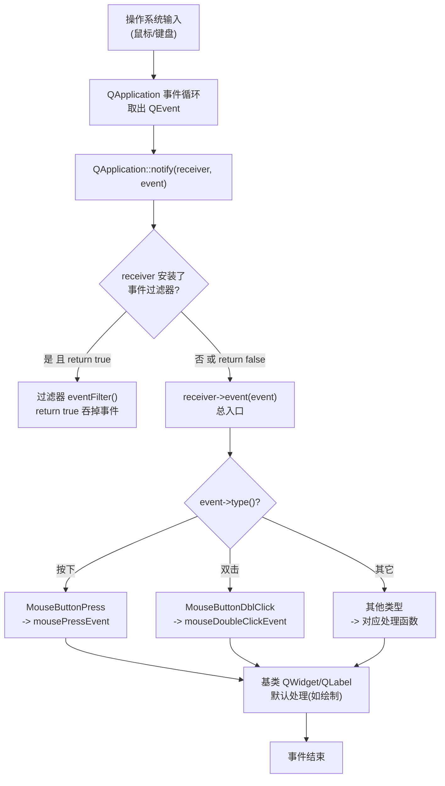

# Qt 15 事件系统基础 学习笔记

## 本章重要 API 函数

| API | 功能 | 参数说明 | 头文件 |
|-----|------|----------|--------|
| `bool event(QEvent *event)` | 所有事件进入控件的总入口（虚函数） | 返回 `true` 表示事件已处理、停止继续分发；`false` 交给基类默认处理 | `<QObject>` / `<QWidget>` |
| `QEvent::type()` | 获取事件类型枚举 | 返回如 `QEvent::MouseButtonPress`、`QEvent::KeyPress` 等 | `<QEvent>` |
| `void mousePressEvent(QMouseEvent *)` | 鼠标按下事件的具体处理函数 | 重写以自定义按下行为；记得调基类或自行 `accept` | `<QWidget>` |
| `void mouseDoubleClickEvent(QMouseEvent *)` | 鼠标双击事件 | 双击由系统/Qt 识别后派发 | `<QWidget>` |
| `installEventFilter(obj)` / `eventFilter(obj, event)` | 事件过滤器：在目标对象前截获事件 | `installEventFilter` 注册监视者；`eventFilter` 返回 `true` 则吞掉事件 | `<QObject>` |
| `QObject::eventFilter()` | 过滤器虚函数 | `(QObject *watched, QEvent *event)`；`watched` 是被监视对象 | `<QObject>` |

> 💡 Tips：`event()` 是"总开关"，具体事件函数（如 `mousePressEvent`）是"分插座"。**永远不要忘记在自定义 `event()` 末尾 `return QWidget::event(event);`**——否则没处理的事件被你吞掉，控件会"失灵"（点不动、画不出）。本工程 `Widget::event` 与 `InnerLable::event` 都正确地把事件交还基类。

## 本章目录

> 点击条目可跳转到对应小节。

### 章节导航

- **[本章重要 API 函数](#本章重要-api-函数)**
- **[学习前后依赖](#学习前后依赖)**
- **[1. 概述](#1-概述)**
- **[2. 核心概念 / 原理](#2-核心概念--原理)**
- **[3. 事件分发链与事件过滤器](#3-事件分发链与事件过滤器)**
- **[4. 核心代码解析](#4-核心代码解析)**
- **[5. 运行效果 / 验证](#5-运行效果--验证)**
- **[容易踩坑](#容易踩坑)**
- **[学习要点总结](#学习要点总结)**
  - [核心知识点](#核心知识点)
  - [关键 API](#关键-api)
  - [下一步学习](#下一步学习)
- **[Q&A](#qa常见问题)**
- **[Tips](#tips)**
  - [最容易忽视的细节](#最容易忽视的细节)
  - [踩坑记录](#踩坑记录)
  - [与后续章节的衔接](#与后续章节的衔接)
  - [设计决策思考](#设计决策思考)

---

## 学习前后依赖

| 方向 | 内容 |
| ---- | ---- |
| 前置基础 | 第 13 篇信号与槽（本篇 `InnerLable` 在双击时 `emit` 自定义信号，需理解信号声明与连接）、`QObject` 继承与 `Q_OBJECT` 宏。 |
| 本章核心 | 事件分发链 `notify → event → 具体事件函数`、重写 `event()`、`mousePressEvent`、事件过滤器、自定义控件处理事件。 |
| 后续承接 | 第 16 篇鼠标事件、第 17 篇键盘事件都是本篇"事件处理函数"的具体展开；信号槽的底层也由事件驱动。 |

> 💡 Tips：必须先懂第 13 篇的信号槽，因为本篇 `InnerLable` 是"在事件处理函数里 emit 信号"的典型——事件和信号在这里交汇。本篇是 16/17 的"总纲"：鼠标/键盘事件函数本质上就是 `event()` 根据类型转发到的那些具体虚函数。

## 1. 概述

Qt 是**事件驱动**框架。用户的一次点击、一次按键、一次定时器到期、一次重绘请求，都会变成一个个 `QEvent` 对象，被 `QApplication` 从系统消息队列取出，然后**逐层派发**到目标控件。控件收到事件后，先经过总入口 `event()`，再被分流到 `mousePressEvent`、`keyPressEvent` 等具体处理函数。

本工程 `qt15_tst_eventbase` 用一个 `Widget` 承载一个自定义 `InnerLable`（继承自 `QLabel`）。它演示了三件事：(1) 在 `Widget::event` 中截获并打印鼠标按下事件；(2) `InnerLable` 重写 `event()`/`mousePressEvent`/`mouseDoubleClickEvent`，在双击时 `emit double_clicked()` 信号；(3) `Widget` 用 Lambda 连接该信号，把 `show_label` 文字设为"霜机完成"。

> 💡 Tips：记住一句话——**信号槽是"对象间通信"，事件是"输入/系统的原始通知"；多数信号最终由事件触发**。本篇双击 `InnerLable` 后 `emit double_clicked`，正是把"底层的鼠标双击事件"翻译成了"上层可连接的信号"，这就是 Qt 控件封装输入的典型模式。

## 2. 核心概念 / 原理

事件分发是一条**责任链**。简化流程：

1. 操作系统产生鼠标/键盘消息 → `QApplication` 的 event loop 取出 → 调用 `QApplication::notify(receiver, event)`。
2. `notify` 先给 receiver 安装的**事件过滤器**（`eventFilter`）一次机会截获；过滤器 `return true` 则事件被吞掉，不再继续。
3. 若未被过滤，调用 `receiver->event(event)`——这是控件的总处理器。
4. `event()` 根据 `event->type()` 把事件转发给对应的具体虚函数（如 `MouseButtonPress → mousePressEvent`）。
5. 具体函数处理完后，事件结束（或继续向父控件传播，视事件类型而定）。

`InnerLable` 继承自 `QLabel`，说明**任何 `QObject` 派生类都能重写 `event()` 与事件函数**——自定义控件处理自定义事件，正是 Qt 可扩展性的来源。

```cpp
// inner_lable.h 关键声明
class InnerLable : public QLabel {
    Q_OBJECT
protected:
    bool event(QEvent *event) override;
    void mousePressEvent(QMouseEvent *ev) override;
    void mouseDoubleClickEvent(QMouseEvent *event) override;
signals:
    void double_clicked();
};
```

> 💡 Tips：原理上最易误解的是"事件与信号槽的区别"——事件更底层、同步、由 `notify` 直接调用分发出去；信号槽是建立在 QObject 之上的高级抽象。一个事件可以 `emit` 出多个信号，一个信号也可以由多种事件触发。另外，**`event()` 返回 `true` 表示"我已处理，停止传播"**，返回 `false` 表示"我不管，交给基类"，这与 `accept()`/`ignore()` 是两套不同体系，别混。

## 3. 事件分发链与事件过滤器

下面用流程图展示事件从系统到具体处理函数的完整责任链，并标注事件过滤器与 `event()` 的介入点：



> 💡 Tips：流程里最关键的箭头是 `notify → eventFilter → event → 具体函数` 这一串。**事件过滤器位于 `event()` 之前**，所以它能"抢在控件自己看到事件之前"拦截（常用于给别人的控件加行为而不改其源码）。而 `event()` 是控件"自己处理一切事件"的最后总闸——在 `InnerLable::event` 里加日志，就能看到所有流经它的事件。

## 4. 核心代码解析

### 4.1 Widget：重写 event() 截获鼠标按下

```cpp
bool Widget::event(QEvent *ev) {
    if(ev->type()==QEvent::MouseButtonPress) {
        qDebug()<<__PRETTY_FUNCTION__;   // 打印 "Widget::event"
        qDebug()<<ev->type();            // 打印事件类型枚举
    }
    return QWidget::event(ev);           // 必须交还基类！
}
void Widget::mousePressEvent(QMouseEvent *ev) {
    qDebug()<<__PRETTY_FUNCTION__;
}
```

`Widget::event` 只"观察"鼠标按下事件（打印），然后 `return QWidget::event(ev)` 让基类继续——所以点击仍正常触发 `mousePressEvent`。若漏掉这句 return，控件会吞掉所有事件、点不动。**`__PRETTY_FUNCTION__`** 是 GCC/Clang 宏（MinGW 支持），打印带类名和参数签名的函数全名，调试分发路径极好用。

### 4.2 InnerLable：自定义控件处理事件并发信号

```cpp
InnerLable::InnerLable(QWidget *parent) : QLabel(parent) {
    setFrameStyle(QFrame::Panel | QFrame::Plain);
    setLineWidth(3); setMidLineWidth(1);   // 画个边框，便于看到控件范围
}
bool InnerLable::event(QEvent *ev) {
    // 注释掉了一段"在 event 里直接调用 mousePressEvent 并返回 true"的写法
    return QLabel::event(ev);              // 交给 QLabel 默认分发
}
void InnerLable::mousePressEvent(QMouseEvent *ev) {
    qDebug()<<__PRETTY_FUNCTION__;
}
void InnerLable::mouseDoubleClickEvent(QMouseEvent *event) {
    emit double_clicked();                 // 双击 -> 发自定义信号
}
```

`InnerLable` 继承自 `QLabel`，重写了三个函数。`mouseDoubleClickEvent` 在双击时 `emit double_clicked()`——这个信号在 `inner_lable.h` 的 `signals:` 区声明、由 moc 生成。注意 `event()` 里注释掉的那段：原本尝试在 `event` 内手动 `mousePressEvent((QMouseEvent*)ev); return true;`，这种写法会跳过默认分发、可能导致双击识别等基类逻辑失效，所以当前版本让 `QLabel::event` 正常处理。

### 4.3 Widget 构造：摆放控件并连接双击信号

```cpp
Widget::Widget(QWidget *parent) : QWidget(parent), ui(new Ui::Widget) {
    ui->setupUi(this);
    setGeometry(100,100,500,500);
    in_label = new InnerLable(this);
    in_label->resize(150,150);
    in_label->move(150,150);
    show_label = new QLabel(this);
    show_label->resize(100,50);
    show_label->move(10,20);
    QObject::connect(in_label, &InnerLable::double_clicked, this, [=](){
        show_label->setText("霜机完成");
    });
}
```

`in_label` 是自定义控件，放在窗口 (150,150) 处 150×150 大小；`show_label` 显示提示文字。双击 `in_label` → `emit double_clicked()` → Lambda 把 `show_label` 文本改为"霜机完成"。这里连接用的是**新式函数指针 + Lambda 槽**，接收者 `this` 保证 Lambda 生命周期随 Widget。

> 💡 Tips：这段代码藏着的细节——`InnerLable` 的父设为 `this`（Widget），父析构时自动回收，无需手动 `delete`；Lambda 捕获 `[=]` 按值捕获 `this` 指针与局部 `show_label`，安全有效。`in_label` 用 `setFrameStyle` 画边框，否则 `QLabel` 默认无边框，你根本看不见它的点击区域。

## 5. 运行效果 / 验证

运行后窗口 500×500，左上角一个 `show_label`（初始空），中间一个带边框的 150×150 `InnerLable`。验证：

1. 在窗口空白处点击 → 控制台打印 `Widget::event` 及事件类型，并 `Widget::mousePressEvent`（证明总入口与具体函数都被调用）。
2. 在中间 `InnerLable` 上点击 → 打印 `InnerLable::mousePressEvent`。
3. 在 `InnerLable` 上**双击** → `show_label` 文字变为"霜机完成"，证明 `mouseDoubleClickEvent → emit double_clicked → Lambda` 链路打通。

> 💡 Tips：验证时容易误判"成功"的假象——若双击 `show_label` 没变字，先确认双击发生在 `InnerLable` 区域内（它有边框可辨），而非窗口空白处；空白处只有 `Widget` 的事件，`InnerLable` 信号不会触发。另外 `event()` 里若误 `return true` 吞掉事件，双击信号也会发不出。

## 容易踩坑（注意点）

- **坑 1：重写 `event()` 后忘记 `return Base::event(event);`** → 所有事件被吞，控件点不动、画不出。规避：要么转发基类，要么对处理的事件显式 `return true`、其余转发。
- **坑 2：在 `event()` 里手动调用具体事件函数又 `return true`** → 绕过默认分发，可能丢失双击/悬停等基类逻辑（本工程注释掉的写法就是反例）。规避：除非完全清楚后果，否则让 `Base::event` 正常转发。
- **坑 3：事件过滤器 `eventFilter` 返回 `true` 却没真处理** → 事件被悄悄吞掉。规避：只对你关心的事件返回 `true`；其余 `return false`（或 `Base::eventFilter`）。
- **坑 4：自定义控件忘记 `Q_OBJECT` 与继承 `QObject` 体系** → 信号 `double_clicked` 无法 `emit`/`connect`。规避：`InnerLable` 继承 `QLabel`（间接继承 `QObject`）且带 `Q_OBJECT`。
- **坑 5：误以为 `event()` 返回值和 `accept()/ignore()` 是一回事** → 前者控制"是否继续分发"，后者标记"事件是否被处理"用于父子传播。规避：理解两者作用域不同。
- **坑 6：双击依赖 `mouseDoubleClickEvent` 却没开启** → Qt 默认支持；但某些平台/自定义 `event` 吞掉 `MouseButtonDblClick` 会导致不触发。规避：保持事件正常转发到基类。

## 学习要点总结

### 核心知识点
1. 事件分发链：`QApplication::notify → eventFilter（若有）→ event() → 具体事件函数 → 基类默认处理`。
2. `event()` 是总入口，`mousePressEvent` 等是分流后的具体处理；重写须正确转发基类。
3. 事件过滤器能在控件自身 `event()` 之前截获事件，适合无侵入地增强他人控件。
4. 自定义控件（如 `InnerLable`）通过重写事件函数在底层输入上 `emit` 自定义信号，实现"事件→信号"的封装。

### 关键 API
| API | 功能 |
|-----|------|
| `event(QEvent*)` | 事件总入口 |
| `QEvent::type()` | 事件类型 |
| `mousePressEvent` / `mouseDoubleClickEvent` | 鼠标事件处理 |
| `installEventFilter` / `eventFilter` | 事件过滤器 |
| `emit`（自定义信号） | 由事件触发上抛信号 |

### 下一步学习
- 第 16 篇：深入 `mousePressEvent`/`mouseMoveEvent`/`mouseReleaseEvent` 与 `setMouseTracking`。
- 第 17 篇：深入 `keyPressEvent` 与 `QKeyEvent`。
- 进阶：自定义 `QEvent` 子类、定时器事件 `timerEvent`、事件在多线程中的投递。

> 💡 Tips：本篇是 16/17 的"目录页"——鼠标/键盘事件函数正是本篇 `event()` 会分流到的那些具体虚函数。读完本篇再去看 16/17，会发现它们只是把 `MouseButtonPress`/`KeyPress` 的处理讲得更细。

## Q&A（常见问题）

**Q1：事件和信号槽到底先有谁？**  A1：事件是更底层、先发生的一方。以本工程为例，用户在 `InnerLable` 上双击，操作系统产生鼠标事件 → `notify` 分发 → `InnerLable::mouseDoubleClickEvent` 被调用 → 其中 `emit double_clicked()` 才产生信号 → 连接的 Lambda 执行。所以"事件触发信号，信号再驱动槽"，事件是源头。

**Q2：`event()` 返回 `true` 和调用 `event->accept()` 有什么区别？**  A2：这是两套机制。`event()` 返回 `true` 告诉 Qt"这个事件我全权处理，不要再往基类/父控件转发"；`accept()`/`ignore()` 是 `QEvent` 上的标记，用于**同一事件在控件层级间的传播语义**（例如 `closeEvent` 里 `ignore()` 可阻止窗口关闭）。混用会出怪问题，记住 `event()` 的返回值控制"分发是否继续"，`accept/ignore` 控制"语义是否被消费"。

**Q3：事件过滤器适合什么场景？和重写 `event()` 怎么选？**  A3：想给**别人写的、不想改源码的控件**加预处理逻辑（如全局屏蔽某类按键、统一日志），用 `installEventFilter` 最干净——无侵入。若是**自己的控件**，直接重写 `event()` 或具体事件函数更直接。过滤器在 `event()` 之前执行，优先级更高。

**Q4：为什么本工程 `InnerLable::event` 里把"手动调用 mousePressEvent 并返回 true"注释掉了？**  A4：那种写法属于"在总入口自己处理按下事件并吞掉"，会跳过 `QLabel::event` 的默认分发链，导致双击识别、样式更新等基类行为可能失效，还可能重复触发。工程选择让 `QLabel::event(ev)` 正常转发，由具体事件函数各司其职，更安全、更符合 Qt 设计意图。

## Tips（全局速记）

### 最容易忽视的细节
1. **`__PRETTY_FUNCTION__` 是调试事件分发的最佳探针**：在 `event()` 与各事件函数里都打印它，你能直观看到"事件先经过谁、再到谁"，比单步还快。
2. **`InnerLable` 继承 `QLabel` 而非 `QWidget`**：因为需要 `QLabel` 的显示能力，同时 `QLabel` 已带完整事件链。继承体系越靠近功能基类，能复用的默认行为越多。
3. **双击事件依赖单次点击事件的正确转发**：`mouseDoubleClickEvent` 不是独立输入，而是 Qt 在多次 `mousePressEvent` 间识别出的语义。若你吞掉 `MouseButtonPress`，双击可能判不出来。

### 踩坑记录
- **"重写 `event` 后整个窗口失灵"**：几乎都是漏了 `return QWidget::event(event);`。本工程 `Widget::event` 和 `InnerLable::event` 都正确转发，可做范本对照。一旦你加了 `return true` 又没处理对应事件，控件就会"假死"。
- **"双击没反应却没报错"**：因为 `mouseDoubleClickEvent` 没被重写或事件被吞。排查顺序：`event()` 是否转发 → 是否重写了 `mouseDoubleClickEvent` → `emit` 的信号是否真的 `connect` 了。本工程的 Lambda 连接是验证关键。

### 与后续章节的衔接
1. 第 16 篇鼠标事件：`mousePressEvent`/`mouseReleaseEvent`/`mouseMoveEvent` 都是本篇 `event()` 会分流到的具体函数，本篇是它们的"总纲"。
2. 第 17 篇键盘事件：`keyPressEvent` 同理，只是事件类型换成 `KeyPress`。
3. 第 14 篇键盘面板：`QPushButton::clicked` 信号本质来自按钮的 `mouseReleaseEvent`——正是本篇"事件→信号"封装模式的实例。

### 设计决策思考
- **为何用"事件里 emit 信号"而不是直接在事件里改 UI？** 因为把"输入（双击）"与"响应（改文字）"解耦，符合信号槽的解耦哲学：`InnerLable` 只负责"我被打双击了"这一事实，`Widget` 决定"接下来做什么"。这样 `InnerLable` 可被复用在任何需要"双击通知"的场景。
- **为何 `Widget::event` 只观察不拦截？** 因为它只是演示"事件流经此处可被看见"，真正的业务逻辑（双击响应）下沉到 `InnerLable` 与 Lambda。保持 `event()` 的"观察者"角色、不破坏默认分发，是安全增强控件行为的黄金法则。
- **为何本工程同时演示 `Widget` 和 `InnerLable` 两个层级的 `event`？** 为了展示事件分发的**层级性**——事件先到子控件（InnerLable）再到父控件（Widget 空白处），两层都能感知。理解这点对调试"点击到底被谁吃了"至关重要。
