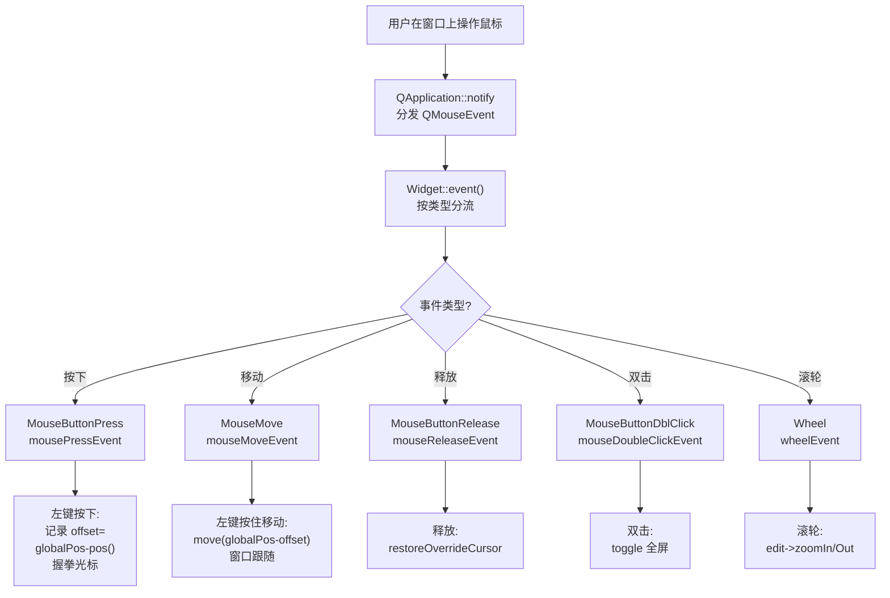

# Qt 16 鼠标事件 学习笔记

## 本章重要 API 函数

| API | 功能 | 参数说明 | 头文件 |
|-----|------|----------|--------|
| `mousePressEvent(QMouseEvent*)` | 鼠标按键按下时调用 | `event->button()` 返回**本次**按下的键（Left/Right/...） | `<QWidget>` |
| `mouseReleaseEvent(QMouseEvent*)` | 鼠标按键松开时调用 | 同 `button()`；用于复位状态/光标 | `<QWidget>` |
| `mouseMoveEvent(QMouseEvent*)` | 鼠标移动时调用 | `event->buttons()` 返回**当前仍按住**的键位掩码；不开启追踪时仅按键按住才触发 | `<QWidget>` |
| `mouseDoubleClickEvent(QMouseEvent*)` | 双击时调用 | 由 Qt 在两次按下间识别；本篇用于切换全屏 | `<QWidget>` |
| `event->globalPosition()` | Qt6 获取全局坐标（QPointF） | 返回鼠标在屏幕坐标系的位置；Qt5 对应 `globalPos()` 返回 QPoint | `<QMouseEvent>` |
| `setMouseTracking(bool)` | 是否追踪鼠标移动（无需按键） | `true` 时 `mouseMoveEvent` 随时触发；默认 `false` 仅按键按住触发 | `<QWidget>` |
| `QApplication::setOverrideCursor` / `restoreOverrideCursor` | 压栈/弹出全局光标 | 配对使用；可多层嵌套，restore 弹一层 | `<QApplication>` |
| `wheelEvent(QWheelEvent*)` | 滚轮事件 | `event->angleDelta().y()` 上滚为正、下滚为负 | `<QWidget>` |
| `closeEvent(QCloseEvent*)` | 窗口关闭请求 | `event->accept()` 允许关闭；`ignore()` 取消 | `<QWidget>` |

> 💡 Tips：Qt6 把 `globalPos()` 改成了 `globalPosition()`（返回 `QPointF`，更精确），Qt5 用 `globalPos()`（返回 `QPoint`）。本项目是 Qt6，用的是 `globalPosition()`。**`button()` 与 `buttons()` 极易混**：前者是"触发本次事件的那个键"，后者是"当前所有被按住的键的位或掩码"；拖动判定必须用 `buttons() & Qt::LeftButton`（按住期间多次移动都含左键），而按下/松开判定用 `button()`。

## 本章目录

> 点击条目可跳转到对应小节。

### 章节导航

- **[本章重要 API 函数](#本章重要-api-函数)**
- **[学习前后依赖](#学习前后依赖)**
- **[1. 概述](#1-概述)**
- **[2. 核心概念 / 原理](#2-核心概念--原理)**
- **[3. 鼠标事件的分发与拖动链路](#3-鼠标事件的分发与拖动链路)**
- **[4. 核心代码解析](#4-核心代码解析)**
- **[5. 运行效果 / 验证](#5-运行效果--验证)**
- **[容易踩坑](#容易踩坑)**
- **[学习要点总结](#学习要点总结)**
  - [核心知识点](#核心知识点)
  - [关键 API](#关键-api)
  - [下一步学习](#下一步学习)
- **[Q&A](#qa常见问题)**
- **[Tips](#tips)**
  - [最容易忽视的细节](#最容易忽视的细节)
  - [踩坑记录](#踩坑记录)
  - [与后续章节的衔接](#与后续章节的衔接)
  - [设计决策思考](#设计决策思考)

---

## 学习前后依赖

| 方向 | 内容 |
| ---- | ---- |
| 前置基础 | 第 15 篇事件系统（`mousePressEvent` 等正是 `event()` 分流到的具体事件函数）、`QWidget` 继承与 `Q_OBJECT`。 |
| 本章核心 | 鼠标四类事件 + 滚轮 + 关闭事件的具体重写，`globalPosition()`、`setOverrideCursor`、拖动窗口的经典算法。 |
| 后续承接 | 第 17 篇键盘事件（同属"事件处理函数"家族）；后续自定义拖拽（`QDrag`）、绘图（`paintEvent`）都以此为基础。 |

> 💡 Tips：本篇是 15 篇的"具体展开"——第 15 篇讲 `event()` 总入口如何把 `MouseButtonPress` 分流到 `mousePressEvent`；本篇直接重写这些具体函数。先读 15 理解分发链，再看本篇就不会觉得这些函数是"凭空被调用"的。

## 1. 概述

鼠标是人类与 GUI 交互最频繁的输入设备。Qt 把鼠标行为拆成一组清晰的事件虚函数：按下、移动、释放、双击、滚轮、进入/离开。本工程 `qt16_tst_mouse` 把它们集成进一个 400×400 窗口，演示了四个实用能力：

1. **拖动窗口**：左键按下记录偏移，移动时按全局坐标差移动窗口。
2. **光标反馈**：左键按下变"握拳"光标、松开恢复"张开手"；右键按下临时换成一张图片光标（Doraemon.png）。
3. **双击全屏**：左键双击在普通/全屏间切换。
4. **滚轮缩放**：在 `QTextEdit` 上滚轮回滚缩放文字；关闭窗口弹确认框，可取消退出。

> 💡 Tips：记住一句话——**鼠标事件的核心难点不是"怎么响应"，而是"坐标用哪种、按键用哪个函数取"**。本工程的拖动算法 `offset = globalPos - pos()` 是 GUI 拖拽的教科书写法，务必吃透 `globalPosition()`（屏幕坐标）与 `pos()`（窗口左上角相对父的坐标）的区别。

## 2. 核心概念 / 原理

鼠标事件对象 `QMouseEvent` 携带三类关键信息：(1) **按键**——`button()`（本次事件的键）与 `buttons()`（当前按住的所有键掩码）；(2) **坐标**——`pos()`（相对接收控件）、`globalPosition()`（相对屏幕，Qt6）；(3) **修饰键**——`modifiers()`（Shift/Ctrl/Alt）。

拖动窗口的经典算法依赖"全局坐标"而非"相对坐标"：按下时记录 `offset = 鼠标全局坐标 - 窗口左上角全局坐标`；之后每次移动，新窗口位置 = `鼠标全局坐标 - offset`。这样无论鼠标在窗口哪个位置按下，拖动都不会"跳变"。

```cpp
// 拖动核心（在 mousePressEvent 记录，在 mouseMoveEvent 应用）
offset = event->globalPosition() - pos();   // pos() 即窗口左上角
// 移动时：
move(event->globalPosition() - offset);
```

光标管理用 **栈式覆盖**：`setOverrideCursor` 把光标压入 Qt 的全局光标栈，`restoreOverrideCursor` 弹出一层。这意味着可以嵌套多层（按下 A 压一种、再按下 B 压另一种），释放时逐层恢复，不会乱。

> 💡 Tips：原理上最易误解的是 `mouseMoveEvent` 默认**只在按键按住时**才触发（因为 `setMouseTracking` 默认 `false`）。本工程正是利用这点做"按住左键才拖动"——没按住时移动鼠标 `mouseMoveEvent` 根本不被调用，既省 CPU 又天然实现了"拖拽而非悬停跟随"。若要"悬停即跟随"，需 `setMouseTracking(true)`，但那样拖动逻辑要加 `buttons()` 判断否则会乱飞。

## 3. 鼠标事件的分发与拖动链路

下面用流程图展示从鼠标移动到窗口拖动的完整链路，并标示各事件函数的介入点：



> 💡 Tips：流程里最关键的节点是 `J（记录 offset）→ K（move）` 这一对——它们必须配合 `globalPosition()`（屏幕坐标系）才能正确。若误用 `pos()`（相对控件）做偏移，拖动会从鼠标按下点"瞬移"到窗口左上角。另外注意 `F` 分支只在"左键按住"时抵达 `K`（因 `buttons()&LeftButton` 判定），这正是默认 `setMouseTracking(false)` 的效果。

## 4. 核心代码解析

### 4.1 构造函数：初始光标与文本控件

```cpp
Widget::Widget(QWidget *parent) : QWidget(parent) {
    setGeometry(100,100,400,400);
    QCursor cursor;
    cursor.setShape(Qt::OpenHandCursor);   // 张开手光标
    setCursor(cursor);
    edit = new QTextEdit(this);
    edit->resize(200,200); edit->move(100,100);
}
```

窗口 400×400，默认光标为"张开手"（`OpenHandCursor`），暗示"可抓取"。`edit` 是 200×200 的 `QTextEdit`，放在窗口中央，用于滚轮缩放演示。`setCursor` 设置的是**本控件自身**光标（局部），而 `QApplication::setOverrideCursor` 设置的是**全局**光标（后面压下栈）。

### 4.2 按下/释放：光标与偏移

```cpp
void Widget::mousePressEvent(QMouseEvent *event) {
    if(event->button()==Qt::LeftButton) {
        QCursor cursor; cursor.setShape(Qt::ClosedHandCursor);
        QApplication::setOverrideCursor(cursor);   // 全局压栈：握拳
        offset = event->globalPosition() - pos();
    } else if(event->button()==Qt::RightButton) {
        QPixmap pixmap("./Doraemon.png");
        qreal dpr = qApp->primaryScreen()->devicePixelRatio();
        QSize realSize = QSize(64,64)*dpr;
        pixmap = pixmap.scaled(realSize, Qt::KeepAspectRatio, Qt::SmoothTransformation);
        pixmap.setDevicePixelRatio(dpr);
        QCursor cursor(pixmap, 64, 64);
        QApplication::setOverrideCursor(cursor);    // 临时图片光标
    }
    QWidget::mousePressEvent(event);
}
void Widget::mouseReleaseEvent(QMouseEvent *event) {
    Q_UNUSED(event);
    QApplication::restoreOverrideCursor();          // 弹出一层光标
    QWidget::mouseReleaseEvent(event);
}
```

按下左键：把"握拳"光标压入全局栈，并记录 `offset = 全局坐标 - 窗口左上角`。按下右键：加载 `Doraemon.png` 并按设备像素比（dpr）缩放生成自定义图片光标（高清屏不糊）。释放时 `restoreOverrideCursor` 弹栈恢复——无论之前压了握拳还是图片光标，都 safely 回到张开手。末尾都调用基类 `mousePressEvent/Release`，保证默认行为（如焦点）不被吞。

### 4.3 移动与双击：拖动与全屏

```cpp
void Widget::mouseMoveEvent(QMouseEvent *event) {
    if(event->buttons() & Qt::LeftButton) {         // 注意用 buttons()
        QPointF temp = event->globalPosition() - offset;
        move(temp.x(), temp.y());
    }
}
void Widget::mouseDoubleClickEvent(QMouseEvent *event) {
    if(event->button()==Qt::LeftButton) {
        if(windowState()!=Qt::WindowFullScreen)
            setWindowState(Qt::WindowFullScreen);
        else
            setWindowState(Qt::WindowNoState);
    }
    QWidget::mouseDoubleClickEvent(event);
}
```

`mouseMoveEvent` 用 `event->buttons() & Qt::LeftButton` 判定"左键正按住"——因为移动事件在按住期间会连续产生，每次 `buttons()` 都含左键。`move()` 把窗口移到 `全局坐标 - offset`，实现无跳变拖动。双击左键在 `WindowFullScreen` 与 `WindowNoState` 间切换；用 `windowState()` 判断当前状态避免重复设置。

### 4.4 滚轮与关闭

```cpp
void Widget::wheelEvent(QWheelEvent *event) {
    if(event->angleDelta().y()>0) edit->zoomIn();
    else                           edit->zoomOut();
}
void Widget::closeEvent(QCloseEvent *event) {
    QMessageBox::StandardButton result = QMessageBox::question(
        this,"鼠标事件框","确定退出吗？",
        QMessageBox::Yes|QMessageBox::No|QMessageBox::Cancel);
    if(result==QMessageBox::Yes) event->accept();
    else                         event->ignore();
}
```

滚轮 `angleDelta().y()` 上滚（>0）放大文本、下滚缩小。`closeEvent` 弹确认框：`Yes` 调 `accept()` 允许关闭，`No/Cancel` 调 `ignore()` 取消关闭——这是"防止误关窗口"的标准做法。

> 💡 Tips：这段代码藏着的细节——`Doraemon.png` 是相对**程序运行目录**加载的，若 exe 旁没有该图，pixmap 为空、图片光标无效但不崩溃，只是右键光标不显示。另外 `Q_UNUSED(event)` 用于消除"release 里没用 event"的编译警告，是 Qt 代码的常见写法。滚轮缩放只作用于 `edit`（`QTextEdit` 自带 `zoomIn/Out`），窗口其它区域滚轮不会缩放。

## 5. 运行效果 / 验证

运行 400×400 窗口，中央有文本框。验证：

1. 鼠标移到窗口上 → 光标是"张开手"。
2. 左键按住并拖动 → 窗口跟随鼠标平滑移动，光标变"握拳"；松开恢复张开手。
3. 右键按下 → 光标临时变成 Doraemon 图片（若有图）；松开恢复。
4. 左键双击 → 窗口在全屏/普通间切换。
5. 在文本框上滚动滚轮 → 文字放大/缩小。
6. 点关闭按钮 → 弹"确定退出吗？"，选 Yes 退出、No/Cancel 取消。

> 💡 Tips：验证时容易误判"成功"的假象——若拖动时窗口"瞬移"，基本是 `offset` 用了 `pos()` 而非 `globalPosition()`（坐标系统不一致）。若右键光标无变化，先确认 exe 同目录有 `Doraemon.png`。若双击不切全屏，检查双击的是窗口空白区（控件 `Widget` 自身）而非文本框（文本框可能会吞事件）。

## 容易踩坑（注意点）

- **坑 1：拖动用 `pos()` 算 offset 导致瞬移** → 混合了相对坐标与全局坐标。规避：按下与移动都用 `globalPosition()`（或 Qt5 的 `globalPos()`）保持一致。
- **坑 2：拖动判定用 `button()` 而非 `buttons()`** → `button()` 在移动事件里返回 `NoButton`（移动不是"按下"动作），导致永远不拖动。规避：移动中用 `buttons() & Qt::LeftButton`。
- **坑 3：`setOverrideCursor` 与 `restoreOverrideCursor` 不配对** → 光标栈失衡，光标错乱。规避：按下压一次、释放弹一次，严格对称。
- **坑 4：`setMouseTracking(true)` 后没加 `buttons()` 判定** → 鼠标悬停就拖动，窗口乱飞。规避：要么保持默认 `false`（仅按住触发），要么在 move 里加 `buttons()` 判断。
- **坑 5：Qt5/Qt6 坐标 API 混用** → `globalPos()`（Qt5 返回 QPoint）与 `globalPosition()`（Qt6 返回 QPointF）不兼容。规避：项目是 Qt6，统一用 `globalPosition()`；跨版本注意返回类型差异。
- **坑 6：重写事件函数后忘调基类** → 焦点、默认绘制等丢失。规避：本工程每个函数末尾都 `QWidget::xxxEvent(event)`，保留默认行为。
- **坑 7：`Doraemon.png` 缺失** → 图片光标无效。规避：把图片放到构建产物（exe）同目录，或用资源文件 `qrc` 内嵌。

## 学习要点总结

### 核心知识点
1. 鼠标事件家族：`mousePressEvent`/`mouseMoveEvent`/`mouseReleaseEvent`/`mouseDoubleClickEvent`/`wheelEvent`，均由 `event()` 按类型分流。
2. `button()`（本次键）与 `buttons()`（按住掩码）用途不同；拖动必须用 `buttons() & LeftButton`。
3. 拖动算法：`offset = globalPosition() - pos()`，移动时 `move(globalPosition() - offset)`，坐标系统必须统一。
4. 光标用栈式 `setOverrideCursor`/`restoreOverrideCursor` 配对管理；`closeEvent` 用 `accept/ignore` 控制退出。

### 关键 API
| API | 功能 |
|-----|------|
| `globalPosition()` | 全局坐标（Qt6） |
| `button()` / `buttons()` | 按键状态 |
| `setOverrideCursor` / `restoreOverrideCursor` | 全局光标栈 |
| `wheelEvent` / `angleDelta()` | 滚轮缩放 |
| `closeEvent` / `accept`/`ignore` | 关闭确认 |

### 下一步学习
- 第 17 篇：键盘事件 `keyPressEvent` 与 `QKeyEvent`（同属事件函数家族）。
- 进阶：`setMouseTracking` 实现悬停高亮、`QDrag` 拖放、`paintEvent` 结合鼠标绘制。
- 自定义光标：用 `QCursor::setPos`、动画光标。

> 💡 Tips：本篇与第 17 篇是"一对兄弟"——都是重写"输入事件处理函数"。读懂本篇的坐标与按键取法，第 17 篇的 `key()`/`text()` 你就触类旁通了。

## Q&A（常见问题）

**Q1：`button()` 和 `buttons()` 到底怎么区分？**  A1：`button()` 返回**触发本次事件**的那个键——在 `mousePressEvent` 里它就是刚被按下的键，在 `mouseReleaseEvent` 里是刚被松开的键；在 `mouseMoveEvent` 里它通常是 `NoButton`（因为移动动作本身没有"按下某个键"）。`buttons()` 返回**当前所有被按住的键的位或掩码**，在按住期间的移动事件里持续包含左键。所以"按下瞬间判断用哪个键"用 `button()`，"按住期间是否含某键"用 `buttons()`。

**Q2：为什么我的窗口拖不动 / 拖动会跳？**  A2：两个最常见原因：(1) 在 `mouseMoveEvent` 里用了 `button()==LeftButton` 判断——移动事件 `button()` 是 `NoButton`，永远不成立；(2) `offset` 用了 `pos()`（相对控件）而 `move` 用的是 `globalPosition()`（相对屏幕），坐标系统错配导致跳变。修正为 `buttons()&LeftButton` 且全程用 `globalPosition()` 即可。

**Q3：Qt5 和 Qt6 在鼠标事件上有差异吗？**  A3：事件函数签名基本一致，最大差异在坐标 API：Qt5 用 `event->globalPos()` 返回 `QPoint`，Qt6 用 `event->globalPosition()` 返回 `QPointF`（更高精度，支持高分屏）。本项目用 Qt6，务必用 `globalPosition()`。其余 `button()`/`buttons()`/`wheelEvent` 逻辑一致。

**Q4：右键图片光标显示不出来怎么办？**  A4：先确认 `Doraemon.png` 在**可执行文件运行目录**下（Qt 的资源路径 `./` 是进程工作目录）。若缺失，`QPixmap` 加载为空，`QCursor` 构造无效但不报错。更稳妥的做法是把图片放进 `.qrc` 资源文件用 `":/Doraemon.png"` 引用，避免路径依赖。

## Tips（全局速记）

### 最容易忽视的细节
1. **`Q_UNUSED(event)` 不是可有可无**：`mouseReleaseEvent` 里没用 `event` 参数，不写 `Q_UNUSED` 某些严格编译选项会报警告；这是 Qt 代码的规范写法。
2. **`restoreOverrideCursor` 是"弹一层"而非"恢复默认"**：若你压了多层光标，一次 restore 只弹最上面一层。本工程每次按下压一层、释放弹一层，对称即安全。
3. **双击事件依赖单次按下被正确转发**：`mouseDoubleClickEvent` 由 Qt 在两次按下间识别，若你吞掉 `MouseButtonPress`（`event()` 返回 true 且不转发），双击可能识别失败。

### 踩坑记录
- **"窗口拖动时一抖一抖/瞬移"**：几乎都是坐标系统混用。本工程 `offset = globalPosition() - pos()` 中 `globalPosition()` 是屏幕坐标、`pos()` 是窗口相对父的坐标——这里 `pos()` 取的是窗口左上角的**屏幕坐标等价位置**（因为窗口直接挂在桌面），所以对得上。若窗口有父控件，`pos()` 是相对父的，需要改用 `mapToGlobal(pos())` 才能正确。这是隐藏的"恰好能跑"陷阱。
- **"关闭框点了 No 还是退出了"**：通常是忘了 `event->ignore()`，或把 `accept()` 写反了。本工程 `Yes→accept`、`else→ignore` 逻辑正确；若反写，关闭请求会被错误放行。

### 与后续章节的衔接
1. 第 17 篇键盘事件：同属事件函数家族，把"鼠标"换成"键盘"的 `keyPressEvent`/`QKeyEvent`，思路完全一致。
2. 第 15 篇事件系统：本篇所有 `mouseXxxEvent` 都是 `event()` 分流到的具体函数，回看 15 篇能串起完整分发链。
3. 进阶拖放：`QDrag` 的 `exec()` 内部正是基于鼠标按下→移动→释放的事件序列，本篇的拖动算法是理解它的前置。

### 设计决策思考
- **为何用全局光标栈而非直接 `setCursor`？** `setCursor` 设置的是控件局部光标，只在鼠标位于该控件上生效；而本工程的"握拳/图片"光标希望在**按下期间整个屏幕**都生效（即使拖出窗口），所以用 `QApplication::setOverrideCursor` 压入全局栈。这让拖动体验更连贯——鼠标移出窗口边界光标状态也不丢失。
- **为何关闭要弹确认框？** 直接用默认关闭对用户不友好（误点关闭就丢工作）。`closeEvent` 是唯一能"拦截退出"的钩子，`ignore()` 可取消关闭——这是桌面应用防止误关的标准模式，代价仅是多一次用户确认。
- **为何滚轮缩放只针对 `edit`？** 因为 `wheelEvent` 在 `Widget` 上触发，但缩放语义只属于文本框。若想让整个窗口响应滚轮，应在 `wheelEvent` 里操作 `this` 而非 `edit`。这种"事件挂在父、效果限子控件"的划分，体现了事件作用域与业务作用域可以解耦。
