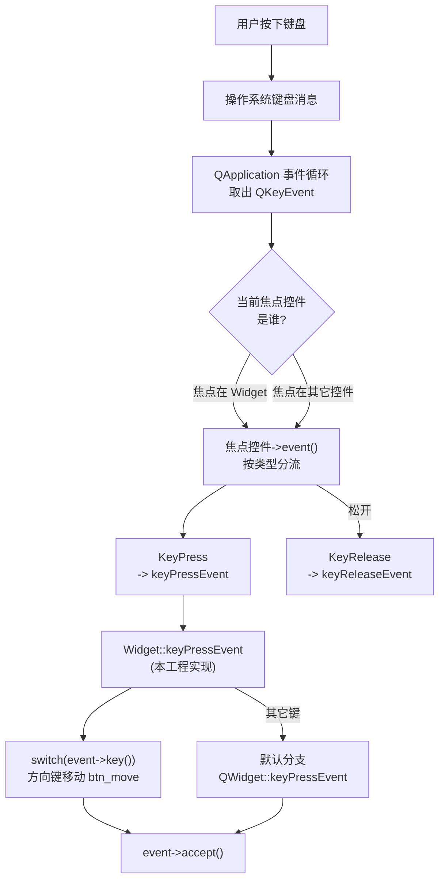

# Qt 17 键盘事件 学习笔记

## 本章重要 API 函数

| API | 功能 | 参数说明 | 头文件 |
|-----|------|----------|--------|
| `keyPressEvent(QKeyEvent*)` | 键盘按键按下时调用 | `event->key()` 返回 `Qt::Key` 枚举；`event->text()` 返回按键字符 | `<QWidget>` |
| `keyReleaseEvent(QKeyEvent*)` | 键盘按键松开时调用 | 与 `keyPressEvent` 同族；本工程**未实现**，仅作扩展说明 | `<QWidget>` |
| `QKeyEvent::key()` | 按键的物理/逻辑编码 | 返回 `Qt::Key_Left` 等枚举，不受大小写/修饰键影响（区分键位） | `<QKeyEvent>` |
| `QKeyEvent::text()` | 按键产生的实际字符 | 受 Shift/输入法影响，如 `a` 与 `A` 的 text 不同；方向键 text 为空 | `<QKeyEvent>` |
| `setFocusPolicy(Qt::FocusPolicy)` | 设置控件获取键盘焦点的策略 | `Qt::StrongFocus` 表示可点击/Tab/代码获得焦点并收键盘事件 | `<QWidget>` |
| `setFocus()` | 主动让本控件获得键盘焦点 | 无参数；使 `keyPressEvent` 能收到事件 | `<QWidget>` |
| `event->accept()` / `ignore()` | 标记事件是否被消费 | 在 `keyPressEvent` 末尾 `accept()` 表示已处理，阻止继续传播 | `<QEvent>` |

> 💡 Tips：键盘事件**只发给当前拥有焦点的控件**——这是新手第一道坎。本工程构造函数里 `setFocusPolicy(Qt::StrongFocus); setFocus();` 就是为了让 `Widget` 拿到焦点、从而能收到 `keyPressEvent`。**`key()` 与 `text()` 用途不同**：`key()` 区分"哪个物理键"（方向键、F1 等无字符键只能用 `key()`），`text()` 拿到"按出的字符"（处理字母/数字输入时用）。方向键的 `text()` 为空字符串，务必用 `key()` 判断。

## 本章目录

> 点击条目可跳转到对应小节。

### 章节导航

- **[本章重要 API 函数](#本章重要-api-函数)**
- **[学习前后依赖](#学习前后依赖)**
- **[1. 概述](#1-概述)**
- **[2. 核心概念 / 原理](#2-核心概念--原理)**
- **[3. 键盘事件的分发与焦点链路](#3-键盘事件的分发与焦点链路)**
- **[4. 核心代码解析](#4-核心代码解析)**
- **[5. 运行效果 / 验证](#5-运行效果--验证)**
- **[容易踩坑](#容易踩坑)**
- **[学习要点总结](#学习要点总结)**
  - [核心知识点](#核心知识点)
  - [关键 API](#关键-api)
  - [下一步学习](#下一步学习)
- **[Q&A](#qa常见问题)**
- **[Tips](#tips)**
  - [最容易忽视的细节](#最容易忽视的细节)
  - [踩坑记录](#踩坑记录)
  - [与后续章节的衔接](#与后续章节的衔接)
  - [设计决策思考](#设计决策思考)

---

## 学习前后依赖

| 方向 | 内容 |
| ---- | ---- |
| 前置基础 | 第 15 篇事件系统（`keyPressEvent` 正是 `event()` 分流到的具体事件函数）、第 13 篇信号槽（本工程 `QTimer::timeout` 信号连 Lambda）。 |
| 本章核心 | 键盘焦点机制、`keyPressEvent` 重写、`key()` 与 `text()` 的区别、方向键移动控件。 |
| 后续承接 | 文本输入控件（`QLineEdit`/`QTextEdit` 的键盘处理）、快捷键（`QShortcut`）、输入法（IME）与 `inputMethodEvent`。 |

> 💡 Tips：必须先懂"事件要先到达焦点控件"——否则 `keyPressEvent` 写了却从不触发，会让人怀疑人生。本篇是 16 篇鼠标事件的"兄弟篇"，两者都是重写输入事件函数；区别仅在于键盘事件多了一层"焦点"门槛。

## 1. 概述

键盘是除鼠标外最主要的文本与命令输入设备。Qt 把键盘交互拆成 `keyPressEvent`（按下）与 `keyReleaseEvent`（松开）两个虚函数。本工程 `qt17_tst_keyboard` 的核心演示是：**用方向键移动窗口里的一个 QPushButton**——按 ←/→/↑/↓ 让按钮在窗口内平移 10 像素。同时工程里还放了一个 `QTimer`，每秒刷新按钮上显示的当前时间（`mm,ss`），用来对比"信号槽定时器"与"事件定时器 `timerEvent`"两种机制。

> 💡 Tips：记住一句话——**键盘事件必须先过"焦点"这一关**：只有拿到焦点的控件才会收到 `keyPressEvent`。本工程 `setFocus()` 让 `Widget` 主动抢到焦点，这是键盘演示能跑起来的前提。另外本项目**实际只重写了 `keyPressEvent`，并未实现 `keyReleaseEvent`**——后者在源码中不存在，本篇会在第 2、4 节作为扩展对比说明，避免你误以为工程里有。

## 2. 核心概念 / 原理

键盘事件对象 `QKeyEvent` 携带两类关键信息：**物理键位** `key()` 与 **输入字符** `text()`。

- `key()` 返回 `Qt::Key` 枚举（如 `Qt::Key_Left`、`Qt::Key_A`）。它描述的是"哪个键被按"，不受 Shift、CapsLock、输入法影响。判断是否方向键、功能键、控制键必须用 `key()`。
- `text()` 返回该按键产生的 Unicode 字符（受 Shift/输入法影响）。`a` 与 `A` 的 `key()` 都是 `Key_A`，但 `text()` 分别是 `"a"` 和 `"A"`。处理可打印字符输入时用 `text()`。

焦点机制：Qt 的事件循环中，键盘事件被派发给**当前焦点控件**（focus widget）。控件能否获得焦点由 `focusPolicy` 决定：`Qt::NoFocus`（永不）、`Qt::TabFocus`（Tab 切到）、`Qt::ClickFocus`（点击获得）、`Qt::StrongFocus`（Tab+点击+代码 `setFocus()` 均可）。本工程用 `StrongFocus` 并主动 `setFocus()`。

```cpp
// widget.cpp 构造函数关键两行
setFocusPolicy(Qt::StrongFocus);   // 允许本控件获得键盘焦点
setFocus();                        // 主动夺取焦点，确保能收 keyPressEvent
```

> 💡 Tips：原理上最易误解的是"`keyPressEvent` 写了却不触发"——根因几乎都是焦点不在本控件上（没 `setFocus`、或被别的控件抢走，比如窗口里有个 `QLineEdit` 聚焦时键盘事件就归它了）。其次要分清 `key()` 与 `text()`：方向键没有字符，`text()` 为空，只能用 `key()` 判方向；而你想做"输入字母过滤"时该用 `text()` 拿真实字符。

## 3. 键盘事件的分发与焦点链路

下面用流程图展示键盘消息如何从系统到达 `keyPressEvent`，并强调焦点这一关卡：



> 💡 Tips：流程里最关键的关卡是 `D（焦点判定）`。若焦点不在 `Widget`（比如点了一下别的可聚焦控件，或被系统切走），`keyPressEvent` 根本不会到达本工程的函数，而是被真正的焦点控件消费。这也是为什么构造函数必须 `setFocus()`——主动把焦点钉在 `Widget` 上。本工程只实现了 `KeyPress` 分支（`F→H→I`），`KeyRelease` 分支（`G`）在源码中未重写，交给基类默认处理。

## 4. 核心代码解析

### 4.1 构造函数：焦点、按钮与定时器

```cpp
Widget::Widget(QWidget *parent) : QWidget(parent) {
    setGeometry(100,100,400,400);
    setFocusPolicy(Qt::StrongFocus);
    setFocus();                       // 关键：夺取键盘焦点
    btn_move = new QPushButton(this);
    btn_move->resize(80,80);
    btn_move->setText("Move Button");
    QTimer *timer = new QTimer(this);
    timer->start(1000);               // 每 1 秒触发一次 timeout
    connect(timer, &QTimer::timeout, [=](){
        QTime abc = QTime::currentTime();
        btn_move->setText(abc.toString("mm,ss"));   // 按钮上显示时分秒
    });
}
```

窗口 400×400。`setFocusPolicy(StrongFocus)` + `setFocus()` 让 `Widget` 拿到键盘焦点。`btn_move` 是 80×80 的按钮，初始文字 "Move Button"。`QTimer` 每秒 `timeout`，Lambda 用 `QTime::currentTime().toString("mm,ss")` 把当前时间刷到按钮上——这是第 13 篇信号槽的实战（定时器信号连 Lambda 槽）。

> 💡 Tips：这里有个**源码层面的隐藏细节**——头文件声明了 `int id1; int id2;` 并实现了 `timerEvent()`，但构造函数用的是 `QTimer`（信号槽方式），**从未调用 `startTimer()`**，所以 `id1`/`id2` 始终是 0，`timerEvent` 实际上永远不会被触发。也就是说工程里 `timerEvent` 是一段"备而未用"的代码（可能本想演示 `startTimer`/`timerEvent` 机制，却改用了更方便的 `QTimer`）。读源码时要能识别这种"写了但不生效"的死代码。

### 4.2 keyPressEvent：方向键移动按钮

```cpp
void Widget::keyPressEvent(QKeyEvent *event) {
    QPoint pt = btn_move->pos();
    int step = 10;
    switch (event->key()) {           // 用 key() 判方向键
    case Qt::Key_Left:  pt.rx() -= step; break;
    case Qt::Key_Right: pt.rx() += step; break;
    case Qt::Key_Up:    pt.ry() -= step; break;
    case Qt::Key_Down:  pt.ry() += step; break;
    default:
        QWidget::keyPressEvent(event); // 其它键交给基类
    }
    btn_move->move(pt);
    event->accept();                   // 标记事件已处理
}
```

先取按钮当前位置 `pt`，根据 `event->key()` 在 `pt` 上加减 `step`（10 像素）。方向键用 `key()` 判断——因为方向键没有可打印字符，`text()` 为空，必须用键位枚举。`default` 分支把其它键（如字母、空格）交给 `QWidget::keyPressEvent` 做默认处理（如焦点切换）。最后 `btn_move->move(pt)` 应用新位置，`event->accept()` 声明已消费。

> 💡 Tips：这段代码藏着的细节——`pt.rx() -= step` 用 `QPoint::rx()` 返回左值引用直接修改 x 分量（等同 `pt.setX(pt.x()-step)`）。`event->accept()` 放在 `switch` 之外、对所有方向键都执行，表示"方向键我已处理"；而 `default` 分支里调用了基类 `keyPressEvent`（基类内部会自行 `accept` 或传播）。注意 `move(pt)` 在 `switch` 之后、对所有情况都执行，即使 `default` 分支也会把按钮 `move` 到原位置（无副作用）。

### 4.3 关于 `keyReleaseEvent`（源码未实现，补充说明）

本工程**没有**重写 `keyReleaseEvent`。如果你需要"按下高亮、松开恢复"等效果，应补上：

```cpp
void Widget::keyReleaseEvent(QKeyEvent *event) override {
    // 例如：松开方向键后做收尾处理
    QWidget::keyReleaseEvent(event);
}
```

并在 `widget.h` 的 `protected` 区声明。它与 `keyPressEvent` 成对，参数同样是 `QKeyEvent*`，`key()`/`text()` 用法一致。本篇如实说明：当前源码仅演示了"按下"这一半。

## 5. 运行效果 / 验证

运行 400×400 窗口，中央有一个 "Move Button" 按钮，其文字每秒刷新为当前 `mm,ss` 时间。验证：

1. 窗口获得焦点后，按 **←/→/↑/↓** → 按钮按对应方向平移 10 像素；连续按多次持续移动。
2. 按其它键（如字母、空格）→ 按钮不动，事件交由基类（如焦点在按钮上时可触发按钮默认行为）。
3. 按钮文字持续以 `mm,ss` 跳动，证明 `QTimer` 每秒刷新生效。

> 💡 Tips：验证时容易误判"成功"的假象——若方向键完全没反应，九成是焦点不在窗口（例如你先点了一下按钮，焦点跑到按钮上，方向键事件就被按钮吃掉了）。解决：点窗口空白区让 `Widget` 重新获得焦点，或确保程序启动时的 `setFocus()` 生效。若按钮文字不刷新，检查 `QTimer::start(1000)` 是否执行、`connect` 是否写成新式函数指针。

## 容易踩坑（注意点）

- **坑 1：`keyPressEvent` 写了却不触发** → 焦点不在本控件。规避：`setFocusPolicy(StrongFocus)` + `setFocus()`；避免窗口里有其它可聚焦控件抢焦点。
- **坑 2：用 `text()` 判断方向键** → 方向键 `text()` 为空，判断永远失败。规避：方向键/功能键一律用 `event->key()`。
- **坑 3：用 `key()` 做字母大小写判断** → `Key_A` 不论 Shift 都是同一枚举，`key()` 区分不了 a/A。规避：需要真实字符用 `event->text()`。
- **坑 4：`timerEvent` 不触发却以为是键盘问题** → 本工程用 `QTimer` 而非 `startTimer()`，`timerEvent` 是死代码。规避：要么用 `startTimer(ms)` 触发 `timerEvent`，要么像工程那样用 `QTimer` 信号槽（二者选一，别混）。
- **坑 5：默认分支忘记 `QWidget::keyPressEvent(event)`** → 其它键的默认行为（如 Tab 切换焦点）失效。规避：非自己处理的键要转发基类。
- **坑 6：`event->accept()` 用错位置** → 若只想接受方向键，应放在 `case` 内而非全局；本工程全局 `accept` 对所有方向键合理，但 `default` 已交基类处理，注意语义。
- **坑 7：头文件声明 `id1/id2` 但从未 `startTimer`** → 变量无用、可能误导读者。规避：演示 `timerEvent` 就调 `startTimer` 并保存返回的 id 赋给 `id1/id2`；否则删掉避免混淆。

## 学习要点总结

### 核心知识点
1. 键盘事件只派发给**当前焦点控件**；`setFocusPolicy` + `setFocus()` 是键盘演示生效的前提。
2. `key()` 取物理键位（方向键/功能键用），`text()` 取输入字符（字母大小写用），两者用途不同。
3. `keyPressEvent` 用 `switch(event->key())` 分流方向键，移动控件后 `accept()`。
4. 本工程用 `QTimer` 信号槽做周期刷新，而 `timerEvent` 因未 `startTimer` 实际不触发（死代码）。

### 关键 API
| API | 功能 |
|-----|------|
| `keyPressEvent` / `keyReleaseEvent` | 键盘按下/松开 |
| `QKeyEvent::key()` / `text()` | 键位 / 字符 |
| `setFocusPolicy` / `setFocus` | 焦点策略 / 夺取焦点 |
| `event->accept()` | 标记已处理 |

### 下一步学习
- 文本输入控件：`QLineEdit`/`QTextEdit` 的键盘与输入法处理。
- 快捷键：`QShortcut`、`QAction::setShortcut` 封装组合键。
- 输入法：`inputMethodEvent`、`QInputMethodEvent` 处理中文等合成输入。

> 💡 Tips：本篇与第 16 篇鼠标事件并称"输入事件双璧"——都重写具体事件函数，区别是键盘多了"焦点"门槛、且用 `key()`/`text()` 取代坐标。读完本篇，再去做文本编辑器类项目就是顺水推舟。

## Q&A（常见问题）

**Q1：为什么我重写了 `keyPressEvent` 却一次都没被调用？**  A1：几乎都是焦点问题。键盘事件只发给焦点控件。请确认：(1) 工程里调用了 `setFocusPolicy(Qt::StrongFocus)` 和 `setFocus()`；(2) 运行时没点过其它可聚焦控件把焦点抢走；(3) 窗口本身 `isActiveWindow()` 为真（未被遮挡到后台）。本工程在构造函数末尾 `setFocus()` 正是为了确保启动即获焦点。

**Q2：`key()` 和 `text()` 到底该用哪个？**  A2：规则很简单——**判"哪个键"用 `key()`，取"什么字符"用 `text()`**。方向键、功能键（F1、Shift、Ctrl）、控制键没有可打印字符，`text()` 为空，只能用 `key()`。而当你要过滤/收集用户真实输入的字母数字时（如屏蔽某些字符、做输入掩码），用 `text()` 才能拿到 Shift/CapsLock/输入法作用后的真实字符。

**Q3：Qt5 和 Qt6 在键盘事件上有差异吗？**  A3：`keyPressEvent`/`QKeyEvent` 的接口基本一致。Qt6 仍是 `key()` 返回 `Qt::Key`、`text()` 返回 `QString`。需要注意的跨版本点主要在坐标/枚举细节，键盘事件本身改动很小。本工程 Qt6 用法在 Qt5 同样适用。差异较大的是部分废弃枚举值（如 `Qt::Key_` 个别常量），但方向键 `Key_Left/Right/Up/Down` 一直稳定。

**Q4：本工程的 `timerEvent` 和 `id1/id2` 有什么用？为什么没触发？**  A4：这是源码里的一段"遗留/未完成"代码——头文件声明了 `int id1; int id2;` 并实现了 `timerEvent()`（按 `timerId()` 分别处理），但构造函数里用的是 `QTimer`（信号槽方式），**没有调用 `startTimer()`**，所以 `id1`/`id2` 一直是 0、`timerEvent` 永不被调用。若想真正演示 `timerEvent`，应在构造里 `id1 = startTimer(1000);` 并据此在 `timerEvent` 里 `killTimer(id1)`。当前工程按钮上的时间刷新完全来自 `QTimer`，与 `timerEvent` 无关。

## Tips（全局速记）

### 最容易忽视的细节
1. **`setFocus()` 必须搭配 `setFocusPolicy(StrongFocus)`**：只调 `setFocus()` 而焦点策略是 `NoFocus` 时，控件仍无法获得键盘焦点。本工程两者都设，缺一不可。
2. **方向键 `text()` 为空**：用 `text()` 判方向键会得到空字符串，判断失灵。牢记"方向/功能键 → `key()`"。
3. **`timerEvent` 是死代码**：本工程既声明 `id1/id2` 又实现 `timerEvent`，却用 `QTimer` 而未 `startTimer`，阅读时要识别这种"写了不生效"的冗余。

### 踩坑记录
- **"方向键没反应，但按钮文字在跳"**：说明程序在跑（`QTimer` 正常），但键盘事件没到 `Widget`——焦点被抢了。最常见是启动后鼠标点过按钮，焦点落到 `btn_move` 上。解决：点窗口空白区或重新 `setFocus()`。这提醒我们：键盘焦点是个"会漂移"的状态，调试键盘事件先查焦点。
- **"我加了 `keyReleaseEvent` 却编译不过"**：通常是忘了在 `widget.h` 的 `protected` 区声明、或没加 `override` 导致签名不匹配。本工程未实现它，若要补，声明与 `keyPressEvent` 同区、`QKeyEvent*` 参数一致即可。

### 与后续章节的衔接
1. 第 16 篇鼠标事件：同属"输入事件函数"，思路一致；区别是键盘多了焦点门槛、用 `key()/text()` 取代坐标。
2. 第 15 篇事件系统：本篇 `keyPressEvent` 是 `event()` 分流到的具体函数，回看 15 篇串起完整分发链。
3. 文本编辑器项目：`QLineEdit` 的 `keyPressEvent` 已内置输入/光标/选择逻辑，理解本篇后你能正确"在合适时机"扩展它（如按键拦截）。

### 设计决策思考
- **为何按钮时间刷新用 `QTimer` 而非 `timerEvent`？** `QTimer` 是信号槽方式，配合 Lambda 一行搞定、可读性好、且天然跨线程安全（槽在对象线程执行）；`timerEvent` 更底层、需要手动 `startTimer`/`killTimer` 管理 id。本工程明显是"图省事"选了 `QTimer`，于是 `timerEvent`/`id1`/`id2` 成了遗留死代码——这提示我们：两种定时器机制只应保留一种，混用且留死代码会增加阅读负担。
- **为何用 `key()` 而非 `text()` 移动按钮？** 因为方向键的本质是"位置指令"而非"字符输入"，它没有可打印字符，`text()` 为空。用 `key()` 能稳定识别 `Key_Left` 等语义，不受输入法/修饰键干扰——把"控制意图"和"文本输入"用不同 API 区分，是 Qt 键盘设计的清晰之处。
- **为何 `default` 分支要转发基类？** 因为 `Widget` 不打算"吞掉"所有键。像 Tab（焦点切换）、Alt（菜单）等系统级键若被 `keyPressEvent` 静默吞掉，会破坏窗口的正常交互；交给 `QWidget::keyPressEvent` 保留默认行为，是"只处理自己关心的键、其余放行"的稳健写法。
