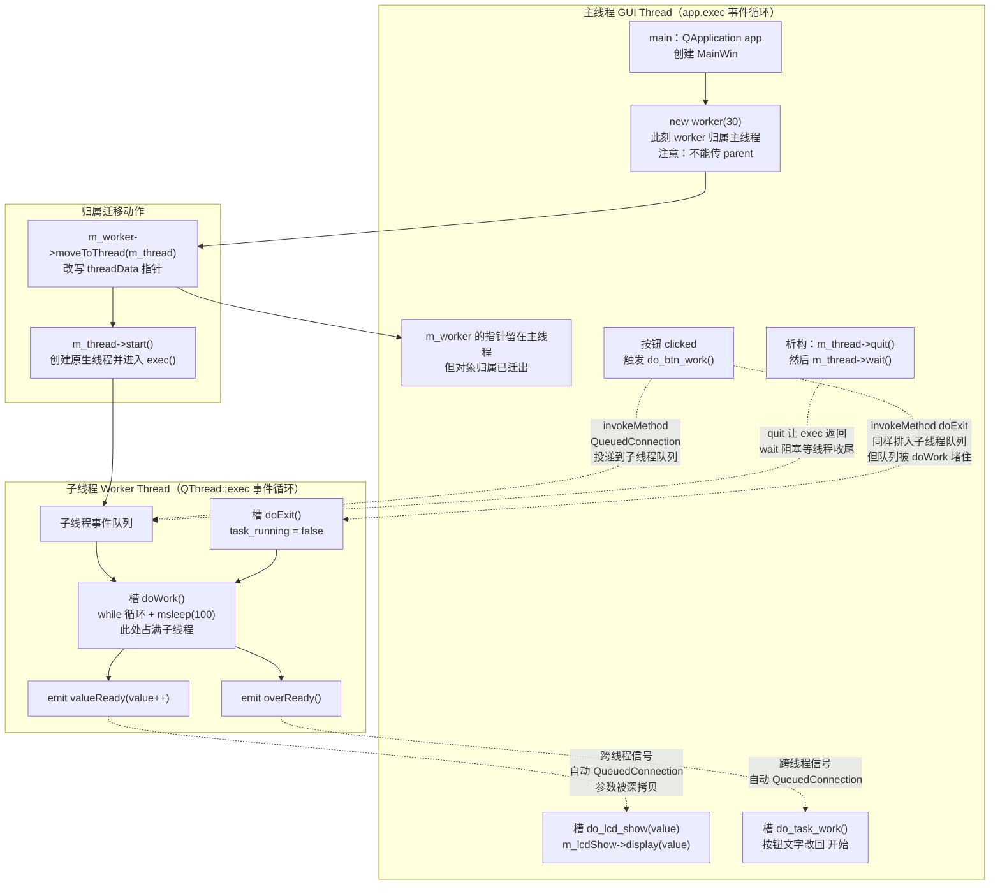

# Qt 19 多线程 moveToThread 学习笔记

## 本章重要 API 函数

| API | 功能 | 参数说明 | 头文件 |
|-----|------|----------|--------|
| `QObject::moveToThread()` | 把对象的**线程亲和性（thread affinity）**改到目标线程 | `QThread *targetThread`：目标线程对象。只能由当前拥有该对象的线程调用；对象必须**没有父对象** | `<QObject>` |
| `QThread::start()` | 启动线程，进入 `run()`（默认实现是 `exec()` 事件循环） | `Priority priority = InheritPriority`：线程优先级，通常不改 | `<QThread>` |
| `QThread::quit()` | 请求退出线程的事件循环（等价于 `exit(0)`） | 无参数。**只对跑着事件循环的线程有效**，对死循环的 `run()` 无效 | `<QThread>` |
| `QThread::wait()` | 阻塞等待线程真正结束 | `QDeadlineTimer / unsigned long time = ULONG_MAX`：超时毫秒数，超时返回 `false` | `<QThread>` |
| `QThread::currentThreadId()` | 获取当前线程的**平台原生线程 ID** | 无参数，返回 `Qt::HANDLE`。调试线程归属的利器 | `<QThread>` |
| `QThread::msleep()` | 让**当前线程**睡眠指定毫秒 | `unsigned long msecs`。在 Qt5 之前是 protected，Qt5 起变为 public static | `<QThread>` |
| `QMetaObject::invokeMethod()` | 按**方法名字符串**跨线程调用槽函数 | `QObject *obj, const char *member, Qt::ConnectionType type, ...`：目标对象、方法名、连接类型、可选参数 | `<QMetaObject>` / `<QObject>` |
| `QObject::connect()` | 建立信号槽连接，跨线程时自动选择 `QueuedConnection` | `sender, signal, receiver, slot, type = Qt::AutoConnection` | `<QObject>` |
| `QObject::deleteLater()` | 请求在**对象所属线程的事件循环**中安全删除对象 | 无参数。必须有事件循环在跑，否则永远不会被删 | `<QObject>` |
| `std::atomic<bool>` | 跨线程无锁读写的布尔标志 | `load()` / `store()` / 赋值。用于线程间的"停止请求" | `<atomic>` |

> 💡 Tips：
> - `moveToThread()` **必须在对象还没有 parent 的时候调用**。如果 `new worker(30, this)` 带了父对象，Qt 会直接输出 `QObject::moveToThread: Cannot move objects with a parent` 并且**静默失败**——对象仍留在主线程，你会误以为已经多线程了。
> - `QThread::msleep()` 睡的是**调用它的那个线程**，不是 `QThread` 对象代表的线程。在 GUI 线程里调 `m_thread->msleep(100)` 卡住的是界面。
> - `QMetaObject::invokeMethod()` 用字符串查方法，**只有 `slots:` / `Q_INVOKABLE` 标记的函数才找得到**，且拼错方法名编译期不报错、运行期只打一行警告。Qt5.10+ 支持传函数指针/lambda 的重载，更安全，推荐新代码使用。
> - Qt6 移除了 `QThread::terminate()` 之外的很多"暴力"用法，也移除了 `Qt::MidButton` 之类旧枚举；但 `moveToThread` 的语义从 Qt4 到 Qt6 完全一致，这是 Qt 线程模型里最稳定的一块。

---

## 本章目录

> 点击条目可跳转到对应小节。

### 章节导航

- **[本章重要 API 函数](#本章重要-api-函数)**
- **[学习前后依赖](#学习前后依赖)**
- **[1. 概述](#1-概述)**
- **[2. 核心概念与原理](#2-核心概念与原理)**
  - [2.1 线程亲和性：对象"属于"哪个线程](#21-线程亲和性对象属于哪个线程)
  - [2.2 事件循环是跨线程通信的地基](#22-事件循环是跨线程通信的地基)
  - [2.3 两种多线程写法的对比](#23-两种多线程写法的对比)
- **[3. 关键机制：moveToThread 前后的对象归属迁移](#3-关键机制movetothread-前后的对象归属迁移)**
  - [3.1 对象归属迁移流程图](#31-对象归属迁移流程图)
  - [3.2 连接类型决定槽函数在哪个线程执行](#32-连接类型决定槽函数在哪个线程执行)
- **[4. 核心代码解析](#4-核心代码解析)**
  - [4.1 worker.h：可搬迁的工人类](#41-workerh可搬迁的工人类)
  - [4.2 worker.cpp：耗时循环与停止标志](#42-workercpp耗时循环与停止标志)
  - [4.3 mainwin.cpp：搬迁、启动与连线](#43-mainwincpp搬迁启动与连线)
  - [4.4 析构：quit + wait 的顺序不能反](#44-析构quit--wait-的顺序不能反)
- **[5. 运行效果与验证](#5-运行效果与验证)**
- **[容易踩坑（注意点）](#容易踩坑注意点)**
- **[学习要点总结](#学习要点总结)**
  - [核心知识点](#核心知识点)
  - [关键 API](#关键-api)
  - [下一步学习](#下一步学习)
- **[Q&A（常见问题）](#qa常见问题)**
- **[Tips（全局速记）](#tips全局速记)**

> 💡 Tips：本篇的阅读顺序建议是 `2.1 → 3.1 → 4.3`。先建立"对象有归属线程"这个心理模型，再看流程图，最后回到代码；反过来（先看代码）容易把 `moveToThread` 误当成"创建线程的函数"。

---

## 学习前后依赖

| 方向 | 内容 |
| ---- | ---- |
| 前置基础 | qt08 对象树与父子关系（理解 parent 为什么会阻止 `moveToThread`）、qt13 信号与槽（`connect` 的五参数形式与 `Qt::ConnectionType`）、qt15 事件基础（事件循环 `exec()` 与事件队列的概念）。 |
| 本篇核心 | `QThread` 的正确用法、`moveToThread` 改变对象线程亲和性、跨线程信号槽自动排队、`QMetaObject::invokeMethod` 主动投递调用、用 `std::atomic<bool>` 做协作式停止。 |
| 后续承接 | 为 qt20 / qt21 绘图篇提供"**只有 GUI 线程能碰界面**"的铁律基础；为 qt22 数据库篇提供"**QSqlDatabase 连接不能跨线程共享**"的判断依据；也是后续网络请求、串口读写、文件批处理等所有"耗时任务不能堵界面"场景的通用模板。 |

> 💡 Tips：为什么必须先会 qt13 信号槽？因为跨线程通信在 Qt 里**没有新语法**——还是 `connect`，只是连接类型从 `DirectConnection` 悄悄变成了 `QueuedConnection`。如果你对"信号发出后槽立即执行"这个直觉没有松动，后面所有"为什么我的槽没跑"的问题都解释不通。而本篇又为哪篇打基础？绘图篇里 `update()` 之所以是线程安全的、而 `repaint()` 不是，根因就在这里。

---

## 1. 概述

Qt 的 GUI 是**单线程**的：所有 `QWidget` 的绘制、事件分发、布局计算都必须发生在启动 `QApplication` 的那个线程（习惯上叫 GUI 线程 / 主线程）。这带来一个残酷的约束——**只要你在槽函数里写了一个跑 3 秒的循环，界面就冻结 3 秒**：不重绘、不响应点击、拖动窗口留下一片白，Windows 甚至会给标题栏加上"(无响应)"。

本工程（`qt19_tst_ThreadMove`）用一个最小但完整的例子演示如何解决它：界面上只有一个 `QLCDNumber` 和一个按钮，点"开始"后数字从 0 递增到 30，每 100 ms 一格；递增期间界面依然能拖动、按钮文字变成"停止"、点它能中途结束任务。这个"数着数"的循环本身是**故意写成阻塞的死循环加 `msleep`** 的——它就是所有耗时任务（下载、解码、大文件扫描、串口轮询）的替身。

解决思路不是"把循环拆碎塞进定时器"，而是**把执行循环的那个对象搬到另一个线程去**。这就是 `moveToThread` 的价值：你的业务类 `worker` 一行线程代码都不写，纯粹是个 `QObject`；把它 `moveToThread(m_thread)` 之后，它的槽函数就自动在子线程里跑了。业务逻辑和线程调度彻底解耦。

> 💡 Tips：整篇最该记住的一句话——**`moveToThread` 不创建线程，它只是给对象换个"户口"**。线程是 `QThread::start()` 创建的；`moveToThread` 决定的是"这个对象的槽函数将来会被哪个线程执行"。反直觉的点在于：调用 `moveToThread` 之后，`m_worker` 这个**指针在主线程里依然完全可用**（你可以读它的地址、传给 `connect`），但你**不能再直接调用它的成员函数**——`m_worker->doWork()` 会在主线程里执行，等于白搭。

---

## 2. 核心概念与原理

### 2.1 线程亲和性：对象"属于"哪个线程

每个 `QObject` 内部都记着一个"我属于哪个线程"的指针（`QObjectPrivate::threadData`）。默认值是**创建它的那个线程**。这个归属决定了两件事：

1. **它接收的事件由谁分发**：投递给该对象的事件（`QEvent`，包括排队的信号调用）会进入其所属线程的事件队列，由该线程的 `exec()` 取出并调用 `event()`。
2. **它的定时器归谁管**：`QTimer` 必须在其所属线程里启停，跨线程 `start()` 会报 `Timers cannot be started from another thread`。

```cpp
// 在 MainWin 构造函数里（主线程）
m_worker = new worker(30);        // 此刻 m_worker 的归属线程 = 主线程
m_worker->moveToThread(m_thread); // 归属改为 m_thread 代表的子线程
m_thread->start();               // 子线程真正跑起来，进入 exec() 事件循环
```

注意 `new worker(30)` **没有传 parent**。这是硬性要求：`moveToThread` 会顺带把对象的所有**子对象**一起搬走，但如果对象自己有父亲，就意味着父亲和儿子会被劈到两个线程，Qt 直接拒绝这种操作。

### 2.2 事件循环是跨线程通信的地基

跨线程信号槽之所以能工作，靠的不是魔法，而是**事件队列 + 事件循环**：

- 发送方 `emit valueReady(0)` 时，Qt 发现接收者 `MainWin` 的归属线程（主线程）≠ 当前线程（子线程）；
- 于是不直接调用槽，而是把"要调用哪个槽、参数是什么"打包成一个 `QMetaCallEvent`，**深拷贝参数**，投递到主线程的事件队列；
- 主线程的 `app.exec()` 在下一次空闲时取出该事件，在**主线程上下文**中调用 `MainWin::do_lcd_show(0)`。

这也解释了两个常见困惑：

- **为什么槽函数是"延迟"执行的？** 因为要排队等目标线程的事件循环轮到它。
- **为什么参数类型必须能被 `qRegisterMetaType` 识别？** 因为要深拷贝进事件对象里，Qt 必须知道怎么拷贝。内置类型和 `Q_DECLARE_METATYPE` 过的类型才行。

### 2.3 两种多线程写法的对比

| 维度 | 继承 `QThread` 重写 `run()` | `moveToThread`（本篇写法） |
|------|------------------------------|-----------------------------|
| 业务代码位置 | 写在 `run()` 里 | 写在普通 `QObject` 的槽里 |
| 是否有事件循环 | 默认没有（除非自己调 `exec()`） | 有（`QThread::run()` 默认就是 `exec()`） |
| 能否收信号 | 麻烦，`QThread` 对象本身属于主线程 | 天然支持，槽在子线程执行 |
| 一线程多任务 | 难 | 容易，多个 worker 搬到同一线程 |
| 官方推荐度 | 仅适合"跑完就退出"的纯计算 | ✅ 推荐 |

> 💡 Tips：原理层面最容易误解的三点，务必刻进脑子：
> 1. **`QThread` 对象本身属于创建它的线程**（本例是主线程），只有它 `run()` 里的代码在新线程。所以 `m_thread` 的槽函数（如 `finished` 的接收方）默认在主线程执行——这不是 bug，是设计。
> 2. **`moveToThread` 之后对象属于子线程，主线程不能再直接碰它**。想让它干活只能"发信号"或 `invokeMethod`，这是唯一正确的入口。
> 3. **UI 只能在主线程**。子线程里 `m_lcdShow->display(...)` 可能"看起来能跑"，但那是未定义行为——在 Windows 上可能偶尔正常、在 Linux/X11 上直接崩，或者留下一堆 `QPainter` 警告。

---

## 3. 关键机制：moveToThread 前后的对象归属迁移

### 3.1 对象归属迁移流程图

下面这张图是本篇的核心。左半区是主线程，右半区是子线程；虚线箭头表示"跨线程排队投递"，实线箭头表示"同线程直接调用"。



**箭头含义速查：**

- `A2 → M1`：**创建在主线程、立刻搬走**，这是标准姿势。搬走的时机必须在 `start()` 之前或之后都行，但必须在"第一次让它干活"之前。
- `A4 ⇢ B1`：主线程只做一件事——**往子线程的队列里塞一个"请执行 doWork"的事件**，塞完立即返回，界面不卡。
- `B3 ⇢ A5`：子线程算出的数字**排队回到主线程**才敢碰 `QLCDNumber`。这一步是"UI 只能主线程"这条铁律的具体落地方式。
- `A4 ⇢ B5`（虚线且指向被 `B2` 占用的线程）：**本工程最隐蔽的坑就在这条箭头上**。`doExit` 是排队投递的，但子线程此刻正卡在 `doWork` 的 `while` 里，事件循环压根没机会取事件——所以"停止"按钮在任务跑完之前是**无效**的。详见第 4 节和踩坑清单。

### 3.2 连接类型决定槽函数在哪个线程执行

| 连接类型 | 行为 | 槽在哪个线程跑 |
|----------|------|----------------|
| `Qt::AutoConnection`（默认） | 同线程走 Direct，跨线程走 Queued | 视情况 |
| `Qt::DirectConnection` | 立即调用，像普通函数 | **发射信号的线程** |
| `Qt::QueuedConnection` | 打包成事件排队 | **接收者归属的线程** |
| `Qt::BlockingQueuedConnection` | 排队 + 阻塞等返回 | 接收者线程（同线程用会死锁） |

> 💡 Tips：流程图里最关键的节点是 `B2`（`doWork` 的 while 循环）。它是一个"**吞掉整个子线程事件循环**"的节点——所有指向子线程的虚线箭头都会在它执行期间被堵在 `B1` 队列里。理解这一个节点，就理解了为什么"有了子线程也不等于随时可控"：**排队投递的前提是目标线程有空闲去跑事件循环**。想要"随时可停"，停止标志就必须绕开事件循环（用 `atomic` + `DirectConnection`），或者把耗时循环拆成可返回的小片（配合 `QCoreApplication::processEvents()`）。

---

## 4. 核心代码解析

以下代码全部摘自 `D:\QT_place\QT_study_pjt\qt19_tst_ThreadMove\`。

### 4.1 worker.h：可搬迁的工人类

```cpp
// worker.h
class worker : public QObject          // ① 必须继承 QObject，才有 threadData 和信号槽
{
    Q_OBJECT                           // ② 必须有 Q_OBJECT，moc 才会生成元对象
public:
    explicit worker(int max, QObject *parent = nullptr);
    ~worker() override;

public slots:                          // ③ 声明为 slots，invokeMethod 才按名字找得到
    void doWork();
    void doExit();

signals:                               // ④ 结果只通过信号往外送，不直接碰 UI
    void valueReady(int value);
    void overReady();

private:
    int m_max;
    std::atomic<bool> task_running{false};   // ⑤ 跨线程读写的标志，必须 atomic
};
```

**逐点说明：**

- ① **继承 `QObject` 是 `moveToThread` 的前提**。纯 C++ 类没有线程亲和性概念，也没有槽。删掉继承，整套机制全部失效。
- ② **`Q_OBJECT` 不能省**。少了它，moc 不生成 `staticMetaObject`，`QMetaObject::invokeMethod(m_worker, "doWork", ...)` 会在运行时输出 `No such method` 并静默返回 `false`——编译完全正常，跑起来毫无反应，这是新手最爱掉的坑。
- ③ 注意这里是 `public slots:` 而不是普通 public 函数。Qt6 里普通成员函数也能用新语法 `connect` 到信号，但**按字符串名反射调用**只认 `slots` 和 `Q_INVOKABLE`。
- ④ `worker` 头文件里**没有 include 任何 `QWidget`**。这是一种有意的架构约束：一个准备搬到子线程的类，若它连 UI 头文件都没见过，就不可能误碰 UI。
- ⑤ `task_running` 会被**两个线程同时访问**——主线程通过 `doExit` 写、子线程在 `while` 里读。如果写成裸 `bool`，编译器可能把 `while(task_running)` 优化成"只读一次寄存器"的死循环，永远看不到变化；`std::atomic<bool>` 既保证原子性，也阻止这种优化。

### 4.2 worker.cpp：耗时循环与停止标志

```cpp
void worker::doWork()
{
    qDebug() << "工人工作的ID为：" << QThread::currentThreadId();  // ① 验证归属的关键
    int value = 0;
    task_running = true;
    while (task_running.load() && value <= m_max)               // ② 双条件退出
    {
        emit valueReady(value++);                              // ③ 结果外送，不碰 UI
        QThread::msleep(100);                                  // ④ 睡的是子线程
    }
    if (task_running.load()) {
        qDebug() << "Work normal over";                        // ⑤ 跑满 m_max 自然结束
    } else {
        qDebug() << "Worker  stop";                            // ⑥ 被 doExit 打断
    }
    emit overReady();                                          // ⑦ 无论哪种结束都通知 UI
}

void worker::doExit()
{
    qDebug() << "准备完成任务" << QThread::currentThreadId();
    task_running = false;
}
```

- ① **这一行 `qDebug` 是整个工程的"证据"**。把它和 `MainWin` 构造里的 `qDebug()<<"GUI线程ID号为："<<QThread::currentThreadId();` 对比：两个 ID **必须不同**，才说明 `moveToThread` 真的生效了。删掉这行，你就失去了唯一的低成本验证手段。
- ② 循环条件是 `task_running.load() && value <= m_max`：前者响应"外部要求停止"，后者是"任务自然做完"。缺任何一个，都会得到一个无法中断或永不结束的任务。
- ③ `emit valueReady(value++)` 是**唯一的输出通道**。改成 `m_lcdShow->display(value)`（假如把窗口指针传进来）在语法上完全合法，但那是子线程直接操作 GUI，属于未定义行为。
- ④ `QThread::msleep(100)` 是 **static 函数，睡的是调用它的线程**——此刻是子线程，所以主线程界面照样流畅。这里也解释了为什么不能把这段代码留在主线程：同样的 `msleep`，在主线程就是界面冻结。
- ⑤⑥ 这个 if/else 的判断依据很巧：**能走到循环外并且 `task_running` 仍为 true**，只可能是 `value > m_max` 触发的自然结束；反之就是被 `doExit` 改成 false 打断的。
- ⑦ `emit overReady()` 放在两种分支之后，保证**任何结束路径都会通知 UI 复位按钮**。如果只在正常结束时 emit，按钮就会永远卡在"停止"文字上。

### 4.3 mainwin.cpp：搬迁、启动与连线

```cpp
MainWin::MainWin(QWidget *parent) : QWidget(parent),
    m_btnStart(nullptr), m_lcdShow(nullptr), m_thread(new QThread(this)),  // ①
    m_worker(nullptr), m_isRunning(false)
{
    initWin();
    qDebug() << "GUI线程ID号为：" << QThread::currentThreadId();
    m_worker = new worker(30);          // ② 关键：不传 parent
    m_worker->moveToThread(m_thread);   // ③ 改归属
    m_thread->start();                  // ④ 起线程 + 进 exec()

    connect(m_worker, &worker::valueReady, this, &MainWin::do_lcd_show);   // ⑤ 跨线程
    connect(m_worker, &worker::overReady,  this, &MainWin::do_task_work);  // ⑤
    connect(m_thread, &QThread::finished,  this, &MainWin::deleteLater);   // ⑥ 值得商榷
    connect(m_btnStart, &QPushButton::clicked, this, &MainWin::do_btn_work);
}

void MainWin::do_btn_work()
{
    if (!m_isRunning) {
        QMetaObject::invokeMethod(m_worker, "doWork", Qt::QueuedConnection);  // ⑦
        m_btnStart->setText("停止");
        m_isRunning = true;
    } else {
        QMetaObject::invokeMethod(m_worker, "doExit", Qt::QueuedConnection);  // ⑧ 陷阱
    }
}
```

- ① `m_thread(new QThread(this))`：**`QThread` 对象本身挂在 `MainWin` 的对象树上**，随窗口销毁自动 delete。注意这里 parent 给的是 `this`——`QThread` 对象归属主线程，这完全正确，它不是被搬走的那个对象。
- ② **`new worker(30)` 故意不传 parent**。这是 `moveToThread` 能成功的必要条件。如果写成 `new worker(30, this)`，控制台会打印 `Cannot move objects with a parent`，而程序继续运行——`doWork` 就在主线程跑，界面照旧冻结，且两处 `currentThreadId()` 打印出相同 ID。这是本工程"删掉会怎样"最值得亲手试一次的地方。
- ③④ `moveToThread` 和 `start()` 的**先后顺序不敏感**（都在 `invokeMethod` 之前即可），但**先搬后起**是更清晰的表达：先定户口，再开门营业。
- ⑤ 这两个 `connect` 用的是默认 `Qt::AutoConnection`。因为 `m_worker` 属子线程、`this` 属主线程，Qt 在**信号发射的那一刻**比较两者归属，自动选 `QueuedConnection`。这就是"跨线程信号槽自动安全"的全部秘密——**你什么都不用写**。
- ⑥ `connect(m_thread, &QThread::finished, this, &MainWin::deleteLater)`：这行的意图应该是"线程结束就清理"，但**接收者写成了 `this`（主窗口）**。语义变成了"线程一结束就删主窗口"。在本例中，`finished` 是在析构函数 `quit()+wait()` 时才发出的，窗口本来就在销毁，所以没炸；但如果哪天你在运行期主动 `m_thread->quit()`，主窗口会被 `deleteLater` 掉，界面凭空消失。**更符合意图的写法是 `connect(m_thread, &QThread::finished, m_worker, &QObject::deleteLater);`**——顺手也修掉了 `m_worker` 从未被 delete 的内存泄漏（跑一遍会发现 `worker::~worker` 的 `qDebug` 永远不打印，就是证据）。
- ⑦ `invokeMethod(..., "doWork", Qt::QueuedConnection)` 是**正确用法**：把"执行 doWork"投递到子线程队列，主线程立刻返回，然后界面继续响应。这里绝对不能写成 `m_worker->doWork()`——那是在主线程直接调用，界面冻结 3 秒，多线程白做。
- ⑧ `invokeMethod(..., "doExit", Qt::QueuedConnection)` 是**本工程最值得研究的陷阱**：`doExit` 也被排进子线程队列，可子线程正卡在 `doWork` 的 `while + msleep` 里，事件循环无法运转，这个事件要等 `doWork` 整个跑完才会被取出——那时候设 `task_running=false` 已经毫无意义。**正确写法是 `Qt::DirectConnection`**：

  ```cpp
  // 让 doExit 就在 GUI 线程里执行，直接写那个 atomic 标志
  QMetaObject::invokeMethod(m_worker, "doExit", Qt::DirectConnection);
  ```

  这也正是 `task_running` 被设计成 `std::atomic<bool>` 的原因——它本来就是准备被**另一个线程直接写**的。用 `atomic` 却又走 `QueuedConnection`，等于买了防弹衣却把它挂在衣柜里。

### 4.4 析构：quit + wait 的顺序不能反

```cpp
MainWin::~MainWin() {
    qDebug() << __PRETTY_FUNCTION__;
    m_thread->quit();   // ① 请求事件循环退出
    m_thread->wait();   // ② 阻塞等线程真正结束
}
```

- ① `quit()` 只是**给子线程的事件循环发一个"退出"请求**，函数立刻返回，线程可能还在跑。
- ② `wait()` 阻塞主线程，直到子线程函数真正返回。**少了 `wait()` 会发生什么？** `MainWin` 析构完成、`m_worker` 所在线程可能还在 `emit valueReady`，而接收者 `MainWin` 已成野指针 → 随机崩溃。这是多线程程序里最典型的"退出时偶尔崩"。
- 顺序反了（先 `wait()` 再 `quit()`）会**直接死锁**：主线程等一个永远不会收到退出请求的线程。
- 补充一个本例的隐患：如果退出时任务还在跑，`quit()` 同样要排队等 `doWork` 结束，`wait()` 会把主窗口关闭卡住最长 3 秒。健壮做法是析构里先 `doExit`（Direct）再 `quit()`、`wait()`。

> 💡 Tips：这几段代码里藏着的关键细节，一句话一条：
> - **`moveToThread` 后不要再给对象设父对象**，`setParent()` 会把它拽回父亲所在线程的管辖，等于撤销了搬迁。
> - **子线程绝对不碰 UI**：`worker` 里只有 `emit`，没有任何 widget 指针，这是设计出来的纪律不是巧合。
> - **`invokeMethod` 的字符串方法名没有编译期检查**：把 `"doWork"` 拼成 `"dowork"`，编译通过、运行无反应。Qt5.10+ 可以写 `QMetaObject::invokeMethod(m_worker, &worker::doWork, Qt::QueuedConnection);`，让编译器帮你查错。
> - **`__PRETTY_FUNCTION__` 是 GCC/Clang/MinGW 扩展**，MSVC 下要用 `__FUNCSIG__`；跨平台请用 Qt 提供的 `Q_FUNC_INFO`。
> - **`m_worker` 全程没被 delete**，`worker::~worker()` 的日志永远不出现——一个被"看起来能跑"掩盖的泄漏。

---

## 5. 运行效果与验证

**编译运行后应看到：**

1. 控制台先打印两行 ID，例如：
   ```
   GUI线程ID号为： 0x3f2c
   工人工作的ID为： 0x1a48      // 点击"开始"后打印
   ```
   **这两个 ID 不同**，是 `moveToThread` 生效的第一手证据。
2. 点"开始"：LCD 从 0 一路跳到 30，约 3.1 秒（31 次 × 100 ms）。
3. **递增期间用鼠标拖动窗口**：窗口跟手，LCD 继续跳数——这是"界面没被堵住"的直观验证。
4. 数到 30 后控制台打印 `Work normal over`，按钮文字自动回到"开始"。
5. 点"停止"：**在当前工程里你会发现没有立即停止**，要等数到 30 才复位（原因见 4.3 ⑧）。把 `doExit` 改成 `Qt::DirectConnection` 后重试，会立刻打印 `Worker  stop` 并停在当前数字——这一步对比实验是本篇最有价值的动手环节。
6. 关闭窗口：控制台打印 `MainWin::~MainWin`（`__PRETTY_FUNCTION__` 的输出）。

**进阶验证方法：**

- 把 `m_worker = new worker(30);` 改成 `new worker(30, this);`，重跑 → 控制台出现 `QObject::moveToThread: Cannot move objects with a parent`，两个 ID 变成**相同**，拖窗口开始卡死。这一步让你亲眼看到"parent 会静默毁掉多线程"。
- 用任务管理器 / `htop` 看线程数：程序启动后是 N 个，点"开始"不增加（因为线程在构造时就 `start()` 了）。这提醒你 `QThread` 是**在 `start()` 时创建原生线程**，不是在 `new QThread` 时。

> 💡 Tips：验证时最容易误判"成功"的三种假象：
> 1. **"界面没卡，所以多线程成功了"**——如果耗时任务只有 100 ms，主线程也不会明显卡。必须让任务够长（本例 3 秒）才能区分。
> 2. **"数字在跳，所以跨线程信号没问题"**——数字跳只证明信号到了，不证明它是排队到主线程的。真正的判据是**两个线程 ID 不同**。
> 3. **"关闭窗口没崩，所以析构写对了"**——多线程的退出崩溃是**概率性**的。任务跑到一半时关闭窗口、连续开关 20 次，才能暴露缺少 `wait()` 的问题。别用"跑了一次没崩"当证据。

---

## 容易踩坑（注意点）

- **坑 1：给要搬走的对象设了 parent。**
  *现象*：控制台 `QObject::moveToThread: Cannot move objects with a parent`，程序照常运行但界面依旧冻结。
  *原因*：`moveToThread` 拒绝拆散父子关系，失败后**只警告不抛异常**。
  *规避*：`new worker(30)` 绝不传 parent；生命周期用 `connect(m_thread, &QThread::finished, m_worker, &QObject::deleteLater)` 管理。

- **坑 2：用 `QueuedConnection` 去发"停止"指令。**
  *现象*：点"停止"没反应，必须等任务自然结束。
  *原因*：目标线程正被死循环占用，事件循环停摆，排队的 `doExit` 取不出来。
  *规避*：停止标志用 `std::atomic` + `Qt::DirectConnection`（或直接暴露一个 `void requestStop(){ task_running=false; }` 让主线程调）。**能被跨线程直接调用的函数必须是无锁/加锁安全的**。

- **坑 3：在子线程里操作 widget。**
  *现象*：偶发崩溃、`QPainter::begin: Paint device returned engine == 0`、Linux 下 X11 报错。
  *原因*：Qt GUI 类不是线程安全的，绘制资源绑定主线程。
  *规避*：子线程只 `emit` 数据；所有 `setText/display/update` 都放到主线程的槽里。**只有 `QWidget::update()` 是"相对安全"的（它只投递事件），但仍不推荐从子线程调；`repaint()` 则绝对禁止（同步绘制）。**

- **坑 4：析构时忘了 `wait()`，或顺序写反。**
  *现象*：关闭窗口偶发崩溃，或关闭时程序卡死不退出。
  *原因*：忘 `wait()` → 子线程持有已销毁对象；`wait()` 在前 → 死锁。
  *规避*：固定模板 `quit(); wait();`，并在 `quit()` 前先把耗时循环的停止标志置位。

- **坑 5：`QMetaObject::invokeMethod` 的方法名写错 / 目标函数不是 slot。**
  *现象*：编译通过，点按钮完全没反应，最多一行 `No such method`。
  *原因*：字符串反射在运行期才解析。
  *规避*：优先用 Qt5.10+ 的函数指针重载；或者干脆改成"主线程发信号 → worker 槽接收"的 `connect` 方式，享受编译期检查。

- **坑 6：把 `QThread` 对象和"线程"混为一谈。**
  *现象*：`connect(m_thread, &QThread::finished, this, ...)` 的槽在主线程执行，你却以为它在子线程；或者在 `QThread` 子类里定义成员变量，以为它们"属于子线程"。
  *原因*：`QThread` 对象归属**创建它的线程**，只有 `run()` 的执行体在新线程。
  *规避*：牢记"`QThread` 是线程的**遥控器**，不是线程本身"。业务状态放在 worker 里，不放在 QThread 子类里。

- **坑 7：`worker` 对象从未释放。**
  *现象*：`worker::~worker()` 的 `qDebug` 永远不打印。
  *原因*：既没 parent，也没连 `deleteLater`。
  *规避*：`connect(m_thread, &QThread::finished, m_worker, &QObject::deleteLater);`——这是 `moveToThread` 模式的标配一行。

---

## 学习要点总结

### 核心知识点

1. **线程亲和性**：每个 `QObject` 都有归属线程，决定它的事件由谁分发、槽由谁执行。`moveToThread` 改的就是这个归属，**它不创建线程**。
2. **事件循环是跨线程通信的基础设施**：跨线程 `connect` 自动降级为 `QueuedConnection`，参数被深拷贝、事件排队、由目标线程 `exec()` 取出执行。目标线程一旦被死循环占用，排队机制立即失效。
3. **worker-object 模式（本篇写法）优于继承 QThread**：业务类保持纯净的 `QObject`，天然拥有事件循环、能收信号、可多任务复用同一线程。
4. **UI 只能在 GUI 线程**：子线程唯一合法的输出方式是 `emit` 信号，让主线程的槽去更新界面。
5. **协作式停止**：耗时循环必须自己检查停止标志（`std::atomic<bool>`），并且这个标志要通过**不依赖事件循环**的路径（Direct 调用）来设置。
6. **确定性收尾**：`quit()` → `wait()` 是固定顺序；worker 用 `finished → deleteLater` 释放。

### 关键 API

| API | 功能 |
|-----|------|
| `moveToThread(QThread*)` | 改变对象的归属线程（对象必须无 parent） |
| `QThread::start()` / `quit()` / `wait()` | 起线程 / 请求退出事件循环 / 等待结束 |
| `QThread::currentThreadId()` | 打印线程 ID，验证归属的最快手段 |
| `QThread::msleep()` | 让当前线程睡眠（在子线程里用才安全） |
| `QMetaObject::invokeMethod()` | 跨线程投递方法调用，`Queued` 排队 / `Direct` 立即 |
| `deleteLater()` | 在对象所属线程的事件循环中安全析构 |
| `std::atomic<bool>` | 跨线程停止标志 |

### 下一步学习

- **qt20 绘图基础**：本篇建立的"UI 只能在主线程"铁律，直接决定了下一篇 `paintEvent` 为什么**只能由主线程的事件循环调用**、为什么用 `update()`（投递事件）而不是 `repaint()`（同步绘制）。
- **qt21 自定义控件**：当绘制内容来自子线程算出的数据（比如实时速度采样）时，正是本篇 `emit → 主线程槽 → setSpeed() → update()` 这条链路的实战。
- **qt22 SQLite**：数据库查询是典型耗时操作，会用到本篇的 worker 模式；同时要额外注意"`QSqlDatabase` 连接对象不能跨线程共享，每个线程要用不同 `connectionName` 各开一个连接"。

> 💡 Tips：本篇与"下一步"的挂钩点写死在一句话里——**qt20 的 `update()` 之所以是"请求重绘"而不是"立即重绘"，就是因为它走的是本篇讲的事件队列**。你在 qt19 学会的"投递事件 → 事件循环取出 → 执行"这个心理模型，在 qt20 会以 `update() → QPaintEvent → paintEvent()` 的形式再出现一次。两篇本质上是同一个机制的两种应用。

---

## Q&A（常见问题）

**Q1：`moveToThread` 之后，我还能不能直接调用 `m_worker->someFunc()`？**
A1：**语法上能，语义上错。** `moveToThread` 只改了对象的"归属登记"，没有给对象加任何调用拦截。你在主线程写 `m_worker->doWork()`，这个函数就实实在在地在**主线程**执行——界面照样冻结，多线程完全白做，而且不会有任何警告。正确入口只有两个：

```cpp
// 方式一：信号槽（推荐，编译期检查）
connect(this, &MainWin::startRequested, m_worker, &worker::doWork);
emit startRequested();

// 方式二：invokeMethod（本工程用法）
QMetaObject::invokeMethod(m_worker, "doWork", Qt::QueuedConnection);
```
唯一的例外是**读写 `std::atomic` 成员或调用你确信线程安全的函数**（如本例的 `doExit` 用 Direct），那属于有意识的、加了保护的直接访问。

**Q2：`Qt::QueuedConnection` 和 `Qt::DirectConnection` 到底怎么选？**
A2：判断标准只有一句：**这段代码需要在哪个线程执行？**

| 目的 | 该用 | 理由 |
|------|------|------|
| 让 worker 在子线程干活 | `Queued` | 主线程立刻返回不阻塞 |
| 把结果送回 UI | `Queued`（Auto 自动选） | UI 必须在主线程 |
| 设置一个 atomic 停止标志 | `Direct` | 不能等目标线程的事件循环 |
| 需要拿到返回值 | `BlockingQueued` | 但**同线程使用必死锁**，慎用 |

本工程 `doWork` 用 Queued 是对的，`doExit` 用 Queued 就错了——同一个 API、同一个对象，连接类型的选择完全由"这行代码想在哪跑"决定，而不是"看起来对称就好"。

**Q3：为什么 `connect(m_thread, &QThread::finished, this, &MainWin::deleteLater)` 里的槽在主线程执行？跨线程不该排队吗？**
A3：会排队，但**排到主线程去了**。原因是 `m_thread` 这个 `QThread` **对象本身归属主线程**（它是 `new QThread(this)` 在主线程创建的）。`finished` 信号虽然是在子线程即将结束时发射的，但接收者 `this`（MainWin）也属主线程，所以 Qt 走 `QueuedConnection` 投递到主线程队列 → 在主线程执行 `deleteLater`。这正是"**`QThread` 对象 ≠ 线程**"最容易绊人的地方：`QThread` 只有 `run()` 里的代码在新线程，它自己的信号槽依然按普通 `QObject` 规则走归属线程。

**Q4：`QThread::sleep/msleep/usleep` 在 Qt5 和 Qt6 有区别吗？`__PRETTY_FUNCTION__` 呢？**
A4：
- **`msleep` 系列**：Qt4 时代是 `protected static`，只能在 `QThread` 子类内部用；**Qt5 起提升为 `public static`**，所以本工程能在 `worker::doWork()` 里直接 `QThread::msleep(100)`。Qt6 保持 public。但语义永远是"**睡当前线程**"，不是"睡那个 QThread 对象代表的线程"。
- **`__PRETTY_FUNCTION__`**：GCC/Clang/MinGW 扩展。本工程用 Qt 6.5.3 + MinGW 所以能编过；**换成 MSVC 编译器会直接报"未定义标识符"**，要改成 `__FUNCSIG__`。跨平台正确写法是 Qt 自带的宏：`qDebug() << Q_FUNC_INFO;`。
- 另外 Qt6 中 `QThread::terminate()` 依然存在但更不推荐了；Qt6 新增的 `QThread::isCurrentThread()`、以及 `QFuture`/`QtConcurrent` 体系是更现代的替代方案。

**Q5：既然有 `QtConcurrent::run()` 一行就能开线程，为什么还要学 `moveToThread`？**
A5：两者解决的问题不同。`QtConcurrent::run()`（配合 `QFutureWatcher`）适合**"发射后不管"的一次性计算**——传进去一个函数，跑完拿结果。但它跑在线程池里、**没有事件循环**，因此：不能接收信号、不能持有 `QTimer`、不能做"长期驻留的服务对象"（如串口监听、数据库连接持有者、状态机）。本篇的 `moveToThread` 模式给的是一个**有事件循环、可反复接受指令、可长期存活的子线程对象**——这才是绝大多数 GUI 后台服务的形态。规律是：**一次性重计算用 QtConcurrent，长期后台服务用 moveToThread。**

**Q6：一个 `QThread` 能放几个 worker？**
A6：任意多个。`moveToThread` 是"改归属"，多个对象可以归属同一个线程，它们**共享这一个事件循环、串行执行各自的槽**。这也是 `moveToThread` 相比"继承 QThread"的优势之一。但要注意：既然串行，一个 worker 的死循环会堵住同线程其他所有 worker——本篇的坑 2 会被放大 N 倍。

---

## Tips（全局速记）

### 最容易忽视的细节

1. **`new worker(30)` 后面那个"没有的 parent"，是整个工程最重要的一行"没写的代码"。** 它不是疏忽，是 `moveToThread` 的硬性前置条件。读代码时看到"该有 parent 却没有"，第一反应就该是"这个对象要被搬走"。
2. **`std::atomic<bool>` 和 `Qt::QueuedConnection` 在本工程里是互相矛盾的设计。** `atomic` 的存在意义是"允许被别的线程直接写"，而 `Queued` 却坚持"排队到本线程执行"。发现这种矛盾，往往就找到了代码的真实 bug。
3. **两行 `currentThreadId()` 的 `qDebug` 比任何注释都有用。** 多线程调试没有比"打印线程 ID"更廉价可靠的手段了。养成在每个关键槽的第一行打线程 ID 的习惯，能省掉一半的困惑。
4. **`QThread::finished` 是在 `run()` 返回之后、线程对象层面发出的**，不是在 `quit()` 调用时发出的。所以析构里 `quit()` 之后马上 `wait()`，`finished` 的槽通常在 `wait()` 返回后的事件循环里才跑——而此时若接收者是 `this` 而 `this` 正在析构，就是一段"侥幸没炸"的代码。

### 踩坑记录

- **"停止按钮不好使"排查了半天，最后发现不是按钮的问题，是事件循环被堵了。** 这个经历很典型：多线程 bug 的现象出现位置和根因位置往往相距很远。看到"投递的调用没执行"，第一步永远是问"目标线程此刻在干什么？它有空跑事件循环吗？"
- **带 parent 的 `moveToThread` 失败是"静默"的。** Qt 大量使用"打印警告 + 继续运行"的容错策略（`moveToThread` 失败、`invokeMethod` 找不到方法、`QTimer` 跨线程 start 都是这样）。所以**开发阶段必须盯着控制台输出**，把 Qt 的警告当成编译错误来对待。
- **`worker` 析构日志从没出现过。** 这类"没发生的事"最难察觉——测试只会验证"该发生的发生了"，不会验证"该释放的释放了"。给每个类的析构函数加一行 `qDebug() << Q_FUNC_INFO;`，是排查 Qt 对象生命周期问题的低成本高收益做法。

### 与后续章节的衔接

1. **→ qt20 绘图基础**：`update()` 的本质是"往事件队列投递一个 `QPaintEvent`"，和本篇 `invokeMethod(Queued)` 是同一个机制。理解了本篇，你就能解释为什么连续调 10 次 `update()` 只会重绘一次（事件被合并）。
2. **→ qt21 自定义控件**：实时仪表盘的数据源常常是子线程（传感器、串口）。标准链路就是本篇的 `worker::emit dataReady(v)` → 主线程 `SpeedWidget::setSpeed(v)` → `update()` → `paintEvent()`。三篇笔记在这里合成一条完整的工业级数据可视化管线。
3. **→ qt22 SQLite**：数据库的耗时查询要用本篇的 worker 模式；但数据库有额外约束——**`QSqlDatabase` 连接不能跨线程使用**，必须在使用它的那个线程里 `addDatabase(type, uniqueConnectionName)` 并 `open()`。这是"线程亲和性"概念在资源管理层面的延伸。
4. **→ 后续网络/文件章节**：`QNetworkAccessManager` 本身是异步的（内部已有线程），不需要你 `moveToThread`；但同步的 `QFile` 大文件读写、图片解码就需要。判断标准是"这个 API 是否会阻塞调用线程"。

### 设计决策思考

- **为什么 Qt 不允许多线程操作 GUI，而不是加锁做成线程安全的？** 因为 GUI 操作的粒度太细、调用太频繁（一次布局刷新涉及成百上千次属性读写），逐个加锁的开销会吃掉大部分性能收益，而且极易死锁（widget 的父子关系是图状的，锁顺序无法统一）。底层原因还有一层：Windows 的窗口消息、X11 的连接、macOS 的 AppKit **本身就要求在特定线程调用**。Qt 的选择是"承认这个约束，并提供一条安全的跨线程数据通道（事件队列）"，把复杂度限制在一个明确的点上——这比"到处加锁但仍然不保证正确"更工程化。
- **为什么官方从"继承 QThread"改推荐"moveToThread"？** 继承 `QThread` 时，`QThread` 子类对象**归属主线程**，而 `run()` 在子线程——同一个类的成员变量被两个线程访问，天然容易写错（这是 Qt 早年最著名的困惑源，官方博客那篇《You're doing it wrong》就是专门讲这个的）。`moveToThread` 把"线程管理"（QThread）和"业务逻辑"（worker）拆成两个对象，各自归属清晰，心智负担骤降。这是一个"用组合代替继承"的经典案例。
- **为什么停止任务要用"协作式标志"而不是"强制杀线程"？** `QThread::terminate()` 会在任意指令处切断线程，此时它可能正持有锁、正在 malloc 中途、刚打开文件还没关——留下的是不可恢复的进程状态。协作式停止（检查标志 → 自己清理 → 正常返回）虽然需要业务代码配合，但换来了确定性。这也解释了为什么本例把耗时循环写成 `while(flag && ...)` 而不是 `for(...)`：**留出被中断的机会，是可中断任务的设计前提**。
- **为什么 `emit` 的参数要深拷贝而不是传引用？** 因为排队投递意味着"信号发出"和"槽执行"之间存在时间差，发送方栈上的临时变量早就销毁了。Qt 选择深拷贝进 `QMetaCallEvent`，代价是要求参数类型可拷贝且已注册元类型。理解这一点，你就知道**为什么跨线程信号不该传裸指针**——拷贝的是指针值，指向的对象生命周期没人管，这是跨线程传参最隐蔽的悬空引用来源。
