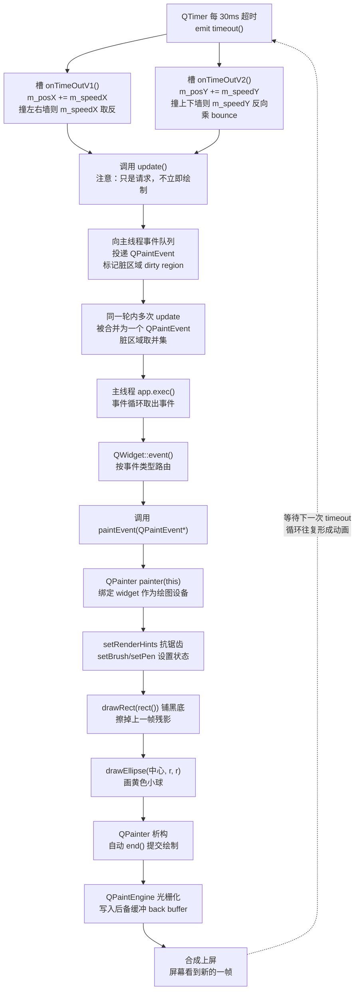

# Qt 20 绘图基础 QPainter 学习笔记

## 本章重要 API 函数

| API | 功能 | 参数说明 | 头文件 |
|-----|------|----------|--------|
| `QWidget::paintEvent()` | 重绘事件处理函数，**唯一合法的绘制入口** | `QPaintEvent *event`：可通过 `event->rect()` 拿到需要重绘的脏矩形。必须 `override`，且是 `protected` | `<QWidget>` |
| `QWidget::update()` | **请求**重绘（投递 `QPaintEvent` 到事件队列，会合并） | 无参 / `const QRect &rect` / `int x,y,w,h`：只重绘指定区域 | `<QWidget>` |
| `QWidget::repaint()` | **立即**同步重绘（当场调用 `paintEvent`） | 同 `update()`。在 `paintEvent` 里调用会无限递归 | `<QWidget>` |
| `QPainter` 构造 | 绑定绘图设备，开始绘制 | `QPaintDevice *device`：通常是 `this`。**只有在 `paintEvent` 内以 `this` 构造才合法** | `<QPainter>` |
| `setRenderHint()` | 开启渲染提示（抗锯齿等） | `RenderHint hint, bool on = true`：如 `QPainter::Antialiasing` | `<QPainter>` |
| `setRenderHints()` | 批量开启多个渲染提示 | `RenderHints hints, bool on = true`：**第二参是 bool 不是第二个 hint**（高频误用点） | `<QPainter>` |
| `QPen` | 描边样式：颜色/线宽/线型/端点/连接 | `QPen(brush, width, style, cap, join)`，如 `QPen(Qt::red, 2, Qt::DashLine, Qt::RoundCap, Qt::RoundJoin)` | `<QPen>` |
| `QBrush` | 填充样式：纯色/渐变/纹理 | `QBrush(color)` / `QBrush(gradient)` / `QBrush(pixmap)` | `<QBrush>` |
| `drawRect/drawEllipse/drawLine` | 画矩形 / 椭圆 / 直线 | `QRect` 或 `(x,y,w,h)`；`drawEllipse(QPointF center, rx, ry)` 是**圆心+半径**重载 | `<QPainter>` |
| `drawArc/drawPie/drawChord` | 画弧 / 扇形 / 弓形 | `(rect, startAngle, spanAngle)`：**角度单位是 1/16 度**，逆时针为正 | `<QPainter>` |
| `QLinearGradient` | 线性渐变 | `QLinearGradient(QPointF start, QPointF stop)` + `setColorAt(qreal pos, color)`，pos ∈ [0,1] | `<QLinearGradient>` |
| `QPainterPath` | 可组合的矢量路径 | `addEllipse/addRect/addPolygon` 构建；`united/subtracted/intersected` 做布尔运算 | `<QPainterPath>` |
| `translate/rotate/scale` | 坐标系变换：平移 / 旋转 / 缩放 | `translate(dx,dy)`；`rotate(angle)` 单位是**度、顺时针为正**；`scale(sx,sy)` | `<QPainter>` |
| `save/restore` | 压栈 / 弹栈保存画家状态 | 无参。**必须成对**，否则变换会累积 | `<QPainter>` |
| `QTimer::start()` | 启动定时器驱动动画 | `int msec`：间隔毫秒。30 ms ≈ 33 FPS | `<QTimer>` |

> 💡 Tips：
> - **`setRenderHints(QPainter::Antialiasing, QPainter::TextAntialiasing)` 是本工程里出现了三次的经典误用。** 它的签名是 `setRenderHints(RenderHints hints, bool on = true)`，第二个参数是 `bool`！`QPainter::TextAntialiasing` 的枚举值非 0，被隐式转成 `true`，所以**结果等价于只开了 `Antialiasing`**——代码"能跑、看起来也对"，但文字抗锯齿压根没开。正确写法是用 `|` 组合：`setRenderHints(QPainter::Antialiasing | QPainter::TextAntialiasing);`（`seniorpainter.cpp` 里就是这么写的，两种写法在同一个工程里并存，是绝佳的对照样本）。
> - **`drawArc` 家族的角度是 1/16 度**。想画 30 度就要写 `30*16`。而 `painter.rotate()` 的角度是**普通度数**。同一个类里两套角度单位，是 Qt 绘图最反直觉的设计之一。
> - **`drawEllipse` 有两族重载**：`drawEllipse(const QRectF&)` 是"外接矩形"，`drawEllipse(QPointF center, qreal rx, qreal ry)` 是"圆心+半径"。传错会导致图形偏移半个直径。
> - **Qt5 vs Qt6**：`QPainter::HighQualityAntialiasing` 在 Qt6 中已废弃（Qt5 起就等同于 `Antialiasing`）；`Qt::MidButton` 改名 `Qt::MiddleButton`；`QPainter::drawRoundRect()`（老拼写）在 Qt6 移除，必须用 `drawRoundedRect()`。

---

## 本章目录

> 点击条目可跳转到对应小节。

### 章节导航

- **[本章重要 API 函数](#本章重要-api-函数)**
- **[学习前后依赖](#学习前后依赖)**
- **[1. 概述](#1-概述)**
- **[2. 核心概念与原理](#2-核心概念与原理)**
  - [2.1 paintEvent 是"被动"的：你不能主动画](#21-paintevent-是被动的你不能主动画)
  - [2.2 QPainter 三件套：Pen、Brush、Font](#22-qpainter-三件套penbrushfont)
  - [2.3 逻辑坐标与设备坐标](#23-逻辑坐标与设备坐标)
- **[3. 关键机制：update 到 paintEvent 的重绘流程](#3-关键机制update-到-paintevent-的重绘流程)**
  - [3.1 重绘流程图](#31-重绘流程图)
  - [3.2 事件合并：连续 update 只重绘一次](#32-事件合并连续-update-只重绘一次)
- **[4. 核心代码解析](#4-核心代码解析)**
  - [4.1 BasePainter：Pen、Brush、渐变与基本形状](#41-basepainterpenbrush渐变与基本形状)
  - [4.2 SeniorPainter：QPainterPath 布尔运算与坐标变换](#42-seniorpainterqpainterpath-布尔运算与坐标变换)
  - [4.3 Ball：QTimer + update 驱动的弹球动画](#43-ballqtimer--update-驱动的弹球动画)
  - [4.4 main.cpp 与 CMakeLists](#44-maincpp-与-cmakelists)
- **[5. 运行效果与验证](#5-运行效果与验证)**
- **[容易踩坑（注意点）](#容易踩坑注意点)**
- **[学习要点总结](#学习要点总结)**
  - [核心知识点](#核心知识点)
  - [关键 API](#关键-api)
  - [下一步学习](#下一步学习)
- **[Q&A（常见问题）](#qa常见问题)**
- **[Tips（全局速记）](#tips全局速记)**

> 💡 Tips：建议先跑 `BasePainter`（静态图形）→ 再跑 `SeniorPainter`（路径与变换）→ 最后跑 `Ball`（动画）。本工程的 `main.cpp` 通过注释切换启动哪个类，这种"一个工程多个实验体"的组织方式很适合练手，但要记住：**注释掉的类依然会被编译**（CMakeLists 里都列着），所以它们的语法错误一样会拦住你。

---

## 学习前后依赖

| 方向 | 内容 |
| ---- | ---- |
| 前置基础 | qt08 对象树（widget 的父子与生命周期）、qt11 布局管理（`width()`/`height()` 从哪来）、qt15 事件基础（`QEvent` 分发机制、`event()` → 具体 `xxxEvent()` 的路由）、qt19 线程（"UI 只能在主线程"这条铁律的来源）。 |
| 本篇核心 | `paintEvent` 的被动特性、`QPainter` 的 Pen/Brush 模型、`QPainterPath` 的布尔运算、坐标系变换（translate/rotate/scale）与 `save/restore` 配对、`QTimer + update()` 组成的动画循环。 |
| 后续承接 | qt21 自定义速度表控件几乎是本篇 `SeniorPainter::base04()` 的产品化版本；后续图表控件、自绘按钮、皮肤化界面全部建立在本篇之上。 |

> 💡 Tips：为什么必须先会 qt15 事件基础？因为 `paintEvent` 不是"函数"而是"**事件回调**"。如果你还带着"我调用一个函数去画图"的思维，就会写出在按钮槽里 `QPainter painter(this)` 这样必然失败的代码（Qt 会打印 `QPainter::begin: Paint device returned engine == 0`）。而本篇为哪篇打基础？qt21 的仪表盘里每一行代码——`translate` 到中心、`scale` 归一化、`rotate` 摆刻度、`save/restore` 隔离状态——本篇的 `base03/base04` 已经全部预演过一遍了。

---

## 1. 概述

前面十几个工程里，界面元素都来自 Qt 现成的控件：`QPushButton`、`QLabel`、`QLCDNumber`。它们外观固定，你能改的只是样式表。但真实项目里总会遇到"没有现成控件"的需求：车速表、频谱图、K 线、示波器、流程图节点、带动画的自定义开关。这时候唯一的出路是**自己拿画笔在窗口上画**。

Qt 提供的绘图体系叫 **Qt Paint System**，核心是三个概念：

- **`QPaintDevice`**：画在什么上面（`QWidget`、`QPixmap`、`QImage`、`QPrinter`、`QPdfWriter`）；
- **`QPainter`**：怎么画（画笔、画刷、字体、变换、裁剪）；
- **`QPaintEngine`**：底层怎么落地（Raster 软件光栅化 / OpenGL / 平台原生），这一层由 Qt 自动选择，你基本不用碰。

本工程 `qt20_tst_painterbase` 用三个 widget 循序渐进地演示这套体系：

| 类 | 演示内容 |
|----|----------|
| `BasePainter` | `QPen`（颜色/线宽/线型/端点/连接）、`QBrush`、`QLinearGradient` 渐变填充、`drawRect/drawEllipse/drawRoundedRect/drawArc/drawPie/drawChord` 六种形状 |
| `SeniorPainter` | `QPainterPath` 的 `united/subtracted/intersected` 布尔运算（画月牙）、`translate/rotate/scale` 坐标变换、`save/restore` 状态栈、循环画表盘刻度与文字 |
| `Ball` | `QTimer` 驱动 → 改坐标 → `update()` → `paintEvent` 重绘，实现一个撞墙反弹的小球动画 |

这三个类的价值密度很高：**`BasePainter` 教你"用什么画"，`SeniorPainter` 教你"画复杂形状的技巧"，`Ball` 教你"让画面动起来"**。qt21 的速度表就是这三者的合体。

> 💡 Tips：概述里最该记住的一句话——**你永远不能"主动"绘图，只能"请求"绘图**。所有绘制代码必须待在 `paintEvent` 里等着被系统调用；你能做的只是改变数据、然后 `update()` 通知系统"我脏了，请重绘我"。这个反直觉的点是初学者写自绘控件时 90% 报错的根源：他们试图在按钮槽里、在定时器槽里、在构造函数里直接 `QPainter painter(this)` 画东西——全部无效。

---

## 2. 核心概念与原理

### 2.1 paintEvent 是"被动"的：你不能主动画

`paintEvent(QPaintEvent*)` 会在以下时机被 Qt **自动调用**：

1. 窗口第一次显示（`show()`）；
2. 窗口被遮挡后又露出来（暴露事件）；
3. 窗口尺寸改变（resize）；
4. 你调用了 `update()` 或 `repaint()`；
5. 父窗口重绘波及到它。

关键推论：**窗口上的图形不是"画上去就留在那里"的**。每次重绘都是从零开始重画整幅内容。所以 `paintEvent` 必须是**幂等**的——只依赖成员变量的当前状态，不依赖"上次画了什么"。这也解释了 `Ball::paintEvent` 里为什么每帧都先 `painter.drawRect(rect())` 铺一层黑底：**不擦掉旧帧，小球就会拖出一条尾巴**（虽然 Qt 默认会用背景色擦除，但显式铺底既是保险也是设计）。

```cpp
// 正确：绘制代码在 paintEvent 里
void Ball::paintEvent(QPaintEvent *event) {
    QPainter painter(this);      // this 作为 paint device，仅此处合法
    painter.drawEllipse(...);
}

// 错误：在普通槽里构造 QPainter(this)
void Ball::onTimeOutV1() {
    QPainter painter(this);      // 运行期报错：Paint device returned engine == 0
    painter.drawEllipse(...);    // 什么也画不出来
}
```

### 2.2 QPainter 三件套：Pen、Brush、Font

`QPainter` 是一个**状态机**。你先设置状态，再调 `drawXxx`，图形按当前状态渲染：

| 状态 | 作用 | 谁受影响 |
|------|------|----------|
| `QPen` | **描边**：轮廓的颜色、宽度、线型、端点样式、拐角样式 | 所有图形的边框、`drawLine`、`drawText` 的文字颜色 |
| `QBrush` | **填充**：内部区域的颜色/渐变/纹理 | 闭合图形的内部（矩形、椭圆、路径） |
| `QFont` | 字体 | `drawText` |

三个高频细节：

- `setPen(Qt::NoPen)` = 不画边框；`setBrush(Qt::NoBrush)` = 不填充（默认就是不填充）。
- **`drawText` 的颜色由 Pen 决定，不是 Brush**。这是最常见的"为什么我的字是黑的"来源。
- **`QBrush` 可以直接用 `QGradient` 构造**，所以渐变填充只需 `painter.setBrush(gradient)`，不用手写像素插值。

### 2.3 逻辑坐标与设备坐标

`QPainter` 默认的坐标系原点在 widget **左上角**，x 向右、y 向下，单位是像素。但一旦你调用 `translate/rotate/scale`，**逻辑坐标**就与**设备坐标**分离了：

```cpp
painter.translate(W/2, H/2);        // 原点移到中心
painter.scale(side/200.0, side/200.0); // 逻辑坐标 200×200 映射到实际 side×side
// 从此你可以按"200×200 的画布"来思考，尺寸自适应由 scale 负责
painter.drawLine(81, 0, 99, 0);    // 这里的 81/99 是逻辑单位，不是像素
```

这套"**先归一化再画**"的手法是自绘控件的核心技巧：**设计时按固定尺寸（如 200×200）画，运行时用 scale 适配任意窗口大小**。`SeniorPainter::base03/base04` 和 qt21 的 `SpeedWidget` 都是这个套路。

> 💡 Tips：原理层面最容易误解的三点：
> 1. **"`paintEvent` 由系统或 `update()` 触发"**——你不能也不该直接调用 `paintEvent(nullptr)`。手动调用会绕过 Qt 的双缓冲和裁剪机制，`QPainter(this)` 在非绘制阶段构造会直接失败。
> 2. **`rotate()` 旋转的是坐标系，不是图形**。`rotate(30)` 之后你画的直线看起来转了 30°，但真实发生的是"整个纸张转了 30°，笔还是横着走"。想画一圈刻度就是"画一根 → 转 30° → 再画一根"，`base03` 正是这么干的。
> 3. **变换是累积的**。连续两次 `rotate(30)` 等于 `rotate(60)`。所以循环里必须用 `save()/restore()` 把每次变换隔离开，否则第 n 根刻度会转到 `30n` 度而不是你算的角度。

---

## 3. 关键机制：update 到 paintEvent 的重绘流程

### 3.1 重绘流程图

下图完整展示了 `Ball` 的一帧是怎么产生的——从定时器超时到像素上屏。



### 3.2 事件合并：连续 update 只重绘一次

注意 `Ball` 的构造里把**同一个 `timeout` 信号连到了两个槽**：

```cpp
connect(m_timer, &QTimer::timeout, this, &Ball::onTimeOutV1);  // 改 X，调 update()
connect(m_timer, &QTimer::timeout, this, &Ball::onTimeOutV2);  // 改 Y，调 update()
```

一次 `timeout` 会调用两次 `update()`，但**只会产生一次 `paintEvent`**。因为 `update()` 的实现是"把脏区域并入待重绘区域 + 投递一个 `UpdateRequest` 事件（若已有待处理的就不再投）"。这是 Qt 的重要优化：**你可以放心地在一个逻辑帧里调用 N 次 `update()`，代价近似于一次**。

反过来，如果这里用的是 `repaint()`，就会**真的同步绘制两次**，帧率减半且可能撕裂。这正是"优先用 `update()`"的量化理由。

> 💡 Tips：流程图里最关键的两个节点是 `C`（`update()`）和 `E`（事件合并）。
> - `C` 是"**异步分界线**"：它上面是你的业务逻辑（改数据），它下面是 Qt 的渲染流水线。把这条线看清楚，你就永远不会再想"在槽里直接画图"。
> - `E` 是"**性能保险丝**"：它保证了即使你在一帧里调 100 次 `update()`，也只重绘一次。这个机制的代价是"`update()` 之后数据不会立刻上屏"——如果你在 `update()` 下一行就去读像素，读到的还是旧帧。需要"立刻可见"的极少数场景（如打印前刷新）才用 `repaint()`。
> - 另外注意 `M` 节点：**`QPainter` 是靠析构来 `end()` 提交的**。所以 `QPainter painter(this);` 用栈对象是标准写法；若用 `new QPainter(this)` 忘了 delete，绘制永远不会提交。

---

## 4. 核心代码解析

以下代码全部摘自 `D:\QT_place\QT_study_pjt\qt20_tst_painterbase\`。

### 4.1 BasePainter：Pen、Brush、渐变与基本形状

```cpp
// BasePainter.cpp
void BasePainter::paintEvent(QPaintEvent *event)
{
    base02();                     // ① 分发到具体实验函数
}

void BasePainter::base01()
{
    int W = width();
    int H = height();
    QPen pen(Qt::red, 2, Qt::DashLine, Qt::RoundCap, Qt::RoundJoin);   // ②
    QLinearGradient gradient(QPoint(W/4, H/4), QPoint(3*W/4, 3*H/4));  // ③
    gradient.setColorAt(0,   Qt::yellow);
    gradient.setColorAt(0.5, Qt::green);
    gradient.setColorAt(1,   Qt::blue);
    painter.setBrush(gradient);   // ④ QGradient 可隐式转 QBrush
    painter.setPen(pen);
    painter.drawRect(H / 4, W / 4, W / 2, H / 2);                      // ⑤ 注意参数顺序
}
```

- ① **`paintEvent` 只做一件事：转发**。这是本工程一个很聪明的组织方式——`base01/base02` 各自是一个独立实验，切换实验只需改这一行。代价是这些函数**必须只在 `paintEvent` 调用链内被调用**，因为它们内部构造了 `QPainter(this)`。
- ② `QPen` 的五参数构造一次配好全部描边属性，等价于分别调 `setColor/setWidth/setStyle/setCapStyle/setJoinStyle`（被注释掉的那段代码就是分步写法）。
  - `Qt::DashLine` 虚线，`Qt::RoundCap` 圆头端点，`Qt::RoundJoin` 圆角拐弯。
  - **线宽为 0 是特殊值**：表示"cosmetic pen"，无论怎么 `scale` 都保持 1 像素宽。若希望线宽随缩放变化，必须显式给 ≥1 的宽度。
- ③④ `QLinearGradient(起点, 终点)` + `setColorAt(位置, 颜色)`，位置是 `[0,1]` 的归一化参数。把它塞给 `setBrush` 就得到渐变填充——**Qt 里渐变属于"画刷"，不是独立的绘制命令**，这个归类要记牢。
- ⑤ **`drawRect(H/4, W/4, W/2, H/2)` 的前两个参数写反了**：应该是 `(x, y, w, h)`，即 `(W/4, H/4, W/2, H/2)`。当前写法把高度的 1/4 当成了 x 坐标。在 `resize(500,400)` 下 W=500、H=400，画出来是 `(100, 125, 250, 200)`——图形能出来，只是位置偏了，属于"**不报错的逻辑 bug**"。`base02()` 里的 `QRect rect(H/4, W/4, W/2, H/2)` 犯了同样的错。这是很好的提醒：**`width()`/`height()` 弄混不会有任何编译或运行警告，只能靠眼睛看**。

```cpp
void BasePainter::base02()
{
    int W = width(), H = height();
    QPainter painter(this);
    painter.setRenderHint(QPainter::Antialiasing);       // ⑥ 单个 hint 用 setRenderHint
    painter.setRenderHint(QPainter::TextAntialiasing);
    QRect rect(H / 4, W / 4, W / 2, H / 2);
    int redius = qMin(rect.width(), rect.height()) / 3;  // ⑦ 圆角半径取短边的 1/3
    // painter.drawRect(rect);
    // painter.drawEllipse(rect);
    // painter.drawRoundedRect(rect, redius, redius);
    // painter.drawArc(rect, 90, 30*16);                 // ⑧ 角度单位 1/16 度
    // painter.drawPie(rect, 90, 30*16);
    // painter.drawChord(rect, 90, 30*16);               // ⑨ 当前全被注释 → 空白窗口
}
```

- ⑥ 这里用的是**单数形式 `setRenderHint(hint)` 连调两次**，这是完全正确的写法。对比 `ball.cpp` 里的 `setRenderHints(QPainter::Antialiasing, QPainter::TextAntialiasing)`（复数形式 + 两个 hint），后者的第二个参数被当成 `bool on` 用了——**同一个工程里的两种写法，一个对一个错，非常值得对照记忆**。
- ⑦ `qMin(w, h)/3` 让圆角半径自适应，避免窗口变扁时圆角超过边长。
- ⑧ **`drawArc/drawPie/drawChord` 的角度单位是 1/16 度**，所以 30 度写成 `30*16 = 480`。起始角 `90` 这里其实也应该乘 16（`90*16`）才是正 90 度——写 `90` 实际只有 5.625 度。三者区别：`drawArc` 只画弧线、`drawPie` 连圆心成扇形、`drawChord` 用弦封口成弓形。
- ⑨ **当前 `base02()` 所有绘制语句都被注释了**，所以运行 `BasePainter` 会得到一个**纯空白窗口**。这不是 bug，是"实验开关"留在了全关状态。想看效果就取消对应注释——但要意识到：`paintEvent` 里什么都不画，窗口就只有背景色，这本身也验证了"每帧从零重画"的机制。

### 4.2 SeniorPainter：QPainterPath 布尔运算与坐标变换

```cpp
void SeniorPainter::base01()
{
    QPainter painter(this);
    painter.setRenderHints(QPainter::Antialiasing | QPainter::TextAntialiasing);  // ① 正确写法
    QPainterPath path1;  path1.addEllipse(0, 0, 100, 100);
    QPainterPath path2;  path2.addRect(0, 50, 150, 150);
    QPainterPath result = path1.united(path2);       // ② 并集
    // QPainterPath result = path2.subtracted(path1);   // 差集
    // QPainterPath result = path1.intersected(path1);  // 交集
    painter.drawPath(result);
}
```

- ① **注意这里用 `|` 组合了两个 hint，这是唯一正确的批量写法**。与 `ball.cpp` 的逗号写法形成鲜明对比。
- ② `QPainterPath` 的三个布尔运算是自绘复杂图形的核心武器：
  - `united(other)` → 并集（合并两个形状）
  - `subtracted(other)` → 差集（**在自己身上挖掉 other**）
  - `intersected(other)` → 交集（只保留重叠部分）

  被注释的第三行 `path1.intersected(path1)` 是**自己和自己求交**，结果就是 path1 本身——显然是笔误（本意应是 `path1.intersected(path2)`）。

```cpp
void SeniorPainter::base02()
{
    QPainterPath path1;  path1.addEllipse(0,  0, 100, 100);
    QPainterPath path2;  path2.addEllipse(20, 0, 100, 100);
    QPainterPath moon = path1.intersected(path2);   // ③ 两圆相交 = 月牙（柳叶形）
    painter.translate(50, 100);                     // ④ 先平移
    painter.rotate(30);                             // ⑤ 再旋转
    painter.fillPath(moon, Qt::darkBlue);           // ⑥ 直接填充，不需要 setBrush
}
```

- ③ **两个错位圆求交得到"柳叶形"**（严格说月牙是 `subtracted`）。这是路径运算最经典的教学例子：**复杂形状 = 简单形状做布尔运算**，比手写贝塞尔曲线容易一个数量级。
- ④⑤ **变换顺序至关重要**：`translate` 再 `rotate`，是"移到 (50,100) 后绕该点转 30°"；顺序颠倒则是"绕原点转 30° 后，沿转过的坐标轴移动"——结果完全不同。规律是：**变换按书写顺序依次作用于坐标系**。
- ⑥ `fillPath(path, brush)` 是"填充但不描边"的快捷方式，省掉 `setBrush + setPen(Qt::NoPen) + drawPath` 三步。

```cpp
void SeniorPainter::base03()
{
    qreal W = width(), H = height();
    qreal side = qMin(W, H);                         // ⑦ 取短边保证不变形
    painter.translate(W/2, H/2);                     // ⑧ 原点移到窗口中心
    painter.scale(side/200.0, side/200.0);           // ⑨ 归一化到 200×200 逻辑画布
    painter.setPen(Qt::black);
    for (int i = 0; i < 12; i++) {
        if (i % 3 == 0) {
            painter.save();                          // ⑩ 压栈
            QPen pen = painter.pen();
            pen.setWidth(3);                         // ⑪ 改了 pen 但忘了 setPen！
            painter.drawLine(81, 0, 99, 0);
            painter.restore();                       // ⑩ 弹栈
        } else {
            painter.drawLine(81, 0, 99, 0);
        }
        painter.rotate(30);                          // ⑫ 每次转 30°，12 次转满 360°
    }
}
```

- ⑦⑧⑨ **这三行是自适应自绘控件的标准开场**：取短边 → 移原点到中心 → 按 200 单位归一化。做完之后，后续所有坐标都可以按"一张 200×200、原点在中心的纸"来写，**窗口无论多大都自动适配**。qt21 的 `SpeedWidget` 开头一字不差地复刻了这个套路。
- ⑩ `save()/restore()` **必须成对**。这里的意图是"只让粗线那一次的 pen 改变生效，不污染后续"。
- ⑪ **这是一个典型的"改了副本却没生效"的 bug**：`painter.pen()` 返回的是 `QPen` 的**值拷贝**，`pen.setWidth(3)` 改的是这个局部副本，**必须再 `painter.setPen(pen)` 才会作用到画家上**。当前代码缺了这一行，所以"每 3 根一根粗线"的效果根本没出现——12 根刻度全是同样粗细。这个坑的隐蔽性极高：代码读起来完全合理，编译无警告，只是效果不对。**凡是 `painter.xxx()` 返回值类型不是引用的（`pen()`、`brush()`、`font()`），改完都必须 set 回去。**
- ⑫ `rotate(30)` 累积 12 次刚好 360°。因为在 `save/restore` 之外，所以每次都在上一次基础上累加——这正是想要的。

`base04()` 是**速度表刻度盘的雏形**，也是 qt21 的直接前身：

```cpp
int rangeIndex = 24;
for (int i = 0; i <= rangeIndex; ++i) {
    qreal startAngle = 150, rangeAngle = 240;                  // ⑬ 从 150° 起，跨 240°
    painter.save();
    qreal currentRotate = startAngle + (i * (rangeAngle / rangeIndex * 1.0));
    painter.rotate(currentRotate);                             // ⑭ 绝对角度（因为有 save/restore）
    if (i % 2 == 0) {
        painter.setPen(QPen(Qt::black, 2));                    // ⑮ 直接构造并 setPen，正确
        painter.drawLine(80, 0, 95, 0);                        // 长刻度
        int speedValue = i * 10;
        QRect textRect(-15, -10, 30, 20);
        painter.translate(70, 0);                              // ⑯ 移到刻度内侧
        painter.rotate(-currentRotate);                        // ⑰ 反向转回来，让文字保持水平
        painter.drawText(textRect, Qt::AlignCenter, QString::number(speedValue));
    } else {
        painter.setPen(QPen(Qt::black, 1));
        painter.drawLine(85, 0, 95, 0);                        // 短刻度
    }
    painter.restore();
}
```

- ⑬ **150° 起、240° 跨度**是汽车仪表盘的经典布局：底部留 120° 的缺口（360-240），刻度从左下经正上到右下。
- ⑭ 因为循环体被 `save/restore` 包住，每次进来坐标系都是干净的，所以这里算的是**绝对角度**（`startAngle + i*step`），而不是 `base03` 里的增量式 `rotate(30)`。两种写法都对，但**绝对角度 + save/restore 更易读、不会累积误差**。
- ⑮ 对比 `base03` 的 ⑪，这里 `painter.setPen(QPen(Qt::black, 2))` 直接构造新 pen 并设置，一步到位、不会犯"改副本"的错。**这是更推荐的风格**。
- ⑯⑰ **"反向旋转让文字保持水平"是仪表盘绘制最精髓的技巧**：坐标系已经转了 `currentRotate` 度，如果直接 `drawText`，文字会跟着倾斜（想象把书斜着放）。先 `translate(70,0)` 移到文字该在的位置，再 `rotate(-currentRotate)` 把坐标系转回水平，文字就正了。**记住这个组合：先移动，后转回。** 顺序反了位置就错。

### 4.3 Ball：QTimer + update 驱动的弹球动画

```cpp
Ball::Ball(QWidget *parent) : QWidget(parent) {
    m_posX = 30;  m_speedX = 50;                    // ① 初始位置与速度
    m_posY = 0;   m_speedY = 5;
    m_radius = 30;
    m_timer = new QTimer(this);                     // ② 有 parent，随 widget 自动销毁
    m_timer->start(30);                             // ③ 30ms ≈ 33 FPS
    setGeometry(100, 100, 500, 500);
    connect(m_timer, &QTimer::timeout, this, &Ball::onTimeOutV1);
    connect(m_timer, &QTimer::timeout, this, &Ball::onTimeOutV2);   // ④ 一信号两槽
    setGeometry(100, 100, 600, 600);                // ⑤ 重复调用，后者生效
}

void Ball::onTimeOutV1() {
    m_posX += m_speedX;
    if (m_posX + m_radius > width() || m_posX - m_radius < 0) {
        m_speedX = -m_speedX;                       // ⑥ 撞墙反弹：速度取反
    }
    update();                                       // ⑦ 请求重绘
}

void Ball::onTimeOutV2() {
    double g = 0.6;                                 // ⑧ 定义了但从未使用
    double bounce = 2;                              // ⑨ 反弹系数 > 1，能量不守恒
    m_posY += m_speedY;
    if (m_posY + m_radius > height()) {
        m_posY = height() - m_radius;               // ⑩ 位置修正，防止陷入墙内
        m_speedY = -m_speedY * bounce;
    } else if (m_posY - m_radius < 0) {
        m_posY = m_radius;
        m_speedY = -m_speedY * bounce;
    }
    update();
}

void Ball::paintEvent(QPaintEvent *event) {
    QPainter painter(this);
    painter.setRenderHints(QPainter::Antialiasing, QPainter::TextAntialiasing);  // ⑪ 误用
    painter.setBrush(Qt::black);
    painter.drawRect(rect());                       // ⑫ 铺黑底，擦掉上一帧
    painter.setBrush(Qt::yellow);
    painter.setPen(Qt::NoPen);                      // ⑬ 无边框
    painter.drawEllipse(QPointF(m_posX, m_posY), m_radius, m_radius);  // ⑭ 圆心+半径重载
}
```

- ① 位置和速度都是 `double`，为动画的亚像素平滑留了余量。`m_speedX = 50` 意味着每帧横移 50 px——在 30ms 间隔下是 1666 px/s，非常快。
- ② `new QTimer(this)` 挂在对象树上，不用手动 delete。对比 qt19 里"要 `moveToThread` 就不能有 parent"，这里**不需要跨线程，所以给 parent 是最佳实践**。
- ③ `start(30)` 是 30 毫秒间隔。注意 `QTimer` 精度受事件循环负载影响，**不是硬实时**；要求严格帧率应该用 `QElapsedTimer` 测实际间隔并做插值。
- ④ **一个信号连两个槽**：`timeout` 同时触发 X 方向和 Y 方向的更新。执行顺序按 `connect` 顺序（V1 先，V2 后）。两个槽各调一次 `update()`，但只重绘一次（见 3.2）。这个拆分方式教学意义大于工程意义——真实项目通常合成一个 `advanceFrame()`。
- ⑤ `setGeometry` 被调了两次，第二次 `(100,100,600,600)` 覆盖第一次。这不是错误，只是遗留代码。但要注意 **`m_posX/m_posY` 的边界判断依赖 `width()`/`height()`**，所以窗口尺寸变了，弹球范围会自动跟着变——这是用 `width()` 而非硬编码常量的好处。
- ⑥ **反弹的本质是速度取反**，一行 `m_speedX = -m_speedX` 就够了。注意判断条件用的是 `m_posX + m_radius > width()`（球的右边缘超出）而不是 `m_posX > width()`（球心超出），这样球不会半个身子插进墙里。
- ⑦ **`update()` 是动画的引擎**。删掉它，`m_posX` 依然在变，但屏幕永远停在第一帧——因为没人告诉 Qt "该重绘了"。这是最能说明"数据变化 ≠ 画面变化"的实验：**注释掉 `update()` 跑一遍，是本篇最推荐的动手验证**。
- ⑧ **`double g = 0.6;` 定义后从未使用**——这是重力加速度的占位符。完整的抛体运动应该是 `m_speedY += g;`（每帧加速下落）。当前代码缺这一行，所以 Y 方向是匀速运动，看起来像"直上直下的乒乓球"而非"自由落体"。想补全物理效果，加上这一行即可。
- ⑨⑩ **`bounce = 2` 意味着每次撞墙速度翻倍**——能量不守恒，球会越来越快，几帧之后就快到"每帧跨越整个窗口"，肉眼看到的是疯狂闪烁。物理上正确的反弹系数应该 `0 < bounce < 1`（如 0.8 表示损失 20% 动能）。⑩ 的位置修正 `m_posY = height() - m_radius` 是必要的防护：速度太大时球可能一帧就冲出边界很远，不修正就会"卡在墙外反复取反"（抖动 bug）。**位置修正 + 速度取反，是所有碰撞响应的标准两步。**
- ⑪ 又是 `setRenderHints(hint1, hint2)` 的误用（详见本篇 API 表格的 Tips）。实际效果 = 只开了 `Antialiasing`。好在这里没有文字，所以看不出差别——**这就是这个 bug 能长期存活的原因**。
- ⑫ **`drawRect(rect())` 铺满黑底是"清屏"**。`rect()` 返回 widget 的整个区域。如果去掉这行，Qt 会用默认背景色擦除（因为 `autoFillBackground` 等机制），但显式铺色能保证背景确定、也方便改成渐变背景。
- ⑬ `setPen(Qt::NoPen)` 让小球没有黑边，视觉更干净。忘了这句会得到一个带 1px 黑色描边的球。
- ⑭ **`drawEllipse(QPointF center, rx, ry)` 是"圆心 + 两半径"重载**。如果误用 `drawEllipse(QRectF)` 重载传同样的数字，球会偏移半个直径——这是 `QPainter` 最容易搞错的重载之一。

### 4.4 main.cpp 与 CMakeLists

```cpp
// main.cpp
// #include "BasePainter.h"
#include "ball.h"
#include <QApplication>

int main(int argc, char *argv[]) {
    QApplication a(argc, argv);
    // BasePainter w;
    Ball ball;
    ball.show();
    return QCoreApplication::exec();   // ① 静态调用，能跑但不推荐
}
```

- ① `QCoreApplication::exec()` 是 **static 函数**，所以这样写能编译能运行。但语义上应该写 `a.exec()`——表达"运行我创建的这个应用实例"。用静态形式容易让人误以为"不需要 QApplication 对象"，而实际上没有 `a` 这行程序会直接崩（`QWidget` 需要 `QApplication`）。
- 切换实验体的方式是**注释/反注释 include 和对象声明**。三个类（`BasePainter`、`SeniorPainter`、`Ball`）在 `CMakeLists.txt` 里全部列入了源文件，**都会被编译**，只是运行时只实例化一个。`SeniorPainter` 甚至没有在 `main.cpp` 里出现过，想看它的效果需要自己加两行。

```cmake
qt_add_executable(qt20_tst_painterbase
    WIN32 MACOSX_BUNDLE
    main.cpp
    BasePainter.cpp BasePainter.h BasePainter.ui   # ② .ui 列入了但代码里没用
    ball.h ball.cpp
    seniorpainter.h seniorpainter.cpp
)
target_link_libraries(... PRIVATE Qt::Core Qt::Widgets)   # ③ 绘图不需要额外模块
```

- ② `BasePainter.ui` 被列入源文件，但 `BasePainter.cpp` 里既没有 `ui_BasePainter.h` 也没有 `Ui::` 相关代码——它是 Qt Creator 建类时自动生成的空壳。**这说明自绘控件通常不需要 .ui 文件**：界面就是代码画出来的，没有可拖拽的子控件。
- ③ **`QPainter`、`QPen`、`QBrush`、`QPainterPath` 全在 `Qt::Gui` 模块**，而 `Qt::Widgets` 已经依赖 `Qt::Gui`，所以只链 `Core + Widgets` 就够了。如果你要做**不带窗口**的离屏绘制（画到 `QImage` 存文件），只链 `Qt::Gui` 即可，不需要 Widgets。

> 💡 Tips：这几段代码里藏着的关键细节，一句话一条：
> - **`update()` 触发重绘，不是立即重绘**；删掉它动画就死，改成 `repaint()` 会同步绘制两次。
> - **`painter.pen()` 返回值拷贝**，`base03` 里改了宽度却没 `setPen` 回去，"每三根一根粗线"的效果根本没生效。凡是返回值不是引用的 getter，改完必须 set 回。
> - **`setRenderHints(a, b)` 的第二参是 bool**，本工程三处误用；正确写法是 `setRenderHints(a | b)`。
> - **`save()/restore()` 必须成对**，循环里画多个旋转元素时是刚需，漏掉一次后面全乱。
> - **`drawArc` 用 1/16 度，`rotate` 用普通度数**，同一个类两套单位。
> - **`bounce=2` 让能量不守恒、`g=0.6` 定义了没用**——这两个"半成品"恰好演示了动画代码里物理参数的正确用法。

---

## 5. 运行效果与验证

**运行 `Ball`（当前 `main.cpp` 的默认选择）应看到：**

1. 一个 600×600 的窗口，黑色背景，一个黄色小球。
2. 小球高速左右横移，撞到左右边缘立刻反向。
3. Y 方向因为 `bounce=2`，几次撞击后速度暴涨，视觉上变成"上下疯狂闪跳"——**这是预期内的"错误效果"**，把 `bounce` 改成 `0.8`、并加上 `m_speedY += g;` 后，会得到自然的"弹跳逐渐衰减"效果。这个对比实验能让你彻底理解动画里物理参数的意义。
4. **拖动窗口边缘改变大小**：小球的活动范围立即跟着变——验证了 `width()`/`height()` 动态取值的好处。

**切换到 `BasePainter` 验证：**

```cpp
#include "BasePainter.h"
BasePainter w;  w.show();
```
- 直接跑会看到**空白窗口**（`base02()` 里所有 draw 都被注释）。
- 把 `paintEvent` 里改成 `base01();`，会看到一个红色虚线边框、内部黄→绿→蓝渐变的矩形——但**位置偏左上**，因为 `drawRect(H/4, W/4, ...)` 参数顺序错了。改成 `drawRect(W/4, H/4, W/2, H/2)` 后矩形会居中，这是验证"你真的看懂了参数顺序"的最好方式。
- 逐个取消 `base02()` 里的注释，对比 `drawEllipse`/`drawRoundedRect`/`drawArc`/`drawPie`/`drawChord` 五种形状的差异；把 `drawArc(rect, 90, 30*16)` 改成 `drawArc(rect, 90*16, 30*16)`，观察起始角从"5.6 度"跳到"90 度"的变化。

**切换到 `SeniorPainter` 验证：**

- `base01()`：一个圆和一个矩形合并后的复合轮廓（只有描边，因为没 setBrush）。
- 改调 `base02()`：一个旋转 30° 的深蓝色柳叶形。
- 改调 `base03()`：**12 根均匀分布的表盘刻度线**。此时给 `pen.setWidth(3)` 后补上 `painter.setPen(pen);`，会看到 0/3/6/9 点位置的刻度变粗——**修好这个 bug 的前后对比，是本篇最有教育意义的一次验证**。
- 改调 `base04()`：完整的速度表刻度盘，带 0~240 的数字标注和红色文字框。这就是 qt21 的雏形。

> 💡 Tips：验证时最容易误判"成功"的三种假象：
> 1. **"窗口里有东西，所以绘图代码对了"**——`BasePainter::base01()` 画出的矩形位置是错的，但看起来"有个漂亮的渐变方块"，很容易就此收工。判断位置对不对，要**主动改窗口尺寸**看图形是否按预期比例移动。
> 2. **"没有编译错误也没有运行警告，所以没问题"**——`painter.pen()` 改副本、`setRenderHints` 第二参当 bool、`drawRect` 参数顺序错，这三个 bug **一个警告都不会给**。绘图代码的正确性只能靠眼睛和"故意改一个参数看变化"来验证。
> 3. **"动画在动，所以帧循环对了"**——`bounce=2` 的球也在"动"，但它是错的物理。判断动画质量要看**是否符合预期的运动规律**，而不是"是否在动"。一个实用技巧：在 `paintEvent` 里 `qDebug() << m_posY << m_speedY;`，用数字而不是眼睛来判断。

---

## 容易踩坑（注意点）

- **坑 1：在 `paintEvent` 之外构造 `QPainter(this)`。**
  *现象*：控制台 `QPainter::begin: Paint device returned engine == 0`、`QPainter::setBrush: Painter not active`，什么都画不出来。
  *原因*：widget 只在重绘周期内有有效的 paint engine。
  *规避*：所有绘制必须在 `paintEvent` 内（或它调用的私有函数内）。要在别处"画"，就改数据然后 `update()`。若确实要离屏绘制，画到 `QPixmap`/`QImage` 上，再在 `paintEvent` 里 `drawPixmap`。

- **坑 2：`setRenderHints(hintA, hintB)` 当成"开两个 hint"。**
  *现象*：以为开了文字抗锯齿，实际没开；文字边缘发毛。
  *原因*：签名是 `setRenderHints(RenderHints, bool on = true)`，第二个 hint 被隐式转成 `true`。
  *规避*：批量用 `|` 组合 `setRenderHints(A | B)`；或分两次调单数形式 `setRenderHint(A); setRenderHint(B);`。

- **坑 3：`painter.pen()` / `font()` / `brush()` 改了副本没 set 回去。**
  *现象*：代码明明改了线宽/字号，画面毫无变化。
  *原因*：这些 getter 返回的是**值**，不是引用。
  *规避*：`QPen p = painter.pen(); p.setWidth(3); painter.setPen(p);` 三步齐全；或干脆 `painter.setPen(QPen(Qt::black, 3));` 一步到位。

- **坑 4：`save()`/`restore()` 不配对，或循环里漏了。**
  *现象*：画一圈刻度时越画越歪，后面的元素跑到窗口外。
  *原因*：`translate/rotate/scale` 是**累积**的，不 restore 就会叠加。
  *规避*：循环体开头 `save()`、结尾 `restore()`，像括号一样对齐。复杂绘制里可以用 RAII 小工具类包一层，保证异常安全。

- **坑 5：混淆 `drawArc` 的 1/16 度与 `rotate` 的普通度。**
  *现象*：画出的弧只有预期的 1/16 大小，或者刻度盘转到奇怪的角度。
  *原因*：Qt 为了整数精度，`drawArc/drawPie/drawChord` 用 1/16 度作单位。
  *规避*：写角度时统一乘 16 并加注释：`painter.drawArc(rect, 90 * 16, 30 * 16); // 从90°起，跨30°`。

- **坑 6：动画只改数据、忘了 `update()`；或滥用 `repaint()`。**
  *现象*：忘 `update()` → 画面静止不动；滥用 `repaint()` → 帧率下降、界面卡顿甚至递归崩溃。
  *原因*：`update()` 投递事件（可合并、异步），`repaint()` 同步立即绘制。
  *规避*：默认永远用 `update()`。**绝对不要在 `paintEvent` 里调 `repaint()`**——那是无限递归。

- **坑 7：动画物理参数不合理导致"数值爆炸"。**
  *现象*：小球越来越快，最后满屏闪烁；或者球卡在边界抖动。
  *原因*：反弹系数 > 1（能量增益）；只反转速度不修正位置。
  *规避*：反弹系数取 `0 < e < 1`；碰撞时先把位置钳回边界内再反转速度；给速度设上限 `qBound(-maxV, v, maxV)`。

- **坑 8：把 `width()`/`height()` 写反，或在 `QRect(x,y,w,h)` 里传错顺序。**
  *现象*：图形位置偏移，但窗口方形时看不出来。
  *原因*：`drawRect(H/4, W/4, W/2, H/2)` 这类错误没有任何编译/运行提示。
  *规避*：养成先取局部变量 `int W = width(), H = height();` 再按 `(x, y, w, h)` 顺序对照书写的习惯；**用非方形窗口测试**（如 500×400），方形窗口会掩盖这类 bug。

---

## 学习要点总结

### 核心知识点

1. **`paintEvent` 是唯一合法的绘制入口，且是被动调用的。** 你能做的是改数据 + `update()`，绘制时机由 Qt 决定。每次重绘都从零重画整幅内容，所以 `paintEvent` 必须幂等。
2. **`QPainter` 是状态机**：先设 `QPen`（描边）/`QBrush`（填充）/`QFont`（字体），再调 `drawXxx`。`drawText` 的颜色由 Pen 决定。
3. **`update()` 会合并**：一帧内调 N 次只重绘一次，脏区域取并集。这是性能保险丝，也是"数据改完画面不立刻变"的原因。
4. **坐标变换是自绘控件的核心技巧**：`translate` 到中心 + `scale` 归一化 → 按固定逻辑尺寸设计，自动适配任意窗口大小。变换按书写顺序累积作用，必须用 `save/restore` 隔离。
5. **`QPainterPath` 的布尔运算（united/subtracted/intersected）** 让复杂形状可以由简单形状拼出来，是画月牙、镂空指针、异形按钮的标准手段。
6. **`QTimer + update()` = 动画循环**：定时器改数据 → `update()` → `paintEvent` 画新帧。这是 Qt 里最简单也最通用的动画模式。

### 关键 API

| API | 功能 |
|-----|------|
| `paintEvent(QPaintEvent*)` | 重绘回调，唯一绘制入口 |
| `update()` / `repaint()` | 请求重绘（异步合并）/ 立即重绘（同步） |
| `QPainter(this)` | 绑定绘图设备，析构时自动提交 |
| `setPen/setBrush/setFont` | 设置描边 / 填充 / 字体状态 |
| `setRenderHint(s)` | 开抗锯齿（注意复数形式第二参是 bool） |
| `drawRect/Ellipse/Line/Text/Path` | 基本绘制命令 |
| `drawArc/drawPie/drawChord` | 弧 / 扇形 / 弓形（角度 1/16 度） |
| `QLinearGradient + setColorAt` | 渐变填充 |
| `QPainterPath::united/subtracted/intersected` | 路径布尔运算 |
| `translate/rotate/scale` + `save/restore` | 坐标变换与状态栈 |

### 下一步学习

- **qt21 自定义控件：速度表**。本篇的 `SeniorPainter::base04()` 已经画出了刻度盘，qt21 会把它**封装成一个可复用的 `SpeedWidget` 类**，加上 `setSpeed()` 接口、`QPainterPath` 镂空指针，并用 `QLineEdit + QPushButton` 驱动。
- 之后可延伸到：`QGraphicsView` 图形视图框架（大量图元 + 交互）、`QPropertyAnimation` 属性动画（比手写 QTimer 更平滑）、`QChart` 图表模块。

> 💡 Tips：本篇与 qt21 的挂钩点非常直接——**qt21 的 `SpeedWidget::paintEvent` 前四行就是本篇 `base03/base04` 的开场三步（translate 到中心 / scale 归一化 / 循环 rotate 画刻度）**，而它的镂空指针用的正是本篇 `base01` 学的 `subtracted()`。可以说 qt20 是零件，qt21 是成品。读完本篇直接进 qt21，会有"原来这些零件是这么装起来的"的畅快感。

---

## Q&A（常见问题）

**Q1：`update()` 和 `repaint()` 到底该用哪个？**
A1：**默认永远用 `update()`。** 区别如下：

| | `update()` | `repaint()` |
|---|-----------|-------------|
| 时机 | 投递 `QPaintEvent` 到队列，事件循环空闲时执行 | **立即**同步调用 `paintEvent` |
| 合并 | ✅ 一帧内多次调用只重绘一次 | ❌ 每次都真的重绘 |
| 安全性 | 高 | 在 `paintEvent` 内调用会**无限递归崩溃** |
| 适用 | 99% 的场景 | 极少数需要"这一行之后画面必须已更新"的场景 |

本工程 `Ball` 一帧调两次 `update()` 却只重绘一次，如果换成 `repaint()` 帧率直接减半。另外注意：`update()` 走的是事件队列，和 qt19 里跨线程信号槽是**同一套机制**——理解了一个就理解了另一个。

**Q2：`QPen` 和 `QBrush` 有什么区别？为什么我的文字总是黑色？**
A2：`QPen` 管**描边（轮廓线）**，`QBrush` 管**填充（内部）**。画一个矩形时，边框用 Pen、内部用 Brush：

```cpp
painter.setPen(QPen(Qt::red, 3));    // 红色 3px 边框
painter.setBrush(Qt::yellow);        // 黄色填充
painter.drawRect(10, 10, 100, 50);   // 红框黄底的矩形

painter.setPen(Qt::NoPen);           // 不要边框
painter.setBrush(Qt::NoBrush);       // 不要填充（默认值）
```

**文字颜色由 Pen 决定，不是 Brush**——这是最高频的困惑。想让文字变蓝：

```cpp
painter.setPen(Qt::blue);            // ✅ 正确
painter.setBrush(Qt::blue);          // ❌ 对 drawText 无效
painter.drawText(rect, Qt::AlignCenter, "240");
```

`base04()` 里 `painter.setPen(QPen(Qt::red)); painter.drawRect(textRect); ... painter.drawText(...)` 就是靠这一个 Pen 同时决定了文字框的边框色和文字色。

**Q3：为什么 `painter.rotate(30)` 之后画的文字是斜的？怎么让它保持水平？**
A3：因为 `rotate` 旋转的是**整个坐标系**，不是单个图形。文字作为坐标系里的内容，自然跟着倾斜。标准解法是"**先移到位，再反向转回**"（本工程 `base04()` 的做法）：

```cpp
painter.save();
painter.rotate(currentRotate);      // ① 转到刻度角度
painter.drawLine(80, 0, 95, 0);     // ② 画刻度线（需要倾斜）
painter.translate(70, 0);           // ③ 沿着已旋转的 x 轴移到文字位置
painter.rotate(-currentRotate);     // ④ 把坐标系转回水平
painter.drawText(rect, Qt::AlignCenter, "240");   // ⑤ 文字水平
painter.restore();
```

**顺序不能颠倒**：必须先 `translate` 再反向 `rotate`。如果先 `rotate(-currentRotate)` 再 `translate(70,0)`，那 70 就是沿着**水平方向**移动了，文字会跑到窗口右边而不是刻度旁边。

**Q4：Qt5 和 Qt6 在绘图 API 上有哪些变化？**
A4：主要有这些（本工程用 Qt 6.5.3 + MinGW）：

| 项目 | Qt5 | Qt6 |
|------|-----|-----|
| `QPainter::HighQualityAntialiasing` | 已废弃（等同 Antialiasing） | **移除** |
| `drawRoundRect()`（老拼写） | 废弃 | **移除**，必须用 `drawRoundedRect()` |
| `QPainter::drawText(int, int, QString)` | 可用 | 可用，但推荐 `QRect` 重载做对齐 |
| `Qt::MidButton` | 废弃别名 | **移除**，用 `Qt::MiddleButton` |
| 高 DPI 缩放 | 需 `AA_EnableHighDpiScaling` | **默认开启**，`devicePixelRatio` 可能是小数 |
| `QGradient` 预设 | Qt5.12+ 新增 `QGradient::Preset` | 保留 |

其中**高 DPI 默认开启**对自绘控件影响最大：在 200% 缩放的显示器上，`width()` 返回的是**逻辑像素**（如 600），实际物理像素是 1200。好消息是 `QPainter` 会自动处理，所以本篇的"translate + scale 归一化"写法天然是 DPI 无关的；坏消息是如果你硬编码了像素尺寸或自己算 `QImage` 缓存尺寸，就必须乘 `devicePixelRatio()`。

**Q5：`QPainterPath` 的布尔运算性能如何？能在动画里每帧调用吗？**
A5：`united/subtracted/intersected` 内部要做**多边形裁剪计算**（Qt 用的是自己的路径裁剪算法），复杂度随控制点数量增长，比 `drawEllipse` 昂贵得多。经验值：

- 简单形状（几十个点）做一次布尔运算，**微秒级**，每帧调用完全没问题（qt21 的镂空指针就是每帧 `subtracted` 一次）。
- 上百个子路径或包含大量贝塞尔曲线时，可能到毫秒级，30 FPS 就会吃紧。
- **优化手段**：如果路径形状不随帧变化（只是位置/角度变），就**把 path 缓存成成员变量，只在构造时算一次**，每帧只做 `rotate + drawPath`。qt21 的指针 path 其实就可以这样优化。

**Q6：我想画的东西很多，每帧重画很慢，怎么优化？**
A6：三级优化策略，按代价从低到高：

1. **局部重绘**：`update(QRect)` 只标记脏区域，`paintEvent` 里用 `event->rect()` 判断需要画什么。适合"大部分内容静止、小部分在动"的场景（如仪表盘只有指针动）。
2. **离屏缓存**：把静态部分（刻度盘、背景网格）预先画到 `QPixmap`，`paintEvent` 里 `drawPixmap` 贴上去，再画动态部分。**这是仪表盘/图表最常用的优化**，能省掉每帧几百次 `drawLine`。
3. **换渲染后端**：`QOpenGLWidget` 自绘，或改用 `QGraphicsView`（内建了图元级的脏区管理和 BSP 索引）、Qt Quick（GPU 场景图）。

顺序很重要：**先测量再优化**。用 `QElapsedTimer` 包住 `paintEvent` 打印耗时，确认瓶颈真在绘制上再动手。

---

## Tips（全局速记）

### 最容易忽视的细节

1. **`QPainter` 靠析构提交绘制。** `QPainter painter(this);` 是栈对象，函数结束自动 `end()`。如果写 `auto *p = new QPainter(this);` 而忘了 `delete`，绘制内容永远不会出现在屏幕上，而且不会有任何报错——只是"什么都没画出来"。
2. **`paintEvent` 的 `event` 参数几乎总被忽略，但它是局部重绘的钥匙。** `event->rect()` 告诉你哪块区域脏了。本工程三个 `paintEvent` 都没用它（全量重绘），在小控件上没问题，但画复杂图表时用上它能省掉大量无用绘制。
3. **一个信号连多个槽时，`update()` 调用次数与重绘次数不是 1:1。** `Ball` 一帧调两次 `update()` 只重绘一次。这意味着你**不能靠"数 update 调用次数"来推断帧率**，要在 `paintEvent` 里计数。
4. **`width()`/`height()` 在构造函数里可能还不是最终值。** 构造时布局还没生效，拿到的是默认或 `resize()` 设定的值。所以**依赖尺寸的计算必须放在 `paintEvent` 或 `resizeEvent` 里**，不能在构造函数里算好存起来。本工程三个类都在 `paintEvent` 里现取 `width()`，这是正确的。
5. **被注释掉的类依然会被编译。** `SeniorPainter` 在 `main.cpp` 里从未出现，但它在 `CMakeLists.txt` 里，所以它的语法错误照样会拦住构建。这既是保护（不会积累坏代码）也是负担（改一个不用的类也要保证能编过）。

### 踩坑记录

- **"改了线宽却没变化"排查了很久，最后发现是 `painter.pen()` 返回值拷贝。** 这类"getter 返回值 vs 引用"的坑在 Qt 里很普遍（`pen()`、`brush()`、`font()`、`QWidget::palette()` 都是值语义）。养成条件反射：**从 Qt 对象取出的配置类对象，改完一定要 set 回去。**
- **`setRenderHints(A, B)` 这个误用在同一个工程里出现了三次，而 `setRenderHints(A | B)` 的正确写法就在隔壁文件。** 说明这类错误极易"复制传播"——写对一次不代表下次会写对。解决办法是把常用绘图初始化封装成一个小函数：`static void setupPainter(QPainter &p) { p.setRenderHints(QPainter::Antialiasing | QPainter::TextAntialiasing); }`，一处正确处处正确。
- **`bounce = 2` 造成的"闪烁"最初被误判为"帧率问题"。** 实际是数值爆炸——速度大到每帧跨越整个窗口。教训：**动画异常先打印数值，再怀疑渲染**。`qDebug() << m_posY << m_speedY;` 一行就能定位。
- **`double g = 0.6;` 定义了却没用，编译器只给一个 unused variable 警告（还常被忽略）。** 这种"写了一半的物理模型"是学习代码的常态。读别人的示例代码时，**注意那些声明了但没用到的变量——它们往往标记着"作者本来想做但没做完的事"**，是很好的练手切入点。

### 与后续章节的衔接

1. **→ qt21 速度表**：`SeniorPainter::base04()` 的刻度盘代码几乎原封不动地进化成了 `SpeedWidget::paintEvent`。区别是 qt21 把它**封装成了带 `setSpeed()` 接口的可复用控件**，并用 `QPainterPath::subtracted` 做了镂空指针。本篇的每个技巧在 qt21 都会被用到。
2. **→ qt22 数据库**：看起来无关，但"**把查询结果画成图表**"是数据库 + 绘图的经典组合。本篇的 `paintEvent` + `update()` 模式就是数据可视化的渲染层。
3. **→ 与 qt19 线程的呼应**：`update()` 走事件队列，和跨线程信号槽是同一套机制。当绘图数据来自子线程时，链路是 `worker emit dataReady(v)` → 主线程槽 `setValue(v)` → `update()` → `paintEvent`。**qt19 + qt20 + qt21 三篇合起来，就是一条完整的"后台采集 → 线程安全传递 → 自定义可视化"工业级管线。**
4. **→ 后续 QGraphicsView / Qt Quick**：本篇是"手动挡"——你管理每一次绘制。`QGraphicsView` 是"自动挡"——你只描述图元，框架管脏区、层次、碰撞检测。学过手动挡再用自动挡，你会明白框架帮你做了什么、以及它的开销在哪。

### 设计决策思考

- **为什么 Qt 要求绘制只能在 `paintEvent` 里？为什么不允许随时画？** 因为现代 GUI 都是**双缓冲 + 脏区合成**的。窗口内容存在一块后备缓冲里，系统在合适时机把它合成到屏幕。如果允许你随时往窗口上画，就会出现"画了一半被合成上屏"的撕裂，以及"缓冲被系统重建后你的绘制丢失"的问题。把绘制收敛到 `paintEvent` 这一个时机，Qt 才能保证"每次绘制开始时缓冲是有效的、结束后一次性提交"。**代价是你必须接受"声明式重绘"的思维：不是"我去画"，而是"我脏了，请重画我"。**
- **为什么 `update()` 要合并而不是每次都画？** 因为业务代码里一次逻辑更新常常涉及多个属性变化（本例的 X、Y 分两个槽改），每个都"顺手" `update()` 一下是最自然的写法。如果不合并，一帧就会重绘 N 次，而屏幕刷新率是固定的（60/120 Hz），多出来的绘制全是浪费。合并机制让"**随手调 update() 是安全的**"成为一条可以放心遵守的规则——这大幅降低了自绘控件的心智负担。这也是为什么 Qt 不提供"批量更新开始/结束"的显式 API：合并已经自动做了。
- **为什么坐标变换设计成"变换坐标系"而不是"变换图形"？** 因为变换坐标系可以让**同一段绘制代码复用**在不同位置/角度/尺寸上。`base03` 里 12 根刻度线的代码是同一行 `drawLine(81,0,99,0)`，靠 `rotate(30)` 转 12 次画出一圈——如果是"变换图形"，你就得算出 12 组不同的端点坐标（涉及 sin/cos）。这个设计把三角函数计算从业务代码里赶了出去，是"**用变换换取简洁**"的经典权衡。代价是必须理解"累积"和 `save/restore`，这也是初学者最大的门槛。
- **为什么 `QPainterPath` 提供布尔运算，而不是让用户自己拼曲线？** 因为"两个形状的交/并/差"是人类描述复杂形状最自然的方式（月牙 = 两圆相减、镂空指针 = 大三角减小三角）。而底层实现需要多边形裁剪算法（Weiler-Atherton 之类），普通开发者写不对也不该写。Qt 把这个复杂度封装成三个方法，让"复杂形状"的成本从"研究计算几何"降到"想清楚用哪个运算"。这是库设计中"**抽象层次要匹配用户的心智模型**"的好例子。
