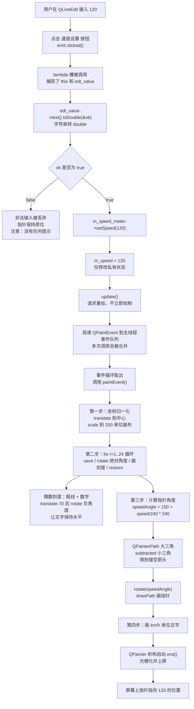

# Qt 21 自定义控件：速度表绘制 学习笔记

## 本章重要 API 函数

| API | 功能 | 参数说明 | 头文件 |
|-----|------|----------|--------|
| `QWidget::paintEvent()` | 重绘回调，控件外观的全部来源 | `QPaintEvent *event`：`event->rect()` 可取脏矩形。`protected` + `override` | `<QWidget>` |
| `QWidget::update()` | 请求重绘，是自定义控件"数据变了"的唯一响应方式 | 无参 / `QRect`。异步、可合并 | `<QWidget>` |
| `QPainter::translate()` | 平移坐标系原点 | `qreal dx, dy` 或 `QPointF`。仪表盘的第一步：把原点搬到控件中心 | `<QPainter>` |
| `QPainter::scale()` | 缩放坐标系 | `qreal sx, sy`：把 200×200 逻辑画布映射到实际尺寸，实现尺寸自适应 | `<QPainter>` |
| `QPainter::rotate()` | 旋转坐标系 | `qreal angle`：**单位是度、顺时针为正**（与数学习惯相反） | `<QPainter>` |
| `QPainter::save()` / `restore()` | 画家状态压栈 / 弹栈 | 无参。**必须严格配对**，循环画刻度时是刚需 | `<QPainter>` |
| `QPainterPath::addPolygon()` | 往路径里加一个多边形 | `const QPolygonF &polygon`：可用 `{QPointF(...), ...}` 初始化列表构造 | `<QPainterPath>` |
| `QPainterPath::subtracted()` | 路径差集（在自己身上挖掉对方） | `const QPainterPath &p`：返回新路径，**不修改原对象** | `<QPainterPath>` |
| `QPainter::drawPath()` | 绘制路径（按当前 Pen 描边 + Brush 填充） | `const QPainterPath &path` | `<QPainter>` |
| `QPainter::drawText()` | 绘制文字 | `(const QRect &r, int flags, const QString &text)`：`flags` 用 `Qt::AlignCenter` 等。**颜色由 Pen 决定** | `<QPainter>` |
| `QFont::setPointSize()` | 设置字号（点数） | `int pointSize`。注意会被 `scale()` 一起缩放 | `<QFont>` |
| `QString::number()` | 数字转字符串 | `int/double value, int base = 10`（double 版是 `char format, int precision`） | `<QString>` |
| `QString::toDouble()` | 字符串转 double，带成功标志 | `bool *ok = nullptr`：**必须检查 ok**，否则非法输入静默变成 0 | `<QString>` |
| `QBoxLayout::setStretch()` | 设置布局项的伸缩比例 | `int index, int stretch`：如 `(0,9)`/`(1,1)` 表示 9:1 分配空间 | `<QBoxLayout>` |

> 💡 Tips：
> - **`painter.rotate()` 是顺时针为正**，而数学上的极坐标是逆时针为正。所以"从左下 150° 开始、跨 240°"在屏幕上是"左下 → 正上 → 右下"的顺时针扫过。算角度时如果方向搞反，指针会朝错误的一侧摆。
> - **`QFont::setPointSize()` 会被 `scale()` 放大**。本工程 `scale(W/200.0, H/200.0)` 之后设 `setPointSize(6)`，在 400px 宽的控件上实际渲染约等于 12pt。这就是为什么代码里的字号数字看起来"小得不合理"——它们是逻辑坐标下的字号。
> - **`subtracted()` 返回新路径、不改原对象**。`a.subtracted(b)` 必须接收返回值；写成 `a.subtracted(b);` 一行丢弃返回值，编译通过但毫无效果。
> - **`toDouble(&ok)` 的 `ok` 必须检查**。`"abc".toDouble(&ok)` 会让 `ok = false` 且返回 0.0。不检查的话，用户输入乱码会让指针"归零"，看起来像 bug 却找不到原因。
> - **Qt5 vs Qt6**：`Q_OBJECT` 宏后面**不要加分号**（本工程 `SpeedWidget.h` 写了 `Q_OBJECT;`，Qt5/Qt6 的 moc 都能容忍，但某些编译器/静态分析工具会报警告，属于不规范写法）；Qt6 移除了 `QPainter::HighQualityAntialiasing`；Qt6 高 DPI 默认开启，但本篇的 `scale` 归一化写法天然 DPI 无关。

---

## 本章目录

> 点击条目可跳转到对应小节。

### 章节导航

- **[本章重要 API 函数](#本章重要-api-函数)**
- **[学习前后依赖](#学习前后依赖)**
- **[1. 概述](#1-概述)**
- **[2. 核心概念与原理](#2-核心概念与原理)**
  - [2.1 自定义控件的三要素](#21-自定义控件的三要素)
  - [2.2 坐标归一化：按 200×200 设计，适配任意尺寸](#22-坐标归一化按-200200-设计适配任意尺寸)
  - [2.3 镂空图形 = 大路径减小路径](#23-镂空图形--大路径减小路径)
- **[3. 关键机制：一次 setSpeed 到指针转动的完整链路](#3-关键机制一次-setspeed-到指针转动的完整链路)**
  - [3.1 数据驱动重绘流程图](#31-数据驱动重绘流程图)
  - [3.2 角度映射公式推导](#32-角度映射公式推导)
- **[4. 核心代码解析](#4-核心代码解析)**
  - [4.1 SpeedWidget.h：最小对外接口](#41-speedwidgeth最小对外接口)
  - [4.2 paintEvent 第一段：坐标归一化](#42-paintevent-第一段坐标归一化)
  - [4.3 paintEvent 第二段：循环画刻度与数字](#43-paintevent-第二段循环画刻度与数字)
  - [4.4 paintEvent 第三段：镂空指针](#44-paintevent-第三段镂空指针)
  - [4.5 mainwin.cpp：本工程最值得注意的几处写法](#45-mainwincpp本工程最值得注意的几处写法)
- **[5. 运行效果与验证](#5-运行效果与验证)**
- **[容易踩坑（注意点）](#容易踩坑注意点)**
- **[学习要点总结](#学习要点总结)**
  - [核心知识点](#核心知识点)
  - [关键 API](#关键-api)
  - [下一步学习](#下一步学习)
- **[Q&A（常见问题）](#qa常见问题)**
- **[Tips（全局速记）](#tips全局速记)**

> 💡 Tips：本篇的正确读法是**对着 qt20 的 `SeniorPainter::base04()` 一起读**。qt21 的 `paintEvent` 有大半是 base04 的翻版，真正新增的只有两块：`setSpeed()` 接口 + 镂空指针。把"哪些是复用的、哪些是新增的"分清楚，学习效率会高一倍。

---

## 学习前后依赖

| 方向 | 内容 |
| ---- | ---- |
| 前置基础 | **qt20 绘图基础（强依赖）**：`paintEvent`/`QPainter`/`QPen`/`translate-rotate-scale`/`save-restore`/`QPainterPath` 布尔运算，尤其是 `SeniorPainter::base03/base04` 的刻度盘代码；qt11 布局管理（`QHBoxLayout`/`QVBoxLayout`/`setStretch`）；qt13 信号槽（lambda 连接）。 |
| 本篇核心 | 把绘图代码**封装成可复用控件**：私有状态 + 公有 setter + `update()` 的标准范式；角度映射公式；`QPainterPath::subtracted` 做镂空指针；控件与宿主窗口的职责分离。 |
| 后续承接 | 所有自绘控件（温度计、进度环、频谱、K 线、示波器）都是这个范式的变体；也是接入 qt19 线程数据源、qt22 数据库数据源做可视化的展示层。 |

> 💡 Tips：为什么必须先会 qt20？因为本篇**不再解释任何绘图 API**，`translate`/`rotate`/`save/restore` 会被当成已知常识直接使用。如果 qt20 的"变换是累积的、必须 save/restore 隔离"这一点没吃透，读 `SpeedWidget::paintEvent` 的循环时会完全看不懂为什么每次算的是绝对角度。而本篇为哪篇打基础？它给出的"**私有数据 + setter + update()**"三段式，是之后所有自定义控件（包括接数据库/线程数据的实时图表）的通用骨架。

---

## 1. 概述

qt20 教会了我们"怎么用 QPainter 画东西"，但那些代码有个共同问题：**它们不是控件，只是一段绘制脚本**。`SeniorPainter::base04()` 能画出漂亮的刻度盘，可你没法在别的项目里 `new` 一个它、给它设个值、把它塞进布局里——因为它没有对外接口，画的内容也是写死的。

本工程 `qt21_tst_speedmeter` 完成的正是这个"从脚本到控件"的跨越。它把车速表做成一个独立的 `SpeedWidget` 类：

```cpp
SpeedWidget *meter = new SpeedWidget();
layout->addWidget(meter);      // 能进布局
meter->setSpeed(120.5);        // 能设数据，画面立刻更新
```

这三行代码背后是自定义控件的完整契约：**它像 Qt 自带控件一样可用**。使用者不需要知道里面有多少个 `rotate`、指针是怎么镂空的，只需要调 `setSpeed()`。

工程结构极简，一共三个源文件：

| 文件 | 职责 |
|------|------|
| `SpeedWidget.h/.cpp` | **控件本体**：一个 `qreal m_speed` 状态 + `setSpeed()` 接口 + 全部绘制逻辑 |
| `mainwin.h/.cpp` | **宿主窗口**：左侧放表盘（占 9 份宽），右侧放输入框 + 按钮（占 1 份），用 lambda 把输入值送给表盘 |
| `main.cpp` | 标准入口 |

值得注意的是：`SpeedWidget` **完全不知道 `QLineEdit` 的存在**，`MainWin` 也**完全不知道表盘里有几根刻度**。这种职责分离不是"写得漂亮"的加分项，而是控件能被复用的**前提**——同一个 `SpeedWidget` 明天接串口数据、后天接数据库查询结果，都不需要改一行绘制代码。

> 💡 Tips：概述里最该记住的一句话——**自定义控件的价值不在"画得好看"，而在"接口足够小"**。`SpeedWidget` 的全部对外接口只有一个 `setSpeed(qreal)`，这才是它能被到处复用的根本原因。反直觉的点是：很多人做自绘控件时急着加 `setMaxSpeed()`、`setTickColor()`、`setNeedleStyle()` 一堆配置项，结果类膨胀到 500 行还是不够灵活。**先做死一个能用的，再按真实需求逐个放开参数**，比一开始就设计"万能控件"务实得多。

---

## 2. 核心概念与原理

### 2.1 自定义控件的三要素

一个合格的自绘控件必须有且只需有三样东西：

```cpp
class SpeedWidget : public QWidget {
    Q_OBJECT
public:
    void setSpeed(qreal speed);          // ② 对外接口：改状态 + 触发重绘
protected:
    void paintEvent(QPaintEvent*) override;  // ③ 外观：完全由状态决定
private:
    qreal m_speed = 0;                   // ① 内部状态：唯一的数据源
};
```

- **① 内部状态**：控件"当前该显示什么"的全部信息。必须 `private`，且**有默认值**（这里 `= 0`，保证控件在还没被 setSpeed 前也能正确绘制）。
- **② 对外接口（setter）**：固定两句——**改状态，然后 `update()`**。少了 `update()`，数据变了画面不动；多做别的事（比如直接画图）就破坏了"绘制只在 paintEvent"的规则。
- **③ paintEvent**：**纯函数式**——只读 `m_speed` 和 `width()/height()`，不修改任何状态，不依赖"上次画了什么"。这保证了无论何时被调用（窗口遮挡后恢复、resize、setSpeed 触发）结果都一致。

这个三段式看起来简单到不值一提，但它是 Qt 全部控件（包括 `QSlider`、`QProgressBar`）的内部结构。**记住它，你就掌握了自定义控件的 80%。**

### 2.2 坐标归一化：按 200×200 设计，适配任意尺寸

自绘控件最棘手的问题是"窗口大小会变"。硬编码像素（`drawLine(180, 200, 195, 200)`）在 400px 的控件上好看，在 800px 上就缩在角落。解决方案是**坐标归一化**：

```cpp
int W = width();
int H = height();
painter.translate(W/2.0, H/2.0);       // ① 原点搬到控件中心
painter.scale(W/200.0, H/200.0);       // ② 逻辑 200×200 → 实际 W×H
// 此后所有坐标都按"一张 200×200、原点在中心、四边到边界各 100"的纸来写
painter.drawLine(80, 0, 95, 0);        // ③ 距中心 80~95 处的一根横线
```

做完这两步，你就在一个**固定尺寸的虚拟画布**上作画：

- 坐标范围是 `x ∈ [-100, 100]`、`y ∈ [-100, 100]`；
- `80` 表示"从中心到边界的 80%"处，控件放大缩小它都在同一相对位置；
- 所有尺寸、字号、线宽都自动跟着缩放。

**这是自绘控件最重要的一个模式**，qt20 的 `base03/base04` 已经预演过，qt21 原封不动地复用。

### 2.3 镂空图形 = 大路径减小路径

指针如果只是一个实心三角形，视觉上很"廉价"。真实仪表盘的指针往往是**中空的箭头轮廓**。手写这个轮廓需要 6~8 个点还要处理拐角，但用路径差集只需两行：

```cpp
QPainterPath bigNeedle;    // 外轮廓：底宽 8、长 80 的细长三角
bigNeedle.addPolygon(QPolygonF({QPointF(0,4), QPointF(80,0), QPointF(0,-4)}));
QPainterPath smallNeedle;  // 内轮廓：稍小一圈的同形三角
smallNeedle.addPolygon(QPolygonF({QPointF(4,2), QPointF(60,0), QPointF(4,-2)}));
QPainterPath finalNeedle = bigNeedle.subtracted(smallNeedle);   // 大减小 = 中空
```

结果是一个"**只有边框、内部被挖空**"的箭头。这个技巧的通用性极强：镂空箭头、环形进度条（大圆减小圆）、月牙、异形按钮，全是同一招。

> 💡 Tips：原理层面最容易误解的三点：
> 1. **`setSpeed()` 里的 `update()` 不是可选的礼貌，而是必需的。** 删掉它，`m_speed` 会被正确改写，但屏幕上的指针一动不动——直到你偶然拖动窗口触发了重绘，指针才"跳"到新位置。这个现象非常迷惑（"有时候能动有时候不能"），根因就是漏了 `update()`。
> 2. **`scale()` 之后，所有数字的含义都变了。** `drawLine(80, 0, 95, 0)` 里的 80 不是 80 像素，是"200 单位画布里的 80 单位"。同理 `setPointSize(6)` 也不是 6pt。**看到 scale 就要切换思维单位**，这是读自绘代码的必备开关。
> 3. **`scale(W/200.0, H/200.0)` 用了两个不同的比例，控件非正方形时会变形。** 圆盘会被拉成椭圆、文字会被横向拉伸。qt20 的 `base03/base04` 用的是 `side = qMin(W,H)` 然后 `scale(side/200.0, side/200.0)`（等比缩放），**那才是更稳妥的写法**。qt21 这里的差异是本工程最值得注意的一处细节，详见 4.2。

---

## 3. 关键机制：一次 setSpeed 到指针转动的完整链路

### 3.1 数据驱动重绘流程图



### 3.2 角度映射公式推导

指针角度这一行是整个控件的数学核心：

```cpp
qreal speedAngle = startAngle + (m_speed / max_speed) * rangeAngle;
//                  150       + (speed / 240)         * 240
```

拆解它：

| 部分 | 含义 | 本工程取值 |
|------|------|-----------|
| `startAngle` | 表盘起始角（0 刻度所在角度） | `150`（左下方） |
| `rangeAngle` | 表盘总跨度 | `240`（转 2/3 圈，底部留 120° 缺口） |
| `max_speed` | 满量程 | `240` km/h |
| `m_speed / max_speed` | **归一化比例**，把速度映射到 [0,1] | 120/240 = 0.5 |
| 乘 `rangeAngle` | 比例 → 角度增量 | 0.5 × 240 = 120° |
| 加 `startAngle` | 增量 → 绝对角度 | 150 + 120 = **270°** |

270° 顺时针（因为 `rotate` 顺时针为正）从"三点钟方向为 0°"起算，落在**正上方**——120 km/h 是满量程的一半，指针指正上，完全符合直觉。

这个公式是**所有量程类控件的通用模板**：温度计、油量表、进度环、音量旋钮，把 `startAngle/rangeAngle/max` 三个常量换掉就能直接用。

> 💡 Tips：流程图里最关键的三个节点：
> - **`E` 判断节点（`ok` 检查）**：这是本工程唯一的输入校验。它的存在保证了"输入 abc 不会让指针乱跳"，但**它选择了静默丢弃**——用户不知道自己输错了。工程化改进应该是 `edt_value->setStyleSheet("border:1px solid red")` 或弹提示。
> - **`I` 节点（`update()`）**：整个链路的**异步分界线**。它上面是数据流（同步、立即完成），下面是渲染流（异步、由事件循环调度）。理解这条线，就理解了"为什么 setSpeed 返回后画面还没变"。
> - **`M → O` 的顺序**：刻度和指针共用同一个归一化坐标系，但**刻度循环内部有自己的 save/restore**，所以画完刻度后坐标系回到"已归一化、未旋转"的干净状态，指针才能从 `rotate(speedAngle)` 正确起算。如果刻度循环漏了 restore，指针的角度会被累积的旋转污染——这是最难排查的一类 bug。

---

## 4. 核心代码解析

以下代码全部摘自 `D:\QT_place\QT_study_pjt\qt21_tst_speedmeter\`。

### 4.1 SpeedWidget.h：最小对外接口

```cpp
class SpeedWidget : public QWidget {
    Q_OBJECT;                                        // ① 多了个分号
public:
    explicit SpeedWidget(QWidget *parent = nullptr);
    ~SpeedWidget() override = default;               // ② 默认析构足够
    void setSpeed(qreal speed);                      // ③ 唯一的对外接口
protected:
    void paintEvent(QPaintEvent *event) override;    // ④ protected + override
private:
    qreal m_speed = 0;                               // ⑤ 唯一状态，有默认值
};
```

- ① **`Q_OBJECT;` 后面这个分号是多余的**。`Q_OBJECT` 展开是一大段声明（含 `public:` 访问说明符），末尾已经自带分号。多写一个分号会产生一条空声明语句——C++11 起允许类内出现多余分号，所以 MinGW/GCC 编译通过，但 MSVC 的某些警告等级和 clang-tidy 会提示。**规范写法是不加分号**。
- ② `~SpeedWidget() override = default;` ——控件没有裸指针成员，默认析构就够。写 `override` 是好习惯（基类 `QWidget` 的析构是 virtual）。
- ③ **`setSpeed` 不是 slot 也不是信号，就是个普通成员函数**。这完全够用——`MainWin` 通过 lambda 直接调用它。如果希望它能被 `connect` 到别的信号（比如 qt19 的 worker 信号），把它移到 `public slots:` 下即可（Qt5 新语法下普通成员函数也能连，但声明为 slot 更明确表达意图）。
- ④ `paintEvent` 必须是 `protected`（Qt 的设计约定，外部不该调用它）且必须 `override`。**漏了 `override` 而把参数类型写错（如写成 `QEvent*`）会变成"新函数"而不是重写**，编译通过但永远不会被调用——控件一片空白。`override` 关键字能在编译期拦住这个错误。
- ⑤ **`m_speed = 0` 的默认值很重要**。控件在被 `show()` 后、`setSpeed()` 被调用前就会收到第一个 `paintEvent`。如果 `m_speed` 未初始化，那次绘制会用随机值算角度，指针指向不确定方向（甚至 NaN 导致绘制异常）。**自定义控件的所有状态成员都必须有确定的初值。**

### 4.2 paintEvent 第一段：坐标归一化

```cpp
void SpeedWidget::paintEvent(QPaintEvent *event)
{
    QPainter painter(this);
    painter.setRenderHints(QPainter::Antialiasing, QPainter::TextAntialiasing);  // ①
    int W = width();
    int H = height();
    painter.translate(W/2.0, H/2.0);      // ② 原点移到中心
    painter.scale(W/200.0, H/200.0);      // ③ 归一化，但用了两个不同比例
```

- ① **`setRenderHints(hintA, hintB)` 又是那个误用**（详见 qt20 笔记）。签名是 `setRenderHints(RenderHints hints, bool on = true)`，第二个参数 `QPainter::TextAntialiasing` 的枚举值非 0，被隐式转成 `true`。**实际效果 = 只开了 `Antialiasing`，文字抗锯齿没开。** 本工程画了 13 处文字（12 个刻度数字 + km/h），所以这个 bug 在这里**是能看出来的**——数字边缘比开了文字抗锯齿时略毛糙。正确写法：

  ```cpp
  painter.setRenderHints(QPainter::Antialiasing | QPainter::TextAntialiasing);
  ```

  这是本工程最值得动手修的一处。修完前后放大截图对比，能直观感受到文字渲染质量的差别。
- ② `translate(W/2.0, H/2.0)` 用 `2.0` 而不是 `2` 保证浮点除法——`W/2` 在 W 为奇数时会丢半个像素，导致图形轻微偏移。**这个 `.0` 是有意义的**。
- ③ **`scale(W/200.0, H/200.0)` 是本工程最值得注意的一处设计选择**：它用了 X、Y 两个**独立**的缩放比例。后果是——

  | 控件尺寸 | sx | sy | 效果 |
  |---------|-----|-----|------|
  | 400×400（正方形） | 2.0 | 2.0 | ✅ 圆盘是正圆，文字正常 |
  | 400×200（扁） | 2.0 | 1.0 | ❌ 圆盘被压成椭圆，文字被横向拉宽 |
  | 200×400（高） | 1.0 | 2.0 | ❌ 圆盘被拉成竖椭圆 |

  `MainWin` 里 `resize(400,420)` 且表盘占 9/10 宽度，所以启动时表盘区域约 360×420 —— **已经不是正方形，仪表盘实际上是轻微竖向拉伸的椭圆**。用鼠标把窗口拖成很扁的形状，会看到明显的变形。

  **对比 qt20 的正确做法**：

  ```cpp
  qreal side = qMin(W, H);              // 取短边
  painter.scale(side/200.0, side/200.0); // 等比缩放，永不变形
  ```

  `SeniorPainter::base03/base04` 用的就是这个等比写法。qt21 反而"退化"了——这提醒我们：**代码演进不总是单向变好的，抄自己以前的代码时也要盯住关键行。**

  为什么等比更好？因为仪表盘的语义是"圆盘"，圆变椭圆就失真了。少数情况下（如横向拉伸的条形图）非等比缩放才是想要的。

### 4.3 paintEvent 第二段：循环画刻度与数字

```cpp
    qreal startAngle = 150;
    qreal rangeAngle = 240;
    for (int i = 1; i <= 24; i++)                     // ① 注意从 1 开始
    {
        painter.save();                               // ② 压栈，隔离本次变换
        qreal cur = startAngle + (i * (rangeAngle/24.0));   // ③ 绝对角度
        painter.rotate(cur);
        if (i % 2 == 0) {
            painter.setPen(QPen(Qt::darkRed, 2));     // ④ 直接构造 + setPen，正确写法
            painter.drawLine(80, 0, 95, 0);           // ⑤ 长刻度
            int speed_value = i * 10;                 // ⑥ 刻度值
            painter.translate(70, 0);                 // ⑦ 移到文字位置
            painter.rotate(-cur);                     // ⑧ 反向转回，文字保持水平
            QRect textRect(-15, -10, 30, 20);
            QFont font = painter.font();
            font.setPointSize(6);
            painter.setFont(font);                    // ⑨ 改完 set 回去，正确
            painter.drawText(textRect, Qt::AlignCenter, QString::number(speed_value));
        } else {
            painter.setPen(QPen(Qt::yellow, 1));      // ⑩ 短刻度用黄色细线
            painter.drawLine(80, 0, 90, 0);
        }
        painter.restore();                            // ② 弹栈
    }
```

- ① **`for (int i = 1; i <= 24; i++)` 从 1 开始，这是本工程一个隐含的问题**。当 i=1 时 `cur = 150 + 10 = 160°`，也就是说 **0 km/h 刻度线（应在 150°）根本没画**。对比 qt20 的 `base04` 用的是 `for (int i = 0; i <= rangeIndex; ++i)`（从 0 开始，画 25 根，含起点）。

  后果：表盘最左下角少了一根刻度和"0"这个数字，第一根出现的数字是 i=2 时的"20"。而指针在 `m_speed=0` 时会指向 150° 位置——**那里空无一物**。运行时能明显看到"指针零位没有刻度"。改成 `for (int i = 0; i <= 24; i++)` 即可修复。
- ② **`save()`/`restore()` 包住整个循环体**，保证每次进入循环时坐标系都是"已归一化、未旋转"的干净状态。这样 ③ 才能用**绝对角度**。如果去掉这一对，第 i 次的实际旋转会是前 i 次 `cur` 的累加，刻度瞬间乱成一团——**这是本篇最不能删的两行**。
- ③ `cur = 150 + i * (240/24.0) = 150 + i*10`。注意 `240/24.0` 写成浮点除法，若写 `240/24` 是整数除法得 10（这里恰好整除所以没出错，但换成 `rangeAngle/25` 就会因整除丢精度）。**角度计算永远用浮点**。
- ④ `painter.setPen(QPen(Qt::darkRed, 2))` —— 直接构造新 pen 并设置，**避免了 qt20 `base03` 里"改 `painter.pen()` 副本忘了 set 回"的经典 bug**。这个写法值得学：一步到位，不给自己犯错的机会。
- ⑤⑩ 长刻度 `drawLine(80,0,95,0)` 长 15 单位、粗 2；短刻度 `drawLine(80,0,90,0)` 长 10 单位、粗 1。**注意两者起点都是 80**，所以是"从内向外延伸不同长度"。qt20 的 base04 用的是长刻度 `(80,0,95,0)`、短刻度 `(85,0,95,0)` ——"外端对齐、内端不同"。两种风格都常见：外端对齐更整齐（像真实仪表），内端对齐更有层次。
- ⑥ `speed_value = i * 10`，配合 i 步进 2（只有偶数画数字），所以数字序列是 20、40、60 …… 240，间隔 20。加上缺失的 0，正好是标准车速表标注。
- ⑦⑧ **"先 translate 再反向 rotate"是仪表盘文字水平的标准技巧**（qt20 已详述）。这里 `translate(70, 0)` 把原点移到距中心 70 单位处（刻度线内侧），然后 `rotate(-cur)` 把坐标系转回水平。**顺序绝对不能反**：先反向转再平移，70 就会沿水平方向走，文字全跑到右边去。
- ⑨ `QFont font = painter.font(); font.setPointSize(6); painter.setFont(font);` —— 三步齐全。**注意 `painter.font()` 和 `painter.pen()` 一样返回值拷贝**，这里正确地 set 回去了。另外 `setPointSize(6)` 在 `scale` 之后意味着实际渲染字号约 `6 × (W/200)`，在 360px 宽时约 10.8pt，视觉上正合适。
- ⑩ 短刻度用 `Qt::yellow`，长刻度用 `Qt::darkRed`。这是纯审美选择，但**在白色默认背景上黄色对比度很低**，短刻度几乎看不见。改成深色（如 `Qt::darkGray`）或者给控件铺个深色底会好很多——真实仪表盘几乎都是深底亮字。

### 4.4 paintEvent 第三段：镂空指针

```cpp
    qreal max_speed = 240;                            // ① 满量程，与刻度上限一致
    painter.save();
    qreal speedAngle = startAngle + (m_speed/max_speed) * rangeAngle;   // ② 核心公式
    painter.rotate(speedAngle);
    // 镂空效果
    QPainterPath bigNeedle;
    bigNeedle.addPolygon(QPolygonF({QPointF(0,4), QPointF(80,0), QPointF(0,-4)}));   // ③
    QPainterPath smallNeedle;
    smallNeedle.addPolygon(QPolygonF({QPointF(4,2), QPointF(60,0), QPointF(4,-2)})); // ④
    QPainterPath finalNeedle = bigNeedle.subtracted(smallNeedle);       // ⑤ 大减小
    painter.setBrush(QColor(255,60,60));              // ⑥ 亮红填充
    painter.setPen(QPen(Qt::darkRed, 1));             // ⑦ 深红描边
    painter.drawPath(finalNeedle);
    painter.restore();
    // 画单位
    painter.save();
    QRect textRect(-20, 60, 40, 20);                  // ⑧ 中心下方
    QFont font = painter.font();
    font.setPointSize(12);
    painter.setFont(font);
    painter.drawText(textRect, Qt::AlignCenter, "km/h");
    painter.restore();
}
```

- ① **`max_speed = 240` 和刻度的 `24 × 10 = 240` 必须一致**，否则指针指向和刻度标注对不上。当前是硬编码的两处"240"（一处在循环的 `i*10`，一处在这里），**改量程时要同时改两处，很容易漏**。工程化改法是提成一个成员常量：

  ```cpp
  static constexpr qreal kMaxSpeed = 240.0;
  static constexpr int   kTickCount = 24;
  // 刻度值 = i * (kMaxSpeed / kTickCount)
  ```
  这样量程只有一个真相来源。**"同一个魔法数字在代码里出现两次"永远是重构信号。**
- ② **角度映射公式**（推导见 3.2）。注意 `m_speed/max_speed` 没有做钳位：输入 500 会算出 `150 + 2.08*240 = 650°`，指针转过一圈半指到奇怪的位置；输入 -100 会指到 150° 左侧。**健壮写法应该 `m_speed = qBound(0.0, speed, kMaxSpeed);` 在 setter 里就钳住。**
- ③④ **两个三角形的点集设计**：
  - 大三角 `(0,4) → (80,0) → (0,-4)`：底边在原点处宽 8 单位，尖端伸到 80 单位处。这是一个细长的等腰三角形。
  - 小三角 `(4,2) → (60,0) → (4,-2)`：底边在 x=4 处宽 4，尖端到 60。**整体比大三角小一圈且缩在里面**。
  - 关键是小三角必须**完全包含在大三角内部**，否则 `subtracted` 会切出奇怪的形状。这里 (4,2) 在大三角内、(60,0) 在大三角轴线上且 60<80，满足条件。
- ⑤ **`subtracted()` 返回新路径**。写成 `bigNeedle.subtracted(smallNeedle);` 丢弃返回值，编译通过但指针会是实心的——一个"看起来正常只是不镂空"的静默失败。
- ⑥⑦ 填充亮红 `QColor(255,60,60)` + 描边深红。**因为路径是镂空的，填充只作用于"大三角减小三角"的环状区域**，中间的空洞会透出背景色。这就是镂空效果的视觉来源。如果把 `setBrush` 去掉，就只剩内外两圈轮廓线——也是一种风格。
- ⑧ `QRect textRect(-20, 60, 40, 20)` 在归一化坐标里，即"中心下方 60~80 单位处、宽 40 单位"的区域。因为此时坐标系已经 `restore` 回未旋转状态，所以文字是水平的、位置固定在表盘下半部。`setPointSize(12)` 在 scale 后约合 21pt，是刻度数字的两倍，视觉层次合理。
- **一个可优化点**：`bigNeedle`/`smallNeedle`/`finalNeedle` 每帧都重新构造和做布尔运算。**指针形状其实永远不变，只有角度在变**，完全可以把 `finalNeedle` 缓存成成员变量，构造时算一次。当前实现在 30 FPS 下不会有问题（路径只有 3 个点，运算是微秒级），但如果指针形状复杂（几十个控制点 + 贝塞尔），这就是必须做的优化。

### 4.5 mainwin.cpp：本工程最值得注意的几处写法

```cpp
class MainWin : public QWidget          // ① 没有 Q_OBJECT 宏
{
public:
    explicit MainWin(QWidget *parent = nullptr);
    ~MainWin() override = default;
private:
    SpeedWidget *m_speed_meter;
};
```

```cpp
MainWin::MainWin(QWidget *parent)       // ② parent 参数被接收但没传给基类！
{
    auto main_layout = new QHBoxLayout(this);
    auto ctl_layout  = new QVBoxLayout();
    auto ctl_Widget  = new QWidget(this);
    ctl_Widget->setLayout(ctl_layout);              // ③ 手动 setLayout
    auto btn_start = new QPushButton("速度设置");    // ④ 无 parent，靠 addWidget 收养
    auto edt_value = new QLineEdit();
    ctl_layout->addWidget(edt_value);
    ctl_layout->addWidget(btn_start);

    m_speed_meter = new SpeedWidget();              // ④ 同上
    main_layout->addWidget(m_speed_meter);
    main_layout->addWidget(ctl_Widget);
    main_layout->setStretch(0, 9);                  // ⑤ 表盘 : 控制区 = 9 : 1
    main_layout->setStretch(1, 1);
    resize(400, 420);
    connect(btn_start, &QPushButton::clicked, this, [this, edt_value]() {   // ⑥
        bool ok = false;
        double v = edt_value->text().toDouble(&ok);  // ⑦ 检查 ok，好习惯
        if (ok) {
            m_speed_meter->setSpeed(v);             // ⑧ 唯一的数据入口
        }
    });                                             // ⑨ 非法输入静默忽略
}
```

这个文件虽然只有 30 行，但**藏着本篇最多的"注意点"**，逐条说明：

- ① **`MainWin` 缺少 `Q_OBJECT` 宏。** 后果：
  - 不能定义自己的信号和槽（moc 不为它生成元对象）；
  - `qobject_cast<MainWin*>` 失效；
  - `tr()` 翻译、属性系统、`className()` 都拿不到正确信息。

  **那为什么第 ⑥ 行的 `connect` 还能工作？** 因为 Qt5 新语法的 `connect(sender, &Class::signal, context, functor)` 只要求 **sender 有元对象**（`QPushButton` 当然有），第三个参数 `this` 仅作为"上下文对象"用于生命周期管理，不需要 `MainWin` 自己有元对象。所以这里**侥幸能跑**。但只要哪天想给 `MainWin` 加一个 `signals: void speedChanged(qreal);`，就会得到链接错误。**任何 QObject 派生类都应该加 `Q_OBJECT`，没有例外。**

- ② **`MainWin::MainWin(QWidget *parent)` 接收了 `parent` 却没有传给基类**——应该写成 `MainWin::MainWin(QWidget *parent) : QWidget(parent)`。当前写法等价于调用 `QWidget()` 默认构造，`parent` 参数被完全丢弃。

  后果：如果有人写 `new MainWin(someParent)`，这个窗口**不会成为 someParent 的子控件**，不会随父窗口销毁 → 内存泄漏，也不会跟随父窗口显示/隐藏。本工程 `main.cpp` 里是 `MainWin w;`（栈对象、无 parent），所以问题没暴露。**这是一个"当前用法下无害、但一旦复用就出错"的定时炮弹**，而且编译器不会给任何警告（未使用参数的警告通常被关掉）。

  凡是构造函数签名里有 `parent`，初始化列表里就必须有 `Base(parent)`——这是 Qt 类的肌肉记忆。

- ③ `ctl_Widget->setLayout(ctl_layout)`：`ctl_layout` 创建时没传 parent（`new QVBoxLayout()`），所以需要手动 `setLayout` 建立关联。对比 `main_layout = new QHBoxLayout(this)` 直接在构造时指定了宿主。**两种写法都对**，但混用容易搞混"这个 layout 到底装在哪"。建议统一用构造传参：`new QVBoxLayout(ctl_Widget)`。
- ④ `new QPushButton("速度设置")`、`new QLineEdit()`、`new SpeedWidget()` 都**没有传 parent**。这不是 bug——`layout->addWidget(w)` 会自动把 w **reparent** 到 layout 所属的 widget 上。所以它们最终都挂在对象树上，不会泄漏。

  **但要注意这和 qt19 的 `moveToThread` 场景形成有趣对比**：那里"不能有 parent"是硬要求，这里"暂时没有 parent"只是依赖 `addWidget` 后续收养。**如果你 `new` 了一个 widget 却忘了 `addWidget`，它就是真的泄漏了**（没 parent 也没 layout 管它）。

- ⑤ `setStretch(0, 9)` / `setStretch(1, 1)` 让表盘和控制区按 **9:1** 分配水平空间。在 400px 宽下约 360px 给表盘、40px 给控制区。

  **40px 宽的控制区能放下"速度设置"四个字的按钮吗？** 实际上放不下——按钮有最小尺寸约束（`sizeHint`），布局会优先满足最小宽度，所以实际比例会偏离 9:1。这也解释了为什么运行时控制区看起来比 1/10 宽。**`setStretch` 分配的是"剩余空间"，不是"绝对比例"**，这是布局系统一个高频误解点。

- ⑥ **lambda 捕获了 `this` 和 `edt_value` 两个指针**。`this` 用来访问 `m_speed_meter`，`edt_value` 是局部变量所以必须显式捕获（值捕获指针本身）。

  这里有个**潜在的生命周期风险**：lambda 持有 `edt_value` 的裸指针，如果 `edt_value` 先于 `btn_start` 被销毁，点击按钮就是访问野指针。本例中两者都挂在同一对象树上、生命周期一致，所以安全。但**通用做法是把 `edt_value` 提升为成员变量**，或者用第三参数 `this` 保证"MainWin 销毁时自动断开连接"（这里已经这么做了，是正确的）。

  **注意 `connect` 的第三个参数 `this` 不是可选装饰**：如果写成 `connect(btn_start, &QPushButton::clicked, [this, edt_value](){...})`（省略 context），那么 `MainWin` 销毁后连接不会自动断开，若 `btn_start` 存活更久就会调用已销毁对象的成员 → 崩溃。**带 lambda 的 connect 一定要给 context 对象。**

- ⑦ `toDouble(&ok)` **检查了 `ok`，这是本文件写得最好的一处**。`QString::toDouble()` 在转换失败时返回 0.0，如果不检查，用户输入 "abc" 会让指针归零——一个看起来像 bug 却查不出原因的现象。
- ⑧ **`setSpeed(v)` 是 `MainWin` 和 `SpeedWidget` 之间唯一的耦合点**。`MainWin` 不知道表盘里有几根刻度、指针怎么画；`SpeedWidget` 不知道数据来自输入框还是传感器。这种"**窄接口**"是控件可复用的根本。想接 qt19 的子线程数据，只需 `connect(worker, &Worker::speedReady, meter, &SpeedWidget::setSpeed);`（把 `setSpeed` 挪到 `public slots:` 即可），一行代码换数据源。
- ⑨ **非法输入被静默忽略**——`if(ok)` 为假时什么都不做，用户看不到任何反馈，会以为"程序卡了"。改进方案：

  ```cpp
  if (ok) {
      m_speed_meter->setSpeed(qBound(0.0, v, 240.0));   // 顺手钳位
      edt_value->setStyleSheet("");
  } else {
      edt_value->setStyleSheet("border: 1px solid red");  // 视觉反馈
  }
  ```
  或者直接用 `QDoubleValidator` 从源头限制输入：
  ```cpp
  edt_value->setValidator(new QDoubleValidator(0, 240, 1, edt_value));
  ```
  **"校验通过才用、校验失败给反馈"是完整的输入处理，只做前一半是半成品。**

> 💡 Tips：这几段代码里藏着的关键细节，一句话一条：
> - **`update()` 触发重绘**——`setSpeed` 里少了它，指针就只在窗口被动重绘时才跳动。
> - **`save()/restore()` 包住刻度循环**，删掉后所有刻度的旋转会累积叠加，表盘瞬间报废。
> - **`for i = 1` 少画了 0 刻度**，指针零位处空无一物；改成 `i = 0` 修复。
> - **`scale(W/200.0, H/200.0)` 非等比**，控件非方形时圆盘变椭圆；qt20 的 `qMin(W,H)` 等比写法更稳。
> - **`setRenderHints(A, B)` 第二参是 bool**，文字抗锯齿实际没开；改用 `A | B`。
> - **`MainWin` 缺 `Q_OBJECT`、构造函数丢了 `parent`**——当前能跑，但都是复用时的定时炮弹。
> - **`toDouble(&ok)` 检查了 ok（好），但失败后无反馈（半成品）。**
> - **量程 240 硬编码了两处**，改量程容易漏改一处导致指针和刻度对不上。

---

## 5. 运行效果与验证

**编译运行后应看到：**

1. 一个 400×420 的窗口。左侧大部分区域是**白底的速度表**：一圈从左下经正上到右下的刻度（深红长刻度 + 黄色短刻度），长刻度旁标着 20、40、60 …… 240 的数字，表盘下方有 "km/h"。
2. 中心有一根**镂空的红色箭头指针**，初始 `m_speed = 0` 时指向左下 150° 方向。
3. 右侧窄条区域有一个输入框和"速度设置"按钮。
4. 在输入框输入 `120`、点按钮 → **指针立即跳到正上方**（120 是满量程 240 的一半，150° + 120° = 270°，正上）。
5. 输入 `240` → 指针跳到右下（150 + 240 = 390° ≡ 30°）。
6. 输入 `0` → 指针回到左下起点。

**逐项验证清单：**

| 验证项 | 操作 | 预期 | 说明 |
|--------|------|------|------|
| 零刻度缺失 | 观察左下 150° 位置 | **没有刻度线也没有"0"** | 因为 `for i=1` 起。改成 `i=0` 后会出现 |
| 指针角度对不对 | 输入 120 | 指针**正上方** | 验证角度公式；若指向别处说明公式或起始角理解错了 |
| 非等比缩放变形 | 把窗口拖得很扁（如 700×250） | **圆盘明显压成椭圆**，文字被横向拉宽 | 验证 `scale(W/200,H/200)` 的副作用。改成 `qMin` 等比后不再变形 |
| 尺寸自适应 | 等比放大窗口（400×420 → 800×840） | 所有元素**按比例放大**，相对位置不变 | 验证归一化设计有效 |
| 非法输入 | 输入 `abc` 点按钮 | 指针**不动**，无任何提示 | 验证 `if(ok)` 生效；同时暴露"无反馈"的体验问题 |
| 超量程 | 输入 `500` | 指针转过一圈半，指向奇怪位置 | 验证缺少 `qBound` 钳位 |
| 负值 | 输入 `-50` | 指针指到 150° 左侧（表盘外） | 同上 |
| 空输入 | 直接点按钮 | 指针不动（`""` 转换失败） | `if(ok)` 正确拦住了 |
| 镂空效果 | 放大窗口后细看指针 | 箭头**内部透出背景色**，只有一圈红色轮廓 | 验证 `subtracted` 生效；若是实心说明丢了返回值 |
| 文字抗锯齿 | 放大到 800px 看数字边缘 | 边缘略有锯齿 | 因 `setRenderHints(A,B)` 误用。改成 `A\|B` 后明显平滑 |

**推荐的对比实验（最有价值的三个）：**

1. **注释掉 `setSpeed` 里的 `update()`**：输入 120 点按钮，指针**不动**；然后用鼠标拖动窗口边缘，指针**突然跳到 120 位置**。这个"延迟生效"的现象能让你永久记住 `update()` 的作用。
2. **删掉刻度循环里的 `save()/restore()`**：表盘变成一团乱麻——因为每次 `rotate(cur)` 都叠加在上一次之上，第 24 次的实际角度是所有 `cur` 之和（约 3000°）。
3. **把 `scale(W/200.0, H/200.0)` 改成 `qreal s = qMin(W,H)/200.0; painter.scale(s,s);`** 然后拖成扁窗口对比。你会发现等比版本永远是正圆（只是可能没填满控件），非等比版本会变形。这是"要不要填满 vs 要不要保形"的经典权衡。

> 💡 Tips：验证时最容易误判"成功"的三种假象：
> 1. **"指针会动，所以角度公式对了"**——指针会动只说明 `setSpeed + update` 通了。公式对不对要**用特殊值验证**：0 应指起点、满量程应指终点、半量程应指正上。只测一个中间值（比如 87）根本看不出偏差。
> 2. **"窗口默认大小下表盘是圆的，所以缩放没问题"**——`resize(400,420)` 加上 9:1 布局，表盘区域约 360×420，**已经在轻微变形了**，只是幅度小看不出。必须**主动拖成极端比例**才能暴露。这是"默认配置掩盖 bug"的典型。
> 3. **"输入 abc 指针没乱跳，所以输入校验做好了"**——校验只做了一半。没有反馈的校验对用户来说等同于"程序坏了"。判断标准应该是"**用户能否知道自己输错了**"，而不是"程序有没有崩"。

---

## 容易踩坑（注意点）

- **坑 1：`setSpeed()` 里忘了 `update()`。**
  *现象*：数据改了但画面不动；拖动窗口后指针突然跳到新位置，表现为"有时候能动有时候不能"。
  *原因*：`m_speed` 只是内存里的数，Qt 不知道控件需要重绘。
  *规避*：**所有自定义控件的 setter 结尾都必须 `update()`**。进阶优化：`if (qFuzzyCompare(m_speed, speed)) return;` 先判重，值没变就不重绘。

- **坑 2：循环画多个旋转元素时漏了 `save()/restore()`。**
  *现象*：刻度越画越歪，后面的元素飞到控件外，整个表盘乱成一团。
  *原因*：`rotate/translate/scale` 是**累积**的，不 restore 就会叠加。
  *规避*：循环体首尾严格配对 `save()`/`restore()`，像括号一样对齐缩进。复杂场景可写个 RAII 守卫类保证异常安全。

- **坑 3：非等比 `scale(W/200, H/200)` 导致圆盘变形。**
  *现象*：窗口不是正方形时，圆盘变椭圆、文字被拉伸。
  *原因*：X、Y 用了不同缩放比例。
  *规避*：**保形优先用 `qreal s = qMin(W,H)/200.0; scale(s,s);`**（qt20 的做法）；若确实要填满非方形区域，再考虑 `sizeHint()` + `heightForWidth()` 强制控件保持方形。

- **坑 4：`for (int i = 1; ...)` 漏画起始刻度。**
  *现象*：指针零位处没有刻度线和"0"标注，表盘左下角有个缺口。
  *原因*：循环从 1 开始，跳过了 `i=0` 对应的 150° 位置。
  *规避*：**画刻度的循环边界要用"特殊值验证法"检查**：手算 i 的首末值对应的角度，确认覆盖了 `[startAngle, startAngle+rangeAngle]` 整个区间。这里应是 `for (int i = 0; i <= 24; i++)`。

- **坑 5：指针角度不钳位，超量程/负值时指到表盘外。**
  *现象*：输入 500 指针转一圈半，输入 -50 指到刻度区外。
  *原因*：`m_speed/max_speed` 可以是任意值。
  *规避*：在 setter 里就钳住 `m_speed = qBound(0.0, speed, kMaxSpeed);`。**输入校验放在数据入口，而不是绘制阶段**——绘制代码应该假设数据已经合法。

- **坑 6：`painter.pen()/font()/brush()` 改了副本没 set 回去。**
  *现象*：明明改了字号/线宽，画面毫无变化。
  *原因*：这些 getter 返回**值拷贝**。
  *规避*：三步齐全 `QFont f = painter.font(); f.setPointSize(6); painter.setFont(f);`；或直接 `painter.setPen(QPen(Qt::darkRed, 2))` 一步到位（本工程刻度部分用的正是这种更安全的写法）。

- **坑 7：`QObject` 派生类忘了 `Q_OBJECT` 宏。**
  *现象*：当前能跑（因为只用了 lambda connect），但一旦想加自己的 signal 就链接错误；`qobject_cast` 返回 nullptr。
  *原因*：moc 不为它生成元对象。
  *规避*：**任何直接或间接继承 QObject 的类，第一行就写 `Q_OBJECT`（不加分号）**，不管当前是否用得上。

- **坑 8：构造函数接收了 `parent` 却没传给基类。**
  *现象*：`new MainWin(parent)` 创建的窗口不受 parent 管理 → 泄漏、不随父窗口显示隐藏。
  *原因*：`MainWin::MainWin(QWidget *parent)` 后面漏了 `: QWidget(parent)`。
  *规避*：Qt 类的构造函数只要有 `parent` 参数，初始化列表就必须有 `Base(parent)`。这条没有例外。

- **坑 9：`setRenderHints(hintA, hintB)` 当成开两个 hint。**
  *现象*：文字边缘发毛，以为是字体问题。
  *原因*：第二参是 `bool on`，第二个 hint 被转成 `true`。
  *规避*：用 `|` 组合 `setRenderHints(A | B)`。

- **坑 10：量程等魔法数字在多处硬编码。**
  *现象*：改量程时只改了一处，指针指向和刻度标注对不上（比如刻度标到 240 但指针按 300 算）。
  *原因*：`i*10` 隐含的 240 和 `max_speed = 240` 是两个独立的真相。
  *规避*：提成 `static constexpr` 常量，所有派生值都从它算出来。

---

## 学习要点总结

### 核心知识点

1. **自定义控件三要素**：`private` 状态（有默认值）+ `public` setter（改状态 + `update()`）+ `paintEvent`（纯函数式，只依赖状态）。这是 Qt 所有控件的内部结构。
2. **坐标归一化模式**：`translate` 到中心 + `scale` 到固定逻辑尺寸（200×200）→ 按虚拟画布设计，自动适配任意控件大小。**等比缩放（`qMin(W,H)`）保形，非等比会变形**。
3. **量程 → 角度的映射公式**：`angle = startAngle + (value / maxValue) * rangeAngle`。温度计、油量表、进度环、旋钮全都用它，只需换三个常量。
4. **循环画重复元素必须 `save()/restore()`**，这样每次可以用**绝对角度**而不是累积增量，既易读又无累积误差。
5. **"先 translate 再反向 rotate"让旋转坐标系里的文字保持水平**，这是仪表盘绘制最精髓的技巧，顺序不可颠倒。
6. **`QPainterPath::subtracted()` 做镂空**：大形状减小形状。通用于镂空箭头、环形进度、月牙、异形按钮。
7. **窄接口是复用的前提**：`SpeedWidget` 对外只有 `setSpeed(qreal)`，所以换任何数据源（输入框/串口/线程/数据库）都不用改绘制代码。

### 关键 API

| API | 功能 |
|-----|------|
| `paintEvent(QPaintEvent*)` | 控件外观的唯一来源 |
| `update()` | setter 里必须调用，请求重绘 |
| `translate/scale/rotate` | 坐标归一化与元素定位 |
| `save()/restore()` | 状态压栈，循环绘制的刚需 |
| `QPainterPath::addPolygon/subtracted` | 构建路径 / 做镂空 |
| `drawPath/drawLine/drawText` | 绘制路径 / 刻度 / 数字 |
| `QFont::setPointSize` | 字号（会被 scale 一起缩放） |
| `QString::toDouble(bool*)` | 输入解析，**必须检查 ok** |
| `QBoxLayout::setStretch` | 按比例分配剩余空间 |
| `qBound` | 数值钳位，防止超量程 |

### 下一步学习

- **qt22 SQLite 数据库**：给仪表盘配上数据持久化——把每次采集的速度存进数据库，再查历史记录回放。`QSqlQuery` 取出的数据经 `setSpeed()` 送进本篇的控件，就是一个完整的"存储 + 可视化"小系统。
- 之后可延伸：`QPropertyAnimation` 让指针**平滑过渡**而不是瞬间跳变（配合 `Q_PROPERTY(qreal speed ...)`）；离屏缓存把静态刻度盘预渲染成 `QPixmap` 优化性能；`QChart`/`QCustomPlot` 做趋势曲线。

> 💡 Tips：本篇与 qt22 的挂钩点——**本篇解决了"数据怎么显示"，qt22 解决"数据从哪来、存到哪去"**。两篇合起来就是一个最小可用的数据采集系统：`QSqlQuery` 查出速度记录 → `setSpeed()` → `update()` → 指针转动。而如果数据源是耗时查询，还要用上 qt19 的 worker 线程避免卡界面。**qt19 + qt20 + qt21 + qt22 四篇正好构成一条完整链路：后台采集（线程）→ 数据持久化（SQLite）→ 绘制引擎（QPainter）→ 可复用控件（SpeedWidget）。**

---

## Q&A（常见问题）

**Q1：`setSpeed()` 为什么必须调 `update()`？直接在 `setSpeed` 里画不行吗？**
A1：不行，而且会失败得很彻底。原因有两层：

1. **技术上不可能**：`QPainter painter(this)` 只有在 `paintEvent` 执行期间才能成功绑定 widget（此时 paint engine 有效）。在 `setSpeed` 里构造会得到 `QPainter::begin: Paint device returned engine == 0`，什么都画不出来。
2. **逻辑上不该**：即使能画，你画上去的内容也会在下一次系统重绘（窗口遮挡恢复、resize）时被完全擦掉——因为系统重绘会调 `paintEvent`，而它只认 `m_speed`。

正确的心智模型是：**`paintEvent` 是"状态 → 像素"的纯函数，setter 只负责改状态并说一句"我脏了"**。

```cpp
void SpeedWidget::setSpeed(qreal speed) {
    if (qFuzzyCompare(m_speed, speed)) return;   // 可选优化：值没变不重绘
    m_speed = speed;                             // 改状态
    update();                                    // 请求重绘
}
```

**Q2：`save()/restore()` 到底在保存什么？不用它行不行？**
A2：`save()` 把 `QPainter` 的**全部当前状态**压入栈：变换矩阵（translate/rotate/scale 累积的结果）、Pen、Brush、Font、裁剪区域、渲染提示、opacity 等。`restore()` 弹出恢复。

**不用它行不行？取决于你的循环写法：**

```cpp
// 写法 A：用 save/restore + 绝对角度（本工程，推荐）
for (int i = 0; i <= 24; i++) {
    painter.save();
    painter.rotate(150 + i * 10);      // 绝对角度，一眼看懂
    painter.drawLine(80, 0, 95, 0);
    painter.restore();
}

// 写法 B：不用 save/restore + 增量角度（qt20 base03 的做法）
painter.rotate(150);                   // 先转到起点
for (int i = 0; i <= 24; i++) {
    painter.drawLine(80, 0, 95, 0);
    painter.rotate(10);                // 每次增量 10°
}
```

写法 B 也能工作且更省调用，但有两个缺点：① 循环体内如果还有 `translate`（比如画文字），就会污染下一轮，必须 save/restore；② 浮点累积误差（转 24 次 10.0° 可能不精确等于 240°）。**只要循环体内做了多于一次变换，就必须用 save/restore。** 本工程偶数分支里有 `rotate + translate + rotate`，属于必须用的情况。

**Q3：`QPainterPath::subtracted()` 和 `intersected()`、`united()` 分别什么时候用？**
A3：三个都是路径布尔运算，选择取决于你想要的形状：

| 方法 | 效果 | 典型用途 |
|------|------|----------|
| `a.united(b)` | **并集**，a 和 b 合并 | 复合轮廓（圆+矩形拼成的图标）、连通区域 |
| `a.subtracted(b)` | **差集**，在 a 上挖掉 b | **镂空指针**（本篇）、环形进度条（大圆减小圆）、月牙、带孔的形状 |
| `a.intersected(b)` | **交集**，只留重叠部分 | 柳叶/透镜形（两圆相交）、把图形裁进某个区域 |

**注意三点：**
1. 都返回**新路径**，不修改原对象。`a.subtracted(b);` 丢弃返回值 = 什么都没做。
2. 做差集时被减的形状应**完全包含在减数内部**（或有明确的重叠语义），否则会切出意外形状。
3. 有开销（多边形裁剪算法）。**形状不变只是角度变时，应该缓存路径**：

```cpp
// 在构造函数里算一次
m_needlePath = bigNeedle.subtracted(smallNeedle);
// paintEvent 里只做 rotate + drawPath
painter.rotate(speedAngle);
painter.drawPath(m_needlePath);
```

**Q4：为什么 `MainWin` 没有 `Q_OBJECT` 宏也能用 `connect`？这样有什么隐患？**
A4：因为 Qt5 引入的新语法 `connect(sender, &Sender::signal, context, functor)` 对三个参数的要求不同：

- **sender**：必须有元对象（`QPushButton` 有 `Q_OBJECT`，满足）；
- **signal**：编译期取成员函数指针，靠 sender 的元对象解析；
- **context**（第三参 `this`）：只需要是 `QObject*`，用于"context 销毁时自动断开连接"。**不需要自己有元对象。**

所以 `MainWin` 缺 `Q_OBJECT` 在这个特定用法下不会报错。**隐患是：**

1. 无法定义自己的 signals/slots——加一个 `signals: void xxx();` 会得到 `undefined reference to MainWin::xxx()`（moc 没生成实现）；
2. `qobject_cast<MainWin*>(ptr)` 永远返回 nullptr；
3. `metaObject()->className()` 返回的是基类名 `"QWidget"` 而不是 `"MainWin"`，调试和属性系统都受影响；
4. 无法用 `tr()` 做上下文相关的翻译；
5. 无法用 Qt 的属性系统（`Q_PROPERTY`）和动画框架。

**结论：没有任何理由省略 `Q_OBJECT`。** 代价是零（moc 生成的代码量微乎其微），收益是完整的元对象能力。

**Q5：怎么让指针平滑转动而不是瞬间跳变？**
A5：三种方案，从简到繁：

**方案一：`QPropertyAnimation`（最优雅，推荐）**

```cpp
// SpeedWidget.h
class SpeedWidget : public QWidget {
    Q_OBJECT
    Q_PROPERTY(qreal speed READ speed WRITE setSpeed)   // 声明为属性
public:
    qreal speed() const { return m_speed; }
    void setSpeed(qreal s) { m_speed = s; update(); }
};

// 使用
auto *anim = new QPropertyAnimation(meter, "speed");
anim->setDuration(800);
anim->setStartValue(meter->speed());
anim->setEndValue(120.0);
anim->setEasingCurve(QEasingCurve::OutCubic);   // 缓出，更像真实仪表
anim->start(QAbstractAnimation::DeleteWhenStopped);
```
动画框架会以约 60 FPS 反复调用 `setSpeed`，每次都 `update()`，自然形成平滑过渡。**注意 `Q_PROPERTY` 要求类有 `Q_OBJECT`**——这又是一条不能省略它的理由。

**方案二：`QTimer` 手动插值**（qt20 `Ball` 的思路）

```cpp
// 每 16ms 让 m_speed 向 m_targetSpeed 逼近
m_speed += (m_targetSpeed - m_speed) * 0.15;   // 指数逼近，天然缓出
update();
```

**方案三：`QVariantAnimation` + 自定义插值**，适合非线性映射（如指针有超调回摆的物理效果）。

真实汽车仪表盘还会有"回弹"效果（指针略微超过目标再回摆），用 `QEasingCurve::OutBack` 一行就能模拟。

**Q6：Qt5 和 Qt6 在自定义控件上有什么差异需要注意？**
A6：本工程用 Qt 6.5.3 + MinGW，主要差异：

| 项目 | Qt5 | Qt6 |
|------|-----|-----|
| 高 DPI 缩放 | 需 `QApplication::setAttribute(Qt::AA_EnableHighDpiScaling)` | **默认开启**，`devicePixelRatio()` 可能是 1.25/1.5 等小数 |
| `QPainter::HighQualityAntialiasing` | 废弃（等同 Antialiasing） | **移除** |
| `drawRoundRect()` | 废弃 | **移除**，用 `drawRoundedRect()` |
| `QFontMetrics::width()` | 废弃 | **移除**，用 `horizontalAdvance()` |
| `Qt::MidButton` | 废弃别名 | **移除**，用 `Qt::MiddleButton` |
| `qrand()/qsrand()` | 废弃 | **移除**，用 `QRandomGenerator` |
| `QWidget::enterEvent` 参数 | `QEvent*` | **改为 `QEnterEvent*`** |

**对自绘控件影响最大的是高 DPI 默认开启**：`width()` 返回逻辑像素，实际物理像素是 `width() * devicePixelRatio()`。好消息是本篇的"translate + scale 归一化"写法**天然 DPI 无关**——因为一切都是相对比例。坏消息是如果你做离屏缓存（画到 `QPixmap`），必须：

```cpp
QPixmap pm(size() * devicePixelRatio());
pm.setDevicePixelRatio(devicePixelRatio());   // 否则在高 DPI 屏上模糊
```

另外 `QEnterEvent` 那条会导致 Qt5 代码在 Qt6 下**编译通过但 `enterEvent` 永不被调用**（签名不匹配变成了新函数）——这也是为什么 `override` 关键字必须写。

---

## Tips（全局速记）

### 最容易忽视的细节

1. **`m_speed = 0` 的默认初值不是可选的。** 控件在 `show()` 后、`setSpeed()` 前就会收到第一个 `paintEvent`。成员未初始化会用随机值算角度，可能得到 NaN 让整个路径绘制失败（表现为"指针不见了"）。**所有控件状态成员都要有确定初值。**
2. **`for (int i = 1; i <= 24; ...)` 这个 `1` 让 0 刻度凭空消失。** 循环边界错误在绘图代码里特别隐蔽——因为"少画一根线"不会报错，只会让画面"看起来差点意思"。**画刻度的循环写完，一定要手算首末角度对不对。**
3. **`scale(W/200.0, H/200.0)` 和 `scale(qMin(W,H)/200.0, ...)` 的差别在方形窗口下完全看不出来。** 这类"默认配置掩盖的 bug"必须靠**极端参数测试**暴露。养成习惯：自绘控件写完，先把窗口拖成 3:1 和 1:3 各看一次。
4. **`painter.font()` 返回值拷贝**，和 `pen()`/`brush()` 一样。本工程这里写对了（改完 set 回去），但 qt20 的 `base03` 就在 `pen()` 上翻了车。**Qt 里从对象取出的配置类，改完必须 set 回去。**
5. **`setStretch(0,9)` 分配的是"剩余空间"而非绝对比例。** 子控件的 `minimumSizeHint` 优先被满足，所以"速度设置"按钮的最小宽度会挤占表盘空间，实际比例达不到 9:1。想要严格比例得用 `setFixedWidth` 或 `QSizePolicy`。
6. **`connect` 带 lambda 时第三个参数 `this` 是生命周期保险**。省略它，`MainWin` 销毁后连接仍存在，若 sender 存活更久就会访问野指针。本工程正确地传了 `this`。

### 踩坑记录

- **"指针有时候能动有时候不能"排查半天，最后是 `update()` 被注释掉了。** 现象之所以迷惑，是因为**窗口的被动重绘（拖动、遮挡恢复）会掩盖漏掉 `update()` 的 bug**——你以为程序是间歇性故障，实际是"只有系统重绘时才更新"。**遇到"间歇性生效"的绘图问题，第一个怀疑对象永远是 `update()`。**
- **`Q_OBJECT;` 那个多余的分号，MinGW 编过了，换 MSVC 报警告。** 这类"某编译器容忍、某编译器不容忍"的写法是跨平台移植的隐形成本。规范写法（不加分号）在所有编译器下都对，没有理由不遵守。
- **`MainWin` 构造函数丢了 `parent` 这个 bug，编译器一个字都没说。** 因为"未使用的参数"警告默认关闭，而"忘了调基类构造"是合法 C++（会调默认构造）。**这类 bug 只能靠 code review 和肌肉记忆防御。** 建议在 CODEBUDDY.md / 团队规范里写死一条："Qt 类构造函数有 parent 参数时，初始化列表必须有 Base(parent)"。
- **量程 240 在代码里有两个独立来源（`i*10` 的隐含 240 和 `max_speed=240`）。** 我曾把 `max_speed` 改成 300 想扩量程，结果刻度还标到 240、指针却按 300 算，两者错位——查了很久才发现"另一个 240 藏在 `i*10` 里"。**魔法数字出现第二次，就是提取常量的时候。**

### 与后续章节的衔接

1. **→ qt22 SQLite**：本篇的 `setSpeed()` 是可视化入口，qt22 提供数据来源。完整链路是 `QSqlQuery::next()` 取出历史速度 → `setSpeed()` → 指针转动，就能做"行程回放"。如果查询耗时，还要套上 qt19 的 worker 线程。
2. **→ 回望 qt19 线程**：把数据源换成子线程只需一行 `connect(worker, &Worker::speedReady, meter, &SpeedWidget::setSpeed);`（前提是 `setSpeed` 声明为 slot）。跨线程信号自动排队到主线程，`update()` 在主线程调用，**完全符合"UI 只能在主线程"的铁律**——本篇的窄接口设计让这个切换毫无成本。
3. **→ 回望 qt20 绘图**：本篇是 qt20 `SeniorPainter::base04()` 的产品化。对比两者能清楚看到"实验脚本 → 可复用组件"需要补的东西：状态成员、setter、`update()`、以及把硬编码值参数化。
4. **→ 后续动画与属性系统**：给 `SpeedWidget` 加 `Q_PROPERTY(qreal speed ...)` 就能接入 `QPropertyAnimation`，指针从"跳变"升级为"平滑转动"。这也是 Qt 属性系统最直观的一个应用场景。
5. **→ 后续性能优化**：静态刻度盘每帧重画 24 根线 + 12 段文字是浪费（只有指针在动）。标准优化是把刻度盘预渲染到 `QPixmap` 缓存，`paintEvent` 里 `drawPixmap` + 画指针。**这是所有仪表类控件的标配优化**，等你做到 10 个仪表同屏刷新时就必须用上。

### 设计决策思考

- **为什么把速度表做成独立的 `SpeedWidget` 类，而不是直接在 `MainWin::paintEvent` 里画？** 因为**复用性和可测试性**。独立成类后：① 可以在任何窗口、任何布局里放多个实例（做双表盘、四表盘仪表台）；② 数据源可以随意替换（输入框/串口/线程/数据库），因为它只认 `setSpeed`；③ 可以单独调试——写个只有一个表盘的 `main` 快速迭代外观。如果画在 `MainWin` 里，这三点全部丧失。**"一个类只画自己"是自绘控件的第一原则。**
- **为什么用"归一化到 200×200"而不是直接用像素坐标？** 因为它把"设计"和"适配"解耦了。设计时你在一张固定大小的纸上思考（刻度在 80~95、文字在 70、指针长 80），完全不用考虑控件多大；适配交给一行 `scale`。如果用像素坐标，每个数字都得写成 `width()*0.4` 这样的表达式，代码可读性会崩塌，而且改一处比例要改十几个地方。**这是"用一次变换换取全局简洁"的经典权衡**，代价是必须始终记住"当前数字是逻辑单位不是像素"。
- **为什么指针用 `subtracted` 做镂空，而不是画两个三角形（外面红、里面白）？** 因为**背景不一定是白色**。如果用"里面填白色三角"的假镂空，控件放在深色背景上就会露出一块白斑。真镂空（路径差集）挖出的是**透明区域**，会正确透出任何背景。这是"看起来一样但本质不同"的两种实现，只有换背景时才暴露差异。**做视觉效果时要问一句："如果周围环境变了，我这个实现还成立吗？"**
- **为什么 `setSpeed` 不做参数校验而把校验放在 `MainWin` 的 lambda 里？** 当前工程是这么做的（`if(ok)` 在 MainWin 里），但**这个划分其实值得商量**。更好的做法是"**双层校验**"：`MainWin` 负责"字符串能否转成数字"（输入格式校验，属于 UI 职责），`SpeedWidget::setSpeed` 负责"数字是否在量程内"（业务约束校验，属于控件职责，用 `qBound`）。理由是——控件不能假设所有调用者都会先钳位。**每个模块都应该对自己的不变式负责**，这是防御性编程的基本原则，也是为什么本篇反复强调 setter 里该加 `qBound`。
- **为什么 `paintEvent` 要设计成"每次全量重绘"而不是"增量更新指针"？** 增量更新（只擦掉旧指针、画新指针）在理论上更快，但实践中几乎不可行：① 你得精确知道旧指针覆盖了哪些像素（包括抗锯齿的半透明边缘）；② 擦除时要还原被覆盖的刻度和背景；③ 一旦有半透明叠加，增量计算就彻底失效。Qt 选择"**全量重绘 + 脏区裁剪 + 双缓冲**"这条路：你只管重画全部，Qt 用 `event->rect()` 裁掉不可见部分、用双缓冲避免闪烁。**这是典型的"用简单正确的模型 + 底层优化，替代复杂易错的手工优化"**，也是为什么 `paintEvent` 必须写成幂等的纯函数。
