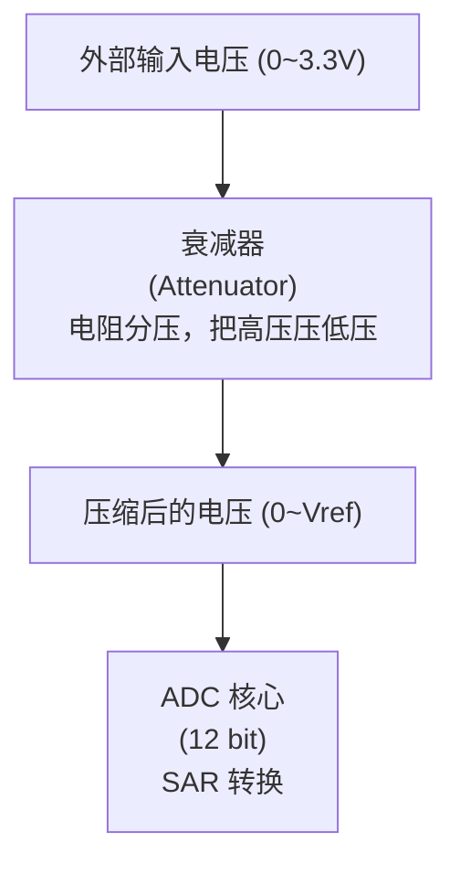

# ESP32-S3 ADC 单次采样（Oneshot）与 LCD 显示

## 本章重要 API 函数（仅 ADC Oneshot 相关）

| API | 功能 | 参数说明 | 头文件 |
|-----|------|----------|--------|
| `adc_oneshot_new_unit()` | 创建 ADC Oneshot 单元句柄 | `const adc_oneshot_unit_init_cfg_t *init_config`：初始化配置（时钟源、单元ID）<br>`adc_oneshot_unit_handle_t *ret_unit`：返回单元句柄 | `"esp_adc/adc_oneshot.h"` |
| `adc_oneshot_config_channel()` | 配置 ADC 采样通道 | `adc_oneshot_unit_handle_t handle`：单元句柄<br>`adc_channel_t channel`：通道号（如 `ADC_CHANNEL_3`）<br>`const adc_oneshot_chan_cfg_t *chan_config`：通道配置 | `"esp_adc/adc_oneshot.h"` |
| `adc_oneshot_read()` | 触发一次 ADC 转换并读取结果（阻塞） | `adc_oneshot_unit_handle_t handle`：单元句柄<br>`adc_channel_t channel`：通道号<br>`int *out_raw`：输出 12bit 原始值（0-4095） | `"esp_adc/adc_oneshot.h"` |
| `adc_init()` | 初始化 ADC Oneshot 模式（自定义封装） | `void`：无参数 | `"myadc.h"` |

**ADC Oneshot 配置结构体关键字段：**

| 结构体 | 字段 | 说明 |
|--------|------|------|
| `adc_oneshot_unit_init_cfg_t` | `.unit_id` | ADC 单元：`ADC_UNIT_1`（ADC1，不与WiFi冲突） |
|  | `.clk_src` | 时钟源：`ADC_RTC_CLK_SRC_DEFAULT`（默认RTC时钟） |
|  | `.ulp_mode` | ULP模式：`ADC_ULP_MODE_DISABLE`（禁用超低功耗模式） |
| `adc_oneshot_chan_cfg_t` | `.atten` | 衰减：`ADC_ATTEN_DB_11`（量程约0~2.6V），可选`DB_0`~`DB_11` |
|  | `.bitwidth` | 分辨率：`ADC_BITWIDTH_12`（12位，0-4095） |

**注意：SPI、LCD 相关 API 已在前面章节讲解。**

---

## 本章目录

> 点击条目可跳转到对应小节。

### 章节导航

- **[本章重要 API 函数（仅 ADC Oneshot 相关）](#本章重要-api-函数仅-adc-oneshot-相关)**
- **[学习前后依赖](#学习前后依赖)**
- **[一、理解 ADC——从电压到数字的桥梁](#一理解-adc——从电压到数字的桥梁)**
  - [1.1 模数转换的核心流程](#11-模数转换的核心流程)
  - [1.2 Oneshot vs Continuous：两种采样哲学](#12-oneshot-vs-continuous两种采样哲学)
  - [1.3 为什么本项目选 Oneshot](#13-为什么本项目选-oneshot)
- **[二、运行链路树](#二运行链路树)**
- **[三、ADC Oneshot 数据读取流程](#三adc-oneshot-数据读取流程)**
  - [3.1 单次转换时序](#31-单次转换时序)
  - [3.2 双通道采样不是真正"同时"](#32-双通道采样不是真正"同时")
  - [3.3 数据格式](#33-数据格式)
- **[四、重点行注释](#四重点行注释)**
  - `[#[myadc.c L8-12`|`myadc.c L8-12`]]
  - `[#[myadc.c L13`|`myadc.c L13`]]
  - `[#[myadc.c L15-18`|`myadc.c L15-18`]]
  - `[#[myadc.c L19-20`|`myadc.c L19-20`]]
  - `[#[main.c L20-21`|`main.c L20-21`]]
  - `[#[main.c L22-23`|`main.c L22-23`]]
- **[五、整体架构](#五整体架构)**
- **[六、模块实现说明](#六模块实现说明)**
  - [6.1 MYADC 组件](#61-myadc-组件)
  - [6.2 main 模块](#62-main-模块)
- **[七、文件简单注释](#七文件简单注释)**
  - `[#[myadc.c`|`myadc.c`]]
  - `[#[main.c`|`main.c`]]
- **[容易踩坑](#容易踩坑)**
- **[八、关键要点总结](#八关键要点总结)**
- **[九、扩展思路](#九扩展思路)**
- **[Tips](#tips)**
  - [低速 vs 连续：何时选用哪种模式](#低速-vs-连续何时选用哪种模式)
  - [ADC 衰减器的深层意义](#adc-衰减器的深层意义)
  - [踩坑实录](#踩坑实录)
  - [知识衔接](#知识衔接)

---

## 学习前后依赖

| 方向 | 内容 |
|------|------|
| 前置基础 | GPIO/模拟输入、ADC 衰减/位宽概念，以及连续采样与 DMA 的基本区别。 |
| 本章核心 | 掌握 ADC Oneshot 单次采样、通道配置、电压换算和 LCD 显示。 |
| 后续承接 | 承接 `12_ADCContinuous` 的连续 ADC 对比章节，从低速采样过渡到高速 DMA 采样。 |

## 一、理解 ADC——从电压到数字的桥梁

### 1.1 模数转换的核心流程

ADC（Analog-to-Digital Converter，模数转换器）负责把**模拟电压信号**转换成**数字量**，让 MCU 能够读取和处理。ESP32-S3 片上集成的 SAR ADC（逐次逼近型）是这个项目唯一的模拟输入通道：

| 参数 | 说明 |
|------|------|
| 分辨率 | 12 bit（可选 9~12 bit） |
| 量程 | 0 ~ 3.3 V（配合衰减配置） |
| 通道数 | ADC1 最多 10 通道，ADC2 最多 10 通道 |
| 转换原理 | SAR（逐次逼近寄存器），通过二分法逐位逼近真实电压 |

12 bit 分辨率意味着数字量范围是 `0 ~ 4095`，对应电压换算：

```text
电压 = (ADC值 / 4095) × 量程电压
```

**SAR ADC 工作过程分四步**：

```text
1. 采样保持 → 电容阵列捕获输入电压瞬间值（纳秒级）
2. 逐次逼近 → DAC 产生参考电压，与采样电压逐位比较
              ┌─ bit11: DAC输出 = 2.5V, 输入=1.8V → 1.8 < 2.5 → bit11=0, 参考电压折半
              ├─ bit10: DAC输出 = 1.25V, 输入=1.8V → 1.8 > 1.25 → bit10=1, 参考电压增加
              ├─ bit9:  DAC输出 = 1.875V, 输入=1.8V → 1.8 < 1.875 → bit9=0
              └─ ... 重复 12 次得到最终值
3. 数字输出 → 12 bit 结果写入寄存器
4. 函数返回 → 调用 adc_oneshot_read() 拿到 int 型原始值
```

> **关键理解**：12 bit SAR ADC 每次转换需要 12 个时钟周期逐位逼近。这意味着 Conversion Time = 12 / ADC_Clock，在低速场景（如 500ms 刷新一次 LCD）下几乎感知不到延迟，但高速场景（如 20 kHz 波形采样）就开始吃力了。

### 1.2 Oneshot vs Continuous：两种采样哲学

ESP32-S3 的 ADC 驱动在 ESP-IDF 中分为两套 API：`adc_oneshot` 和 `adc_continuous`。本项目使用 **Oneshot（单次转换）** 模式。

| 对比项    | Oneshot 单次转换                  | Continuous 连续转换              |
| ------ | ----------------------------- | ---------------------------- |
| 触发方式   | CPU 主动调用 `adc_oneshot_read()` | 硬件自动循环，DMA 自动搬运              |
| 数据搬运   | 转换结果直接写入函数传入的变量              | DMA 把多帧数据搬到内存环形缓冲区，再通知 CPU 读取 |
| 数据获取   | 函数返回一个 12 bit 值               | 通过 `on_conv_done` 回调获得一帧原始字节 |
| 代码复杂度  | 简单，无需回调和帧解析                   | 较复杂，需要配置 DMA 缓冲区、解析 TYPE1/TYPE2 数据帧 |
| CPU 占用 | 每次读取都要进入驱动等待转换                | 仅在回调中处理数据，采样期间 CPU 可干别的      |
| 典型速率   | 几百 Hz ~ 几 kHz（取决于调用频率）        | 可达几十 kHz ~ 几百 kHz            |
| 适用场景   | 按键电压、电池检测、低速传感器轮询             | 音频、高速信号采集、波形记录               |
| 多通道支持 | 逐通道顺序调用 read              | DMA 自动轮转多通道              |

**Oneshot 模式不涉及 DMA**：每次调用 `adc_oneshot_read()`，CPU 都要进入驱动，等待当前通道转换完成，然后拿到一个值。流程更直接，但 CPU 参与度高。

而 Continuous 模式下 DMA 的工作流程如下：

```text
ADC 硬件连续采样
        │
        ▼
SAR 转换完成，产生数据
        │
        ▼
DMA 控制器把数据搬到内存环形缓冲区
        │
        ▼
累积到一帧（如 8 字节）后触发 on_conv_done 回调
        │
        ▼
CPU 在回调里解析数据
```

Continuous 模式下 CPU 不用一次次地发起转换请求，只需要在 DMA 搬够一帧数据后处理一次。采样和搬运由硬件完成，CPU 开销小，适合高速场景。

### 1.3 为什么本项目选 Oneshot

- 只需要每 500 ms 刷新一次 LCD，速率很低。
- 无需 DMA 环形缓冲区和回调，代码更直观。
- 直接得到 `int` 型 ADC 值，不需要像 Continuous 那样从原始字节中拼出 12 bit 数据。

**两种模式的数据形态差异一目了然**：

Oneshot 一次读取直接拿到结果：

```text
adc_oneshot_read(handle, CH3, &adc1_value)
           │
           ▼
    adc1_value = 0 ~ 4095   (12 bit 原始值)
```

Continuous 则需要 DMA 搬运并解析帧：

```text
ADC 连续采样 → DMA 搬运到缓冲区
           │
           ▼
    on_conv_done 回调
           │
           ▼
    data_value = edata->conv_frame_buffer   (原始字节数组)
           │
           ▼
    adc_value = ((data_value[1] & 0x0F) << 8) | data_value[0]
```

本项目采用 Oneshot，因此没有 DMA、帧格式、缓冲区、`conv_frame_size` 等概念。

---

## 二、运行链路树

```text
app_main()
    │
    ├─ lcd_init()           // 初始化 LCD 显示
    │
    └─ adc_init()           // 初始化 ADC 单次采样
            │
            ├─ adc_oneshot_unit_init_cfg_t      // 配置 ADC 单元
            │       参数：unit_id = ADC_UNIT_1
            │             clk_src = ADC_RTC_CLK_SRC_DEFAULT
            │             ulp_mode = ADC_ULP_MODE_DISABLE
            │
            ├─ adc_oneshot_new_unit()           // 创建 ADC oneshot 单元句柄
            │
            ├─ adc_oneshot_chan_cfg_t           // 配置通道参数
            │       参数：atten = ADC_ATTEN_DB_11
            │             bitwidth = ADC_BITWIDTH_12
            │
            ├─ adc_oneshot_config_channel()     // 配置 ADC1_CHANNEL_3
            │
            └─ adc_oneshot_config_channel()     // 配置 ADC1_CHANNEL_4

                    │
                    ▼ 主循环 while(1)
        app_main() 每 500 ms 执行一次：
                    │
                    ├─ adc_oneshot_read(adc_unit_handle, ADC_CHANNEL_3, &adc1_value)
                    │       // 触发一次 CH3 转换，结果写入 adc1_value
                    │
                    ├─ adc_oneshot_read(adc_unit_handle, ADC_CHANNEL_4, &adc2_value)
                    │       // 触发一次 CH4 转换，结果写入 adc2_value
                    │
                    ├─ lcd_show_num(1, 6, adc1_value, ...)    // 显示 CH3 数值
                    │
                    ├─ lcd_show_num(2, 6, adc2_value, ...)    // 显示 CH4 数值
                    │
                    └─ vTaskDelay(500)                         // 阻塞 500 ms
```

---

## 三、ADC Oneshot 数据读取流程

### 3.1 单次转换时序

Oneshot 模式下，CPU 每次调用 `adc_oneshot_read()` 都会触发一次完整的 SAR 转换：

```text
CPU 调用 adc_oneshot_read()
           │
           ▼
    选择 ADC1 目标通道（CH3 或 CH4）
           │
           ▼
    SAR 转换核心开始逐次逼近
           │
           ▼
    转换完成，得到 12 bit 数字量
           │
           ▼
    结果写入 &adc1_value / &adc2_value
           │
           ▼
    函数返回，CPU 继续执行
```

### 3.2 双通道采样不是真正"同时"

ESP32-S3 的 ADC1 内部只有一个 SAR 转换核心：

#### 总览图：GPIO 模拟输入到 raw

```text
GPIO4(CH3) ─┐
            ├─> ADC1 MUX ─> SAR 核心 ─> raw
GPIO5(CH4) ─┘

raw 为 12 bit 原始值，范围 0 ~ 4095。
```

#### 局部图：衰减 atten 与量程关系

```text
atten 越大，可测输入范围越高：

DB_0   -> 低电压范围，精度较细
DB_2_5 -> 范围略增
DB_6   -> 范围继续增大
DB_11  -> 本项目使用，约 0 ~ 2.6 V
```

#### 状态图：Oneshot 与 Continuous 对比

```text
Oneshot:
CPU 调用 read -> 等待转换 -> 直接得到 int raw

Continuous:
ADC 连续采样 -> DMA 缓冲区 -> 回调解析帧
```

#### 时序图：配置、读取、显示

```text
adc_init()
  │ 配置 unit/channel/atten
  ▼
adc_oneshot_read()
  │ 触发一次 SAR 转换
  ▼
raw 结果
  │ 可换算为电压
  ▼
LCD 显示
```

虽然代码中连续两次调用 `adc_oneshot_read()`，但硬件上是先转换 CH3，再转换 CH4，两者相隔一次转换时间（约微秒级），对 500 ms 刷新周期来说可视为"同时"。

### 3.3 数据格式

Oneshot 模式直接返回一个 `int` 类型的 12 bit 原始值，范围 `0 ~ 4095`，无需像 Continuous 模式那样解析字节帧。

| 变量 | 对应通道 | 数据类型 | 取值范围 |
|------|----------|----------|----------|
| `adc1_value` | ADC1_CHANNEL_3 | int | 0 ~ 4095 |
| `adc2_value` | ADC1_CHANNEL_4 | int | 0 ~ 4095 |

---

## 四、重点行注释

### `myadc.c L8-12`

```c
adc_oneshot_unit_init_cfg_t oneshot_structure = {
    .clk_src = ADC_RTC_CLK_SRC_DEFAULT,
    .ulp_mode = ADC_ULP_MODE_DISABLE,
    .unit_id = ADC_UNIT_1,
};
```

**作用**：配置 ADC oneshot 单元级别的参数。

| 字段 | 值 | 含义 |
|------|-----|------|
| `clk_src` | `ADC_RTC_CLK_SRC_DEFAULT` | 使用默认 RTC 时钟源 |
| `ulp_mode` | `ADC_ULP_MODE_DISABLE` | 禁用 ULP 低功耗协处理器采样模式 |
| `unit_id` | `ADC_UNIT_1` | 使用 ADC1，避免与 Wi-Fi/BT 冲突 |

---

### `myadc.c L13`

```c
adc_oneshot_new_unit(&oneshot_structure, &adc_unit_handle);
```

**作用**：根据上面的配置创建 ADC oneshot 单元句柄，后续所有通道配置和读取都需要使用该句柄。

---

### `myadc.c L15-18`

```c
adc_oneshot_chan_cfg_t oneshot_chan_structure = {
    .atten = ADC_ATTEN_DB_11,
    .bitwidth = ADC_BITWIDTH_12,
};
```

**作用**：配置每个 ADC 通道的衰减和分辨率。

| 字段 | 值 | 含义 |
|------|-----|------|
| `atten` | `ADC_ATTEN_DB_11` | 11 dB 衰减，输入量程约 0 ~ 2.6 V |
| `bitwidth` | `ADC_BITWIDTH_12` | 12 bit 分辨率（0 ~ 4095） |

---

### `myadc.c L19-20`

```c
adc_oneshot_config_channel(adc_unit_handle, ADC_CHANNEL_3, &oneshot_chan_structure);
adc_oneshot_config_channel(adc_unit_handle, ADC_CHANNEL_4, &oneshot_chan_structure);
```

**作用**：将 CH3 和 CH4 都应用上述配置。

- `ADC_CHANNEL_3` 对应 GPIO4。
- `ADC_CHANNEL_4` 对应 GPIO5。

---

### `main.c L20-21`

```c
adc_oneshot_read(adc_unit_handle, ADC_CHANNEL_3, &adc1_value);
adc_oneshot_read(adc_unit_handle, ADC_CHANNEL_4, &adc2_value);
```

**作用**：触发单次转换并读取结果。

**说明**：`adc_oneshot_read()` 是阻塞调用，内部会等待转换完成并将结果写入第三个参数指向的变量。

---

### `main.c L22-23`

```c
lcd_show_num(1, 6, adc1_value, 4, YELLOW, BLACK);
lcd_show_num(2, 6, adc2_value, 4, YELLOW, BLACK);
```

**作用**：在第 1 行第 6 列、第 2 行第 6 列分别显示 `adc1_value` 和 `adc2_value`，显示宽度为 4 位。

---

## 五、整体架构

#### 总览图：Oneshot 软件到硬件链路

```text
main/main.c
  │ 初始化 LCD、ADC，循环读取并显示
  ▼
components/MYADC/myadc.c
  │ 封装 ADC oneshot 初始化
  │ 导出 adc_unit_handle
  ▼
ESP-IDF adc_oneshot
  │ 创建单元、配置通道、触发转换
  ▼
ESP32-S3 ADC1
  │ CH3/GPIO4，CH4/GPIO5
  ▼
12 bit raw 结果
```

#### 局部图：raw 到显示值

```text
raw: 0 ~ 4095
  │
  ├─ 直接显示 ADC 原始值
  │
  └─ 可换算电压：raw / 4095 × 3.3V
```

---

## 六、模块实现说明

### 6.1 MYADC 组件

文件：

- `myadc.h`
- `myadc.c`

**头文件职责**：

- 导出全局句柄 `adc_unit_handle`，供 `main.c` 直接调用读取。
- 导出 `adc_init()` 初始化函数。

**源文件职责**：

- 使用 `adc_oneshot_unit_init_cfg_t` 配置 ADC1 单元。
- 调用 `adc_oneshot_new_unit()` 创建句柄。
- 使用 `adc_oneshot_chan_cfg_t` 配置 12 bit、11 dB 衰减。
- 调用 `adc_oneshot_config_channel()` 配置 CH3 和 CH4。

### 6.2 main 模块

文件：

- `main.c`

**职责**：

- 初始化 LCD 和 ADC。
- 在 LCD 上固定显示两行标签：`adc1:` 和 `adc2:`。
- 主循环每 500 ms 读取一次两个通道，更新显示。

---

## 七、文件简单注释

### `myadc.c`

```c
#include "myadc.h"
#include "esp_adc/adc_oneshot.h"

adc_oneshot_unit_handle_t adc_unit_handle;  // ADC oneshot 单元句柄

void adc_init(void)
{
    // 1. 配置并创建 ADC oneshot 单元
    adc_oneshot_unit_init_cfg_t oneshot_structure = {
        .clk_src = ADC_RTC_CLK_SRC_DEFAULT,
        .ulp_mode = ADC_ULP_MODE_DISABLE,
        .unit_id = ADC_UNIT_1,
    };
    adc_oneshot_new_unit(&oneshot_structure, &adc_unit_handle);

    // 2. 配置通道：12 bit、11 dB 衰减
    adc_oneshot_chan_cfg_t oneshot_chan_structure = {
        .atten = ADC_ATTEN_DB_11,
        .bitwidth = ADC_BITWIDTH_12,
    };

    // 3. 应用配置到 CH3 和 CH4
    adc_oneshot_config_channel(adc_unit_handle, ADC_CHANNEL_3, &oneshot_chan_structure);
    adc_oneshot_config_channel(adc_unit_handle, ADC_CHANNEL_4, &oneshot_chan_structure);
}
```

### `main.c`

```c
#include <stdio.h>
#include "freertos/FreeRTOS.h"
#include "freertos/task.h"
#include "esp_adc/adc_oneshot.h"
#include "myadc.h"
#include "lcd.h"

int adc1_value = 0;
int adc2_value = 0;

void app_main(void)
{
    lcd_init();  // 初始化 LCD
    adc_init();  // 初始化 ADC oneshot

    // 显示固定标签
    lcd_show_string(1, 1, "adc1:", GREEN, BLACK);
    lcd_show_string(2, 1, "adc2:", GREEN, BLACK);

    while (1)
    {
        // 单次读取两个通道
        adc_oneshot_read(adc_unit_handle, ADC_CHANNEL_3, &adc1_value);
        adc_oneshot_read(adc_unit_handle, ADC_CHANNEL_4, &adc2_value);

        // 刷新 LCD 显示
        lcd_show_num(1, 6, adc1_value, 4, YELLOW, BLACK);
        lcd_show_num(2, 6, adc2_value, 4, YELLOW, BLACK);

        vTaskDelay(500);  // 每 500 ms 刷新一次
    }
}
```

---

## 容易踩坑

| 现象 | 常见原因 | 排查方向 |
|------|----------|----------|
| 读数一直满量程 | 输入电压超过衰减对应范围 | 降低输入电压或提高 attenuation 档位 |
| 读数波动大 | 模拟输入悬空或源阻抗太高 | 加下拉/滤波电容，保证信号源稳定 |
| 双通道看似不同步 | Oneshot 是逐通道顺序读取 | 接受时间差或改用连续采样/外部同步 ADC |
| LCD 显示残影 | 数字位数变化未清除旧字符 | 固定显示长度或先覆盖背景 |

## 八、关键要点总结

1. **Oneshot 模式适合低速场景**：每次读取都主动触发转换，代码简单，无需 DMA 和回调。
2. **ADC1 与 ADC2 区别**：ESP32-S3 的 ADC2 与 Wi-Fi/BT 共用，本项目使用 ADC1，不受影响。
3. **输入电压范围**：`ADC_ATTEN_DB_11` 衰减下，GPIO 输入电压建议不超过约 2.6 V，否则可能损坏芯片。
4. **12 bit 分辨率**：返回值为 `0 ~ 4095`，如需显示电压可按 `(value / 4095) × 3.3` 换算。
5. **通道与 GPIO 对应**：
   - ADC1_CH3 对应 GPIO4
   - ADC1_CH4 对应 GPIO5
6. **未启用 ADC 校准**：读数为原始值，如需高精度电压测量，可引入 `esp_adc/adc_cali.h` 进行校准。
7. **显示刷新周期**：`vTaskDelay(500)` 默认 500 ms，可通过减小该值提高刷新率，但 ADC 转换本身需要一定时间。

---

## 九、扩展思路

- 启用 ADC 校准（`adc_cali_create_scheme_line_fitting` 等）将原始值转换为真实电压 mV。
- 在 LCD 上同时显示 ADC 原始值和换算后的电压值。
- 加入阈值判断，当 ADC 值超过设定范围时点亮 LED 或触发报警。
- 改用 `adc_continuous` 模式实现 DMA 连续采样，适合音频或高速传感器采集。

---

## Tips

### 低速 vs 连续：何时选用哪种模式

这是 ADC 学习中最容易混淆的决策点。一句话总结：

> **Oneshot = "我需要什么数据就什么时候去问"，Continuous = "硬件持续采样，CPU 需要时来取"**

| 决策维度 | 选 Oneshot | 选 Continuous |
|---------|-----------|---------------|
| 采样速率 | < 1 kHz | > 1 kHz |
| 实时性要求 | 无要求，"什么时候读到算什么时候" | 需要完整波形、不能丢采样点 |
| 代码复杂度 | 极低——初始化 + read + 显示 | 中等——需配置 DMA、解析数据帧、处理回调 |
| 多通道需求 | 2-3 个通道，顺序切换无所谓 | 多通道轮转、需要帧同步 |
| 典型场景 | 电池电压、按键 ADC、光照传感器 | 音频采集、震动波形、ECG 信号 |

**一个实用准则**：如果你在主循环里手动 `vTaskDelay(100)` 再读一次 ADC，那 Oneshot 一定够用。如果你需要知道"两次采样之间"发生了什么，必须用 Continuous。

### ADC 衰减器的深层意义

很多初学者以为衰减器只是"放大/缩小信号"，但它的原理远比这复杂：

**什么是衰减器（Attenuator）？**

ESP32-S3 的 ADC 输入范围由参考电压决定，但外部信号可能高达 3.3V——直接输入会烧毁 ADC 前端。衰减器就是一个**电阻分压网络**，把高压信号压缩到 ADC 核心可接受的范围。



**衰减档位的选择策略**：

| 衰减档位 | 量程（近似） | 每 LSB 电压 | 使用场景 |
|---------|-------------|-----------|---------|
| DB_0 | 0 ~ 1.1V | ~0.27 mV | 微弱信号（传感器输出 mV 级） |
| DB_2_5 | 0 ~ 1.5V | ~0.37 mV | 中等精度测量 |
| DB_6 | 0 ~ 2.2V | ~0.54 mV | 常见 3.3V 系统里的 1.8V 器件 |
| **DB_11** | **0 ~ 2.6V** | ~0.63 mV | 通用场景（本项目使用），覆盖大部分传感器输出 |

> **容易误解的点**：衰减器是"衰减信号"不是"放大信号"。DB_11 衰减意味着"把输入的 2.6V 衰减到 ADC 核心能测量的范围"，而不是"把信号放大 11dB"。dB 值越大 → 分压越多 → 可测量范围越大 → 但分辨率（mV/LSB）越低。

**实战建议**：
- 测量 3.3V 系统下的普通传感器 → 用 DB_11
- 测量 1.2V 基准电压 → 用 DB_0（精度最高）
- 不确定信号范围 → 先用 DB_11 试探，再缩小档位

### 踩坑实录

1. **ADC 值跳变（噪声）**：常见于 GPIO 引脚悬空。即使配置了内部下拉，悬空引脚的 ADC 读数仍然会随环境电磁噪声波动。解决方法：外接 100nF 电容到 GND，或并联 10kΩ 下拉电阻。

2. **读数不是 0 ~ 4095**：ESP-IDF 的 `adc_oneshot_read()` 返回的是校准后的原始值，在没有启用校准的情况下，数值可能因为芯片差异偏离理论范围。不要惊讶于满量程不是 4095——这在未校准的 ADC 上是正常的。

3. **WiFi 开启后 ADC2 读数异常**：ESP32-S3 的 ADC2 与 WiFi 共用内部资源。如果项目中需要 WiFi + ADC，一定要用 ADC1（本项目已这样做）。这是一个极易犯的错误——代码跑通了单机测试，加上 WiFi 后 ADC 就不准了。

### 知识衔接

- **上一章**：LCD 显示驱动——本项目的 ADC 值最终显示在 LCD 上，`lcd_show_num()` 和 `lcd_show_float()` 是你已掌握的工具。
- **下一章**：[02_连续ADC](02_连续ADC.md)——深入 DMA 驱动的 Continuous 模式，把采样率从"每秒几次"提升到"每秒两万次"。理解 TYPE2 帧格式后你会发现，Continuous 和 Oneshot 用的是同一套硬件，只是驱动策略不同。
- **后续硬件**：BH1750（I2C 数字光传感器）是一个"不需要 ADC 的传感器"——它内部自带 ADC 和 DSP，通过 I2C 直接输出数字量。这是模拟传感器（接 ADC）和数字传感器（接 I2C/SPI）的关键分水岭。
