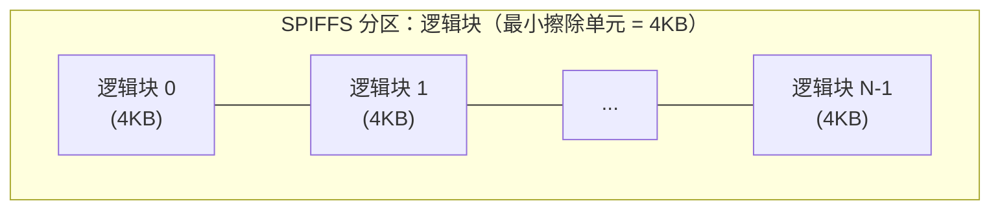
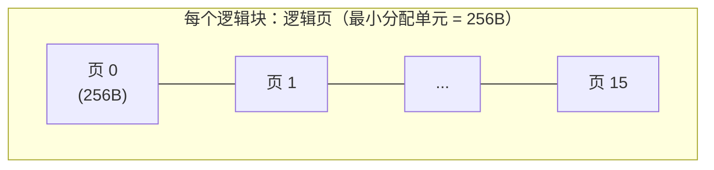
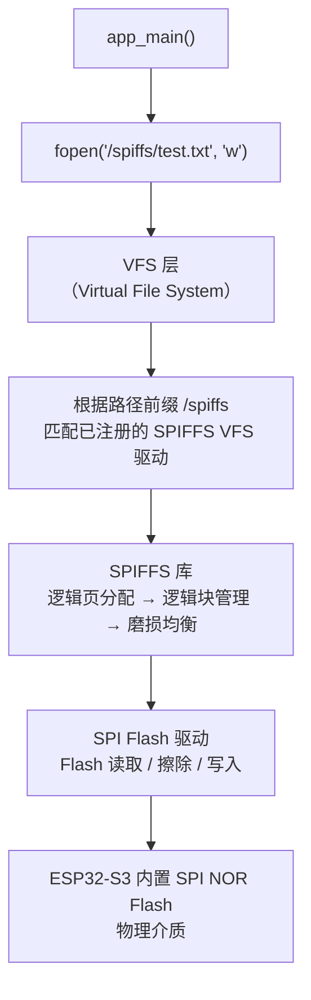
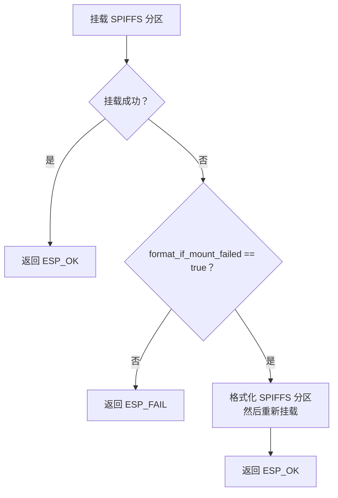
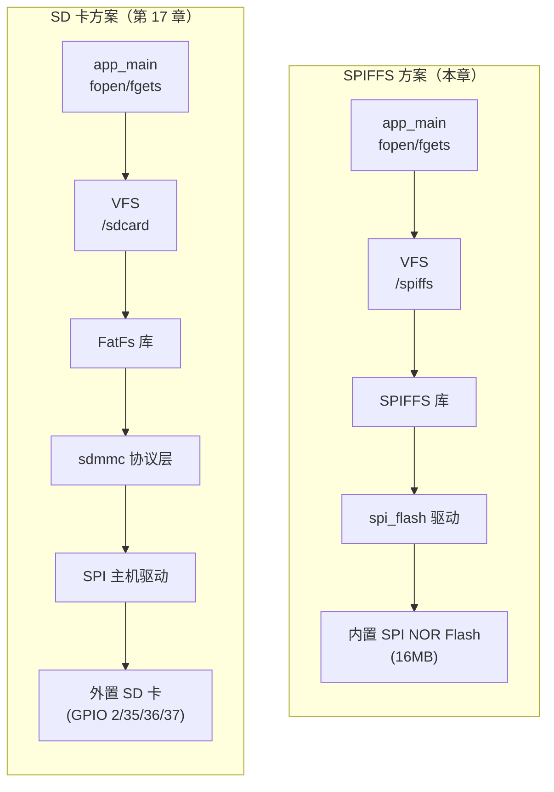
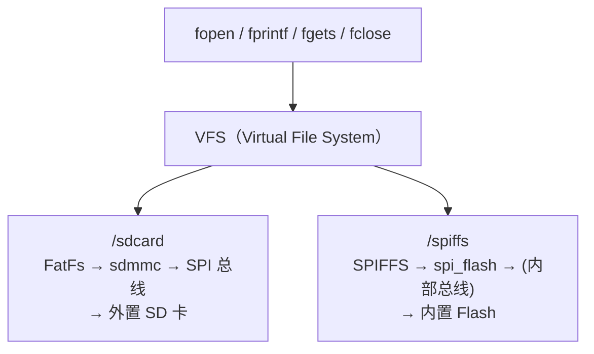

# SPIFFS — ESP32-S3 片上 Flash 文件系统

## 本章重要 API 函数

| API | 功能 | 参数说明 | 头文件 |
|-----|------|----------|--------|
| `esp_vfs_spiffs_register()` | 注册 SPIFFS 分区并挂载到 VFS | `const esp_vfs_spiffs_conf_t *conf`：挂载配置结构体指针；返回 `esp_err_t`，`ESP_OK` 表示成功 | `"esp_spiffs.h"` |
| `esp_vfs_spiffs_unregister()` | 卸载 SPIFFS 分区 | `const char *partition_label`：分区标签名；返回 `esp_err_t` | `"esp_spiffs.h"` |
| `ifs_init()` | 项目封装的 SPIFFS 初始化（一步完成注册+挂载） | `void`：无参数 | `"ifs.h"` |

## 本章目录

> 点击条目可跳转到对应小节。

### 章节导航

- **[本章重要 API 函数](#本章重要-api-函数)**
- **[学习前后依赖](#学习前后依赖)**
- **[1. 概述](#1-概述)**
- **[2. SPIFFS 原理](#2-spiffs-原理)**
  - [2.1 什么是 SPIFFS](#21-什么是-spiffs)
  - [2.2 SPIFFS vs SD 卡 vs FAT](#22-spiffs-vs-sd-卡-vs-fat)
- **[3. 分区表配置](#3-分区表配置)**
  - [3.1 分区表结构](#31-分区表结构)
  - [3.2 分区表文件详解](#32-分区表文件详解)
- **[4. 软件架构传递树](#4-软件架构传递树)**
  - [4.1 模块调用关系](#41-模块调用关系)
  - [4.2 文件操作调用链](#42-文件操作调用链)
- **[5. 代码详细解析](#5-代码详细解析)**
  - [5.1 SPIFFS 初始化 — ifs_init()](#51-spiffs-初始化-—-ifs_init)
  - [5.2 main.c — 文件读写演示](#52-mainc-—-文件读写演示)
  - [5.3 挂载失败时自动格式化](#53-挂载失败时自动格式化)
- **[6. SPIFFS 与 SD 卡对比](#6-spiffs-与-sd-卡对比)**
  - [6.1 架构对比](#61-架构对比)
  - [6.2 使用场景对比](#62-使用场景对比)
- **[容易踩坑](#容易踩坑)**
- **[7. 本章小结](#7-本章小结)**
- **[Tips](#tips)**

---

## 学习前后依赖

| 方向   | 内容                                                                                               |
| ---- | ------------------------------------------------------------------------------------------------ |
| 前置基础 | `17_SPITF`（SD 卡 + FAT 文件系统 + VFS 概念）、`07_LCDDisplay`（LCD 驱动和 SPI 总线）、分区表基本概念                     |
| 本章核心 | 掌握 SPIFFS 分区配置、`esp_vfs_spiffs_register()` 一键挂载、通过 VFS 用标准 C 库读写 Flash 文件，并与 SD 卡方案对比理解两种存储路径的差异 |
| 后续承接 | 可用于持久化存储传感器数据、设备配置文件、日志等无需外置 SD 卡的场景                                                             |

---

## 1. 概述

本章学习 ESP32-S3 的 **SPIFFS**（SPI Flash File System）——一种专为 SPI NOR Flash 设计的轻量级文件系统。

与第 17 章的 SD 卡方案不同，SPIFFS **不需要外部存储介质**，直接使用 ESP32-S3 芯片内置或外挂的 SPI Flash 作为文件存储空间。通过 ESP-IDF 的 VFS 层，上层同样可以用 `fopen` / `fprintf` / `fgets` / `fclose` 等标准 C 库函数操作文件——接口与 SD 卡方案完全一致，差异只在底层存储介质和初始化方式。

本项目实现：

- 在分区表中开辟 `storage` 分区（约 15MB）
- 初始化 SPIFFS 并挂载到 `/spiffs` 路径
- 在 `/spiffs/test.txt` 写入字符串 `"Hello SPIFFS!"`
- 读出并显示在 LCD 上

---

## 2. SPIFFS 原理

### 2.1 什么是 SPIFFS

```
SPIFFS（SPI Flash File System）是一种专为 SPI NOR Flash
设计的嵌入式文件系统，特点：

┌──────────────────────────────────────────────────────┐
│  特性                  说明                           │
├──────────────────────────────────────────────────────┤
│  磨损均衡（Wear Leveling）│  均匀分布擦写，延长 Flash 寿命 │
│  掉电安全                │  写操作不会破坏已有数据       │
│  静态开销小              │  RAM 占用仅取决于打开文件数    │
│  不支持目录              │  所有文件在根目录，扁平结构    │
│  无 POSIX 权限           │  不支持 chmod/chown 等权限    │
└──────────────────────────────────────────────────────┘

工作方式：
  直接将 NOR Flash 的一个分区作为文件系统空间，
  不需要额外的 Flash Translation Layer（FTL），
  SPIFFS 自身直接管理 Flash 页的分配和回收。
```

SPIFFS 的内部结构：


SPIFFS 分区布局：



每个逻辑块内部：



特点：
- 最小分配单元：逻辑页（256 字节）
- 最小擦除单元：逻辑块（4KB）
- 文件索引存储在 Flash 内部，不需要额外 RAM

SPIFFS 的"逻辑块-逻辑页"两级管理是它实现磨损均衡的基础。每次写入新文件时，SPIFFS 不会覆盖旧数据所在的物理页，而是把新数据写到空闲页，然后更新索引指向新页——这就是为什么它说"掉电安全"：旧数据在新数据完全写入之前不会被破坏。

### 2.2 SPIFFS vs SD 卡 vs FAT

| 对比维度     | SPIFFS                        | FAT（SD 卡）                           |
| -------- | ----------------------------- | ----------------------------------- |
| 存储介质     | 芯片内置 SPI NOR Flash            | 外置 SD 卡（通过 SPI/SDMMC）               |
| 是否需要额外硬件 | 不需要                           | 需要 SD 卡槽和卡                          |
| 容量       | 取决于 Flash 分区大小（本项约 15MB）      | 取决于 SD 卡（可达 32GB+）                  |
| 目录支持     | 不支持，所有文件在根目录                  | 支持任意层级目录                            |
| 文件名长度    | 最大 32 字节（含路径）                 | 8.3 短名或 LFN 长名                      |
| 磨损均衡     | 内置支持                          | 依赖 SD 卡内部控制器的实现                     |
| 初始化 API  | `esp_vfs_spiffs_register()`   | `esp_vfs_fat_sdspi_mount()`         |
| 挂载路径     | `/spiffs`                     | `/sdcard`                           |
| 文件操作接口   | `fopen` / `fprintf` / `fgets` | `fopen` / `fprintf` / `fgets`（完全相同） |

---

## 3. 分区表配置

### 3.1 分区表结构


```
ESP32-S3 Flash 分区布局（本项目）：

Offset     Size       Name         Type/SubType
──────────────────────────────────────────────
0x0000      0x9000     (bootloader) 
0x9000      0x6000     nvs           data/nvs
0xF000      0x1000     phy_init      data/phy
0x10000    0x100000    factory       app/factory
0x110000   0xEF0000    storage       data/spiffs    ← 本章核心
──────────────────────────────────────────────
Flash 总大小：16MB
storage 分区：0x110000 ~ 0xFFFFFF，共 15,728,640 字节 ≈ 15MB
```

### 3.2 分区表文件详解

`partitions_user.csv`：

```csv
# ESP-IDF Partition Table
# Name, Type, SubType, Offset, Size, Flags
nvs,data,nvs,0x9000,0x6000,
phy_init,data,phy,0xf000,0x1000,
factory,app,factory,0x10000,0x100000,
storage,data,spiffs,0x110000,0xef0000,
```

各列含义：

| 列 | 含义 | `storage` 行的值 |
|----|------|-----------------|
| Name | 分区名称，代码中通过标签引用 | `storage` |
| Type | 分区类型 | `data`（数据分区） |
| SubType | 分区子类型 | `spiffs`（SPIFFS 文件系统） |
| Offset | 分区起始地址（相对于 Flash 0x0） | `0x110000`（1MB + 64KB） |
| Size | 分区大小 | `0xEF0000`（约 15MB） |
| Flags | 特殊标志 | 空（无特殊标志） |

关键点：
- `SubType = spiffs` 告诉 ESP-IDF 这个分区用于 SPIFFS 文件系统，`esp_vfs_spiffs_register()` 会自动找到它
- 分区名 `storage` 对应代码中的 `partition_label = "storage"`，用于匹配分区
- `factory` 分区后面的空间（0x110000 之后）全部划给了 SPIFFS

---

## 4. 软件架构传递树

### 4.1 模块调用关系

```
app_main()                                    [main/main.c]
  ├── lcd_init()                              [components/LCD/lcd.c]
  │     └── spi2_init()                        [components/SPI/spi.c]
  │           └── spi_bus_initialize(SPI2_HOST)
  │
  ├── ifs_init()                              [components/SPIFFS/ifs.c]
  │     └── esp_vfs_spiffs_register(&conf)     [ESP-IDF: esp_spiffs]
  │           ├── 根据 partition_label="storage" 找到分区
  │           ├── 调用 SPIFFS 库进行文件系统挂载
  │           └── 注册 VFS，挂载到 /spiffs 路径
  │
  ├── fopen("/spiffs/test.txt", "w")          [标准 C 库 → VFS → SPIFFS]
  ├── fprintf(f, "%s", test_string)           [标准 C 库 → VFS → SPIFFS]
  ├── fclose(f)                               [标准 C 库 → VFS → SPIFFS]
  │
  ├── fopen("/spiffs/test.txt", "r")          [标准 C 库 → VFS → SPIFFS]
  ├── fgets(buf, sizeof(buf), f)              [标准 C 库 → VFS → SPIFFS]
  └── fclose(f)                               [标准 C 库 → VFS → SPIFFS]
```

### 4.2 文件操作调用链



---

## 5. 代码详细解析

### 5.1 SPIFFS 初始化 — ifs_init()

`ifs.c` 是整个 SPIFFS 初始化的核心，仅 14 行：

```c
#include "ifs.h"
#include "esp_spiffs.h"
#include "esp_vfs.h"

void ifs_init(void)
{
    esp_vfs_spiffs_conf_t conf = {
        .base_path              = "/spiffs",
        .format_if_mount_failed = true,
        .max_files              = 2,
        .partition_label        = "storage",
    };
    esp_vfs_spiffs_register(&conf);
}
```

**`esp_vfs_spiffs_conf_t` 配置结构体逐字段说明：**

| 字段                        | 值           | 含义                                                                                             |
| ------------------------- | ----------- | ---------------------------------------------------------------------------------------------- |
| `.base_path`              | `"/spiffs"` | VFS 挂载路径前缀。之后所有以 `/spiffs` 开头的文件路径都会路由到 SPIFFS                                                 |
| `.format_if_mount_failed` | `true`      | 挂载失败时**自动格式化**。首次烧录或分区数据损坏时会自动建文件系统。区别于 SD 卡方案中设为 `false`（保护用户数据），Flash 的 SPIFFS 分区通常可以放心自动格式化 |
| `.max_files`              | `2`         | 最多同时打开 2 个文件。决定了 RAM 中文件描述符缓存数量。本章只同时读写一个文件，2 已足够                                              |
| `.partition_label`        | `"storage"` | 分区标签名，与分区表 CSV 文件中 `Name` 列对应。ESP-IDF 会自动找到 `type=data, subtype=spiffs` 且名为 `storage` 的分区      |

**`esp_vfs_spiffs_register()` 内部做了什么：**

```
esp_vfs_spiffs_register(&conf)
  │
  ├── 1. 查找分区
  │     esp_partition_find_first(
  │         type=ESP_PARTITION_TYPE_DATA,
  │         subtype=ESP_PARTITION_SUBTYPE_DATA_SPIFFS,
  │         label="storage"
  │     )
  │     → 找到 partitions_user.csv 中定义的 storage 分区
  │
  ├── 2. 调用 SPIFFS 库挂载
  │     spiffs_mount(&fs, &cfg, ...)
  │     → 读取/验证 SPIFFS 元数据
  │     → 如果 format_if_mount_failed=true 且挂载失败，
  │       则调用 spiffs_format() 重新格式化
  │
  ├── 3. 注册到 VFS
  │     esp_vfs_register("/spiffs", &vfs, NULL)
  │     → 让 fopen("/spiffs/xxx") 路由到 SPIFFS 驱动
  │
  └── 4. 返回 ESP_OK 或错误码
```

**对比：`ifs_init()` vs `sd_spi_init()`（第 17 章）**

```
ifs_init():                          sd_spi_init():
  esp_vfs_spiffs_conf_t                sdmmc_host_t host = SDSPI_HOST_DEFAULT()
  ├── base_path                        sdspi_device_config_t slot_config
  ├── format_if_mount_failed           esp_vfs_fat_mount_config_t mount_config
  ├── max_files                        esp_vfs_fat_sdspi_mount()
  └── partition_label
                                      → 需要配置 SPI 主机、CS 引脚、
  esp_vfs_spiffs_register()              FAT 参数、SDMMC 回调表等
                                      → 更复杂、依赖硬件连接

  共性：最终都通过 VFS 使 fopen 可用
```

### 5.2 main.c — 文件读写演示

`main.c`：

```c
void app_main(void)
{
    const char *test_string = "Hello SPIFFS!";

    // 1. 初始化 LCD（底层依赖 SPI 总线）
    lcd_init();

    // 2. 初始化 SPIFFS（挂载 Flash 文件系统）
    ifs_init();

    // 3. 写文件
    lcd_show_string(1, 1, "read_buf:", GREEN, BLACK);
    FILE *f = fopen("/spiffs/test.txt", "w");
    if (f != NULL)
    {
        fprintf(f, "%s", test_string);
        fclose(f);
    }

    // 4. 短暂延时（确保文件写完）
    vTaskDelay(pdMS_TO_TICKS(10));

    // 5. 读文件并显示到 LCD
    f = fopen("/spiffs/test.txt", "r");
    if (f != NULL)
    {
        char buf[128];
        fgets(buf, sizeof(buf), f);
        fgets(buf, sizeof(buf), f);
        lcd_show_string(2, 1, buf, BLUE, BLACK);
        fclose(f);
    }

    while(1) { vTaskDelay(1000); }
}
```

**代码执行流程：**

```
1. lcd_init()           → 初始化 SPI2 总线 + LCD 控制器（参考第 7 章笔记）

2. ifs_init()           → 挂载 SPIFFS 到 /spiffs
    └── esp_vfs_spiffs_register()

3. fopen("/spiffs/test.txt", "w")
    ├── VFS 匹配 /spiffs 路径前缀
    ├── SPIFFS 在 Flash 中创建/打开文件
    └── 返回 FILE*，可写

4. fprintf(f, "%s", "Hello SPIFFS!")
    ├── 标准 C 格式化写入
    └── 数据经 VFS → SPIFFS → spi_flash 驱动写入 Flash

5. fclose(f)            → 关闭文件，刷新缓冲区

6. vTaskDelay(10ms)     → 确保文件系统完成写入操作

7. fopen("/spiffs/test.txt", "r")
    └── 以只读方式重新打开同一文件

8. fgets() × 2
    → 第一次 fgets 读取文件内容
    → 第二次 fgets 返回 NULL（文件已读完）
    → buf 中保留第一次读取到的字符串

9. lcd_show_string(2, 1, buf, BLUE, BLACK)
    → LCD 第 2 行第 1 列显示 "Hello SPIFFS!"（蓝色字）

10. fclose(f) + while(1) → 关闭文件并进入空闲循环
```

**注意事项：**

- 代码中调用了两次 `fgets()`。第一次读取到 `"Hello SPIFFS!"` 存入 buf，第二次 `fgets()` 返回 NULL（已到文件末尾），buf 中仍然保留第一次读取的内容
- `vTaskDelay(10)` 的作用是确保文件写完、文件系统元数据刷新完毕，再重新打开读取
- 若写入和读取之间不进行 `fclose` 再 `fopen`，需要 `fseek(f, 0, SEEK_SET)` 重置文件指针

### 5.3 挂载失败时自动格式化

`format_if_mount_failed = true` 的含义：



**适用场景：**
- 首次烧录固件时，SPIFFS 分区是原始 Flash 状态（全 0xFF），自动格式化后即可使用
- 分区数据意外损坏时自动恢复
- 生产环境中如果希望保护数据，可以设为 `false`，由应用程序自行处理挂载失败

---

## 6. SPIFFS 与 SD 卡对比

### 6.1 架构对比



### 6.2 使用场景对比

| 场景 | 推荐方案 | 原因 |
|------|----------|------|
| 设备参数/配置文件（几KB~几百KB） | SPIFFS | 不需要外置硬件，磨损均衡保护 Flash |
| 传感器数据日志（每日几MB） | SD 卡 | 大容量、可插拔导出、FAT 通用 |
| OTA 固件存储 | FAT（Flash 分区）或专用 OTA 分区 | 需要大文件支持 |
| 系统运行时缓存/临时文件 | SPIFFS | 上电即用，速度够快 |
| 用户数据（照片、音频） | SD 卡 | 容量大、可直接在 PC 上读取 |

---

## 容易踩坑

| 现象 | 常见原因 | 排查方向 |
|------|----------|----------|
| `esp_vfs_spiffs_register()` 返回 `ESP_ERR_NOT_FOUND` | 分区表未配置 `spiffs` 类型的 `storage` 分区 | 检查 `partitions_user.csv` 中是否有 `storage,data,spiffs,...` 行；确认 `idf.py menuconfig` → Partition Table 选择了正确的 CSV 文件 |
| `fopen` 返回 NULL | 路径前缀不是 `/spiffs`，或者文件系统没挂载 | 确认路径以 `/spiffs/` 开头；检查 `ifs_init()` 返回值 |
| 写文件成功但读不到 | 写完没 `fclose` 就重新 `fopen` | 必须先 `fclose` 确保缓冲区刷入 Flash，再 `fopen` 读取 |
| 反复写文件后 Flash 寿命短 | 没有设计磨损均衡策略 | SPIFFS 内置磨损均衡，但高频写入仍会加速老化；建议用 NVS 存小数据，SPIFFS 存中等量数据，SD 卡存大数据 |
| 文件名太长导致失败 | SPIFFS 文件名（含路径）最长 32 字节 | `/spiffs/` 占 8 字节，剩余 24 字节用于文件名 |
| 文件数量过多 | 每次 `fopen` 消耗一个文件描述符 | `max_files` 限制了打开文件数，但总文件数量受 Flash 空间限制 |
| SPIFFS 分区空间不足 | 文件删除后空间并非立即可用 | SPIFFS 的垃圾回收（GC）在 `fopen` 写文件时触发，写满后清除旧数据才能写入新数据 |

---

## 7. 本章小结

### 核心收获

| 维度 | 要点 |
|------|------|
| **概念** | SPIFFS 是面向 SPI NOR Flash 的轻量级文件系统，内置磨损均衡，不需要外置存储介质 |
| **配置** | 在分区表中定义 `data,spiffs` 类型分区，通过 `partition_label` 匹配分区名称 |
| **初始化** | `esp_vfs_spiffs_conf_t` 配置结构体 + `esp_vfs_spiffs_register()` 一步完成挂载 |
| **文件操作** | 与 SD 卡方案完全相同：`fopen` / `fprintf` / `fgets` / `fclose`，仅路径前缀不同（`/spiffs` vs `/sdcard`） |
| **设计选择** | 小数据配 SPIFFS（无外设），大数据配 SD 卡（可插拔、通用格式） |

### 与第 17 章的关系

第 17 章介绍了 **SD 卡 + FAT**，本章介绍了 **SPIFFS + Flash**。两条技术路线共用一个上层接口：



选择哪种方案取决于项目是否需要外置存储介质、容量需求和数据导出的便利性。

---

## Tips

### 本章最易忽视的细节

1. **SPIFFS 不支持目录**：所有文件都在根目录，不能用 `mkdir`，不能用 `/spiffs/subdir/file.txt` 这样的路径。如果你需要目录结构来组织文件，只能用前缀命名来模拟（如 `/spiffs/config_wifi.txt`、`/spiffs/config_mqtt.txt`）。
2. **文件名含路径总长不超过 32 字节**：`/spiffs/` 前缀已占 8 字节，文件名本身最多 24 字节。超过这个长度不会报编译错误，但运行时会返回 NULL。
3. **SPIFFS 的"删除"不是立即回收空间**：文件被删除后，SPIFFS 只是标记为无效，实际空间要等到下次写入时通过 GC（垃圾回收）回收。如果分区写满了，即使删了文件也不一定立刻能写入新数据——需要给 SPIFFS 留出一部分空闲块用于 GC。
4. **`format_if_mount_failed = true` 是把双刃剑**：方便开发调试，但在正式产品中如果误烧了错误的固件，可能导致已有用户数据被静默清除。正式发布时可以设为 `false`，由应用层判断挂载失败的处理逻辑。

### 踩坑记录

- **写入了但断电后数据不见了**：`fprintf` 写的是 C 库缓冲区，不一定会立刻写入 Flash。必须 `fclose` 或 `fflush` 才能确保数据持久化。如果你在 `fprintf` 之后没有 `fclose` 就断电，数据可能还在 RAM 缓冲区里。
- **SPIFFS 和 NVS 分区重叠**：如果分区表中的 `storage` 偏移量设置不当，可能覆盖 NVS 或其他分区。检查 `partitions_user.csv` 时务必确认各分区的 Offset + Size 不重叠。
- **`max_files` 设太小导致打不开文件**：本章设 `2` 够用，但实际项目中如果同时操作配置文件和日志文件，需要设更大值。每个 `fopen` 消耗一个描述符，即使文件已经 `fclose`，描述符也会被释放回池中重复使用——`max_files` 限制的是同时打开数，不是总文件数。

### NVS vs SPIFFS 的使用场景划分

很多初学者搞不清 NVS 和 SPIFFS 该用哪个，因为它们都在片内 Flash 上。本质区别在于设计目标：

| 维度 | NVS | SPIFFS |
|------|-----|--------|
| 设计目标 | 键值对存储（Key-Value） | 文件系统 |
| 数据粒度 | 单个键值对（几个字节到几KB） | 文件（几百字节到几MB） |
| 操作接口 | `nvs_set_u8()` / `nvs_get_str()` 等 | `fopen` / `fprintf` / `fgets` |
| 磨损均衡 | 有，基于扇区轮转 | 有，基于逻辑块分配 |
| 命名空间 | 支持命名空间隔离 | 不支持（扁平结构） |
| 典型用途 | Wi-Fi 密码、设备序列号、校准参数 | 配置文件、日志、网页资源 |

**选择口诀：**

```
配置参数用 NVS      —— 一条一条存，一条一条取
文件内容用 SPIFFS   —— 整块读写，像操作文件
大数据用 SD 卡      —— 容量大、可插拔、PC 可读
```

举例：
- 存 Wi-Fi SSID 和密码 → **NVS**（两个键值对，几字节到几十字节）
- 存一个 HTML 网页文件（几KB）→ **SPIFFS**（以文件形式整体读写）
- 存一天的传感器 CSV 日志（几MB）→ **SD 卡**（大文件、需要导出到 PC）

### 与后续章节的知识衔接

SPIFFS 作为 ESP32-S3 的片上存储方案，在后续章节中有以下应用场景：

- **Wi-Fi 配网信息存储**：如果做 SmartConfig 或网页配网，配网成功后可以把 SSID/密码存到 SPIFFS（或 NVS），下次上电自动连接
- **WebServer 静态资源**：ESP32 做 HTTP Server 时，可以把 HTML/CSS/JS 文件放到 SPIFFS 分区中
- **OTA 升级**：虽然不是直接使用 SPIFFS，但理解"Flash 分区"的概念对于理解 OTA 的双分区机制（factory + ota_0 + ota_1）至关重要
- **FreeRTOS + 文件系统**：后续 FreeRTOS 多任务章节中，一个任务写 SPIFFS、另一个任务读，就涉及文件共享和互斥问题

### 设计决策思考：为什么 ESP-IDF 选择了 SPIFFS 而不是 LittleFS？

很多开发者会问：既然 LittleFS 更现代、支持目录，为什么 ESP-IDF 默认文件系统示例用的是 SPIFFS？

SPIFFS 的优势：
- 专为 NOR Flash 设计，代码量极小（约 15KB ROM），适合资源紧张的 MCU
- ESP-IDF 中集成度极高，`esp_vfs_spiffs_register()` 一行搞定挂载
- 经过大量量产验证，稳定性有保障

LittleFS 的优势：
- 支持目录结构
- 更好的掉电安全（COW 写时复制）
- 更快的挂载速度

ESP-IDF 同时支持两者，如果你的项目需要目录结构和更强的掉电保护，可以选择 LittleFS。但对于大多数"存个配置文件、写个日志"的场景，SPIFFS 完全够用且更轻量。

实测建议：如果你的 SPIFFS 分区超过 4MB，挂载时间会明显变长（需要扫描所有逻辑块），此时可以考虑 LittleFS 或减小分区大小。15MB 的 SPIFFS 分区挂载可能需要几秒钟——这是在 `app_main` 里同步调用 `ifs_init()` 时需要注意的。
