# ESP32 Wi-Fi 原理笔记

## 本章重要概念速查

| 概念 | 含义 | 关键点 |
|------|------|--------|
| **Wi-Fi** | 基于 IEEE 802.11 的无线局域网技术 | 2.4GHz / 5GHz 频段，CSMA/CA 介质访问 |
| **STA** | Station，站点模式 | ESP32 作为客户端连接路由器 |
| **AP** | Access Point，接入点模式 | ESP32 作为热点，供其他设备连接 |
| **STA+AP** | 混合模式 | 同时作为客户端和热点（中继/网关） |
| **lwIP** | 轻量级 TCP/IP 协议栈 | ESP-IDF 内置的网络协议栈 |
| **IP 地址** | 网络层逻辑地址 | IPv4: 32 位（192.168.1.100） |
| **MAC 地址** | 数据链路层物理地址 | 48 位（AA:BB:CC:DD:EE:FF） |
| **CSMA/CA** | 载波监听多路访问/冲突避免 | Wi-Fi 的核心介质访问机制，先听后发 |
| **NAT** | 网络地址转换 | 多台内网设备共享一个公网 IP |
| **DHCP** | 动态主机配置协议 | 自动分配 IP 地址、子网掩码、网关、DNS |

## 本章目录

> 点击条目可跳转到对应小节。

### 章节导航

- **[本章重要概念速查](#本章重要概念速查)**
- **[学习前后依赖](#学习前后依赖)**
- **[1. 概述](#1-概述)**
- **[2. 电磁波与频段](#2-电磁波与频段)**
  - [2.1 为什么 Wi-Fi 用 2.4GHz 和 5GHz？](#21-为什么-wi-fi-用-24ghz-和-5ghz)
  - [2.2 2.4GHz vs 5GHz 对比](#22-24ghz-vs-5ghz-对比)
  - [2.3 信道划分](#23-信道划分)
- **[3. IEEE 802.11 协议族](#3-ieee-80211-协议族)**
  - [3.1 各代 Wi-Fi 标准](#31-各代-wi-fi-标准)
  - [3.2 ESP32-S3 支持的协议](#32-esp32-s3-支持的协议)
- **[4. 网络拓扑](#4-网络拓扑)**
  - [4.1 星型拓扑（Wi-Fi 的核心拓扑）](#41-星型拓扑wi-fi-的核心拓扑)
  - [4.2 其他拓扑形式](#42-其他拓扑形式)
- **[5. 路由器](#5-路由器)**
  - [5.1 路由器的工作原理](#51-路由器的工作原理)
  - [5.2 NAT — 多个设备共用一个公网 IP](#52-nat-—-多个设备共用一个公网-ip)
- **[6. IP 地址](#6-ip-地址)**
  - [6.1 IPv4 地址结构](#61-ipv4-地址结构)
  - [6.2 公有 IP vs 私有 IP](#62-公有-ip-vs-私有-ip)
  - [6.3 子网掩码与网关](#63-子网掩码与网关)
  - [6.4 DHCP — 自动获取 IP](#64-dhcp-—-自动获取-ip)
  - [6.5 MAC 地址 vs IP 地址](#65-mac-地址-vs-ip-地址)
- **[7. 客户端-服务器模型](#7-客户端-服务器模型)**
  - [7.1 C/S 模型的核心思想](#71-c/s-模型的核心思想)
  - [7.2 端口号](#72-端口号)
- **[8. lwIP 协议栈](#8-lwip-协议栈)**
  - [8.1 什么是 lwIP](#81-什么是-lwip)
  - [8.2 TCP/IP 四层模型](#82-tcp/ip-四层模型)
  - [8.3 lwIP 在 ESP-IDF 中的位置](#83-lwip-在-esp-idf-中的位置)
  - [8.4 TCP vs UDP](#84-tcp-vs-udp)
- **[9. ESP32 Wi-Fi 三种工作模式](#9-esp32-wi-fi-三种工作模式)**
  - [9.1 STA 模式 — 客户端](#91-sta-模式-—-客户端)
  - [9.2 AP 模式 — 热点](#92-ap-模式-—-热点)
  - [9.3 STA+AP 模式 — 混合](#93-sta+ap-模式-—-混合)
  - [9.4 三种模式对比](#94-三种模式对比)
- **[10. Wi-Fi 连接流程](#10-wi-fi-连接流程)**
  - [10.1 STA 连接路由器流程](#101-sta-连接路由器流程)
  - [10.2 ESP-IDF Wi-Fi 编程模型](#102-esp-idf-wi-fi-编程模型)
- **[容易踩坑](#容易踩坑)**
- **[11. 本章小结](#11-本章小结)**
- **[Tips](#tips)**
  - [最容易忽视的细节](#最容易忽视的细节)
  - [踩坑记录](#踩坑记录)
  - [与后续章节的知识衔接点](#与后续章节的知识衔接点)
  - [设计决策思考](#设计决策思考)

---

## 学习前后依赖

| 方向 | 内容 |
|------|------|
| 前置基础 | 基本 C 语言编程、ESP-IDF 任务和事件循环概念、FreeRTOS 基础 |
| 本章核心 | 理解 Wi-Fi 物理层（频段/信道/协议）、网络层（IP/MAC）、传输层（TCP/UDP）的完整技术栈，掌握 ESP32 三种 Wi-Fi 模式的本质区别 |
| 后续承接 | 承接所有 Wi-Fi 项目章节（MQTT、HTTP、WebSocket、OTA 等），理解联网设备与服务器的通信基础 |

---

## 1. 概述

Wi-Fi 是 ESP32 最重要的功能之一。ESP32-S3 内置 **2.4 GHz Wi-Fi 4（802.11 b/g/n）** 收发器，支持 STA、AP、STA+AP 三种工作模式。

本章从物理层的电磁波频段开始，逐层讲到数据链路层的 MAC 地址、网络层的 IP 地址、传输层的 TCP/UDP、应用层的 C/S 模型，最后落到 ESP32 的三种 Wi-Fi 模式——建立完整的知识链路。

```
                        应用层: HTTP / MQTT / WebSocket
                                │
                        传输层: TCP / UDP
                                │
                        网络层: IP (lwIP)
                                │
                        链路层: MAC + Wi-Fi 驱动
                                │
                        物理层: 2.4GHz 射频
```

**为什么选择自底向上的知识结构？** 嵌入式工程师调试 Wi-Fi 问题时，往往会顺着协议栈从底往上排查：先看射频信号强度（RSSI），再看 MAC 层是否关联成功，然后检查 DHCP 是否拿到 IP，最后才看应用层 socket 连接。自底向上的知识结构正好匹配调试链路——遇到问题，翻开对应层级即可定位。

---

## 2. 电磁波与频段

### 2.1 为什么 Wi-Fi 用 2.4GHz 和 5GHz？

Wi-Fi 使用的 2.4GHz 和 5GHz 属于 **ISM 频段**（Industrial, Scientific, Medical）——全球统一开放、无需申请无线牌照即可使用的频段：

```
无线电频谱分配（简化）：

频率 →  ...  900MHz    2.4GHz       5GHz      ...
            ─────────┬──────────┬──────────
使用场景    GSM/2G    Wi-Fi/BT   Wi-Fi 5/6
                     微波炉
                     Zigbee
                     
ISM 频段特点：
  ① 免费使用，无需授权
  ② 发射功率受限（家用 100mW 以内）
  ③ 设备间互相干扰（因为谁都能用）
```

为什么 2.4GHz 设备多、干扰大？因为这个频段不仅 Wi-Fi 用，蓝牙、Zigbee、微波炉、无线键盘鼠标都在用——**频谱是公共资源，谁先用谁占**。

**为什么 ISM 频段专门挑 2.4GHz？** 这不是随意指定的。2.4GHz 恰好处于一个"物理上的甜点区"：频率够高（携带信息量大，802.11n 可达 150Mbps），但波长的穿透力又不像 5GHz 那样差。太低频（如 900MHz）的带宽不够，太高频（如 60GHz）的穿墙能力几乎为零——2.4GHz 是在速率和覆盖之间的工程折中。同理，蓝牙选 2.4GHz 也是同样的逻辑，只是蓝牙的带宽需求更低（1~3 Mbps），所以能用更简单的 GFSK 调制。

### 2.2 2.4GHz vs 5GHz 对比

| 特性 | 2.4 GHz | 5 GHz |
|------|---------|-------|
| 穿墙能力 | **强**（波长长，绕射好） | 弱（波长短，衰减快） |
| 覆盖范围 | **大** | 小 |
| 干扰源 | 多（蓝牙/微波炉/Zigbee） | 少 |
| 最大速率 | 较低（802.11n: 150Mbps） | 高（802.11ac: 866Mbps+） |
| 信道数量 | 13~14 个（仅 3 个不重叠） | 20+ 个（不重叠多） |
| ESP32-S3 支持 | **支持** | **不支持** |

**ESP32-S3 只支持 2.4GHz。** 这是硬件决定的——芯片内部的射频收发器只设计了 2.4GHz 的电路。

**为什么 ESP32-S3 不做双频？** 这不是乐鑫"偷工减料"，而是芯片定位问题。5GHz 射频前端（PA、LNA、混频器、PLL）比 2.4GHz 贵得多、功耗大得多。ESP32-S3 定位是 IoT 微控制器——传感器数据上报、智能开关控制、简单的 LCD 显示，这些场景对带宽的需求不超过几 Mbps，2.4GHz 绰绰有余。如果需要 5GHz，用户会选支持 Wi-Fi 6 的 ESP32-C5/C6 系列。

### 2.3 信道划分

2.4GHz 频段被划分为多个信道，每个信道宽度 22MHz：

```
2.4GHz 频段信道分布：

  2412  2417  2422  2427  2432  2437  2442  2447  2452  2457  2462  2467  2472  MHz
   │     │     │     │     │     │     │     │     │     │     │     │     │
   Ch1   Ch2   Ch3   Ch4   Ch5   Ch6   Ch7   Ch8   Ch9   Ch10  Ch11  Ch12  Ch13
   └──┬──┘     └──┬──┘     └──┬──┘
     互不重叠     互不重叠     互不重叠

关键规律：
  • 相邻信道之间有重叠（中心频率间隔 5MHz，信道宽 22MHz）
  • 互不重叠的信道组：1, 6, 11（最常用）
  • 同一空间内相邻路由器用相同/相邻信道 → 互相干扰
```

**为什么路由器通常默认信道 6？** 因为信道 6 处于频段中间，与信道 1 和信道 11 都不重叠——给用户留了两个干净的切换选项。如果你的周围信道 6 很拥挤，路由器管理界面中切到信道 1 或 11，往往能显著提升速度。

**为什么信道间隔是 5MHz 而非 22MHz？** 802.11b 的 DSSS 调制将信号能量分散到约 22MHz 的带宽上，但信道中心频率的步进是 5MHz——这意味着相邻信道之间必然有 17MHz 的重叠。这是一个"频谱效率 vs 干扰容忍"的权衡：步进越小，能塞的信道越多，但邻居干扰越大。802.11b 时代的设计者认为 3 个完全不重叠的信道对大多数部署已足够——事实证明他们太乐观了。

---

## 3. IEEE 802.11 协议族

IEEE 802.11 是 Wi-Fi 技术的正式标准名称。"Wi-Fi"是 Wi-Fi 联盟的商业品牌名——就像 "IEEE 802.3" 对应 "以太网"。

### 3.1 各代 Wi-Fi 标准

| 代际 | 标准 | 年份 | 频段 | 最大速率 | 技术亮点 |
|------|------|------|------|---------|---------|
| **Wi-Fi 1** | 802.11b | 1999 | 2.4GHz | 11 Mbps | DSSS 调制 |
| **Wi-Fi 2** | 802.11a | 1999 | 5GHz | 54 Mbps | OFDM 引入 |
| **Wi-Fi 3** | 802.11g | 2003 | 2.4GHz | 54 Mbps | OFDM + 2.4GHz |
| **Wi-Fi 4** | 802.11n | 2009 | 2.4/5GHz | 600 Mbps | MIMO（多天线） |
| **Wi-Fi 5** | 802.11ac | 2013 | 5GHz | 6.9 Gbps | MU-MIMO |
| **Wi-Fi 6** | 802.11ax | 2019 | 2.4/5/6GHz | 9.6 Gbps | OFDMA |
| **Wi-Fi 7** | 802.11be | 2024 | 2.4/5/6GHz | 46 Gbps | MLO（多链路） |

**为什么 802.11a 和 802.11b 同年发布但 802.11a 用了 OFDM？** 802.11a 是给 5GHz 频段设计的——5GHz 的可用带宽更大，能容纳 OFDM 的多个子载波。而 802.11b 面向当时主流的 2.4GHz，选择了更简单的 DSSS（直接序列扩频），以降低硬件成本。直到 2003 年，硬件成本下降到足够便宜，802.11g 才把 OFDM "搬回"2.4GHz。

**为什么从 Wi-Fi 4 到 Wi-Fi 6 速率的提升主要靠"并行"而非"更快"？** 802.11n 的 MIMO（多入多出）用多根天线同时收发不同数据流；802.11ac 的 MU-MIMO 让 AP 能同时向多个客户端发送；802.11ax 的 OFDMA 进一步把信道按子载波分给不同用户。核心思路都是"增加并行度"——因为单根天线的物理极限（香农定理）已经逼近了。

### 3.2 ESP32-S3 支持的协议

ESP32-S3 的 Wi-Fi 能力：

| 参数 | ESP32-S3 |
|------|----------|
| Wi-Fi 协议 | **802.11 b/g/n（Wi-Fi 4）** |
| 频段 | 仅 2.4 GHz |
| 带宽 | 20 MHz / 40 MHz（HT40） |
| 最大 PHY 速率 | 150 Mbps（1×1 MIMO，HT40） |
| 天线 | 1T1R（1 发 1 收） |
| 工作模式 | STA / AP / STA+AP |
| 最大 AP 连接数 | 理论 10 个，推荐 ≤ 4 个 |

```
802.11b:  ████████████████████ (11 Mbps, 慢但稳定，兼容最老设备)
802.11g:  ██████████████████████████████████████ (54 Mbps)
802.11n:  ██████████████████████████████████████████████████████████████ (150 Mbps)
          ↑ ESP32-S3 最高支持到这里

802.11ac/ax/be:  ESP32-S3 不支持 → 需要 5GHz 射频硬件
```

**1T1R 的限制**：ESP32-S3 只有一根天线，不能做 MIMO。即使 AP 支持 802.11n 的 2×2 MIMO（300Mbps），ESP32-S3 也只能用其中 1 路（150Mbps）。这个 150Mbps 还是 PHY 层速率——TCP 层实际吞吐量大约在 60~80 Mbps。

---

## 4. 网络拓扑

网络拓扑描述了设备之间的物理或逻辑连接方式。Wi-Fi 网络的核心拓扑是**星型拓扑**。

### 4.1 星型拓扑（Wi-Fi 的核心拓扑）

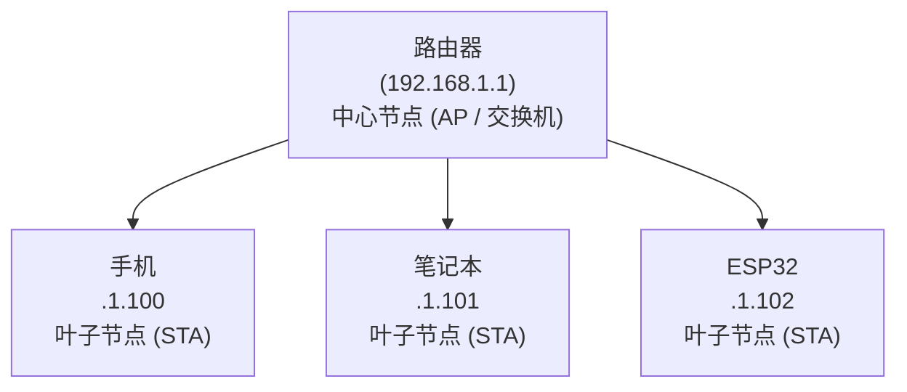

特点：
  ① 所有通信必须经过中心节点（路由器）
  ② 节点之间不直接通信，均由路由器转发
  ③ 中心节点故障 = 全网瘫痪
  ④ 添加/删除节点不影响其他设备 → 扩展性好

**为什么 Wi-Fi 采用星型拓扑？**

Wi-Fi 的介质访问机制是 **CSMA/CA**（载波监听多路访问/冲突避免）——每个设备在发送数据前先"听"一下信道是否空闲。如果每个设备都直接互相通信，冲突检测复杂度呈指数增长。统一由 AP 集中调度，冲突管理简化为"一个中心管控来往"。

**CSMA/CA 和以太网的 CSMA/CD 有何不同？** 以太网用 CD（Collision Detection，冲突检测）——设备边发边听，检测到冲突就停发+随机退避。Wi-Fi 不能用 CD，因为无线信号在发送时会把接收器"震聋"（发射功率远大于接收灵敏度），设备无法在发送的同时监听信道。所以 Wi-Fi 用 CA（Collision Avoidance，冲突避免）——先声明（RTS/CTS），再发送，靠预防而非检测。

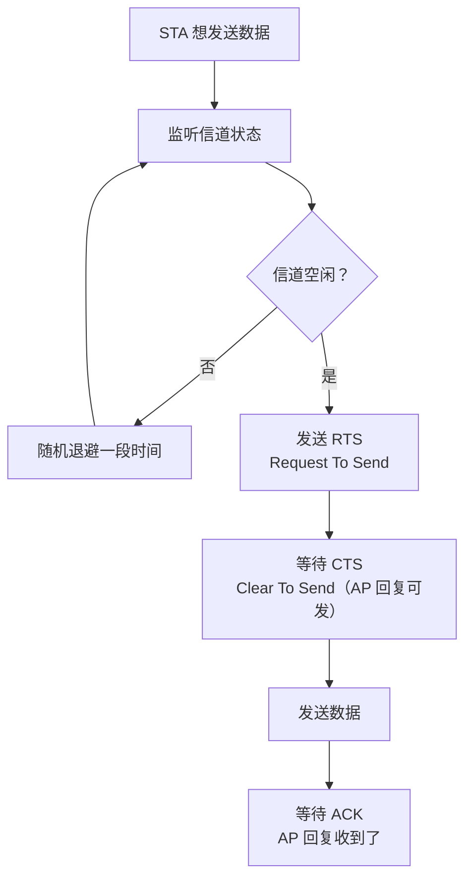

**RTS/CTS 的开销问题**：RTS/CTS 每传一帧都要额外发送两个管理帧。ESP32 的 Wi-Fi 驱动默认不启用 RTS/CTS（因为 IoT 场景数据包通常很小）。

### 4.2 其他拓扑形式

| 拓扑 | 图示 | 特点 | Wi-Fi 中对应 |
|------|------|------|-------------|
| **星型** | 中心节点+叶子 | 结构简单，中心依赖性强 | 标准 Wi-Fi 家庭网络 |
| **树型** | 星型的层级串联 | 逐级扩展覆盖 | 企业级多 AP 组网（Mesh） |
| **网状（Mesh）** | 节点互相连接 | 自愈、自组织 | Wi-Fi Mesh 组网（ESP-MESH） |
| **总线型** | 一条线串所有设备 | 已淘汰（早期以太网） | 不适用于 Wi-Fi |

**树型拓扑（多 AP 扩展）：**

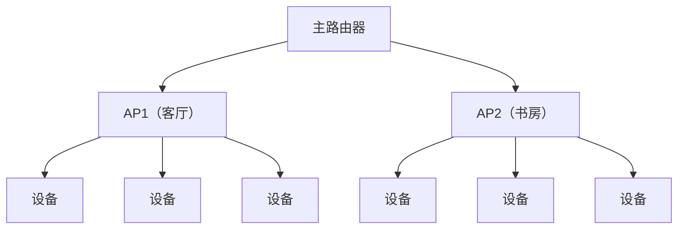

**ESP-MESH 网状拓扑（ESP32 特色功能）：**

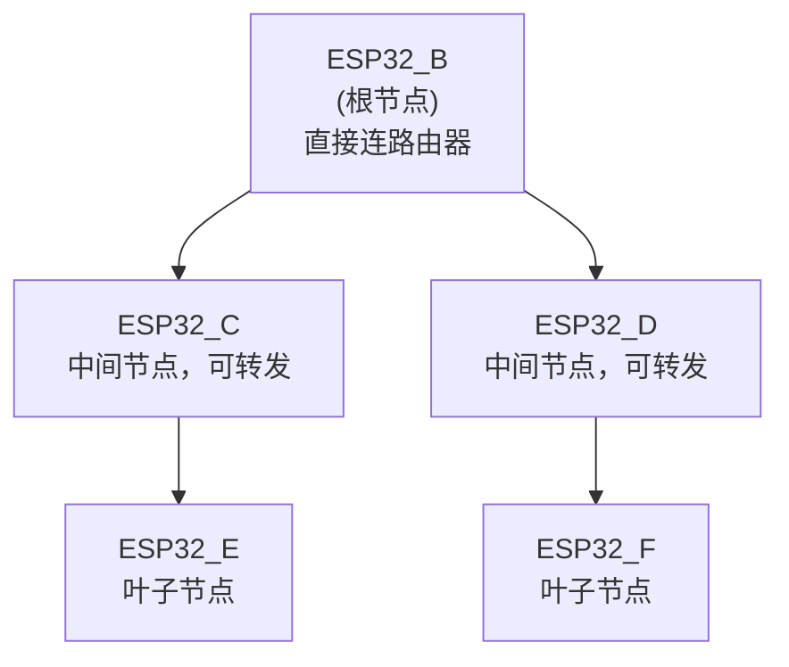

Mesh 优势：
  • 节点之间可相互转发 → 覆盖范围远大于单个 AP
  • 某节点掉线 → 自动重新寻路 → 自愈

**ESP-MESH 的内部实现**：根节点运行 STA+AP 混合模式——STA 侧连上游路由器，AP 侧为下游节点提供热点。非根节点运行 AP+STA 扫描模式。Mesh 内部运行一个轻量级路由协议（基于 IEEE 802.11s 简化版），维护一张"到达根节点的跳数和信号质量表"，当父节点断线时自动切换到次优路径。

---

## 5. 路由器

### 5.1 路由器的工作原理

路由器是连接**不同网络**的设备。它工作在网络层（IP 层），根据 IP 地址决定数据从哪个接口转发出去。

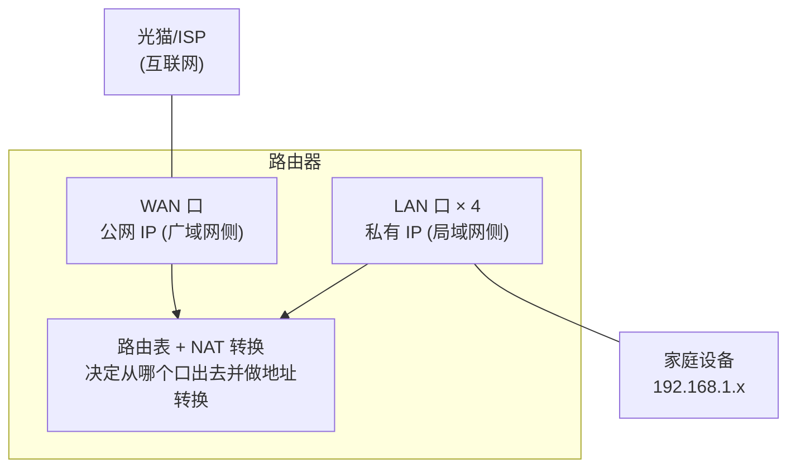

路由器内部有一张**路由表**：

```
路由表示例：

目标网络          子网掩码         下一跳          出接口
0.0.0.0          0.0.0.0         100.64.0.1      WAN    ← 默认路由（所有外网走这里）
192.168.1.0      255.255.255.0   0.0.0.0         LAN    ← 局域网内直接通信
```

- `0.0.0.0/0` 是默认路由——匹配所有目标地址，"不知道往哪走就走这里"
- `192.168.1.0/24` 是本地局域网路由——设备间直接通信，不经过 WAN

**为什么家庭路由器的 LAN 口是"交换机"而 WAN 口是"路由器"？** 四个 LAN 口通过内部芯片级联，MAC 层直接转发（不经过 IP 层）——这是二层交换机。WAN 口的数据要经过 IP 层的路由决策和 NAT 转换——这是三层路由器。LAN→LAN 的通信不消耗路由器的 CPU，而 WAN→LAN 的通信每一帧都要经过 CPU 处理——这就是为什么大流量下载时路由器会变热。

### 5.2 NAT — 多个设备共用一个公网 IP

NAT（Network Address Translation，网络地址转换）是路由器的核心功能之一。全世界 IPv4 地址早已枯竭，不可能给每个设备分配一个公网 IP。NAT 的解决思路是：

```mermaid
flowchart LR
    A["ESP32<br/>192.168.1.102"]
    B["手机<br/>192.168.1.100"]
    C["笔记本<br/>192.168.1.101"]
    D["路由器 (NAT)<br/>公网 IP: 203.0.113.5"]
    E["互联网服务器"]
    A --> D
    B --> D
    C --> D
    D --> E

    关键转换：
      内网 IP:端口 → NAT 映射表 → 公网 IP:新端口
    
      ESP32 发往 baidu.com:80 →
        源地址: 192.168.1.102:45678 → NAT 改写 → 203.0.113.5:50001
        路由器记住映射: 192.168.1.102:45678 ↔ 203.0.113.5:50001
    
      baidu.com 回复 203.0.113.5:50001 →
        路由器查映射表: 50001 → 192.168.1.102:45678
        → 转发回 ESP32
```

**NAT 的本质**：一组内网设备共享一个公网 IP，路由器用端口号区分不同的内网设备。对外看来，所有流量都来自同一个公网 IP——外部无法直接访问内网设备（这就是为什么"内网穿透"才成为一个问题）。

**NAT 映射表的维护问题**：每一条 NAT 映射都是临时的——如果 ESP32 长时间不发数据，路由器会清掉这条映射（超时通常在 30 秒到 5 分钟之间）。这也是为什么 TCP Keep-Alive 和 MQTT Keep-Alive 机制的底层原因——不是为了"保持 TCP 连接"，而是为了"保持 NAT 映射不过期"。

**CGNAT（运营商级 NAT）**：`100.64.0.1` 这个地址属于 `100.64.0.0/10` 私有地址空间。这说明路由器的下一跳也是私网——你的 ISP 也在做 NAT。传统"公网 IP"现在只存在于电信级路由器的出口端。普通家庭宽带实际上经历了双重 NAT。

---

## 6. IP 地址

### 6.1 IPv4 地址结构

IPv4 地址是 32 位二进制数，通常写成**点分十进制**形式：

```
IP 地址 = 网络号 + 主机号

  192     .    168     .    1      .    100
  11000000  10101000  00000001  01100100
  └────┬────┘ └────────────┬────────────┘
     网络号                 主机号

  32 位 = 4 字节，每字节 0~255
  理论地址总数: 2³² ≈ 43 亿个
```

**为什么有"点分十进制"这种奇怪的记号？** 纯属人类可读性。`192.168.1.100` 比 `3232235876`（十进制等价）或 `0xC0A80164`（十六进制）直观太多。路由器内部只存 32 位无符号整数。

### 6.2 公有 IP vs 私有 IP

由于 43 亿个 IPv4 地址根本不够全球用，IETF 划出了三块**私有地址**空间，供局域网内部使用：

| 私有地址范围 | CIDR | 可用数量 | 典型场景 |
|-------------|------|---------|---------|
| 10.0.0.0 ~ 10.255.255.255 | 10.0.0.0/8 | 约 1677 万 | 大型企业内网 |
| 172.16.0.0 ~ 172.31.255.255 | 172.16.0.0/12 | 约 104 万 | 中型网络 |
| **192.168.0.0 ~ 192.168.255.255** | 192.168.0.0/16 | 约 6.5 万 | **家庭路由器（最常见）** |

```
公网 IP 和私有 IP 的区别：

  公网 IP (203.0.113.5)
  ├── 全球唯一，由 ISP 分配
  ├── 可以直接被互联网上的任何设备访问
  └── 路由器 WAN 口拥有

  私有 IP (192.168.1.100)
  ├── 只能在局域网内使用
  ├── 不同家庭可以用相同的 192.168.1.100（不冲突）
  ├── 不能直接从互联网访问
  └── 必须通过 NAT 转换才能上网
```

你的 ESP32 连接家里路由器后，路由器通过 DHCP 给它分配一个 `192.168.1.x` 的私有 IP。ESP32 访问外网时，路由器做 NAT 转换后才真正发出。

**为什么家庭路由器几乎都用 192.168.x.x？** 这是市场惯性。2000 年初 Linksys 把 WRT54G 路由器默认设为 192.168.1.1，之后几乎所有消费级路由器都沿用了这个惯例。

### 6.3 子网掩码与网关

```
典型家庭网络配置：

  IP 地址:   192.168.1.100
  子网掩码:  255.255.255.0     ← 表示前 24 位是网络号
  默认网关:  192.168.1.1       ← 出局域网的"出口"

  子网掩码的作用：告诉设备"哪些 IP 和我在同一个局域网"

  192.168.1.100 & 255.255.255.0 = 192.168.1.0  (本机网络号)
  192.168.1.101 & 255.255.255.0 = 192.168.1.0  (相同 → 局域网内直连)
  192.168.2.100 & 255.255.255.0 = 192.168.2.0  (不同 → 必须走网关)
```

**网关 = 局域网的"大门"**。任何目标不在本局域网内的数据，全部丢给网关（路由器），由网关决定下一跳往哪走。

### 6.4 DHCP — 自动获取 IP

DHCP（Dynamic Host Configuration Protocol，动态主机配置协议）让设备自动获取 IP 地址，免去手动配置：

```
DHCP 四步握手：

  ESP32 (新设备)                         路由器 (DHCP Server)
      │                                        │
      │ ─────── DHCP DISCOVER ────────────────►│   "有人吗？我要 IP！"
      │        (广播到 255.255.255.255)         │
      │                                        │
      │ ◄─────── DHCP OFFER ──────────────────│   "给你 192.168.1.102，租期 24h"
      │                                        │
      │ ─────── DHCP REQUEST ─────────────────►│   "好的，我就用这个了"
      │                                        │
      │ ◄─────── DHCP ACK ────────────────────│   "确认。网关 192.168.1.1，DNS 8.8.8.8"
      │                                        │

  ESP32 拿到: IP + 子网掩码 + 网关 + DNS
```

ESP32 在 STA 模式下默认启用 DHCP 客户端——连接路由器后自动获取 IP，不需要写任何配置代码。

**DHCP 租期的实现细节**：路由器给 ESP32 的 IP 不是永久的。租期到期前（通常 12~24 小时），ESP32 必须发送 DHCP REQUEST 续约。如果 ESP32 休眠了，醒来时 IP 可能已被分配给其他设备——这就是为什么 Wi-Fi 长时间休眠后需要重新 DHCP。

### 6.5 MAC 地址 vs IP 地址

| 维度 | MAC 地址 | IP 地址 |
|------|---------|---------|
| 所在层 | 数据链路层（第 2 层） | 网络层（第 3 层） |
| 长度 | 48 位（6 字节） | 32 位（4 字节，IPv4） |
| 格式 | `AA:BB:CC:DD:EE:FF` | `192.168.1.100` |
| 来源 | **出厂烧录，全球唯一** | 网络分配，可变 |
| 作用范围 | 局域网内（不跨路由器） | 全球路由 |
| 类比 | 身份证号（出生就有） | 家庭住址（到哪住哪） |

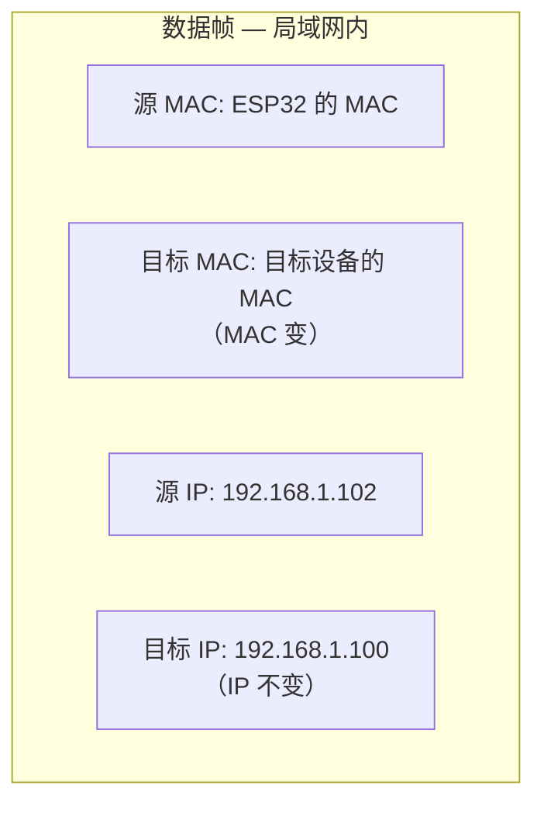

  跨网络传输（经路由器）：

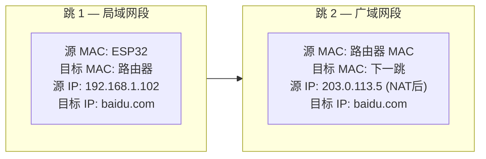

**为什么需要两层地址？** 因为它们的"管辖范围"不同。MAC 地址只在一个广播域（同一局域网）内有效。路由器不会把广播帧转发到 WAN 口——否则全世界的广播帧会淹没互联网。跨网络的通信需要 IP 地址来"找到目标网络"，再在该网络内用 MAC 地址"找到目标设备"。MAC 是"最后一跳"，IP 是"长途导航"。

---

## 7. 客户端-服务器模型

### 7.1 C/S 模型的核心思想

互联网上的通信几乎都是**客户端-服务器（C/S）模型**：

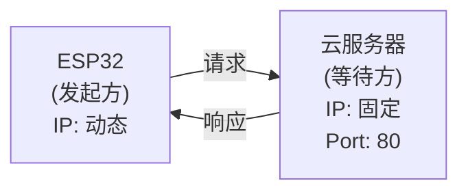

核心特征：
  ① 客户端主动发起连接请求
  ② 服务器被动等待连接（一直监听某个端口）
  ③ 服务器 IP 必须已知且固定（DNS 帮我们记住）
  ④ 一次交互由"请求 → 响应"组成

**为什么服务器必须先启动？** 因为客户端需要有确定的"目标地址"来发起连接。服务器不先启动监听，客户端连接请求到达时无人应答 → 连接失败。

**C/S 模型的"非对称性"对嵌入式设备的影响**：ESP32 作为客户端时，它的 IP 可以随意变（DHCP），只要能访问服务器即可。但如果 ESP32 作为服务器（内嵌 Web 管理页面），它的 IP 必须固定或至少可知——这就是 AP 模式的优势（ESP32 作为热点时 IP 固定为 192.168.4.1）。在 STA+AP 模式下，手机可连接 ESP32 的 AP 热点，通过固定的 192.168.4.1 访问配置页面——这正是几乎所有智能设备配网方案的底层逻辑。

### 7.2 端口号

IP 地址找到"哪台机器"，端口号找到"机器上的哪个程序"：

```
服务器 203.0.113.5 上运行多个服务：

  203.0.113.5:80   → HTTP (Web 服务器)
  203.0.113.5:443  → HTTPS (加密 Web)
  203.0.113.5:1883 → MQTT Broker
  203.0.113.5:22   → SSH (远程登录)

类比: IP = 写字楼地址，端口 = 房间号
```

常见端口号：

| 端口 | 协议 | 用途 |
|------|------|------|
| 80 | HTTP | Web 服务器 |
| 443 | HTTPS | 加密 Web 服务器 |
| 1883 | MQTT | IoT 消息协议 |
| 8080 | HTTP(备用) | 开发调试 |
| 21 | FTP | 文件传输 |
| 22 | SSH | 安全远程登录 |

**端口号的分配规则**：0~1023 是"知名端口"（Well-Known Ports），需要管理员权限才能绑定；1024~49151 是"注册端口"；49152~65535 是"动态/私有端口"。ESP32 作为客户端连接 MQTT Broker 时，操作系统自动分配一个临时端口（如 50001）作为源端口。

---

## 8. lwIP 协议栈

### 8.1 什么是 lwIP

lwIP（lightweight IP）是由瑞典计算机科学研究所（SICS）开发的**轻量级 TCP/IP 协议栈**，专为嵌入式系统设计：

| 特性 | lwIP | Linux TCP/IP |
|------|------|-------------|
| RAM 占用 | 几十 KB | 几 MB |
| 代码量 | 约 4 万行 | 数十万行 |
| 功能完整度 | 核心协议齐全 | 全部协议支持 |
| 线程模型 | 单线程回调 / 多线程 | 内核态多线程 |
| 适用场景 | MCU / 嵌入式 | 桌面 / 服务器 |

**lwIP 的设计哲学**：在有限的 RAM 和 Flash 上实现 TCP/IP 协议栈的核心子集——不需要的协议不编译，所有数据结构都做了嵌入式优化（零拷贝缓冲、静态分配、内存池）。

**lwIP 的"零拷贝"具体怎么做的？** Linux 内核中，数据从网卡 DMA 到 `sk_buff`，再拷贝到用户空间——至少两次拷贝。lwIP 用 `pbuf`（Packet Buffer）直接指向 DMA 缓冲区，应用层通过 `pbuf` 指针读取而非拷贝数据。这让一个只有 64 KB RAM 的 MCU 也能处理 TCP 收发——因为没有多余的内存给拷贝缓冲。

### 8.2 TCP/IP 四层模型

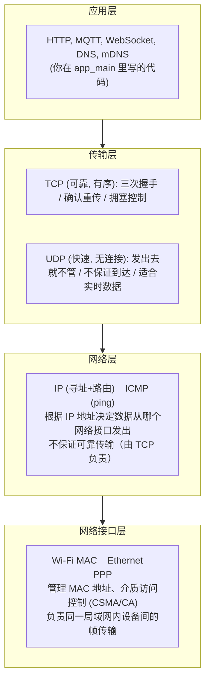

**数据封装过程**：

```
应用数据 "Hello"
      │
      ▼  +TCP头(端口号)
  [TCP Header│Hello]
      │
      ▼  +IP头(IP地址)
  [IP Header│TCP Header│Hello]
      │
      ▼  +MAC头(MAC地址) + FCS(校验)
  [MAC Header│IP Header│TCP Header│Hello│FCS]
      │
      ▼  物理层转为电磁波发送
  ... 2.4GHz 射频信号 ...
```

每一层把自己的头部信息加到数据前面——这就是**封装**。接收端逐层剥掉头部，最终拿到原始数据。

**为什么要逐层封装而不是把所有信息塞进一个头？** 因为每一层由不同的代码/硬件处理，它们不应该知道其他层的细节。Wi-Fi 驱动只关心 MAC 地址和射频参数，不关心 TCP 的确认号。IP 层只关心路由，不关心 TCP 重传。这种"关注点分离"让你可以在不改变上层应用的情况下切换底层物理介质——同一个 MQTT 应用可以跑在 Wi-Fi 上，也可以跑在以太网上。

### 8.3 lwIP 在 ESP-IDF 中的位置

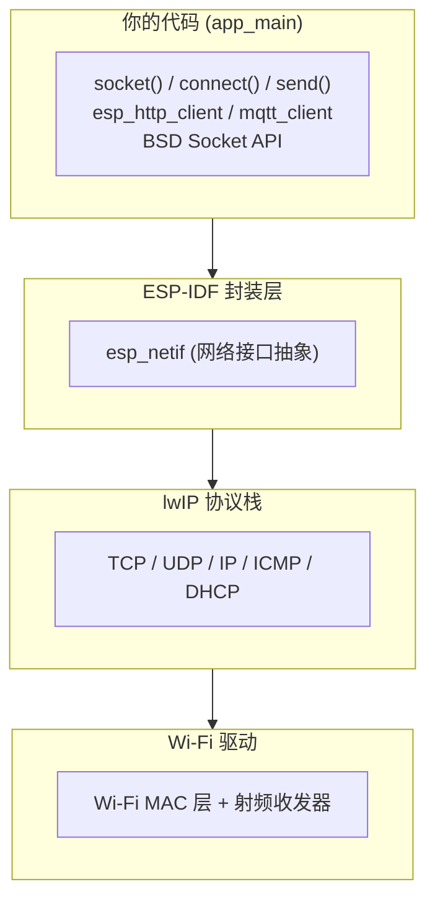

**关键理解**：ESP-IDF 中的 `socket()` 并不是 Linux 的 `socket()`，而是 lwIP 提供的 BSD Socket 兼容接口。函数名相同、用法相同，但底层实现完全不同——lwIP 使用回调机制和零拷贝缓冲，而非 Linux 内核的 `sk_buff` 和中断处理。

**`esp_netif` 这层是干什么的？** 在多网络接口的场景下（同时有 Wi-Fi STA + Wi-Fi AP + 以太网），数据包需要从正确的接口出去。`esp_netif` 维护每个接口的 IP 配置、路由表、DHCP 状态，并向上层提供统一 API。

### 8.4 TCP vs UDP

| 特性 | TCP | UDP |
|------|-----|-----|
| 连接 | 面向连接（三次握手） | 无连接（直接发） |
| 可靠性 | 确认+重传+序号 | 不保证到达 |
| 顺序 | 严格有序 | 不保证顺序 |
| 流量控制 | 有（滑动窗口+拥塞控制） | 无 |
| 头部开销 | 20 字节 | 8 字节 |
| 速度 | 慢（握手+ACK 等待） | 快（发完就忘） |
| 适用场景 | HTTP、MQTT、文件传输 | 视频流、语音、DNS 查询 |

```
TCP 三次握手：

  ESP32                                服务器
    │                                     │
    │ ──── SYN (seq=x) ────────────────► │  "我想连接你"
    │                                     │
    │ ◄── SYN+ACK (seq=y, ack=x+1) ──── │  "好，我也确认"
    │                                     │
    │ ──── ACK (ack=y+1) ──────────────► │  "收到，开始传数据"
    │                                     │
    │ ◄══════ 数据传输阶段 ═══════════► │

UDP 发送：

  ESP32                                服务器
    │                                     │
    │ ──── 数据 ──────────────────────► │  直接发！
    │                                     │
    │ 不等待确认，不知道对方有没有收到     │
```

**TCP 和 UDP 在嵌入式中的实际选择**：MQTT 选 TCP 因为它跑在不可靠的 Wi-Fi 上——丢包重传是刚需。CoAP 选 UDP 因为它面向低功耗传感器——省去握手的电量开销。DNS 查询用 UDP 因为查询包很小，丢了重发一次就行，比先握手再发快太多了。**选 TCP 还是 UDP，本质上是在"可靠性开销"和"速度开销"之间做选择**。

---

## 9. ESP32 Wi-Fi 三种工作模式

### 9.1 STA 模式 — 客户端

STA（Station）模式是**最常见的模式**——ESP32 作为客户端连接到现有的 Wi-Fi 路由器。

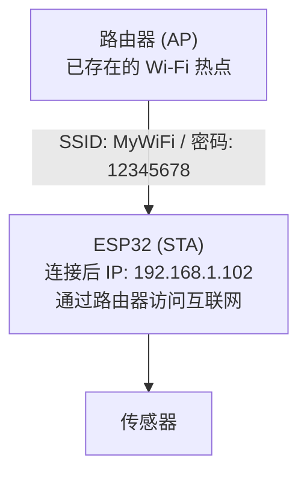

**STA 模式关键 API（ESP-IDF）**：

| 步骤 | 说明 |
|------|------|
| `esp_netif_init()` | 初始化网络接口 |
| `esp_event_loop_create_default()` | 创建默认事件循环 |
| `esp_netif_create_default_wifi_sta()` | 创建 STA 网络接口实例 |
| `esp_wifi_init(&cfg)` | 初始化 Wi-Fi 驱动 |
| `esp_wifi_set_mode(WIFI_MODE_STA)` | 设为 STA 模式 |
| `esp_wifi_set_config(..., &wifi_config)` | 配置 SSID 和密码 |
| `esp_wifi_start()` | 启动 Wi-Fi |
| `esp_wifi_connect()` | 发起连接 |

### 9.2 AP 模式 — 热点

AP（Access Point）模式下，**ESP32 自身变成热点**，其他设备（手机、电脑）可以连接它。

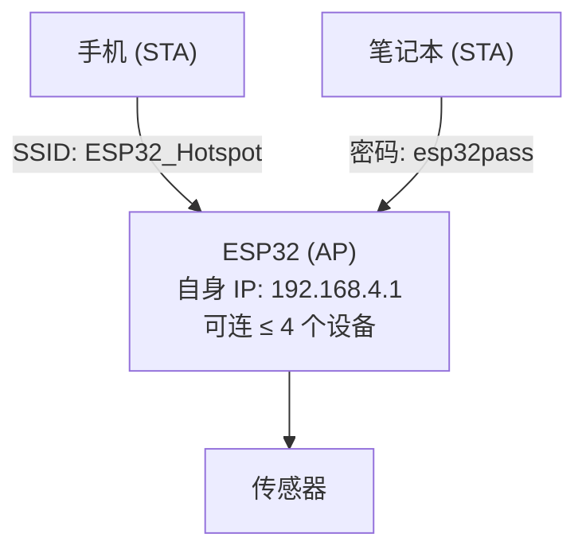

  适用场景：
    • 设备配网（手机连 ESP32 热点 → 告诉它家里的 Wi-Fi 密码）
    • 独立传感器网络（ESP32 做热点，手机连上查看数据）
    • 离线控制（不需要路由器，直连 ESP32 控制）

AP 模式关键点：
- ESP32 AP 默认 IP：`192.168.4.1`
- DHCP 自动给连接的设备分配 IP（`192.168.4.x`）
- 最大连接数受限于芯片资源，推荐 ≤ 4 个
- AP 模式下 ESP32 **不能直接访问互联网**——它自己是热点，没有上游网络

**为什么 AP 的默认 IP 是 192.168.4.1？** 因为大多数路由器的默认 IP 是 192.168.1.1，手机同时连接路由器和 ESP32 时，如果两个网络都是 192.168.1.x，手机无法区分哪个数据包应该发往哪个网络接口——IP 路由冲突。192.168.4.1 选择了不同的第三段。

### 9.3 STA+AP 模式 — 混合

STA+AP 模式又称**混合模式**或**中继模式**——ESP32 同时扮演客户端和热点两个角色：

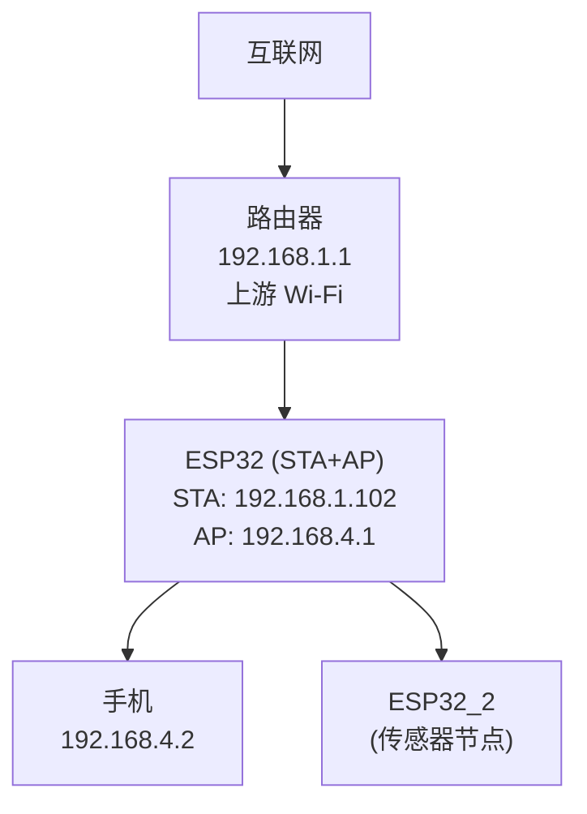

  两个网络完全独立，不自动转发数据。
  如需转发 → 需要应用层实现数据中转。

| 模式 | ESP32 角色 | 能否上网 | 典型场景 |
|------|-----------|---------|---------|
| **STA** | 纯客户端 | **能**（经路由器） | 连家里 Wi-Fi 上云 |
| **AP** | 纯热点 | **不能** | 配网、离线控制 |
| **STA+AP** | 客户端 + 热点 | **能**（经 STA 侧） | Wi-Fi 中继/网关 |

**STA+AP 为什么不自动转发数据？** 这是安全性设计。自动转发（桥接模式）意味着任何连上 ESP32 热点的设备都可以通过它的 STA 侧访问上游网络。如果任由硬件自动桥接，ESP32 就成了"透明代理"，上游网络的设备可以被热点侧设备任意访问——这是安全漏洞。

### 9.4 三种模式对比

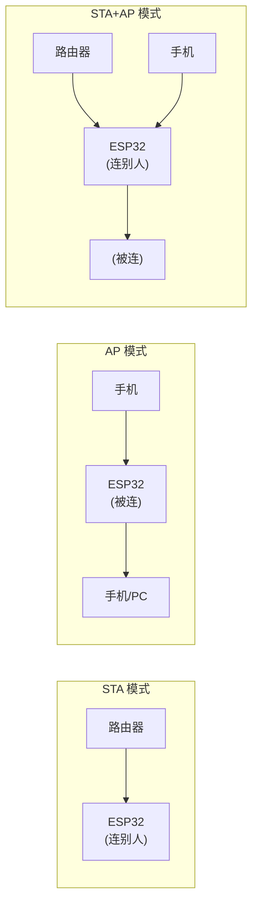

  一句话总结：
    STA  → "我连你的 Wi-Fi"
    AP   → "你连我的热点"
    STA+AP → "我连你的，你也连我的"

---

## 10. Wi-Fi 连接流程

### 10.1 STA 连接路由器流程

ESP32 STA 连接路由器的完整流程：

  ① 扫描 (Scan)
     ESP32 扫周边 AP → 发现 SSID "MyWiFi" (信道 6, RSSI -45dBm)

  ② 认证 (Authentication)
     ESP32 → Auth Req → AP
     ESP32 ← Auth Resp ← AP

  ③ 关联 (Association)
     ESP32 → Assoc Req → AP ("我要连你，支持 802.11n")
     ESP32 ← Assoc Resp ← AP ("好，给你关联 ID = 3")

  ④ 四次握手 (4-Way Handshake)

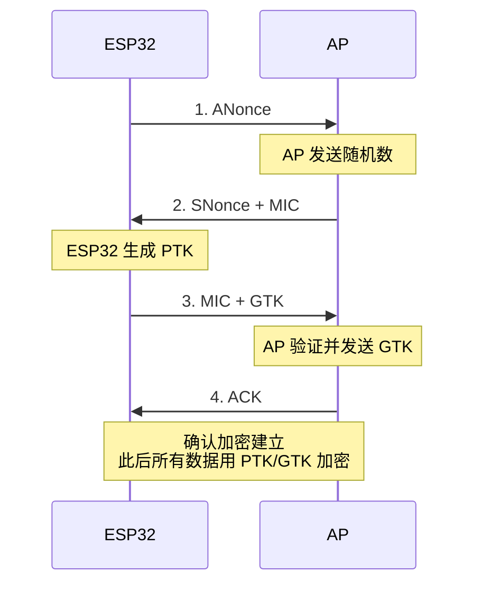

  ⑤ DHCP 获取 IP
     ESP32 → DHCP DISCOVER → AP
     ESP32 ← DHCP OFFER ← AP (192.168.1.102)
     ESP32 → DHCP REQUEST → AP
     ESP32 ← DHCP ACK ← AP

  ⑥ IP 就绪 → 可以 socket/connect/send 了

**扫描阶段为什么耗时最长？** 全信道扫描（1~13 信道）需要在每个信道上停留约 100ms 来监听 Beacon 帧。13 个信道 × 100ms = 1.3 秒，加上 Probe Request/Response 交互，一次全扫描通常需要 2~3 秒。如果已知路由器的信道号，配置中指定 `channel` 可跳过扫描——连接速度从 3 秒降低到约 0.5 秒。

**四次握手的密码学意义**：ANonce（AP Nonce）和 SNonce（Station Nonce）是两个随机数。双方各自用 PMK（Pairwise Master Key，由 Wi-Fi 密码派生）+ ANonce + SNonce + MAC 地址算出 PTK（Pairwise Transient Key）。PTK 用于加密后续所有帧。Wi-Fi 密码从未在空中传输——传输的是用密码计算的校验值（MIC）。

### 10.2 ESP-IDF Wi-Fi 编程模型

ESP-IDF 的 Wi-Fi 使用**事件驱动**模型。Wi-Fi 连接的每个阶段都会产生事件，用户代码通过事件回调获知状态变化：

```
Wi-Fi 事件回调中的典型事件流：

WIFI_EVENT_STA_START          ← Wi-Fi 驱动已启动
       │
       ▼
esp_wifi_connect()            ← 应用调用，开始连接
       │
       ▼
WIFI_EVENT_STA_CONNECTED      ← 与 AP 关联成功（链路层连上）
       │
       ▼
IP_EVENT_STA_GOT_IP           ← DHCP 拿到 IP（网络层就绪）
       │
       ▼
应用开始 socket/connect/send  ← 此时才能真正通信
```

**关键区分**：
- `WIFI_EVENT_STA_CONNECTED` 只是 Wi-Fi 链路层连接上，**还没有 IP 地址**
- `IP_EVENT_STA_GOT_IP` 才是真正的"可以上网了"——拿到了 IP、子网掩码、网关地址
- **一定要等到 `IP_EVENT_STA_GOT_IP` 后再做网络操作**，否则 socket 创建会失败

**事件回调中的 FreeRTOS 上下文问题**：Wi-Fi 事件回调是在 Wi-Fi 任务的上下文中执行的（不是你的 app_main 任务）。这意味着：
1. 回调中可以调用 `xQueueSend`、`xEventGroupSetBits` 等 FreeRTOS API 来通知你的任务
2. **不要在回调中做耗时操作**（如 socket connect）——这会阻塞 Wi-Fi 任务
3. 最佳实践：回调中只设置标志位/发送队列消息，让 app_main 中的任务去处理真正的业务逻辑

---

## 容易踩坑

| 现象 | 常见原因 | 排查方向 |
|------|----------|----------|
| Wi-Fi 连不上，一直打印 `WIFI_EVENT_STA_DISCONNECTED` | SSID 或密码错误、信号太弱、路由器拒绝连接 | 检查 SSID/密码、路由器 MAC 过滤、Wi-Fi 密码类型（WPA2 兼容） |
| `socket connect` 失败 | 没等到 `IP_EVENT_STA_GOT_IP` 就创建 socket | 在 `IP_EVENT_STA_GOT_IP` 回调中发起连接，而非 `WIFI_EVENT_STA_CONNECTED` |
| AP 模式手机搜不到热点 | 没有调用 `esp_wifi_start()`，或信道配置有误 | 确认 Wi-Fi 已启动、AP 配置中 SSID 和密码已设置 |
| 连上 Wi-Fi 但 ping 不通外网 | DNS 未配置，或网关设置错误 | 检查 DHCP 是否拿到了 DNS（通常 8.8.8.8），手动 `ping 8.8.8.8` 测试 |
| STA+AP 模式下 STA 侧设备无法上网 | 两个网络的数据包没做转发 | STA+AP 不会自动转发数据——需要在应用层实现包转发（或直接不需要转发，两种身份独立工作即可） |
| Wi-Fi 连接慢（>5 秒） | 路由器信道拥挤、扫描阶段耗时 | 如果已知 SSID 和信道，配置中直接指定信道号，跳过扫描 |
| 长时间运行 Wi-Fi 断连 | 路由器 DHCP 租期到期未续约、射频干扰、FreeRTOS 任务饥饿 | 在事件回调中处理 `WIFI_EVENT_STA_DISCONNECTED`，实现自动重连 |
| `nvs_flash_init()` 报错 | NVS 分区被 SPIFFS 覆盖或未初始化 | Wi-Fi 配置存储在 NVS 中，`app_main` 开头必须调用 `nvs_flash_init()` |

---

## 11. 本章小结

### 核心知识链路

```
物理层:   2.4GHz ISM 频段 → 信道划分 → 802.11 b/g/n 协议
             │
链路层:   MAC 地址 → CSMA/CA → 星型拓扑 → 路由器转发
             │
网络层:   IP 地址 → 子网掩码 → 网关 → NAT → DHCP
             │
传输层:   TCP (可靠有序) / UDP (快速无连接)
             │
应用层:   HTTP / MQTT / WebSocket / 自定义协议
```

### ESP32 三种模式总结

| 模式 | 本质 | 一句话 |
|------|------|--------|
| **STA** | 客户端 | "我连你的 Wi-Fi，借你的网上云" |
| **AP** | 热点 | "我是热点，你连我，我在局域网里给你服务" |
| **STA+AP** | 混合 | "我既连你的网，也开自己的热点" |

### 关键理解

1. ESP32-S3 只支持 2.4GHz Wi-Fi 4（802.11n），不支持 5GHz 和 Wi-Fi 5/6
2. lwIP 是轻量级 TCP/IP 协议栈，占用 RAM 几十 KB，适合嵌入式
3. TCP 可靠但慢（三次握手+ACK），UDP 快但不保证到达
4. STA 模式能上网，AP 模式只能局域网通信，STA+AP 两个网络默认不互通
5. 区分 `WIFI_EVENT_STA_CONNECTED`（链路层）和 `IP_EVENT_STA_GOT_IP`（网络层）——后者才是"真·连上了"

---

## Tips

### 最容易忽视的细节

1. **Wi-Fi 密码从未在空中传输**。四次握手中传输的是用密码计算的校验值（MIC），攻击者无法反推密码。但这不代表安全——如果密码是 `12345678`，攻击者可以离线暴力破解 MIC。
2. **ESP32 的 `esp_wifi_connect()` 不阻塞**。它只是发起连接请求，实际连接过程在后台（Wi-Fi 任务）进行。你的代码需要事件回调来感知连接结果。这和你写 PC 端 `connect()` 的阻塞行为完全不同——嵌入式 Wi-Fi 是全异步的。
3. **AP 默认 IP 192.168.4.1 是可以改的**。如果你的手机同时连路由器和 ESP32 热点且两个网络恰好用了不同网段，那没问题。但如果你的路由器恰好也是 192.168.4.x（公司网络），需要在 `esp_netif` 中修改 AP 的 IP 配置。
4. **lwIP 的 socket 在 FreeRTOS 任务中默认是阻塞的，但可设超时**。`setsockopt(fd, SOL_SOCKET, SO_RCVTIMEO, &timeout, ...)` 可以设置接收超时——在嵌入式 Wi-Fi 环境下，不设超时的 `recv()` 可能导致任务永远阻塞。

### 踩坑记录

- **`WIFI_EVENT_STA_CONNECTED` 到 `IP_EVENT_STA_GOT_IP` 之间的时间差可能长达数秒**。如果路由器 DHCP 响应慢，或网络里有 DHCP 冲突（两台 DHCP 服务器抢着分配 IP），这个间隙会更长。在这期间创建 socket 必然失败。
- **STA+AP 模式下 Wi-Fi 任务栈更容易溢出**。同时维护两个网络接口意味着两倍的 Beacon 帧发送、两倍的管理帧处理。默认的 Wi-Fi 任务栈（通常 4096 字节）在同时承载加密广播 + DHCP 分发 + 连接维护时可能不够。如果遇到 `Stack overflow in WiFi task`，在 menuconfig 中增大 `CONFIG_ESP32_WIFI_TASK_STACK_SIZE`。
- **`nvs_flash_init()` 失败的最常见原因不是 NVS 分区坏了，而是旧的分区表残留**。如果你之前用过 SPIFFS 或其他自定义分区表，Flash 上可能有残留的元数据被 NVS 误读。用 `idf.py erase_flash` 全擦除，再重烧通常能解决。

### 与后续章节的知识衔接点

1. **MQTT 章节**：MQTT 跑在 TCP 之上。理解 TCP 的三次握手和重传机制，你才能理解 MQTT 的 QoS 和 Keep-Alive——它们是在 TCP 可靠性之上再增加应用层保障。
2. **HTTP/HTTPS 章节**：HTTP 用 TCP（端口 80），HTTPS 在 TCP 之上加 TLS 握手（端口 443）。理解本章的 TCP 握手 + 数据封装，TLS 就是"再多一层握手+加密"。
3. **OTA 章节**：OTA 下载固件用 HTTP（TCP 连接），Wi-Fi 断线重连是 OTA 的最大敌人。理解本章的 `WIFI_EVENT_STA_DISCONNECTED` 事件驱动模型，你就能实现"断线自动重连+断点续传"的健壮 OTA。
4. **NVS 章节**：Wi-Fi 的 SSID、密码、信道偏好都存储在 NVS 中（`nvs` 命名空间，`wifi_config` 键）。理解本章的 `nvs_flash_init()` 前置条件，才能顺利实现"首次配网 + 重启自动连接"。

### 设计决策思考

- **为什么 ESP32 不直接移植 Linux 的 TCP/IP 栈？** Linux 的 TCP/IP 栈与内核深度耦合——发送数据涉及 `sk_buff` 分配、netfilter 钩子、QoS 队列、路由缓存，每一步都在内核态完成。这套机制依赖 MMU（虚拟内存映射 `sk_buff`）和内核线程模型。ESP32 没有 MMU、RAM 只有几百 KB，移植 Linux 协议栈意味着至少 500 KB 的 RAM 开销——对 ESP32 来说是灾难。lwIP 的选择不是"不想用 Linux"，而是"物理上不支持"。
- **为什么 Wi-Fi 安全机制要分 PMK 和 PTK？** PMK（Pairwise Master Key）是长期密钥——只要密码不变，它就不变。PTK（Pairwise Transient Key）是会话密钥——每次连接都重新生成。分开的好处是：即使攻击者抓到了某次会话的所有加密帧并破解了 PTK，他只能解密那一次会话的数据。以前的会话和未来的会话都因为使用了不同的 PTK 而安全。这就是"前向安全性"（Forward Secrecy）的简化实现——Wi-Fi 没有用完整的 Diffie-Hellman 密钥交换，但通过每次连接重新计算 PTK 达到了类似效果。
