# 嵌入式系统底层三线贯通：裸机 · RTOS · Linux

## 本章目录

> 点击条目可跳转到对应小节。

### 章节导航

- **[学习前后依赖](#学习前后依赖)**
- **[第一章：裸机 vs FreeRTOS — 同一个场景，三种写法](#第一章裸机-vs-freertos-—-同一个场景三种写法)**
  - [1.1 51 单片机（AT89C51）：裸机是唯一选择](#11-51-单片机at89c51裸机是唯一选择)
  - [1.2 STM32（F103C8）：裸机和 FreeRTOS 势均力敌](#12-stm32f103c8裸机和-freertos-势均力敌)
  - [1.3 ESP32（N8R16，双核 240MHz）：FreeRTOS 是基因，裸机是自虐](#13-esp32n8r16双核-240mhzfreertos-是基因裸机是自虐)
- **[第二章：栈指针深入 — 51 的硬栈 vs ESP32 的寄存器栈](#第二章栈指针深入-—-51-的硬栈-vs-esp32-的寄存器栈)**
- **[第三章：TCB vs PCB — 为什么 RTOS 的任务不叫进程？](#第三章tcb-vs-pcb-—-为什么-rtos-的任务不叫进程)**
- **[第四章：MMU — 有与无，是两个世界](#第四章mmu-—-有与无是两个世界)**
- **[第五章：崩溃的连锁反应 — 一人犯错，全家升天](#第五章崩溃的连锁反应-—-一人犯错全家升天)**
- **[第六章：全局变量的开销 — 微观经济学视角](#第六章全局变量的开销-—-微观经济学视角)**
- **[第七章：三种架构的底层差异](#第七章三种架构的底层差异)**
- **[第八章：ESP-IDF 与 Arduino — 引擎与外壳](#第八章esp-idf-与-arduino-—-引擎与外壳)**
- **[第九章：ESP32 启动全流程 — 从 POR 到 app_main](#第九章esp32-启动全流程-—-从-por-到-app_main)**
  - [9.1 启动流程图解](#91-启动流程图解)
  - [9.2 与 Windows BIOS 启动对比](#92-与-windows-bios-启动对比)
  - [9.3 FreeRTOS 调度器启动细节](#93-freertos-调度器启动细节)
- **[第十章：NVS vs SPIFFS — 嵌入式存储的两种哲学](#第十章nvs-vs-spiffs-—-嵌入式存储的两种哲学)**
  - [10.1 核心定位区别](#101-核心定位区别)
  - [10.2 NVS 的底层设计](#102-nvs-的底层设计)
  - [10.3 SPIFFS 的底层设计](#103-spiffs-的底层设计)
  - [10.4 对比总结](#104-对比总结)
  - [10.5 代码示例](#105-代码示例)
- **[第十一章：学习路径 — 降维打击式学法](#第十一章学习路径-—-降维打击式学法)**
- **[第十二章：从轮询到中断再到 DMA — CPU 解放三部曲](#第十二章从轮询到中断再到-dma-—-cpu-解放三部曲)**
- **[终章：四芯对照总表](#终章四芯对照总表)**
- **[容易踩坑](#容易踩坑)**
- **[Tips](#tips)**

---

## 学习前后依赖

| 方向 | 内容 |
|------|------|
| 前置基础 | C 语言函数、循环、指针/内存基础，以及单片机程序从入口函数开始运行的直觉。 |
| 本章核心 | 建立裸机 while 循环、RTOS 任务、Linux 进程/线程、轮询/中断/DMA 的底层对比框架。理解 NVS 与 SPIFFS 的分工、ESP32 启动全流程、以及嵌入式启动与 PC BIOS/UEFI 的异同。 |
| 后续承接 | 承接 `00_hello_world` 与所有外设章节，帮助判断何时使用轮询、中断、DMA 或任务协作。 |

## 第一章：裸机 vs FreeRTOS — 同一个场景，三种写法

**统一实验场景**：按键按下 → LED 以不同频率闪烁 → 串口打印按键次数。

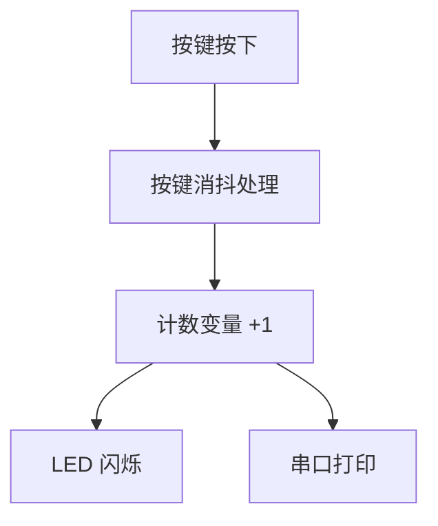

---

### 1.1 51 单片机（AT89C51）：裸机是唯一选择

| 指标 | 数值 |
|------|------|
| 内核 | Intel 8051，8 位 CISC |
| RAM | 128 ~ 256 字节 |
| Flash | 几 KB |
| 主频 | 12 ~ 40 MHz |
| 可用 OS | 裸机（超级循环），极轻量 RTOS |

#### 编程范式：超级循环

代码全部写在 `while(1)` 大循环中。核心约束：**绝对不能使用 `delay(1000)` 死等**。

```
while (1) {
    ① 扫描定时器计数器标志 → 决定是否翻转 LED
    ② 轮询按键 GPIO 电平   → 检测状态变化
    ③ 串口发送缓冲区        → 有数据则发送一字节
}
```

#### 正确实现：定时器中断驱动

```
主循环 while(1)
+-----------+
| LED 模块  |  查标志翻转
+-----+-----+
      |
+-----v-----+
| 按键模块  |  查标志消抖
+-----+-----+
      |
+-----v-----+
| 串口模块  |  查标志发送
+-----+-----+
      |
      v
+----------------+
| 定时器中断 1ms |
| 累加计数器     |
| 置位时间标志   |
| ISR 保持极短   |
+----------------+
```

#### 关键细节

1. **按键消抖**：检测到按键变化后，等 10ms 再读一次确认。这个 10ms 必须靠定时器计数实现，不能用死循环。
2. **栈指针（SP）**：51 有一个专用的 **8 位硬件 SP 寄存器**，复位后 SP = `0x07` ——程序员必须手动将其重设到更高地址（如 `0x60`），否则栈增长会覆盖寄存器。
3. **崩溃后果**：栈溢出覆盖返回地址 → CPU 跳转到随机地址执行 → 看门狗复位或死机。

#### 深入：为什么 51 必须用定时器中断驱动？

**12T 指令周期的含义**

8051 的 "12T" 意味着：取一条指令需要 12 个时钟周期。以 12 MHz 晶振为例：

```
  晶振 12 MHz → 机器周期 = 12 × (1/12 μs) = 1 μs
  大部分指令 = 1 个机器周期 = 1 μs
```

`delay(1000)` 意味着 CPU 原地空转 100 万微秒。**这是 51 裸机编程的根本约束：CPU 慢，必须让每次出场都有产出。**

**CALL 指令的压栈顺序**

当 51 执行 `CALL addr16` 时：

```
  SP ← SP + 1  →  写入 PC[7:0]   (先压低位)
  SP ← SP + 1  →  写入 PC[15:8]  (再压高位)
```

`RET` 出栈顺序相反。这是 51 小端序存储的直接体现。

**4 组寄存器切换（RS0/RS1）——51 的"袖珍上下文切换"**

51 的 RAM 地址 00H~1FH 被分为 4 组寄存器（Bank 0~3），PSW 寄存器中的 `RS0` 和 `RS1` 位选择当前活动的寄存器组。中断服务函数可以切换到一个未使用的寄存器组，实现**零指令开销的寄存器现场保护**——代价是嵌套中断不能超过 3 层。

---

### 1.2 STM32（F103C8）：裸机和 FreeRTOS 势均力敌

| 指标 | 数值 |
|------|------|
| 内核 | ARM Cortex-M3，32 位 RISC |
| RAM | 20 KB |
| Flash | 64 KB |
| 主频 | 72 MHz |
| 可选 OS | 裸机 / FreeRTOS / RT-Thread |

#### 裸机实现：状态机

```
+----------------+
| SysTick 1ms    |
| 更新 millis     |
+-------+--------+
        |
        v
+------------------------------+
| 主循环 while(1)              |
+------------------------------+
| LED: 500ms 到期则翻转         |
| Key: 10ms 到期则扫描消抖      |
| UART: 有按键事件则发送        |
+------------------------------+
```

**痛点**：当项目扩展到 5 个 LED、3 个按键、2 个串口、1 个 ADC 时，主循环充斥着时间戳比较和状态机跳转，任何一个函数执行时间超过 1ms，整个系统的时序崩塌。

#### FreeRTOS 实现：三个独立任务

```
Task_LED       Task_Key       Task_UART
   │              │               │
   │ vTaskDelay   │ 扫描消抖       │ xQueueReceive
   │ (500ms)     │ 发队列         │ 阻塞等事件
   │              │               │
   └──────────────┴───────────────┘
                  │
          +----------------+
          | FreeRTOS 调度器 |
          | 抢占 + 时间片   |
          +----------------+
```

**优势**：每个任务变成"独立的小程序"。`vTaskDelay` 期间让出 CPU，调度器自动切换。

#### 任务切换过程（PendSV 异常）

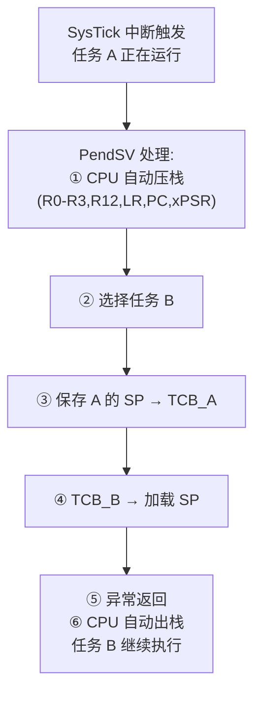

整个切换只保存和恢复寄存器现场，不涉及内存映射表切换，开销极小。

#### 深入：Cortex-M3 的双堆栈设计——MSP 与 PSP

Cortex-M3 有两个栈指针寄存器：**MSP（主栈指针）** 和 **PSP（进程栈指针）**。

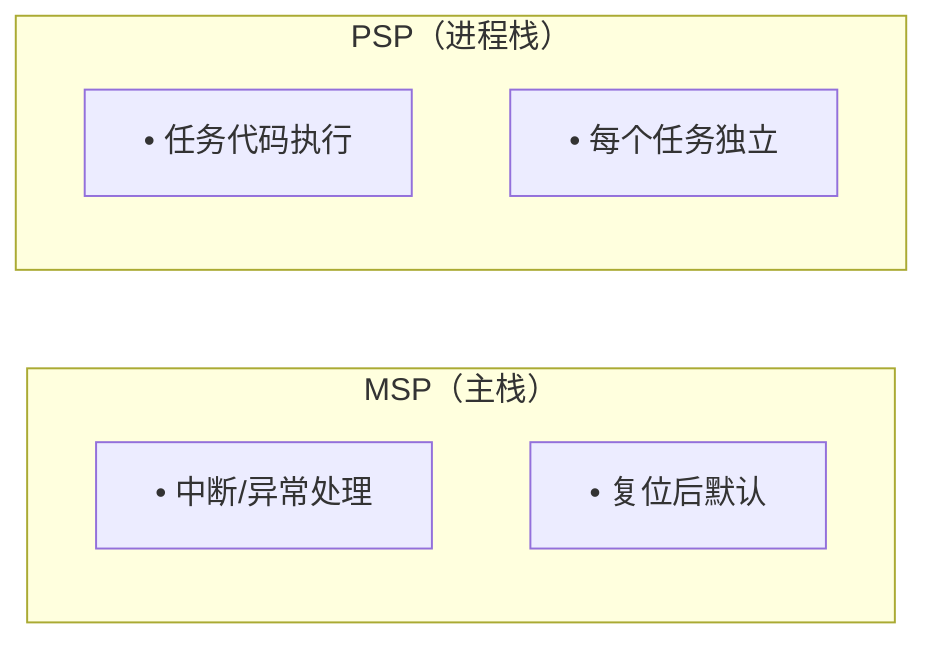

**为什么 RTOS 用 PSP 做任务栈、MSP 做中断栈？** 分离后 PSP 溢出最多毁掉当前任务，MSP 受保护——中断和内核始终安全。

**PendSV 为什么是最低优先级？** 保证所有中断处理完毕后才做任务切换——"等所有中断都退场，我再收拾局面。"

#### 关键对比

| 维度 | 裸机 | FreeRTOS |
|------|------|----------|
| 代码结构 | 状态机 + 时间戳比较 | 顺序执行的独立任务 |
| 延时 | `HAL_Delay()` 死等，阻塞 CPU | `vTaskDelay()` 让出 CPU |
| 扩展性 | 每加一个功能，复杂度指数上升 | 加一个任务 ≈ 50 行代码 |
| 崩溃后果 | 整机 HardFault | 整机 HardFault（无 MMU，一样脆弱） |

---

### 1.3 ESP32（N8R16，双核 240MHz）：FreeRTOS 是基因，裸机是自虐

| 指标 | 数值 |
|------|------|
| 内核 | Xtensa LX7，32 位 RISC，双核 |
| RAM | 内置 512 KB + 外挂 16 MB PSRAM |
| 主频 | 240 MHz |
| 无线 | Wi-Fi 4 + BLE 5.0 |
| OS | FreeRTOS（ESP-IDF 强制绑定） |

#### 为什么 ESP32 不能用裸机编程？

Wi-Fi / 蓝牙的底层协议栈代码量超过**百万行**。ESP-IDF 对 FreeRTOS 的绑定不是"集成"，而是"共生"：

```
+-------------------------+
| 用户代码 app_main()     |
| xTaskCreate / xQueue    |
+-----------+-------------+
            |
            v
+-------------------------+
| FreeRTOS 内核           | ← 任务调度 / 队列 / 信号量 / 定时器
+-----------+-------------+
            |
            v
+-------------------------+
| ESP-IDF 框架            | ← Wi-Fi / BLE / LWIP / SSL/TLS
+-------------------------+
```

**为什么协议栈必须依赖 FreeRTOS？** Wi-Fi 协议栈不是"一个函数调用"——Wi-Fi Task（处理 Beacon/关联/加密）、Timer Task（省电管理）、lwIP Task（TCP/IP 处理）都是持续运行的后台任务。没有 FreeRTOS，你就得自己写调度器来管理这些任务的运行时机——本质上就是在实现一个 RTOS。

#### 经典双核场景

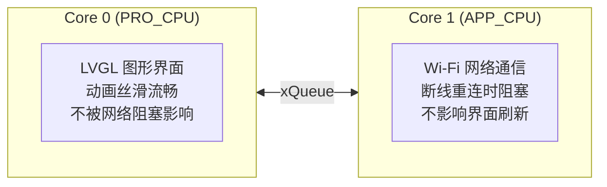

#### 任务与线程的关系

ESP32 **没有进程概念**（无 MMU）。所有任务共享同一片物理内存，等价于 **"单进程多线程"** 模型。FreeRTOS 管它们叫"任务"以避免学术歧义。

#### 深入：Xtensa LX7 的窗口寄存器 — 与 ARM 的本质区别

Xtensa LX7 的寄存器文件有 64 个物理寄存器，但指令只能访问 16 个逻辑寄存器（A0~A15）。通过"寄存器窗口"机制，`CALL8` 指令使 WindowBase+8，新函数看到"全新"的 A0~A15，旧寄存器的内容被硬件自动隐藏——**0 指令开销的函数调用！** ARM 则必须手动 `PUSH/POP`。这就是 Xtensa 函数调用更快的根本原因——用硬件寄存器资源换取零开销的调用约定。

#### 深入：为什么双核 FreeRTOS 比单核复杂得多？

多了一个核引入**竞态条件**——关 Core 0 的中断不影响 Core 1 继续跑，必须用**自旋锁（spinlock）**保护所有内核数据结构。`spin_acquire` 让等待的核空转浪费 CPU——这就是双核 RTOS 的性能代价。

---

## 第二章：栈指针深入 — 51 的硬栈 vs ESP32 的寄存器栈

### 2.1 51 单片机的硬件栈

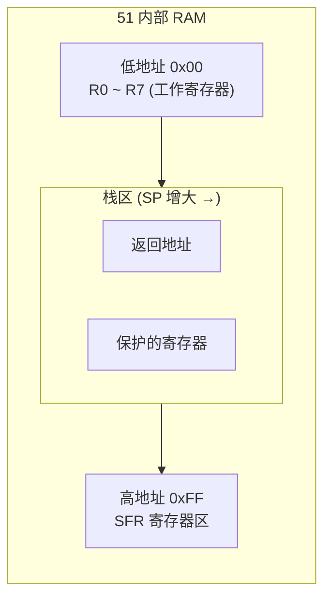

- **专用 SP 寄存器**：8 位物理寄存器
- **硬件自动操作**：`PUSH` → SP 先 +1 再存数据
- **向上增长**；**容量限制**：8 位 SP 最大 256 字节

#### 硬栈 vs 软栈的区别

| 类型 | 维护者 | 内容 |
|------|--------|------|
| **硬栈** (硬件 SP) | CPU 硬件 | 返回地址、寄存器保护 |
| **软栈** (编译器模拟) | 编译器生成代码 | 函数参数、局部变量 |

### 2.2 ESP32 的栈指针

Xtensa 架构中，通用寄存器 `A1` 在汇编中别名为 `sp`。

| 特性 | 51 | ESP32 |
|------|-----|-------|
| SP 寄存器 | 8 位，专用 | 32 位通用寄存器 A1 |
| PUSH/POP 指令 | 有 | **没有** |
| 栈操作方式 | `PUSH` / `POP` 指令 | `S32I` / `L32I` 配合 sp 偏移 |
| 增长方向 | 向上（低→高） | 向下（高→低） |

#### 多任务下的 SP 管理

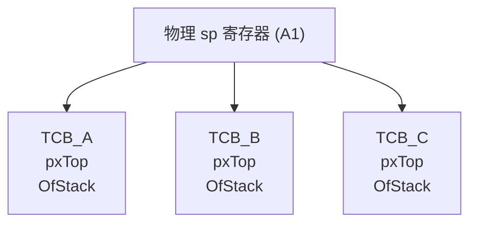

任务切换时：**硬件 sp 值** → 存入当前 TCB → 从下一 TCB 加载 → 写回硬件 sp。

#### 深入：栈向下增长的物理原因

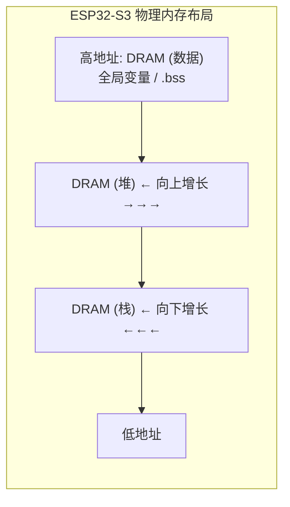

栈向下增长，堆向上增长，两者对向扩张——**最大化利用中间的空闲区域**。只要 `栈顶 > 堆顶` 就安全。

---

## 第三章：TCB vs PCB — 为什么 RTOS 的任务不叫进程？

### 3.1 数据结构对比

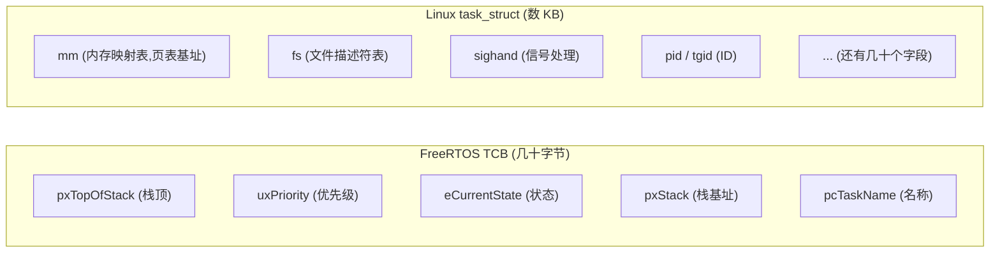

**为什么 FreeRTOS 叫 TCB？** 因为没有进程概念。TCB 只存调度器必需的最小信息——没有 `mm`（无 MMU）、没有 `files`（无 VFS）。

#### 深入：优先级反转——RTOS 的经典陷阱

```
  优先级:  任务 H (高) > 任务 M (中) > 任务 L (低)

  时刻 1: 任务 L 获取互斥锁
  时刻 2: 任务 H 就绪 → 抢占 L
  时刻 3: 任务 H 尝试获取同一把锁 → 被 L 持有 → 阻塞！
  时刻 4: 任务 M 就绪 → 抢占 L（M 比 L 优先级高）
          任务 L 无法运行 → 无法释放锁 → 任务 H 永远阻塞 = 死锁！
```

1997 年火星探路者号因此反复重启。

#### 深入：FreeRTOS 如何解决——互斥信号量的优先级继承

**临时提升持锁任务的优先级**，让它能尽快释放锁，不被中间优先级的任务打断。不是"把锁给高优先级任务"，而是"让持有者变快"。

### 3.2 任务 = 线程？

| 语境 | 说法 |
|------|------|
| **计算机科学严格定义** | 线程是进程内的执行单元，FreeRTOS 没有进程，不能叫"线程" |
| **实际行为** | ESP32 所有任务共享物理内存/全局变量/堆 → 典型的"单进程多线程" |
| **工程结论** | 把 ESP32 理解成一个**巨型单进程程序**，里面每个任务就是这个进程的**线程** |

---

## 第四章：MMU — 有与无，是两个世界

### 4.1 无 MMU：实地址模式

```
  CPU 发出的地址 ────────────────► 物理内存
  (0x3FFC1234)                      (0x3FFC1234)
  无中间转换，一发就中

  任务 A 可随意读写任务 B 的内存——没有任何硬件权限检查。
  效率极高（无地址转换开销），但毫无保护。
```

### 4.2 有 MMU：虚拟地址模式

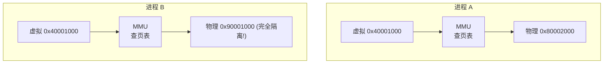

- 进程 A 野指针访问非法地址 → MMU 阻断 → Linux 发 `SIGSEGV` → **仅杀死该进程**
- 开销：地址转换需查 TLB，未命中时遍历页表耗时数百纳秒

#### 深入：ESP32-S3 为什么没有 MMU 但有 Cache？

```
  Cache 解决的：                  MMU 解决的：
  ════════════                  ════════════
  "内存太慢"                     "内存太乱"
  → Cache 是加速器               → MMU 是隔离墙
```

ESP32-S3 有 **L1 Cache（32 KB I-Cache + 32 KB D-Cache）**，但没有 MMU。一个快但脆弱，一个慢但安全——这就是 ESP32-S3 与 RK3506（跑 Linux + MMU）的本质差异。

---

## 第五章：崩溃的连锁反应 — 一人犯错，全家升天

### 5.1 无 MMU 下的三种死亡传染路径

```
  路径一：栈溢出踩踏 → 任务 A 栈溢出覆盖任务 B 栈 → B 恢复时弹出被篡改返回地址 → 崩溃
  路径二：TCB 被清零 → 野指针命中 TCB → 调度器读 pxTop=0 → 取指错误
  路径三：中断向量表被毁 → 野指针命中向量表 → 中断触发跳转到随机地址 = 崩溃
```

### 5.2 有 MMU 的保护（RK3506 / Linux）

进程 A 野指针访问非法地址 → MMU 检测页表权限错误 → 缺页异常 → 发送 SIGSEGV → **仅杀死进程 A**。进程 B、C 继续正常运行。

**结论**：有 MMU 的系统是"铁桶式"隔离；无 MMU 的系统是"纸牌屋"——一个任务出错，整栋楼塌。

#### 深入：ESP32 的 Guru Meditation Error 具体类型

| 异常类型 | 含义 | 典型原因 |
|---------|------|---------|
| **StoreProhibited** | 试图写入只读/不存在地址 | `NULL` 指针赋值、写 ROM 区 |
| **LoadProhibited** | 试图从不可读地址加载 | `NULL` 指针读取、野指针 |
| **InstrFetchProhibited** | 试图从不可执行地址取指令 | 函数指针指向数据区 |
| **IntegerDivideByZero** | 整数除零 | `a / 0` 无保护 |
| **StackOverflowError** | 栈溢出 | FreeRTOS 栈分配过小 |

ESP-IDF 的 panic handler 会打印寄存器转储、栈回溯和当前任务名。配合 `.elf` 和 `addr2line`，可精确追溯到哪一行触发崩溃。

#### 深入：FreeRTOS 的栈溢出检测——Stack Canary

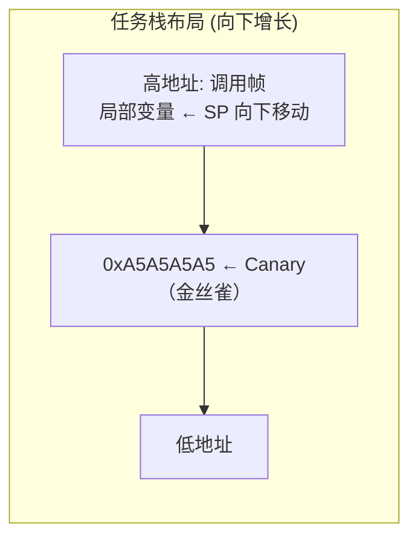

调度器每次切换任务时检查：如果 `pxStack[0] != 0xA5A5A5A5`，说明栈溢出已发生。**缺陷**：Canary 只能检测"已经发生"的溢出，无法阻止。

#### 深入：ESP32 的三种看门狗

| 看门狗 | 时钟源 | 用途 |
|--------|--------|------|
| **TWDT**（任务看门狗） | 系统时钟 | 监视 FreeRTOS 任务是否卡死 |
| **RTC WDT**（硬件看门狗） | RTC 慢时钟（32 kHz） | 最后防线——连中断都瘫痪时用 |
| **中断看门狗** | 系统时钟 | 监视中断是否长时间占用 CPU |

---

## 第六章：全局变量的开销 — 微观经济学视角

| 维度 | 全局变量 | 局部变量 |
|------|---------|---------|
| 分配位置 | `.data` / `.bss` 段 | 栈上 |
| 生命周期 | 程序运行全程 | 函数返回即释放 |
| 访问速度 | 地址编译时确定，**更快** | sp + 偏移间接寻址，稍慢 |
| 内存复用 | 不能复用 | 高复用率 |

**核心矛盾**：全局变量访问快但有永久内存占用——在 51 的 128 字节 RAM 上是致命问题；在 ESP32 的几百 KB 上无关紧要。

#### 深入：链接脚本 — 程序的六个"地盘"

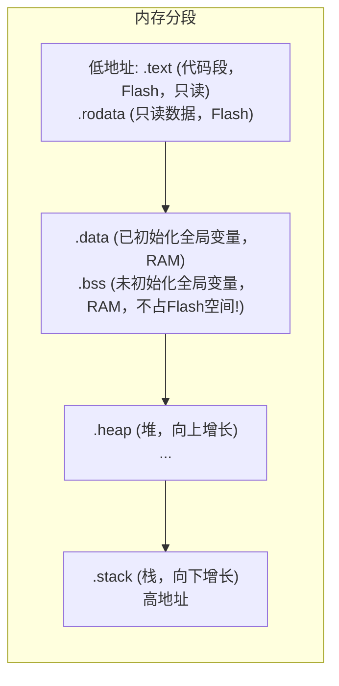

#### 深入：volatile — 让编译器"别自作聪明"

```c
volatile uint32_t *p = (volatile uint32_t *)0x3FF44000;
*p = 0x01;    // 编译器：必须写入内存！不能缓存！
*p = 0x01;    // 编译器：虽然值一样，但必须再写一次！
```

`volatile` 告诉编译器：不要优化缓存、不要删除重复写入、不要重排访问顺序。三经典场景：硬件寄存器、中断共享变量、DMA 缓冲区。

---

## 第七章：三种架构的底层差异

| 维度 | 51 单片机 | STM32 (F103) | ESP32-S3 |
|------|----------|-------------|----------|
| **内核** | Intel 8051, 8 位 CISC | ARM Cortex-M3, 32 位 RISC | Xtensa LX7, 32 位 RISC, 双核 |
| **主频** | 12 ~ 40 MHz | 72 MHz | 240 MHz |
| **指令周期** | 12 时钟/指令 | 单周期（3 级流水线） | 单周期（7 级流水线 + 双发超标量） |
| **MMU** | 无 | 无 | 无 |
| **DMA** | 无 | 7 通道 | 5 通道 GDMA |
| **典型 OS** | 裸机 | 裸机 / FreeRTOS | FreeRTOS（ESP-IDF 强制绑定） |

#### 深入：哈佛结构 vs 冯·诺依曼结构

51 是哈佛结构——程序和数据有独立总线，可同时取指和取数据。Cortex-M3/ESP32-S3 是冯·诺依曼结构——统一地址空间，取指和数据分时复用总线。现代芯片（ESP32-S3）在 Cache 层面是改进的哈佛结构（I-Cache 和 D-Cache 分开），内存总线层面是冯·诺依曼——鱼和熊掌兼得。

#### 深入：流水线的基本原理

五级经典 RISC 流水线：每条指令占一个阶段，稳态下每周期完成一条指令。流水线冒险（Hazards）包括数据冒险（指令依赖）、控制冒险（分支预测）、结构冒险（硬件资源冲突）。

---

## 第八章：ESP-IDF 与 Arduino — 引擎与外壳

### 8.1 架构层次

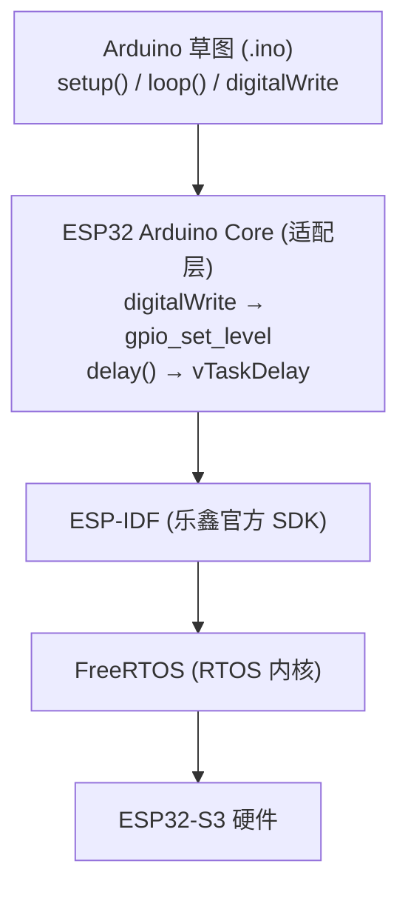

**Arduino 是外壳，ESP-IDF 是引擎。**

### 8.2 `delay()` vs `vTaskDelay()` — 核心分水岭

```
  Arduino delay(1000)         ESP-IDF vTaskDelay(1000)
  ████████████████████        ██░░░░░░░░░░░░██░░░░░░
  100% CPU 占用               让出 CPU 给其他任务
```

### 8.3 为什么资深开发者不推荐 Arduino 入门？

| 问题 | 说明 |
|------|------|
| **过度封装屏蔽底层** | `digitalWrite` 背后的 GPIO 推挽/开漏、时钟使能、复用映射完全不可见 |
| **调试困难** | 崩溃后只打印错误，无栈回溯、无寄存器转储；ESP-IDF 配 GDB 可精确定位到行 |

---

## 第九章：ESP32 启动全流程 — 从 POR 到 app_main

> 本章将 ESP32 的启动流程与 PC 的 BIOS/UEFI 启动、FreeRTOS 调度器的内部初始化串联起来。

### 9.1 启动流程图解

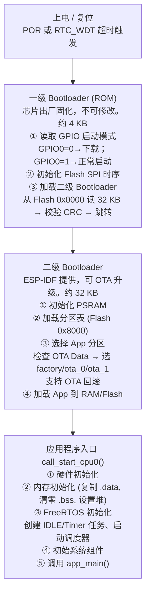

**启动时间线**：
- POR 到一级 Bootloader：约 200 μs
- 一级 Bootloader 执行：约 2~3 ms
- 二级 Bootloader 执行：约 10~20 ms
- FreeRTOS + 系统组件初始化：约 50~100 ms
- **总计约 100~150 ms** 到达 `app_main()` 第一行代码

### 9.2 与 Windows BIOS 启动对比

ESP32 的启动流程和 PC 的 BIOS/UEFI 启动有着惊人的结构相似性：

```
  ESP32                              Windows PC
  ─────                              ──────────
  一级 Bootloader (ROM)              BIOS / UEFI (Flash ROM)
  │ 读 GPIO 判断模式                  │ POST (硬件自检)
  │ 初始化 Flash                     │ 初始化 CPU/RAM/外设
  │ 加载二级 Bootloader              │ 加载 MBR/GPT 引导扇区
        │                                    │
        ▼                                    ▼
  二级 Bootloader                     Windows Boot Manager
  │ 初始化 PSRAM                     │ 加载 bootmgr.exe
  │ 解析分区表                       │ 解析 GPT 分区表
  │ 选择 App 分区                    │ 选择 Windows 分区
        │                                    │
        ▼                                    ▼
  FreeRTOS 内核初始化                 Windows NT 内核
  │ 创建 IDLE/Timer 任务              │ 创建 System 进程
  │ 启动调度器                       │ 启动进程调度器
  │ 初始化 Wi-Fi/lwIP                │ 加载驱动 (smss.exe)
        │                                    │
        ▼                                    ▼
  app_main()                          explorer.exe (桌面)
```

**结构对比表**：

| 阶段 | ESP32 | Windows PC | 共性 |
|------|-------|-----------|------|
| 第 0 级 | 硬件 POR 复位 | 电源按钮 → PSU | 纯硬件触发 |
| 第 1 级 | ROM Bootloader（~4 KB） | BIOS/UEFI（2~16 MB） | 固化存储，最基本硬件初始化 |
| 第 2 级 | Second Stage Bootloader（~32 KB） | bootmgr.exe / GRUB | 理解分区表，选择启动系统 |
| 第 3 级 | FreeRTOS 内核初始化 | NT 内核加载 | OS 内核启动 |
| 第 4 级 | app_main() | 用户登录/桌面 | 用户代码/交互入口 |

**为什么 PC 启动慢而 ESP32 快？** PC 的 BIOS/UEFI 需要枚举 PCIe 设备（显卡、SSD、USB）、训练 DDR4/DDR5 内存、遍历 ACPI 表——每步毫秒级等待。ESP32 只有 Flash 一个存储设备、SRAM/PSRAM 固定时序——初始化是"线性的"，不需要设备发现。这就是"专用系统"和"通用系统"在启动速度上的本质鸿沟。

### 9.3 FreeRTOS 调度器启动细节

`vTaskStartScheduler()` 内部流程：

```
  ① 创建 IDLE 任务（最低优先级 0，空闲时自动喂 TWDT）
  ② 创建 Timer 任务（可选，处理软件定时器回调）
  ③ 初始化 SysTick 定时器（ESP32: 1ms 周期中断）
  ④ 调用 xPortStartScheduler()
     设置 PendSV 异常为最低优先级
     通过 SVC 异常启动第一个任务
     → 从此不再返回！
```

**"从此不再返回"的含义**：`vTaskStartScheduler()` 之后的代码永远不会被执行。CPU 控制权已移交给调度器——每次 SysTick 中断触发调度评估，PendSV 做上下文切换。在 ESP-IDF 中，你永远看不到"程序正常结束"——调度器是永恒的。

---

## 第十章：NVS vs SPIFFS — 嵌入式存储的两种哲学

### 10.1 核心定位区别

```
  NVS                             SPIFFS
  ═══                             ══════
  键值对数据库                      文件系统
  存配置参数                       存"文件"
  "WiFi密码是什么？"                "有没有 logo.bin？"
  key: "wifi_ssid"                /spiffs/logo.bin
  value: "MyWiFi"                 /spiffs/index.html
```

| 维度 | NVS | SPIFFS |
|------|-----|--------|
| **本质** | 键值对（Key-Value）存储 | 文件系统 |
| **访问方式** | `nvs_get_u32(handle, "key", &val)` | `fopen("/spiffs/data.txt", "r")` |
| **数据结构** | 扁平的键值对表 | 层级目录树 + 文件 inode |
| **适合存储** | 配置参数（Wi-Fi SSID/密码、校准值、计数值） | 静态资源（HTML/CSS/JS、图片、字体、配置文件） |
| **不适合存储** | 大文件（> 几 KB） | 频繁修改的单个小值 |
| **写粒度** | 单个键值（数字节~数百字节） | 页（通常 256 字节） |
| **磨损均衡** | 有（Flash 页循环使用） | 有（动态磨损均衡） |
| **掉电保护** | 有（事务性写入） | 有（Copy-on-Write 日志型） |
| **最大容量** | 典型 16~64 KB | 典型 1~4 MB |

### 10.2 NVS 的底层设计

NVS 将 Flash 分区划分为等大扇区（通常 4 KB）。写入不是"原地修改"——当你 `nvs_set_u32(handle, "boot_count", 43)` 时：

1. 在活跃扇区尾部追加新条目（旧条目标记为"废弃"）
2. 当活跃扇区满时，把有效条目压缩拷贝到新扇区，擦除旧扇区
3. 两步提交：先写数据，再写"提交"标记——掉电也安全

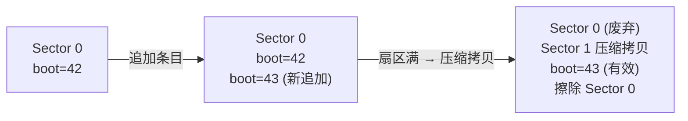

**为什么不用 FAT 文件系统存配置？** FAT 的每个文件至少占一个簇（通常 4 KB），存一个 4 字节的 `boot_count` 浪费 4092 字节。NVS 的一个键值对只占约 16~32 字节——效率高两个数量级。此外 FAT 没有事务性写入——写 `boot_count` 时掉电可能导致文件系统损坏，NVS 的两阶段提交保证了原子性。

### 10.3 SPIFFS 的底层设计

SPIFFS（SPI Flash File System）是为 NOR Flash 设计的轻量级文件系统：

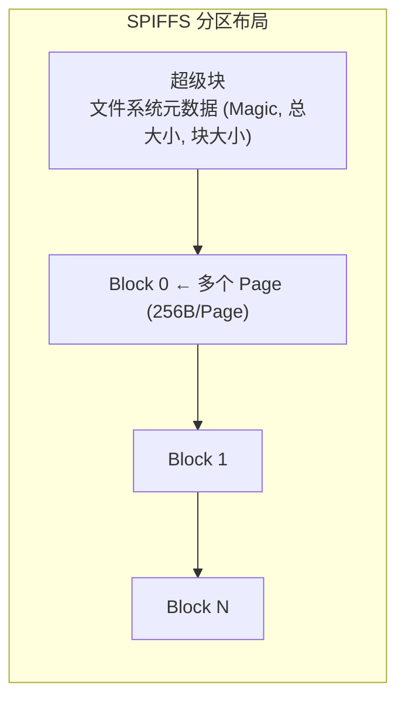

- **写时复制（COW）**：修改文件 → 写新页 → 更新元数据指向新页 → 旧页标记为可回收
- **垃圾回收**：后台自动擦除废弃页
- **不支持目录**：SPIFFS 是扁平文件系统——所有文件在根目录
- **文件名限制**：最长 32 字符，没有子目录概念

**SPIFFS 的优缺点**：优点是支持标准文件 API（`fopen`/`fread`/`fwrite`），适合存放 HTML 页面、配置文件；缺点是不适合频繁修改小数据（每次修改触发 COW，产生大量废弃页，GC 开销大）。

### 10.4 对比总结

| 场景 | 推荐方案 | 原因 |
|------|---------|------|
| Wi-Fi 密码 / 校准数据 | **NVS** | 小数据、高效、事务安全 |
| 重启计数 / 设备 ID | **NVS** | 单个整数值，NVS 一条搞定 |
| Web 页面 (HTML/CSS/JS) | **SPIFFS** | 文件系统 + fopen，方便管理 |
| 图片 / 字体 | **SPIFFS / FatFS** | 大文件，文件系统接口更合适 |
| OTA 固件 | **Flash 分区直接写** | 既不用 NVS 也不用 SPIFFS——直接操作 Flash API |
| 日志文件（持续追加） | **SPIFFS（谨慎）或 FatFS** | 需注意 GC 性能和磨损均衡 |

### 10.5 代码示例

```c
// ==================== NVS 读写 ====================
#include "nvs_flash.h"

void nvs_example(void) {
    nvs_handle_t handle;
    nvs_open("storage", NVS_READWRITE, &handle);

    // 写
    int32_t boot_count = 0;
    nvs_get_i32(handle, "boot_count", &boot_count);
    boot_count++;
    nvs_set_i32(handle, "boot_count", boot_count);
    nvs_commit(handle);  // 确保写入 Flash（否则在缓冲区中）

    nvs_close(handle);
}

// ==================== SPIFFS 读写 ====================
#include "esp_spiffs.h"

void spiffs_example(void) {
    esp_vfs_spiffs_conf_t conf = {
        .base_path = "/spiffs",
        .partition_label = "storage",
        .max_files = 5,
        .format_if_mount_failed = true,
    };
    esp_vfs_spiffs_register(&conf);

    // 写文件
    FILE *f = fopen("/spiffs/hello.txt", "w");
    fprintf(f, "Hello SPIFFS!\n");
    fclose(f);

    // 读文件
    char buf[64];
    f = fopen("/spiffs/hello.txt", "r");
    fgets(buf, sizeof(buf), f);
    fclose(f);

    esp_vfs_spiffs_unregister(conf.partition_label);
}
```

**NVS 使用注意事项**：
- `nvs_flash_init()` 必须在 `app_main()` 开头调用（Wi-Fi 配置存在 NVS 中）
- `nvs_commit()` 才真正写入 Flash——不调用则数据在缓冲区，掉电丢失
- NVS 命名空间最长 15 字符，键名最长 15 字符

**SPIFFS 使用注意事项**：
- 分区表需要预先配置 SPIFFS 分区
- `esp_vfs_spiffs_register` 注册虚拟文件系统，`base_path` 是挂载点
- SPIFFS 是扁平的，不支持子目录
- 频繁写小文件会产生大量 GC 开销

---

## 第十一章：学习路径 — 降维打击式学法

### 11.1 现有装备

- ESP32-S3 N8R16（2 MB Flash + PSRAM）
- RK3506-EVB（跑 Linux）

### 11.2 推荐路线：站在高山上往下看

```
 传统教科书顺序（不推荐）            降维打击路线（推荐）
 ═══════════════════              ═══════════════════

  51 单片机                          ESP32-S3 + ESP-IDF
   ↓  几个月                         ↓  直接上手 RTOS
  STM32                              │  遇到底层问题
   ↓  几个月                         ├→ 查阅 STM32 参考手册（当字典）
  ESP32                               │  需要理解最简内存模型
   ↓                                  ├→ 花 2 天看 51 RAM 分区
  RTOS 入门                            │
                                      │  同时并行
                                      └→ RK3506 上跑 Linux 应用

  总耗时: 6~12 个月                   总耗时: 2~3 个月入门, 持续深入
```

#### 三步走

```
第 1 步 ── 现在 ──────────────► ESP32 + ESP-IDF
                                  彻底切到 ESP-IDF，不用 Arduino
                                  手动创建任务、配置中断、用 xQueue 通信
                                  掌握：任务管理、内存管理、中断下半部

第 2 步 ── 底层瓶颈时 ────────► STM32 参考手册（当字典查）
                                  不是从头学 STM32，是查"底层字典"

第 3 步 ── 理解最简内存模型时 ──► 51 单片机 RAM 分区（2 天）
                                  直观理解：栈、全局、堆的物理位置
```

#### 第一个"不看教程自己写"的项目：定时器 + PWM 呼吸灯 + 按键调速

```
  按键 1（短按）：加速 PWM 呼吸频率
  按键 1（长按 2s）: 恢复默认频率
  按键 2（短按）：切换 LED
  PWM 使用 LEDC 硬件定时器，不占用 CPU
  串口输出当前频率和 LED 状态
```

这个项目涵盖了 `xTaskCreate`、队列通信、GPIO 中断——ESP-IDF 开发的三大基本功。

### 11.3 核心理念

```
   × 传统路线:  51 → STM32 → ESP32 (爬楼梯)
   √ 工程路线:  ESP32 + RK3506 → 往下俯视 (降维打击)

   你手上有 RTOS 和 Linux 两座高山。
   先站上去，再往下看 51 和 STM32 的底层细节。
```

---

## 第十二章：从轮询到中断再到 DMA — CPU 解放三部曲

> 用你项目中真实的代码展示一条完整的"CPU 解放路线"：软件轮询 → 硬件中断 → DMA 自动搬运。

### 12.1 第一阶段：CPU 独占轮询 — 按键扫描（04_Key_board）

打开项目中的 `key.c`：

```c
void app_main(void) {
    LED_init(); key_init();
    while (1) {
        uint8_t key_num = key_scan();  // 每次循环主动去问 GPIO
        if (key_num != 0) printf("key_num = %d\n", key_num);
        vTaskDelay(100);               // 每 100ms 轮询一次
    }
}
```

**轮询的本质**：CPU 亲自走到每个 GPIO 门口敲门"有人按你吗?" → 敲完一轮回去休息 100ms → 再出来敲。最坏延迟 100ms，CPU 90% 时间在"等"。

### 12.2 第二阶段：硬件中断 — 让 GPIO 主动敲门（06_Exti）

打开 `exti.c`：

```c
void app_main(void) {
    LED_init(); exti_init();          // 注册中断回调
    while (1) { vTaskDelay(100); }    // CPU 主循环只做"呼吸"
}

void exti_isr_handler(void *arg) {     // ISR：必须极短！
    gpio_toggle(GPIO_NUM_38);          // 只翻转 LED，< 1 μs
}
```

**中断 vs 轮询**：轮询是 CPU 不停地"问"，中断是 GPIO 主动"敲门通知 CPU"。CPU 占用从持续 100% 降到每次 0.7 μs。

### 12.3 第三阶段：DMA — 让专用硬件替你搬数据

你的 `15_UART` 目前用中断模式搬数据——`uart_read_bytes` 每次 RX FIFO 有数据就触发 ISR 搬字节。115200 bps 时每秒 ~11520 次中断。

升级为 DMA 只需改缓冲大小（ESP-IDF 自动启用）：

```c
// 中断模式:
uart_driver_install(UART_NUM_1, 1024, 1024, 0, NULL, 0);

// DMA 模式（RX buffer 增大，IDF 自动分配 DMA 通道）:
uart_driver_install(UART_NUM_1, 1024 * 2, 0, 0, NULL, 0);
```

DMA 优势：UART 收 1KB 数据时，DMA 自动搬到 RAM（约 8.7ms），CPU 在这期间可以做按键扫描、LCD 刷新、PID 计算——只在收到完成中断时处理数据。

### 12.4 三阶段决策树

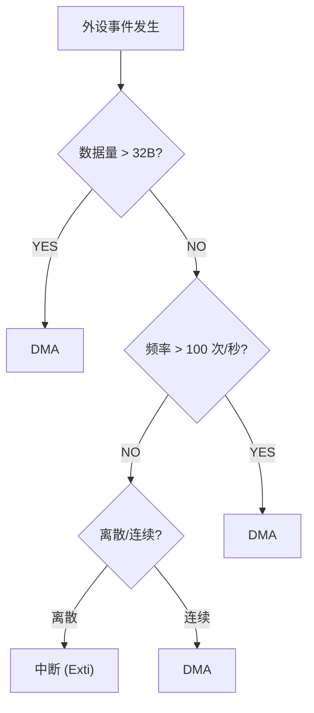

#### 对照你的项目

| 项目 | 方式 | 适合吗？ | 为什么 |
|------|------|---------|--------|
| `04_Key_board` | 轮询 | 可改进 | 升级为中断更好 |
| `06_Exti` | 中断 | **完美** | 按键是离散信号，中断是最优解 |
| `15_UART` (9600 bps) | 中断 | 够用 | 9600 bps 慢，中断来得及 |
| `14_IICBH1750` (2 字节) | I2C 命令链 | **不要用 DMA** | 2 字节配 DMA 反而更慢 |
| GPS 模块 @921600 | **必须 DMA** | — | 高频数据流，中断会被拖死 |

---

## 终章：四芯对照总表

| 概念 | 51 单片机 | STM32 | ESP32 | RK3506 / Linux |
|------|----------|-------|-------|----------------|
| **MMU** | 无 | 无 | 无 | **有** |
| **地址类型** | 物理 | 物理 | 物理 | **虚拟** |
| **调度实体** | 无（裸机大循环） | 任务/状态机 | 任务(RTOS) | 进程 / 线程 |
| **控制块** | 无 | TCB | TCB | PCB (`task_struct`) |
| **栈指针** | 硬件 SP 专用寄存器 | SP 存于 TCB | SP 存于 TCB（双核各一） | SP 存于 `task_struct` |
| **栈增长方向** | 向上 | 向下 | 向下 | 向下 |
| **PUSH/POP** | 有专用指令 | 有 | **无**（用访存指令） | 有 |
| **内存保护** | 无 | MPU | 无 | **页表级隔离** |
| **崩溃后果** | 整机死机 | 整机 HardFault | 整机看门狗复位 | **仅杀死该进程** |
| **延时本质** | `delay` 忙等 | `vTaskDelay` 让出 | `vTaskDelay` 让出 | `sleep()` 内核接管 |
| **进程隔离** | 无 | 无 | 无 | **有** |
| **地址空间** | 64 KB | 4 GB (统一) | 4 GB (统一) | 每进程 4 GB (虚拟) |

---

## 容易踩坑

| 现象 | 常见原因 | 排查方向 |
|------|----------|----------|
| 把轮询理解成低级方案 | 只看 CPU 占用，忽略简单可控和低频场景 | 按事件频率、实时性和代码复杂度综合选择 |
| ISR 中做复杂业务 | 误以为中断越快处理越好 | ISR 只做确认/搬运/通知，业务放任务或主循环 |
| DMA 配好但数据异常 | 缓冲区生命周期、对齐或缓存一致性没处理好 | 确认缓冲区有效期、大小、对齐和驱动要求 |
| RTOS 任务仍写成死循环空转 | 缺少阻塞等待或延时让出 CPU | 使用 `vTaskDelay()`、队列、信号量或事件通知 |
| NVS 读写后数据丢失 | 忘记调 `nvs_commit()` | 确认每次写后调用了 `nvs_commit()` |
| SPIFFS 挂载失败 | 分区表未配置或分区类型错误 | 检查分区表 CSV 中 SPIFFS 分区的 type 和 subtype |

---

## Tips

### 最容易忽视的细节

1. **ESP32 的 `vTaskDelay(1)` 不是延迟 1ms**。`vTaskDelay(1)` 延迟的是 **1 个 Tick**。如果 `configTICK_RATE_HZ=100`（即 10ms/tick），`vTaskDelay(1)` 可能延迟 0~10ms（取决于调用时机）。正确做法：用 `pdMS_TO_TICKS(ms)` 宏转换后传入。
2. **FreeRTOS 的 `portYIELD()` 和 `taskYIELD()` 的区别**：`taskYIELD()` 请求任务切换（如果有更高优先级任务则切换，没有则继续执行），不是"一定切"。`vTaskDelay(0)` 在某些实现中等价于 `taskYIELD()`。
3. **NVS 的分区名和命名空间是两回事**：分区名在分区表中定义（如 `"nvs"`）；命名空间在代码中打开（如 `nvs_open("storage", ...)`）。一个 NVS 分区上可以有多个命名空间。
4. **SPIFFS 的 `fclose()` 才真正写入**。和 PC 不同，嵌入式 SPIFFS 的写入发生在 `fclose()` 时（缓冲区在 RAM），而不是每次 `fprintf()`。如果不 `fclose()`，数据丢失。

### 踩坑记录

- **忘记在 `app_main` 开头调 `nvs_flash_init()` 导致 Wi-Fi 连不上**：Wi-Fi 驱动读取存储的 SSID 和密码时依赖 NVS。如果没初始化 NVS，Wi-Fi 初始化返回 `ESP_ERR_NVS_NOT_INITIALIZED`，连接失败但不报明显的错误信息。
- **NVS 和 SPIFFS 分区重叠**：如果你手动修改分区表，务必将 NVS 分区和 SPIFFS 分区的起始地址和大小隔离开。重叠的分区会导致一个擦除另一个的数据。
- **SPIFFS 频繁 `fopen("w")/fclose`** 循环写小文件会导致 GC 大量产生，Flash 写入变慢（从几百 μs 到几十 ms），最终触发看门狗复位。如果需要频繁写，用 NVS 或自定义循环缓冲。

### 与后续章节的知识衔接点

1. **从 NVS 到 Wi-Fi 配网**：Wi-Fi 的 SSID 和密码最终存在 NVS 中（`nvs` 命名空间）。理解 NVS 的 API，你就能实现"首次配网→存 NVS→重启后读取→自动连接"的完整配网流程。
2. **从 SPIFFS 到 Web 服务器**：ESP-IDF 的 HTTP Server 组件通常从 SPIFFS 读取 HTML/CSS/JS 文件。理解 `fopen("/spiffs/index.html")` 的路径，就能搭建一个嵌入式 Web 配置页面。
3. **从启动流程到 OTA**：理解两级 Bootloader + 分区表，才能做 OTA 固件升级。OTA 的本质是：下载新固件写到 `ota_0` 分区 → 更新 OTA Data 指向 `ota_0` → 重启 → 二级 Bootloader 读取 OTA Data → 加载新固件。如果新固件启动失败，自动回滚到 `factory` 分区。
4. **从 BIOS 对比到嵌入式调试**：PC BIOS 有 POST 码（通过蜂鸣器/诊断卡报错），ESP32 的 ROM Bootloader 也会通过 GPIO 输出启动状态码——用逻辑分析仪/示波器抓取可以判断启动卡在哪一步。
5. **从 MMU 对比到 Linux 应用开发**：理解 ESP32 没有 MMU 意味着所有任务共享内存 → 野指针会杀死整个系统。在 RK3506 Linux 上开发时，同样的野指针只会 `SIGSEGV` 当前进程——这种"安全感"来自 MMU 的页表级隔离。

### 设计决策思考

- **为什么 ESP-IDF 强制绑定 FreeRTOS 而不是裸机？** Wi-Fi/BLE 协议栈的运行需要持续的后台任务调度——处理 Beacon、DTIM 唤醒、自动省电、密钥刷新。这些都依赖一个抢占式调度器。如果提供裸机 API（如某些厂商的 Wi-Fi AT 指令模块），你需要外挂另一个 MCU 跑 FreeRTOS 来管理协议栈，成本更高。ESP32 把 MCU 和 Wi-Fi 集成在一起，自然需要一个片上 RTOS 来管理——FreeRTOS 是开源、成熟、轻量的最优选择。
- **为什么 NVS 不以文件形式暴露而 SPIFFS 以文件形式？** NVS 是"被机器读写的"，`nvs_get_u32(handle, "boot_count", &val)` 比 `fopen/fscanf/fclose` 代码小得多、快得多。SPIFFS 是"被人和 Web Server 读写的"——HTML 页面、配置文件更适合文件接口。两者各走各的路，设计上没有交叉。
- **为什么 ESP32 的栈向下增长而 51 向上？** 51 的栈向上增长是历史原因——8051 设计时 RAM 只有 128 字节，栈从低地址的寄存器组上方开始向上增长，简单且不需要复杂的边界检查。现代芯片（ARM、Xtensa、x86）的栈向下增长，配合堆向上增长，两者对向使用中间空间，最大化内存利用率——这是一个更优雅的设计演进。
