# ESP32-S3 I2C 总线与 BH1750 光照传感器

## 本章重要 API 函数（I2C 相关）

| API | 功能 | 参数说明 | 头文件 |
|-----|------|----------|--------|
| `i2c_param_config()` | 配置 I2C 总线参数（时钟源、GPIO、速度等） | `i2c_port_t i2c_num`：I2C 端口号（`I2C_NUM_0` / `I2C_NUM_1`）<br>`const i2c_config_t *i2c_conf`：配置结构体指针 | `"driver/i2c.h"` |
| `i2c_driver_install()` | 向 CPU 注册 I2C 驱动，分配中断和内存资源 | `i2c_port_t i2c_num`：端口号<br>`i2c_mode_t mode`：`I2C_MODE_MASTER` / `I2C_MODE_SLAVE`<br>`size_t slv_rx_buf_len`：从机接收缓冲（主机填0）<br>`size_t slv_tx_buf_len`：从机发送缓冲（主机填0）<br>`int intr_alloc_flags`：中断分配标志（主机填0） | `"driver/i2c.h"` |
| `i2c_cmd_link_create()` | 创建命令链（存放 I2C 命令的数组），返回句柄 | `void`：无参数，返回 `i2c_cmd_handle_t` 命令链句柄 | `"driver/i2c.h"` |
| `i2c_master_start()` | 向命令链中存入 I2C START（起始）命令 | `i2c_cmd_handle_t cmd_handle`：命令链句柄 | `"driver/i2c.h"` |
| `i2c_master_write_byte()` | 向命令链中存入 I2C WRITE（写数据）命令 | `i2c_cmd_handle_t cmd_handle`：命令链句柄<br>`uint8_t data`：要发送的数据字节<br>`bool ack_en`：是否等待从机 ACK（`true`=等待ACK） | `"driver/i2c.h"` |
| `i2c_master_read_byte()` | 向命令链中存入 I2C READ（读数据）命令 | `i2c_cmd_handle_t cmd_handle`：命令链句柄<br>`uint8_t *data`：存放读取数据的指针<br>`i2c_ack_type_t ack`：`I2C_MASTER_ACK` 应答 / `I2C_MASTER_NACK` 非应答 | `"driver/i2c.h"` |
| `i2c_master_stop()` | 向命令链中存入 I2C STOP（停止）命令 | `i2c_cmd_handle_t cmd_handle`：命令链句柄 | `"driver/i2c.h"` |
| `i2c_master_cmd_begin()` | 开启命令控制器，按命令链顺序执行 I2C 通信 | `i2c_port_t i2c_num`：端口号<br>`i2c_cmd_handle_t cmd_handle`：命令链句柄<br>`TickType_t ticks_to_wait`：超时等待时间（tick 数） | `"driver/i2c.h"` |
| `i2c_cmd_link_delete()` | 删除命令链，释放内存空间 | `i2c_cmd_handle_t cmd_handle`：命令链句柄 | `"driver/i2c.h"` |
| `iic_init()` | 初始化 I2C 主机模式（自定义封装） | `void`：无参数 | `"iic.h"` |

**I2C 配置结构体 `i2c_config_t` 关键字段：**

| 字段 | 说明 |
|------|------|
| `.mode` | 工作模式：`I2C_MODE_MASTER`（主机） / `I2C_MODE_SLAVE`（从机） |
| `.scl_io_num` | SCL 时钟线 GPIO 引脚号 |
| `.sda_io_num` | SDA 数据线 GPIO 引脚号 |
| `.scl_pullup_en` | SCL 内部上拉电阻：`GPIO_PULLUP_ENABLE` / `GPIO_PULLUP_DISABLE` |
| `.sda_pullup_en` | SDA 内部上拉电阻：`GPIO_PULLUP_ENABLE` / `GPIO_PULLUP_DISABLE` |
| `.master.clk_speed` | 主机通信速度（Hz）：标准 100000 / 快速 400000 |
| `.clk_flags` | 时钟标志：`0` = 默认时钟源 `RC_FAST_CLK` + `XTAL_CLK` 选择器自动切换 |

---

## 本章重要 API 函数（BH1750 从机封装）

| API | 功能 | 参数说明 | 头文件 |
|-----|------|----------|--------|
| `bh1750_init()` | 初始化 BH1750 传感器（I2C + 上电 + 高分辨率模式） | `void`：无参数 | `"bh1750.h"` |
| `bh1750_send_cmd()` | 向 BH1750 发送单字节命令 | `uint8_t cmd_data`：命令字节（如 0x01=PowerOn, 0x10=H分辨率模式） | `"bh1750.h"` |
| `bh1750_read_data()` | 从 BH1750 读取 16bit 光照强度原始值 | `void`：无参数，返回 `uint16_t`：高8位\|低8位合成的 16bit 值 | `"bh1750.h"` |

**BH1750 指令集：**

| 宏定义 | 值 | 功能 |
|--------|-----|------|
| `PowerDown` | 0x00 | 断电模式 |
| `PowerOn` | 0x01 | 上电模式 |
| `Reset` | 0x07 | 复位数据寄存器 |
| `HResolutionMode` | 0x10 | 连续高分辨率模式（1 lux 精度，测量时间 120ms） |
| `HResolutionMode2` | 0x11 | 连续高分辨率模式2（0.5 lux 精度，测量时间 120ms） |
| `LResolutionMode` | 0x13 | 连续低分辨率模式（4 lux 精度，测量时间 16ms） |
| `OneTimeHResolutionMode` | 0x20 | 单次高分辨率模式 |
| `OneTimeHResolutionMode2` | 0x21 | 单次高分辨率模式2 |
| `OneTimeLResolutionMode` | 0x23 | 单次低分辨率模式 |

**BH1750 I2C 地址：**

| 地址 | 值 | 说明 |
|------|-----|------|
| 7 位物理地址 | 0x23 (0100011) | BH1750 默认 7 位地址 |
| 写地址 | 0x46 (0100011 + 0) | 7位地址左移1位 + R/W=0 |
| 读地址 | 0x47 (0100011 + 1) | 7位地址左移1位 + R/W=1 |

**注意：SPI、LCD 相关 API 已在前面章节讲解。**

---

## 本章目录

> 点击条目可跳转到对应小节。

### 章节导航

- **[本章重要 API 函数（I2C 相关）](#本章重要-api-函数i2c-相关)**
- **[本章重要 API 函数（BH1750 从机封装）](#本章重要-api-函数bh1750-从机封装)**
- **[学习前后依赖](#学习前后依赖)**
- **[一、I2C 总线物理层](#一i2c-总线物理层)**
  - [1.1 什么是 I2C](#11-什么是-i2c)
  - [1.2 推挽输出 vs 开漏输出](#12-推挽输出-vs-开漏输出)
  - [1.3 I2C 为什么必须用开漏输出](#13-i2c-为什么必须用开漏输出)
- **[二、ESP32-S3 I2C 硬件架构](#二esp32-s3-i2c-硬件架构)**
  - [2.1 I2C 外设简介](#21-i2c-外设简介)
  - [2.2 完整的 I2C 时钟源到 GPIO 引脚的路线图](#22-完整的-i2c-时钟源到-gpio-引脚的路线图)
  - [2.3 I2C 命令寄存器与命令链（Command Link）机制](#23-i2c-命令寄存器与命令链command-link机制)
- **[三、I2C 时序基本单元](#三i2c-时序基本单元)**
  - [3.1 起始条件（START Condition）](#31-起始条件start-condition)
  - [3.2 终止条件（STOP Condition）](#32-终止条件stop-condition)
  - [3.3 发送一个字节（Master Write 8 bits）](#33-发送一个字节master-write-8-bits)
  - [3.4 接收应答（Master 读 ACK）](#34-接收应答master-读-ack)
  - [3.5 发送应答（Master 发 ACK）](#35-发送应答master-发-ack)
- **[四、I2C 地址字节与读写判断](#四i2c-地址字节与读写判断)**
  - [4.1 地址字节构成](#41-地址字节构成)
  - [4.2 I2C 主机向从机发送数据的时序](#42-i2c-主机向从机发送数据的时序)
  - [4.3 I2C 主机从从机接收数据的时序](#43-i2c-主机从从机接收数据的时序)
- **[五、从机模块（BH1750）工作流程与注意事项](#五从机模块bh1750工作流程与注意事项)**
  - [5.1 BH1750 光照传感器简介](#51-bh1750-光照传感器简介)
  - [5.2 从机模块使用四步法](#52-从机模块使用四步法)
- **[六、代码详细解析](#六代码详细解析)**
  - [6.1 I2C 初始化 - iic_init()](#61-i2c-初始化---iic_init)
  - [6.2 BH1750 发送命令 - bh1750_send_cmd()](#62-bh1750-发送命令---bh1750_send_cmd)
  - [6.3 BH1750 读取数据 - bh1750_read_data()](#63-bh1750-读取数据---bh1750_read_data)
  - [6.4 主程序 - app_main()](#64-主程序---app_main)
  - [6.5 引脚分配总览](#65-引脚分配总览)
- **[七、完整通信时序图](#七完整通信时序图)**
  - [7.1 主循环每次读取](#71-主循环每次读取)
- **[八、软件架构传递树](#八软件架构传递树)**
- **[容易踩坑](#容易踩坑)**
- **[九、学习要点总结](#九学习要点总结)**
  - [9.1 核心知识点](#91-核心知识点)
  - [9.2 I2C 工作流程总结](#92-i2c-工作流程总结)
  - [9.3 常用 I2C 速度](#93-常用-i2c-速度)
  - [9.4 进阶方向](#94-进阶方向)
- **[Tips](#tips)**
  - [开漏 + 上拉的硬件原理——I2C 的"线与"逻辑](#开漏-+-上拉的硬件原理——i2c-的"线与"逻辑)
  - [设备地址 7bit vs 8bit——最容易混淆的概念](#设备地址-7bit-vs-8bit——最容易混淆的概念)
  - [踩坑实录](#踩坑实录)
  - [知识衔接](#知识衔接)

---

## 学习前后依赖

| 方向 | 内容 |
|------|------|
| 前置基础 | GPIO 开漏输出、上拉电阻、时序读写、传感器寄存器/数据帧基础。 |
| 本章核心 | 掌握 I2C 主机配置、START/STOP/ACK/NACK、BH1750 命令发送与光照数据换算。 |
| 后续承接 | 承接 `15_UART` 的通信输出、上位机日志和传感器数据协议封装。 |

## 一、I2C 总线物理层

### 1.1 什么是 I2C

I2C（Inter-Integrated Circuit）是一种**两线制**串行通信总线，由飞利浦（Philips）公司开发。只需要两根线即可实现多设备通信：

- **SCL（Serial Clock）**：时钟线，由主机产生
- **SDA（Serial Data）**：数据线，双向传输

### 1.2 推挽输出 vs 开漏输出


这是理解 I2C 物理层最关键的概念。


#### 总览图：两种输出结构

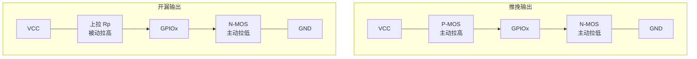

推挽输出靠上管 P-MOS 主动拉高、下管 N-MOS 主动拉低，所以边沿陡峭、驱动能力强；开漏输出只有下管 N-MOS，低电平由器件主动拉到 GND，高电平必须依赖上拉电阻回到 VCC。

#### 局部图：推挽输出

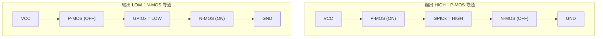

推挽结构的核心是"一推一拉"：上管导通时输出高电平，下管导通时输出低电平，正常设计中二者不会同时导通，否则 VCC 与 GND 会形成直通短路。

#### 局部图：开漏输出

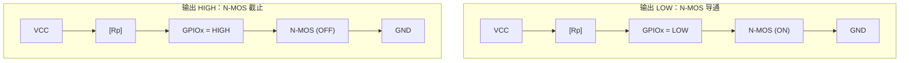

开漏结构不能主动输出高电平：N-MOS 截止时 GPIO 处于释放状态，由上拉电阻把线拉回 VCC；N-MOS 导通时则强制把线拉到 GND。

#### 状态图：I2C 线与逻辑

```
设备A   设备B   总线状态
释放    释放    HIGH
拉低    释放    LOW
释放    拉低    LOW
拉低    拉低    LOW

规则：任一设备拉低，总线即为 LOW。
```

这就是 I2C 能多设备共享 SDA/SCL 的原因：所有设备只负责"拉低或释放"，不会出现某个设备强拉高、另一个设备强拉低的电源短路冲突。

**两种输出的电气特性对比：**

| 特性 | 推挽输出（Push-Pull） | 开漏输出（Open-Drain） |
|------|----------------------|------------------------|
| 输出高电平方式 | P-MOS 主动驱动到 VCC | 上拉电阻被动拉到 VCC |
| 输出低电平方式 | N-MOS 下拉到 GND | N-MOS 下拉到 GND |
| 驱动能力 | 强（上下都有 MOS 管） | 高电平弱（靠电阻），低电平强 |
| 能否多设备共享总线 | 不能（会短路冲突） | 可以（线与逻辑） |
| 典型应用 | 普通 GPIO、SPI、PWM | **I2C**、1-Wire、按键矩阵 |

### 1.3 I2C 为什么必须用开漏输出

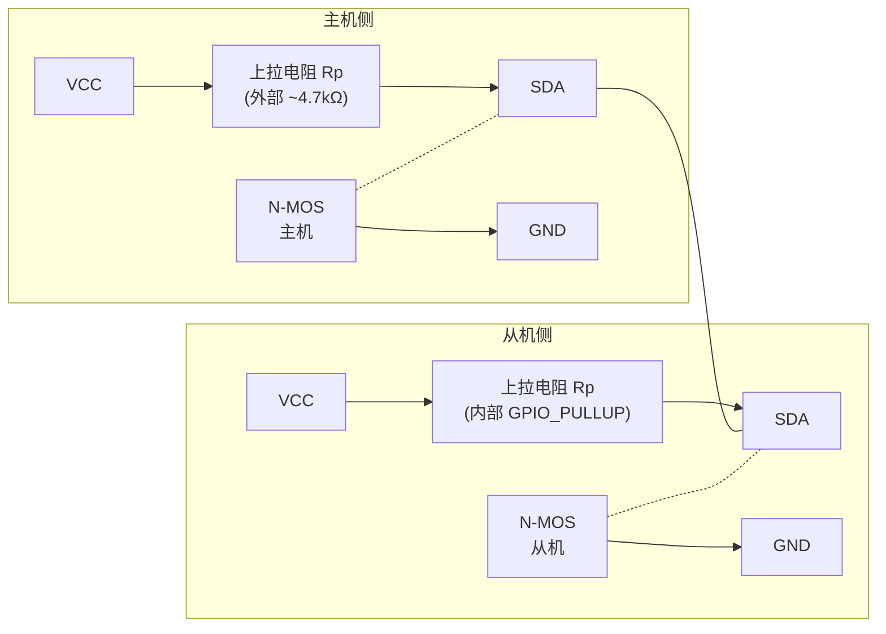
场景：主机和从机共享同一根 SDA 线

线与逻辑（Wired-AND）：
  - 任何一个设备的 N-MOS 导通 → 总线被拉到低电平
  - 所有设备的 N-MOS 都截止   → 总线被上拉电阻拉到高电平
  
  这就是为什么 I2C 可以多设备共享总线：
  - 推挽输出的话，A 输出高 B 输出低 = 短路烧毁！
  - 开漏输出的话，任何设备拉低都不冲突
```

**本项目配置（`iic.c`）：**

```c
.scl_io_num = GPIO_NUM_4,
.scl_pullup_en = GPIO_PULLUP_ENABLE,   // ← 内部上拉使能（替代外部电阻）
.sda_io_num = GPIO_NUM_5,
.sda_pullup_en = GPIO_PULLUP_ENABLE,   // ← 内部上拉使能（替代外部电阻）
```

---

## 二、ESP32-S3 I2C 硬件架构

### 2.1 I2C 外设简介


#### 总览图：I2C 控制器资源

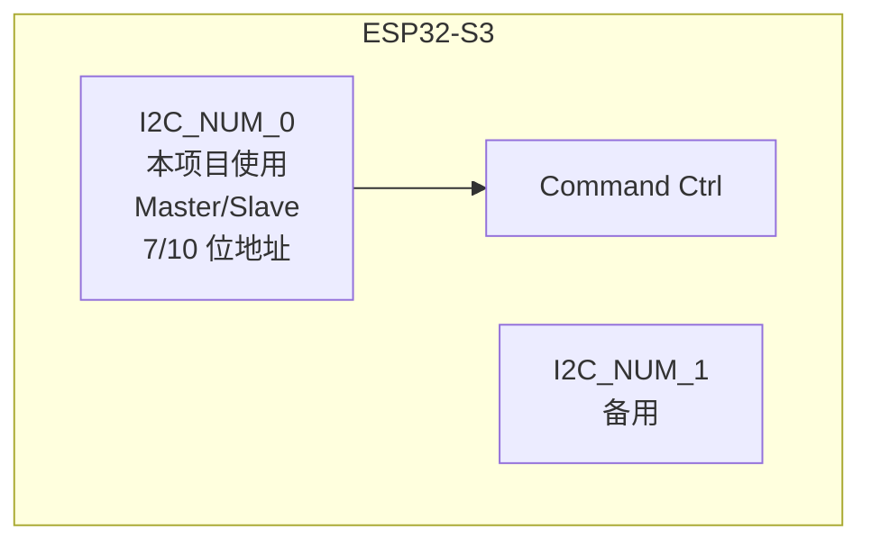

ESP32-S3 内部集成 2 个 I2C 控制器，`I2C_NUM_0` 和 `I2C_NUM_1` 都支持主机/从机模式、7 位/10 位地址和 100 kHz/400 kHz 常见速率。本项目选择 `I2C_NUM_0`，并通过 ESP-IDF 命令链机制批量执行 START、WRITE、READ、STOP。

### 2.2 完整的 I2C 时钟源到 GPIO 引脚的路线图

#### 总览图：时钟到引脚

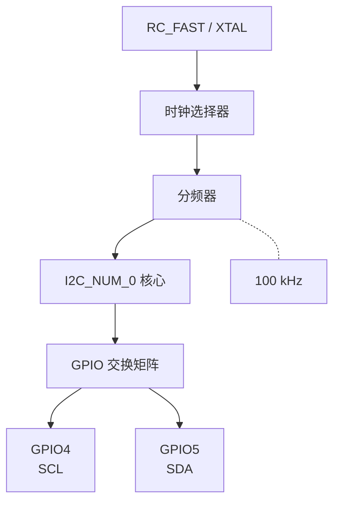

#### 局部图：SCL/SDA 开漏连接

```
3.3V
 |
 +--[Rp]-- SCL(GPIO4) -- BH1750 SCL
 |
 +--[Rp]-- SDA(GPIO5) -- BH1750 SDA

任意设备只能拉低，释放后由 Rp 拉高。
```

#### 时序图：配置到传输

```
i2c_param_config()
        | 选 GPIO4/5 与 100kHz
        v
i2c_driver_install()
        | 创建驱动资源
        v
i2c_master_cmd_begin()
        | 执行命令链
        v
SCL/SDA 输出真实波形
```

原大图中的知识点可以按三层理解：时钟源先经过选择器和分频器得到目标总线速率；I2C 控制器核心负责解释 START/STOP/WRITE/READ 命令；GPIO 交换矩阵把控制器信号映射到本项目的 GPIO4（SCL）和 GPIO5（SDA）。

### 2.3 I2C 命令寄存器与命令链（Command Link）机制

#### 总览图：命令链生命周期

```
create
  |
  v
追加 START/WRITE/READ/STOP
  |
  v
cmd_begin 执行
  |
  v
delete 释放
```

#### 局部图：BH1750 写命令链

```
START
  |
  v
WRITE 0x46  -- 从机 ACK
  |
  v
WRITE 0x10  -- 从机 ACK
  |
  v
STOP
```

#### 局部图：BH1750 读数据链

```
START
  |
  v
WRITE 0x47 -- 从机 ACK
  |
  v
READ 高字节 -- 主机 ACK
  |
  v
READ 低字节 -- 主机 NACK
  |
  v
STOP
```

#### 时序图：命令链执行顺序

```
CPU 追加命令:  START WRITE READ STOP
                 |
                 v
I2C 控制器:    逐条取命令并驱动总线
                 |
                 v
SCL/SDA:       产生对应时序与 ACK 位
```

命令链的价值是把多个总线动作先放入内存结构，再由 `i2c_master_cmd_begin()` 统一交给 I2C 控制器执行。执行结束后必须调用 `i2c_cmd_link_delete()` 释放命令链，避免小内存对象泄漏。

---

## 三、I2C 时序基本单元

### 3.1 起始条件（START Condition）


**定义：** SCL 高电平期间，SDA 从高电平切换到低电平。

```
起始条件（START）：

       ┌─── SCL 为高 ───┐
       │                │
SCL:   ─────────────────┘
       │                │
       │   ┌── SDA 从高到低 ──┐
       │   │                  │
SDA:   ────┘                  │
       │                      │
       │←── 总线空闲 ──→│←── 起始后 ──→│
       
       主机发出 START，表示"我要开始通信了"
```

### 3.2 终止条件（STOP Condition）

**定义：** SCL 高电平期间，SDA 从低电平切换到高电平。

```
终止条件（STOP）：

                ┌── SCL 为高 ───┐
                │   |           │
SCL:   ─────────┘   |           └─────────
                    │                  |
                    ┌── SDA 从低到高 ── ─┐    
                    │                   │    
SDA:   -------------┘                   └────
       │                   │
       │←── 通信中 ──→│←── 总线释放 ──→│
       
       主机发出 STOP，表示"通信结束，总线释放"
```

### 3.3 发送一个字节（Master Write 8 bits）


**过程：** SCL 低电平期间，主机将数据位依次放到 SDA 线上（高位先行），然后释放 SCL，从机在 SCL 高电平期间读取数据位。依次循环 8 次。

```
发送一个字节（主机 → 从机，MSB 先发）：

发送 B7（bit7 = 最高位）：
SCL:  ───┐   ┌───      SCL 低时主机放数据，SCL 高时从机读取
         │   │
SDA:  ───┘   │──────    B7 = 1（高电平）
         │   │
发送 B6：
SCL:      ───┐   ┌───
             │   │
SDA:      ───│───│────  B6 = 0（低电平）
             │   │
发送 B5 ~ B0 依次类推...共 8 个 bit：

完整字节时序：
SCL:  ─┐  ┌┐  ┌┐  ┌┐  ┌┐  ┌┐  ┌┐  ┌┐  ┌────
       │  ││  ││  ││  ││  ││  ││  ││  ││
SDA:   └──┘└──┘│──┘└──┘│──┘└──┘│──┘│──┘└──
               │       │       │   │
       B7=1  B6=0  B5=1  B4=0  ... ...  B0=0
       │←────────── 8 个时钟周期 ──────────→│
```

### 3.4 接收应答（Master 读 ACK）


**过程：** 主机在发送完一个字节后，在下一个时钟释放 SDA（设为输入），接收从机返回的应答位。数据 0 = ACK（应答），数据 1 = NACK（非应答）。

```
主机发送完 8bit 后，在第 9 个时钟接收 ACK：

          │←────── 8 个数据位（主机发）──────→│  │← 第9位 →│
  SCL:  ──┘└─┐┌─┐┌─┐┌─┐┌─┐┌─┐┌─┐┌─┐┌──┐  ┌──┐┌──
               │ │ │ │ │ │ │ │ │ │ │ │ │ │  │  ││
  ┌──────────────────────────────────────┐  ┌──────────┐
  │  发送 B7 B6 B5 B4 B3 B2 B1 B0       │  │ 释放 SDA │
  └──────────────────────────────────────┘  └──────────┘
  主机:  发 8 个数据位                     等待从机应答
  ──────────────────────────────────────   ┌──────────┐
  从机:  逐位读取数据                      │ ACK(拉低) │
  ──────────────────────────────────────   └──────────┘
                                           SDA=0→应答  SDA=1→不应答

放大第 9 位细节：
              最后一个数据位     第 9 位
  SCL:    ───┘              └──┐        ┌──
               │                │        │
  主机:   ─────┘    (释放 SDA)  │        │
                                │        │
  从机:   ───────────────────   └────────  0 = ACK（拉低 SDA 表示应答）
                                         1 = NACK（释放 SDA 表示不应答）
```

### 3.5 发送应答（Master 发 ACK）

**过程：** 主机在接收完一个字节后，在下一个时钟发送一位应答数据。0 = ACK（继续接收），1 = NACK（停止接收）。

```
主机接收完 8bit 后，在第 9 个时钟发送 ACK：

SCL:  ─┐  ┌┐  ┌┐  ┌┐  ┌┐  ┌┐  ┌┐  ┌┐  ┌┐  ┌────
       │  ││  ││  ││  ││  ││  ││  ││  ││  ││  │
       │←── 8 个从机数据位 ──────→│  │  ││  │
                                  │  │  ││  │
SDA: (从机发数据)    ────────►     │  └──┘│── 主机拉低 SDA = ACK
                                  │      │   （主机说：继续发）

第 9 位 SCL 高电平期间：
  主机拉低 SDA = 0 → ACK（"再发一个字节"）
  主机释放 SDA = 1 → NACK（"不要了，结束"）
```

---

## 四、I2C 地址字节与读写判断

### 4.1 地址字节构成

I2C 的 7 位地址模式下，通信的第一个字节格式如下：

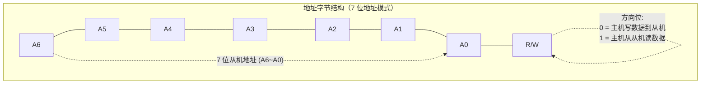

BH1750 地址示例：
- 7 位物理地址 = 0x23 = 0b0100011
- 写地址 = 0b0100011 0 = 0x46（左移1位 + 0）
- 读地址 = 0b0100011 1 = 0x47（左移1位 + 1）

#define bh1750_write_addr 0x46   // 7位地址左移1位，R/W=0
#define bh1750_read_addr  0x47   // 7位地址左移1位，R/W=1
```

### 4.2 I2C 主机向从机发送数据的时序

```
主机写数据到从机（Master Write）：

  主机:  START  →  发 0x46(W)  →   ───    →  发 0x10   →   ───    →  STOP
  从机:  ─────  →  ──────────  →  ACK(低) →  ────────  →  ACK(低) →  ─────

过程解读：
  ① START                   主机发出起始信号，抢占总线
  ② 0x46 (7位地址0x23<<1 | R/W=0)   主机发送 BH1750 写地址
  ③ ACK(从机)               从机地址匹配后拉低 SDA 应答
  ④ 0x10 (HResolutionMode)  主机发送测量模式命令
  ⑤ ACK(从机)               从机确认收到命令
  ⑥ STOP                    主机释放总线，通信结束
```

### 4.3 I2C 主机从从机接收数据的时序

```
主机从从机读数据（Master Read）：

  主机:  START  →  发 0x47(R)  →   ───    →    ACK     →    ───    →    NACK    →  STOP
  从机:  ─────  →  ──────────  →  ACK(低) →  发高8位    →    ───    →  发低8位    →  ─────
                                         D15~D8                          D7~D0

数据合成: light = (高8位 << 8) | 低8位

过程解读：
  ① START                   主机发出起始信号
  ② 0x47 (7位地址0x23<<1 | R/W=1)   主机发送 BH1750 读地址
  ③ ACK(从机)               从机地址匹配，拉低 SDA 应答
  ④ 从机发高8位              从机发送光照值 D15~D8
  ⑤ ACK(主机)               主机应答："继续发"
  ⑥ 从机发低8位              从机发送光照值 D7~D0
  ⑦ NACK(主机)              主机不应答："不要了，结束"
  ⑧ STOP                    主机释放总线
```

---

## 五、从机模块（BH1750）工作流程与注意事项

### 5.1 BH1750 光照传感器简介

BH1750FVI 是 ROHM 公司的数字式环境光传感器：

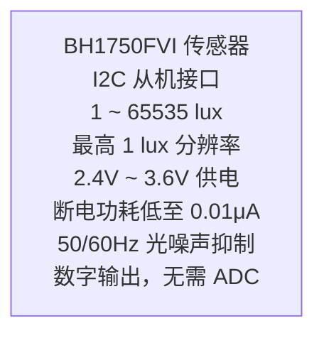

### 5.2 从机模块使用四步法

从机模块使用的四个核心注意事项：

```
1. 确定指令发送顺序

bh1750_init()
  ├─ iic_init()          初始化 I2C 主机
  ├─ PowerOn(0x01)       先上电
  └─ HResolutionMode     再设置模式

主循环:
  └─ bh1750_read_data()  每次读 16bit 值
```

```
2. 从机模块的指令集

初始化必须:
  PowerOn  → 芯片上电
  模式指令 → 选择分辨率模式

常用指令:
  0x01  上电
  0x00  断电
  0x10  连续高分辨率 1 lux, 120ms
  0x11  连续高分辨率2 0.5 lux, 120ms
  0x13  连续低分辨率 4 lux, 16ms
  0x07  复位数据寄存器
```

```
3. 从机模块的 I2C 通信速度

本项目:
  .master.clk_speed = 100000

BH1750 支持:
  标准模式  ~100 kHz ✓
  快速模式  ~400 kHz

注意:
  速度过快会通信失败，不能超过从机上限。
```

```
4. 从机模块的地址

默认 7 位地址: 0x23

地址冲突检查:
  ADDR 接低 → 0x23
  ADDR 接高 → 0x5C
  同一总线不能有两个相同从机地址

地址验证:
  发地址后检查 ACK；无 ACK 通常是地址错
  或从机未连接。
```

```
5. 从机模块的数据帧结构

写命令帧:
  START → Addr+W → CMD → STOP
  例: 0x46 + ACK + 0x10 + ACK

读数据帧:
  START → Addr+R → 高8位+ACK
        → 低8位+NACK → STOP
  例: 0x47 + D[15:8] + D[7:0]

数据合成:
  light_value = (高8位 << 8) | 低8位
  return light_high << 8 | light_low;
```

---

## 六、代码详细解析

### 6.1 I2C 初始化 - iic_init()

**源代码（`iic.c`）：**

```c
void iic_init(void)
{
    i2c_config_t i2c_structure = {
        .clk_flags = 0,                         // 时钟标志：0=默认
        .master.clk_speed = 100000,             // 通信速度：100kHz 标准模式
        .mode = I2C_MODE_MASTER,                // 工作模式：主机
        .scl_io_num = GPIO_NUM_4,               // SCL 引脚：GPIO4
        .scl_pullup_en = GPIO_PULLUP_ENABLE,    // SCL 上拉：使能
        .sda_io_num = GPIO_NUM_5,               // SDA 引脚：GPIO5
        .sda_pullup_en = GPIO_PULLUP_ENABLE,    // SDA 上拉：使能
    };
    i2c_param_config(I2C_NUM_0, &i2c_structure); // 将配置写入 I2C_NUM_0
    
    i2c_driver_install(I2C_NUM_0, I2C_MODE_MASTER, 0, 0, 0);
    // I2C_NUM_0: 使用 I2C 控制器 0
    // I2C_MODE_MASTER: 主机模式
    // 0,0,0: 从机模式才需要填（RX缓冲、TX缓冲、中断标志），主机模式填 0
}
```

**时钟源与 GPIO 交换矩阵配置说明：**

| 配置项 | 值 | 说明 |
|--------|-----|------|
| `clk_flags` | `0` | 使用默认时钟源选择器，自动从 `RC_FAST_CLK` 和 `XTAL_CLK` 中选最优 |
| `scl_io_num` | `GPIO_NUM_4` | 通过 GPIO 交换矩阵将 I2C0_SCL 信号路由到 GPIO4 |
| `sda_io_num` | `GPIO_NUM_5` | 通过 GPIO 交换矩阵将 I2C0_SDA 信号路由到 GPIO5 |
| `scl/sda_pullup_en` | `ENABLE` | 开启内部上拉，GPIO 设为开漏输出模式 |

### 6.2 BH1750 发送命令 - bh1750_send_cmd()

**源代码（`bh1750.c`）：**

```c
void bh1750_send_cmd(uint8_t cmd_data)
{
    i2c_cmd_handle_t cmd = i2c_cmd_link_create();    // 1. 创建命令链
    i2c_master_start(cmd);                           // 2. 存入 START 命令
    i2c_master_write_byte(cmd, bh1750_write_addr, true); // 3. 存入写地址 (0x46)
    i2c_master_write_byte(cmd, cmd_data, true);      // 4. 存入命令字节
    i2c_master_stop(cmd);                            // 5. 存入 STOP 命令
    i2c_master_cmd_begin(I2C_NUM_0, cmd, 1000);      // 6. 命令控制器执行
    i2c_cmd_link_delete(cmd);                        // 7. 删除命令链，释放内存
}
```

**命令链执行流程图：**

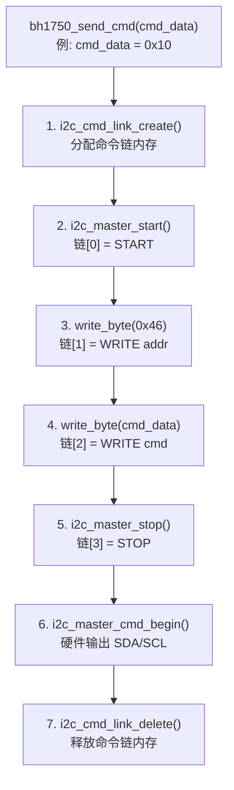

### 6.3 BH1750 读取数据 - bh1750_read_data()

**源代码（`bh1750.c`）：**

```c
uint16_t bh1750_read_data(void)
{
    uint8_t light_high = 0, light_low = 0;
    i2c_cmd_handle_t cmd = i2c_cmd_link_create();       // 1. 创建命令链
    i2c_master_start(cmd);                              // 2. START
    i2c_master_write_byte(cmd, bh1750_read_addr, true); // 3. 读地址 (0x47)
    i2c_master_read_byte(cmd, &light_high, I2C_MASTER_ACK); // 4. 读高8位→ACK
    i2c_master_read_byte(cmd, &light_low, I2C_MASTER_ACK);  // 5. 读低8位→ACK
    i2c_master_stop(cmd);                               // 6. STOP
    i2c_master_cmd_begin(I2C_NUM_0, cmd, 1000);         // 7. 命令控制器执行
    i2c_cmd_link_delete(cmd);                           // 8. 删除命令链
    return light_high<<8|light_low;                     // 9. 合成 16bit 数据
}
```

**读数据时的 ACK 处理：**

| 字节 | 应答方 | ACK 值 | 含义 |
|------|--------|--------|------|
| 地址字节 0x47 | BH1750 | ACK(0) | "我在这里" |
| 高 8 位数据 | 主机→从机 | ACK(0) | "继续发低8位" |
| 低 8 位数据 | 主机→从机 | (`I2C_MASTER_ACK`=0) | "收到了" |

**注意：** 代码中对最后一次读取也使用了 `I2C_MASTER_ACK`。标准做法应使用 `I2C_MASTER_NACK` 告诉从机不再接收，但 BH1750 对此不敏感，不影响正常工作。

### 6.4 主程序 - app_main()

**源代码（`main.c`）：**

```c
float light = 0;

void app_main(void)
{
    lcd_init();
    bh1750_init();                               // I2C + BH1750 初始化

    lcd_show_string(1,1,"light:",GREEN,BLACK);
    while (1)
    {
        light = bh1750_read_data() / 1.2;        // 读取原始值并换算为 lux
        lcd_show_float(1,7,light,6,YELLOW,BLACK); // LCD 显示
        vTaskDelay(1000);                         // 每秒刷新一次
    }
}
```

**光照值换算说明：**

```
bh1750_read_data() 返回值 / 1.2 = 光照强度（lux）

HResolutionMode 下：
  原始值范围：0 ~ 65535
  换算公式： lux = 原始值 / 1.2
  精度：1 lux

为什么 / 1.2？
  BH1750 在 H 分辨率模式下的测量公式：
  光照强度(lx) = 原始寄存器值 / 1.2
  这是芯片手册规定的固定换算系数

示例：
  原始值 = 1200 → lux = 1200 / 1.2 = 1000 lux（明亮室内）
  原始值 = 120  → lux = 120 / 1.2 = 100 lux（较暗）
```

### 6.5 引脚分配总览

```
ESP32-S3 引脚分配：

  I2C 总线（BH1750 光照传感器）
  ├── GPIO4  ── SCL（I2C 时钟线）
  └── GPIO5  ── SDA（I2C 数据线）

  LCD（SPI 通信）
  ├── GPIO12 ── SCLK
  ├── GPIO11 ── MOSI
  ├── GPIO48 ── CS
  ├── GPIO47 ── DC
  ├── GPIO21 ── RST
  └── GPIO40 ── BL
```

---

## 七、完整通信时序图

bh1750_send_cmd() 的时序与 [4.2 主机写数据](#42-i2c-主机向从机发送数据的时序) 完全一致，每次调用都是一次完整的 START → 地址+W → 数据 → STOP 流程。初始化阶段连续调用两次：PowerOn(0x01) → HResolutionMode(0x10)，再 `vTaskDelay(200)` 等待测量准备完成。

### 7.1 主循环每次读取

```
bh1750_read_data() 完整时序（每 1000ms 执行一次）:

  主机:  START  →  发 0x47(R)  →   ───    →   ACK   →   ───   →  NACK  →  STOP
  从机:  ─────  →  ────────  →  ACK(低) →  发高8位    →  ───  →  发低8位  →  ─────
                                         D15~D8                          D7~D0

数据合成: light_raw = (light_high << 8) | light_low
光照计算: lux = light_raw / 1.2
```

---

## 八、软件架构传递树

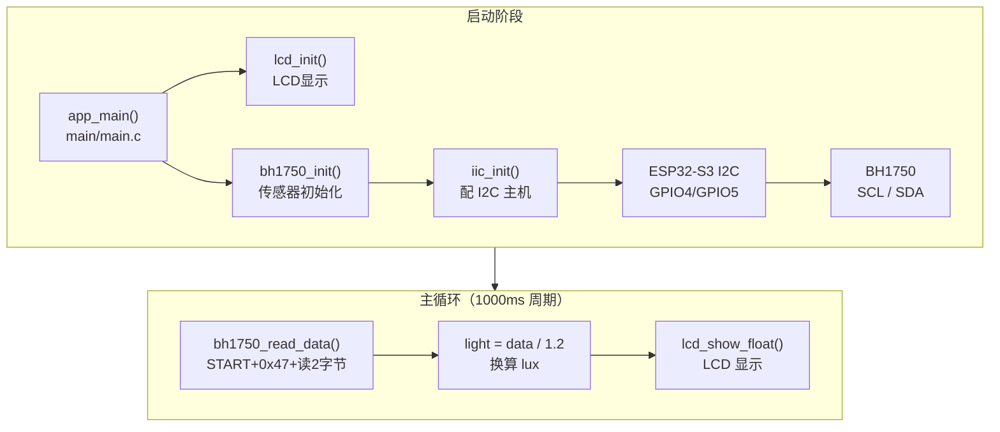

---

## 容易踩坑

| 现象 | 常见原因 | 排查方向 |
|------|----------|----------|
| I2C 一直 NACK | 地址字节/7 位地址混淆或器件未上电 | 确认 BH1750 地址、ADDR 引脚和供电 |
| 总线被拉低 | SDA/SCL 缺少上拉、接线短路或从机卡住 | 测量空闲电平，应为高电平；必要时重新上电 |
| 读数始终为 0 | 未发送测量命令或等待转换时间不足 | 先发模式命令，再按手册等待约 120~180ms |
| 最后一字节 ACK/NACK 写反 | 主机读取最后字节仍发送 ACK | 中间字节 ACK，最后字节 NACK 后 STOP |

## 九、学习要点总结

### 9.1 核心知识点

| 知识点 | 说明 |
|--------|------|
| I2C 物理层 | 两线制（SCL + SDA），开漏输出 + 上拉电阻，支持多设备 |
| 开漏 vs 推挽 | 开漏=只有下拉管+上拉电阻，推挽=上下管都驱动；I2C 必须用开漏 |
| 起始条件 | SCL 高时 SDA 从高→低 |
| 终止条件 | SCL 高时 SDA 从低→高 |
| 发送字节 | SCL 低时放数据，SCL 高时对方读，8次循环 |
| 应答机制 | 第 9 位：0=ACK（成功），1=NACK（失败/结束） |
| 地址字节 | 7位地址左移1位 + R/W位（0=写，1=读） |
| 命令链 | ESP-IDF 的 I2C 命令批处理机制：create → 填充 → begin → delete |
| BH1750 | 数字光传感器，I2C 接口，直接输出 lux，/1.2 换算 |

### 9.2 I2C 工作流程总结

```
完整的 I2C 主机通信流程：

1. i2c_param_config()    配置时钟源、GPIO交换矩阵引脚、速度
2. i2c_driver_install()  向 CPU 注册 I2C 驱动，分配资源
3. i2c_cmd_link_create() 创建命令链（内存中的命令数组）
4. i2c_master_start()    向命令链存入 START 命令
5. i2c_master_write_byte() 向命令链存入 WRITE 命令（地址/数据）
6. i2c_master_read_byte()  向命令链存入 READ 命令（接收数据）
7. i2c_master_stop()     向命令链存入 STOP 命令
8. i2c_master_cmd_begin() 命令控制器按序执行所有命令
9. i2c_cmd_link_delete() 删除命令链，释放内存
```

### 9.3 常用 I2C 速度

| 模式 | 速度 | 用途 |
|------|------|------|
| 标准模式 | 100 kHz | 本项目使用，适合大多数传感器 |
| 快速模式 | 400 kHz | 数据传输量大的场景 |
| 高速模式 | 3.4 MHz | 需要特殊硬件支持 |

### 9.4 进阶方向

- I2C 多从机连接（同一总线挂多个不同地址的传感器）
- I2C 从机模式（ESP32-S3 作为 I2C 从设备）
- 10 位地址模式（超过 127 个从机时使用）
- I2C 总线仲裁与时钟同步

---

## Tips

### 开漏 + 上拉的硬件原理——I2C 的"线与"逻辑

I2C 最核心的硬件设计决策就是**开漏输出 + 上拉电阻**组合。这不是随便选的——它解决了一个关键问题：**多个设备如何安全地共享两根线**。

```
如果 I2C 用推挽输出（错误示范）：

设备A输出 HIGH ──┐
               ├── 短路！VCC 经过 P-MOS(A)→N-MOS(B)→GND
设备B输出 LOW  ──┘

→ 两个 MOS 管同时导通 → 电源直接短路 → 芯片烧毁
```

而开漏输出只有 N-MOS 下拉管，任何设备只能"拉低"或"释放"，永远不会冲突：

```
开漏输出（正确）：

设备A释放 ──┐
            ├── 总线 = HIGH（上拉电阻拉高）
设备B释放 ──┘

设备A拉低 ──┐
            ├── 总线 = LOW（A 强制拉到 GND）
设备B释放 ──┘

→ 无短路风险，这就是"线与"逻辑
```

**上拉电阻的选择**：I2C 速率越高，上拉电阻需要越小（上升沿更陡）。一般 100 kHz 用 4.7kΩ，400 kHz 用 2.2kΩ。本项目启用 ESP32-S3 内部上拉（约 45kΩ），因为 BH1750 通信速率低、线短，内部上拉够用。如果总线上设备多或线长，建议外接 4.7kΩ 电阻。

### 设备地址 7bit vs 8bit——最容易混淆的概念

这是 I2C 新手最常见的困惑：**传感器的数据手册写地址是 0x23，但代码里写的是 0x46（写）和 0x47（读），为什么？**

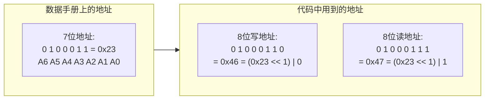

**关键规则**：
- 数据手册永远是 **7 位地址**（0x00 ~ 0x7F）
- 实际发送的第 1 字节是 **7 位地址左移 1 位 + R/W 位**
- ESP-IDF 的 `i2c_master_write_byte()` 接收的是 **8 位地址**（已经包含 R/W 位）

**这个设计为什么存在？** I2C 标准用最低位做方向标记，所以 7 位地址必须左移到高 7 位，把最低位留给 R/W。这就是"7 位地址"和"8 位地址"的全部秘密。

### 踩坑实录

1. **SCL/SDA 没接上拉**：这是最经典的问题。如果用示波器看 SCL/SDA，空闲时应该都是高电平（3.3V）。如果是低电平或浮动，说明上拉失效。ESP32-S3 内部上拉约 45kΩ——对短距离单从机够用，但建议外部加 4.7kΩ。

2. **多个从机地址冲突**：I2C 总线上所有设备地址必须唯一。两个 BH1750 不能挂在同一条总线上（除非一个的 ADDR 接高电平改为 0x5C）。用 `i2cdetect` 类工具扫描总线是排查地址冲突的最佳方法。

3. **忘记 vTaskDelay(200)**：BH1750 上电后需要约 120ms 才能完成第一次测量。很多人在 `bh1750_init()` 后立刻读数据，读到的全是 0。手册规定的等待时间不能省略。

### 知识衔接

- **上一章**：[01_UART](01_UART.md)——UART 是异步通信（无时钟，靠波特率同步），I2C 是同步通信（有时钟 SCL）。两者的"同步机制"完全不同，这是理解所有串行协议的基础。
- **下一章**：[03_SPI_LCD](03_SPI_LCD.md)——SPI 也是同步通信，但它用独立的 CS 片选代替 I2C 的地址机制，用全双工代替 I2C 的半双工。理解 SPI 后你会发现，I2C 和 SPI 是"同样的问题（多设备通信），不同的答案"。
