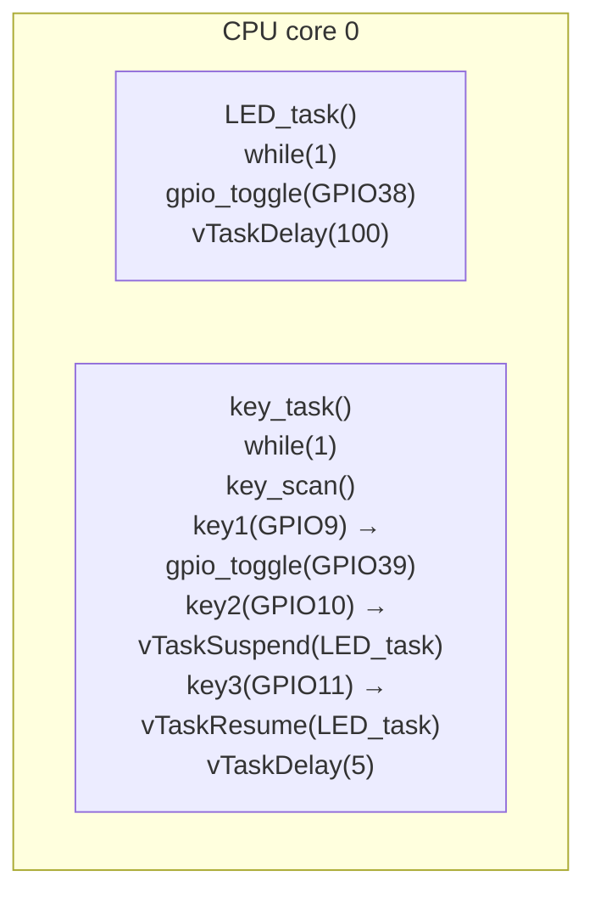
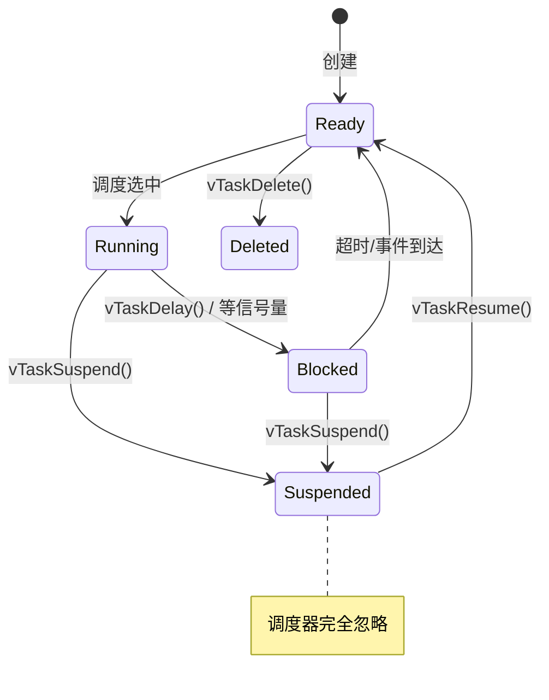
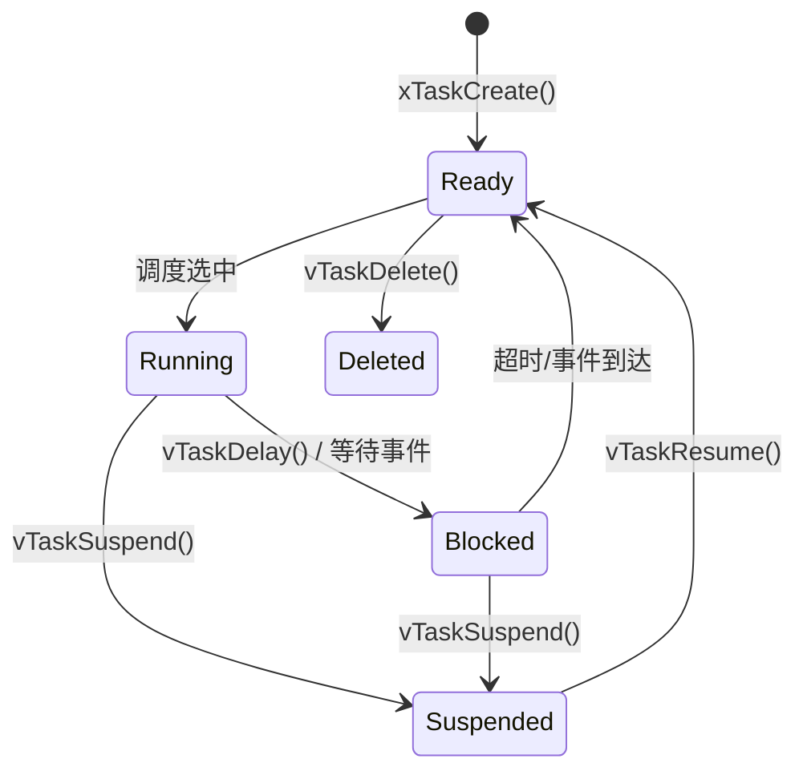

# FreeRTOS 任务挂起与恢复 — Suspended 态的语义与用法

## 本章重要 API 函数

| API | 功能 | 参数说明 | 头文件 |
|-----|------|----------|--------|
| `vTaskSuspend()` | 挂起任务（移出所有调度队列） | `TaskHandle_t xTaskToSuspend`：要挂起的任务句柄；无返回值 | `"freertos/task.h"` |
| `vTaskResume()` | 恢复挂起的任务（回到 Ready 态） | `TaskHandle_t xTaskToResume`：要恢复的任务句柄；无返回值 | `"freertos/task.h"` |
| `xTaskCreatePinnedToCore()` | 创建任务并绑定到指定核心 | 同第 1 章；返回 `pdPASS` 或 `errCOULD_NOT_ALLOCATE_REQUIRED_MEMORY` | `"freertos/task.h"` |
| `vTaskDelay()` | 任务阻塞延时 | `const TickType_t xTicksToDelay`：延时 tick 数；无返回值 | `"freertos/task.h"` |
| `key_scan()` | 按键扫描（轮询 3 路） | `void`：无参数；返回 `uint8_t`，`0` 无按下，`1`/`2`/`3` 对应 3 个按键 | `"key.h"` |
| `gpio_toggle()` | GPIO 电平翻转（自定义） | `gpio_num_t gpio_num`：引脚号；无返回值 | `"LED.h"` |

---

## 本章目录

> 点击条目可跳转到对应小节。

### 章节导航

- **[本章重要 API 函数](#本章重要-api-函数)**
- **[学习前后依赖](#学习前后依赖)**
- **[1. 概述](#1-概述)**
- **[2. 本章目录结构](#2-本章目录结构)**
- **[3. 软件架构传递树](#3-软件架构传递树)**
  - [3.1 模块调用关系](#31-模块调用关系)
  - [3.2 按键与任务状态联动示意](#32-按键与任务状态联动示意)
- **[4. `vTaskSuspend()` 详解](#4-vtasksuspend-详解)**
  - [4.1 Suspended 态在任务状态机中的位置](#41-suspended-态在任务状态机中的位置)
  - [4.2 挂起一个任务后会发生什么](#42-挂起一个任务后会发生什么)
  - [4.3 和 `vTaskDelete()` 的本质区别](#43-和-vtaskdelete-的本质区别)
- **[5. `vTaskResume()` 详解](#5-vtaskresume-详解)**
  - [5.1 恢复后任务回到哪里](#51-恢复后任务回到哪里)
  - [5.2 恢复一个从未挂起的任务](#52-恢复一个从未挂起的任务)
- **[6. 和上一章的差异对比](#6-和上一章的差异对比)**
  - [6.1 功能差异](#61-功能差异)
  - [6.2 硬件差异](#62-硬件差异)
- **[7. 代码详细解析](#7-代码详细解析)**
  - [7.1 LED 初始化 — 配置两颗灯](#71-led-初始化-—-配置两颗灯)
  - [7.2 按键初始化 — 配置三路输入](#72-按键初始化-—-配置三路输入)
  - [7.3 LED 任务 — 不变的闪烁循环](#73-led-任务-—-不变的闪烁循环)
  - [7.4 按键任务 — 三种按键行为](#74-按键任务-—-三种按键行为)
  - [7.5 `app_main` — 创建任务后返回](#75-app_main-—-创建任务后返回)
- **[容易踩坑](#容易踩坑)**
- **[8. 本章小结](#8-本章小结)**
- **[Tips](#tips)**

---

## 学习前后依赖

| 方向 | 内容 |
|------|------|
| 前置基础 | 第 1 章 `1_MultiTask` 的任务创建与删除、时间片轮转调度、`vTaskDelay` 让出 CPU 的原理 |
| 本章核心 | 掌握 `vTaskSuspend()` / `vTaskResume()` 的用法，理解 Suspended 态在五态任务模型中的位置，以及它与 Blocked、Deleted 的本质区别 |
| 后续承接 | 队列/信号量中任务因资源等待进入 Blocked 态的原理；中断中使用 `vTaskResumeFromISR()` 的 ISR 安全版本 |

---

## 1. 概述

本章在上一章的基础上做了一个小而精的改动：**把"删任务"换成了"挂起与恢复"**。

- 上一章 `1_MultiTask`：Key2 删掉 LED 任务，删了就没了；
- 本章 `2_SuspendTask`：Key2 挂起 LED 任务，Key3 恢复它——**可逆**。

这引出了 FreeRTOS 任务状态模型里一个容易被忽视的态：**Suspended（挂起态）**。它和 Blocked（阻塞态）看似都是"不运行"，但语义完全不同：

- Blocked：任务在**等待某个事件**（时间到、信号量、队列数据），事件来了自动回到 Ready；
- Suspended：任务被**人为暂停**，调度器完全忽略它，必须由另一个任务显式调用 `vTaskResume()` 才能恢复。

---

## 2. 本章目录结构

```text
FREERTOS/2_SuspendTask/
├── main/
│   └── main.c                     // 双任务 + 按键挂起/恢复
└── components/
    ├── LED/
    │   ├── LED.c                  // 两颗 LED 初始化 + 电平翻转
    │   └── LED.h
    └── KEY/
        ├── key.c                  // 三路按键输入 + 消抖扫描
        └── key.h
```

---

## 3. 软件架构传递树

### 3.1 模块调用关系

```text
app_main()                                  [main/main.c]
  ├── LED_init()                            [components/LED/LED.c]
  ├── key_init()                            [components/KEY/key.c]
  │
  ├── xTaskCreatePinnedToCore(LED_task,...)  创建 LED 任务 → core 0
  └── xTaskCreatePinnedToCore(key_task,...)  创建 key 任务 → core 0
```



### 3.2 按键与任务状态联动示意

```text
初始: LED_task 运行中 (Ready/Running)

按下 Key2 → vTaskSuspend(LED_task_handle)
  │
  ▼
LED_task 进入 Suspended 态
  │ LED 停在当前状态（不闪了）
  │
  按下 Key3 → vTaskResume(LED_task_handle)
  │
  ▼
LED_task 回到 Ready 态
  │ LED 恢复闪烁
  │
  再按 Key2 → 再次挂起
  再按 Key3 → 再次恢复
  ... 可重复无限次
```

---

## 4. `vTaskSuspend()` 详解

本章核心调用的位置在 `main.c#L33`：

```c
vTaskSuspend(LED_task_handle);
```

### 4.1 Suspended 态在任务状态机中的位置

上一章的任务状态机只有四个态：Ready → Running → Blocked（→ Ready）。本章补上了 Suspended：



关键观察：
- Suspended 态**没有自动退出机制**——不像 Blocked 超时后自动变 Ready，Suspended 必须由外界显式 `vTaskResume()`;
- 从 Running 态可以走 `vTaskSuspend()` 进入 Suspended，也可以从 Blocked 态被挂起（一个在等信号量的任务也可以被挂起）;
- `vTaskResume()` 后任务回到 **Ready** 态，不是直接 Running——调度器来决定什么时候让它跑。

### 4.2 挂起一个任务后会发生什么

执行 `vTaskSuspend(LED_task_handle)` 后：

1. **LED_task 的 TCB 从所有调度队列中被移除**：它不在 Ready 队列，不在 Blocked 队列，调度器遍历任务列表时不再考虑它；
2. **LED_task 的栈和 TCB 不会被释放**：和 `vTaskDelete()` 不同，它的内存仍然被占用;
3. **LED_task 的程序计数器停在当前执行点**：恢复后从挂起点继续往下走。在本例中，它被挂起时大概率正处于 `vTaskDelay(100)` 的阻塞中，恢复后会继续等完剩余 tick 然后翻转 LED;
4. **LED_task 的句柄仍然有效**：`LED_task_handle` 没有变 NULL，依然可以用来对它做 Resume 或 Delete。

用一句话概括：**被 Suspend 的任务是"冬眠"，不是"死亡"。**

### 4.3 和 `vTaskDelete()` 的本质区别

| 维度 | `vTaskSuspend()` | `vTaskDelete()` |
|------|-----------------|-----------------|
| 可逆性 | 可恢复 | 不可恢复 |
| 内存 | 栈和 TCB 保留 | 栈和 TCB 被 IDLE 任务回收 |
| 句柄 | 始终有效 | 变为悬空指针，必须手动置 NULL |
| 调度器视角 | 忽略但不遗忘 | 完全移除 |
| 适用场景 | 临时停用某个功能 | 该任务再也不会用到 |

---

## 5. `vTaskResume()` 详解

本章的恢复调用在 `main.c#L36`：

```c
vTaskResume(LED_task_handle);
```

### 5.1 恢复后任务回到哪里

```text
Suspended ──vTaskResume()──► Ready ──调度选中──► Running
```

**不是直接回到 Running！** 恢复只是把任务插回 Ready 队列，什么时候跑取决于调度器：

- 如果恢复后 LED_task 的优先级（1）> 当前运行任务 → 立即抢占;
- 如果优先级相同 → 等到下一个 tick 边界，由时间片轮转决定;
- 如果优先级更低 → 等高优先级任务让出 CPU。

本例两个任务同级，所以恢复后 LED_task 会在 key_task 下次 `vTaskDelay(5)` 时被调度运行。

### 5.2 恢复一个从未挂起的任务

如果对一个 Normal（Ready/Running/Blocked）状态的任务调用 `vTaskResume()`，**不会出错**，只是什么都不会发生。FreeRTOS 内部会检查任务是否真的在 Suspended 态，不是就跳过。

也就是说多次按 Key3 不会造成任何问题。

---

## 6. 和上一章的差异对比

### 6.1 功能差异

| | 1_MultiTask | 2_SuspendTask |
|---|---|---|
| Key1 (GPIO9) | 翻转 GPIO39 | 翻转 GPIO39（相同） |
| Key2 (GPIO10) | `vTaskDelete(LED_task)` → 永久删除 | `vTaskSuspend(LED_task)` → 挂起 |
| Key3 (GPIO11) | 不存在 | `vTaskResume(LED_task)` → 恢复 |
| 句柄管理 | 删完后 `LED_task_handle = NULL` | 不设 NULL（句柄持续有效） |
| `app_main()` | 创建任务后 `while(1) vTaskDelay(500)` | 创建任务后直接返回 |

### 6.2 硬件差异

| | 1_MultiTask | 2_SuspendTask |
|---|---|---|
| LED | GPIO38 一颗 | GPIO38 + GPIO39 两颗 |
| 按键 | GPIO9 + GPIO10 两路 | GPIO9 + GPIO10 + GPIO11 三路 |
| 按键配置 | 位掩码 `1ULL<<9 \| 1ULL<<10` | 位掩码 `1ULL<<9 \| 1ULL<<10 \| 1ULL<<11` |

---

## 7. 代码详细解析

### 7.1 LED 初始化 — 配置两颗灯

`LED.c` 这次配置了两颗 LED：

```c
.pin_bit_mask=(1ULL<<GPIO_NUM_38)|(1ULL<<GPIO_NUM_39),
```

一次 `gpio_config()` 调用了两个引脚。和分两次调用相比，优点是指令数更少，但缺点是两个引脚的配置必须完全相同（中断模式、上下拉都一样）。

初始态设为高电平（1），LED 默认熄灭（取决于硬件是共阴还是共阳，这里假设高电平灭、低电平亮）。

### 7.2 按键初始化 — 配置三路输入

`key.c` 的 `key_init()` 配置了三路输入引脚：

```c
.pin_bit_mask=1ULL<<(GPIO_NUM_9)|1ULL<<(GPIO_NUM_10)|1ULL<<(GPIO_NUM_11),
.mode=GPIO_MODE_INPUT,
.pull_up_en=GPIO_PULLUP_ENABLE,
```

按键接法：按键一端接 GPIO，另一端接 GND。未按下时上拉电阻把电平拉高（读 1），按下后接地拉低（读 0）。所以 `key_scan()` 里检测 `gpio_get_level(...) == 0` 表示按下。

`key_scan()` 采用**轮询 + 延时消抖**方式：
1. 读到低电平；
2. 延时 20ms 消抖；
3. 等待按键释放（`while(...==0) vTaskDelay(10)`）；
4. 再延时 20ms 消除释放抖动；
5. 返回按键编号。

注意：三个 if 是独立的（不是 `if-else if`），如果极端情况下同时按下多键，后扫描的键会覆盖 `key_num`。本工程不处理多键同时按下的情况。

### 7.3 LED 任务 — 不变的闪烁循环

`main.c#L13-L20` 的 LED_task 和上一章完全一样：

```c
void LED_task(void *args)
{
    while(1)
    {
        gpio_toggle(GPIO_NUM_38);
        vTaskDelay(100);
    }
}
```

它不关心自己是否会被挂起——挂起是外部对它的操作，和它内部的循环逻辑无关。被恢复后，它从被挂起的那条指令继续执行（如果正在 `vTaskDelay` 中，则继续等待剩余时间）。

### 7.4 按键任务 — 三种按键行为

`main.c#L22-L39` 是本工程核心：

```c
void key_task(void *args)
{
    uint8_t key_num = 0;
    while(1)
    {
        key_num = key_scan();
        if(key_num == 1)                          // Key1
        {
            gpio_toggle(GPIO_NUM_39);              // 翻转第二颗 LED
        }else if(key_num == 2)                    // Key2
        {
            vTaskSuspend(LED_task_handle);         // 挂起 LED 任务
        }else if(key_num == 3)                    // Key3
        {
            vTaskResume(LED_task_handle);          // 恢复 LED 任务
        }
        vTaskDelay(5);                             // 让出 CPU（喂狗 + 给其他任务机会）
    }
}
```

逐项解释：

| 按键 | GPIO | 行为 | 对应的 API | 效果 |
|------|------|------|-----------|------|
| Key1 | GPIO9 | 翻转 GPIO39 LED | `gpio_toggle()` | 手动控制 LED，演示"两个任务各管一颗灯" |
| Key2 | GPIO10 | 挂起 LED_task | `vTaskSuspend()` | LED38 停止闪烁但任务内存未释放 |
| Key3 | GPIO11 | 恢复 LED_task | `vTaskResume()` | LED38 从停止处继续闪烁 |

和上一章最关键的区别：Key2 不再 `vTaskDelete()` + `LED_task_handle = NULL`，而是直接用 `vTaskSuspend()`。**不再需要判断句柄是否为 NULL**，因为挂起不会破坏句柄。这是 Suspended 态最实用的好处之一——不需要额外的空指针保护。

### 7.5 `app_main` — 创建任务后返回

`main.c#L44-L51`：

```c
void app_main(void)
{
   LED_init();
   key_init();

   xTaskCreatePinnedToCore(LED_task,"LED_task",1024,NULL,1,&LED_task_handle,0);
   xTaskCreatePinnedToCore(key_task,"key_task",1024,NULL,1,&key_task_handle,0);
}
```

注意：这里没有 `while(1) { vTaskDelay(500); }`。和上一章不同，`app_main()` 创建完两个任务直接返回。

这能行的原因是：当 `app_main()` 返回后，main 任务被删除，但两个用户任务仍在运行。如果没有用户任务运行，IDLE 任务会接管 CPU 并喂狗。

上一章写 `while(1) vTaskDelay(500)` 是一种"占位"写法，虽然运行效果一样（`vTaskDelay` 让出 CPU 给两个用户任务），但语义上不必要。本章用直接返回的方式更加简洁，也更符合 FreeRTOS 的推荐做法。

---

## 容易踩坑

| 现象 | 常见原因 | 排查方向 |
|------|----------|----------|
| 挂起后按恢复没反应 | 句柄传错了、或被其他代码改了 | 确认 `vTaskSuspend` 和 `vTaskResume` 用的是同一个句柄 |
| Suspended 的任务看起来"死了" | 这是正常行为 | 用 `vTaskList()` 或调试器看任务状态，确认它在 Suspended 态而不是 Deleted |
| 把任务 Suspend 后忘了 Resume | 任务永久停摆，功能丢失 | 设计上确保有一个恢复路径（按键、定时器、中断等） |
| 对被 Delete 的句柄调 Resume | 句柄在 `vTaskDelete()` 后没有置 NULL | 行为未定义，可能崩溃。确保句柄管理策略一致 |
| 在 ISR 里调 `vTaskResume()` | ISR 中不能阻塞 | 用 `xTaskResumeFromISR()`，会触发任务切换（需 `portYIELD_FROM_ISR`） |
| 同时按两键导致 key_num 被覆盖 | `key_scan` 没做多键互斥 | 用 `else if` 链或状态机改进扫描逻辑 |

---

## 8. 本章小结

本章从"删任务"升级到"挂起与恢复"，引入 FreeRTOS 五态模型中的 Suspended 态：

```text
创建 → Ready ←── vTaskResume() ←── Suspended
         ↑                           ↑
         │ vTaskDelay 等超时          │ vTaskSuspend()
         │                           │
      Blocked ←──── Running ─────────┘
     (idle)       (Running)      (dbg)

Blocked：等事件，自动恢复
Suspended：等人为 Resume，手动恢复
Deleted：不可逆消失
```

核心收获：

1. **Suspended ≠ Blocked**：被挂起的任务完全不受调度器管理，没有自动恢复路径；被阻塞的任务在事件到达或超时后自动变 Ready；
2. **Suspended ≠ Deleted**：挂起保留所有内存和句柄，随时可恢复；删除释放内存，句柄失效；
3. **句柄管理更简单**：和 `vTaskDelete()` 不同，`vTaskSuspend()` 不需要把句柄置 NULL，所以后续恢复操作不需要空指针检查；
4. **可逆性**：挂起/恢复可以无限次循环，适合"临时停用/重新启用"的场景，比如低功耗模式下关掉非必要任务；
5. **`app_main()` 返回**：本章演示了创建任务后直接返回的写法，因为用户任务已经被调度器接管运行，不需要在 `app_main()` 里写死循环。

从调度器角度来看：

```text
vTaskSuspend() → 把任务从所有队列移走
vTaskResume()  → 把任务插回 Ready 队列
调度器见不到 Suspended 的任务 → 不调度、不唤醒、不管
```

正因为如此，Suspended 态在低功耗和动态功能管理中非常实用——你可以在不需要的时候让任务"睡过去"，需要用的时候再"叫醒"，全程不涉及内存分配和释放，开销极低。

---

## Tips

### 本章最易忽视的细节

1. **挂起一个正在 Blocked 态的任务，恢复后还在 Blocked 态**：如果 LED_task 正在 `vTaskDelay(100)` 中（还剩 50 tick），此时被 `vTaskSuspend()` 挂起。再 `vTaskResume()` 后，它回到 Blocked 队列——继续等那剩下的 50 tick，而不是重新开始等 100 tick。这是因为 TCB 中的 `xTicksToDelay` 字段被原样保留了。
2. **多次 `vTaskSuspend()` 同一个任务**：FreeRTOS 内部有一个挂起嵌套计数器。每次 `vTaskSuspend()` 计数器加 1，每次 `vTaskResume()` 计数器减 1。只有当计数器归零时，任务才真正回到 Ready。这意味着如果你在没有 Resume 的情况下 Suspend 了两次，就需要两次 Resume 才能唤醒——这是防止多个模块各自挂起/恢复同一任务时互相干扰的保护机制。
3. **IDLE 任务不能被挂起**：`vTaskSuspend(xIdleTaskHandle)` 会返回失败（或直接 assert）。因为 IDLE 任务负责回收被删除任务的内存和喂看门狗，挂起它会直接导致系统崩溃。同理，FreeRTOS 的 Timer Task 也不应该被挂起。
4. **`app_main()` 返回的写法比 `while(1) vTaskDelay()` 更省内存**：上一章在 `app_main()` 里写 `while(1) { vTaskDelay(500); }` 会永久占用 main 任务的栈空间（通常是 3-4KB）。本章直接返回，main 任务被删除，这 3-4KB 就回收了。对于内存紧张的设备，这个细节能帮你省出不少 RAM。

### 踩坑记录

- **Suspended 的任务还在占用栈内存**：这是 Suspended 与 Deleted 最重要的区别。挂起 10 个任务，每个任务栈 4KB，那就是 40KB RAM 被占用。如果你的设备 RAM 只有 512KB，挂了太多任务会导致内存不足。而 `vTaskDelete()` 会立即释放栈内存。
- **挂起一个持有互斥锁的任务 → 死锁**：如果 LED_task 在持有某个互斥锁（mutex）期间被挂起，其他等待这个锁的任务会永久阻塞。挂起操作绕过了 FreeRTOS 的优先级继承机制，所以挂起一个持锁任务是 FreeRTOS 中经典的死锁场景之一。设计上应该先释放锁再挂起。
- **`vTaskResume()` 在 ISR 中不能用**：如果你在 GPIO 中断中想恢复一个任务，必须用 `xTaskResumeFromISR()`。它的签名是 `BaseType_t xTaskResumeFromISR(TaskHandle_t)`，返回值表示是否需要做上下文切换（`pdTRUE` 表示被恢复的任务优先级高于当前中断打断的任务，需要 `portYIELD_FROM_ISR()`）。
- **挂起了自己的任务但忘了给自己留恢复路径**：如果 LED_task 自己调用了 `vTaskSuspend(NULL)`（虽然 API 上写的是 `vTaskSuspend(xTaskToSuspend)`，但 `NULL` 不能挂自己），它会被挂起但没有任何外部代码能恢复它（除非有其他任务知道它的句柄）。正确的做法是：永远不要让任务自己挂起自己，而是由管理任务来挂起/恢复。

### Suspended vs Blocked vs Deleted：完整五态模型对比

上一章给出了四态模型（不含 Suspended），本章补全为五态。下面是一张完整的五态对比表：

| 维度 | Ready | Running | Blocked | Suspended | Deleted |
|------|-------|---------|---------|-----------|---------|
| **本质** | 准备就绪，等待 CPU | 正在占用 CPU | 等待事件/时间 | 被人为暂停 | 不存在 |
| **进入方式** | 创建完成 / 事件恢复 / Resume | 调度器选中 | `vTaskDelay()` / `xQueueReceive()` 等 | `vTaskSuspend()` | `vTaskDelete()` |
| **退出方式** | 被调度选中 | 阻塞 / 挂起 / 被抢占 | 超时 / 事件到达 | `vTaskResume()` | 不可逆 |
| **调度器是否管理** | 是（Ready 队列） | 是（当前任务） | 是（Blocked/Delayed 队列） | **否** | 否（TCB 已移除） |
| **自动恢复** | — | — | **有**（超时或事件） | **无** | 无 |
| **CPU 占用** | 0% | 100%（单核） | 0% | 0% | 0% |
| **栈内存** | 占用 | 占用 | 占用 | **占用** | 释放 |
| **句柄有效性** | 有效 | 有效 | 有效 | 有效 | **无效**（野指针） |
| **可被挂起** | 是 | 是 | **是**（保留阻塞状态） | 是（嵌套计数） | 否 |
| **可被删除** | 是 | 是 | 是 | 是 | 否（重复删除会崩） |
| **典型场景** | 刚创建 / 等 CPU | 正在干活 | 等 1 秒 / 等队列数据 | **临时停用功能** / 低功耗 | 功能永久下线 |

**状态转换全图（五态完整版）：**



**快速判断口诀：**

```text
LED 不闪了：
  按 Key3 能恢复 → Suspended
  按 Key3 不能恢复 → 看句柄是否 NULL
    句柄 = NULL → Deleted（永久消失）
    句柄 ≠ NULL → 可能卡死在 Blocked（在等一个永远不会来的事件）

任务"消失了"：
  内存还在占用 → Suspended 或 Blocked
  内存被释放 → Deleted

任务循环里有 vTaskDelay()：
  停止执行 → 大概率被 Suspend 了
  还在执行 → 可能是 Blocked 到期后自动恢复了
```

### 与后续章节的知识衔接

- **队列**：`xQueueReceive()` 让任务进入 Blocked 态，而 Blocked 态的任务可以被 `vTaskSuspend()` 挂起。这在队列章节中是一个重要的边界情况——如果一个任务在等队列数据，另一个任务挂起了它，恢复后它继续等队列数据（如果数据还没到）。
- **信号量/互斥量**：互斥量有优先级继承机制，但 Suspended 绕过了这个机制。后续学信号量时要牢记：永远不要挂起一个可能持有互斥锁的任务。
- **中断**：`xTaskResumeFromISR()` 是 ISR 中唤醒 Suspended 任务的正确方式。它和 `vTaskResume()` 的功能相同，但 ISR 安全，并且返回值能告诉 ISR 是否需要立即做上下文切换。
- **FreeRTOS MPU 保护**：如果启用了 MPU（内存保护单元），Suspended 任务的内存区域仍然受到 MPU 保护，其他任务不能越界访问它的栈。

### 设计决策思考：为什么需要 Suspended 态而不直接删任务

初学者可能会问：如果任务暂时不需要，为什么不用 `vTaskDelete()` 删掉，需要时再用 `xTaskCreatePinnedToCore()` 重新创建？

原因有三：

**1. 创建/删除的代价远高于挂起/恢复：**

```text
vTaskSuspend()：移动链表节点，几微秒
vTaskResume()： 移动链表节点，几微秒

vTaskDelete()： IDLE 任务回收栈内存（异步，不确定时间）
xTaskCreate()： malloc TCB + malloc 栈（可能失败！），几十到几百微秒
```

**2. 创建可能失败，挂起不会：**

`xTaskCreate()` 需要分配内存（TCB + 栈），在内存碎片化严重时可能失败。而 `vTaskSuspend()` 只是改变任务状态，不涉及内存分配——它一定会成功（只要句柄有效）。在资源紧张的嵌入式系统中，"一定成功"的操作比"可能失败"的操作可靠得多。

**3. 任务上下文得以保留：**

被挂起的任务保留了所有局部变量、静态变量状态、程序计数器。恢复后它从挂起点继续执行，不需要重新初始化。如果 Re-Delete 再 Re-Create，任务的内部状态全部丢失，你得在任务函数开头重新初始化——这增加了代码复杂度。

所以设计选择很明确：
- 任务**可能再次需要** → `vTaskSuspend()`
- 任务**永远不再需要** → `vTaskDelete()`
- 任务**偶尔需要**但状态不需要保留 → 两者皆可，`vTaskDelete` + `xTaskCreate` 省内存但慢，`vTaskSuspend` + `vTaskResume` 快但占内存
