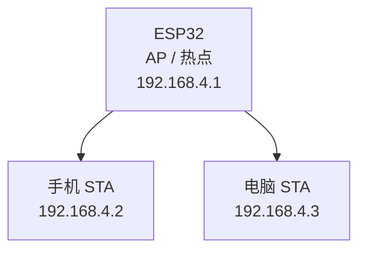

# Wi-Fi AP 模式 — ESP32-S3 创建热点并等待 STA 接入

## 本章重要 API 函数

| API | 功能 | 参数说明 | 头文件 |
|-----|------|----------|--------|
| `nvs_flash_init()` | 初始化 NVS 非易失存储，为 Wi-Fi 驱动提供底层存储支持 | `void`：无参数；返回 `esp_err_t`，`ESP_OK` 表示成功 | `"nvs_flash.h"` |
| `esp_netif_init()` | 初始化网络接口抽象层 | `void`：无参数；返回 `esp_err_t` | `"esp_netif.h"` |
| `esp_event_loop_create_default()` | 创建默认事件循环 | `void`：无参数；返回 `esp_err_t` | `"esp_event.h"` |
| `esp_event_handler_register()` | 注册事件回调函数 | `esp_event_base_t event_base`：事件基类；`int32_t event_id`：事件 ID；`esp_event_handler_t event_handler`：回调函数；`void *event_handler_arg`：用户参数；返回 `esp_err_t` | `"esp_event.h"` |
| `esp_netif_create_default_wifi_ap()` | 创建默认 AP 网络接口实例 | `void`：无参数；返回 `esp_netif_t *` 指针 | `"esp_wifi.h"` |
| `esp_wifi_init()` | 初始化 Wi-Fi 驱动 | `const wifi_init_config_t *config`：Wi-Fi 初始化配置结构体指针；返回 `esp_err_t` | `"esp_wifi.h"` |
| `esp_wifi_set_mode()` | 设置 Wi-Fi 工作模式 | `wifi_mode_t mode`：如 `WIFI_MODE_AP`；返回 `esp_err_t` | `"esp_wifi.h"` |
| `esp_wifi_set_config()` | 设置 Wi-Fi 接口参数 | `wifi_interface_t interface`：接口类型；`wifi_config_t *conf`：Wi-Fi 配置结构体指针；返回 `esp_err_t` | `"esp_wifi.h"` |
| `esp_wifi_start()` | 启动 Wi-Fi 驱动 | `void`：无参数；返回 `esp_err_t` | `"esp_wifi.h"` |

## 本章目录

> 点击条目可跳转到对应小节。

### 章节导航

- **[本章重要 API 函数](#本章重要-api-函数)**
- **[学习前后依赖](#学习前后依赖)**
- **[1. 概述](#1-概述)**
- **[2. 本章目录结构](#2-本章目录结构)**
- **[3. 软件架构传递树](#3-软件架构传递树)**
  - [3.1 模块调用关系](#31-模块调用关系)
  - [3.2 AP 模式事件流](#32-ap-模式事件流)
- **[4. 代码讲解](#4-代码讲解)**
  - [4.1 `main/main.c` — 程序入口](#41-main/mainc-—-程序入口)
  - [4.2 `components/WIFIAP/wifiap.h` — 热点账号配置](#42-components/wifiap/wifiaph-—-热点账号配置)
  - [4.3 `components/WIFIAP/wifiap.c` — AP 模式初始化与事件处理](#43-components/wifiap/wifiapc-—-ap-模式初始化与事件处理)
  - [4.4 为什么 AP 模式不需要 `esp_wifi_connect()`](#44-为什么-ap-模式不需要-esp_wifi_connect)
  - [4.5 为什么 AP 模式通常没有 `IP_EVENT_STA_GOT_IP`](#45-为什么-ap-模式通常没有-ip_event_sta_got_ip)
- **[5. 时序流程图](#5-时序流程图)**
  - [5.1 从上电到热点建立的完整流程](#51-从上电到热点建立的完整流程)
  - [5.2 STA 接入与断开的时序](#52-sta-接入与断开的时序)
- **[6. AP 模式的本质](#6-ap-模式的本质)**
- **[7. STA 与 AP 两章的对照理解](#7-sta-与-ap-两章的对照理解)**
- **[容易踩坑](#容易踩坑)**
- **[8. 本章小结](#8-本章小结)**
- **[Tips](#tips)**

---

## 学习前后依赖

| 方向 | 内容 |
|------|------|
| 前置基础 | `0-1_under_Loop_stu/wifi_notes.md` 中的 AP/STA/STA+AP 概念、星型拓扑、DHCP 基础；以及 `20_WIFI_STA` 中 STA 模式的最小联网框架 |
| 本章核心 | 掌握 ESP-IDF 中 AP 模式的最小工程框架：`NVS → esp_netif → event loop → AP netif → Wi-Fi init → AP config → start`，并理解 STA 接入事件的来源 |
| 后续承接 | 为配网页面、离线控制、局域网 WebServer、ESP32 作为热点管理终端等应用打基础 |

---

## 1. 概述

本章项目 `22_WIFI_AP` 是一个 **ESP32-S3 以 AP（Access Point）模式创建热点** 的最小演示工程。

程序启动后会完成三件事：

1. 初始化 NVS；
2. 初始化 LCD；
3. 初始化 Wi-Fi AP 模式，创建一个名为 `ESP32S3-AP` 的热点，并在 LCD 上显示热点名称、密码以及是否有 STA 设备接入。

这个工程的核心目标不是让 ESP32 去连接别人的路由器，而是让 **ESP32 自己变成热点/接入点的角色**。手机、电脑等外部设备将作为 STA 来连接它。

---

## 2. 本章目录结构

本项目与 AP 模式相关的核心文件如下：

```text
22_WIFI_AP/
├── main/
│   └── main.c                     // 应用入口
├── components/
│   ├── WIFIAP/
│   │   ├── wifiap.c               // AP 初始化与事件回调
│   │   └── wifiap.h               // 热点 SSID / 密码宏与接口声明
│   ├── LCD/
│   │   ├── lcd.c                  // LCD 驱动
│   │   └── lcd.h
│   ├── SPI/
│   │   ├── spi.c                  // LCD 底层 SPI
│   │   └── spi.h
│   └── LED/
│       ├── led.c
│       └── led.h
└── notes.md                       // 本章笔记
```

本章真正决定热点行为的代码集中在：

- `main.c`
- `wifiap.c`
- `wifiap.h`

LCD 模块只负责把热点信息和接入状态显示出来。

---

## 3. 软件架构传递树

### 3.1 模块调用关系

```text
app_main()                                      [main/main.c]
  ├── nvs_flash_init()                          [ESP-IDF: nvs_flash]
  │     └── 初始化 NVS 分区
  │
  ├── lcd_init()                                [components/LCD/lcd.c]
  │     └── 初始化 LCD 显示屏
  │
  ├── wifiap_init()                             [components/WIFIAP/wifiap.c]
  │     ├── esp_netif_init()                    初始化网络接口层
  │     ├── esp_event_loop_create_default()     创建默认事件循环
  │     ├── esp_event_handler_register()        注册 Wi-Fi 事件回调
  │     ├── esp_netif_create_default_wifi_ap()  创建默认 AP 网络接口
  │     ├── esp_wifi_init()                     初始化 Wi-Fi 驱动
  │     ├── esp_wifi_set_mode(WIFI_MODE_AP)     设为 AP 模式
  │     ├── esp_wifi_set_config()               配置热点名称/密码/认证方式
  │     ├── esp_wifi_start()                    启动热点
  │     └── lcd_show_string()                   显示热点 ID / PWD / STA 状态
  │
  └── while(1)
        └── vTaskDelay(500)                     主任务空转等待事件
```

这个结构和 `20_WIFI_STA` 很像，但有两个关键区别：

1. `STA` 需要主动 `connect()` 去连路由器；
2. `AP` 只需要 `start()` 打开热点，等待别人来连。

### 3.2 AP 模式事件流

```text
esp_wifi_start()
   │
   ▼
热点开始广播 SSID: ESP32S3-AP
   │
   ├── LCD 第一行显示热点名称
   ├── LCD 第二行显示热点密码
   └── LCD 第三行预留 STA 状态显示
          │
          ▼
外部 STA（手机/电脑）搜索并连接热点
          │
          ▼
WIFI_EVENT_AP_STACONNECTED
          │
          └── LCD 第三行显示 "connected"

外部 STA 断开时：

WIFI_EVENT_AP_STADISCONNECTED
          │
          └── LCD 第三行显示 "disconnected"
```

注意，这里感知到的是：

- **谁连上了我的热点**；
- **谁又离开了我的热点**；

而不是"我连上了谁"。这是 AP 模式和 STA 模式在事件语义上的根本差异。

---

## 4. 代码讲解

### 4.1 `main/main.c` — 程序入口

`main.c` 如下：

```c
void app_main(void)
{
    nvs_flash_init();
    lcd_init();
    wifiap_init();
    while (1)
    {
        vTaskDelay(500);
    }
}
```

执行顺序与上一章 STA 模式保持一致：

| 步骤 | 代码 | 作用 |
|------|------|------|
| 1 | `nvs_flash_init();` | 初始化 NVS，为 Wi-Fi 驱动提供底层参数存储支持 |
| 2 | `lcd_init();` | 初始化 LCD，确保后续可以立刻显示热点信息 |
| 3 | `wifiap_init();` | 初始化 AP 模式，创建热点并显示 SSID / 密码 |
| 4 | `while(1) { vTaskDelay(500); }` | 主任务不轮询热点连接状态，后续由事件回调处理 |

这说明 AP 模式和 STA 模式一样，都采用 **初始化 + 事件驱动** 的工程结构，而不是在 `while(1)` 里不断轮询 Wi-Fi 状态。

### 4.2 `components/WIFIAP/wifiap.h` — 热点账号配置

`wifiap.h` 内容很简单：

```c
#define DEFAULT_SSID "your_ssid"
#define DEFAULT_PWD  "your_password"

void wifiap_init(void);
```

这表示当前工程创建的热点参数是固定写死的：

- 热点名称：`ESP32S3-AP`
- 热点密码：`qwer123456`

这种写法用于教学示例非常直接，优点是上电即可看到效果。

但它也有局限：

- 无法运行时动态改热点名称；
- 密码写在源码中，不适合正式产品；
- 一旦需要用户自定义配网，就必须改成 NVS、网页配置或串口配置。

### 4.3 `components/WIFIAP/wifiap.c` — AP 模式初始化与事件处理

`wifiap.c` 可分为两部分：

1. **Wi-Fi 事件回调函数**
2. **AP 初始化函数**

#### 4.3.1 事件回调函数

```c
void wifista_event_handler(void* event_handler_arg,
                           esp_event_base_t event_base,
                           int32_t event_id,
                           void* event_data)
```

虽然函数名写成了 `wifista_event_handler`，但它实际处理的是 **AP 模式事件**。这说明这个名字是从上一章 STA 工程沿用过来的，命名上不够准确，但不影响运行逻辑。

如果从代码可读性角度出发，更合理的名字应该是：

```c
wifiap_event_handler()
```

当前函数主要处理两类事件：

- `WIFI_EVENT_AP_STACONNECTED`
- `WIFI_EVENT_AP_STADISCONNECTED`

#### 4.3.2 `WIFI_EVENT_AP_STACONNECTED`

```c
if(event_id == WIFI_EVENT_AP_STACONNECTED)
{
    lcd_show_string(3,5,"connected   ",YELLOW,BLACK);
}
```

含义：有一个外部设备（STA）成功连上了 ESP32 创建的热点。

例如：

- 手机连接 `ESP32S3-AP`
- 笔记本连接 `ESP32S3-AP`

一旦认证与关联成功，就会触发这个事件。

LCD 上第三行会显示：

```text
STA: connected
```

这里显示的是"是否有设备连到我"，而不是"我是否连到了别的网络"。

#### 4.3.3 `WIFI_EVENT_AP_STADISCONNECTED`

```c
else if(event_id == WIFI_EVENT_AP_STADISCONNECTED)
{
    lcd_show_string(3,5,"disconnected",YELLOW,BLACK);
}
```

含义：之前连接到热点的某个 STA 设备已经断开。

可能的原因包括：

- 手机手动断开热点；
- 设备离开信号范围；
- STA 关闭 Wi-Fi；
- 认证失败或超时。

LCD 会显示：

```text
STA: disconnected
```

这里项目没有统计"有多少个设备接入"，只做了最简单的状态显示。因此如果支持多个客户端同时连接，这个显示逻辑不能准确表达人数，只能表示"最近一次事件是接入还是断开"。

#### 4.3.4 `wifiap_init()` 初始化流程

`wifiap_init()` 是整个热点模式的核心入口：

```c
void wifiap_init(void)
{
    esp_netif_init();
    esp_event_loop_create_default();
    esp_event_handler_register(WIFI_EVENT,ESP_EVENT_ANY_ID,&wifista_event_handler,NULL);
    esp_netif_create_default_wifi_ap();

    wifi_init_config_t cfg = WIFI_INIT_CONFIG_DEFAULT();
    esp_wifi_init(&cfg);

    esp_wifi_set_mode(WIFI_MODE_AP);

    wifi_config_t wifiap_config = {
        .ap = {
            .ssid = DEFAULT_SSID,
            .ssid_len = strlen(DEFAULT_SSID),
            .password = DEFAULT_PWD,
            .max_connection = 2,
            .authmode = WIFI_AUTH_WPA_WPA2_PSK,
        }
    };
    esp_wifi_set_config(ESP_IF_WIFI_AP, &wifiap_config);

    esp_wifi_start();

    lcd_show_string(1,1,"ID:",GREEN,BLACK);
    lcd_show_string(1,4,DEFAULT_SSID,YELLOW,BLACK);
    lcd_show_string(2,1,"PWD:",GREEN,BLACK);
    lcd_show_string(2,5,DEFAULT_PWD,YELLOW,BLACK);
    lcd_show_string(3,1,"STA:",GREEN,BLACK);
}
```

可以拆成 6 步来理解。

##### 第 1 步：初始化网络接口层

```c
esp_netif_init();
```

作用与 STA 模式相同，都是初始化 `esp_netif` 抽象层。

虽然 AP 模式不需要去申请外部网络的 IP，但它依然需要创建一个网络接口对象，用于承载 AP 侧的 TCP/IP 能力和 DHCP Server 等功能。

##### 第 2 步：创建默认事件循环并注册 Wi-Fi 事件回调

```c
esp_event_loop_create_default();
esp_event_handler_register(WIFI_EVENT,ESP_EVENT_ANY_ID,&wifista_event_handler,NULL);
```

这一步建立 ESP-IDF 的统一事件系统，并让 Wi-Fi 相关事件交给回调函数处理。

这里没有注册 `IP_EVENT_STA_GOT_IP`，因为当前工程不是 STA 模式，不需要等待自己从路由器获取 IP。

##### 第 3 步：创建默认 AP 网络接口

```c
esp_netif_create_default_wifi_ap();
```

这一句和 STA 工程的：

```c
esp_netif_create_default_wifi_sta();
```

是一一对应的。

区别在于：

- `wifi_sta` 表示自己作为客户端；
- `wifi_ap` 表示自己作为热点端。

AP 接口通常会自动带一个默认地址，例如：

```text
192.168.4.1
```

之后连接到这个热点的手机、电脑，会从 ESP32 内部 DHCP Server 获取类似：

```text
192.168.4.2
192.168.4.3
```

这样的地址。

##### 第 4 步：初始化 Wi-Fi 驱动并切换到 AP 模式

```c
wifi_init_config_t cfg = WIFI_INIT_CONFIG_DEFAULT();
esp_wifi_init(&cfg);

esp_wifi_set_mode(WIFI_MODE_AP);
```

这与 STA 模式的写法一致，但模式不同：

- STA：`WIFI_MODE_STA`
- AP：`WIFI_MODE_AP`

此时 ESP32 的角色从"客户端"变成了"热点提供者"。

##### 第 5 步：配置热点参数

```c
wifi_config_t wifiap_config = {
    .ap = {
        .ssid = DEFAULT_SSID,
        .ssid_len = strlen(DEFAULT_SSID),
        .password = DEFAULT_PWD,
        .max_connection = 2,
        .authmode = WIFI_AUTH_WPA_WPA2_PSK,
    }
};
```

这是 AP 模式的关键配置块，各字段含义如下：

| 字段 | 值 | 含义 |
|------|----|------|
| `.ssid` | `DEFAULT_SSID` | 热点名称 |
| `.ssid_len` | `strlen(DEFAULT_SSID)` | 热点名称长度 |
| `.password` | `DEFAULT_PWD` | 热点密码 |
| `.max_connection` | `2` | 最多允许 2 个 STA 同时接入 |
| `.authmode` | `WIFI_AUTH_WPA_WPA2_PSK` | 热点认证方式，支持 WPA/WPA2 预共享密钥 |

这里最值得注意的是 `max_connection = 2`。这表示即使更多设备看到了热点，也只有前两个客户端能成功接入。

然后通过：

```c
esp_wifi_set_config(ESP_IF_WIFI_AP, &wifiap_config);
```

把配置应用到 AP 接口。

##### 第 6 步：启动热点并显示信息

```c
esp_wifi_start();
```

启动后，ESP32 开始：

- 广播 SSID；
- 等待外部 STA 扫描到它；
- 接受客户端认证、关联请求；
- 为客户端提供局域网接入。

代码紧接着在 LCD 上显示热点信息：

```c
lcd_show_string(1,1,"ID:",GREEN,BLACK);
lcd_show_string(1,4,DEFAULT_SSID,YELLOW,BLACK);
lcd_show_string(2,1,"PWD:",GREEN,BLACK);
lcd_show_string(2,5,DEFAULT_PWD,YELLOW,BLACK);
lcd_show_string(3,1,"STA:",GREEN,BLACK);
```

LCD 最终效果大致如下：

```text
ID:  ESP32S3-AP
PWD: qwer123456
STA: connected / disconnected
```

也就是说，这个项目不显示 AP 自己的 IP，也不显示客户端 IP，只是把"怎么连我"和"有没有人连我"这两类信息展示出来。

### 4.4 为什么 AP 模式不需要 `esp_wifi_connect()`

这是 AP 模式与 STA 模式最直观的差别。

在 STA 模式中：

- 自己是客户端；
- 要主动去找路由器；
- 要主动发起连接；
- 因此必须调用 `esp_wifi_connect()`。

在 AP 模式中：

- 自己是热点；
- 自己负责广播 SSID；
- 等别人来连；
- 所以只要 `esp_wifi_start()` 就够了。

可以简单类比为：

```text
STA 模式：我去别人家敲门
AP 模式：我把自己家门打开，等别人来
```

因此，AP 模式没有"主动连接"这个动作，也就不需要 `esp_wifi_connect()`。

### 4.5 为什么 AP 模式通常没有 `IP_EVENT_STA_GOT_IP`

STA 模式里，ESP32 作为客户端，要从路由器的 DHCP Server 获取 IP，因此会触发：

```text
IP_EVENT_STA_GOT_IP
```

而 AP 模式下，ESP32 自己就是热点端，通常拥有一个固定的默认地址（如 `192.168.4.1`），并在内部运行 DHCP Server 给接入的客户端分配地址。

所以本工程的重点不再是：

- 我有没有拿到 IP

而变成了：

- 有没有客户端连到我
- 客户端有没有断开

因此，这里监听的是：

- `WIFI_EVENT_AP_STACONNECTED`
- `WIFI_EVENT_AP_STADISCONNECTED`

而不是 `IP_EVENT_STA_GOT_IP`。

---

## 5. 时序流程图

### 5.1 从上电到热点建立的完整流程

```text
app_main()
   │
   ├── nvs_flash_init()
   │
   ├── lcd_init()
   │
   ├── wifiap_init()
   │     │
   │     ├── esp_netif_init()
   │     ├── esp_event_loop_create_default()
   │     ├── 注册 Wi-Fi 事件回调
   │     ├── esp_netif_create_default_wifi_ap()
   │     ├── esp_wifi_init()
   │     ├── esp_wifi_set_mode(WIFI_MODE_AP)
   │     ├── esp_wifi_set_config()
   │     └── esp_wifi_start()
   │             │
   │             ▼
   │        ESP32 开始广播热点 SSID
   │             │
   │             ├── LCD 显示 ID
   │             ├── LCD 显示 PWD
   │             └── LCD 显示 STA 标题
   │
   └── while(1)
         └── vTaskDelay(500)
```

### 5.2 STA 接入与断开的时序

```text
外部手机 / 电脑                            ESP32-AP
      │                                      │
      │ 扫描到 SSID: ESP32S3-AP              │
      │────────────────────────────────────► │
      │                                      │
      │ 输入密码并发起连接                    │
      │────────────────────────────────────► │
      │                                      │
      │ 认证 + 关联成功                       │
      │                                      │
      │◄──────── WIFI_EVENT_AP_STACONNECTED ─│
      │                                      │
      │                            LCD 显示 connected
      │                                      │
      │ 后续如果手动断开或离开覆盖范围         │
      │────────────────────────────────────► │
      │                                      │
      │◄────── WIFI_EVENT_AP_STADISCONNECTED ─│
      │                                      │
      │                         LCD 显示 disconnected
```

---

## 6. AP 模式的本质

从网络角色来看，本章 ESP32 扮演的是：

```text
Access Point（接入点）
```

这意味着：

- 它不再是去连接别人的终端；
- 它自己变成了局域网中心；
- 手机、电脑、平板作为 STA 来连接它。

典型拓扑如下：



这和上一章 STA 模式完全相反：

- 上一章：ESP32 是叶子节点；
- 这一章：ESP32 是中心节点。

因此 AP 模式更适合：

- 设备首次配网；
- 无路由器环境下的离线控制；
- 局域网网页配置；
- ESP32 作为局域网服务提供者。

---

## 7. STA 与 AP 两章的对照理解

`20_WIFI_STA` 和 `22_WIFI_AP` 两章最好放在一起理解。

| 维度 | `20_WIFI_STA` | `22_WIFI_AP` |
|------|---------------|--------------|
| 角色 | 客户端 | 热点 / 接入点 |
| 工作模式 | `WIFI_MODE_STA` | `WIFI_MODE_AP` |
| 网络行为 | 主动连别人 | 等别人来连 |
| 关键动作 | `esp_wifi_connect()` | `esp_wifi_start()` |
| 关注事件 | `STA_START / CONNECTED / GOT_IP / DISCONNECTED` | `AP_STACONNECTED / AP_STADISCONNECTED` |
| IP 来源 | 路由器 DHCP 分配 | 自身默认 AP 地址 + 内部 DHCP Server 给客户端分配 |
| LCD 显示内容 | 连接状态 + 自己的 IP | 热点名 + 密码 + 客户端接入状态 |

可以用一句话概括它们：

```text
STA：我去连路由器
AP ：我当路由器，让别人连我
```

---

## 容易踩坑

| 现象 | 常见原因 | 排查方向 |
|------|----------|----------|
| 热点搜不到 | 没有调用 `esp_wifi_start()`，或 AP 模式未正确设置 | 检查 `esp_wifi_set_mode(WIFI_MODE_AP)` 和 `esp_wifi_start()` 是否执行 |
| 手机能搜到热点但连不上 | 密码长度不符合要求，或认证方式与密码不匹配 | WPA/WPA2 密码通常至少 8 位；确认 `authmode` 与密码配置匹配 |
| 代码里名字是 `wifiap`，回调却叫 `wifista_event_handler` | 命名沿用了 STA 示例，语义不清 | 不影响功能，但正式项目应统一改名，避免后续维护误判 |
| 多个设备接入后 LCD 状态不准确 | 代码只显示最近一次接入/断开事件，没有统计在线人数 | 若要精确显示，应维护一个 STA 计数变量 |
| 只显示 connected/disconnected，看不到是谁连接了 | 当前示例没有解析 `event_data` 中的 STA MAC 信息 | 若要显示客户端 MAC，需要在事件回调中解析 `wifi_event_ap_staconnected_t` / `wifi_event_ap_stadisconnected_t` |
| 热点密码泄露 | 密码直接显示在 LCD 且写死在源码中 | 教学示例可接受，正式产品应谨慎处理或仅显示部分信息 |
| AP 模式下误以为能直接访问互联网 | AP 只是热点，不自动具备上游外网连接 | 若需要既能上网又能开热点，应使用 `STA+AP` 模式 |
| 忘记初始化 NVS 导致 Wi-Fi 异常 | Wi-Fi 驱动依赖底层参数存储 | 和 STA 一样，`nvs_flash_init()` 仍然必须在前面调用 |

---

## 8. 本章小结

本章的本质是把 ESP32 从一个"无线客户端"切换成一个"无线接入点"。

整个工程的最小骨架可以浓缩成：

```text
NVS 初始化
   ↓
网络接口初始化
   ↓
事件循环建立
   ↓
创建默认 AP 接口
   ↓
Wi-Fi 设为 AP 模式
   ↓
写入 SSID / 密码 / 最大连接数 / 认证方式
   ↓
启动热点
   ↓
等待外部 STA 接入
   ↓
在事件回调中显示 connected / disconnected
```

本章学会之后，你就掌握了 ESP32 作为热点端的最小工程模板。后续如果要做：

- 手机连接 ESP32 配网页面
- ESP32 本地 Web 配置页面
- 无路由器的离线局域网控制
- 热点模式下的 TCP / HTTP 服务

它们的地基都是本章这个 AP 初始化框架。

---

## Tips

### 本章最易忽视的细节

1. **AP 模式下 ESP32 自带 DHCP Server**：`esp_netif_create_default_wifi_ap()` 不仅创建了网络接口，还在内部启动了一个 DHCP Server。这意味着手机连上热点后会自动获得 IP（默认是从 `192.168.4.2` 开始的地址池），不需要你写任何 DHCP 相关代码。
2. **`ssid_len` 不是可选的**：很多教程只写 `.ssid = "ESP32S3-AP"` 而不写 `.ssid_len`，这在某些情况下会导致手机搜不到热点。因为 Wi-Fi 协议允许 SSID 中包含 `\0` 字符，如果不指定长度，ESP-IDF 会用 `strlen()` 计算——如果你的 SSID 恰好需要包含 `\0`（极少见），就会出问题。所以显式写 `strlen(DEFAULT_SSID)` 是最安全的做法。
3. **`max_connection` 受限于 ESP32 的资源**：ESP32-S3 默认最多支持 10 个 STA 同时连接（由 `CONFIG_ESP_WIFI_SOFTAP_SUPPORT` 和内存决定），但你配置的值不能超过硬件上限。如果设成 `max_connection = 100`，实际只能连上硬件支持的最大数量。
4. **AP 模式下 Wi-Fi 信道很重要**：默认 AP 信道通常是 1。如果你的环境中信道 1 已经很拥挤（周围 Wi-Fi 很多），可以显式设置 `.channel` 字段。信道选择会影响连接稳定性——这往往是"连得上但经常掉线"的元凶。

### 踩坑记录

- **STA 连上 AP 但没有 IP**：虽然 ESP32 AP 自带 DHCP Server，但如果手机端 Wi-Fi 设置中禁用了 DHCP（设为静态 IP 但配置错误），就会出现"已连接但无网络"的情况。排查方向是在手机端检查是否获取到了 `192.168.4.x` 地址。
- **AP 启动后 ESP32 自己无法访问外网**：这是设计如此——AP 模式下的 ESP32 是一个独立的局域网，不经过路由器。如果需要同时上网，必须使用 `WIFI_MODE_APSTA`（STA+AP 混合模式），让 STA 接口连接路由器、AP 接口同时提供热点。
- **热点密码少于 8 位导致手机拒绝连接**：WPA/WPA2 规范要求密码至少 8 位。如果你的密码只有 6 位，Android/iOS 会提示"密码错误"或直接拒绝连接。这不是 ESP32 的问题，而是客户端的安全策略。

### 与 STA 模式的逐项深度对比

上文第 7 节已有一张概要对比表，这里从架构层面补充更深层的差异：

| 维度 | STA 模式 | AP 模式 | 设计原因 |
|------|----------|---------|----------|
| **启动后的第一件事** | 等 `STA_START` 事件，然后调 `esp_wifi_connect()` | 调 `esp_wifi_start()` 即可，不需要等待特定事件 | STA 需要"驱动就绪"才能扫描/连接，AP 启动即开始广播 |
| **IP 地址来源** | 从外部 DHCP Server 动态获取（如路由器） | 固定默认地址 `192.168.4.1`，内部 DHCP Server 分配给客户端 | AP 是网络的"根"，必须自己有一个固定地址 |
| **DNS 解析** | 由路由器 DNS 提供，或需手动配置 | 默认无上游 DNS，客户端无法通过 AP 访问外网域名 | AP 只提供局域网连接，不提供互联网接入 |
| **事件回调关注的 event_base** | `WIFI_EVENT` + `IP_EVENT` | 主要是 `WIFI_EVENT`（`AP_STACONNECTED` 等） | AP 不需要"自己拿到 IP"这个事件 |
| **`event_data` 类型** | `WIFI_EVENT` 的事件数据是 `wifi_event_sta_connected_t` 等；`IP_EVENT` 的是 `esp_netif_ip_info_t` | `WIFI_EVENT_AP_STACONNECTED` 的 `event_data` 是 `wifi_event_ap_staconnected_t`（含 MAC 地址） | 数据内容反映了角色关注点不同 |
| **初始化代码量** | 多一步注册 `IP_EVENT` 回调 | 少一步注册 `IP_EVENT`，但多一个 `.ap` 配置块 | STA 多关心网络层，AP 多关心链路层接入参数 |
| **安全性关注点** | 保护自己的 Wi-Fi 密码不被泄露（写死在源码的问题） | 保护热点密码 + 控制最大连接数，防止未授权设备接入 | AP 是被连接方，需要做接入控制 |

### 为什么 AP 不需要 `esp_wifi_connect()`——从协议栈视角看

这个问题在第 4.4 节已经用类比解释过了。从协议栈视角深入看：

```
STA 模式的协议栈动作序列：
  扫描 → 发现 AP → 认证请求 → 关联请求 → DHCP 请求 → 获得 IP

AP 模式的协议栈动作序列：
  启动 → 开始广播 Beacon → 等待 Probe Request → 
  响应 Probe Response → 处理认证请求 → 处理关联请求 →
  内部 DHCP Server 分配 IP
```

关键差异在第一步：STA 是"主动发起扫描"，AP 是"被动等待扫描"。

`esp_wifi_connect()` 实际上触发了"扫描 → 认证 → 关联"这一整条 STA 侧的信令链。而 AP 侧没有对等的 API——因为 AP 侧的"认证"和"关联"处理已经内置在 Wi-Fi 驱动中，外部 STA 发来的请求会自动触发相应的处理逻辑，并产生 `WIFI_EVENT_AP_STACONNECTED` 事件。

换句话说：
- `esp_wifi_connect()` = 客户端主动发起连接流程
- `esp_wifi_start()`（AP 模式）= 服务器开始监听，连接流程由客户端驱动

这就是为什么 `esp_wifi_connect()` 只在 STA 模式有意义——它是"客户端发起连接"的 API，而 AP 是"服务器响应连接"的角色。

### 与后续章节的知识衔接

- **STA+AP 混合模式**：如果要同时上网和提供热点（比如做 Wi-Fi 中继器），需要 `WIFI_MODE_APSTA`。此时会同时有 `esp_netif_create_default_wifi_sta()` 和 `esp_netif_create_default_wifi_ap()` 两个接口，STA 接口负责连接上游路由器，AP 接口负责给下游设备提供热点。
- **WebServer 配网**：常见的"手机连 ESP32 热点 → 打开网页 → 输入路由器密码 → ESP32 重启并连接路由器"的配网流程，前半段（手机连热点 + 网页）依赖本章的 AP 框架，后半段（连接路由器）依赖 STA 章节。
- **NTP 校时**：AP 模式下的 ESP32 因为没有互联网连接，不能直接 NTP 校时。如果需要在离线环境下提供准确时间，要么用外部 RTC 模块，要么用 STA+AP 模式让 STA 接口去同步时间。

### 设计决策思考：AP 模式下 beacon 间隔的选择

AP 模式下有一个容易被忽略的参数：beacon 间隔。默认值是 100ms，意味着 ESP32 每 100ms 发送一次 beacon 帧。

这影响两个东西：
1. **功耗**：beacon 越频繁，Wi-Fi 射频工作时间越长，功耗越高。如果你的设备是电池供电，可以把 beacon 间隔调到 300ms 甚至 500ms。
2. **STA 发现速度**：beacon 越稀疏，手机扫到热点的速度越慢。100ms 间隔大约 1-3 秒能被扫到，500ms 间隔可能需要 5-10 秒。

如果你需要在 `esp_wifi_set_config()` 中自定义 beacon 间隔，可以配置 `.ap.beacon_interval` 字段（单位是 TU，1 TU = 1024 微秒，所以 100ms ≈ 97 TU）。

对于大多数物联网应用，默认 100ms 是一个很好的平衡点。
