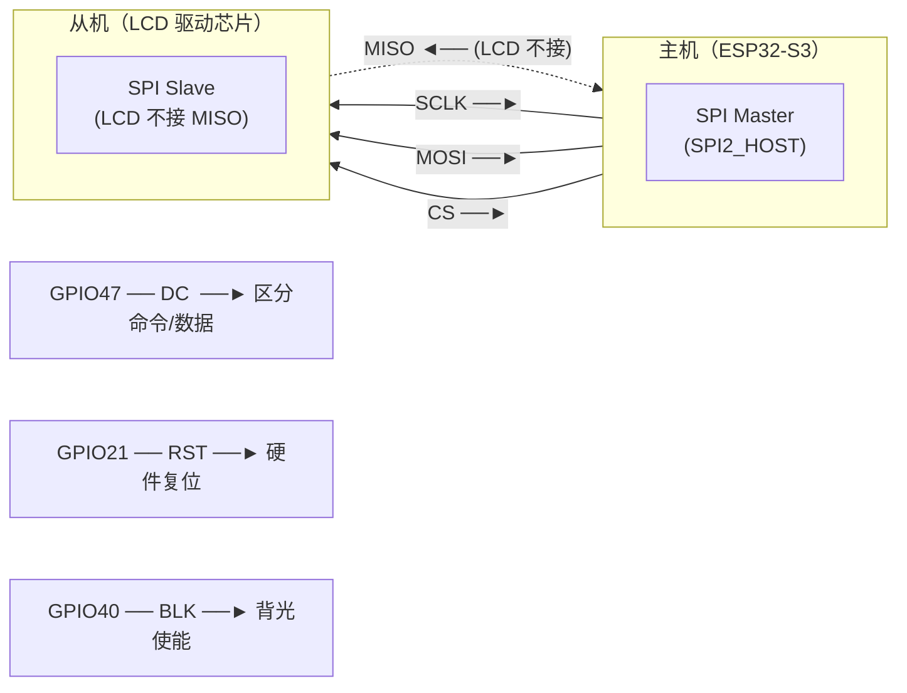
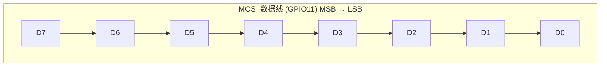
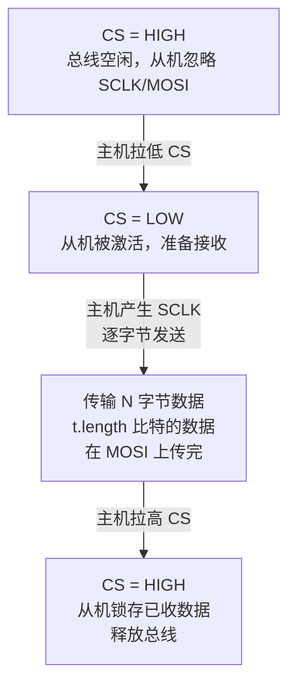
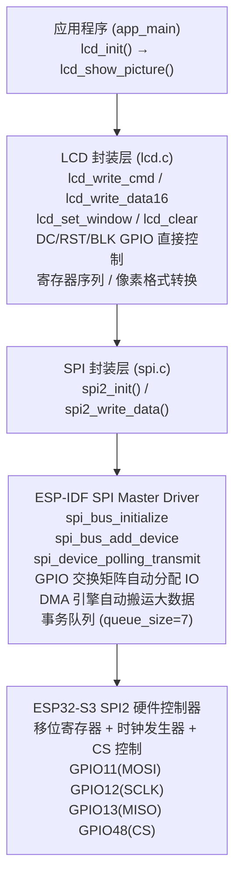
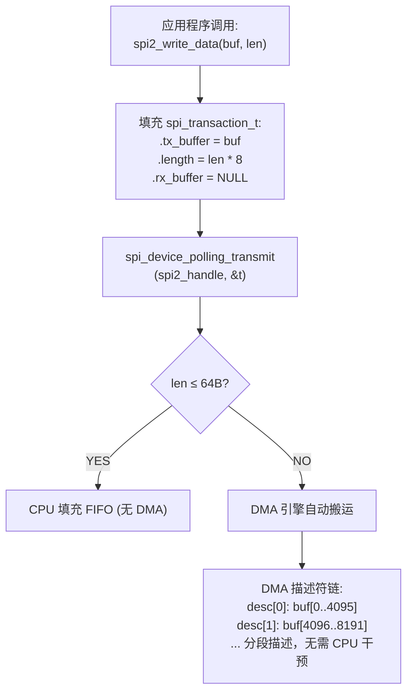
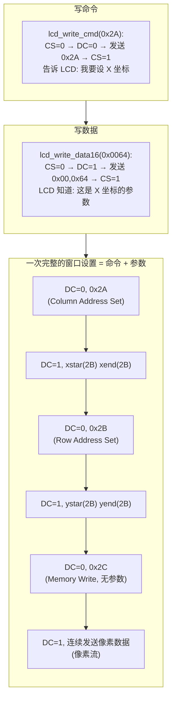
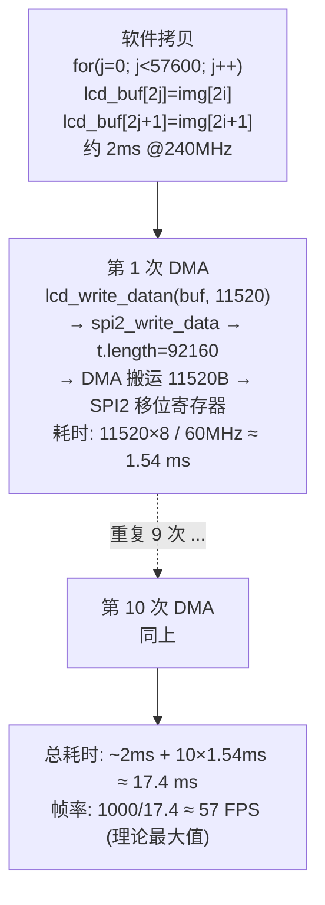

# ESP32-S3 SPI 通信与 LCD 驱动

## 本章重要 API 函数

### ESP-IDF SPI 主机驱动 API

| API                             | 功能                       | 参数说明                                                                                                                                                                     | 头文件                     |
| ------------------------------- | ------------------------ | ------------------------------------------------------------------------------------------------------------------------------------------------------------------------ | ----------------------- |
| `spi_bus_initialize()`          | 初始化 SPI 总线，配置 IO 复用和 DMA | `spi_host_device_t host_id`：SPI 外设编号（SPI2_HOST/SPI3_HOST）<br>`const spi_bus_config_t *bus`：总线配置结构体（IO 引脚、DMA、标志位）<br>返回 `esp_err_t`：ESP_OK 成功，ESP_ERR_INVALID_ARG 参数错误   | `"driver/spi_master.h"` |
| `spi_bus_add_device()`          | 向总线添加 SPI 设备，返回设备句柄      | `spi_host_device_t host_id`：SPI 外设编号<br>`const spi_device_interface_config_t *dev`：设备配置（时钟、模式、队列深度）<br>`spi_device_handle_t *handle`：输出设备句柄<br>返回 `esp_err_t`            | `"driver/spi_master.h"` |
| `spi_device_polling_transmit()` | 轮询方式发送 SPI 事务（阻塞）        | `spi_device_handle_t handle`：设备句柄<br>`spi_transaction_t *trans`：事务描述符（含 tx_buffer、length、rx_buffer）<br>返回 `esp_err_t`                                                    | `"driver/spi_master.h"` |
| `spi_transaction_t`             | SPI 事务描述符结构体             | `.length`：传输总长度（单位 bit，必须为 8 的倍数）<br>`.tx_buffer`：发送缓冲区指针（为 NULL 时填 0）<br>`.rx_buffer`：接收缓冲区指针（为 NULL 时丢弃）<br>`.flags`：SPI_TRANS_* 标志位                                   | `"driver/spi_master.h"` |
| `spi_bus_config_t`              | SPI 总线配置结构体              | `.mosi_io_num`：MOSI 数据输出引脚<br>`.miso_io_num`：MISO 数据输入引脚（不用设 -1）<br>`.sclk_io_num`：SCLK 时钟引脚<br>`.max_transfer_sz`：DMA 单次最大传输字节数<br>`.flags`：SPICOMMON_BUSFLAG_MASTER 等  | `"driver/spi_master.h"` |
| `spi_device_interface_config_t` | SPI 设备接口配置结构体            | `.clock_speed_hz`：SPI 时钟频率（Hz），最高 80MHz<br>`.mode`：SPI 模式 0~3（CPOL+CPHA）<br>`.queue_size`：事务队列深度<br>`.spics_io_num`：硬件 CS 引脚（软件 CS 设 -1）<br>`.clock_source`：时钟源（默认 XTAL） | `"driver/spi_master.h"` |

### 项目封装 SPI 驱动 API

| API                 | 功能                    | 参数说明                                                                                                | 头文件       |
| ------------------- | --------------------- | --------------------------------------------------------------------------------------------------- | --------- |
| `spi2_init()`       | 初始化 SPI2 总线并注册 LCD 设备 | `void`：无参数，内部配置 MOSI=GPIO11、SCLK=GPIO12、MISO=GPIO13、CS=GPIO48、60MHz、Mode 0、开启 DMA                   | `"spi.h"` |
| `spi2_write_data()` | 向 SPI 设备发送数据块（纯写）     | `uint8_t *data`：发送数据指针<br>`uint32_t len`：发送字节数（≤ 115200）<br>无返回值，内部调用 `spi_device_polling_transmit` | `"spi.h"` |

### 项目封装 LCD 驱动 API

| API | 功能 | 参数说明 | 头文件 |
|-----|------|----------|--------|
| `lcd_init()` | 初始化 LCD：配置控制 GPIO → 硬件复位 → 寄存器序列 → 清屏白色 | `void`：无参数 | `"lcd.h"` |
| `lcd_write_cmd()` | 发送 LCD 命令字节 | `uint8_t cmd`：命令码（如 0x11=Sleep Out, 0x29=Display On, 0x2C=Memory Write） | `"lcd.h"`（内部函数） |
| `lcd_write_data()` | 发送 LCD 单字节数据 | `uint8_t data`：数据字节 | `"lcd.h"`（内部函数） |
| `lcd_write_data16()` | 发送 LCD 双字节数据（高字节在前） | `uint16_t data`：16 位数据值 | `"lcd.h"`（内部函数） |
| `lcd_write_datan()` | 批量发送 LCD 数据 | `uint8_t *data`：数据缓冲区指针<br>`uint16_t length`：发送字节数 | `"lcd.h"`（内部函数） |
| `lcd_set_window()` | 设置 LCD 矩形绘图窗口 | `uint16_t xstar`：起始 X 坐标<br>`uint16_t ystar`：起始 Y 坐标<br>`uint16_t xend`：结束 X 坐标<br>`uint16_t yend`：结束 Y 坐标 | `"lcd.h"`（内部函数） |
| `lcd_show_dot()` | 在固定位置画一个像素点 | `uint16_t color`：RGB565 颜色值 | `"lcd.h"` |
| `lcd_show_line()` | 画一条 100 像素的水平色块 | `uint16_t color`：RGB565 颜色值 | `"lcd.h"` |
| `lcd_clear()` | 全屏填充单色 | `uint16_t color`：RGB565 颜色值 | `"lcd.h"` |
| `lcd_show_picture()` | 显示 240×240 RGB565 位图 | `uint8_t *img`：图片数据指针（115200 字节） | `"lcd.h"` |

---

## 本章目录

> 点击条目可跳转到对应小节。

### 章节导航

- **[学习前后依赖](#学习前后依赖)**
- **[一、SPI 通信原理](#一spi-通信原理)**
  - [1.1 SPI 总线物理结构](#11-spi-总线物理结构)
  - [1.2 SPI 四种工作模式（CPOL + CPHA）](#12-spi-四种工作模式cpol-+-cpha)
  - [1.3 SPI 数据帧与时序](#13-spi-数据帧与时序)
  - [1.4 ESP32-S3 SPI 硬件架构](#14-esp32-s3-spi-硬件架构)
  - [1.5 SPI 与 I2C 的对比](#15-spi-与-i2c-的对比)
- **[二、SPI LCD 驱动芯片与命令](#二spi-lcd-驱动芯片与命令)**
  - [2.1 LCD 引脚定义与控制信号](#21-lcd-引脚定义与控制信号)
  - [2.2 LCD 命令行协议](#22-lcd-命令行协议)
  - [2.3 初始化序列详解](#23-初始化序列详解)
- **[三、软件架构传递树](#三软件架构传递树)**
- **[四、代码详细解析](#四代码详细解析)**
  - [4.1 SPI 驱动层 - spi2_init()](#41-spi-驱动层---spi2_init)
  - [4.2 SPI 驱动层 - spi2_write_data()](#42-spi-驱动层---spi2_write_data)
  - [4.3 LCD 驱动层 - GPIO 配置与硬复位](#43-lcd-驱动层---gpio-配置与硬复位)
  - [4.4 LCD 驱动层 - 写命令与写数据的区别](#44-lcd-驱动层---写命令与写数据的区别)
  - [4.5 LCD 驱动层 - 窗口设置](#45-lcd-驱动层---窗口设置)
  - [4.6 LCD 驱动层 - 清屏与图片显示](#46-lcd-驱动层---清屏与图片显示)
  - [4.7 主程序入口](#47-主程序入口)
- **[五、完整通信时序图](#五完整通信时序图)**
  - [5.1 LCD 初始化全程时序](#51-lcd-初始化全程时序)
  - [5.2 图片帧发送时序](#52-图片帧发送时序)
- **[容易踩坑](#容易踩坑)**
- **[六、本章小结](#六本章小结)**
- **[Tips](#tips)**
  - [四线制的每一根线都在干什么](#四线制的每一根线都在干什么)
  - [CPOL/CPHA 四种模式的设计哲学](#cpol/cpha-四种模式的设计哲学)
  - [SPI vs I2C——并非谁更好、而是谁更适合](#spi-vs-i2c——并非谁更好而是谁更适合)
  - [踩坑实录](#踩坑实录)
  - [知识衔接](#知识衔接)

---

## 学习前后依赖

| 方向   | 内容                                                                                                                                                                                      |
| ---- | --------------------------------------------------------------------------------------------------------------------------------------------------------------------------------------- |
| 前置基础 | GPIO 输出配置（01_LED）、GPIO 输入/开漏/推挽概念（04_Key_board）、I2C 通信协议与主从时序理解（14_IICBH1750）、轮询/中断/DMA 三种传输模式的区分（0-1_under_Loop_stu #10 章）                                                             |
| 本章核心 | SPI 四线串行通信原理与 Mode 0~3 时钟极性和相位、ESP32-S3 SPI 主机驱动架构（总线→设备→事务→DMA）、GPIO 交换矩阵自动分配 MOSI/SCLK/CS、SPI LCD 的命令/数据双通道协议（DC 引脚切换）、ST7789-like 初始化序列寄存器分析、RGB565 像素编码与 240×240 帧数据组织、DMA 分段批量传输策略 |
| 后续承接 | ESP-IDF `lvgl` 图形库（LVGL 底层通过 SPI 驱动 LCD）、双缓冲同步渲染（避免撕裂）、SPI Flash/NOR 存储芯片驱动、SPI 从机模式（双 MCU 通信）、QSPI Octal 高速模式                                                                          |

---

## 一、SPI 通信原理

### 1.1 SPI 总线物理结构

SPI（Serial Peripheral Interface）是一种**全双工、同步、主从架构**的串行通信总线，由 Motorola 发明。典型的 4 线制 SPI 定义如下：

#### 总览图：四线 SPI 拓扑



#### 信号线说明

| 信号 | 方向 | 作用 | 本章引脚 |
|------|------|------|----------|
| **SCLK** (Serial Clock) | 主机→从机 | 同步时钟，所有数据传输的节拍器 | GPIO12 |
| **MOSI** (Master Out Slave In) | 主机→从机 | 主机发送数据的主通道 | GPIO11 |
| **MISO** (Master In Slave Out) | 从机→主机 | 从机回复数据（LCD 不读故不接） | GPIO13（预留） |
| **CS** (Chip Select) | 主机→从机 | 低电平选中从机，多设备时区分目标 | GPIO48 |
| **DC** (Data/Command) | 主机→从机 | **LCD 特有**：0=命令，1=数据 | GPIO47 |
| **RST** (Reset) | 主机→从机 | 硬件复位 LCD 驱动芯片 | GPIO21 |
| **BLK** (Backlight) | 主机→从机 | 背光开关控制 | GPIO40 |

#### 局部图：MOSI 上的数据流



**CS 信号的作用：** 主机拉低 CS → 开始与选中的从机通信 → 发送数据 → 拉高 CS 释放总线。多个 SPI 从机挂在同一组 SCLK/MOSI/MISO 上，依靠各自的 CS 线区分。

### 1.2 SPI 四种工作模式（CPOL + CPHA）

SPI 定义了 **CPOL**（Clock Polarity，时钟极性）和 **CPHA**（Clock Phase，时钟相位）两个参数：

- **CPOL = 0**：SCLK 空闲时为低电平
- **CPOL = 1**：SCLK 空闲时为高电平
- **CPHA = 0**：在第 1 个时钟边沿采样数据
- **CPHA = 1**：在第 2 个时钟边沿采样数据

#### 时序图：四种模式对比（以 1 字节为例）

```
  Mode 0 (CPOL=0, CPHA=0) — 本章使用:
  SCLK 空闲低，上升沿采样
        ┌─┐ ┌─┐ ┌─┐ ┌─┐ ┌─┐ ┌─┐ ┌─┐ ┌─┐
  SCLK ─┘ └─┘ └─┘ └─┘ └─┘ └─┘ └─┘ └─┘ └──
        ↑  ↑  ↑  ↑  ↑  ↑  ↑  ↑   ← 采样点（上升沿）
  MOSI ──D7──D6──D5──D4──D3──D2──D1──D0───  主机在下降沿换数据
        ← 主机在 SCLK 下降沿切换数据 →

  Mode 2 (CPOL=1, CPHA=0):
        ┌─┐ ┌─┐ ┌─┐ ┌─┐ ┌─┐ ┌─┐ ┌─┐ ┌─┐
  SCLK ┘ └─┘ └─┘ └─┘ └─┘ └─┘ └─┘ └─┘ └─┘──
        ↑                         ← 下降沿采样
```

#### 对照表

| SPI Mode | CPOL | CPHA | 空闲 SCLK | 采样边沿 | 数据切换边沿 |
|----------|------|------|-----------|----------|-------------|
| **Mode 0** | 0 | 0 | 低 | 上升沿 | 下降沿 |
| Mode 1 | 0 | 1 | 低 | 下降沿 | 上升沿 |
| Mode 2 | 1 | 0 | 高 | 下降沿 | 上升沿 |
| Mode 3 | 1 | 1 | 高 | 上升沿 | 下降沿 |

> 本章 LCD 使用 **Mode 0**：`.mode = 0`，时钟空闲为低，在 SCLK 上升沿锁存数据。这是大多数 SPI 外设的默认选择。

### 1.3 SPI 数据帧与时序

SPI 没有固定的帧格式——没有起始位、停止位、校验位。**唯一的规则就是 SCLK**：主机每产生一个时钟脉冲，总线上就有一位数据被传输。

#### 状态图：一次完整 SPI 事务



**关键认识：** SPI 的"帧"由 CS 的下降沿和上升沿界定。一次 CS↓→CS↑ 就是一帧。帧内可以发送任意字节数——1 字节的命令、2 字节的坐标、11520 字节的像素数据，都由 `t.length` 和 `t.tx_buffer` 控制。

### 1.4 ESP32-S3 SPI 硬件架构

ESP32-S3 内部集成了 **4 个 SPI 外设**：

| SPI 外设 | 用途 | 本章使用 |
|----------|------|----------|
| SPI0 | 内部 Flash 访问（用户不可用） | — |
| SPI1 | 内部 PSRAM 访问（用户不可用） | — |
| **SPI2** | 通用 SPI，又称 HSPI | ✓ 连接 LCD |
| SPI3 | 通用 SPI，又称 VSPI | 预留扩展 |

#### 总览图：ESP32-S3 SPI 驱动分层



#### 局部图：事务描述符与 DMA 协作



### 1.5 SPI 与 I2C 的对比

| 维度     | SPI                          | I2C                    |
| ------ | ---------------------------- | ---------------------- |
| 信号线数   | 4 线（SCLK + MOSI + MISO + CS） | 2 线（SCL + SDA）         |
| 通信模式   | 全双工（同时收发）                    | 半双工（分时收发）              |
| 时钟速度   | **60 MHz**（本章）~ 80 MHz       | 100 kHz ~ 400 kHz（标准）  |
| 从机寻址   | 硬件 CS 线（每从机一根线）              | 软件地址（7/10 位地址字节）       |
| 帧格式    | **无固定帧**，CS 界定               | START → 地址 → 数据 → STOP |
| ACK 机制 | 无（一发到底，不确认）                  | 每字节后 1 位 ACK/NACK      |
| 多从机扩展  | 每加一个从机，多拉一根 CS 线             | 理论上 127 个（同总线）         |
| 距离     | 极短（PCB 级，厘米）                 | 短距离（板间，数十厘米）           |

> **本章用 SPI 而不用 I2C 的原因：** LCD 需要高速刷屏。240×240×2 = 115200 字节/帧，I2C 400kHz 需要约 2.3 秒一帧，SPI 60MHz 只需要约 15ms。差 150 倍。

---

## 二、SPI LCD 驱动芯片与命令

### 2.1 LCD 引脚定义与控制信号

本章 LCD 模块的控制引脚（在 `lcd.h` 中通过宏定义）：

| 宏定义 | GPIO | 功能 | 含义 |
|--------|------|------|------|
| `LCD_RST(x)` | GPIO21 | Reset 复位 | 0 = 复位，1 = 正常运行 |
| `LCD_DC(x)` | GPIO47 | Data/Command | 0 = 命令，1 = 数据 |
| `LCD_CS(x)` | GPIO48 | Chip Select | 0 = 选中（SPI 硬件自动控制） |
| `LCD_BLK(x)` | GPIO40 | Backlight | 1 = 开背光，0 = 关背光 |

> **注意区分 CS 和 DC：** CS 是 SPI 标准的片选信号（在 SPI 设备配置中通过 `.spics_io_num = GPIO_NUM_48` 设置，由 ESP-IDF 驱动自动控制）；DC 是 LCD 特有的命令/数据选择线，由 LCD 驱动层代码手动控制（`LCD_DC(0)` 写命令，`LCD_DC(1)` 写数据）。两者不能混淆。

### 2.2 LCD 命令行协议

SPI LCD 使用一种**双通道协议**——同一根 MOSI 线上，通过 DC 引脚的高低电平区分：

- **DC = 0（Command mode）：** MOSI 上的字节被解释为**命令码**
- **DC = 1（Data mode）：** MOSI 上的字节被解释为**命令参数或像素数据**

#### 状态图：命令与数据的交替



### 2.3 初始化序列详解

`lcd_init()` 中的寄存器初始化序列来自 LCD 驱动芯片的数据手册（ST7789 或兼容芯片）。按功能分类如下：

#### 总览图：初始化序列分类

```
  硬件复位
  ├─ Sleep Out (0x11)       ← 退出睡眠，延时 120ms
  ├─ Porch 时序 (0xB2)      ← 前后肩参数
  ├─ VCOM 控制 (0xBB)       ← VCOM 偏置电压
  ├─ 帧率 (0xC6)            ← 帧频 = 60Hz
  ├─ 伽马校正 (0xE0, 0xE1)  ← 正/负极伽马曲线
  ├─ 颜色格式 (0x3A)        ← 16 位 (RGB565)
  ├─ 内存访问控制 (0x36)    ← 扫描方向
  ├─ Display Inversion On (0x21)
  ├─ Display On (0x29)
  └─ Memory Write (0x2C)    ← 准备接收像素数据
```

#### 关键寄存器详解

**0x3A（Interface Pixel Format）— 像素格式**
```
  lcd_write_cmd(0x3A);
  lcd_write_data(0x05);   // 0x05 = 16 bits/pixel（RGB565）
  
  取值含义:
  0x05 → RGB565 (16bpp): RRRRRGGGGGGBBBBB
  0x06 → RGB666 (18bpp): 每通道 6 位
  0x03 → 12bpp
```

**0x36（Memory Data Access Control）— 扫描方向**
```
  lcd_write_cmd(0x36);
  lcd_write_data(0x70);
  
  0x70 = 0b_0111_0000:
  ┌─ MY = 1: 行地址自上而下递增
  ├─ MX = 1: 列地址自左向右递增
  ├─ MV = 1: 行列交换（横屏/竖屏切换）
  └─ BGR = 0: RGB 顺序（非 BGR）
```

**0xB2（Porch Control）— 前后肩时序**
```
  定义显示区域外围的空白像素行/列（类似 CRT 的消隐期）。
  5 个参数: 0x0C,0x0C,0x00,0x33,0x33
  分别控制: 前肩行数、后肩行数、前肩列数、后肩列数
```

**0xE0 / 0xE1（Gamma Correction）— 伽马校正**
```
  0xE0: 正极性伽马曲线（14 字节）
  0xE1: 负极性伽马曲线（14 字节）
  
  LCD 用交流驱动防止液晶极化，正负极性各有一套调色曲线。
  每条曲线 14 个可编程电压节点 (PRP1~PRP14, PRN1~PRN14)，
  控制从 0% 到 100% 亮度的非线性映射关系。
```

---

## 三、软件架构传递树

```
  main.c
  │
  ├─ app_main()
  │   ├─ lcd_init()                    // [lcd.c]
  │   │   ├─ spi2_init()              // [spi.c]
  │   │   │   ├─ spi_bus_initialize(SPI2_HOST, &spibus, SPI_DMA_CH_AUTO)
  │   │   │   │   └─ 配置: MOSI=11, MISO=13, SCLK=12
  │   │   │   │            max_transfer_sz = 115200
  │   │   │   │            DMA 自动分配通道
  │   │   │   └─ spi_bus_add_device(SPI2_HOST, &spidev, &spi2_handle)
  │   │   │       └─ 配置: 60MHz, Mode 0, CS=48, queue=7
  │   │   │
  │   │   ├─ gpio_config(&...)  ×3      // GPIO21(RST), GPIO47(DC), GPIO40(BLK)
  │   │   │
  │   │   ├─ lcd_hard_reset()           // RST 拉低 100ms → 拉高 100ms
  │   │   │
  │   │   ├─ lcd_on()                   // BLK=1, 开背光
  │   │   │
  │   │   ├─ 寄存器初始化序列:
  │   │   │   ├─ lcd_write_cmd(0x11)    → Sleep Out
  │   │   │   ├─ lcd_write_cmd(0xB2) + 5×data → Porch
  │   │   │   ├─ ... (共 26 组命令)
  │   │   │   └─ lcd_write_cmd(0x2C)    → Memory Write
  │   │   │
  │   │   └─ lcd_clear(WHITE)           // 全屏刷白
  │   │       └─ lcd_set_window(0,0,239,239)
  │   │       └─ lcd_write_datan(lcd_buf, 11520) × 10 次
  │   │           └─ spi2_write_data(buf, len)  [spi.c]
  │   │               └─ spi_device_polling_transmit(handle, &t)
  │   │                   └─ ESP-IDF → DMA 引擎 → SPI2 硬件
  │   │
  │   └─ lcd_show_picture(gImage_image)
  │       └─ lcd_set_window(0,0,239,239)
  │       └─ 数据重组: 将 uint8 数组按 RGB565 组装到 lcd_buf
  │       └─ lcd_write_datan(lcd_buf, 11520) × 10 次
  │           └─ spi2_write_data(...) → DMA → SPI2
  │
  ├─ components/ (CMakeLists.txt)
  │   ├─ SPI/    ← spi.c + spi.h
  │   ├─ LCD/    ← lcd.c + lcd.h
  │   └─ LED/    ← led.c + led.h（本章未实际使用 LED 功能）
  │
  └─ main/CMakeLists.txt → main.c
```

**调用关系总结：**

```
  app_main() → lcd_init() → spi2_init() + 寄存器序列
            → lcd_show_picture() → lcd_set_window() + lcd_write_datan()
  
  所有 LCD 写操作最终汇聚到:
    lcd_write_cmd() --─┐
    lcd_write_data() -─┤
    lcd_write_data16()─┼──→ spi2_write_data() → spi_device_polling_transmit()
    lcd_write_datan() ─┘
```

---

## 四、代码详细解析

### 4.1 SPI 驱动层 — spi2_init()

源码位置：`components/SPI/spi.c`

```c
void spi2_init(void)
{
    // 第一步: 配置 SPI 总线
    spi_bus_config_t spibus_structure = {
        .flags = SPICOMMON_BUSFLAG_MASTER,    // 主机模式
        .intr_flags = 0,                       // 不使用中断
        .isr_cpu_id = INTR_CPU_ID_AUTO,        // 自动分配 ISR CPU
        .max_transfer_sz = 240*240*2,          // DMA 最大传输 = 115200 字节
        .miso_io_num = GPIO_NUM_13,           // MISO（预留，LCD 不读）
        .mosi_io_num = GPIO_NUM_11,           // MOSI 数据输出
        .quadhd_io_num = -1,                  // 不使用四线模式
        .quadwp_io_num = -1,                  // 不使用四线模式
        .sclk_io_num = GPIO_NUM_12,           // SCLK 时钟
    };
    spi_bus_initialize(SPI2_HOST, &spibus_structure, SPI_DMA_CH_AUTO);

    // 第二步: 注册 LCD 设备
    spi_device_interface_config_t spidevice_structure = {
        .clock_source = SPI_CLK_SRC_DEFAULT,   // 默认时钟源（XTAL）
        .clock_speed_hz = 60000000,           // 60 MHz
        .mode = 0,                            // SPI Mode 0 (CPOL=0, CPHA=0)
        .queue_size = 7,                      // 事务队列深度
        .spics_io_num = GPIO_NUM_48,          // 硬件 CS 引脚
    };
    spi_bus_add_device(SPI2_HOST, &spidevice_structure, &spi2_handle);
}
```

**设计要点：**

1. **为什么用 SPI2 而不是 SPI3？** SPI0/1 被内部 Flash/PSRAM 占用。SPI2(HSPI) 和 SPI3(VSPI) 都可用，这里使用 SPI2。

2. **`max_transfer_sz = 240*240*2 = 115200` 的含义：** 告诉 ESP-IDF 为 DMA 准备足够大的描述符内存。如果设为默认值 4096，一次只能 DMA 搬运 4KB，发送 115200 字节需要约 29 次 DMA 操作，效率低。

3. **`queue_size = 7`：** 事务队列可以预存 7 个 SPI 事务。在使用轮询模式时实际不会用到这个队列，但如果改为中断模式，队列就会发挥作用。

4. **`.mode = 0`：** 对应 CPOL=0, CPHA=0。SCLK 空闲为低，在上升沿锁存数据。这是 LCD 驱动芯片手册规定的模式。

5. **`SPI_DMA_CH_AUTO`：** 自动分配 GDMA 通道，不手动指定。

### 4.2 SPI 驱动层 — spi2_write_data()

```c
void spi2_write_data(uint8_t *data, uint32_t len)
{
    spi_transaction_t t = {0};
    t.length = len * 8;          // bit 总数（例如 11520 × 8 = 92160）
    t.tx_buffer = data;          // 发送缓冲区的指针（不是拷贝！）
    spi_device_polling_transmit(spi2_handle, &t);
}
```

**关键细节：**

- **`t.length` 的单位是 bit**，不是 byte。发送 11520 字节需要 `11520 * 8 = 92160` bit。
- **`t.tx_buffer` 是只读指针**，ESP-IDF 驱动直接从该地址读数据并送入 DMA/移位寄存器，不会拷贝数据。因此调用者必须保证在 `transmit` 返回前缓冲区有效。
- **`spi_device_polling_transmit` 是阻塞调用**——调用后 CPU 会等待 DMA 或 FIFO 传输完成才返回。对于 11520 字节 @60MHz，阻塞时间约 1.5ms。
- LCD 只写不读，所以 `t.rx_buffer` 不设（保持 NULL）。

### 4.3 LCD 驱动层 — GPIO 配置与硬复位

源码位置：`components/LCD/lcd.c`

`lcd_init()` 函数前 3 段分别配置 RST(GPIO21)、DC(GPIO47)、BLK(GPIO40) 为 GPIO 输出模式：

```c
// RST 引脚: 上拉，初始状态高（不复位）
gpio_structure.pin_bit_mask = 1ull << GPIO_NUM_21;
gpio_structure.pull_up_en = GPIO_PULLUP_ENABLE;

// DC 引脚: 上拉，初始状态高（数据模式，虽然还没用）
gpio_structure.pin_bit_mask = 1ull << GPIO_NUM_47;
gpio_structure.pull_up_en = GPIO_PULLUP_ENABLE;

// BLK 引脚: 下拉，初始状态低（默认关背光）
gpio_structure.pin_bit_mask = 1ull << GPIO_NUM_40;
gpio_structure.pull_down_en = GPIO_PULLDOWN_ENABLE;
```

**为什么 RST 上拉、DC 上拉、BLK 下拉？**
- **RST 上拉**：复位是低有效，上拉保证上电时不误复位
- **DC 上拉**：默认数据模式，写命令时下拉
- **BLK 下拉**：上电时关背光防止闪烁，初始化完成后再 `lcd_on()` 开启

硬件复位函数：

```c
void lcd_hard_reset(void)
{
    LCD_RST(0);              // 拉低 RST（复位芯片）
    vTaskDelay(100);         // 保持 100ms
    LCD_RST(1);              // 拉高 RST（释放复位）
    vTaskDelay(100);         // 等待芯片内部 PLL 稳定，100ms
}
```

> **为什么使用 `vTaskDelay(100)` 而不是 `delay(100)`？** 前者是 FreeRTOS 的任务挂起（CPU 可调度其他任务），后者是死循环忙等。养成用 `vTaskDelay` 的习惯是正确的。

### 4.4 LCD 驱动层 — 写命令与写数据的区别

这是 LCD 驱动中最核心的 4 个函数：

```c
// 写命令: DC=0, 发送 1 字节
void lcd_write_cmd(uint8_t cmd)
{
    LCD_DC(0);                       // DC 低 = 命令模式
    spi2_write_data(&cmd, 1);        // 发送 1 字节
}

// 写数据 (8 位): DC=1, 发送 1 字节
void lcd_write_data(uint8_t data)
{
    LCD_DC(1);                       // DC 高 = 数据模式
    spi2_write_data(&data, 1);
}

// 写数据 (16 位): DC=1, 发送 2 字节，高字节在前（大端序）
void lcd_write_data16(uint16_t data)
{
    uint8_t databuf[2] = {0, 0};
    databuf[0] = data >> 8;          // 高字节在前（MSB first = 大端序）
    databuf[1] = data & 0xFF;        // 低字节在后
    LCD_DC(1);
    spi2_write_data(databuf, 2);
}

// 写数据块: DC=1, 发送 N 字节
void lcd_write_datan(uint8_t *data, uint16_t length)
{
    LCD_DC(1);
    spi2_write_data(data, length);   // 一次 SPI 事务发送全部
}
```

**为什么 `write_data16` 要做字节拆分？** ST7789 的 16 位格式是 **RGB565 大端序**：先发高 8 位（R5 + G3），再发低 8 位（G3 + B5）。一个像素 = 2 字节。这个拆分对应硬件要求的字节顺序。

**为什么 `write_datan` 直接传指针？** 批量像素数据用 `spi2_write_data` 一次性发起一次 SPI 事务 + DMA 搬运，比循环调用 `write_data16` 快很多（后者每 2 字节就触发一次 CS↓→CS↑ 和一次函数调用）。

### 4.5 LCD 驱动层 — 窗口设置

```c
void lcd_set_window(uint16_t xstar, uint16_t ystar,
                    uint16_t xend,  uint16_t yend)
{
    lcd_write_cmd(0x2a);          // CASET: Column Address Set
    lcd_write_data16(xstar);      // 起始列
    lcd_write_data16(xend);       // 结束列

    lcd_write_cmd(0x2b);          // RASET: Row Address Set
    lcd_write_data16(ystar);      // 起始行
    lcd_write_data16(yend);       // 结束行

    lcd_write_cmd(0x2c);          // RAMWR: Memory Write
    // 之后所有发来的数据都按从左到右、从上到下的顺序
    // 填充这个窗口区域
}
```

**命令说明：**

| 命令 | 名称 | 作用 |
|------|------|------|
| `0x2A` | CASET | 设定列的起止坐标（X 方向） |
| `0x2B` | RASET | 设定行的起止坐标（Y 方向） |
| `0x2C` | RAMWR | 开始写入显存（GRAM），自动指针递增 |

**GRAM 写入顺序：**

```
  set_window(0, 0, 239, 239) 之后:
  
  Y\X  0        1        2    ...    239
  0   pixel[0] pixel[1] pixel[2] ... pixel[239]
  1   pixel[240] ...               ... pixel[479]
  ... ...
  239                               ... pixel[57599]
  
  写入顺序: 逐行、每行从左到右。
  每个像素 2 字节 (RGB565)，一帧 = 57600 像素 × 2 = 115200 字节。
```

### 4.6 LCD 驱动层 — 清屏与图片显示

**清屏函数 `lcd_clear(color)`：**

```c
void lcd_clear(uint16_t color)
{
    uint8_t data[2] = {0, 0};
    data[0] = color >> 8;
    data[1] = color & 0xFF;
    lcd_set_window(0, 0, 239, 239);   // 全屏窗口

    // 填充 lcd_buf 缓冲区（每 2 字节一个像素）
    for(uint16_t i = 0; i < 240*240/10; i++)  // 57600 / 10 = 5760 次迭代
    {
        lcd_buf[2 * i] = data[0];       // 每 2 字节填一个颜色
        lcd_buf[2 * i + 1] = data[1];
    }
    // 10 次 DMA 传输，每次 11520 字节 = 全屏
    for(uint16_t j = 0; j < 10; j++)
    {
        lcd_write_datan(lcd_buf, 11520);
    }
}
```

**关键设计分析：**

- **为什么分 10 次发送？** `lcd_buf` 是 115200 字节的全局数组。虽然可以把 SPI 事务的 `t.length` 设为 `115200*8 = 921600`，但 DMA 一次传输的数据量受 `max_transfer_sz` 限制。分成 10 次×11520 字节**复用同一个 `lcd_buf` 缓冲区**，节省 RAM。

- **为什么用全局 `lcd_buf` 而不是每次 malloc？** 115200 字节的 `malloc` 可能从 PSRAM 分配，速度慢且碎片化。全局数组编译时就固定在 `.bss` 段，地址已知，没有运行时开销。

**图片显示函数 `lcd_show_picture(img)`：**

```c
void lcd_show_picture(uint8_t *img)
{
    unsigned long i = 0, j = 0;
    lcd_set_window(0, 0, 239, 239);

    // 将 img（uint8数组，每 2 字节 = 1 像素）组装到 lcd_buf
    for (j = 0; j < 240 * 240; j++)
    {
        lcd_buf[2 * j]     = img[2 * i];      // 高字节
        lcd_buf[2 * j + 1] = img[2 * i + 1];  // 低字节
        i++;
    }

    // 分 10 次 DMA 发送
    for(j = 0; j < (240*240*2 / 11520); j++)
    {
        lcd_write_datan(&lcd_buf[j * 11520], 11520);
    }
}
```

> 如果 `img` 本身就是 RGB565 大端序，可以跳过从 `img` 拷贝到 `lcd_buf` 的第一步，直接把 `img` 指针传给 `lcd_write_datan`。

### 4.7 主程序入口

```c
void app_main(void)
{
    lcd_init();                       // 初始化 SPI + LCD
    lcd_show_picture(gImage_image);   // 显示 240×240 图片
    while (1)
    {
        vTaskDelay(500);              // 空闲循环，500ms Tick
    }
}
```

- `gImage_image` 是一个 115200 字节的 `unsigned char` 数组，存于 Flash（`.rodata` 段），包含一张 240×240 RGB565 图片。
- `vTaskDelay(500)` 保证空闲任务不空转，让 FreeRTOS Idle Task 能执行清理工作。

---

## 五、完整通信时序图

### 5.1 LCD 初始化全程时序

```
  ─── 硬件复位 ───
  主机:  RST=0 ─────(100ms)────── RST=1 ─────(100ms)──────
  从机:  (芯片内部复位)          (PLL锁相环启动)
  ──── 寄存器初始化序列 ────
  主机:  0x11  (DC=0) ────(120ms delay)────
  从机:                   (退出 Sleep，启动内部振荡器)
  
  主机:  0xB2 (DC=0) → 0x0C,0x0C,0x00,0x33,0x33 (DC=1)
  从机:                  (配置 Porch 前后肩)
  
  主机:  0x3A (DC=0) → 0x05 (DC=1)
  从机:                  (设为 16bpp RGB565)
  
  主机:  0x36 (DC=0) → 0x70 (DC=1)
  从机:                  (设为 MY=MX=MV=1 / RGB 顺序)
  
  ... (共 26 组命令) ...
  
  主机:  0x21 (DC=0)    ← Display Inversion On
  主机:  0x29 (DC=0)    ← Display On
  主机:  0x2C (DC=0)    ← Memory Write
  
  ──── 清屏（全白）────
  主机:  0x2A (DC=0) → 0x00,0x00, 0x00,0xEF (DC=1)   ← X: 0~239
  主机:  0x2B (DC=0) → 0x00,0x00, 0x00,0xEF (DC=1)   ← Y: 0~239
  主机:  0x2C (DC=0)
  
  主机:  (DC=1) 115200 字节 WHITE 色 ──► 屏幕变白
```

### 5.2 图片帧发送时序



> 实际帧率会低于 57FPS，因为还需要考虑 CS 切换、DMA 描述符准备、中断延时的开销。如需更高帧率，可以改用双缓冲 + 中断通知机制。

---

## 容易踩坑

| 现象 | 常见原因 | 排查方向 |
|------|----------|----------|
| LCD 白屏无显示 | 复位时序异常：`vTaskDelay(100)` 不够、RST 引脚未正确拉低/拉高 | 用示波器测 RST 引脚波形；检查 `LCD_RST(0)` / `LCD_RST(1)` 宏定义中的 GPIO 编号是否与板子实际接线一致 |
| LCD 花屏/颜色错乱 | RGB565 字节序反了（先低后高 vs 先高后低） | 检查 `lcd_write_data16()` 中 `data >> 8` 和 `data & 0xFF` 的顺序 |
| 清屏只清了部分区域 | `lcd_set_window()` 的坐标参数超出范围、或者只调用了一次 `lcd_write_datan` | 确认 `lcd_set_window(0,0,239,239)`；确认循环次数 `j < 10`（115200/11520=10） |
| LCD 显示偏移或镜像 | `0x36` 寄存器配置的 MY/MX/MV 位不对 | 参考 LCD 手册调整 `0x36` 值 |
| `max_transfer_sz` 太小导致显示截断 | DMA 描述符内存不够 | 确保 `max_transfer_sz >= 240*240*2 = 115200` |
| 图片颜色发红/发蓝 | 图片取模时 RGB 顺序选错 | 检查取模工具的 RGB565 输出顺序是否为大端序；0x36 的 BGR 位是否为 0 |

---

## 六、本章小结

| 维度 | 应掌握内容 |
|------|-----------|
| **SPI 原理** | 四线制（SCLK/MOSI/MISO/CS）全双工同步通信；CPOL+CPHA 四种模式；Mode 0 是最常见的选择 |
| **ESP-IDF SPI 驱动** | 总线初始化（`spi_bus_initialize`）→ 设备注册（`spi_bus_add_device`）→ 事务发送（`spi_device_polling_transmit`）三步走；事务描述符的 `.length` 是 bit 单位 |
| **LCD 驱动** | DC 线区分命令/数据；`0x2A/0x2B/0x2C` 窗口设置三步曲；RGB565 大端序 2 字节/像素 |
| **DMA 使用** | `max_transfer_sz` 决定 DMA 缓冲区大小；启用 `SPI_DMA_CH_AUTO` 让 ESP-IDF 自动管理 |
| **软件架构** | SPI 封装层（总线+设备句柄）→ LCD 封装层（命令/数据/寄存器序列）→ 应用层（初始化+刷新） |
| **性能** | SPI 60MHz 的理论帧率约 57FPS；瓶颈在 CPU 准备像素数据而非 SPI 带宽 |

### SPI 对比 I2C — 何时用哪个？

| 场景 | 推荐 |
|------|------|
| 高速刷屏 / 大量数据传输 | **SPI** |
| 多个传感器挂在同一总线 | **I2C**（节省 IO 引脚） |
| PCB 板级短距离 | **SPI** |
| 需要 ACK 确认的可靠通信 | **I2C** |
| 主从双向频繁交互 | **SPI**（全双工） |

### 进阶方向

学完本章后应能自主实现：
- 使用 `spi_device_queue_trans` + `spi_device_get_trans_result` 实现**中断驱动异步 SPI**
- 添加**字库+中文显示**（结合 07_LCDDisplay 章节的字模算法）
- 实现**双缓冲帧切换**，消除 DMA 写入期间的屏幕撕裂
- 将 SPI LCD 驱动接入 **LVGL 图形库**，实现按钮、图表等高级 UI

---

## Tips

### 四线制的每一根线都在干什么

SPI 的四根线分工非常清晰，理解各自角色就不会混淆：

```
SCLK（时钟线）:  主机产生的方波信号。从机根据 SCLK 的边沿
                判断"什么时候该读数据、什么时候该放数据"。
                没有 SCLK，从机完全不知道该干什么。

MOSI（主机出）:  主机向从机发送数据的单向通道。
                本章 LCD 场景下几乎所有数据都走 MOSI。

MISO（主机入）:  从机向主机发送数据的单向通道。
                本章 LCD 不读回数据，MISO 闲置。
                但如果接的是 SD 卡或 SPI Flash，MISO 用来读回数据。

CS（片选）:     低电平有效。主机拉低某个 CS 引脚，
                对应的从机就知道"轮到我了"。
                多个从机共享 SCLK/MOSI/MISO，
                靠各自的 CS 线区分。这是 SPI 的寻址机制。
```

**一个常见误解**：SPI 是全双工，所以"任何时候 MOSI 和 MISO 都在同时传输"。实际上——如果你只想写（LCD 场景），MISO 上的数据会被忽略。全双工是硬件能力，不是强制要求。

### CPOL/CPHA 四种模式的设计哲学

为什么 SPI 需要四种模式？难道不能统一用一种吗？

**答案：历史兼容性。** SPI 没有统一的国际标准（不像 I2C 有 NXP 规范文档），不同芯片厂商设计了不同的时序习惯。SPI 四种模式就是为了兼容这些差异。

```text
Mode 0 (CPOL=0, CPHA=0) — 最常用:
  "时钟平常低，一变高就采样"
  大多数 Flash、LCD、传感器用 Mode 0

Mode 3 (CPOL=1, CPHA=1) — 第二常用:
  "时钟平常高，一变高就采样"（与 Mode 0 镜像）
  某些 ADC 和 DAC 用 Mode 3

Mode 1 和 Mode 2 — 少数外设:
  采样时机滞后半个周期
  极少数老芯片用
```

**如何确定用哪种模式？** 看从机芯片的数据手册。找不到就用 Mode 0 试——90% 的设备兼容 Mode 0。如果通信失败（数据错乱或全 0/全 1），再依次试 Mode 1/2/3。

**CS 和 CPOL/CPHA 的关系**：CS 拉低后，从机才开始关注 SCLK。Mode 0 下，从机期望看到 SCLK 在 CS 拉低时刻是低电平，然后第一个上升沿开始采样。所以 CPOL 描述的是"无通信时 SCLK 的电平"，这个电平也应该是 CS 拉低瞬间的电平。

### SPI vs I2C——并非谁更好、而是谁更适合

不是在"SPI 和 I2C 之间选一个"，而是"根据约束条件选择"：

| 你的约束是什么 | 选 SPI | 选 I2C |
|-------------|--------|--------|
| IO 引脚紧张（只剩 2 根） | ❌ 至少 4 根 | ✅ 只要 2 根 |
| 需要高速传输（MHz 级） | ✅ 可达 80 MHz | ❌ 最高 400 kHz |
| 挂很多设备（>5 个） | ❌ 每个设备独占一根 CS | ✅ 一条总线挂 127 个 |
| 需要可靠确认（ACK） | ❌ 无 ACK 机制 | ✅ 每字节 ACK/NACK |
| 收发同时进行 | ✅ 全双工 | ❌ 半双工 |
| 设备距离 > 10cm | ❌ 信号衰减严重 | ✅ 差分 RS485 可达 1km |

**本章的设计智慧**：LCD 需要 SPI（速度），BH1750 需要 I2C（引脚少 + 有 ACK）。两个协议在同一个项目中并存，是合理的工程决策。

### 踩坑实录

1. **MISO 引脚悬空产生假数据**：LCD 不接 MISO，但 SPI 总线上如果 MISO 引脚悬空，电磁干扰可能让主机误以为收到了数据。解决：MISO 接 GND，或在 `spi_bus_config_t` 中设 `.miso_io_num = -1`。

2. **DMA 和 PSRAM 的缓存一致性问题**：ESP32-S3 的 PSRAM 通过 Cache 访问。如果 DMA 直接写 PSRAM，CPU 读到的可能是 Cache 中的旧数据。使用 `CAMERA_FB_IN_PSRAM` 类型的缓冲区时，需要在 DMA 写入后调用 `esp_cache_msync()` 刷新缓存。

3. **`max_transfer_sz` 不是越大越好**：这个值直接影响 SPI 驱动预分配的 DMA 描述符数量。`max_transfer_sz = 115200` 在内部 RAM 中分配约 1KB 的描述符内存。正常情况下无需调大。

### 知识衔接

- **上一章**：[02_IIC](02_IIC.md)——I2C 用地址字节寻址，SPI 用 CS 引脚寻址。两者的"寻址哲学"完全不同：I2C 是"软件地址"（所有人监听），SPI 是"硬件片选"（被选中才监听）。
- **下一章**：[04_SPITF_SD卡](04_SPITF_SD卡.md)——SD 卡也通过 SPI 访问，但用 FATFS 文件系统把块设备抽象成文件。LCD 和 SD 卡可以共享同一组 SPI2 引脚，靠各自的 CS 分时切换。这是 SPI 总线最优雅的设计模式。
