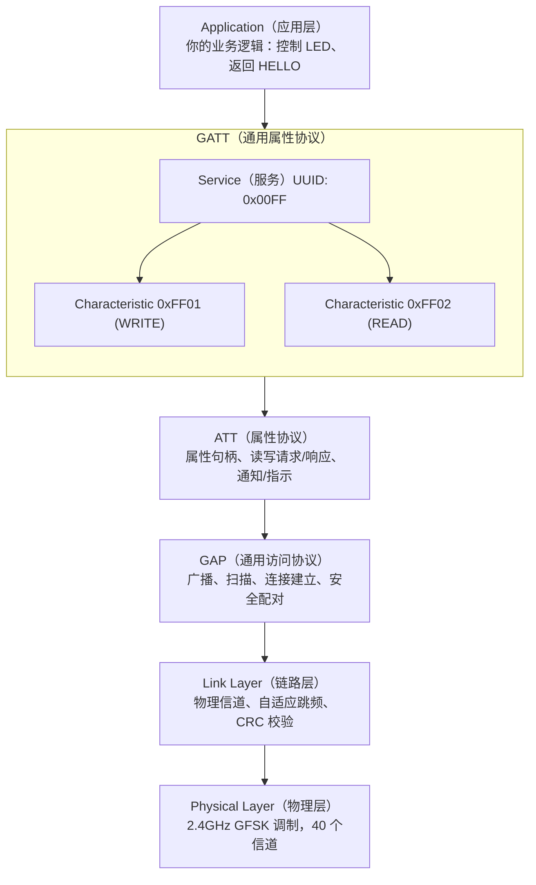

# BLE 与 NimBLE GATT 服务 — ESP32-S3 被手机连接并控制 LED

## 本章重要 API 函数

| API | 功能 | 参数说明 | 头文件 |
|-----|------|----------|--------|
| `nvs_flash_init()` | 初始化 NVS，为 BLE 控制器/协议栈提供底层参数存储 | `void`：无参数；返回 `esp_err_t` | `"nvs_flash.h"` |
| `nimble_port_init()` | 初始化 NimBLE Host 协议栈 | `void`：无参数 | `"nimble/nimble_port.h"` |
| `ble_svc_gap_init()` | 初始化 GAP 标准服务 | `void`：无参数 | `"services/gap/ble_svc_gap.h"` |
| `ble_svc_gatt_init()` | 初始化 GATT 标准服务 | `void`：无参数 | `"services/gatt/ble_svc_gatt.h"` |
| `ble_svc_gap_device_name_set()` | 设置 BLE 设备名 | `const char *name`：设备名称；返回 `int` | `"services/gap/ble_svc_gap.h"` |
| `ble_gatts_count_cfg()` | 统计 GATT 服务表所需资源 | `const struct ble_gatt_svc_def *svcs`：服务表指针；返回 `int` | `"host/ble_gatt.h"` |
| `ble_gatts_add_svcs()` | 注册 GATT 服务表 | `const struct ble_gatt_svc_def *svcs`：服务表指针；返回 `int` | `"host/ble_gatt.h"` |
| `ble_gap_adv_set_fields()` | 设置广播包内容 | `struct ble_hs_adv_fields *adv_fields`：广播字段结构体；返回 `int` | `"host/ble_gap.h"` |
| `ble_gap_adv_start()` | 启动 BLE 广播 | `own_addr_type`、`peer_addr`、`duration_ms`、`adv_params`、`cb`、`cb_arg`：广播参数；返回 `int` | `"host/ble_gap.h"` |
| `nimble_port_freertos_init()` | 创建 NimBLE FreeRTOS 任务 | `void (*host_task_fn)(void *)`：主机任务入口 | `"nimble/nimble_port_freertos.h"` |

## 本章目录

> 点击条目可跳转到对应小节。

### 章节导航

- **[本章重要 API 函数](#本章重要-api-函数)**
- **[学习前后依赖](#学习前后依赖)**
- **[1. 概述](#1-概述)**
- **[2. 本章目录结构](#2-本章目录结构)**
- **[3. BLE 基本角色与本工程定位](#3-ble-基本角色与本工程定位)**
- **[4. 软件架构传递树](#4-软件架构传递树)**
  - [4.1 模块调用关系](#41-模块调用关系)
  - [4.2 广播、连接、GATT 访问流程](#42-广播连接gatt-访问流程)
- **[5. 代码讲解](#5-代码讲解)**
  - [5.1 `main/main.c` — BLE 工程入口](#51-main/mainc-—-ble-工程入口)
  - [5.2 `components/MYBLE/myble.c` — NimBLE 主逻辑](#52-components/myble/myblec-—-nimble-主逻辑)
  - [5.3 GATT 服务表设计](#53-gatt-服务表设计)
  - [5.4 写特征值为什么能控制 LED](#54-写特征值为什么能控制-led)
  - [5.5 读特征值为什么会返回 `HELLO`](#55-读特征值为什么会返回-hello)
- **[6. 时序流程图](#6-时序流程图)**
  - [6.1 上电到广播启动](#61-上电到广播启动)
  - [6.2 手机连接并控制 LED 的流程](#62-手机连接并控制-led-的流程)
- **[7. GAP 与 GATT 的分工](#7-gap-与-gatt-的分工)**
- **[容易踩坑](#容易踩坑)**
- **[8. 本章小结](#8-本章小结)**
- **[Tips](#tips)**

---

## 学习前后依赖

| 方向 | 内容 |
|------|------|
| 前置基础 | GPIO/LED 控制、FreeRTOS 基础、事件回调思想 |
| 本章核心 | 掌握 ESP32-S3 基于 NimBLE 创建 BLE 外设、配置广播、注册自定义 GATT 服务、响应手机读写请求的完整流程 |
| 后续承接 | 可扩展到 BLE 透传、BLE 配网、手机 App 控制设备、BLE 传感器数据上报等项目 |

---

## 1. 概述

本章项目 `24_BLE` 是一个 **ESP32-S3 基于 NimBLE 协议栈创建 BLE 外设（Peripheral），等待手机连接，并通过 GATT 特征值读写实现 LED 控制** 的示例工程。

这个工程完成了三件事：

1. **广播**：让手机能扫描到设备 `ESP32S3-NimBLE`；
2. **建服务**：创建自定义 GATT 服务和两个特征值；
3. **交互**：手机写入数据控制 LED，读取数据得到字符串 `HELLO`。

它是一个很典型的 BLE 入门骨架。

---

## 2. 本章目录结构

```text
24_BLE/
├── main/
│   └── main.c                     // 入口：NVS + LED + BLE 初始化
├── components/
│   ├── MYBLE/
│   │   ├── myble.c                // NimBLE 主逻辑
│   │   └── myble.h
│   └── LED/
│       ├── led.c                  // LED GPIO 初始化
│       └── led.h
└── notes.md
```

最核心的文件是：

- `main.c`
- `myble.c`
- `myble.h`

---

## 3. BLE 基本角色与本工程定位

BLE 设备通常分两类角色：

| 角色 | 含义 | 典型设备 |
|------|------|----------|
| **Peripheral** | 外设，负责广播、等待连接 | 手环、传感器、ESP32 |
| **Central** | 中心设备，负责扫描、连接外设 | 手机、平板、电脑 |

本工程中：

- **ESP32-S3 是 Peripheral**
- **手机是 Central**

通信方式是：

```text
手机扫描到 ESP32 广播
   ↓
手机连接 ESP32
   ↓
手机读写 GATT 特征值
   ↓
ESP32 回调中处理数据
```

---

## 4. 软件架构传递树

### 4.1 模块调用关系

```text
app_main()                                      [main/main.c]
  ├── nvs_flash_init()                          初始化 NVS
  ├── led_init()                                初始化 LED GPIO
  └── ble_init()                                初始化 NimBLE
        ├── nimble_port_init()                  初始化 NimBLE Host
        ├── ble_svc_gap_init()                  初始化 GAP 标准服务
        ├── ble_svc_gatt_init()                 初始化 GATT 标准服务
        ├── ble_svc_gap_device_name_set()       设置设备名
        ├── ble_gatts_count_cfg()               统计服务表资源
        ├── ble_gatts_add_svcs()                注册自定义 GATT 服务
        ├── ble_hs_cfg.sync_cb = on_sync        注册同步完成回调
        └── nimble_port_freertos_init()         创建 BLE 主机任务
                 │
                 ▼
              on_sync()
                 │
                 ▼
          start_advertising()
                 │
                 ├── ble_gap_adv_set_fields()
                 └── ble_gap_adv_start()
```

### 4.2 广播、连接、GATT 访问流程

```text
ESP32 上电
   │
   ▼
初始化 NimBLE Host
   │
   ▼
注册 GATT 服务表
   │
   ▼
协议栈同步完成（on_sync）
   │
   ▼
启动广播（设备名：ESP32S3-NimBLE）
   │
   ▼
手机扫描到并发起连接
   │
   ▼
BLE_GAP_EVENT_CONNECT
   │
   ▼
手机读/写特征值
   │
   ▼
gatt_event_handler()
   ├── 写入 RX 特征值 → 控制 GPIO38/39
   └── 读取 TX 特征值 → 返回 "HELLO"
```

---

## 5. 代码讲解

### 5.1 `main/main.c` — BLE 工程入口

`main.c` 很短：

```c
nvs_flash_init();
led_init();
ble_init();
```

顺序含义：

| 步骤 | 作用 |
|------|------|
| `nvs_flash_init()` | BLE 协议栈依赖 NVS 保存底层参数 |
| `led_init()` | 提前初始化好 GPIO，后面手机一写数据就能立刻控制 LED |
| `ble_init()` | 初始化 NimBLE、服务、广播和任务 |

### 5.2 `components/MYBLE/myble.c` — NimBLE 主逻辑

`myble.c` 分成五块：

1. 全局变量与设备名；
2. `gatt_event_handler()`：处理特征值读写；
3. `gap_event_handler()`：处理连接/断连；
4. `gatt_svcs[]`：定义自定义服务表；
5. `ble_init()` + `start_advertising()`：启动整个 BLE 系统。

#### 5.2.1 全局状态

```c
#define DEVICE_NAME "ESP32S3-NimBLE"
static bool ble_adv_active = false;
static uint16_t rx_value_handler;
static uint16_t tx_value_handler;
```

含义：

- `DEVICE_NAME`：广播出去的设备名；
- `ble_adv_active`：记录当前是否已经在广播，避免重复启动；
- `rx_value_handler` / `tx_value_handler`：记录两个特征值的句柄，回调里靠它判断当前访问的是哪个特征值。

### 5.3 GATT 服务表设计

本工程定义了一个主服务：

```c
.uuid = BLE_UUID16_DECLARE(0x00FF)
```

服务下有两个特征值：

| UUID | 方向 | 属性 | 用途 |
|------|------|------|------|
| `0xFF01` | 手机 → ESP32 | `WRITE` | 手机下发控制命令 |
| `0xFF02` | ESP32 → 手机 | `READ | NOTIFY` | 当前工程手机读取时返回固定字符串，后续也可扩展通知 |

可以画成：

```text
主服务 0x00FF
 ├── 特征值 0xFF01   WRITE           手机写入控制命令
 └── 特征值 0xFF02   READ / NOTIFY   手机读取字符串 HELLO
```

### 5.4 写特征值为什么能控制 LED

在 `gatt_event_handler()` 中：

```c
if(ctxt->op == BLE_GATT_ACCESS_OP_WRITE_CHR)
{
    if(attr_handle == rx_value_handler)
```

说明：

- 当前操作是"写特征值"；
- 且写到的是 RX 特征值 `0xFF01`。

然后代码读取：

```c
ctxt->om->om_data[0]
ctxt->om->om_data[1]
```

这两个字节分别控制两个 GPIO：

| 字节 | 控制对象 | 值为 `0x00` | 值为 `0x01` |
|------|----------|-------------|-------------|
| 第 1 字节 | `GPIO_NUM_38` | `gpio_set_level(...,1)` | `gpio_set_level(...,0)` |
| 第 2 字节 | `GPIO_NUM_39` | `gpio_set_level(...,1)` | `gpio_set_level(...,0)` |

也就是说，手机只要往特征值 `0xFF01` 写入两个字节，就能远程控制两个 LED 的电平状态。

### 5.5 读特征值为什么会返回 `HELLO`

当手机读取 TX 特征值 `0xFF02` 时：

```c
const char *value = "HELLO";
os_mbuf_append(ctxt->om, value, strlen(value));
```

这里的 `ctxt->om` 是 NimBLE 提供的输出缓冲区。把 `HELLO` 拷进去之后，协议栈就会把这 5 个字节打包成 ATT Read Response 发回手机。

这说明 GATT 的"读特征值"本质上就是：

```text
手机发起读请求
   ↓
ESP32 在回调里组织返回数据
   ↓
协议栈自动回传给手机
```

---

## 6. 时序流程图

### 6.1 上电到广播启动

```text
app_main()
   │
   ├── nvs_flash_init()
   ├── led_init()
   └── ble_init()
         │
         ├── nimble_port_init()
         ├── ble_svc_gap_init()
         ├── ble_svc_gatt_init()
         ├── 注册 GATT 服务表
         ├── ble_hs_cfg.sync_cb = on_sync
         └── nimble_port_freertos_init(host_task)
                    │
                    ▼
                 on_sync()
                    │
                    ▼
             start_advertising()
                    │
                    ├── 设置广播字段
                    └── 启动广播
```

### 6.2 手机连接并控制 LED 的流程

```text
手机 Central                          ESP32 Peripheral
     │                                      │
     │ 扫描到 ESP32S3-NimBLE                │
     │────────────────────────────────────► │
     │                                      │
     │ 发起连接                              │
     │────────────────────────────────────► │
     │                                      │
     │◄──────── BLE_GAP_EVENT_CONNECT ───── │
     │                                      │
     │ 写 0xFF01 特征值（2 字节）            │
     │────────────────────────────────────► │
     │                                      │
     │                           gatt_event_handler()
     │                           ├── 第 1 字节控制 GPIO38
     │                           └── 第 2 字节控制 GPIO39
     │                                      │
     │ 读 0xFF02 特征值                      │
     │────────────────────────────────────► │
     │                                      │
     │◄────────────── "HELLO" ───────────── │
```

---

## 7. GAP 与 GATT 的分工

这是 BLE 初学者最容易混的两个层次。

| 层次 | 作用 | 本工程中的体现 |
|------|------|----------------|
| **GAP** | 管理广播、扫描、连接、设备可发现性 | `start_advertising()`、`gap_event_handler()` |
| **GATT** | 定义服务、特征值，以及如何读写数据 | `gatt_svcs[]`、`gatt_event_handler()` |

可以简单理解为：

```text
GAP 负责"怎么找到我、怎么连上我"
GATT 负责"连上以后怎么交换数据"
```

---

## 容易踩坑

| 现象 | 常见原因 | 排查方向 |
|------|----------|----------|
| 手机搜不到设备 | 广播没启动，或同步回调没执行 | 检查 `on_sync()` 是否调用了 `start_advertising()` |
| 连接后立刻断开 | 服务表注册异常、广播参数不兼容 | 检查 `ble_gatts_count_cfg()` / `ble_gatts_add_svcs()` 返回值，补日志 |
| 写特征值无反应 | 手机写入的不是 `0xFF01`，或数据长度不足 2 字节 | 检查客户端 UUID 和发送数据格式 |
| 读特征值没有返回 | 手机读错了 UUID，或没读到 `tx_value_handler` 对应特征值 | 确认读取的是 `0xFF02` |
| 广播重复启动报错 | 没有维护广播状态，连接失败或断开时反复启动广播 | 当前代码用 `ble_adv_active` 做了基本保护 |
| `0x00` / `0x01` 和 LED 亮灭逻辑相反 | LED 硬件可能是低电平点亮或高电平点亮 | 结合 `led.c` 的实际电路确认 |
| 程序可编译但 BLE 不工作 | 漏掉了 `bt` 依赖 | 检查 `CMakeLists.txt` 中是否 `REQUIRES bt driver` |

---

## 8. 本章小结

本章建立了一条完整的 BLE 外设链路：

```text
NVS 初始化
   ↓
LED GPIO 初始化
   ↓
NimBLE Host 初始化
   ↓
注册 GAP / GATT 标准服务
   ↓
注册自定义 GATT 服务表
   ↓
协议栈同步完成
   ↓
启动广播
   ↓
手机连接
   ↓
手机读写特征值
   ↓
ESP32 回调中控制 LED / 返回数据
```

这就是一个标准 BLE 外设的最小骨架。

学会这一章之后，后续可以自然扩展到：

- 用 BLE 透传字符串
- 用 BLE 控制更多外设
- 用通知（Notify）主动上报传感器数据
- 做手机 App 与 ESP32 的近距离交互控制

---

## Tips

### 本章最易忽视的细节

1. **BLE 的广播通道和 Wi-Fi 的 2.4G 频段可能互相干扰**：ESP32-S3 的 BLE 和 Wi-Fi 共用 2.4GHz 天线。如果同时在 STA 模式下联网又在 BLE 模式下广播，两者会分时复用射频。默认情况下 ESP-IDF 已经做了共存调度，但如果你的 BLE 广播间隔很短（如 20ms），Wi-Fi 吞吐量会受到明显影响。
2. **UUID 的 16 位和 128 位不是随便选的**：`BLE_UUID16_DECLARE(0x00FF)` 使用的是 16 位短 UUID，它会被 BLE 协议栈自动扩展到标准的 128 位基地址。这意味着 `0x00FF` 和其他厂商的 `0x00FF` 在 BLE 层面可能是同一个 UUID（因为基地址一样）。如果是正式产品，建议使用 128 位自定义 UUID 以避免冲突。
3. **`os_mbuf` 是 NimBLE 的内存管理核心**：读写特征值时 `ctxt->om` 是一个 mbuf 链（内存缓冲区链）。它和 FreeRTOS 的堆是独立管理的——NimBLE 有自己的内存池。如果 mbuf 分配失败（返回 NULL），说明 NimBLE 内存池太小，需要调大 `MYNEWT_VAL_MSYS_1_BLOCK_COUNT` 等配置。
4. **GATT 服务表是全局静态数据**：`gatt_svcs[]` 在编译时就确定了，运行期不能动态增删。如果你的设备需要根据配置动态暴露不同的服务和特征值，需要在 `ble_init()` 中根据条件构造服务表再注册。

### 踩坑记录

- **手机连上后无法发现服务**：这通常是因为 GATT 服务表的定义有问题。检查 `ble_gatts_count_cfg()` 的返回值，如果返回非 0，说明服务表格式有误。常见错误是特征值的 UUID 指针为空、或者服务的 `type` 字段设置错误。
- **NimBLE Host 任务栈溢出**：NimBLE 在 `nimble_port_freertos_init()` 中创建了一个独立的 FreeRTOS 任务来运行 Host 协议栈。如果你的 GATT 回调中做了大量操作（如 printf 长字符串、读写 SPIFFS），可能导致 Host 任务栈溢出。默认栈大小取决于 SDK 配置，可以在 `menuconfig` 中增大。
- **`ble_adv_active` 标志位不是线程安全的**：本章用了一个简单的 `static bool` 来防止重复广播，这在单核+简单回调场景下没问题。但如果 GAP 回调可能在 BLE 任务上下文中被调用，而你的应用任务也想控制广播开关，就需要用信号量或原子操作保护这个标志。
- **手机断开后不自动重新广播**：本章代码在 `gap_event_handler()` 的 `BLE_GAP_EVENT_DISCONNECT` 分支中应该重新调用 `start_advertising()`。如果忘了这一步，断开后就永远搜不到设备了。这是最常见的用户反馈："连一次断开后就找不到了"。

### GAP 与 GATT 的层次结构

第 7 节已经给了概括性的分工。这里从协议栈层次来展开：



关键理解：
- **GAP 在 GATT 之下**：必须先通过 GAP 建立连接，GATT 的数据才能流动。这就是为什么 `on_sync()` 回调中先启动广播（GAP 操作），然后才等待连接建立。
- **ATT 是 GATT 的传输层**：GATT 定义"服务是什么、特征值是什么"（数据模型），ATT 定义"怎么读写这些数据"（协议）。你在 `gatt_event_handler()` 中拿到的 `ctxt->op == BLE_GATT_ACCESS_OP_WRITE_CHR` 本质上就是 ATT 层的 Write Request。
- **特征值的属性决定了手机能做什么**：`BLE_GATT_CHR_F_WRITE` 让手机可以写；`BLE_GATT_CHR_F_READ` 让手机可以读；`BLE_GATT_CHR_F_NOTIFY` 让 ESP32 可以主动推送。这三个 flag 组合起来就是"手机能控制什么、ESP32 能上报什么"的完整契约。

### NimBLE vs Bluedroid 的选择

ESP-IDF 支持两套 BLE Host 协议栈：Bluedroid（默认）和 NimBLE。本章选择了 NimBLE。两者的选择标准如下：

| 维度 | Bluedroid | NimBLE |
|------|-----------|--------|
| **来源** | Android 蓝牙协议栈移植 | Apache Mynewt 项目的开源 BLE 栈 |
| **代码体积** | 约 300-500KB ROM | 约 50-100KB ROM |
| **RAM 占用** | 约 100-200KB | 约 20-50KB |
| **经典蓝牙（BR/EDR）** | 支持 | 不支持（仅 BLE） |
| **API 风格** | ESP-IDF 原生 C API，结构体+回调 | Apache Mynewt 风格，mbuf + 事件回调 |
| **并发连接数** | 默认支持较多（7+） | 默认较少（约 3-5，可配置） |
| **社区/文档** | ESP-IDF 官方示例多 | 官方示例以 NimBLE 为主，社区活跃 |
| **适用场景** | 需要经典蓝牙、内存充裕、快速原型 | Flash/RAM 紧张、仅需 BLE、追求轻量 |

**选择建议：**

```text
需要经典蓝牙（音频、SPP）？ → 必须 Bluedroid
仅 BLE + Flash < 4MB？     → 推荐 NimBLE
仅 BLE + Flash > 4MB？     → 两者均可，NimBLE 更省资源
刚入门 BLE？              → 两者均可，NimBLE API 更现代
```

本章选择 NimBLE 的原因是：
1. 入门工程不需要经典蓝牙功能；
2. 代码体积小，编译快，适合教学；
3. NimBLE 已成为 ESP-IDF 官方推荐的 BLE-only 方案（从 v5.0 开始）。

如果你从 NimBLE 切换回 Bluedroid，需要关注这些 API 差异：

| 操作 | NimBLE | Bluedroid |
|------|--------|-----------|
| Host 初始化 | `nimble_port_init()` | `esp_bt_controller_init()` + `esp_bluedroid_init()` |
| GATT 服务注册 | `ble_gatts_count_cfg()` + `ble_gatts_add_svcs()` | `esp_ble_gatts_create_service()` 逐个创建 |
| 广播启动 | `ble_gap_adv_start()` | `esp_ble_gap_start_advertising()` |
| 回调机制 | 函数指针赋值（`gatt_svcs[i].access_cb`） | 全局事件回调注册 |
| 内存管理 | `os_mbuf` | 直接操作 `uint8_t *` 缓冲区 |

### 与后续章节的知识衔接

- **BLE Notify（通知）**：本章的 TX 特征值已声明了 `NOTIFY` 属性但未实现推送逻辑。后续你可以在传感器读数变化时主动调用 `ble_gattc_notify_custom()` 把数据推送到手机。
- **BLE 配网（Provisioning）**：ESP-IDF 的 Wi-Fi 配网方案中有一种叫"BLE Provisioning"，手机通过 BLE 把 Wi-Fi 密码发给 ESP32。这个方案的地基就是本章的 GATT 服务注册和特征值读写。
- **BLE Mesh**：如果需要多个 ESP32 之间通过 BLE 组网通信，需要引入 BLE Mesh 协议栈。它建立在 GATT 之上，但数据模型完全不同（用 publish/subscribe 模型取代了 Central/Peripheral 模型）。
- **FreeRTOS + BLE**：NimBLE Host 任务本身就是 FreeRTOS 任务。理解它的优先级和你应用任务的优先级关系，是保证 BLE 通信不丢包、不超时的关键。

### 设计决策思考：为什么 BLE 用广播而不是直接连接

BLE 设计为"广播-扫描-连接"三步走，而不是像 Wi-Fi 那样"指定 IP 直接连"。这背后有几个设计原因：

**1. 功耗**：广播是单向的——Peripheral 只发送，不接收（除非收到连接请求）。这使得 Peripheral 可以在绝大多数时间里关闭接收器，功耗极低（微安级）。Wi-Fi STA 必须保持接收器常开以监听 AP 的 beacon。

**2. 无需预知地址**：Wi-Fi 需要知道 SSID 和密码才能连接，而 BLE 的广播是开放给所有扫描器的。你的手机不需要知道 ESP32 的 MAC 地址，只要扫描到广播包就能发现它。这对"即用即连"的场景（如手环、温度计）非常友好。

**3. 并发发现**：一个 Central 可以同时扫描到周围所有的 Peripheral 广播，选择自己想连的。Wi-Fi 的"扫描 → 选择 → 连接"需要逐个尝试，效率更低。

**4. 协议简单**：广播包只有几十个字节，整个广播-扫描-连接的信令流程非常简洁。相比之下 Wi-Fi 的认证-关联-4 次握手复杂得多。简单意味着代码少、bug 少、功耗低。

这就是为什么 BLE 从协议设计之初就把"广播"作为核心机制，而不是可选功能。
