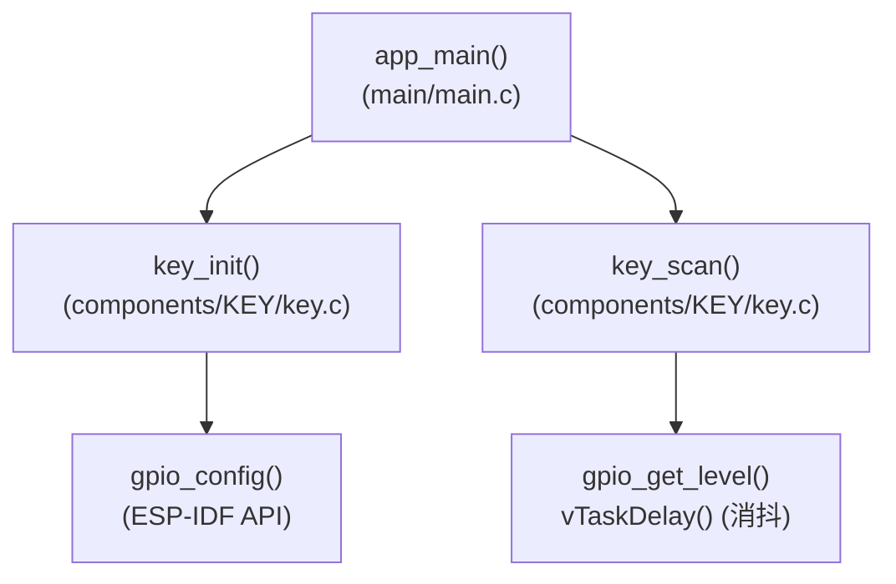
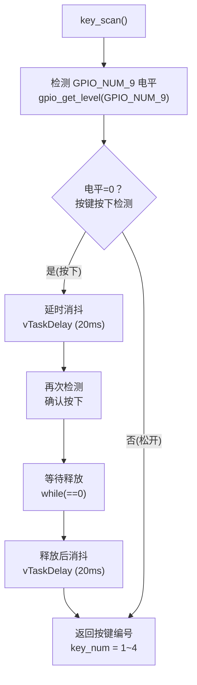
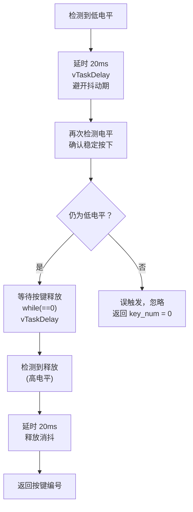
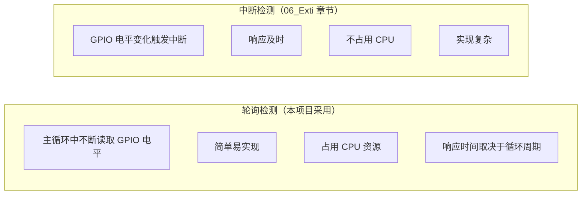
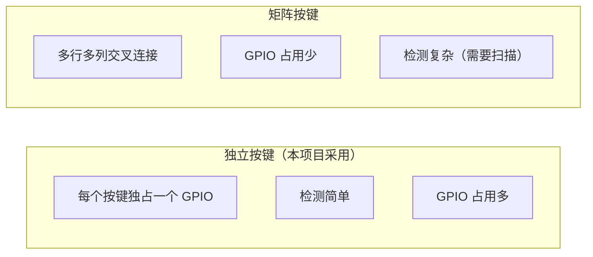

# ESP32-S3 按键键盘（Key Board）学习笔记

## 本章重要 API 函数

| API | 功能 | 参数说明 | 头文件 |
|-----|------|----------|--------|
| `gpio_config()` | 配置按键 GPIO 为输入模式 | `gpio_config_t *cfg`：配置结构体（含模式、引脚掩码、上下拉） | `"driver/gpio.h"` |
| `gpio_get_level()` | 读取按键 GPIO 电平状态 | `gpio_num_t gpio_num`：GPIO 引脚号，返回 `0`(低) 或 `1`(高) | `"driver/gpio.h"` |
| `vTaskDelay()` | 消抖延时处理 | `const TickType_t ticks`：延时 tick 数（1 tick ≈ 10ms） | `"freertos/task.h"` |
| `key_init()` | 初始化所有按键 GPIO（自定义） | `void`：无参数 | `"key.h"` |
| `key_scan()` | 扫描按键并返回编号（自定义） | `void`：无参数，返回 `uint8_t`：按键编号 1~4，0 表示无按键 | `"key.h"` |

**按键消抖流程：**
```c
if(gpio_get_level(GPIO_NUM_9) == 0) {  // 检测按下
    vTaskDelay(20);                     // 消抖延时
    while(gpio_get_level(GPIO_NUM_9) == 0) vTaskDelay(10); // 等待释放
    vTaskDelay(20);                     // 释放消抖
    key_num = 1;                        // 返回按键编号
}
```

---

## 本章目录

> 点击条目可跳转到对应小节。

### 章节导航

- **[本章重要 API 函数](#本章重要-api-函数)**
- **[学习前后依赖](#学习前后依赖)**
- **[1. 概述](#1-概述)**
- **[2. 硬件原理](#2-硬件原理)**
  - [2.1 按键电路结构](#21-按键电路结构)
  - [2.2 按键矩阵布局](#22-按键矩阵布局)
- **[3. 软件架构传递树](#3-软件架构传递树)**
  - [3.1 模块调用关系](#31-模块调用关系)
  - [3.2 按键扫描流程](#32-按键扫描流程)
- **[4. 代码详细解析](#4-代码详细解析)**
  - [4.1 按键初始化 - key_init()](#41-按键初始化---key_init)
  - [4.2 按键扫描函数 - key_scan()](#42-按键扫描函数---key_scan)
  - [4.3 消抖原理详解](#43-消抖原理详解)
  - [4.4 主程序 - app_main()](#44-主程序---app_main)
- **[5. 按键检测模式对比](#5-按键检测模式对比)**
  - [5.1 轮询检测 vs 中断检测](#51-轮询检测-vs-中断检测)
  - [5.2 按键类型对比](#52-按键类型对比)
- **[6. 时序分析](#6-时序分析)**
  - [6.1 按键按下时序图](#61-按键按下时序图)
- **[容易踩坑](#容易踩坑)**
- **[7. 学习要点总结](#7-学习要点总结)**
  - [7.1 核心知识点](#71-核心知识点)
  - [7.2 消抖策略总结](#72-消抖策略总结)
  - [7.3 进阶方向](#73-进阶方向)
- **[Tips：本章容易被忽视的设计细节](#tips本章容易被忽视的设计细节)**

---

## 学习前后依赖

| 方向 | 内容 |
|------|------|
| 前置基础 | GPIO 输出反馈、GPIO 输入模式、内部上拉/下拉和主循环轮询。 |
| 本章核心 | 掌握按键轮询扫描、软件消抖、等待释放和按键编号返回。 |
| 后续承接 | 承接 `06_Exti` 的 GPIO 外部中断，并为 `05_multitask` 的按键任务协作提供输入基础。 |

## 1. 概述

本章节学习 GPIO 输入功能，实现按键检测。核心知识点包括：GPIO 输入模式配置、按键消抖处理、轮询检测机制。

如果说前几章的 LED 和蜂鸣器是"信息的输出"（让 MCU 表达状态），那么按键就是"信息的输入"（让 MCU 感知外部世界）。从这个角度，本章是 GPIO 能力拼图的另一半——输入 + 输出 = 完整的 GPIO 交互。按键检测也是后续中断、多任务通信等高级主题的基石。

---

## 2. 硬件原理

### 2.1 按键电路结构


按键按下：GPIO → GND = 低电平 (0)
按键松开：GPIO → VCC = 高电平 (1)

**为什么需要上拉电阻？**

按键本质上是一个机械开关。当它松开时，GPIO 引脚处于开路状态——既不是高电平也不是低电平，而是**悬空**（高阻态）。悬空的 GPIO 电平由电磁干扰、寄生电容等因素决定，读到的值完全不可靠。

上拉电阻的作用是：当按键松开时，通过电阻将 GPIO 拉向 VCC（3.3V），确保读到确定的高电平。当按键按下时，GPIO 直接连到 GND，电流经上拉电阻流向 GND（电流约为 3.3V / 45kΩ ≈ 73μA），GPIO 读到低电平。

**内部上拉 vs 外部上拉：**

- **内部上拉**（本项目采用）：ESP32-S3 内部有约 45kΩ 的上拉电阻，通过 `pull_up_en = ENABLE` 使能。优点是不需要额外元件，缺点是阻值较大且不可调节
- **外部上拉**：在 PCB 上焊接一个电阻（典型值 10kΩ）。优点是阻值可控、抗干扰更强，缺点是增加 BOM 成本

一般情况下，按键使用内部上拉就足够了。如果按键引线很长（>30cm）或环境干扰大，再考虑外部上拉。

### 2.2 按键矩阵布局

```
本项目按键配置：

        GPIO_NUM_9   ──► KEY1
        GPIO_NUM_10  ──► KEY2
        GPIO_NUM_11  ──► KEY3
        GPIO_NUM_12  ──► KEY4

所有按键采用独立式连接（非矩阵式）
```

**独立式 vs 矩阵式：**

```
独立式：1 个 GPIO = 1 个按键
  GPIO9 ──► KEY1
  GPIO10 ──► KEY2
  优点：扫描简单，可同时检测所有按键
  缺点：N 个按键需要 N 个 GPIO

矩阵式：2行×2列 = 4 个按键（仅需 4 个 GPIO）
  COL1  COL2
  ROW1 ──┬── KEY1  KEY2
  ROW2 ──┴── KEY3  KEY4
  优点：GPIO 利用率高（N×M 个按键仅需 N+M 个 GPIO）
  缺点：需要行列扫描，有"鬼键"问题
```

本项目采用独立式是因为按键数量少（4 个），独立式更直观易懂。矩阵式将在进阶内容中讨论。

---

## 3. 软件架构传递树

### 3.1 模块调用关系



**架构特点：** KEY 组件封装了两个函数——`key_init()`（一次性配置）和 `key_scan()`（每次调用扫描一次）。这种"初始化 + 轮询"的模式与 LED 组件有所不同：LED 的输出控制直接在主循环中用 `gpio_set_level()`，而按键的读取逻辑被完整封装在 `key_scan()` 中。原因在于按键检测涉及**复杂的状态机**（消抖、等待释放），不适合拆散到主循环中。

### 3.2 按键扫描流程



**流程中的三个关键阶段：**
1. **按下消抖**（20ms）：确认这不是电平毛刺
2. **等待释放**：阻塞直到用户松手——这也是一种消抖，防止单次按键被重复识别
3. **释放消抖**（20ms）：确认松开是真的，不是接触不良的抖动

---

## 4. 代码详细解析

### 4.1 按键初始化 - key_init()

**源代码（`key.c`）：**

```c
void key_init(void)
{
    gpio_config_t gpio_cfg=
    {
        .intr_type=GPIO_INTR_DISABLE,       // 禁用中断
        .mode=GPIO_MODE_INPUT,              // 输入模式（关键！）
        // 同时配置4个按键引脚
        .pin_bit_mask=1ULL<<(GPIO_NUM_9)|
                     1ULL<<(GPIO_NUM_10)|
                     1ULL<<(GPIO_NUM_11)|
                     1ULL<<(GPIO_NUM_12),
        .pull_down_en=GPIO_PULLDOWN_DISABLE,// 禁用下拉
        .pull_up_en=GPIO_PULLUP_ENABLE,     // 使能上拉（关键！）
    };
    gpio_config(&gpio_cfg);
}
```

**配置要点：**

| 配置项 | 值 | 说明 |
|--------|-----|------|
| `mode` | `GPIO_MODE_INPUT` | **仅输入模式**，不输出 |
| `pull_up_en` | `GPIO_PULLUP_ENABLE` | **使能内部上拉**，按键松开时保持高电平 |
| `pull_down_en` | `GPIO_PULLDOWN_DISABLE` | 禁用下拉，避免干扰 |

**与 LED/Beep 配置的对比：**

| 配置项 | LED (01章) | Beep (03章) | Key (本章) |
|--------|-----------|------------|------------|
| `mode` | INPUT_OUTPUT | INPUT_OUTPUT | **INPUT** |
| `pull_up_en` | ENABLE | DISABLE | **ENABLE** |
| `pull_down_en` | ENABLE | ENABLE | **DISABLE** |

这三次配置的变化体现了"按需配置"的原则——没有一种配置是万能的，每个外设的需求不同。

**为什么必须用上拉而禁用下拉？** 上拉确保按键松开时读到的电平为高（1），按下按键时 GPIO 经过按键直连 GND，读到的电平为低（0）。如果同时使能下拉，下拉电阻会与上拉电阻形成分压，GPIO 读到的不再是明确的低电平——如果你恰好按下按键时读到了中间电平（>0.8V 但 <2.5V），MCU 的逻辑判断是不确定的。

### 4.2 按键扫描函数 - key_scan()

**源代码（`key.c`）：**

```c
uint8_t key_scan(void)
{
    uint8_t key_num = 0 ;
    
    // KEY1 检测 (GPIO_NUM_9)
    if(gpio_get_level(GPIO_NUM_9) == 0)
    {
        vTaskDelay(20);                     // 消抖延时1
        while(gpio_get_level(GPIO_NUM_9) == 0) vTaskDelay(10); // 等待释放
        vTaskDelay(20);                     // 消抖延时2
        key_num = 1;
    }
    
    // KEY2 检测 (GPIO_NUM_10)
    if(gpio_get_level(GPIO_NUM_10) == 0)
    {
        vTaskDelay(20);
        while(gpio_get_level(GPIO_NUM_10) == 0) vTaskDelay(10);
        vTaskDelay(20);
        key_num = 2;
    }
    
    // KEY3 检测 (GPIO_NUM_11)
    if(gpio_get_level(GPIO_NUM_11) == 0)
    {
        vTaskDelay(20);
        while(gpio_get_level(GPIO_NUM_11) == 0) vTaskDelay(10);
        vTaskDelay(20);
        key_num = 3;
    }
    
    // KEY4 检测 (GPIO_NUM_12)
    if(gpio_get_level(GPIO_NUM_12) == 0)
    {
        vTaskDelay(20);
        while(gpio_get_level(GPIO_NUM_12) == 0) vTaskDelay(10);
        vTaskDelay(20);
        key_num = 4;
    }
    
    return key_num;
}
```

**代码设计分析：**

这个函数有一个重要特性：**优先返回编号最小的按键**。如果你同时按下 KEY1 和 KEY3，返回值是 1（而不是 3），因为 KEY1 的 `if` 判断在前。这不是 Bug——独立式按键的电平互不干扰，"同时按下"本质上是你的手指不够快而已（间隔远大于 20ms）。但如果你确实需要支持组合键（Ctrl+C 式的），就需要用位掩码而非单一编号来返回结果。

**`while(gpio_get_level(...) == 0) vTaskDelay(10)` 的作用：**

这里不是死等！注意循环体内有 `vTaskDelay(10)`——每次迭代都会让出 CPU 10 tick（约 100ms），FreeRTOS 调度器可以去运行其他就绪任务。如果没有这个 `vTaskDelay()`，循环会以 CPU 全速轮询 GPIO 寄存器，导致任务无法被抢占。

### 4.3 消抖原理详解

**按键抖动现象：**

```
按键按下时的电平抖动：

理想信号：  ────────┐           ┌────────
                    │           │
                    └───────────┘
                    
实际信号：  ────────┐ ┌┌┌┐ ┌┐ ┌────────
                    │ ││││ ││ │
                    └─┘┘┘┘ ┘┘ ┘
                    │← 抖动期 →│
                    约 5-20ms
```

**为什么会抖动？** 机械按键由金属弹片构成。按下时，弹片不是瞬间接触——它会在接触面弹跳几次（就像篮球落地后弹几下），每次弹跳产生一个短脉冲。典型的按键抖动持续 5-20ms，弹跳次数 3-10 次。如果不用消抖处理，MCU 会将一次物理按下错误地解读为多次按下。

**消抖处理流程：**



**本项目的消抖策略缺陷：** 当前实现要求直到按键松开后才返回结果。如果用户长按按键不松手，`key_scan()` 永远不会返回，整个程序卡死。这是轮询 + 阻塞消抖的固有问题——它的设计目标是快速按一下的场景（如计算器按键），不适合需要检测"按住不放"的场景（如音量调节）。

### 4.4 主程序 - app_main()

**源代码（`main.c`）：**

```c
void app_main(void)
{
    LED_init();                 // LED 初始化（用于状态显示）
    key_init();                 // 按键初始化
    while(1)
    {
        uint8_t key_num = key_scan();    // 扫描按键
        if(key_num != 0)
        {
            printf("key_num = %d\n", key_num);  // 打印按键编号
        }
        vTaskDelay(100);        // 主循环延时
    }
}
```

**主循环的 `vTaskDelay(100)` 和 `key_scan()` 内部的消抖延时的关系：**

这是两个不同层次的延时：
- `key_scan()` 内部：消抖延时节拍较短（20ms），因为按键抖动窗口就那么大
- 主循环：100 tick（约 1s）延时是为了控制整体扫描频率，避免按键响应太灵敏

如果发生按键按下，整个 `key_scan()` 会阻塞约 20ms（按下消抖）+ 按下持续时间 + 20ms（释放消抖）≈ 按键按下时间 + 40ms。然后 `vTaskDelay(100)` 再等 1 秒。所以从松开按键到下一次主循环迭代之间有约 1 秒的"冷却期"——这个间隔不会漏掉按键，因为你在按住的过程中按键已经被处理了。

---

## 5. 按键检测模式对比

### 5.1 轮询检测 vs 中断检测



**轮询和中断的实质区别：** 轮询是 CPU **主动去问**"按键按了没？"，每隔一段时间问一次。中断是按键 **主动通知** CPU"我被按了！"。前者浪费 CPU 资源但代码简单，后者效率高但需要处理 ISR 中的各种限制（不能调用延时、不能打印日志、不能阻塞）。

**什么时候用轮询？** 当你的主循环本来就在做其他事情（如更新显示、处理网络），轮询按键的开销几乎为零——反正主循环也要跑。当 CPU 大部分时间在睡眠（如低功耗设备），中断才显优势。

### 5.2 按键类型对比



---

## 6. 时序分析

### 6.1 按键按下时序图

```
按键按下完整时序：

时间轴 ───────────────────────────────────────────────────►

按键:   ─────┐           ┌────────────────────
             │           │
             └───────────┘
             │←按下─→│←保持→│←释放→│

GPIO:   ─────┐ ┌┌┌┐ ┌┐ ┌────────────────────
             │ ││││ ││ │
             └─┘┘┘┘ ┘┘ ┘
             │←抖动→│   │←抖动→│

检测:        ▼       ▼       ▼
        ┌────────┐ ┌────────┐
        │延时20ms│ │延时20ms│
        │消抖    │ │消抖    │
        └────────┘ └────────┘

key_num:                  ────► 返回 1~4
```

**时序中的关键窗口期：** GPIO 电平第一次变为低电平到消抖确认之间（约 20ms）是窗口期。在这 20ms 内，按键可能还在抖动——如果消抖延时太短（如 5ms），可能过早判定为"按下"，但实际上按键还没稳定接触。20ms 是工业界常用的经验值，适用于绝大多数消费级按键。

---

## 容易踩坑

| 现象 | 常见原因 | 排查方向 |
|------|----------|----------|
| 按键未按也触发 | 输入悬空或未启用正确上拉/下拉 | 确认 `pull_up_en`、硬件接法和空闲电平 |
| 一次按下触发多次 | 机械抖动未消抖或消抖时间太短 | 增加 10~20ms 稳定判断并等待释放 |
| 长按导致主循环卡住 | `while(gpio_get_level()==0)` 阻塞等待释放 | 长按场景改成状态机或定时采样 |
| 多个按键同时按下结果混乱 | 独立按键扫描顺序覆盖 `key_num` | 明确优先级或返回组合位图 |

---

## 7. 学习要点总结

### 7.1 核心知识点

| 知识点 | 说明 |
|--------|------|
| GPIO 输入模式 | `GPIO_MODE_INPUT` 仅读取电平 |
| 内部上拉电阻 | 使按键松开时保持高电平 |
| 消抖处理 | 延时检测避开抖动期 |
| 等待释放 | `while` 循环检测按键释放 |

### 7.2 消抖策略总结

| 方法 | 实现 | 优点 | 缺点 |
|------|------|------|------|
| 软件延时 | `vTaskDelay()` | 简单 | 阻塞任务 |
| 定时器采样 | 周期检测稳定性 | 不阻塞 | 实现复杂 |
| 硬件滤波 | RC 电路 | 可靠 | 增加成本 |

**为什么不在硬件上加 RC 滤波？** 用一个 100nF 电容 + 10kΩ 上拉电阻构成的 RC 低通滤波器（截止频率约 160Hz），就能在硬件层面滤掉大部分抖动。但这样做有两个代价：(1) 增加元件和 PCB 面积；(2) RC 充放电会引入几毫秒的上升/下降沿延迟。对于教学项目，软件消抖更灵活（可以随时调整消抖时间），成本更低。

### 7.3 进阶方向

- GPIO 中断检测（06_Exti 章节）
- 矩阵键盘扫描
- 长按/短按/双击检测

---

## Tips：本章容易被忽视的设计细节

### 1. 为什么 `key_scan()` 不立即采样第二次，而是等 20ms？

```c
if(gpio_get_level(GPIO_NUM_9) == 0) {
    vTaskDelay(20);                     // 先等 20ms
    while(gpio_get_level(GPIO_NUM_9) == 0) vTaskDelay(10);  // 再确认
```

时序逻辑是：检测到低电平 → 等 20ms 让抖动过去 → 再次读取电平。如果第 2 次读到的还是低电平，说明按键确实按下了（不是噪声）。如果第 2 次已经是高电平，说明之前是偶然的干扰脉冲。

**注意：** 第 2 次读取其实是在 `while` 的条件判断中隐式完成的——`while(gpio_get_level(...) == 0)` 进入循环前会执行一次判断，这一次就是"确认读取"。如果读到高电平（按键其实没持续按下），`while` 直接跳过，执行 `vTaskDelay(20)` 的释放消抖后返回 `key_num`（此时 key_num 值为之前可能设置过的编号，或者从上一个按键留下的旧值——这其实是一个潜在 Bug，应该显式读第二次并用 `if` 判断是否有效）。

### 2. 多个按键同时按下的竞态问题

代码的 `if-else` 逻辑是顺序执行的，且用 `if`（非 `else if`）连接——这意味着如果 KEY1 和 KEY2 同时被检测到：
1. 进入 KEY1 的 `if` → 消抖 → 等待释放 → `key_num = 1`
2. 离开 KEY1 的 `if`
3. 进入 KEY2 的 `if` → 消抖 → 等待释放 → `key_num = 2`（覆盖了！）
4. 返回 2

最终返回 2。这与"返回编号最小的按键"的直觉不符。如果要按优先级返回，应该用 `else if` 而不是 `if`。当前写法实际上给了 KEY4 最高优先级——如果所有 4 个按键同时按下且手指松开顺序不同，最后松开（最后退出 `while`）的按键会覆盖结果。

**修正建议：** 如果业务语义是"一次只处理一个按键"，用 `else if`；如果是"需要处理所有按键"，用返回值位掩码 `return bitmask`。

### 3. 为什么本项目的 key_scan() 没有像流水灯那样做数组优化？

```c
// 为什么不这样写？
const gpio_num_t key_pins[] = {GPIO_NUM_9, GPIO_NUM_10, GPIO_NUM_11, GPIO_NUM_12};
for(int i = 0; i < 4; i++) {
    if(gpio_get_level(key_pins[i]) == 0) {
        vTaskDelay(20);
        while(gpio_get_level(key_pins[i]) == 0) vTaskDelay(10);
        vTaskDelay(20);
        return i + 1;
    }
}
```

从代码量看，数组循环确实更简洁。但原版的重复写法有一个教学优势：**显式地展示消抖三阶段**（按下消抖 → 等待释放 → 释放消抖），每个阶段都写在读者面前，不会隐藏到循环中。对于初学笔记来说，这种"啰嗦"反而是有益的。在 02_流水灯中引入数组优化，是因为流水灯的状态管理本身就是模式化的，而按键消抖是全新的概念，应该先让读者看清全貌。

### 4. 本章与后续章节的关键衔接点

| 衔接点 | 本章内容 | 后续章节 |
|--------|---------|----------|
| GPIO 输入 + 上拉 | `GPIO_MODE_INPUT + PULLUP_ENABLE` | 06_Exti：同样配置 + 中断触发 |
| 轮询模型 | 主循环 `while(1)` 中调用 `key_scan()` | 05_multitask：按键检测独立为 `key_task()` |
| 消抖阻塞 | `while(==0) vTaskDelay(10)` | 后续定时器章节：非阻塞消抖 |
| 状态机思想 | 检测→消抖→等待→返回 | 后续章节各种外设的状态管理 |

### 5. 按键消抖的"道"与"术"

**术**：`vTaskDelay(20)` 等 20ms 再判断。

**道**：消抖的本质是**用时间去交换确定性**——用 20ms 的等待换取"这个按键确实按下了"的确定信息。更深一层，所有数字系统处理模拟现实世界的问题时，都面临类似的挑战：现实世界是连续的、有噪声的、非理想的。ADC 有采样保持时间、通信有超时重传、存储有 ECC 纠错——这些本质上都是"消抖"，只是名字不同。

理解了这一点，你就不会再问"为什么是 20ms 而不是 25ms"——因为 20ms 是工程经验值，对于 99% 的机械按键够用。如果某个按键特别烂（抖动超过 20ms），你需要的是换一个按键，而不是把消抖延时调到 50ms（50ms 的延时让用户感觉按键"不跟手"）。
