# ESP32-S3 DVP 摄像头驱动与图像采集

## 本章重要 API 函数

| API | 功能 | 参数说明 | 头文件 |
|-----|------|----------|--------|
| `esp_camera_init` | 初始化摄像头驱动 | `camera_config_t *config`：摄像头配置结构体指针，包含引脚定义、像素格式、帧大小等；返回 `esp_err_t`：`ESP_OK` 成功，其他值表示失败 | `esp_camera.h` |
| `esp_camera_deinit` | 反初始化摄像头驱动 | `void`：无参数；返回 `esp_err_t`：`ESP_OK` 成功，`ESP_ERR_INVALID_STATE` 未初始化 | `esp_camera.h` |
| `esp_camera_fb_get` | 获取一帧图像数据 | `void`：无参数；返回 `camera_fb_t *`：帧缓冲区指针，包含 `buf`（数据指针）、`len`（长度）、`width`、`height`、`format`；失败返回 `NULL` | `esp_camera.h` |
| `esp_camera_fb_return` | 归还帧缓冲区 | `camera_fb_t *fb`：需要归还的帧缓冲区指针；无返回值 | `esp_camera.h` |
| `esp_camera_sensor_get` | 获取传感器控制结构体 | `void`：无参数；返回 `sensor_t *`：传感器控制结构体指针，用于设置曝光、增益、白平衡等参数；失败返回 `NULL` | `esp_camera.h` |
| `camera_init` | 本地封装的摄像头初始化 | `void`：无参数；无返回值，内部调用 `esp_camera_init` | `camera.h` |
| `camera_show` | 显示摄像头图像到 LCD | `uint16_t x`：LCD 起始 X 坐标；`uint16_t y`：LCD 起始 Y 坐标；无返回值 | `camera.h` |

## 本章目录

> 点击条目可跳转到对应小节。

### 章节导航
- **[学习前后依赖](#学习前后依赖)**
- **[1. 概述](#1-概述)**
- **[2. 组件库：本地与云端](#2-组件库本地与云端)**
  - [2.1 本地组件库](#21-本地组件库)
  - [2.2 IDF 云端组件库](#22-idf-云端组件库)
  - [2.3 组件依赖管理](#23-组件依赖管理)
- **[3. 摄像头硬件架构](#3-摄像头硬件架构)**
  - [3.1 感光像素阵列（Pixel Array）](#31-感光像素阵列pixel-array)
  - [3.2 数模转换单元（ADC）](#32-数模转换单元adc)
  - [3.3 数字信号处理单元（DSP）](#33-数字信号处理单元dsp)
  - [3.4 时序控制与接口单元](#34-时序控制与接口单元)
- **[4. 摄像头接口引脚定义](#4-摄像头接口引脚定义)**
  - [4.1 数据引脚（D0-D7）](#41-数据引脚d0-d7)
  - [4.2 时钟与同步引脚](#42-时钟与同步引脚)
  - [4.3 控制引脚](#43-控制引脚)
  - [4.4 本项目引脚映射表](#44-本项目引脚映射表)
- **[5. 软件架构与数据流](#5-软件架构与数据流)**
  - [5.1 软件架构总览](#51-软件架构总览)
  - [5.2 帧缓冲区与 DMA 传输](#52-帧缓冲区与-dma-传输)
  - [5.3 传感器探测与初始化流程](#53-传感器探测与初始化流程)
- **[6. 代码讲解](#6-代码讲解)**
  - [6.1 摄像头配置结构体](#61-摄像头配置结构体)
  - [6.2 初始化函数](#62-初始化函数)
  - [6.3 图像获取与显示](#63-图像获取与显示)
- **[7. 容易踩坑](#7-容易踩坑)**
- **[8. 本章小结](#8-本章小结)**
- **[Tips](#tips)**
  - [DVP 并行接口的带宽计算——为什么不用 SPI 接摄像头](#dvp-并行接口的带宽计算——为什么不用-spi-接摄像头)
  - [双缓冲的"生产者-消费者"模型深度解析](#双缓冲的"生产者-消费者"模型深度解析)
  - [PSRAM 缓存一致性问题](#psram-缓存一致性问题)
  - [踩坑实录](#踩坑实录)
  - [知识衔接](#知识衔接)

---

## 学习前后依赖

- **前置依赖**：本章需要掌握 GPIO 配置（第 4 章）、SPI 与 LCD 显示（第 16 章）、DMA 基本概念（第 12 章）。理解 I2C/SCCB 通信原理有助于理解摄像头传感器配置。
- **本章核心**：学习 ESP-IDF 云端组件库的使用方法，理解摄像头硬件架构（感光阵列、ADC、DSP、接口单元），掌握摄像头驱动 API 的调用流程。
- **后续承接**：摄像头采集的图像可用于图像识别、机器视觉、视频流传输等高级应用。

---

## 1. 概述

本章介绍 ESP32-S3 如何驱动摄像头模块实现图像采集与实时显示。摄像头作为嵌入式系统中重要的视觉感知设备，其工作原理涉及光学传感、模拟-数字转换、数字信号处理等多个环节。ESP32-S3 通过并行接口（DVP）与摄像头传感器连接，利用 LCD_CAM 外设和 DMA 实现高速图像数据采集。

本项目的摄像头模块采用 OV2640 或兼容传感器，输出 RGB565 格式图像直接显示在 LCD 屏幕上。代码结构采用"云端组件 + 本地封装"的模式：云端组件 `espressif/esp32-camera` 提供底层驱动，本地 `components/Camera` 提供业务层封装。

---

## 2. 组件库：本地与云端

### 2.1 本地组件库

本地组件库存放在项目的 `components/` 目录下，由开发者自行编写和维护。本项目本地组件包括：

```
components/
├── Camera/          # 摄像头业务封装
│   ├── camera.c
│   └── camera.h
├── LCD/             # LCD 显示驱动
├── LED/             # LED 控制
└── SPI/             # SPI 底层驱动
```

本地组件的优势：
- 完全可控，可针对特定硬件定制
- 无需网络下载，构建速度快
- 适合封装业务逻辑和硬件抽象层

本地组件的注册方式在 `components/CMakeLists.txt` 中：

```cmake
set(src_dirs Camera LCD LED SPI)
set(include_dirs Camera LCD LED SPI)
idf_component_register(SRC_DIRS ${src_dirs} INCLUDE_DIRS ${include_dirs})
```

### 2.2 IDF 云端组件库

IDF 组件注册中心（ESP-IDF Component Registry）提供了大量官方和第三方组件，可通过网络自动下载。本项目使用的云端组件：

```
managed_components/
└── espressif__esp32-camera/    # 官方摄像头驱动组件
    ├── driver/                  # 核心驱动代码
    │   ├── esp_camera.c         # 上层 API 实现
    │   ├── cam_hal.c            # 硬件抽象层
    │   └── include/
    │       └── esp_camera.h     # 公开 API 头文件
    ├── sensors/                 # 各种摄像头传感器驱动
    │   ├── ov2640.c
    │   ├── ov5640.c
    │   └── ...
    └── conversions/             # 图像格式转换
```

云端组件的优势：
- 官方维护，质量有保障
- 支持多种摄像头传感器（OV2640、OV5640、GC2145 等）
- 自动处理 DMA、帧缓冲区、JPEG 解码等复杂逻辑

### 2.3 组件依赖管理

云端组件通过 `idf_component.yml` 声明依赖。本项目配置文件位于 `main/idf_component.yml`：

```yaml
dependencies:
  idf:
    version: '>=4.1.0'
  espressif/esp32-camera: ^2.1.7
```

构建时，IDF 组件管理器会自动从组件注册中心下载指定版本的 `esp32-camera` 组件到 `managed_components/` 目录。

**本地与云端组件协作关系图：**

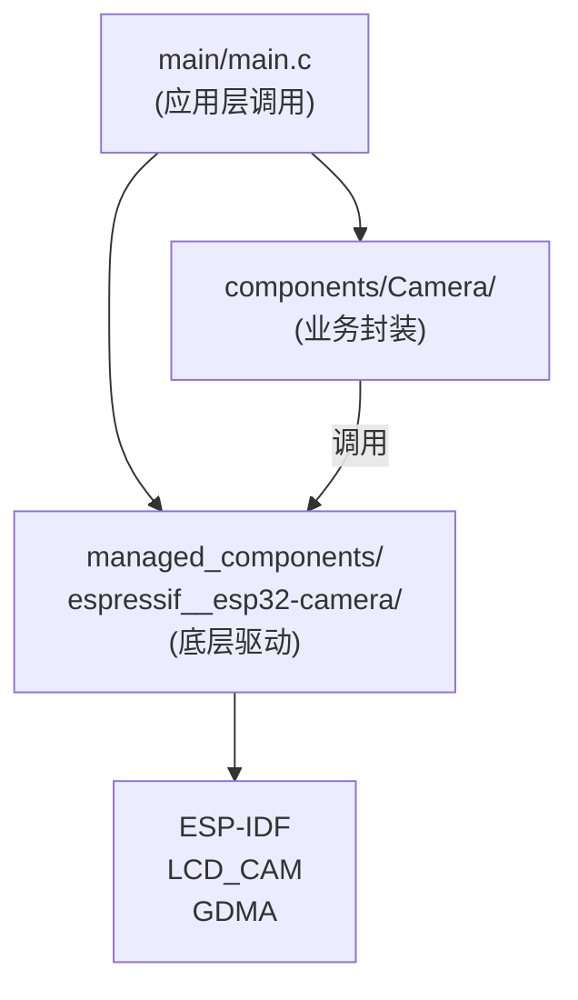

---

## 3. 摄像头硬件架构

摄像头传感器是一个完整的图像采集系统，包含四个核心单元：

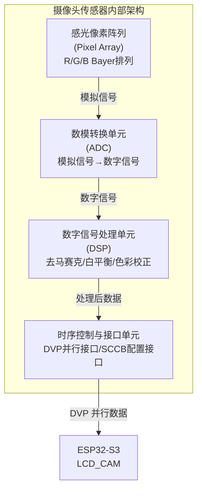

### 3.1 感光像素阵列（Pixel Array）

感光像素阵列是摄像头的"眼睛"，由数百万个光电二极管按矩阵排列组成。每个像素点包含一个感光单元，负责将光信号转换为电信号。

**工作原理：**
1. **光电转换**：光子撞击感光单元，产生电子-空穴对，形成与光照强度成正比的电荷
2. **电荷积累**：曝光时间内，电荷在势阱中积累
3. **电荷读出**：行选通信号逐行读出电荷，送往 ADC

**拜耳阵列（Bayer Pattern）：**
大多数摄像头采用拜耳阵列排列，每个像素点只记录一种颜色分量（R、G 或 B），通过插值算法还原全彩图像：

```mermaid
flowchart TD
    subgraph B["拜耳阵列 (Bayer Pattern)"]
        R1["R G R G"]
        R2["G B G B"]
        R3["R G R G"]
    end
    R1 --- R2 --- R3

G（绿色）像素数量是 R/B 的两倍，因为人眼对绿色更敏感
```

### 3.2 数模转换单元（ADC）

摄像头内部的 ADC（Analog-to-Digital Converter）将像素阵列输出的模拟电压信号转换为数字信号，其工作原理与 MCU 的 ADC 类似。

**关键参数：**

| 参数 | 说明 | 典型值 |
|------|------|--------|
| 分辨率 | 转换精度，决定灰度级数 | 8-12 bit（256-4096 级） |
| 转换速率 | 每秒完成转换次数 | 数十 MHz |
| 信噪比 | 有效信号与噪声的比值 | 40-60 dB |

**工作流程：**
```
模拟电压 ──▶ 采样保持 ──▶ 量化编码 ──▶ 数字输出
```

### 3.3 数字信号处理单元（DSP）

原始像素数据经过 ADC 后，还需要 DSP 进行一系列处理才能输出可用的图像。

**主要处理功能：**

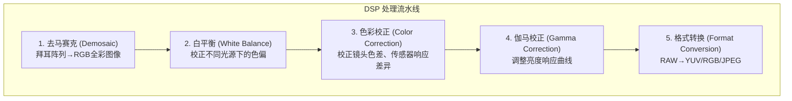

**输出格式选择：**
- **RAW**：原始传感器数据，体积大但保留全部信息
- **RGB565**：16 位彩色格式，适合直接显示
- **YUV422**：亮度+色度格式，便于视频处理
- **JPEG**：压缩格式，节省存储和传输带宽

### 3.4 时序控制与接口单元

时序控制单元负责协调像素阵列、ADC、DSP 的工作节奏，并通过接口单元与外部 MCU 通信。

**DVP（Digital Video Port）并行接口：**

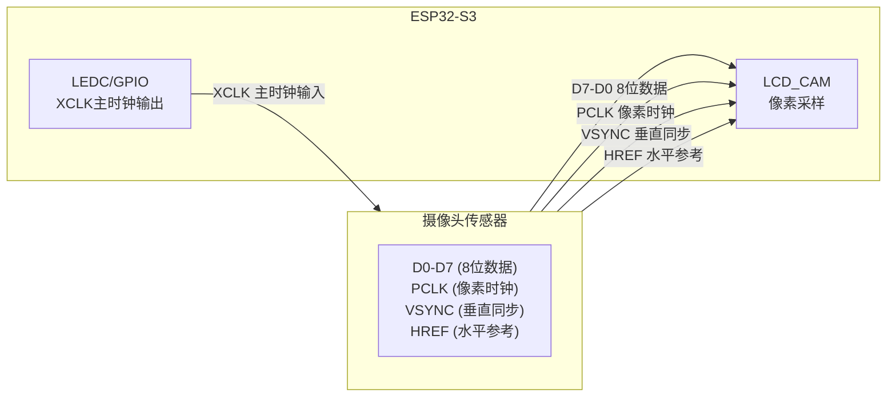

**时序关系图：**

```
VSYNC ─┐     ┌──────────────────────────────────┐     ┌──
       └─────┘                                  └─────┘
              │◀───── 一帧时间 ─────▶│
              
HREF  ────────┐ ┌───┐ ┌───┐ ┌───┐     ┌───┐ ┌───┐──────
              └─┘   └─┘   └─┘   └─────┘   └─┘
              │◀─行─▶│◀─行─▶│          │◀─行─▶│
              
PCLK  ──┬─┬─┬─┬─┬─┬─┬─┬─┬─┬─┬─┬─┬─┬─┬─┬─┬─┬─┬─┬─┬─┬─┬──
       └─┴─┴─┴─┴─┴─┴─┴─┴─┴─┴─┴─┴─┴─┴─┴─┴─┴─┴─┴─┴─┴─┴─┘
              │◀ 每个时钟上升沿采样一字节 ▶│
              
DATA  ────────┤D0D1│D2D3│D4D5│...│───────────────┤
              └────┴────┴────┘   └───────────────┘
```

**SCCB/I2C 配置接口：**
摄像头传感器内部有大量寄存器，用于配置分辨率、格式、曝光等参数。SCCB（Serial Camera Control Bus）是 I2C 的简化版本，用于寄存器读写：

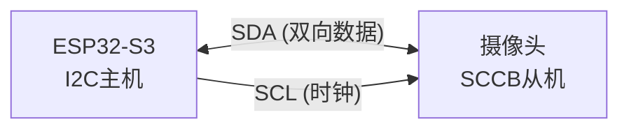

---

## 4. 摄像头接口引脚定义

### 4.1 数据引脚（D0-D7）

D0-D7 为 8 位并行数据总线，每个时钟周期传输一字节数据。在 RGB565 模式下，两个时钟周期传输一个像素（16 bit）。

```
数据传输示意（RGB565）：

时钟周期:    │  1  │  2  │  3  │  4  │  ...
            ─┬─────┬─────┬─────┬─────┬──
数据线D0-D7: │高字节│低字节│高字节│低字节│
             │ R高4位│ G低4位│ R高4位│ G低4位│
             │ G高4位│ B高4位│ G高4位│ B高4位│
            ─┴─────┴─────┴─────┴─────┴──
             │◀─ 像素0 ─▶│◀─ 像素1 ─▶│
```

### 4.2 时钟与同步引脚

| 引脚 | 方向 | 功能 | 时序说明 |
|------|------|------|----------|
| XCLK | MCU→摄像头 | 主时钟输入 | 典型频率 16-24 MHz，决定传感器工作频率 |
| PCLK | 摄像头→MCU | 像素时钟输出 | 与数据同步，上升沿有效 |
| VSYNC | 摄像头→MCU | 垂直同步 | 帧开始信号，下降沿触发 DMA |
| HREF | 摄像头→MCU | 水平参考 | 行有效期间为高，指示数据有效 |

### 4.3 控制引脚

| 引脚 | 方向 | 功能 | 使用场景 |
|------|------|------|----------|
| PWDN | MCU→摄像头 | 掉电控制 | 省电模式，高电平掉电 |
| RESET | MCU→摄像头 | 硬件复位 | 低电平复位，初始化时需产生复位脉冲 |
| SDA/SCL | 双向 | SCCB/I2C | 寄存器配置，地址通常为 0x30 或 0x3C |

### 4.4 本项目引脚映射表

本项目摄像头引脚定义在 `components/Camera/camera.h`：

```c
#define CAM_PIN_PWDN     GPIO_NUM_10   /* 掉电控制 */
#define CAM_PIN_RESET    GPIO_NUM_9    /* 硬件复位 */
#define CAM_PIN_XCLK     GPIO_NUM_NC   /* 使用内部 LCD_CAM 时钟 */
#define CAM_PIN_SIOD     GPIO_NUM_39   /* SCCB 数据线 */
#define CAM_PIN_SIOC     GPIO_NUM_38   /* SCCB 时钟线 */
#define CAM_PIN_D7       GPIO_NUM_18   /* 数据线 D7 */
#define CAM_PIN_D6       GPIO_NUM_17   /* 数据线 D6 */
#define CAM_PIN_D5       GPIO_NUM_16   /* 数据线 D5 */
#define CAM_PIN_D4       GPIO_NUM_15   /* 数据线 D4 */
#define CAM_PIN_D3       GPIO_NUM_7    /* 数据线 D3 */
#define CAM_PIN_D2       GPIO_NUM_6    /* 数据线 D2 */
#define CAM_PIN_D1       GPIO_NUM_5    /* 数据线 D1 */
#define CAM_PIN_D0       GPIO_NUM_4    /* 数据线 D0 */
#define CAM_PIN_VSYNC    GPIO_NUM_14   /* 垂直同步 */
#define CAM_PIN_HREF     GPIO_NUM_3    /* 水平参考 */
#define CAM_PIN_PCLK     GPIO_NUM_45   /* 像素时钟 */
```

**引脚连接拓扑图：**

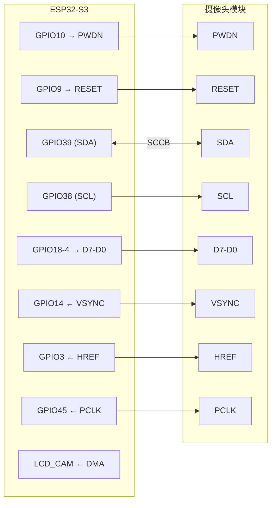

---

## 5. 软件架构与数据流

### 5.1 软件架构总览

摄像头驱动软件分为三层：

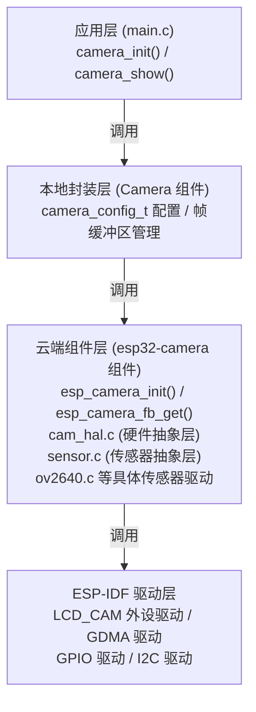

### 5.2 帧缓冲区与 DMA 传输

摄像头使用 DMA（直接内存访问）实现数据的高速传输，CPU 只需配置 DMA 描述符链表，数据由硬件自动搬运到帧缓冲区。

**帧缓冲区结构：**

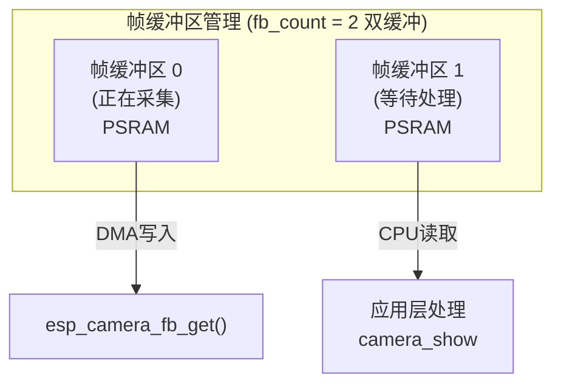

**DMA 描述符链表：**

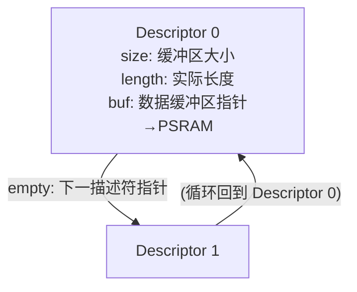

**双缓冲轮转机制：**

双缓冲的核心是"生产者-消费者"模型：DMA 采集线程（cam_task）负责写入帧数据，应用层负责读取和处理。两者通过 FreeRTOS 队列和可用标志位协调。

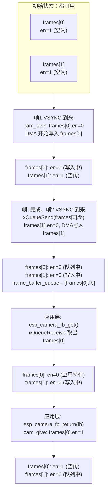

**关键函数解析：**

| 函数 | 作用 | 核心操作 |
|------|------|----------|
| `cam_start_frame()` | 找到可用缓冲区开始采集 | 遍历 `frames[]`，找到 `en=1` 的缓冲区，设置 `en=0` |
| `cam_take()` | 应用层获取帧 | 从 `frame_buffer_queue` 队列取出帧指针 |
| `cam_give()` | 应用层归还帧 | 遍历 `frames[]`，匹配指针，设置 `en=1` |

**en 标志位含义：**

```
en = 1：缓冲区空闲，DMA 可以写入
en = 0：缓冲区被占用（正在写入或被应用持有）
```

**队列满时的处理：**

当应用层处理太慢，队列已满时，新帧会丢弃旧帧：

```
队列已满，新帧到达：
  1. 尝试发送新帧到队列 → 失败（队列满）
  2. 从队列头部取出旧帧
  3. 归还旧帧（cam_give）
  4. 将新帧发送到队列尾部
```

这种设计确保应用层总是能获取到最新的帧，而不是阻塞等待。

### 5.3 传感器探测与初始化流程

`esp_camera_init()` 内部会自动探测连接的摄像头传感器型号：

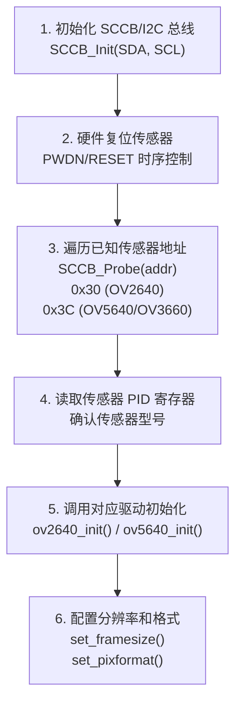

---

## 6. 代码讲解

### 6.1 摄像头配置结构体

摄像头配置在 `components/Camera/camera.c` 定义：

```c
static camera_config_t camera_config = {
    /* 引脚配置 */
    .pin_pwdn = CAM_PIN_PWDN,      /* 掉电引脚 GPIO10 */
    .pin_reset = CAM_PIN_RESET,    /* 复位引脚 GPIO9 */
    .pin_xclk = CAM_PIN_XCLK,      /* XCLK 使用 NC，由 LCD_CAM 内部生成 */
    .pin_sccb_sda = CAM_PIN_SIOD,  /* SCCB 数据线 GPIO39 */
    .pin_sccb_scl = CAM_PIN_SIOC,  /* SCCB 时钟线 GPIO38 */
    .pin_d7 = CAM_PIN_D7,          /* 数据线 D7-D0 */
    /* ... 其他数据引脚 ... */
    .pin_vsync = CAM_PIN_VSYNC,    /* 垂直同步 */
    .pin_href = CAM_PIN_HREF,      /* 水平参考 */
    .pin_pclk = CAM_PIN_PCLK,      /* 像素时钟 */
    
    /* 图像配置 */
    .xclk_freq_hz = 24000000,      /* 主时钟 24MHz */
    .ledc_timer = LEDC_TIMER_0,    /* LEDC 定时器（非 S3 可用） */
    .ledc_channel = LEDC_CHANNEL_0,
    .fb_location = CAMERA_FB_IN_PSRAM,  /* 帧缓冲在 PSRAM */
    .pixel_format = PIXFORMAT_RGB565,   /* 输出 RGB565 格式 */
    .frame_size = FRAMESIZE_240X240,    /* 分辨率 240x240 */
    .jpeg_quality = 5,             /* JPEG 质量（仅 JPEG 模式有效） */
    .fb_count = 2,                 /* 双帧缓冲 */
    .grab_mode = CAMERA_GRAB_WHEN_EMPTY,  /* 缓冲区空时采集 */
};
```

**关键字段说明：**

| 字段 | 作用 | 注意事项 |
|------|------|----------|
| `fb_location` | 帧缓冲位置 | 大分辨率必须用 PSRAM，内部 RAM 不够 |
| `pixel_format` | 像素格式 | RGB565 直接显示，JPEG 节省带宽 |
| `frame_size` | 分辨率 | 与 LCD 分辨率匹配 |
| `fb_count` | 缓冲区数量 | ≥2 可实现流水线采集 |

### 6.2 初始化函数

`camera_init()` 负责硬件初始化：

```c
void camera_init(void)
{
    CAM_PWDN(0);          /* 取消掉电 */
    CAM_RST(0);           /* 拉低复位 */
    vTaskDelay(20);       /* 等待稳定 */
    CAM_RST(1);           /* 释放复位 */
    vTaskDelay(20);       /* 等待传感器启动 */

    esp_camera_init(&camera_config);  /* 调用云端组件初始化 */
}
```

复位时序要求：
1. 先释放掉电，确保传感器供电
2. 产生复位脉冲（低电平保持至少 1ms）
3. 等待传感器启动（通常需要 10-20ms）

### 6.3 图像获取与显示

`camera_show()` 实现图像采集与显示：

```c
void camera_show(uint16_t x, uint16_t y)
{
    /* 获取一帧图像 */
    fb = esp_camera_fb_get();
    
    /* 设置 LCD 显示窗口 */
    lcd_set_window(x, y, x + fb->width - 1, y + fb->height - 1);
    
    /* 将摄像头数据复制到 LCD 缓冲区 */
    for (j = 0; j < fb->width * fb->height; j++) {
        lcd_buf[2 * j] = (fb->buf[2 * i]);
        lcd_buf[2 * j + 1] = (fb->buf[2 * i + 1]);
        i++;
    }
    
    /* 分批发送数据到 LCD */
    for (j = 0; j < (fb->width * fb->height * 2 / 11520); j++) {
        lcd_write_datan(&lcd_buf[j * 11520], 11520);
    }
    
    /* 归还帧缓冲区，允许再次采集 */
    esp_camera_fb_return(fb);
}
```

**数据流图：**

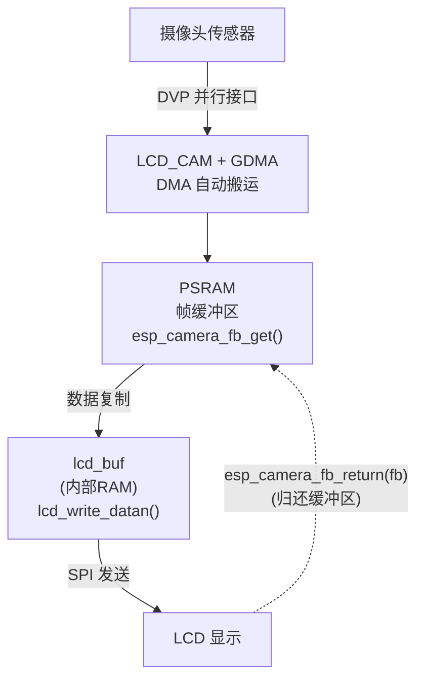

---

## 7. 容易踩坑

| 问题 | 原因 | 解决方案 |
|------|------|----------|
| 摄像头探测失败 | SCCB/I2C 引脚未正确配置或上拉 | 确认 SDA/SCL 有外部上拉（4.7kΩ），检查引脚映射 |
| 图像花屏/颜色错乱 | 数据线顺序错误或字节序问题 | 对照传感器数据手册调整 D0-D7 顺序，检查 `swap_data` 配置 |
| 帧率过低 | 帧缓冲在内部 RAM，DMA 效率低 | 设置 `fb_location = CAMERA_FB_IN_PSRAM` |
| 内存不足崩溃 | 分辨率过高，帧缓冲超过可用内存 | 降低分辨率或使用 JPEG 格式 |
| 图像倒置 | 传感器安装方向与显示方向不一致 | 调用 `sensor->set_vflip()` 或 `set_hmirror()` 翻转 |
| XCLK 频率错误 | 非标准频率导致传感器工作异常 | 使用 16MHz 或 24MHz 等标准频率 |
| 首帧黑屏 | 传感器自动曝光未稳定 | 忽略前几帧，或等待曝光稳定后再显示 |
| PSRAM 缓存问题 | DMA 写入后 CPU 读取到旧数据 | ESP32-S3 需调用 `esp_cache_msync()` 刷新缓存 |

**特别注意**：ESP32-S3 的 LCD_CAM 模块内置 XCLK 生成器，`pin_xclk` 可设为 `GPIO_NUM_NC`，无需外部时钟输入。但 ESP32 和 ESP32-S2 需要通过 LEDC 或 GPIO 生成 XCLK。

---

## 8. 本章小结

本章学习了摄像头驱动的完整知识链：

1. **组件管理**：掌握了本地组件（`components/`）与云端组件（`managed_components/`）的协作方式，理解了 `idf_component.yml` 依赖声明的作用。

2. **硬件架构**：深入理解了摄像头传感器的四个核心单元——感光像素阵列（光电转换）、ADC（数模转换）、DSP（信号处理）、时序接口（DVP/SCCB）——的工作原理。

3. **接口引脚**：学习了 DVP 并行接口的 8 位数据总线、时钟同步信号（XCLK/PCLK/VSYNC/HREF）和控制信号（PWDN/RESET/SCCB）的定义与连接方式。

4. **软件架构**：掌握了三层驱动架构（应用层 → 本地封装层 → 云端组件层 → ESP-IDF 驱动层），理解了 DMA 帧缓冲区的双缓冲机制。

5. **API 调用**：学会了 `esp_camera_init()` 初始化、`esp_camera_fb_get()` 获取帧、`esp_camera_fb_return()` 归还帧的完整调用流程。

摄像头采集的图像数据是后续机器视觉、图像识别、视频流传输等功能的基础，读者可在此基础上扩展 USB 摄像头、网络视频流等应用。

---

## Tips

### DVP 并行接口的带宽计算——为什么不用 SPI 接摄像头

这是本章最关键的工程决策。DVP（Digital Video Port）是一个**8 位并行 + 时钟 + 同步**的接口，和 SPI/I2C/UART 都不一样。我们通过带宽计算来理解为什么必须用 DVP：

```
场景：240×240 RGB565 @ 30 FPS 实时显示

RGB565 = 每像素 16 bit = 2 字节
每帧 = 240 × 240 × 2 = 115200 字节
每秒 = 115200 × 30 = 3,456,000 字节 ≈ 3.3 MB/s
总 bit 速率 = 3.3 × 8 ≈ 26.4 Mbps

如果用 SPI @ 60 MHz（第三章的速度）：
  理论带宽 = 60 Mbps（全双工单向约 60 Mbps）
  实际可用 ≈ 50 Mbps → 勉强够用（26.4 < 50）

如果用 I2C @ 400 kHz（第二章的速度）：
  理论带宽 = 400 kbps = 0.4 Mbps
  3.3 MB/s 需要 66 Mbps → 完全不够（差 165 倍）

如果用 UART @ 115200 bps（第一章的速度）：
  理论带宽 = 115.2 kbps ≈ 0.11 Mbps
  3.3 MB/s 需要 26.4 Mbps → 完全不够（差 240 倍）

DVP @ 24 MHz PCLK × 8 bit 并行：
  理论带宽 = 24 MHz × 8 bit = 192 Mbps
  实际可用 ≈ 150 Mbps → 绰绰有余
```

**结论**：摄像头的数据量（3.3 MB/s）超过了所有串行总线（I2C/UART/SPI），必须用并行的 DVP 接口。DVP 的 8 根数据线每个 PCLK 时钟周期并行传输 1 字节，带宽是 SPI 的 3 倍以上。

**DVP 的时序不同于 SPI**：DVP 用 VSYNC（垂直同步）定位帧边界，用 HREF（水平参考）定位行边界，用 PCLK 在每个上升沿采样数据。这和 SPI 的 CS + SCLK 机制完全不同——DVP 是专门为视频流设计的"fire-and-forget"接口。

### 双缓冲的"生产者-消费者"模型深度解析

摄像头 DMA（生产者）在不间断地写帧数据，应用层（消费者）在不定期地读帧数据。如果只有一个缓冲区：

```
单缓冲问题：
  DMA 正往 buffer 写入第 100 行像素
  应用层开始读 buffer 的第 1 行像素
  结果：读到的是"新帧的前 1/3"和"旧帧的后 2/3"混合
  → 画面撕裂
```

双缓冲的解决方式：
- **Buffer 0** 被 DMA 写入时，Buffer 1 可以被 CPU 读取
- **Buffer 1** 被 DMA 写入时，Buffer 0 可以被 CPU 读取
- `fb_count = 2` 就是这个意思

**为什么要 `esp_camera_fb_return(fb)`？** 归还缓冲区后，DMA 才能再次使用它。如果不归还（忘记调用 `esp_camera_fb_return`），两个缓冲区可能都被"应用持有"——DMA 没有可用的缓冲区，新帧数据全部丢弃。

### PSRAM 缓存一致性问题

ESP32-S3 的 PSRAM 通过 CPU Cache 访问，这是本章最容易遇到的神秘 bug：

```
问题场景：
  1. DMA 把帧数据写入 PSRAM（绕过 Cache）
  2. CPU 从 PSRAM 读帧数据
  3. CPU 读到的可能是 Cache 中的旧数据（因为 Cache 不知道 DMA 改写了 PSRAM）
  → 图像是旧的、花的、或者显示上一帧的内容
```

**解决方案**：
```c
// DMA 写入帧缓冲区后，CPU 读取前：
esp_cache_msync(fb->buf, fb->len, ESP_CACHE_MSYNC_FLAG_DIR_C2M);
// C2M = Cache to Memory，意思是"把 Cache 中的数据写入 Memory"
// 这样 CPU 就能读到 DMA 写入的最新数据了
```

ESP-IDF 的 `esp32-camera` 组件在 `cam_take()` 中已经处理了这个问题，但如果你自己写裸 DMA 驱动，这是必须注意的点。

### 踩坑实录

1. **SCCB 不是标准 I2C**：SCCB 是 I2C 的变体，不支持重复起始条件（Repeated START）。如果用标准 I2C 的 `i2c_master_write_read_device()` 去读摄像头寄存器，可能失败。解决办法：拆成两次独立传输（先写寄存器地址 STOP，再 START 读数据）。

2. **数据线 D0-D7 顺序**：不同摄像头模块的 PCB 布线可能把 D0-D7 的物理顺序打乱。如果图像颜色错乱但轮廓清晰，99% 是数据线顺序不对。检查 `camera_config_t` 中的 `.pin_d0` ~ `.pin_d7` 映射。

3. **VSYNC 极性**：有些传感器 VSYNC 是高有效（上升沿 = 帧开始），有些是低有效。`esp32-camera` 组件的驱动已经处理了大部分情况，但如果帧同步一直失败，检查 `sensor->pixformat` 中的 `vsync_polarity` 字段。

### 知识衔接

- **上一章**：[04_SPITF_SD卡](04_SPITF_SD卡.md)——SD 卡用 SPI + DMA 做高速块读写，摄像头用 DVP + DMA 做高速帧采集。两者都是"外设 → DMA → PSRAM → CPU 处理"的模式。理解了 SD 卡的 DMA 搬运流程，看摄像头代码就能快速上手。
- **扩展方向**：
  - WiFi 视频流：`esp_camera_fb_get()` 拿到帧 → JPEG 编码 → HTTP/MJPEG 推流到浏览器
  - 人脸检测：帧数据 → ESP-WHO（ESP32 的人脸识别库）→ 框出人脸坐标
  - 保存到 SD 卡：帧数据 → `fwrite("/sdcard/photo.jpg", ...)` → 离线图片存储
