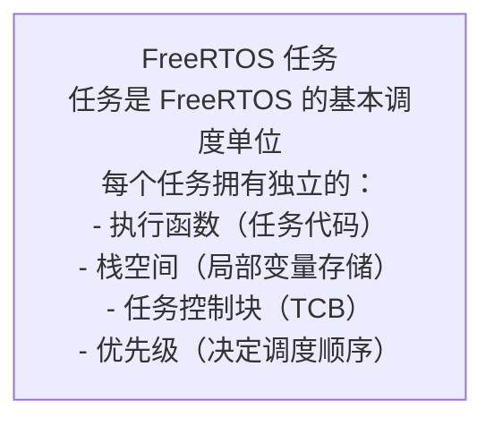
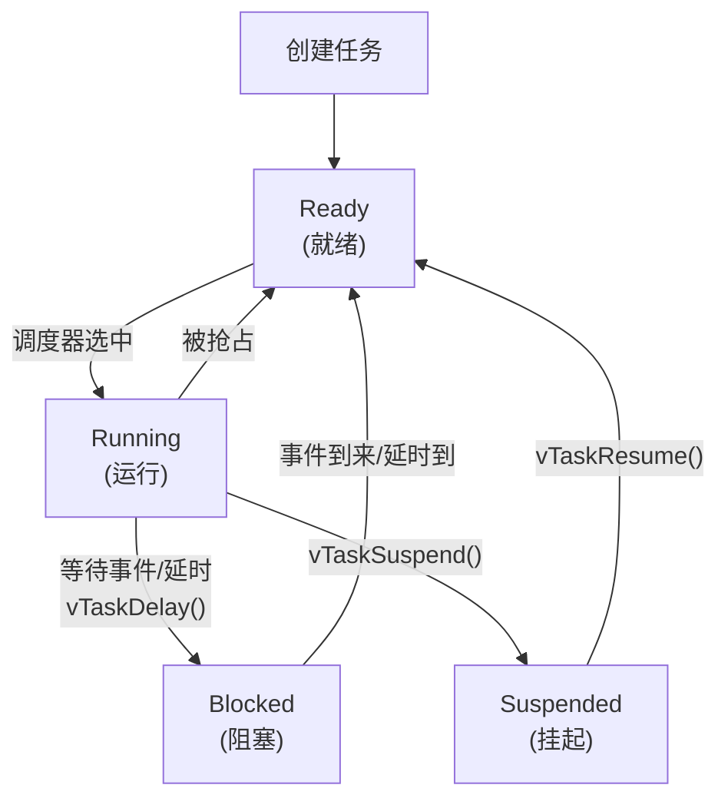
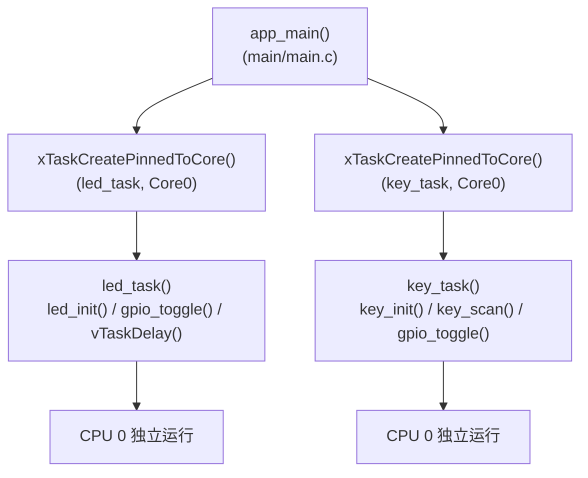
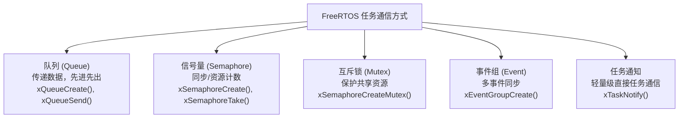

# ESP32-S3 多任务（Multitask）学习笔记

## 本章重要 API 函数

| API | 功能 | 参数说明 | 头文件 |
|-----|------|----------|--------|
| `xTaskCreatePinnedToCore()` | 创建任务并指定运行核心 | `TaskFunction_t pxTaskCode`：任务函数<br>`const char *pcName`：任务名称<br>`uint32_t usStackDepth`：栈大小<br>`void *pvParameters`：传入参数<br>`UBaseType_t uxPriority`：优先级<br>`TaskHandle_t *pxCreatedTask`：任务句柄<br>`BaseType_t xCoreID`：核心ID(0/1) | `"freertos/task.h"` |
| `xTaskCreate()` | 创建任务（系统自动选择核心） | 同上，但无 `xCoreID` 参数 | `"freertos/task.h"` |
| `vTaskDelay()` | 任务阻塞延时，让出 CPU | `const TickType_t ticks`：延时 tick 数 | `"freertos/task.h"` |
| `vTaskDelete()` | 删除任务 | `TaskHandle_t xTask`：任务句柄，`NULL` 表示删除自身 | `"freertos/task.h"` |
| `led_init()` | LED 初始化（自定义） | `void`：无参数 | `"led.h"` |
| `key_init()` | 按键初始化（自定义） | `void`：无参数 | `"key.h"` |
| `gpio_toggle()` | GPIO 电平翻转（自定义） | `gpio_num_t gpio_num`：引脚号 | `"led.h"` |

**任务创建参数说明：**
```c
xTaskCreatePinnedToCore(任务函数, "任务名称", 栈大小, 参数, 优先级, 任务句柄, 核心ID);
// Core ID: 0 = CPU0, 1 = CPU1, tskNO_AFFINITY = 无绑定
```

---

## 本章目录

> 点击条目可跳转到对应小节。

### 章节导航

- **[本章重要 API 函数](#本章重要-api-函数)**
- **[学习前后依赖](#学习前后依赖)**
- **[1. 概述](#1-概述)**
- **[2. FreeRTOS 基础原理](#2-freertos-基础原理)**
  - [2.1 任务概念](#21-任务概念)
  - [2.2 任务状态转换](#22-任务状态转换)
- **[3. ESP32-S3 双核架构](#3-esp32-s3-双核架构)**
  - [3.1 双核处理器特性](#31-双核处理器特性)
  - [3.2 任务核心分配](#32-任务核心分配)
- **[4. 软件架构传递树](#4-软件架构传递树)**
  - [4.1 多任务结构图](#41-多任务结构图)
  - [4.2 任务并行执行示意](#42-任务并行执行示意)
- **[5. 代码详细解析](#5-代码详细解析)**
  - [5.1 任务创建 - app_main()](#51-任务创建---app_main)
  - [5.2 LED 任务函数 - led_task()](#52-led-任务函数---led_task)
  - [5.3 按键任务函数 - key_task()](#53-按键任务函数---key_task)
- **[6. FreeRTOS 调度机制](#6-freertos-调度机制)**
  - [6.1 优先级调度](#61-优先级调度)
  - [6.2 时间片轮转](#62-时间片轮转)
- **[7. 任务间通信](#7-任务间通信)**
  - [7.1 共享资源问题](#71-共享资源问题)
  - [7.2 任务通信机制](#72-任务通信机制)
- **[8. 时序分析](#8-时序分析)**
  - [8.1 多任务执行时序](#81-多任务执行时序)
- **[容易踩坑](#容易踩坑)**
- **[9. 学习要点总结](#9-学习要点总结)**
  - [9.1 核心知识点](#91-核心知识点)
  - [9.2 关键 API](#92-关键-api)
  - [9.3 进阶方向](#93-进阶方向)
- **[Tips：本章容易被忽视的设计细节](#tips本章容易被忽视的设计细节)**

---

## 学习前后依赖

| 方向 | 内容 |
|------|------|
| 前置基础 | `vTaskDelay()`、无限循环任务、LED/按键基础组件和简单状态反馈。 |
| 本章核心 | 掌握 FreeRTOS 多任务创建、优先级、栈大小、核心绑定和任务并行协作。 |
| 后续承接 | 承接 `06_Exti` 与 `08_GPTimer` 中中断/回调向任务传递事件的协作模式。 |

## 1. 概述

本章节深入学习 FreeRTOS 多任务编程，理解 ESP32-S3 双核处理器的任务分配机制，实现 LED 任务和按键任务的并行执行。

从第 1 章到第 4 章，所有代码都运行在单个任务中——`app_main()` 的 `while(1)` 循环包揽了一切。但真实场景下，你不可能让 LED 闪烁和按键检测共享同一个循环：LED 闪烁需要 1 秒延时，而按键需要实时响应。多任务正是为了解决这个矛盾——让 LED 在自己的任务里慢慢闪烁，而按键任务以更快的频率独立扫描。

这是从"裸机思维"到"RTOS 思维"的关键转折点。

---

## 2. FreeRTOS 基础原理

### 2.1 任务概念



**任务 ≠ 线程：**

虽然行为上很像传统操作系统的线程，但 FreeRTOS 的任务有本质区别：

1. **内存无保护**：所有任务共享同一个物理地址空间，任务 A 可以用野指针改写任务 B 的栈——没有 MMU 提供隔离
2. **无虚拟内存**：没有页表、没有 swap、没有 fork。所有任务看到的是同一块物理 RAM
3. **协作式依赖**：高优先级任务如果不主动让出 CPU（通过 `vTaskDelay()` 或等待信号量），低优先级任务永远得不到执行——这就是"任务饿死"

这意味着 FreeRTOS 的"多任务"需要开发者自己约束行为。它给了你并发的能力，但没有给你并发的安全保障。

### 2.2 任务状态转换



**四种状态的直观理解：**

- **Running**：该任务正在 CPU 上执行。单核时只有一个任务处于此状态，双核时最多两个
- **Ready**："我想跑，但 CPU 没轮到我"。所有未被阻塞的、非最低优先级的就绪任务都在此排队
- **Blocked**："我在等电梯（延时/信号量/队列），等到了再叫我"
- **Suspended**："我被 `vTaskSuspend()` 强制暂停了，除非被 `vTaskResume()` 唤醒，否则调度器当我不存在"

**关键区别——Blocked vs Suspended：** Blocked 有超时机制（比如延时到了自动转 Ready），Suspended 必须显式恢复。大多数情况下我们用 Blocked（`vTaskDelay()`），只在需要"暂停任务由另一个任务恢复"的协作场景才用 Suspended。

---

## 3. ESP32-S3 双核架构

### 3.1 双核处理器特性

```mermaid
flowchart TD
    subgraph S["ESP32-S3 双核结构"]
        A["CPU 0<br/>(PRO_CPU)<br/>协议CPU"]
        B["CPU 1<br/>(APP_CPU)<br/>应用CPU"]
        C["共享内存<br/>共享外设"]
    end
    A --> C
    B --> C

CPU 0 (PRO_CPU): 默认运行 WiFi/BT 协议栈
CPU 1 (APP_CPU): 默认运行用户应用程序
```

**两个核心的真实区别：**

- 硬件上，CPU0 和 CPU1 是同构的 Xtensa LX7 核心，指令集完全一样
- **PRO_CPU**（CPU0）：可以做"保护"（内存访问异常、debug），通常用来跑协议栈（WiFi/BT 任务由 ESP-IDF 默认绑定到这里）
- **APP_CPU**（CPU1）：通常用来跑应用程序。但这是**惯例而非强制**——你可以让应用任务跑在 CPU0 上，没有任何问题

本章把两个任务都绑定到了 CPU0——这意味着它们共享一个物理核心，通过分时调度实现"伪并行"。如果你把它们分别绑定到 CPU0 和 CPU1，它们就能**真正同时执行**。

### 3.2 任务核心分配

```
任务创建函数对比：

xTaskCreate()          → 由系统自动选择核心
xTaskCreatePinnedToCore() → 指定任务运行在哪个核心

参数：
- Core ID: 0 = CPU0, 1 = CPU1
- tskNO_AFFINITY = 无核心绑定（系统调度）
```

**什么时候该固定核心？**

| 场景 | 绑定策略 |
|------|---------|
| 高实时性任务（如电机控制） | 绑定到专用核心，避免被其他任务抢占 |
| 与特定外设相关（如某个 SPI 仅连接到 CPU0 的 DMA） | 绑定到对应核心 |
| 普通应用任务 | `tskNO_AFFINITY`——让调度器决定 |
| Wi-Fi/BLE 协议栈 | 默认在 CPU0，不要动 |

**本项目的选择：** 两个任务都绑定到 CPU0，意味着它们时间片轮转。这其实是"退化到单核行为"——如果只为了学习多任务概念，绑不绑定核心都一样，但写出来让你知道有这个能力。

---

## 4. 软件架构传递树

### 4.1 多任务结构图



**架构的关键变化：** `app_main()` 不再是事件循环——它只创建两个任务后就"退休"了。两个子任务各自运行自己的 `while(1)` 循环。这是 RTOS 编程的标准模式：**main 只负责系统初始化 + 创建任务，业务逻辑在任务函数中运行**。

### 4.2 任务并行执行示意

```mermaid
flowchart LR
    subgraph CPU0["CPU0 调度"]
        direction LR
        L1["led_task<br/>100tick"] --> K1["key_task<br/>5tick"] --> L2["led_task<br/>100tick"] --> K2["key_task<br/>5tick"] --> DOT["..."]
    end
    
    subgraph LED["led_task 时间线"]
        direction LR
        LA["闪<br/>1tick"] --> LD1["延时<br/>100tick"] --> LB["闪<br/>1tick"] --> LD2["延时<br/>100tick"]
    end
    
    subgraph KEY["key_task 时间线"]
        direction LR
        KA["扫描<br/>1tick"] --> KD1["延时<br/>5tick"] --> KB["扫描<br/>1tick"] --> KD2["延时<br/>5tick"]
    end

两个任务交替运行在 CPU0 上
```

**时间片分析：**
- LED 任务每次激活约 1 tick（执行 `gpio_toggle()`），然后阻塞 100 tick
- 按键任务每次激活约 1 tick（执行 `key_scan()`），然后阻塞 5 tick
- 两者互不干扰——按键检测不会因为 LED 延时而被推迟 1 秒

这就是多任务的**核心价值**：将不同频率的操作解耦到独立任务中。

---

## 5. 代码详细解析

### 5.1 任务创建 - app_main()

**源代码（`main.c`）：**

```c
void app_main(void)
{
    xTaskCreatePinnedToCore(led_task,"led_task",4096,NULL,1,NULL,0);
    xTaskCreatePinnedToCore(key_task,"key_task",4096,NULL,1,NULL,0);
}
```

**函数参数详解：**

| 参数 | led_task 调用 | key_task 调用 | 说明 |
|------|---------------|---------------|------|
| 任务函数 | `led_task` | `key_task` | 任务执行的函数 |
| 任务名称 | `"led_task"` | `"key_task"` | 用于调试识别 |
| 栈大小 | `4096` | `4096` | 字节数，需足够存放局部变量 |
| 参数 | `NULL` | `NULL` | 传递给任务函数的参数 |
| 优先级 | `1` | `1` | 相同优先级，公平调度 |
| 任务句柄 | `NULL` | `NULL` | 用于后续操作任务 |
| 核心 ID | `0` | `0` | 都绑定到 CPU0 |

**栈大小的选择（4096 = 4KB）：**

为什么选 4096？这取决于任务函数的局部变量大小和调用深度：
- `led_task()` 只有几行代码，局部变量几乎为零 → 实际 1KB 就够
- `key_task()` 调用了 `key_scan()` 和 `gpio_toggle()`，栈上可能有几十字节的临时变量 → 1-2KB 足够

4096 字节对于这两个任务都**严重过度分配**了。但对于初学者，大栈的代价只是浪费了几 KB RAM（ESP32-S3 有 512KB SRAM），而栈溢出则是致命的（会导致不可预知的崩溃）。**先跑起来，再优化栈大小**是合理的策略。

**为什么任务句柄都设为 NULL？** 句柄用于后续操作任务——如 `vTaskSuspend(handle)`、`vTaskResume(handle)`、`vTaskDelete(handle)` 等。如果不需要动态管理任务（暂停/恢复/删除），传 NULL 完全没问题。本章的任务是永久存在的（在 `while(1)` 中循环），所以不需要句柄。

### 5.2 LED 任务函数 - led_task()

**源代码（`main.c`）：**

```c
void led_task(void *parameter)
{
    led_init();                     // 初始化 LED GPIO
    while (1)
    {
        gpio_toggle(GPIO_NUM_38);   // 翻转 LED
        vTaskDelay(100);            // 延时 100 tick
    }
}
```

**与单任务 LED 代码的差异：** 逻辑完全一样！唯一的区别是这段代码现在运行在独立任务中，而不是 `app_main()` 里。代码不用改，只需改运行位置——这就是 RTOS 抽象层的威力：业务逻辑与调度逻辑分离。

### 5.3 按键任务函数 - key_task()

**源代码（`main.c`）：**

```c
void key_task(void *parameter)
{
    key_init();                     // 初始化按键 GPIO
    while (1)
    {
        uint8_t key_num = key_scan();       // 扫描按键
        if(key_num == 1)
        {
             gpio_toggle(GPIO_NUM_39);      // KEY1按下时翻转LED
        }
        vTaskDelay(5);              // 延时 5 tick
    }
}
```

**按键检测与 LED 反馈的闭环：** KEY1 按下 → 翻转 GPIO39 上的 LED。这是第一个"输入→处理→输出"的完整交互链：
- 输入：`key_scan()` 检测按键（GPIO 输入）
- 处理：`if(key_num == 1)` 判断按键编号
- 输出：`gpio_toggle(GPIO_NUM_39)` 翻转 LED（GPIO 输出）

后续章节的所有交互系统（按键控制蜂鸣器、按键切换流水灯模式）都是这个三段式的扩展。

**任务结构模板：**

```c
void 任务函数名(void *parameter)
{
    // 初始化部分（执行一次）
    ...
    
    // 任务主循环（无限循环）
    while(1)
    {
        // 任务工作代码
        ...
        
        // 延时/阻塞（让出 CPU）
        vTaskDelay(...);
        
        // 或等待事件
        xQueueReceive(...);
        xSemaphoreTake(...);
    }
    
    // 正常任务不应退出循环
    // 若需要删除任务：
    vTaskDelete(NULL);
}
```

**为什么任务不应退出 while(1)？** 如果任务函数执行 `return`，FreeRTOS 会把该任务标记为"已完成"——但不会自动删除它（除非 `configUSE_DAEMON_STARTUP_HOOK` 等配置）。一个已完成但未删除的任务仍然占用 TCB 和栈空间，造成内存泄漏。正确做法是显式调用 `vTaskDelete(NULL)`。

---

## 6. FreeRTOS 调度机制

### 6.1 优先级调度

```
优先级规则：
- 数字越大，优先级越高
- 同优先级任务：Round-Robin 轮转调度
- 高优先级任务就绪时：立即抢占低优先级任务

ESP-IDF 优先级范围：
- 0: 最低优先级（Idle 任务）
- 1-23: 用户任务可用
- 24+: 系统保留
```

**抢占的含义：** 如果 led_task(优先级 1) 正在运行，突然 key_task(优先级 2) 变为就绪，调度器会**立即暂停** led_task，转而运行 key_task。led_task 的上下文（寄存器、栈指针）被保存到 TCB，等 key_task 再次阻塞时恢复。

这也是为什么 ISR 中不能调用阻塞 API——ISR 不是任务，没有 TCB 保存上下文，阻塞了就回不来了。

### 6.2 时间片轮转

```mermaid
flowchart LR
    A["Task A<br/>运行"] -->|"vTaskDelay<br/>(主动让出)"| B["Task B<br/>运行"]
    B -->|"vTaskDelay<br/>(主动让出)"| C["Task A<br/>运行"]
    C -->|"vTaskDelay<br/>(主动让出)"| D["..."]

注意：FreeRTOS 使用协作式调度
任务必须主动调用延时/等待函数让出 CPU
```

**FreeRTOS 是"伪抢占式"？**

严格来说，FreeRTOS 的调度策略是**固定优先级抢占 + 同优先级时间片轮转**。抢占只发生在更高的优先级变为就绪时，而时间片轮转只发生在同优先级任务之间。

但 ESP-IDF 的默认配置（`configUSE_TIME_SLICING=1`）下，即使任务没有主动让出 CPU，调度器也会在每个 tick 中断时检查是否需要切换同优先级的另一个就绪任务。所以实际上 FreeRTOS 更像一个**有保护的抢占式调度器**——只要你的代码不关中断或在临界区中，调度器就能打断你。

---

## 7. 任务间通信

### 7.1 共享资源问题

```
多任务访问共享资源的风险：

led_task: ────► gpio_toggle(GPIO_NUM_38) ────►
key_task: ────► gpio_toggle(GPIO_NUM_38) ────►

若两个任务同时操作同一 GPIO：
可能导致竞态条件（Race Condition）

解决方案：
- 互斥锁（Mutex）
- 信号量（Semaphore）
- 队列（Queue）
```

**本项目的竞态风险分析：**

- `led_task` 操作 GPIO 38
- `key_task` 操作 GPIO 39

两个 GPIO 是不同的物理引脚，不存在竞态。但如果有一天你把它们都改为操作 GPIO 38，就需要注意了。`gpio_toggle()` 是"读→判断→反写"三步操作，如果在读和写之间被另一个任务抢占并翻转了同一引脚，最终结果可能错误。

### 7.2 任务通信机制



**本章为什么没用到任务通信？** 两个任务操作的是不同的 GPIO，它们之间不需要传递数据。但后续章节中，当你需要"按键按下后通知 LED 任务改变闪烁频率"时，队列或任务通知就是必需的——那是从"独立任务"到"协作任务"的进阶。

---

## 8. 时序分析

### 8.1 多任务执行时序

```mermaid
flowchart TD
    subgraph LED["led_task (每100tick闪烁一次)"]
        L0["tick 0: LED闪烁"] --> L1["延时 100tick"] --> L2["tick 100: LED闪烁"] --> L3["延时 100tick"] --> L4["tick 200: LED闪烁"]
    end
    subgraph KEY["key_task (每5tick扫描一次)"]
        K0["tick 0: 扫描"] --> K1["延时 5tick"] --> K2["tick 5: 扫描"] --> K3["延时 5tick"] --> K4["..."]
    end

调度器根据 vTaskDelay 时间切换任务
```

**时序的关键洞察：** 在单任务架构中，LED 闪烁的 100 tick 延时意味着按键在这段时间内**完全不被检测**。而在多任务架构中，LED 任务在延时期间让出 CPU，按键任务立刻接替运行——按键每 5 tick 检测一次，响应速度提高了 20 倍。这就是多任务的**实际业务收益**。

---

## 容易踩坑

| 现象 | 常见原因 | 排查方向 |
|------|----------|----------|
| 任务创建失败或重启 | 栈大小不足导致溢出 | 增大栈并查看任务水位线/异常回溯 |
| 某个任务一直不运行 | 高优先级任务不阻塞导致饿死 | 在循环中加入 `vTaskDelay()` 或等待事件 |
| 共享 GPIO 状态异常 | 多个任务同时读改写同一资源 | 用队列/互斥锁或集中到单任务处理 |
| 绑定核心后表现异常 | 不了解 CPU0/CPU1 系统任务负载 | 优先使用 `tskNO_AFFINITY`，必要时再固定核心 |

---

## 9. 学习要点总结

### 9.1 核心知识点

| 知识点 | 说明 |
|--------|------|
| 任务创建 | `xTaskCreatePinnedToCore()` 指定核心 |
| 任务结构 | 初始化 + 无限循环 + 延时让出 CPU |
| 优先级调度 | 同优先级轮转，高优先级抢占 |
| 任务栈大小 | 根据局部变量需求设置 |

### 9.2 关键 API

| API | 功能 |
|-----|------|
| `xTaskCreatePinnedToCore()` | 创建任务并指定核心 |
| `vTaskDelay()` | 阻塞延时，让出 CPU |
| `vTaskDelete()` | 删除任务 |

### 9.3 进阶方向

- 任务间队列通信
- 互斥锁保护共享资源
- 利用双核分别运行不同任务

---

## Tips：本章容易被忽视的设计细节

### 1. `app_main()` 本身也是一个任务——它去哪了？

```c
void app_main(void)
{
    xTaskCreatePinnedToCore(led_task, ...);
    xTaskCreatePinnedToCore(key_task, ...);
    // app_main 返回后去哪了？
}
```

`app_main()` 是 ESP-IDF 自动创建的"main 任务"。当它创建完两个子任务并返回后，main 任务被 FreeRTOS 自动删除（`vTaskDelete(NULL)` 在 C 运行时中被隐式调用）。所以系统最终只有 3 个任务在运行：
- **Idle Task**（优先级 0）：在没有用户任务可运行时运行，通常用于释放被删除任务的内存
- **led_task**（优先级 1）
- **key_task**（优先级 1）

如果你需要在 `app_main()` 返回后继续保持 main 任务活跃（比如用它来做系统监控），就在它里面也写一个 `while(1)` 循环。

### 2. 优先级相等时的调度顺序——FIFO 还是 Round-Robin？

两个任务优先级都是 1，都属于就绪状态。调度器按什么顺序运行它们？

答案是：**按创建顺序**。`led_task` 先创建，所以它先运行。LED 任务第一次 `vTaskDelay(100)` 后，调度器看到 key_task 也是就绪的、同等优先级，就切换到 key_task。key_task 执行完毕（`vTaskDelay(5)`），调度器看到 led_task 还在阻塞中（才过了 5 tick，还剩 95 tick），就运行 Idle Task。

当 tick 到达 100 时，led_task 超时醒来变为 Ready，而此时 key_task 正阻塞在它的第 N 次 `vTaskDelay(5)` 中——调度器立即把 led_task 调上来运行。

这个调度过程证明了：**延时短的 key_task 并不会打断延时长的 led_task**，因为它们的优先级相同，低优先级不能抢占高优先级（反之亦然），同优先级之间是协作式的——你让出 CPU，我才接上。

### 3. 任务的"栈水位线"——如何知道 4096 到底够不够？

FreeRTOS 提供 `uxTaskGetStackHighWaterMark()` 函数，返回任务运行时栈的**最小剩余空间**（以字为单位）。在水位线最低时还剩多少空间，就是你的安全余量。

```c
void led_task(void *parameter) {
    led_init();
    while(1) {
        gpio_toggle(GPIO_NUM_38);
        vTaskDelay(100);
        // 定期检查水位线
        UBaseType_t highWaterMark = uxTaskGetStackHighWaterMark(NULL);
        printf("led_task stack free: %u words\n", highWaterMark);
    }
}
```

如果水位线接近 0（剩余空间 < 100 字），说明栈快爆了——要么增大 `usStackDepth`，要么减少局部变量的使用（特别是大数组）。

### 4. 为什么本章把两个任务都绑在 CPU0 而不是分开？

两个理由：

1. **教学目的**：让读者观察同一核心下的时间片轮转调度。分开到两个核心后，两个任务真正并行运行，反而没有延迟纠纷可以观察
2. **预留 CPU1**：WiFi/BLE 协议栈默认在 CPU0 上运行（通过 `CONFIG_FREERTOS_UNICORE` 和相关选项），CPU1 留给应用程序是个好习惯。虽然本章没有用到协议栈，但养成这个习惯对后续工程有益

实际项目中，如果 CPU1 有空闲，把计算密集型任务或实时性要求高的任务移到 CPU1 上是很常见的优化手段。

### 5. 从单任务到多任务：思维模式的转变

| 单任务思维 | 多任务思维 |
|-----------|-----------|
| "我按顺序做：LED 闪一下，然后检查按键" | "LED 任务和按键任务各管各的" |
| "延时 = CPU 等待" | "延时 = 把 CPU 借给别的任务" |
| "全局变量随便用" | "全局变量需要保护（互斥锁/队列）" |
| "程序 = 一个 while(1)" | "程序 = 多个 while(1) + 调度器" |

这个转变不是一蹴而就的。当你从单任务转到多任务时，最先遇到的坑往往不是 API 不会用，而是**全局变量的竞态条件**。比如有一个全局变量 `g_led_state`，两个任务都读写它——这在单任务下完全没问题，在多任务下就是隐藏的 Bug。后续章节的任务间通信（队列、信号量、互斥锁）正是为了解决这类问题。

### 6. 本章与后续章节的衔接

| 衔接点 | 本章内容 | 后续章节 |
|--------|---------|----------|
| 任务隔离 | LED 和按键独立运行 | 06_Exti：中断替代按键轮询 |
| 优先级机制 | 同优先级轮转 | 后续章节：不同优先级的抢占实验 |
| 任务句柄 | 创建时传 NULL | 后续章节：用句柄挂起/恢复/删除任务 |
| 共享资源风险 | 7.1 节预告 | 后续章节：Mutex、Queue、Semaphore 实战 |
| 双核能力 | 绑在同一个核心 | 后续章节：将不同任务分布到双核 |
