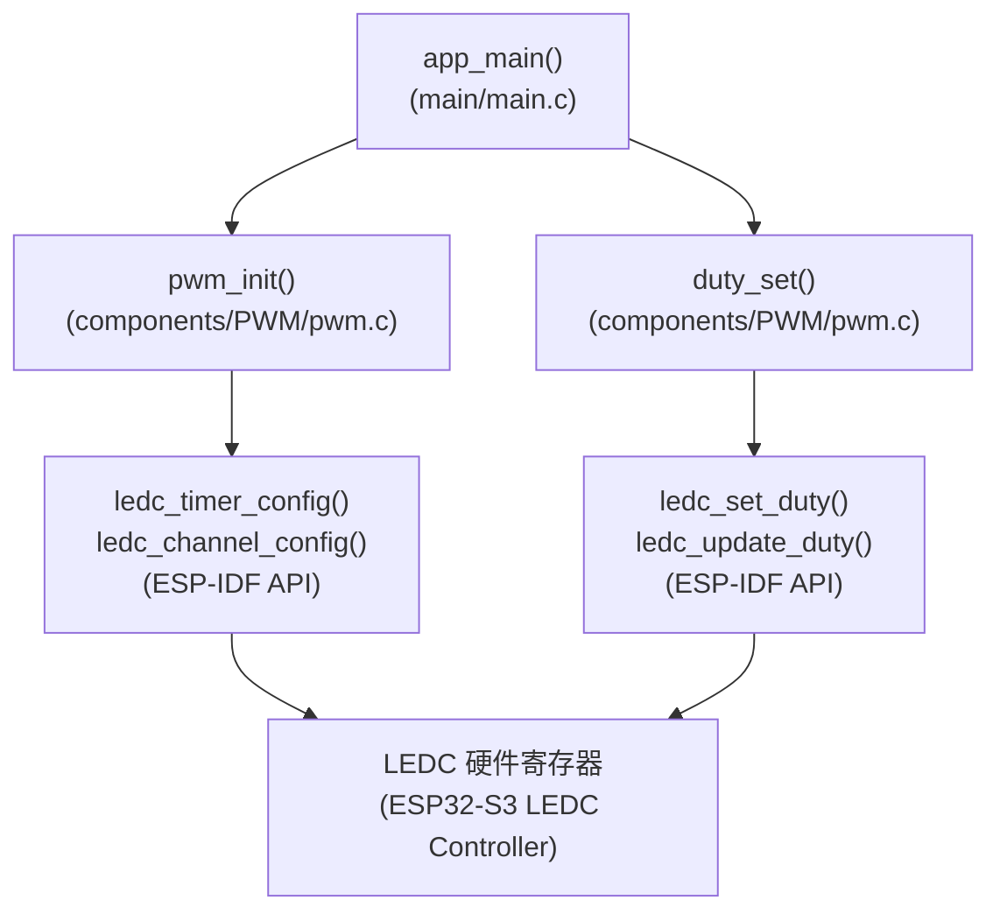
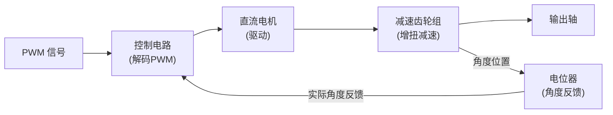
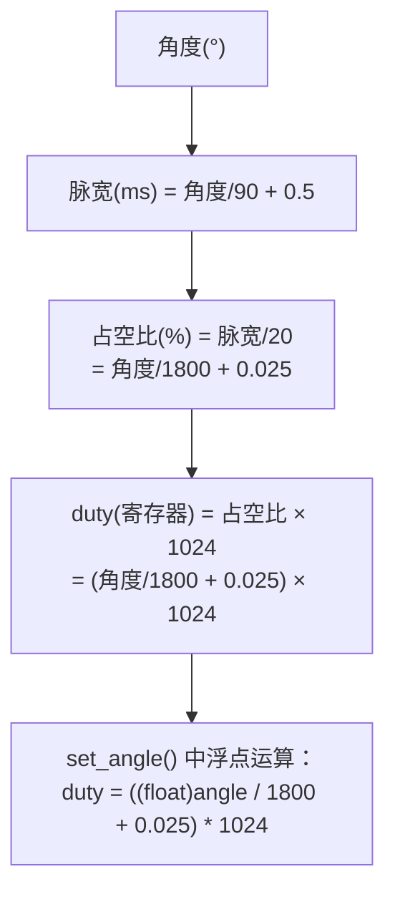
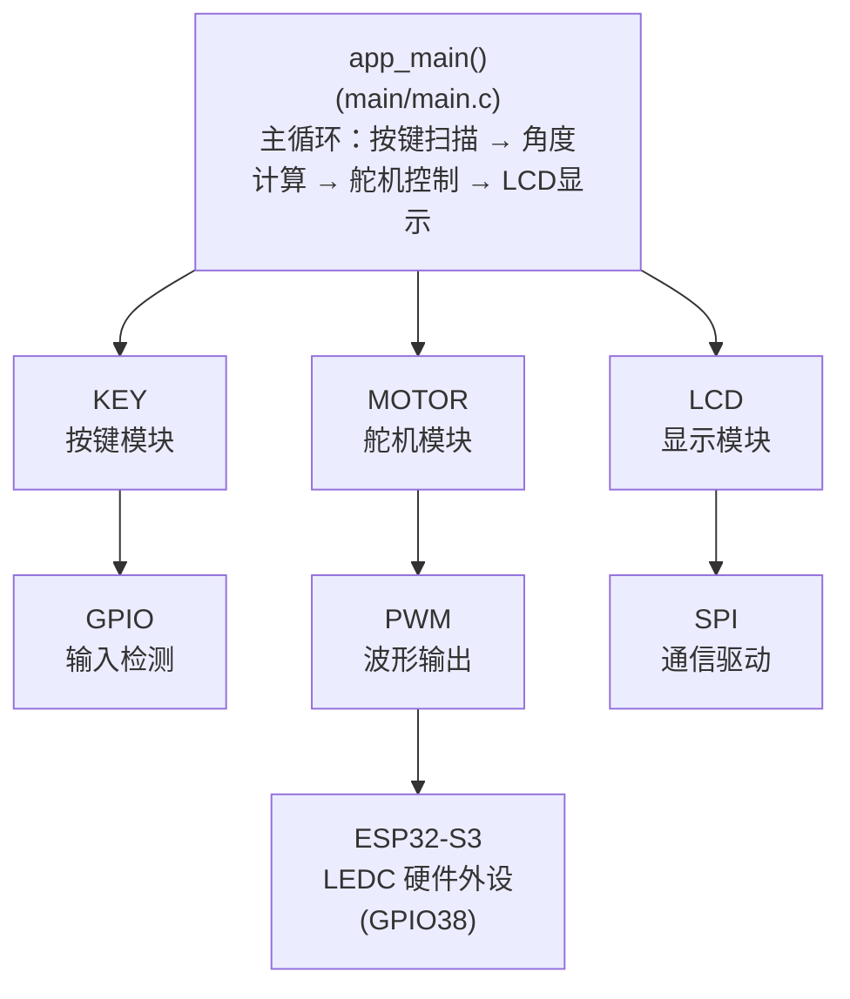

# ESP32-S3 PWM 与舵机控制学习笔记

> 本文合并自 `10_PWM`（LEDC PWM 基础）和 `11_PWMServoMotor`（舵机控制）两章的学习笔记。

## 本章重要 API 函数

| API | 功能 | 参数说明 | 头文件 |
|-----|------|----------|--------|
| `ledc_timer_config()` | 配置 LEDC PWM 定时器 | `const ledc_timer_config_t *timer_conf`：定时器配置结构体指针（频率、分辨率、速度模式、定时器编号） | `"driver/ledc.h"` |
| `ledc_channel_config()` | 配置 LEDC PWM 输出通道 | `const ledc_channel_config_t *ledc_conf`：通道配置结构体指针（引脚、占空比、通道号、绑定定时器） | `"driver/ledc.h"` |
| `ledc_set_duty()` | 设置 PWM 占空比（写入影子寄存器） | `ledc_mode_t speed_mode`：速度模式<br>`ledc_channel_t channel`：通道号<br>`uint32_t duty`：占空比值 | `"driver/ledc.h"` |
| `ledc_update_duty()` | 更新占空比立即生效（影子→活动寄存器） | `ledc_mode_t speed_mode`：速度模式<br>`ledc_channel_t channel`：通道号 | `"driver/ledc.h"` |
| `ledc_set_freq()` | 动态修改 PWM 频率 | `ledc_mode_t speed_mode`：速度模式<br>`ledc_timer_t timer_num`：定时器编号<br>`uint32_t freq_hz`：目标频率 | `"driver/ledc.h"` |
| `ledc_get_duty()` | 获取当前占空比 | `ledc_mode_t speed_mode`：速度模式<br>`ledc_channel_t channel`：通道号 | `"driver/ledc.h"` |
| `ledc_get_freq()` | 获取当前 PWM 频率 | `ledc_mode_t speed_mode`：速度模式<br>`ledc_timer_t timer_num`：定时器编号 | `"driver/ledc.h"` |
| `pwm_init()` | 初始化 PWM 输出（自定义封装） | `void`：无参数 | `"pwm.h"` |
| `duty_set()` | 设置占空比并更新生效（自定义封装） | `uint16_t duty`：占空比值（10位：0-1023） | `"pwm.h"` |
| `set_angle()` | 设置舵机旋转角度（角度→占空比转换） | `uint8_t angle`：目标角度（0-180°），超过180则自动限制为180° | `"motor.h"` |

**LEDC 定时器配置结构体关键字段：**

| 字段 | 说明 |
| --- | --- |
| `.clk_cfg` | 时钟源选择：`LEDC_AUTO_CLK`（自动）/ `LEDC_USE_APB_CLK`（80MHz）/ `LEDC_USE_REF_TICK`（1MHz） |
| `.duty_resolution` | 占空比分辨率：`LEDC_TIMER_10_BIT`（0-1023）/ `LEDC_TIMER_13_BIT`（0-8191）等 |
| `.freq_hz` | PWM 输出频率（Hz） |
| `.speed_mode` | `LEDC_LOW_SPEED_MODE` 或 `LEDC_HIGH_SPEED_MODE` |
| `.timer_num` | 定时器编号：`LEDC_TIMER_0` ~ `LEDC_TIMER_3` |

**LEDC 通道配置结构体关键字段：**

| 字段 | 说明 |
| --- | --- |
| `.channel` | 通道编号：`LEDC_CHANNEL_0` ~ `LEDC_CHANNEL_7` |
| `.duty` | 初始占空比值 |
| `.gpio_num` | 输出 GPIO 引脚号 |
| `.timer_sel` | 绑定定时器：`LEDC_TIMER_0` ~ `LEDC_TIMER_3` |
| `.hpoint` | 高电平起始计数点（决定相位） |
| `.intr_type` | 中断类型：`LEDC_INTR_DISABLE` / `LEDC_INTR_FADE_END` |

**舵机角度 → 占空比转换公式：**

| 步骤 | 公式 | 说明 |
|------|------|------|
| 1. 脉宽计算 | `脉宽(ms) = 角度/90 + 0.5` | 0°→0.5ms, 180°→2.5ms |
| 2. 占空比计算 | `占空比 = 脉宽/20 = 角度/1800 + 0.025` | 周期固定20ms（50Hz） |
| 3. 寄存器值 | `duty = (角度/1800 + 0.025) × 1024` | 10位分辨率 |

---

## 本章目录

> 点击条目可跳转到对应小节。

### 章节导航

- **[本章重要 API 函数](#本章重要-api-函数)**
- **[学习前后依赖](#学习前后依赖)**
- **[第一部分：LEDC PWM 基础](#第一部分ledc-pwm-基础)**
  - **[1. 概述](#1-概述)**
  - **[2. PWM 原理](#2-pwm-原理)**
    - [2.1 什么是 PWM](#21-什么是-pwm)
    - [2.2 PWM 关键参数](#22-pwm-关键参数)
  - **[3. LEDC 硬件架构](#3-ledc-硬件架构)**
    - [3.1 时钟源到 PWM 输出完整路线](#31-时钟源到-pwm-输出完整路线)
    - [3.2 频率与分辨率计算](#32-频率与分辨率计算)
    - [3.3 LEDC 资源分配](#33-ledc-资源分配)
  - **[4. 软件架构传递树](#4-软件架构传递树)**
    - [4.1 模块调用关系](#41-模块调用关系)
  - **[5. 代码详细解析](#5-代码详细解析)**
    - [5.1 PWM 初始化 - pwm_init()](#51-pwm-初始化---pwm_init)
    - [5.2 占空比设置 - duty_set()](#52-占空比设置---duty_set)
    - [5.3 主程序 - app_main()（呼吸灯）](#53-主程序---app_main呼吸灯)
- **[第二部分：舵机控制](#第二部分舵机控制)**
  - **[6. 舵机原理](#6-舵机原理)**
    - [6.1 舵机内部结构](#61-舵机内部结构)
    - [6.2 舵机 PWM 协议 — 角度到占空比的推导](#62-舵机-pwm-协议-—-角度到占空比的推导)
    - [6.3 核心推导过程](#63-核心推导过程)
  - **[7. 舵机控制软件架构](#7-舵机控制软件架构)**
    - [7.1 模块层次结构](#71-模块层次结构)
    - [7.2 主程序数据流](#72-主程序数据流)
  - **[8. 舵机代码关键解析](#8-舵机代码关键解析)**
    - [8.1 角度设置 - set_angle()](#81-角度设置---set_angle)
    - [8.2 主程序逻辑 - app_main()（舵机）](#82-主程序逻辑---app_main舵机)
- **[容易踩坑](#容易踩坑)**
- **[9. 学习要点总结](#9-学习要点总结)**
  - [9.1 核心知识点](#91-核心知识点)
  - [9.2 舵机角度映射速查表](#92-舵机角度映射速查表)
- **[Tips](#tips)**

---

## 学习前后依赖

| 方向 | 内容 |
|------|------|
| 前置基础 | 定时器周期、频率、占空比概念，GPIO 输出和 LED/LCD 显示基础。 |
| 本章核心 | 掌握 LEDC PWM 定时器/通道配置、频率与分辨率约束、占空比更新流程；理解舵机角度到脉宽的线性映射关系。 |
| 后续承接 | 承接 `12_ADCContinuous`、`13_ADC` 的模拟输入交互控制（如电位器控制角度/亮度）。 |

---

## 第一部分：LEDC PWM 基础

### 1. 概述

ESP32-S3 内置 LEDC（LED PWM Controller）外设，提供硬件级 PWM 生成。本章前半部分讲解 LEDC 的基本用法（呼吸灯），后半部分讲解 PWM 的实际应用——舵机角度控制。

PWM 的价值在于：用纯数字信号（只有 0 和 1）模拟出「中间值」效果。你不需要 DAC（数模转换器）就能控制 LED 亮度、电机转速、舵机角度。

### 2. PWM 原理

#### 2.1 什么是 PWM

PWM（Pulse Width Modulation，脉冲宽度调制）是一种通过调节矩形波信号中高电平持续时间（占空比）来传递信息的技术。

```
PWM 波形示意：

周期 T（固定）
│←──────────────→│
    ┌──────────┐         ┌──────────┐
    │ 高电平    │         │  高电平   │    占空比 = ton / T × 100%
    │   ton    │         │   ton    │
────┘          └─────────┘          └───
    低电平                低电平

占空比 25%：
    ┌──┐      ┌──┐      ┌──┐
    │  │      │  │      │  │
────┘  └──────┘  └──────┘  └──────

占空比 75%：
    ┌────────┐┌────────┐┌────────┐
    │        ││        ││        │
────┘        └┘        └┘        └──
```

**核心原理理解**：PWM 不改变信号电压（ESP32-S3 输出始终是 3.3V 或 0V），而是改变高电平的时间占比。对 LED 来说，如果周期足够快（>100Hz），人眼感受到的是平均亮度而不是闪烁。

#### 2.2 PWM 关键参数

| 参数 | 含义 | 本项目呼吸灯取值 | 本项目舵机取值 |
|------|------|-----------|-----------|
| 频率 `f` | 每秒 PWM 周期数 | 1000 Hz | 50 Hz |
| 周期 `T` | `T = 1/f`，一个周期时长 | 1 ms | 20 ms |
| 分辨率 | 占空比的细分精度 | 10-bit（0~1023） | 10-bit（0~1023） |
| 占空比 `D` | 高电平占周期的比例 | 由 duty 值决定 | 由角度计算得出 |

### 3. LEDC 硬件架构

#### 3.1 时钟源到 PWM 输出完整路线

```text
时钟源
  │
  ▼
LEDC_AUTO_CLK
  │  选择 APB/REF/RTC 时钟
  ▼
分频器 Divider
  │
  ▼
LEDC Timer
  │  产生 PWM 时基
  ▼
LEDC Channel
  │  duty/hpoint 比较
  ▼
GPIO Matrix
  │
  ▼
GPIO_NUM_38 -> LED / 舵机信号线
```

**Timer 与 Channel 的关系：**

```text
LEDC_TIMER_0 ─┬─ LEDC_CH0
              └─ LEDC_CH1

LEDC_TIMER_1 ─┬─ LEDC_CH2
              └─ LEDC_CH3

LEDC_TIMER_2 ─┬─ LEDC_CH4
              └─ LEDC_CH5

LEDC_TIMER_3 ─┬─ LEDC_CH6
              └─ LEDC_CH7
```

每个通道通过 `timer_sel = LEDC_TIMER_x` 选择定时器。共用同一定时器的通道具有相同频率和分辨率，但占空比可以独立设置。

**一个 PWM 周期内 HIGH/LOW：**

```text
计数值: 0          duty=512          1023
        |-------------|---------------|
输出:   HIGH HIGH HIGH LOW LOW LOW LOW
        |<--512个计数-->|<--512个计数-->|
        |<------- 1 PWM 周期 -------->|
```

计数器从 0 递增到 `2^resolution - 1` 后回到 0；当计数值小于 duty 时输出 HIGH，达到 duty 后输出 LOW。

#### 3.2 频率与分辨率计算

```text
freq = 时钟源频率 / (2^resolution × (divider + 1))

呼吸灯项目：
APB_CLK = 80MHz
freq_hz = 1000Hz
resolution = 10-bit
分频系数 ≈ 80MHz / (1024 × 1000) - 1
占空比 512 / 1024 = 50%
```

**关键约束**：频率 × 2^分辨率 ≤ 时钟源频率。这意味着分辨率和频率是互相制约的。参见本文 Tips 小节第 4 条的详细分析。

#### 3.3 LEDC 资源分配

```text
LEDC 资源
├─ Timer: 4 个，TIMER_0 ~ TIMER_3
├─ Channel: 8 个，CHANNEL_0 ~ CHANNEL_7
├─ 低速模式通道: 8 个，无毛刺切换
├─ 高速模式通道: 8 个，部分芯片支持
├─ 分辨率: 1 ~ 20 bit
└─ 频率范围: 1 Hz ~ 40 MHz
```

```
Timer 决定频率和分辨率
Channel 决定具体 GPIO 和 duty

多个 Channel 可共用一个 Timer：
共用 Timer  -> 频率相同
独立 Channel -> 占空比可不同
```

### 4. 软件架构传递树

#### 4.1 模块调用关系



### 5. 代码详细解析

#### 5.1 PWM 初始化 - pwm_init()

**源代码（`pwm.c`）：**

```c
void pwm_init(void)
{
    // 定时器配置
    led_timer_config_t ledctimer_cfg={
        .clk_cfg=LEDC_AUTO_CLK,              // 自动时钟配置
        .duty_resolution=LEDC_TIMER_10_BIT,  // 占空比分辨率10位
        .freq_hz=1000;                        // PWM频率1000Hz
        .speed_mode=LEDC_LOW_SPEED_MODE,     // 低速模式
        .timer_num=LEDC_TIMER_0,             // 定时器0
    };
    ledc_channel_config(&ledctimer_cfg);

    // 通道配置
    ledc_channel_config_t ledcchannel_cfg={
        .channel=LEDC_CHANNEL_0,              // LEDC PWM通道0
        .duty=512,                            // 初始占空比512
        .flag.output_invert=0,                // 输出不反转
        .gpio_num=GPIO_NUM_38,                // GPIO38输出PWM
        .hpoint=0,                            // 计数高点值0
        .intr_type=LEDC_INTR_DISABLE,         // 禁用中断
        .speed_mode=LEDC_LOW_SPEED_MODE,      // 低速模式
        .timer_sel=LEDC_TIMER_0,              // 使用定时器0
    };
    ledc_channel_config(&ledcchannel_cfg);
}
```

**定时器配置结构体详解：**

| 字段 | 值 | 说明 |
|------|-----|------|
| `clk_cfg` | `LEDC_AUTO_CLK` | 自动选择时钟源，系统自动计算最佳分频 |
| `duty_resolution` | `LEDC_TIMER_10_BIT` | 占空比精度10位，范围0~1023 |
| `freq_hz` | `1000` | PWM频率1000Hz |
| `speed_mode` | `LEDC_LOW_SPEED_MODE` | 低速模式，支持无毛刺切换 |
| `timer_num` | `LEDC_TIMER_0` | 使用定时器0 |

**通道配置结构体详解：**

| 字段 | 值 | 说明 |
|------|-----|------|
| `channel` | `LEDC_CHANNEL_0` | 使用通道0 |
| `duty` | `512` | 初始占空比512（50%亮度） |
| `flag.output_invert` | `0` | 输出不反转 |
| `gpio_num` | `GPIO_NUM_38` | PWM信号输出到GPIO38 |
| `hpoint` | `0` | 高电平起始点 |
| `intr_type` | `LEDC_INTR_DISABLE` | 禁用LEDC中断 |
| `speed_mode` | `LEDC_LOW_SPEED_MODE` | 低速模式 |
| `timer_sel` | `LEDC_TIMER_0` | 绑定到定时器0 |

#### 5.2 占空比设置 - duty_set()

**源代码（`pwm.c`）：**

```c
void duty_set(uint16_t duty)
{
    ledc_set_duty(LEDC_LOW_SPEED_MODE,LEDC_CHANNEL_1,duty);    // 设置占空比
    ledc_update_duty(LEDC_LOW_SPEED_MODE,LEDC_CHANNEL_1);      // 更新占空比生效
}
```

**注意：** 代码中使用 `LEDC_CHANNEL_1`，但初始化时配置的是 `LEDC_CHANNEL_0`，这是一个潜在的 bug。实际使用时应保持一致。

**影子寄存器机制：**

```text
ledc_set_duty()
      │
      ▼
影子寄存器 Shadow
      │  ledc_update_duty()
      ▼
活动寄存器 Active
      │
      ▼
PWM 输出更新
```

优点：避免 PWM 输出毛刺、支持原子更新多个参数，并保证波形连续性。这类似于双缓冲技术——新值先写入后台缓冲区，确认无误后一次性切换到前台。

#### 5.3 主程序 - app_main()（呼吸灯）

**源代码（`main.c`）：**

```c
void app_main(void)
{
    pwm_init();                              // 初始化LEDC PWM
    while(1)
    {
        // 占空比递增：0→1023（LED渐亮）
        for(uint16_t i=0;i<1024;i++)
        {
            duty_set(i);
            vTaskDelay(10);                  // 延时10个tick
        }
        // 占空比递减：1023→0（LED渐暗）
        for(uint16_t i=1023;i>0;i--)
        {
            duty_set(i);
            vTaskDelay(10);                  // 延时10个tick
        }
    }
}
```

**呼吸灯效果时序图：**

```text
时间:  |--------- 渐亮 ---------|--------- 渐暗 ---------|
duty:  0        512          1023        512          0
亮度:  暗  ->   半亮   ->     亮   ->    半亮   ->    暗
PWM:   窄脉冲 -> 50%占空比 -> 宽脉冲 -> 50%占空比 -> 窄脉冲
```

---

## 第二部分：舵机控制

### 6. 舵机原理

#### 6.1 舵机内部结构



```text
闭环控制原理：
  1. 控制电路接收 PWM 信号，解码出目标角度
  2. 电位器检测当前实际角度
  3. 比对目标与实际的差值，驱动电机转动
  4. 到达目标角度后电机停止
```

舵机本质上是一个带位置反馈的直流电机系统。你只需发出 PWM 脉宽指令，舵机内部的闭环控制器会自动完成「转到指定角度并保持」的全部动作。

#### 6.2 舵机 PWM 协议 — 角度到占空比的推导

标准舵机使用 **50Hz** PWM 信号（周期 T = 20ms），通过调节高电平脉冲宽度来控制角度：

```
舵机 PWM 信号（50Hz，周期 20ms）：

  角度 0°（脉宽 0.5ms）：
  ┌──┐                                ┌──┐
  │  │                                │  │
──┘  └────────────────────────────────┘  └──
  │0.5ms│←──────── 20ms ──────────→│

  角度 90°（脉宽 1.5ms）：
  ┌──────┐                            ┌──────┐
  │      │                            │      │
──┘      └────────────────────────────┘      └──
  │1.5ms│←──────── 20ms ──────────→│

  角度 180°（脉宽 2.5ms）：
  ┌──────────┐                        ┌──────────┐
  │          │                        │          │
──┘          └────────────────────────┘          └──
  │ 2.5ms  │←──────── 20ms ──────────→│
```

#### 6.3 核心推导过程

**第一步：建立角度与脉宽的线性关系**

舵机角度与脉冲宽度呈线性关系：

```
角度范围：     0°  ──────────→  180°
脉宽范围：  0.5ms  ──────────→  2.5ms
```

线性方程：

```
脉宽(ms) = k × 角度(°) + b

代入端点：
  k × 0   + b = 0.5   →   b = 0.5
  k × 180 + b = 2.5   →   180k + 0.5 = 2.5  →  k = 2.0/180 = 1/90

即：脉宽(ms) = (1/90) × 角度 + 0.5
```

**第二步：将脉宽转换为占空比**

占空比 = 脉宽 / 周期：

```
占空比 = 脉宽(ms) / T(ms) = (角度/90 + 0.5) / 20

简化：
  占空比 = 角度 / 1800 + 0.025
```

验证端点：

| 角度 | 计算过程 | 占空比 | 脉宽 |
|------|---------|--------|------|
| 0° | 0/1800 + 0.025 | 2.5% | 0.5 ms |
| 45° | 45/1800 + 0.025 | 5.0% | 1.0 ms |
| 90° | 90/1800 + 0.025 | 7.5% | 1.5 ms |
| 135° | 135/1800 + 0.025 | 10.0% | 2.0 ms |
| 180° | 180/1800 + 0.025 | 12.5% | 2.5 ms |

**第三步：将占空比转换为 LEDC 寄存器值**

10-bit 分辨率下，寄存器值 = 占空比 × 1024：

```
duty = 占空比 × 1024 = (角度/1800 + 0.025) × 1024
```



### 7. 舵机控制软件架构

#### 7.1 模块层次结构



#### 7.2 主程序数据流

```
set_angle(angle)
    │
    │  [motor.c] duty = ((float)angle / 1800 + 0.025) * 1024
    │
    ▼
duty_set(duty)
    │
    │  [pwm.c] ledc_set_duty(LEDC_LOW_SPEED_MODE, LEDC_CHANNEL_0, duty)
    │          写入占空比到 LEDC 寄存器
    │
    │  [pwm.c] ledc_update_duty(LEDC_LOW_SPEED_MODE, LEDC_CHANNEL_0)
    │          触发更新，使新占空比生效
    │
    ▼
ESP32-S3 LEDC 硬件
    │
    │  Timer0 → 按设定频率计数
    │  Channel0 → 比较匹配 → 电平翻转
    │
    ▼
GPIO38 ────────── PWM 波形 ──────────▶ 舵机信号线
```

### 8. 舵机代码关键解析

#### 8.1 角度设置 - set_angle()

**源代码（`motor.c`）：**

```c
void set_angle(uint8_t angle)
{
    if (angle > 180)
    {
        angle = 180;                              // 角度上限保护
    }
    uint16_t duty = ((float)angle / 1800 + 0.025) * 1024;  // 核心转换公式
    duty_set(duty);                               // 输出PWM
}
```

#### 8.2 主程序逻辑 - app_main()（舵机）

```
初始化后，每 5ms 循环：
  1. 扫描按键（KEY1 增加角度 / KEY2 减小角度）
  2. 每次按键修改角度 ±45°
  3. 调用 set_angle() 驱动舵机
  4. 更新 LCD 显示当前角度

角度步进序列（从 0° 开始按 KEY1）：
  0° → 45° → 90° → 135° → 180°
```

**引脚分配总览：**

```
ESP32-S3 引脚分配：

  PWM（舵机）
  ├── GPIO38  ── 舵机信号线（PWM输出）

  按键
  ├── GPIO9   ── KEY1（角度+45°）
  └── GPIO10  ── KEY2（角度-45°）

  LCD（SPI通信）
  ├── GPIO12  ── SCLK（时钟）
  ├── GPIO11  ── MOSI（数据）
  ├── GPIO48  ── CS（片选）
  ├── GPIO47  ── DC（数据/命令）
  ├── GPIO21  ── RST（复位）
  └── GPIO40  ── BL（背光）
```

---

## 容易踩坑

| 现象 | 常见原因 | 排查方向 |
|------|----------|----------|
| PWM 无输出 | LEDC timer/channel 未正确绑定或 GPIO 未配置到通道 | 核对 `timer_sel`、`channel`、`gpio_num` 和返回值 |
| 频率设置失败 | 频率与分辨率组合超出时钟能力 | 降低分辨率或频率，重新计算可达范围 |
| 占空比更新无效 | 调用 `ledc_set_duty()` 后未 `ledc_update_duty()` | 按设置占空比再更新的顺序调用 |
| 亮度变化不线性 | LED 视觉响应非线性或分辨率太低 | 增加分辨率或做伽马/查表映射 |
| 舵机抖动 | 供电不足、脉宽不稳定或刷新周期错误 | 单独供电并确认 50Hz、0.5~2.5ms 脉宽范围 |
| 角度范围不对 | 角度到脉宽映射公式或舵机规格不一致 | 按实际舵机校准最小/最大脉宽 |
| 舵机不动 | PWM GPIO、地线共地或占空比计算错误 | 检查信号线、GND 共地和 LEDC duty 值 |
| 到端点有异响 | 命令角度超出机械限位 | 限制角度范围，避免持续顶死 |

---

## 9. 学习要点总结

### 9.1 核心知识点

| 知识点 | 说明 |
|--------|------|
| PWM 原理 | 通过调节占空比传递模拟量信息 |
| LEDC 架构 | 时钟源 → 分频器 → 定时器 → 通道选择器 → PWM生成器 → GPIO输出 |
| 影子寄存器 | 先 `ledc_set_duty()` 再 `ledc_update_duty()` 实现无毛刺切换 |
| 定时器共享 | 多个通道可共享同一定时器（同频率），各自独立占空比 |
| 舵机控制协议 | 脉宽 0.5~2.5ms 对应 0~180°，线性映射 |
| 角度→占空比推导 | 脉宽 / 周期 → 占空比 → 寄存器值，三步骤换算 |
| 舵机闭环控制 | 内部电位器反馈 + 电机驱动，自动保持目标角度 |
| 按键消抖 | 软件延时法：检测到按下→延时20ms→确认→等待释放→延时20ms |

### 9.2 舵机角度映射速查表

| 角度 | 脉宽 | 占空比 | duty (10-bit) |
|------|------|--------|---------------|
| 0° | 0.5 ms | 2.5% | 26 |
| 45° | 1.0 ms | 5.0% | 51 |
| 90° | 1.5 ms | 7.5% | 77 |
| 135° | 2.0 ms | 10.0% | 102 |
| 180° | 2.5 ms | 12.5% | 128 |

---

## Tips

### 1. 本章最易忽视的细节

- **舵机必须独立供电**：SG90 等舵机在堵转时电流可达 700mA 以上，远超 ESP32-S3 的 3.3V 引脚输出能力（约 40mA）。将舵机和 MCU 共用电源会导致 MCU 欠压复位。必须使用独立 5V 电源为舵机供电，共地即可。
- **舵机 PWM 频率必须 50Hz**：大部分市售舵机严格按照 50Hz（20ms 周期）设计，使用 1000Hz 等高频 PWM 会导致舵机内部控制电路无法正确解码脉宽，表现为抖动或不动作。
- **影子寄存器不适用于舵机**：舵机场景每次只需更新一个占空比，`ledc_set_duty` + `ledc_update_duty` 的两个步骤看似多余，但保持两步流程可以让你在需要同时更新多路 PWM 时免于毛刺。

### 2. 踩坑记录

| 场景 | 现象 | 原因 | 教训 |
|------|------|------|------|
| 舵机只抖动不转 | GPIO38 有 PWM 但舵机不动 | 舵机电源地线与 ESP32 地线未共地 | 信号线 + GND 必须同时连接到舵机和 MCU |
| ESP32 反复重启 | 接上舵机后系统不断复位 | 舵机与 ESP32 共享 3.3V 供电 | 舵机必须独立 5V 供电 |
| 呼吸灯通道不一致 | duty_set 改了 CHANNEL_1 但 LED 接在 CHANNEL_0 | 源码中初始化和设置用了不同通道号 | 修改为一致即可 |

### 3. PWM 频率、分辨率、占空比三者的制约关系

这是 PWM 使用中最核心也最容易被忽略的约束。LEDC 的时钟源（APB 80MHz）经过分频后驱动计数器，计数上限 = 2^分辨率。一个完整的 PWM 周期 = 计数上限 / 计数频率。

**数学关系：**

```
PWM频率 = 时钟源频率 / (2^分辨率)

对于 APB 80MHz：
分辨率13位（8192）：最大频率 = 80MHz / 8192 ≈ 9765 Hz
分辨率10位（1024）：最大频率 = 80MHz / 1024 ≈ 78125 Hz
```

**约束表：**

| 时钟源 | 分辨率 | 最大 PWM 频率 | 适用场景 |
|--------|--------|--------------|----------|
| 80MHz | 1 bit | 40 MHz | 高频简单开关 |
| 80MHz | 8 bit | 312.5 kHz | 电机调速 |
| 80MHz | 10 bit | 78.125 kHz | LED 调光（本项目） |
| 80MHz | 13 bit | 9765 Hz | 精细调光 |
| 80MHz | 14 bit | 4882 Hz | 舵机控制（50Hz 下约 1638 级步进） |
| 1MHz (REF_TICK) | 14 bit | ~61 Hz | 接近舵机频率的低速高精度 PWM |

**舵机场景的特殊情况：**

舵机只需 50Hz，理论上可以用 14 位分辨率（50Hz × 2^14 = 819.2kHz，远低于 80MHz，可行）。但实际使用 10 位就够了——1024 级对应 180° 范围，每级约 0.18°，远超舵机机械精度（通常 ±1°）。

**如何检查配置是否合法：**

ESP-IDF 的 `ledc_timer_config()` 调用 `ledc_find_suitable_duty_resolution()` 来验证。如果频率 × 2^分辨率超过时钟频率，函数会返回错误。你在开发时如遇到 `ESP_ERR_INVALID_ARG`，检查频率和分辨率组合是否超出范围。

### 4. 与后续章节的知识衔接

- **ADC 章节（12/13）**：用 ADC 采集电位器电压，把电压值映射到 PWM 占空比，实现旋钮调光/调速——这是 PWM 输入（ADC）→ PWM 输出（LEDC）的闭环
- **ESP Timer**：在定时器回调中逐步更新 duty 值实现非阻塞的呼吸灯/渐变效果，避免主循环被 `vTaskDelay` 阻塞
- **I2C/SPI 传感器**：传感器数据经 PWM 驱动执行器（舵机、电机），形成「感知→决策→执行」的完整控制链条

### 5. 设计决策思考

**为什么使用 50Hz 而不是更高频率驱动舵机？**

舵机的控制协议是历史标准。大部分模拟舵机和数字舵机都遵循 50Hz（20ms 帧间隔）标准，脉宽范围 0.5~2.5ms。有些数字舵机支持更高帧率（如 333Hz），但这需要查阅具体舵机的数据手册。

如果把频率提高到 100Hz（10ms 周期），舵机会认为信号频率异常，内部控制器可能进入保护模式或产生完全错误的输出角度。

**舵机保持某个角度时为什么还在耗电？**

舵机不是步进电机——它通过内部电位器反馈形成闭环。即使输出轴被固定在某个位置，只要有微小偏差（如外力试图转动输出轴），控制电路就会驱动电机对抗。这个「维持力矩」会持续消耗电流，所以长时间保持角度时应考虑舵机锁死电流和散热问题。

**LEDC 低速模式 vs 高速模式？**

- **低速模式**（`LEDC_LOW_SPEED_MODE`）：支持影子寄存器（无毛刺占空比切换），适合大多数场景
- **高速模式**（`LEDC_HIGH_SPEED_MODE`）：不支持影子寄存器，但允许更高的频率上限。用于需要超过低速模式频率范围的场景（如高频电源变换器）

大多数应用（LED 调光、舵机、电机调速）用低速模式即可。
