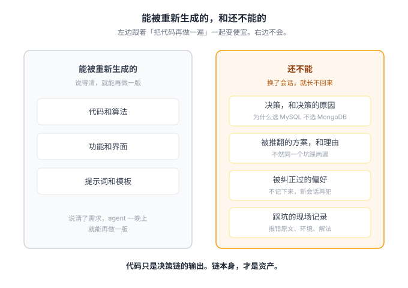

# 新时代的重要资产

> 面试面到最后，对方说了一句很短的话：「代表项目的上下文是资产，不要轻易丢失。」这篇就是沿着这句话往下挖的结果。

那场面试我记的很清楚：华科对面的泛悦城写字楼 T2，11 楼，模态空间——一家三人的 AI 初创，灵境引擎。没有笔试，没有八股。流程就三步：展示项目；追问实现细节——问得最深的不是架构，而是「你怎么把笔记融进去、让它真正有用」；然后现场 AI coding，当场写一个组件，展示你的交互方式。

当场还捡回来几条：项目开始时大骨架很重要，MVP 不是必须架构；不用把所有作品都带上，只呈现对方 JD 感兴趣的能力；处理高密度信息，比揣摩面试官的情绪有用得多。

面到最后，对方说了一句很短的话：

> **代表项目的上下文是资产，不要轻易丢失。**

这句话有分量。一家用 AI 原生方式做产品的初创，不看简历上的技术栈，把「项目的历史」当成估值的对象——他们自己每天就活在这种工作流里，这句话是他们的记账方式，不是客气话。值得往下挖。

## 一、能被重新生成的，和不能的

资产防的是「丢失」。先回答：丢的到底是什么？

代码？代码在 git 里，删了也能重写。功能？说得清的功能，一个 agent 一晚上就能再做一版。在 AI coding 的工作方式里，代码反而是最便宜的部分——它可以被重新生成。

生成不出来的，是写代码之前的那段历史：你和 Agent 的对话记录、你做过的决策、你推翻过的方案、你被纠正过的偏好。

代码丢了，让 Agent 对着决策记录重写一遍，产出还是你的东西。决策记录丢了，代码就只是一堆没有解释的符号——换个会话，你就得从零开始解释自己是谁、在做什么、为什么这样设计。

所以这句话防的不是「文件丢失」，是「决策链丢失」。能被重新生成的，和不能的，得分开看。

## 二、囤记录不等于拥有上下文

这句话先泼一盆冷水，而且冷水先泼给我自己。

我自己就是反例：几千条和 Agent 的对话记录躺在历史里，新开一个会话，我还是得从零开始解释项目背景。囤了几千条，该丢的上下文照样丢。

记录多，不等于记得住。搜到一句主题相关的话，也不等于知道它现在还适不适用。你翻一翻自己那些对话就知道，里面大部分是草稿：试错的中间态、随口提的候选方向、当场就被推翻的想法，还有大量「帮我格式化一下」这类噪音。

这个反例说明囤积没有换来记忆。它没有说明记录没用。能确定的是：**把对话囤在历史里，不会自动变成上下文。**

我把它读成对「囤积」的否定。囤积的逻辑是「怕丢，所以全存」——存储免费了，存一切好像没有成本。但检索的时候你会淹死在噪音里，真正要用的那条决策反而捞不出来。口语一点说：资产在硬盘上躺着，没有变成下次决策的输入，就等于没有。

## 三、补上来的是一份决策链

否定囤积之后，得回答：那什么才值得留下。

我从自己的记录里筛出来的，是四样。它们不是并列的清单，串起来是一条链——决策留下原因，推翻留下理由，纠正留下偏好，踩坑留下现场。

**决策，和决策的原因。** CampusOverflow 里定过两条规矩，都是当时记下了原因的。

第一条：Agent 不直连数据库，只能走白名单接口。原因是权限、事务和可审计——数据一致性这种东西，不能交给一个每次调用完就失忆的东西。

第二条，也是安全上最关键的一条：**Agent 对高风险操作只有提议权，没有执行权。** 删帖、封号、内容隐藏，它只能创建待确认工单，真实处置必须管理员本人确认。当时的理由是：AI 的判断可以错，但审计记录里最后签字的必须是人。

这两条规矩半年后都要重新划一次边界——Agent 表现得可靠，边界可以放宽；它开始犯错，边界就得收紧。而「它最近可不可靠」这个判断本身，靠的还是记录。原因要是丢了，规矩就只剩迷信：要么被我当成祖训供着，要么被我当成枷锁拆了，两头都不讲理。

**被推翻的方案，和推翻的理由。** 这是最容易被丢的，也是最贵的。没有它，你会在某个深夜把同一个坑再踩一遍，还以为在创新。

**被纠正过的偏好。** 你明确说过「以后不要这样」的东西——不记下来，它每次新会话都会再犯。

**踩坑的现场记录。** 报错原文、当时的环境、最后怎么解的。不为纪念，为的是下次同类问题直接命中。

这条链才是面试官说的那个「资产」。它是判断过程本身，代码只是它的输出。

## 四、我自己够得着的：三张表

方法论要说得着地。我在 CampusOverflow 里给 Agent 做的持久化记忆，就是这条链的产品版。

Agent 的每一次运行进 `agent_runs`，每一次工具调用进 `tool_call_logs`，沉淀下来的结论进 `agent_memory`——都通过业务后端写进 LLMWiki。Agent 本身是个无状态的家伙，它的记性全在库里。高风险操作不直接执行，先进待确认工单，管理员确认后落库。

换来三个直接的好处。新会话不再从零解释：接手任务先查记忆。出了问题能回放：当时它看到了什么、调了什么工具、为什么给这个建议。条件变化时能把搁置的事捞回来：某个方案上次因为缺一个条件暂缓了，现在条件有了，记忆里查得到，就能主动重启。

这套思路和我一直在做的记忆系统是同一个：记忆不该寄托在一次模型调用里。模型会换，会话会结束，服务会重启——能穿越这些东西存活的，只有外置的、结构化的记录。

## 五、一个测试

怎么判断自己的上下文资产够不够？给自己一个和面试同款的测试：

**如果明天你在新会话里醒来——模型换了，对话清空了——你还缺什么，才能把这个项目原样接下去？**

缺决策原因的，去补决策记录。缺纠正偏好的，去补偏好清单。缺踩坑现场的，去补坑。

缺的那部分，就是该每天记下来的东西。

## 生存智慧：奥德赛时期

前面说的都是「往哪里投注」，这一节说「在大学这个小环境里，怎么站位置」。

先给一个定位：**大学四年是你的奥德赛时期。** 不是终点线前的冲刺，是十年漂泊里的一段——奥德修斯漂了十年才回家，你在大学里要做的不是「赢」，是把这片海域探完。

然后是一句不太中听的大实话：如果你的学校背景不算好，**别天天在老师面前露头、展现能力。**

不是老师不好，是环境决定的：整个学校没几个真做科研的；说实话，就算做科研，那点产出也打不过企业实验室——多数项目本质上是吃地方财政。你在这种环境里高调，换来的往往不是机会，是画大饼：一些承诺，外加你要去组织和兜底那些水得不行比赛的责任。

这笔账很好算：**你付出的组织和兜底时间是确定的，换回来的承诺是不确定的。** 亏本买卖。

我的做法是站一个中层位置：不那么靠前，又不离开老师的视线。这个位置的好处是资源照样够得着——实验室的门开着，报销类的福利能兑现，但没人把你当成「重点培养对象」来消耗。省下来的时间干什么？更快地向多个领域试，留出整块时间读前沿信息、修炼内功。

说白了还是同一笔账：**大学里最稀缺的资产是你的时间和 attention，别把它们兑给不确定的承诺。** 这一节和前面说的「重要资产」其实是同一件事——对话记录和决策是你的资产，而你用来积累这些资产的时间，更是本金。本金都兑出去了，还攒什么资产。

## 尾声

回到开头的问题：怎样是新时代的重要资产？

不是代码——代码会被隔夜复刻。不是囤起来的聊天记录——不用它做判断，它就只是文件。

**是那条决策链：你做过的每一个决策、推翻过的每一个方案、纠正过的每一次偏好。** 它们不可复制，因为里面装的是你的判断过程本身。
