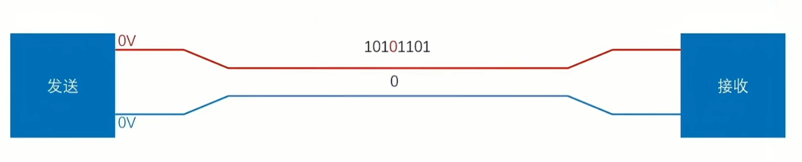
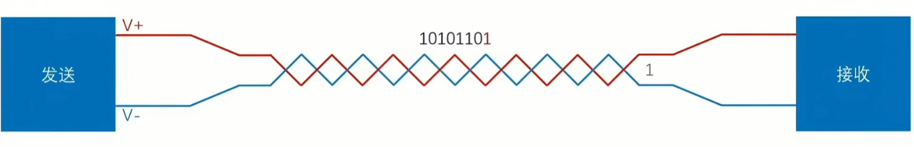
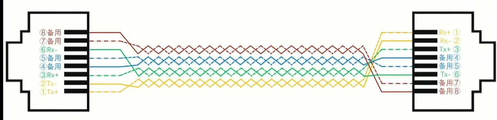
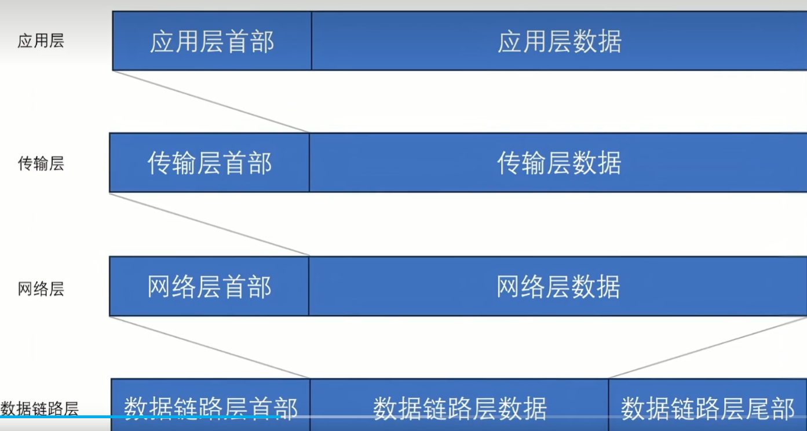
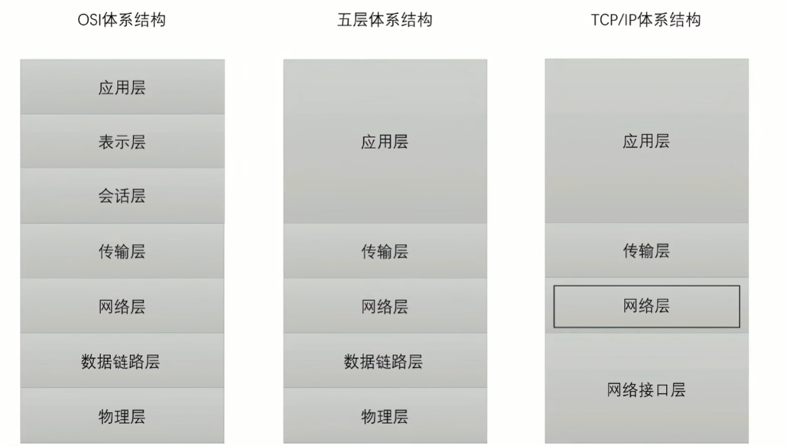
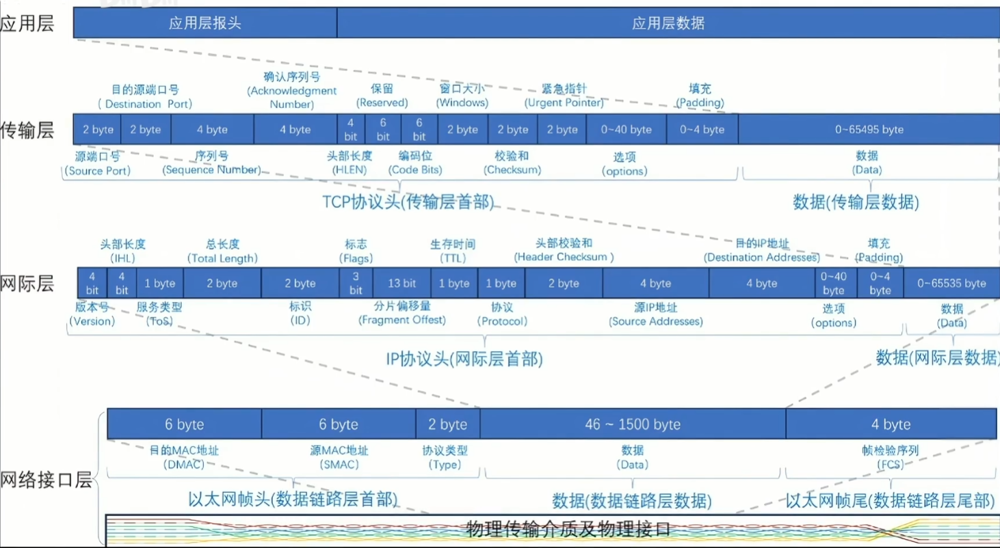
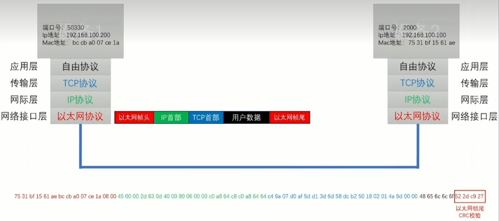

传统物理单端传输，缺点：受环境因素影响，电平波动较大，只能短途传输信息

这是差分传输，红线高于蓝线为1，否则为0，通过维护动态均等的电压差来保证传输的准确性，也称作双绞线，解决了传输举例短的问题

我们常用的网线（千兆网），通常有四组双绞线，百兆以下的网线则是两组双绞线。RX+/-是用于发送，TX+/-是用于接收，另外两组用于语音通话和备用/POE供电使用
	以上是我们物理层常用的连接方式
	

	这是物理层上的四层，而应用层数据则是我们通常意义上的message了。
而传统802局域网提出的OSI七层协议则被替代（过于繁杂难以实现），图中tcpip协议里网络层也称网际层，事实上因为把物理层和数据链路层合二为一抽象成网络接口层，这导致ip协议可以在任何设备使用

	这里网络接口层管理的是不同MAC节点与节点之间的通信，网际层是不同主机之间IP的通信，传输层是管理不同进程之间端口号与端口号之间的通信，应用层则是使用各类自由协议+传输的数据进行通信的，有趣的是，可以注意到网际层的数据65535byte但是网络接口层的数据帧约定了最多1500byte，这可怎么办呢？答案说网际层会自动切片到合适<1500byte的切片来多次传输message。我们常说的抓包是网卡后的抓包，此时无法抓到以太网帧尾，因为校验和计算完会自动丢弃。

	这是完整的信息传输过程

