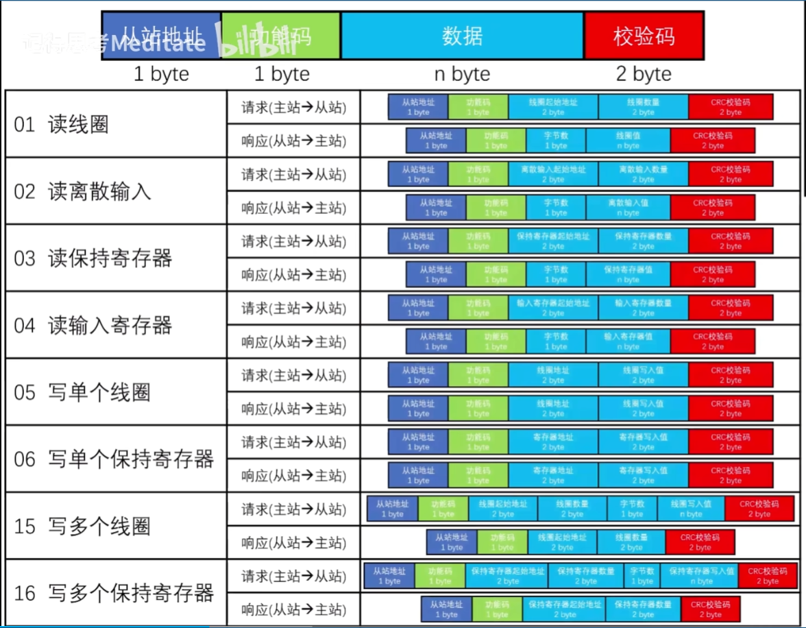
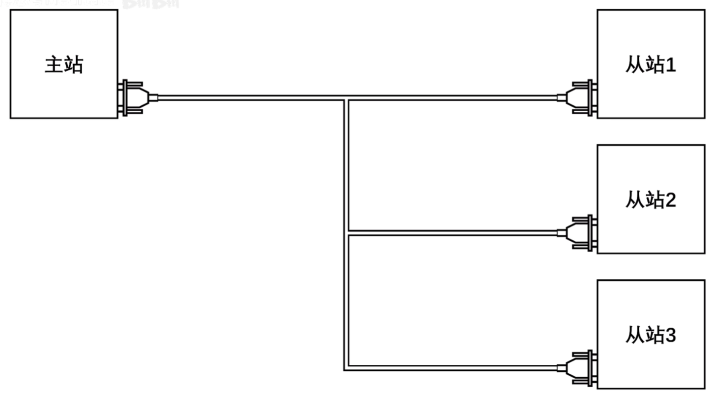
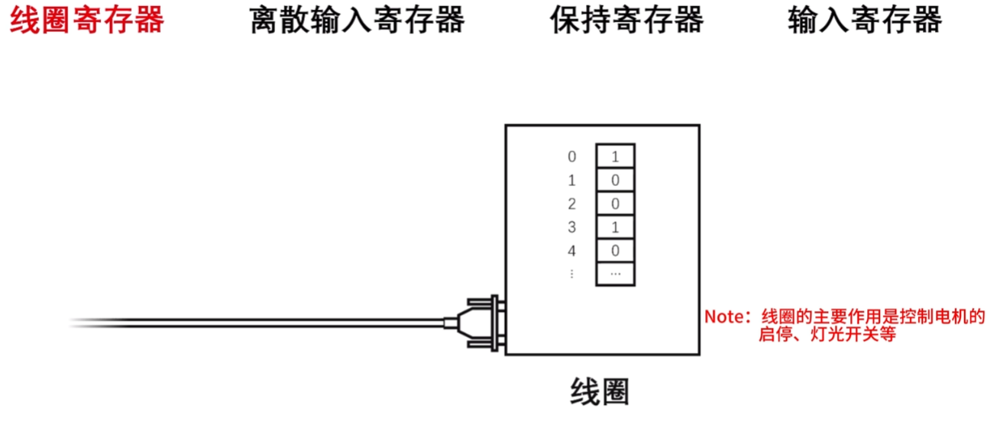
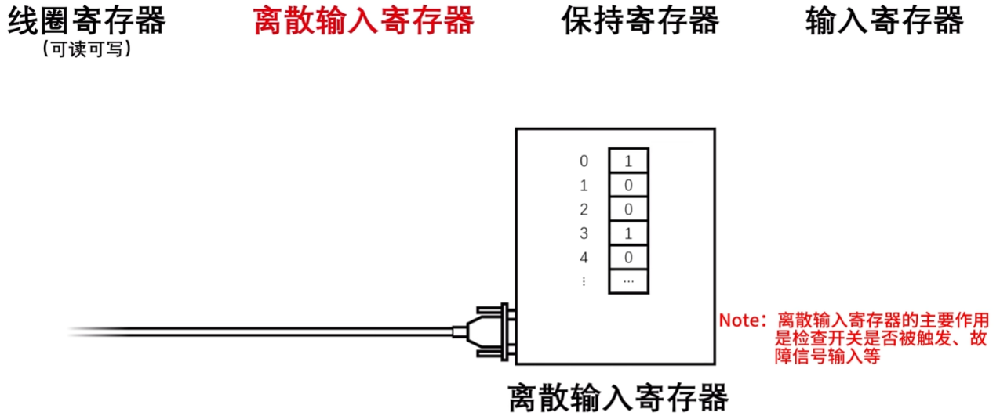
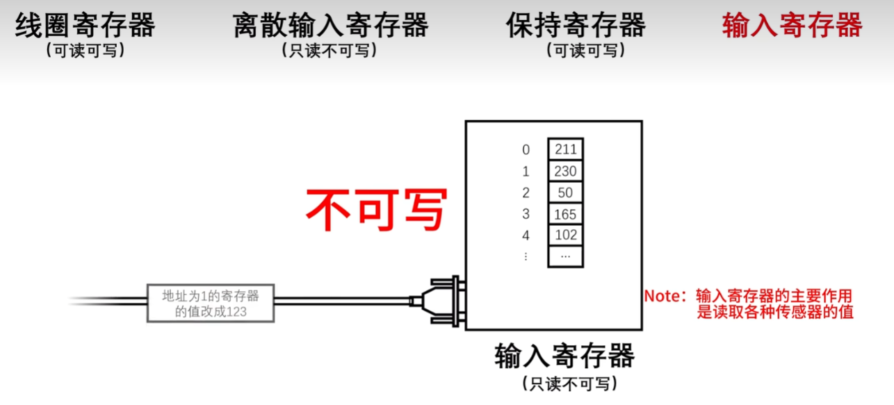
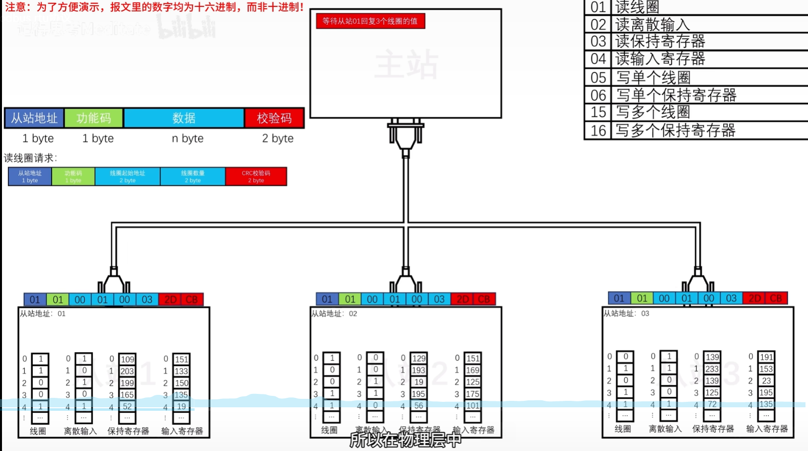

modbus-rtu是使用modbus协议的远程终端控制单元建立的，明显的特点是，他们是主从关系，并且通过rs232/485的方式来连接和传递消息。

一共有四种寄存器，分别是：线圈寄存器，离散输入寄存器，保持寄存器和输入寄存器。
	关于线圈寄存器，外部线圈可读可写，以bit为单位。
	
	关于离散输入寄存器，只读不可写，以bit为单位。
	
	关于保持寄存器，是以word(16bit)为单位的寄存器，可读可写。
	关于输入寄存器，是以word(16bit)为单位的寄存器，可读不可写。
	
操作概述

modbus协议可以有247个从站，每帧组成包括1byte从站地址，1byte功能码，n byte数据，和2byteCRC校验码，用来检验传输中是否错误。
事实上由于使用串口通讯，modbusrtu在信息发送中所有主/从站都能收到信息，但是从站会根据从站地址判断信息是否是传给自己的来选择性接入信息。当CRC校验码相等时接受请求。

