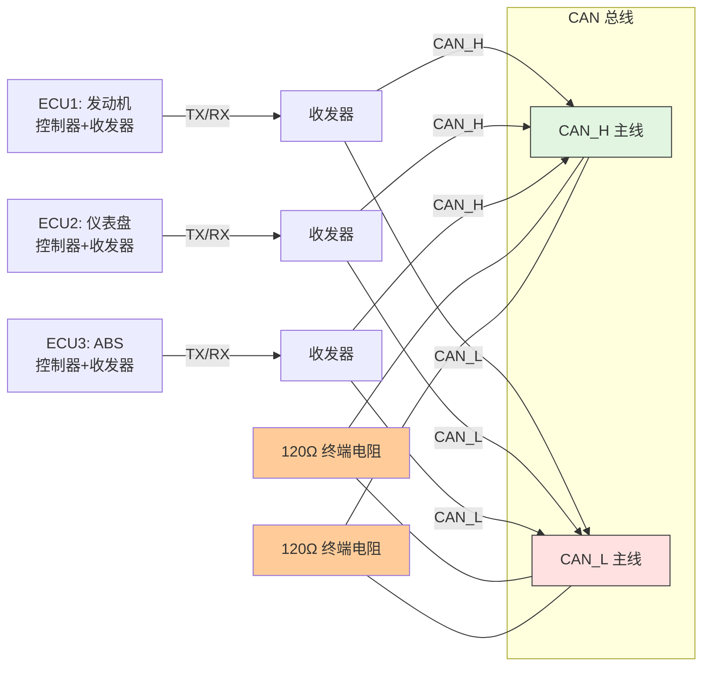
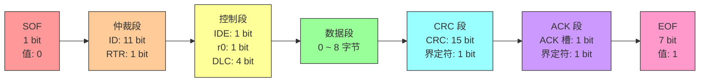
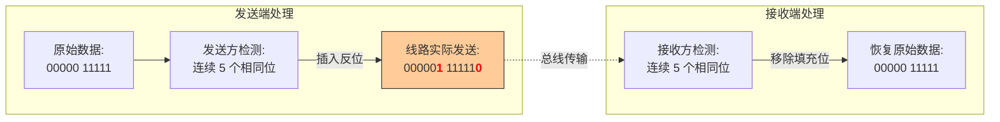
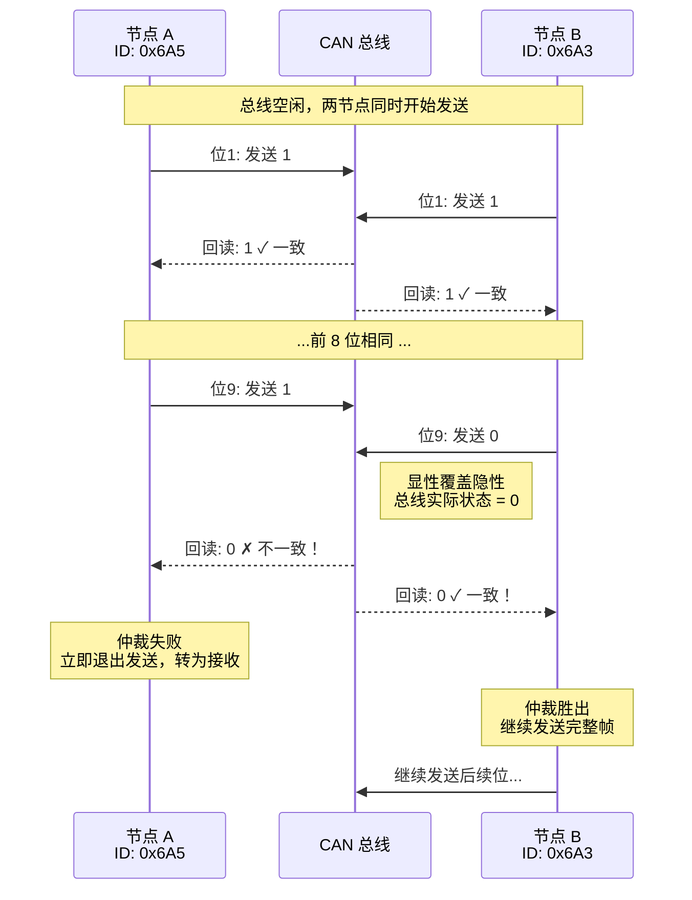
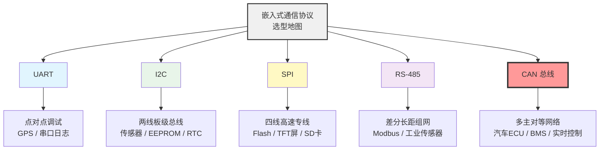

 # CAN 总线入门：汽车与工业的"神经网络"

> 前面聊了 UART、RS-485、I2C、SPI 这些"点对点/主从"通信。今天进入真正的**多主对等网络**——CAN（Controller Area Network）。它是汽车电子、工业控制、医疗设备里无处不在的"神经系统"。

---

## 目录

1. [CAN 是什么](#一can-是什么)
2. [物理层：差分信号与显性/隐性](#二物理层差分信号与显性隐性)
3. [数据帧格式](#三数据帧格式)
4. [遥控帧](#四遥控帧请求数据)
5. [位填充：给时钟"打节拍"](#五位填充给时钟打节拍)
6. [总线仲裁：谁小谁说话](#六总线仲裁谁小谁说话)
7. [ACK 机制](#七ack-机制)
8. [协议对比与选型](#八协议对比与选型)
9. [CAN 的独到之处](#九can-的独到之处)
10. [CAN FD 延伸](#十can-fd-延伸)

---

## 一、CAN 是什么

**CAN** 全称 **Controller Area Network**（控制器局域网），由博世（Bosch）在 1986 年提出。它的设计目标非常明确：

- **不需要主机**，任何设备都可以在总线空闲时主动发送
- **抗干扰极强**，专为汽车发动机舱、工厂车间等恶劣环境设计
- **高可靠性**，硬件层面自带错误检测和自动重发机制

> 如今从汽车 ECU、电池管理系统（BMS），到电梯控制、工业机器人、医疗设备，CAN 总线都是标配。

---

## 二、物理层：差分信号与显性/隐性

CAN 在物理层采用**差分传输**，使用一对双绞线：

| 信号线 | 名称 |
|--------|------|
| **CAN_H** | 高电平线 |
| **CAN_L** | 低电平线 |

CAN 不直接定义"高电平=1，低电平=0"，而是看两根线之间的**电位差**：

| 状态 | CAN_H | CAN_L | 差分电压 | 逻辑值 |
|------|-------|-------|---------|--------|
| **显性（Dominant）** | ~3.5V | ~1.5V | ≈ 2V | **逻辑 0** |
| **隐性（Recessive）** | ~2.5V | ~2.5V | ≈ 0V | **逻辑 1** |

> 注意：CAN 的逻辑是反直觉的——**有电压差（显性）= 0，无电压差（隐性）= 1**。这是为了配合后面的"线与"仲裁机制。

### 收发器与终端电阻

CAN 控制器（芯片内部）不能直接挂到总线上，中间必须加 **CAN 收发器**（如 TJA1051、SN65HVD230）。收发器负责把逻辑电平转成差分信号。

总线拓扑是**总线型**，所有设备的 CAN_H 接在一起，CAN_L 接在一起。总线**两端**必须各接一个 **120Ω 终端电阻**，用于阻抗匹配、防止信号反射。



### 线与特性

CAN 总线有一个核心特性：**显性会覆盖隐性**。

- 如果所有设备都"不说话"（隐性），总线就是隐性（逻辑 1）
- 只要**有一个**设备发送显性（逻辑 0），总线就被拉成显性

这类似于 I2C 的"线与"，但 CAN 是**差分层面**的线与。这个特性是实现"非破坏性仲裁"的基础。

---

## 三、数据帧格式

CAN 协议中，用于实际传输数据的是**数据帧**。CAN 是**广播式**的：发送方把帧丢到总线上，所有节点都能收到，由接收方自己判断要不要处理。

### 标准帧（Standard Frame，11 位 ID）



| 字段 | 长度 | 说明 |
|------|------|------|
| **SOF** | 1 bit | 起始位，固定为 **0**（显性），标志帧开始 |
| **ID** | 11 bit | 报文标识符，决定优先级，**数值越小优先级越高** |
| **RTR** | 1 bit | 0 = 数据帧，1 = 遥控帧 |
| **IDE** | 1 bit | 0 = 标准帧，1 = 扩展帧 |
| **r0** | 1 bit | 保留位，固定为 0 |
| **DLC** | 4 bit | 数据长度码，0~8，表示数据段字节数 |
| **DATA** | 0~64 bit | 实际数据，长度必须是 8 的倍数（0~8 字节） |
| **CRC** | 15 bit | 循环冗余校验，用于检错 |
| **CRC 界定符** | 1 bit | 固定为 **1**（隐性），分隔 CRC 和 ACK |
| **ACK 槽** | 1 bit | 接收方在此位发送 **0**（显性）表示"收到且正确" |
| **ACK 界定符** | 1 bit | 固定为 **1**（隐性），分隔 ACK 和 EOF |
| **EOF** | 7 bit | 帧结束，连续 7 个 **1**（隐性） |

### 扩展帧（Extended Frame，29 位 ID）

当 11 位 ID 不够用时（比如大型汽车网络），CAN 支持扩展帧：

| 字段 | 长度 | 说明 |
|------|------|------|
| **SRR** | 1 bit | 固定为 1，无实际意义，仅用于兼容标准帧格式（占位） |
| **IDE** | 1 bit | 固定为 1，表示扩展帧 |
| **ID 总长度** | 29 bit | 前 11 位 + 后 18 位 |

> 扩展帧的优先级永远低于同等前缀的标准帧，这是协议设计时故意为之的兼容性策略。

---

## 四、遥控帧：请求数据

除了数据帧，CAN 还定义了**遥控帧（Remote Frame）**。它的结构和数据帧几乎一样，但有两个关键区别：

1. **RTR = 1**
2. **没有数据段（DATA 字段）**

遥控帧的作用是**请求数据**。当节点 A 想要节点 B 的某个数据时，A 发送一个遥控帧（带上对应的数据帧 ID）。节点 B 收到后，会返回一帧**对应 ID 的数据帧**作为应答。

```
节点A: [遥控帧: ID=0x123, RTR=1, 无数据] ──→ 总线
节点B:                              ──→ [数据帧: ID=0x123, RTR=0, DATA=...]
```

---

## 五、位填充：给时钟"打节拍"

CAN 规定：发送方在发送时，如果检测到**连续 5 个相同的位**，就必须自动插入**1 个相反的位**。接收方收到后，再自动移除这个填充位。



### 为什么要位填充？

CAN 是**异步串行通信**，收发双方靠各自的时钟采样。为了保证长期同步，CAN 采用两种同步机制：

1. **硬同步（Hard Synchronization）**：检测到 SOF（起始位）的下降沿时，立即把采样点重置到该位中心
2. **再同步（Resynchronization）**：帧传输过程中，每次检测到跳变沿（0→1 或 1→0），就微调采样点

但如果数据中出现一长串连续的 0 或连续的 1，总线上就没有跳变沿，再同步就会失效，时钟漂移累积后导致采样错位。

**位填充强制制造跳变沿**，确保每 5 位至少有一次翻转，给接收方的时钟恢复电路提供"对表"的机会。

---

## 六、总线仲裁：谁小谁说话

CAN 总线是**多主结构**，任何节点都可以在总线空闲时发起通信。但如果两个节点同时开始发送，怎么办？

CAN 的解决方案是**非破坏性仲裁**（Non-destructive Arbitration）：

### 仲裁规则
1. 总线空闲时，任何节点都可以开始发送
2. 如果多个节点同时发送，它们从**报文 ID 的最高位**开始逐位比较
3. 每个节点在发送每一位的同时，**回读总线状态**
4. 如果某节点发送了**隐性 1**，但回读到**显性 0**，说明有别的节点在发 0，该节点**立即退出竞争**，转为接收方
5. 最终，**ID 数值最小的节点**（二进制 0 最多的）赢得总线，继续发送完整帧



> 因为仲裁过程中数据没有损坏，所以叫**"非破坏性"**。这是 CAN 相比以太网 CSMA/CD 的最大优势——**没有冲突、没有重发浪费**。

**RTR 位也参与仲裁**：相同 ID 下，数据帧（RTR=0）优先级高于遥控帧（RTR=1）。

---

## 七、ACK 机制

**ACK 槽是接收方回复的，不是发送方发的。**

发送方在 ACK 槽期间会释放总线（发隐性 1），如果至少有一个接收方认为 CRC 正确，就会把总线拉成显性 0。发送方回读到 0，就知道"有人收到了"。

如果发送方在 ACK 槽读到的是 1（没有任何接收方应答），它会认为自己发送失败，自动重发。

---

## 八、协议对比与选型



| 特性 | UART | RS-485 | I2C | SPI | **CAN** |
|------|------|--------|-----|-----|---------|
| **线数** | 2~3 | 2 | 2 | 4+N | 2（CAN_H/L） |
| **拓扑** | 点对点 | 总线型 | 总线型 | 星型/总线 | **总线型** |
| **主从结构** | 无 | 一主多从/多主 | 一主多从 | 一主多从 | **多主对等** |
| **寻址** | 无 | 无/轮询 | 7/10 位地址 | 片选 CS | **报文 ID（内容寻址）** |
| **仲裁机制** | 无 | 无 | 时钟拉伸 | 无 | **非破坏性位仲裁** |
| **错误检测** | 可选奇偶校验 | 无 | ACK | 无 | **CRC + ACK + 位填充 + 形式检查** |
| **最大速率** | 1 Mbps | 10 Mbps | 3.4 Mbps | 几十 MHz | **1 Mbps（CAN 2.0）/ 5 Mbps（CAN FD）** |
| **最大距离** | 15m | 1200m | 1m | 30cm | **1km@50kbps / 40m@1Mbps** |
| **抗干扰** | 弱 | 强（差分） | 弱 | 弱 | **极强（差分+协议级容错）** |
| **广播能力** | 点对点 | 可广播 | 支持 | 不支持 | **原生广播，内容寻址** |
| **典型场景** | 调试、GPS | 工业传感器组网 | 板级传感器 | Flash/屏高速读写 | **汽车 ECU、BMS、工业控制** |

---

## 九、CAN 的独到之处

### 1. 内容寻址，不是设备寻址
传统协议（I2C、SPI、Modbus）是"找某个设备，读某个寄存器"。CAN 是"发一条 ID 为 0x123 的数据，谁关心谁就拿走"。这种**发布-订阅**模型非常适合汽车：发动机发转速帧，仪表盘、变速箱、ESP 都可以同时订阅，不需要发动机知道谁在听。

### 2. 错误自动处理
CAN 控制器内置**错误计数器**。如果某个节点频繁出错，它会自动从"主动报错"退到"被动监听"，甚至"总线关闭"（Bus Off），避免一个坏节点拖垮全网。

### 3. 实时性保证
因为仲裁是确定性的（ID 越小优先级越高，且可预测），CAN 非常适合**硬实时系统**。汽车刹车信号的 ID 通常设得极小，确保它永远能第一时间抢到总线。

---

## 十、CAN FD 延伸

传统 CAN（CAN 2.0）最高 1 Mbps，数据段最多 8 字节，在汽车智能化时代渐渐不够用了。于是有了 **CAN FD**（Flexible Data-rate）：

- 仲裁段保持 1 Mbps 兼容老设备
- 数据段可提速到 2~8 Mbps
- 数据段长度扩展到 64 字节
- CRC 校验增强

再往后还有 **CAN XL**，数据段可达 2048 字节，速率 10 Mbps+，开始向以太网领地渗透。

---

## 总结

| 概念 | 一句话理解 |
|------|-----------|
| **显性/隐性** | 有差分=0（显性，能覆盖别人），无差分=1（隐性，会被覆盖） |
| **终端电阻** | 总线两端各 120Ω，防信号反射，稳定隐性电平 |
| **标准帧/扩展帧** | 11 位 ID 够用选标准，不够用选 29 位扩展 |
| **遥控帧** | 不带数据的"求数据"请求，RTR=1 |
| **ACK 槽** | 接收方在此位拉低总线，告诉发送方"我收到了" |
| **位填充** | 每 5 个相同位强插一个反位，提供跳变沿用于时钟同步 |
| **非破坏性仲裁** | ID 小的赢，输家自动退赛，不损坏数据 |
| **内容寻址** | 不关心谁发的，关心这条数据是什么（看 ID） |

---

*如果说 SPI 是板级高速专线，I2C 是板级经济公交，RS-485 是工业长距干线，那么 CAN 就是汽车与工业现场里那张去中心化的神经网络——没有老大，人人平等，谁急谁先讲，讲错了自动纠错。搞懂它，你就摸到了现代嵌入式分布式系统的脉搏。*